> **Nota:** esta é uma tradução automática do README.md na versão v0.40.0 que ainda não foi revista por nenhum falante nativo. O README em inglês é a referência. [English](README.md)

<!-- As imagens em docs/assets/readme/ são geradas a partir de execuções reais do motor por
     tools/gen_readme_assets.py (variantes clara e escura); gere-as novamente com
     `python3 tools/gen_readme_assets.py --kshana <path to kshana>` e verifique com `--check`.
     As capturas de tela do Kshana Studio em docs/assets/readme/studio/ são feitas a partir do
     Studio em execução por tools/capture_studio_shots.mjs e registradas em studio/SHOTS.json. -->

<p align="center">
  <picture>
    <source media="(prefers-color-scheme: dark)" srcset="docs/assets/readme/kshana-logo-dark.svg">
    <source media="(prefers-color-scheme: light)" srcset="docs/assets/readme/kshana-logo-light.svg">
    
  </picture>
</p>

<p align="center">
  <strong>Kshana · <span lang="sa">क्षण</span> · <em>o instante preciso</em></strong><br>
  Um simulador de código aberto para a resiliência de PNT (posicionamento, navegação e temporização).
</p>

<p align="center">
  <a href="https://github.com/ashfordeOU/kshana/actions/workflows/ci.yml"></a>
  <a href="docs/COVERAGE.md"></a>
  <a href="#evidence"></a>
  <a href="https://sonarcloud.io/summary/overall?id=ashfordeOU_kshana"></a>
  <a href="https://github.com/ashfordeOU/kshana/releases"></a>
  <a href="docs/i18n.md"></a>
  <a href="LICENSE"></a>
  <br>
  <a href="https://doi.org/10.5281/zenodo.20528627"></a>
  <a href="#editions"></a>
  <a href="https://crates.io/crates/kshana"></a>
  <a href="https://pypi.org/project/kshana/"></a>
  <a href="https://www.npmjs.com/package/kshana"></a>
</p>

<p align="center">
  <a href="https://kshana.dev">Abrir o Kshana Studio</a> ·
  <a href="#install">Instalar</a> ·
  <a href="#capabilities">Capacidades</a> ·
  <a href="#evidence">Evidências</a> ·
  <a href="#research">Pesquisa</a> ·
  <a href="docs/CONCEPTS.md">Documentação</a> ·
  <a href="#cite">Citar</a>
</p>

<p align="center">
  <strong>Idiomas:</strong> <a href="README.md">English</a> ·
  <a href="README.nl.md"><span lang="nl">Nederlands</span></a> ·
  <a href="README.pl.md"><span lang="pl">Polski</span></a> ·
  <a href="README.pt-BR.md"><span lang="pt-BR">Português (Brasil)</span></a> ·
  <a href="README.pt-PT.md"><span lang="pt-PT">Português (Portugal)</span></a> ·
  <a href="README.fi.md"><span lang="fi">Suomi</span></a> ·
  <a href="README.sv.md"><span lang="sv">Svenska</span></a> ·
  <a href="README.da.md"><span lang="da">Dansk</span></a> ·
  <a href="README.nb.md"><span lang="nb">Norsk bokmål</span></a> ·
  <a href="README.cs.md"><span lang="cs">Čeština</span></a> ·
  <a href="README.uk.md"><span lang="uk">Українська</span></a> ·
  <a href="README.ru.md"><span lang="ru">Русский</span></a> ·
  <a href="README.de.md"><span lang="de">Deutsch</span></a> ·
  <a href="README.fr.md"><span lang="fr">Français</span></a> ·
  <a href="README.es.md"><span lang="es">Español</span></a> ·
  <a href="README.et.md"><span lang="et">Eesti</span></a> ·
  <a href="README.ja.md"><span lang="ja">日本語</span></a> ·
  <a href="README.zh-Hans.md"><span lang="zh-Hans">简体中文</span></a><br>
  <sub>A linha de comando, os resumos de execução, os gráficos e os relatórios falam cada idioma com <code>--lang &lt;tag&gt;</code>
  (por exemplo <code>kshana scenarios/holdover-test-example.toml --lang de</code>), assim como as superfícies Python, WebAssembly e MCP.
  São traduções automáticas que ainda não foram revistas por nenhum falante nativo; o inglês é a referência.
  Veja <a href="docs/i18n.md">Localização</a>.</sub>
</p>

<picture>
  <source media="(prefers-color-scheme: dark)" srcset="docs/assets/readme/hero-dark.svg">
  <source media="(prefers-color-scheme: light)" srcset="docs/assets/readme/hero-light.svg">
  
</picture>

<details>
<summary><strong>Conteúdo</strong></summary>

- [Ensaie o minuto em que o GNSS se apaga](#rehearse-the-minute-gnss-goes-dark)
- [Novidades da 0.40](#whats-new-in-040), [Novidades da 0.39](#whats-new-in-039), [Novidades da 0.38](#whats-new-in-038) e [0.38 em detalhe](#038-in-depth): pontuação do jammertest, os próprios indicadores do receptor, entradas de máquina, temporização e holdover, pacotes de normas, LunaNet AFS, a ida e volta com o laboratório, kshana-bench, o observatório, exportadores, óptica, [navegação de usuários espaciais](#space-user-navigation-gnss-ssv) e [infraestrutura lunar](#lunar-infrastructure-lunar-infrastructure)
- [Kshana Studio](#kshana-studio) e cada página do Studio
- [Capacidades](#capabilities): a tabela de áreas, [cada tipo de cenário por família](#every-scenario-kind-by-family), [cada comando](#every-command), [cada superfície](#every-surface)
- [Como funciona uma execução](#how-a-run-works), [Missões](#missions)
- [Evidências](#evidence): o registro, [domínios de capacidade](#capability-domains)
- [Instalar](#install), [Arquitetura](#architecture) (e os [diagramas](#diagrams)), [Assistente de IA](#ai-assistant)
- [Edições](#editions), [Pesquisa](#research), [Citar](#cite), [Licença](#licence)
- [Referência](#reference): uso, formato de cenário, saída, estrutura do repositório, perguntas frequentes, solução de problemas, versionamento, roteiro, contribuição, documentação

</details>

<a id="rehearse-the-minute-gnss-goes-dark"></a>
## Ensaie o minuto em que o GNSS se apaga

O Kshana reproduz interferência intencional (jamming), falsificação de sinal (spoofing) e holdover de relógio quando os sinais GNSS (Global Navigation Satellite
System) falham, e diz por quanto tempo um sistema mantém o tempo e a posição dentro do seu
orçamento, e qual relógio ou sensor garante a maior margem. É um único motor em Rust. Ele roda em um
terminal, em um notebook, em uma IDE (ambiente de desenvolvimento integrado), em um assistente de IA (inteligência
artificial) ou no seu navegador.

Cada execução é reproduzível bit a bit a partir do cenário, da semente e da versão do motor.
Cada capacidade carrega um de três rótulos em um registro verificado por máquina: **VALIDATED** (uma
referência externa independente concorda), **MODELLED** (internamente consistente, e dito abertamente)
ou **PARTNER** (um parceiro de hardware é responsável).

> **Estado: v0.40.0.** Um substrato de simulação validado e reproduzível para a resiliência de PNT.
> A temporização e o holdover vêm primeiro, porque é o domínio mais bem validado. O Kshana é um
> instrumento de estudo e de análise de compromissos: não é hardware gerador de sinais de radiofrequência (RF) (ele
> não aciona nenhum rádio e não transmite nada; sua saída em nível de sinal são arquivos de amostras IQ em banda base
> para receptores de software), não é um receptor GNSS de hardware nem certificado (seu receptor de software
> é uma ferramenta de análise) e não é um produto de voo. É novo na área? Comece pelo
> [guia em linguagem simples](docs/CONCEPTS.md) e pelo [glossário](docs/GLOSSARY.md).

<a id="whats-new-in-040"></a>
## Novidades da 0.40

A 0.40 acrescenta um orçamento de erro em nível de missão, rotula cada figura e tabela com o seu nível de evidência, lê logs de relógio medidos,
verifica submissões de parceiros de dados, estima onde um emissor de interferência pode estar e fala dezessete idiomas além do inglês.
O registro tem agora 401 linhas: 176 VALIDATED, 221 MODELLED, 4 PARTNER. Nenhuma linha foi promovida a VALIDATED, e cada falha abaixo é
fixada por um teste.

- **Fio de missão.** O tipo `mission-thread` encadeia fases do lançamento à reentrada (`launch-ascent`, `leo-rendezvous`,
  `tli-and-cruise`, `entry` e quatro tipos lunares) com regras de transferência declaradas, uma margem frente a requisitos declarados e o elo
  mais fraco; um exemplo de ponta a ponta de classe Artemis ao longo de 11 fases (segmentos terrestre e lunar), 92 tipos de cenário ao todo. Cada número é MODELLED. A propagação cislunar frente à trajetória pública do Artemis I
  **não atinge** o seu limiar pré-registrado (45.3 km e 0.25 m/s frente a 5 km e 0.05 m/s; a causa são pequenas manobras que o modelo não inclui), e o propagador lunar frente à órbita do CAPSTONE
  **não atinge** o limiar (136.8 km frente a 25 km ao fim de uma revolução); a comparação com o LRO é atingida. As linhas continuam MODELLED
  ([Fio de missão](docs/MISSION-THREAD.md), [segmento lunar](docs/MISSION-THREAD-LUNAR.md)). No Studio, o fio é lido em `/studio/mission-thread/`.
- **Rótulos de evidência.** Cada figura e tabela que uma execução escreve traz o nível e os ids das linhas do registro em que se apoia, lidos da matriz.
- **Relógios medidos.** Oito formatos de log de relógio são lidos ([`docs/CLOCK-LOG-FORMATS.md`](docs/CLOCK-LOG-FORMATS.md)) e uma
  série ajustada pode conduzir o holdover. Frente aos limiares pré-registrados, o ajuste **não atinge** F1(a) em cinco de seis registros e F2 em um; ambos
  continuam MODELLED ([Changelog](CHANGELOG.md#0400---2026-10-29)).
- **Parceiros de dados.** `kshana partner check` verifica o formato de uma submissão e não pontua nada ([`docs/PARTNER-DATA.md`](docs/PARTNER-DATA.md)).
- **Região do emissor.** `kshana interference-map locate` fornece uma região e uma elipse, nunca um ponto isolado, a partir de relatos ADS-B ou AIS.
  Comparado uma vez com os locais dos transmissores do Jammertest 2025, o resultado é **NOT ASSESSABLE** para as duas fontes (poucas
  sessões programadas nos dados abertos), por isso a linha continua MODELLED ([Mapa de interferência](docs/INTERFERENCE-MAP.md#emitter-region-interference-map-locate)).
- **Benchmark.** A nova campanha da 0.40 atinge A3, D3 (ambos EXPLORATORY), R3 e R4; A2, D1 e R1 continuam NOT MET ([Bench](docs/BENCH.md)).
- **Idiomas.** nl, pl, pt-BR, pt-PT, fi, sv, da, nb, cs, uk, ru, de, fr, es, et, ja e zh-Hans, como **traduções automáticas que nenhum falante
  nativo revisou**; o inglês é a referência, e as execuções em outros idiomas levam cerca do dobro do tempo
  ([`docs/i18n.md`](docs/i18n.md)).

<a id="whats-new-in-039"></a>
## Novidades da 0.39

A 0.39 não acrescenta nenhuma funcionalidade e não altera nenhum resultado; a saída do motor é a saída da 0.38. Ela corrige uma coisa
na linha de comando, atualiza dependências das ferramentas de validação cruzada e declara por completo os veredictos
do benchmark.

- **Linha de comando.** `kshana kinds | head` (qualquer saída padrão fechada) já não gera pânico: o programa termina
  silenciosamente com o status 141, como fazem outras ferramentas para um pipe fechado. Outros erros de escrita continuam sendo reportados.
- **Dependências.** `memmap2` 0.9.11 nos dois locks de verificação cruzada do ANISE e `pillow` 13.0.0 e
  `certifi` 2026.10.19 nas versões fixadas do ambiente da referência independente, tudo em `xval/`: nada do que é distribuído mudou.
- **kshana-bench, todos os veredictos.** Frente aos limiares pré-registrados, três são NOT MET, cada um fixado por um teste:
  A2 (`agc_k_sigma` AUC 0.766 frente a pelo menos 0.80), D1 (maior lacuna 0.0301) e a tarefa (b) R1 (transportada,
  não executada de novo). Nenhum limiar foi afrouxado ([Bench](docs/BENCH.md)).

<a id="whats-new-in-038"></a>
## Novidades da 0.38

A 0.38 torna o árbitro neutro mensurável: ela pontua logs de receptores frente a um cronograma de testes
publicado, lê mais receptores e sensores, testa sistemas de temporização e distribui um benchmark e um
observatório de interferência. Continua sendo consultiva: nada aqui é certificado, nenhum resultado é uma homologação,
e nada transmite. Cada linha declara o que o registro contém para ela ([como um rótulo é conquistado](#evidence));
um estado nomeia apenas o que foi verificado, e a linha do registro e a página vinculada dizem o que não foi.

| Novo na 0.38 | O que faz, e por quê | Estado no registro | Leia |
|---|---|---|---|
| **Pontuação do Jammertest** | `kshana jammertest import` lê o catálogo de testes e o plano de transmissão publicados pela NPRA como verdade programada; `jammertest score` pontua um log de receptor por teste (latência de detecção, alarmes perdidos, alarmes falsos, tempo até a recuperação), como um pacote de evidências assinado se você fornecer uma chave | **MODELLED**: uma linha do registro. Os limiares foram pré-registrados antes de qualquer execução pontuada; nos dados do JammerTest 2024 a regra de dados mínimos falhou nas duas execuções (4 e 7 janelas pontuáveis frente a 10 exigidas), por isso **nenhum limiar é avaliável** e nada é afirmado | [Jammertest](docs/JAMMERTEST.md) |
| **Os próprios indicadores do receptor** | UBX-NAV-STATUS `spoofDetState`, UBX-SEC-SIG e NovAtel RXSTATUS lidos em um `self_report` por época e comparados com os alarmes do Kshana (ambos, só o receptor, só o Kshana, nenhum); um leitor de SBF da Septentrio e uma entrada `--serial` somente leitura | **MODELLED**; a concordância entre o detector de um receptor e o do Kshana não é validação | [Confiança no receptor](docs/RECEIVER-TRUST.md) |
| **Mais receptores e sensores** | RTKLIB `.pos`, NovAtel OEM7, C/N0 de RTCM 3 MSM4/MSM7 (a partir das tabelas do pyrtcm, sob licença BSD, não do texto da RTCM), fluxos de monitoramento do GNSS-SDR, um log de IMU como segundo sensor, um pacote ROS 2, uma ponte `gnss_lib_py` e `imu-fit` para parâmetros de sensores híbridos | **MODELLED**: seis linhas do registro; apenas fixtures escritas pelo próprio projeto, nenhuma captura de um receptor real, IMU, execução do GNSS-SDR ou grafo ROS foi lida | [Entradas de máquina](docs/MACHINE-INPUTS.md) |
| **Testes de temporização e holdover** | o tipo `holdover-test` pontua um teste de holdover (GNSS removido pelo operador, holdover, recuperação) a partir de um registro medido de erro de tempo frente às máscaras ITU-T, "medido frente à máscara"; leitores de logs do linuxptp e do chrony; os estágios de hardware e o campo `lab-attestation` | **MODELLED**: duas linhas do registro; os horários são declaração do operador, não verificados | [Timing HIL](docs/TIMING-HIL.md), [Segurança do hardware](docs/HARDWARE-SAFETY.md) |
| **Pacotes de normas, LunaNet AFS, ida e volta com o laboratório** | pacotes pontuados para DHS RPCF, IMO MSC.1/Circ.1575 e ICAO Doc 9849 Appendix F frente a limiares declarados antes da execução, "fornece evidências para"; um quadro de correspondência com o NIST IR 8323r1; um gerador e verificador de código LunaNet AFS; um pacote assinado que liga o cenário de uma execução de laboratório, as condições de teste, o log do receptor e a pontuação | **MODELLED** para os pacotes e a ida e volta; a verificação do código AFS é **VALIDATED** frente às suas colunas de verificação impressas (veja as linhas do registro) | [Normas](docs/STANDARDS.md), [LunaNet AFS](docs/LUNANET-AFS.md) |
| **kshana-bench e o observatório** | tarefas, divisões e métricas fixas para detecção de interferência, detecção em IQ, previsão de holdover e a lacuna de otimismo, com um conjunto reservado selado e um placar estático; um produto diário e reproduzível de interferência com atraso de 24 h, células grosseiras e nenhuma atribuição | nenhuma linha do registro própria: ele pontua submissões, e as suas linhas de base são rotuladas MODELLED nos arquivos de resultado; frente aos limiares pré-registrados, o pontuador, C1 a C3 e D2 são atingidos e três limiares são **NOT MET** (fixados por testes): A2 (`agc_k_sigma` AUC 0.766 frente a pelo menos 0.80 na divisão de teste), D1 (maior lacuna 0.0301) e a tarefa (b) R1 (transportada, não executada de novo); veja `xval/bench/RESULTS-v2.md` | [Bench](docs/BENCH.md), [Observatório](docs/observatory/METHOD.md) |
| **Exportadores** | telemetria de confiança como mensagens de descoberta e de estado MQTT do Home Assistant (somente publicação, sem credenciais) ao lado de Prometheus, CEF, LEEF e OTLP | **MODELLED**: uma linha do registro | [Telemetria de confiança](docs/TRUST-TELEMETRY.md) |
| **Margem do enlace óptico ao longo do tempo** | o tipo `optical-atmosphere` pode escrever uma realização com semente do clima de um local como uma série de margem de enlace | **MODELLED**: uma linha do registro; uma amostra do modelo, não o clima | [Atmosfera óptica](docs/OPTICAL-ATMOSPHERE.md) |

Destaques da 0.37: [changelog](CHANGELOG.md#0370---2026-10-17). A lista completa da 0.38 está no
[changelog](CHANGELOG.md#0380---2026-10-19).

<a id="038-in-depth"></a>
## 0.38 em detalhe

Cada capacidade da tabela acima, em poucas linhas: o que faz, um comando para executá-la, uma
imagem desenhada a partir de uma execução real do motor e o que o registro contém para ela. As imagens
são escritas por [`tools/gen_figures_038.py`](tools/gen_figures_038.py) em
[`docs/figures/0.38/`](docs/figures/0.38/) (nunca desenhadas à mão): `python3 tools/gen_figures_038.py`
as reescreve a partir de um motor compilado, e `--check` falha se uma estiver desatualizada ou se a sua legenda aqui for diferente.
Quando uma entrada é um log, trata-se de um log inventado que o script escreve, porque os logs reais de terceiros
nunca são incluídos no repositório, e a legenda diz isso. Tudo abaixo é consultivo: não é certificado, não é uma
homologação, e nada transmite. Um estado nomeia o que foi verificado e nada mais;
[como um rótulo é conquistado](#evidence).

### Pontuação do Jammertest

`kshana jammertest import` transforma o catálogo de testes e o plano de transmissão publicados pela NPRA em
verdade programada, e `kshana jammertest score` pontua um log de receptor frente a ela: para cada
teste programado, se foi detectado, com quanto atraso e quanto tempo o receptor levou para se recuperar, além dos
alarmes falsos fora de todos os intervalos. O catálogo é baixado, nunca incluído no repositório.

```sh
xval/jammertest-plan/fetch.sh ../jammertest-plan
kshana jammertest score session.toml --catalog ../jammertest-plan/testcatalog2025.json \
    --plan ../jammertest-plan/plan-tuesday-2025-09-16.json --location 1 --json
```

<picture>
  <source media="(prefers-color-scheme: dark)" srcset="docs/figures/0.38/jammertest-dark.svg">
  <source media="(prefers-color-scheme: light)" srcset="docs/figures/0.38/jammertest-light.svg">
  
</picture>

**Estado no registro: MODELLED.** Os limiares foram fixados antes de qualquer execução pontuada; nos dados do JammerTest 2024
a regra de dados mínimos falhou nas duas execuções, por isso nenhum limiar é avaliável e nada é afirmado.
[Jammertest](docs/JAMMERTEST.md).

### Os próprios indicadores do receptor

UBX-NAV-STATUS `spoofDetState`, UBX-SEC-SIG e NovAtel RXSTATUS são lidos em um `self_report` por época
e colocados ao lado dos alarmes do Kshana: ambos, só o receptor, só o Kshana, ou nenhum. Um
leitor de SBF da Septentrio e uma entrada `--serial` somente leitura alimentam a mesma comparação. Nenhum dos lados é
a verdade de referência.

```sh
kshana receiver-trust session.toml     # [log] format = "ubx", path = "receiver.ubx"
```

<picture>
  <source media="(prefers-color-scheme: dark)" srcset="docs/figures/0.38/receiver-flags-dark.svg">
  <source media="(prefers-color-scheme: light)" srcset="docs/figures/0.38/receiver-flags-light.svg">
  
</picture>

**Estado no registro: MODELLED.** A concordância entre o detector de um receptor e o do Kshana não é
validação. [Confiança no receptor](docs/RECEIVER-TRUST.md).

### Mais receptores e sensores

RTKLIB `.pos`, NovAtel OEM7, C/N0 de RTCM 3 MSM4/MSM7, fluxos de monitoramento do GNSS-SDR, um log de IMU como segundo
sensor, um pacote ROS 2 e uma ponte `gnss_lib_py` terminam todos na mesma linha do tempo de confiança no receptor.
`imu-fit` lê de um log de IMU estacionária os parâmetros de sensor de que os cenários híbridos e de fusão precisam,
para que um cenário possa ser executado com o sensor que você realmente tem.

```sh
kshana imu-fit still.csv --format csv --axis x --expected-mean 0 --id bench-imu
```

<picture>
  <source media="(prefers-color-scheme: dark)" srcset="docs/figures/0.38/machine-inputs-dark.svg">
  <source media="(prefers-color-scheme: light)" srcset="docs/figures/0.38/machine-inputs-light.svg">
  
</picture>

**Estado no registro: MODELLED.** Apenas fixtures escritas pelo próprio projeto; nenhuma captura de um receptor real, IMU,
execução do GNSS-SDR ou grafo ROS foi lida. [Entradas de máquina](docs/MACHINE-INPUTS.md).

### Testes de temporização e holdover

O tipo `holdover-test` pontua um teste de holdover (GNSS removido pelo operador, holdover, recuperação)
a partir de um registro medido de erro de tempo frente às máscaras ITU-T, e diz isso com estas palavras: medido
frente à máscara. Leitores de logs do linuxptp e do chrony o alimentam; os estágios de hardware e o campo
`lab-attestation` dizem quem declarou o quê.

```sh
kshana scenarios/holdover-test-example.toml
```

<picture>
  <source media="(prefers-color-scheme: dark)" srcset="docs/figures/0.38/timing-dark.svg">
  <source media="(prefers-color-scheme: light)" srcset="docs/figures/0.38/timing-light.svg">
  
</picture>

**Estado no registro: MODELLED.** Os horários em que o GNSS foi removido e restabelecido são declaração do operador,
não verificados. [Timing HIL](docs/TIMING-HIL.md), [Segurança do hardware](docs/HARDWARE-SAFETY.md).

### Pacotes de normas

Pacotes pontuados para os perfis de teste DHS Resilient PNT, IMO MSC.1/Circ.1575 e ICAO Doc 9849
Appendix F, além de um quadro de correspondência com o NIST IR 8323r1 em `compliance-report`. Cada teste executa um
cenário incluído e compara um campo do resultado com um limiar declarado antes da execução; um teste que precisa de um log de
receptor é listado como precisando de uma entrada, não pontuado. A formulação é "fornece evidências para".

```sh
kshana standards-pack list
kshana standards-pack run imo-circ-1575
```

<picture>
  <source media="(prefers-color-scheme: dark)" srcset="docs/figures/0.38/standards-dark.svg">
  <source media="(prefers-color-scheme: light)" srcset="docs/figures/0.38/standards-light.svg">
  
</picture>

**Estado no registro: MODELLED.** Um limiar atingido diz que um cenário modelado atingiu um limiar declarado, nada sobre um
produto; cada falha é mantida e fixada por um teste. [Normas](docs/STANDARDS.md).

### LunaNet AFS

O gerador de código do LunaNet Augmented Forward Signal (códigos Gold, Weil e terciários, o quadro de
mensagem e a sua codificação de erros) e um verificador para um fluxo de símbolos gravado ou gerado, fixados a uma
edição da especificação.

```sh
kshana lunanet-afs-check spec
kshana lunanet-afs-check generate --frames 2 --out afs.sym
kshana lunanet-afs-check symbols afs.sym
```

<picture>
  <source media="(prefers-color-scheme: dark)" srcset="docs/figures/0.38/lunanet-afs-dark.svg">
  <source media="(prefers-color-scheme: light)" srcset="docs/figures/0.38/lunanet-afs-light.svg">
  
</picture>

**Estado no registro: VALIDATED** para as verificações de código e de sincronização, frente aos valores que a
especificação imprime (que ela marca como TBC); uma verificação é NOT MET, mantida e fixada (uma coluna impressa
de código terciário difere: o documento imprime o mesmo valor para dois PRNs). As palavras LDPC e CRC
dos subquadros 2 a 4 não são verificadas. As linhas do registro dizem exatamente quais. [LunaNet AFS](docs/LUNANET-AFS.md).

### Ida e volta com o laboratório

`kshana.test-conditions/1` é uma descrição publicada do que um laboratório fez (eventos, horários,
potências). `kshana evidence round-trip` liga o hash do cenário, o hash das condições, o hash do log do receptor
e a pontuação em um único pacote assinado, e recusa um pacote cujas condições e cujo cenário de pontuação
discordem sobre os eventos. O Kshana nunca produz nem reproduz um sinal: como um cenário chegou a um
receptor é responsabilidade do operador.

```sh
kshana evidence --help
```

<picture>
  <source media="(prefers-color-scheme: dark)" srcset="docs/assets/readme/evidence-pack-dark.svg">
  <source media="(prefers-color-scheme: light)" srcset="docs/assets/readme/evidence-pack-light.svg">
  
</picture>
A imagem é a estrutura de um pacote. **Estado no registro: MODELLED.**
[Condições de teste](docs/spec/TEST-CONDITIONS.md), [Bancada de testes](docs/TEST-BENCH.md).

### kshana-bench

Tarefas, divisões e métricas fixas para detecção de interferência, detecção em IQ, previsão de holdover e
a lacuna de otimismo, com um conjunto reservado selado e um placar estático. Ele pontua submissões; não é
uma classificação de receptores.

```sh
kshana bench baseline --task d --split test --out results/
```

<picture>
  <source media="(prefers-color-scheme: dark)" srcset="docs/figures/0.38/bench-dark.svg">
  <source media="(prefers-color-scheme: light)" srcset="docs/figures/0.38/bench-light.svg">
  
</picture>

**Estado no registro:** nenhuma linha do registro própria; as linhas de base são rotuladas MODELLED nos arquivos de resultado.
Frente aos limiares pré-registrados, o pontuador, C1 a C3 e D2 são atingidos e três limiares são NOT MET, cada um
fixado por um teste: A2 (`agc_k_sigma` AUC 0.766 frente a pelo menos 0.80 na divisão de teste), D1 (maior lacuna
0.0301) e a tarefa (b) R1 (transportada da campanha anterior, não executada de novo). Os números estão em
[`xval/bench/RESULTS-v2.md`](xval/bench/RESULTS-v2.md). [Bench](docs/BENCH.md).

### Observatório de interferência

Um produto por dia UTC e por região a partir de um arquivo aberto de posições de aeronaves, em uma grade grosseira fixa:
cada célula está degradada, não degradada ou não observada (o que não é "livre"). Publicado no mínimo
24 h após o fim do dia, com células pequenas suprimidas e nenhuma atribuição de causa.

```sh
kshana interference-map daily /path/to/extracted/2026-09-15 \
    --dataset adsb-lol --day 2026-09-15 --bbox 53.5,9.0,66.0,31.0 --out products/
```

<picture>
  <source media="(prefers-color-scheme: dark)" srcset="docs/assets/readme/interference-map-dark.svg">
  <source media="(prefers-color-scheme: light)" srcset="docs/assets/readme/interference-map-light.svg">
  
</picture>

A imagem mostra os dias de amostra incluídos no repositório, não um produto do observatório. **Estado no registro: MODELLED**:
nenhuma referência externa, nenhuma verdade de referência e nenhuma atribuição de causa; uma célula que não é observada não foi
avaliada, o que não é o mesmo que livre. [Método do observatório](docs/observatory/METHOD.md).

### Exportadores

Telemetria de confiança como texto Prometheus, CEF, LEEF, OTLP e mensagens de descoberta e de estado MQTT do Home Assistant.
O comando publica apenas para um destino que você lhe fornece e não guarda credenciais.

```sh
kshana trust-telemetry --result session.result.json --print-metrics
kshana trust-telemetry --result session.result.json --print-syslog --format cef
```

<picture>
  <source media="(prefers-color-scheme: dark)" srcset="docs/figures/0.38/exporters-dark.svg">
  <source media="(prefers-color-scheme: light)" srcset="docs/figures/0.38/exporters-light.svg">
  
</picture>

**Estado no registro: MODELLED.** [Telemetria de confiança](docs/TRUST-TELEMETRY.md).

### Margem do enlace óptico ao longo do tempo

O tipo `optical-atmosphere` pode escrever uma realização com semente do clima de um local como uma série de margem
de enlace: episódios de nuvens, uma coluna de água líquida para cada um, uma amostra de cintilação por passo. A
página Optical PNT do Studio abre os cenários optical-atmosphere.

```sh
kshana scenarios/optical-atmosphere-network.toml
```

<picture>
  <source media="(prefers-color-scheme: dark)" srcset="docs/figures/0.38/optical-dark.svg">
  <source media="(prefers-color-scheme: light)" srcset="docs/figures/0.38/optical-light.svg">
  
</picture>

**Estado no registro: MODELLED.** Uma amostra do modelo, não o clima. [Atmosfera óptica](docs/OPTICAL-ATMOSPHERE.md).

### Novas visualizações do Studio

O [kshana.dev/studio](https://kshana.dev/studio/) ganha um replay Bridge (duas execuções lado a lado em um mesmo
relógio de missão, em [`/studio/replay/`](https://kshana.dev/studio/replay/)), uma página Optical PNT
(`/studio/optical/`), uma página de teste de holdover (`/studio/holdover/`) e um visualizador do observatório
(`/studio/observatory/`). Elas executam o mesmo motor no navegador, nada é enviado, e trazem
a mesma declaração de caráter consultivo. As imagens acima são desenhadas a partir da própria saída do motor por um script;
não são capturas de tela dessas páginas.

<a id="space-user-navigation-gnss-ssv"></a>
### Navegação de usuários espaciais (`gnss-ssv`)

Para uma espaçonave acima, ao redor ou muito além das órbitas GNSS: quantos sinais GNSS ela pode usar, quão
fortes eles são, quão boa é a geometria e o que um filtro a bordo pode fazer com eles. Um tipo,
quatro modos, escolhidos pelas tabelas do cenário: uma **casca** de usuários (a fração do tempo com um e com quatro
sinais, por constelação), uma **trajetória** (sinais, C/N0, diluição da precisão e o
meio atravessado pelos raios rasantes ao limbo ao longo de uma órbita), uma execução de **navegação** (um filtro de nove estados sobre pseudodistâncias, até a
Lua) e uma **formação** (navegação relativa de satélites auxiliares em torno de um satélite principal). A fonte pública para a
comparação de disponibilidade é o livreto interoperável do GNSS Space Service Volume (UN OOSA
ST/SPACE/75, do International Committee on GNSS), que é ele próprio uma simulação; ele é baixado, nunca
incluído no repositório. Página completa: [docs/SSV.md](docs/SSV.md).

```sh
kshana scenarios/gnss-ssv-shell.toml            # shell: the upper space service volume, reduced size
kshana scenarios/gnss-ssv-heo.toml              # trajectory: a high Earth orbit, limb medium
kshana scenarios/gnss-ssv-nav-lunar.toml        # navigation: an onboard filter toward the Moon
kshana scenarios/gnss-ssv-formation-heo.toml    # formation: relative navigation
```
<picture>
  <source media="(prefers-color-scheme: dark)" srcset="docs/figures/0.38/ssv-shell-dark.svg">
  <source media="(prefers-color-scheme: light)" srcset="docs/figures/0.38/ssv-shell-light.svg">
  
</picture>

<picture>
  <source media="(prefers-color-scheme: dark)" srcset="docs/figures/0.38/ssv-heo-dark.svg">
  <source media="(prefers-color-scheme: light)" srcset="docs/figures/0.38/ssv-heo-light.svg">
  
</picture>

<picture>
  <source media="(prefers-color-scheme: dark)" srcset="docs/figures/0.38/ssv-nav-dark.svg">
  <source media="(prefers-color-scheme: light)" srcset="docs/figures/0.38/ssv-nav-light.svg">
  
</picture>

<picture>
  <source media="(prefers-color-scheme: dark)" srcset="docs/figures/0.38/ssv-formation-dark.svg">
  <source media="(prefers-color-scheme: light)" srcset="docs/figures/0.38/ssv-formation-light.svg">
  
</picture>

**Estado no registro: MODELLED, e a comparação com o livreto em grande parte não atinge os limiares.** Os limiares foram fixados antes
da execução. Dos oito, apenas S0 (o orçamento de enlace inverso, 13 de 13 valores) e S6 (a missão lunar) são
atingidos. **S1 a S5 e S7 são NOT MET**: a geometria dos volumes de serviço superior e inferior (43 de 52 e 48 de 52
células), o volume de serviço superior a 15/20/25 dB-Hz, as seis missões GEO, a missão HEO e o
padrão paramétrico de lóbulos laterais frente aos padrões medidos dos painéis GPS. Quase toda falha de S1 a S5 envolve o
GLONASS, e o livreto imprime dois ângulos de referência diferentes para ele; uma variante de diagnóstico que usa o
outro par leva S1, S2 e S4 a todas as células, mas não substitui a execução oficial e nenhuma linha é
VALIDATED. O filtro absoluto da execução de formação também é excessivamente confiante (erro normalizado ao quadrado médio
bem acima do valor de cerca de 3 que um filtro consistente dá).

<picture>
  <source media="(prefers-color-scheme: dark)" srcset="docs/figures/0.38/ssv-booklet-dark.svg">
  <source media="(prefers-color-scheme: light)" srcset="docs/figures/0.38/ssv-booklet-light.svg">
  
</picture>

[Navegação de usuários espaciais](docs/SSV.md), [o que a comparação mostra](docs/SSV.md#what-the-comparison-with-the-booklet-shows).

<a id="lunar-infrastructure-lunar-infrastructure"></a>
### Infraestrutura lunar (`lunar-infrastructure`)

A órbita e a superfície da Lua como infraestrutura de navegação e geodésia, em cinco estudos escolhidos por
`study`: **od-consistency** (uma determinação de órbita a bordo com GNSS terrestre em uma órbita halo frente a uma
determinação independente feita em solo), **carrier-phase** (fixação de ambiguidades inteiras entre estações de superfície e um
orbitador), **frame-coestimation** (o datum lunar a partir de medições de distância de estações terrestres com e sem enlaces
do orbitador), **space-tie** (deslocamentos entre laser, VLBI e GNSS em uma mesma espaçonave frente ao erro da amarração local) e
**geodesy-sensitivity** (qual família de observáveis enxerga os números de Love h2, k2 e l2). O modelo é um modelo
restrito de três corpos com simplificações declaradas e entradas ilustrativas. Página completa:
[docs/LUNAR-INFRASTRUCTURE.md](docs/LUNAR-INFRASTRUCTURE.md).

```sh
kshana scenarios/lunar-infrastructure-od-consistency.toml
kshana scenarios/lunar-infrastructure-carrier-phase.toml            # quick; the scored run takes about eight minutes
kshana scenarios/lunar-infrastructure-frame-coestimation.toml
kshana scenarios/lunar-infrastructure-space-tie.toml
kshana scenarios/lunar-infrastructure-geodesy-sensitivity.toml
```

<picture>
  <source media="(prefers-color-scheme: dark)" srcset="docs/figures/0.38/lunar-od-dark.svg">
  <source media="(prefers-color-scheme: light)" srcset="docs/figures/0.38/lunar-od-light.svg">
  
</picture>

<picture>
  <source media="(prefers-color-scheme: dark)" srcset="docs/figures/0.38/lunar-carrier-dark.svg">
  <source media="(prefers-color-scheme: light)" srcset="docs/figures/0.38/lunar-carrier-light.svg">
  
</picture>

<picture>
  <source media="(prefers-color-scheme: dark)" srcset="docs/figures/0.38/lunar-frame-dark.svg">
  <source media="(prefers-color-scheme: light)" srcset="docs/figures/0.38/lunar-frame-light.svg">
  
</picture>

<picture>
  <source media="(prefers-color-scheme: dark)" srcset="docs/figures/0.38/lunar-tie-dark.svg">
  <source media="(prefers-color-scheme: light)" srcset="docs/figures/0.38/lunar-tie-light.svg">
  
</picture>

<picture>
  <source media="(prefers-color-scheme: dark)" srcset="docs/figures/0.38/lunar-geodesy-dark.svg">
  <source media="(prefers-color-scheme: light)" srcset="docs/figures/0.38/lunar-geodesy-light.svg">
  
</picture>

**Estado no registro: MODELLED, e três limiares são NOT MET.** Os cálculos numéricos são verificados frente a programas independentes
em numpy e scipy; nada é comparado com uma medição de uma grandeza lunar, e nada é
VALIDATED. Atingidos: as duas soluções de órbita são consistentes (q médio 5.81 frente a 6 esperado), e os enlaces do orbitador
aumentam o menor autovalor do datum cerca de 111 vezes, supondo uma órbita conhecida. **Não atingidos**: o
erro de modelo injetado de 3e-10 m/s2 **não é detectado** (C3: a solução a bordo é conhecida a cerca de 350 m, por isso
cerca de dez metros se escondem na sua covariância); **a fixação inteira não é alcançada** (1 a 3 % de sucesso a
25 dBi, e nos 12 dBi registrados o problema não pode ser formulado); e a metade do traço de G3 para o acréscimo de uma
família de observáveis (o traço aumentou em 12 de 28 acréscimos, cada vez porque a família aumentou o posto).
Cada falha é fixada por um teste. [Infraestrutura lunar](docs/LUNAR-INFRASTRUCTURE.md).

<a id="kshana-studio"></a>
## Kshana Studio

Abra o [kshana.dev/studio](https://kshana.dev/studio/) e o motor inteiro roda no seu
navegador, compilado para WebAssembly. Nada para instalar, e nada é enviado. O Studio tem
duas visões do mesmo motor, e um seletor no cabeçalho alterna entre elas, mantendo o
cenário, a visão e quaisquer configurações que você tenha alterado.

**A visão Simples** é onde o Studio abre. Ela parte de perguntas (quantos satélites
consigo ver, posso confiar na minha posição, por quanto tempo um relógio consegue manter a hora, o que um jammer faz
com o meu receptor) e de um mapa de tudo o que o motor pode fazer, cada área com a sua fração de
métodos validados. Abra um cenário e a resposta vem primeiro: uma frase simples, escrita para
o que aquele cenário mede, depois os seus números-chave e um gráfico. No máximo cinco configurações ficam
visíveis, as que mais alteram a resposta; as demais aguardam em **Configurações avançadas**.
**Como isto é calculado** explica o método, e **Para pesquisadores** traz os próprios
números do motor, o arquivo do cenário, o código para executá-lo a partir do Python e a citação.

<picture>
  <source media="(prefers-color-scheme: dark)" srcset="docs/assets/readme/studio/studio-task-dark.jpg">
  <source media="(prefers-color-scheme: light)" srcset="docs/assets/readme/studio/studio-task-light.jpg">
  
</picture>

**A visão Avançada** é o painel completo: a biblioteca de cenários, cinco etapas numeradas
(Escolher, Configurar, Executar, Ler resultados, Compartilhar ou exportar), os números-chave com selos PASS e FAIL
quando a execução declara um limiar, e cada painel: visão geral, gráficos, mapas, replay, o
relatório do motor e as exportações. Uma única caixa de busca alcança cenários, domínios e os campos dentro
deles, e você pode fixar até quatro execuções e compará-las lado a lado.

<details>
<summary>A tela de abertura da visão Simples, e a visão Avançada após uma execução</summary>

<br>

<picture>
  <source media="(prefers-color-scheme: dark)" srcset="docs/assets/readme/studio/studio-home-dark.jpg">
  <source media="(prefers-color-scheme: light)" srcset="docs/assets/readme/studio/studio-home-light.jpg">
  
</picture>

<picture>
  <source media="(prefers-color-scheme: dark)" srcset="docs/assets/readme/studio/studio-advanced-dark.jpg">
  <source media="(prefers-color-scheme: light)" srcset="docs/assets/readme/studio/studio-advanced-light.jpg">
  
</picture>

</details>

O código-fonte do Studio e as suas notas de compilação estão em [`web/README.md`](web/README.md).

### O site

O restante do [kshana.dev](https://kshana.dev) é construído a partir dos próprios arquivos deste repositório e de
execuções do motor: missões, capacidades, o registro de evidências, a pesquisa publicada e as
edições.

<picture>
  <source media="(prefers-color-scheme: dark)" srcset="docs/assets/readme/site/site-strip-dark.jpg">
  <source media="(prefers-color-scheme: light)" srcset="docs/assets/readme/site/site-strip-light.jpg">
  
</picture>

<a id="capabilities"></a>
## Capacidades

Um único motor cobre toda a cadeia de falhas, do primeiro satélite interferido ao último
nanossegundo de holdover do relógio. O motor tem 92 tipos de cenário; `kshana kinds` os lista
e [`docs/SCENARIOS.md`](docs/SCENARIOS.md) documenta cada campo.

| Capacidade | O que ela responde |
|---|---|
| [Espectro](docs/SPECTRUM.md) | como um jammer ocupa a banda L do GNSS, banda por banda, segundo a segundo |
| [Relógios e temporização](docs/TELECOM-TIMING.md) | por quanto tempo cada relógio mantém a hora após a perda do GNSS |
| [Constelações em torno de qualquer corpo](docs/CONSTELLATION-DESIGN.md) | cobertura, diluição da precisão e disponibilidade em torno da Terra, da Lua ou de Marte |
| [Sistema solar](docs/SOLAR-SYSTEM.md) | onde está cada planeta, e o tempo-luz de qualquer enlace |
| [Navegação em órbita terrestre baixa](docs/LEO-PNT.md) | uma passagem, um enlace, uma mensagem de navegação e uma posição fundida, etapa por etapa |
| [Campanhas](docs/CAMPAIGNS.md) | uma missão encadeada, uma varredura ou um conjunto de Monte Carlo em um único cenário |
| [Animação](docs/ANIMATION.md) | as séries temporais de uma execução como um desenho animado, um reprodutor ou quadros |
| [Relatórios](docs/REPORTS.md) | cada número com a sua unidade e o seu rótulo, em HTML (HyperText Markup Language) e JSON (JavaScript Object Notation) |
| [Exportações de interoperabilidade](docs/INTEROP.md) | órbitas e geometria para outras ferramentas: SP3, CCSDS OMM e OEM, CZML, KML, GeoJSON, STK e SigMF |
| [Confiança marítima](docs/MARITIME-TRUST.md) | o passadiço pode confiar nesta posição: uma pontuação de 0-100 e as razões para o NMEA de uma embarcação, ao vivo ou a partir de um log (consultivo, não um equipamento de navegação homologado) |
| [Fluxos NMEA de treinamento](docs/NMEA-TRAINING.md) | NMEA sintético de passadiço com jamming e spoofing roteirizados e um log do instrutor, para treinamento de tripulações (apenas texto; nunca para os sistemas de navegação em operação de uma embarcação; consultivo, não um equipamento de navegação homologado) |
| [Mapa de interferência](docs/INTERFERENCE-MAP.md) | onde aeronaves e navios relataram dados de navegação degradados, e quanto de uma rota isso atinge |
| [Região do emissor](docs/INTERFERENCE-MAP.md#emitter-region-interference-map-locate) | onde, sob premissas declaradas, pode estar uma fonte de relatos de posição degradados: regiões com confiança declarada, um centroide com a sua elipse, nunca um ponto (MODELLED; `kshana interference-map locate`) |
| [Pacotes de evidências](docs/EVIDENCE-PACKS.md) | um registro técnico assinado e verificável off-line de uma janela do log de uma embarcação e do que o motor calculou a partir dela, para um relatório de incidente (consultivo, não um equipamento de navegação homologado) |
| [Telemetria de confiança](docs/TRUST-TELEMETRY.md) | o fluxo de confiança como métricas Prometheus, eventos SIEM e OpenTelemetry opcional, com um painel Grafana de exemplo (`deploy/grafana/kshana-gnss-trust.json`) |
| [Signal K e OpenCPN](docs/MARINE-INTEGRATIONS.md) | a pontuação de confiança no servidor Signal K de uma embarcação e no OpenCPN, com uma montagem de referência para um pequeno computador junto ao receptor (consultivo, não um equipamento de navegação homologado) |
| [Exportação para bancada de testes](docs/TEST-BENCH.md) | `kshana bench-export`: o movimento do veículo e os eventos de um cenário para um simulador GNSS de laboratório (nenhum sinal é escrito), e como pontuar depois o log do receptor |
| [Mapeamento e relatório de conformidade](docs/compliance/README.md) | `kshana compliance-report`: para quais linhas de frameworks públicos de resiliência um conjunto de execuções fornece evidências, e a lacuna que resta |
| [Notebooks](notebooks/README.md) | tutoriais executáveis: confiança na embarcação e fluxos de treinamento, exposição de uma rota no mapa de interferência, mapeamento de conformidade e a bancada de testes, GDOP quântico frente ao clássico |
| [Verificador Galileo OSNMA](docs/OSNMA.md) | os dados de navegação de quais satélites um receptor pode autenticar criptograficamente, e por que uma verificação falha; o Kshana não concede nenhum direito sob os DPI do OSNMA ICD da UE (veja o NOTICE na página) |

Os formatos de exportação por extenso: SP3 é Standard Product 3; CCSDS OMM e OEM são as Orbit
Mean-elements e Orbit Ephemeris Messages do Consultative Committee for Space Data
Systems; CZML e KML são as Cesium e Keyhole Markup Languages; STK é o Systems Tool Kit;
SigMF é o Signal Metadata Format.

<picture>
  <source media="(prefers-color-scheme: dark)" srcset="docs/assets/readme/campaign-timeline-dark.svg">
  <source media="(prefers-color-scheme: light)" srcset="docs/assets/readme/campaign-timeline-light.svg">
  
</picture>

<details>
<summary>Cada capacidade, desenhada a partir de uma execução real: a cascata da banda L, o mapa de cobertura, o sistema solar e uma passagem em órbita terrestre baixa</summary>

<br>

<picture>
  <source media="(prefers-color-scheme: dark)" srcset="docs/assets/readme/lband-waterfall-dark.svg">
  <source media="(prefers-color-scheme: light)" srcset="docs/assets/readme/lband-waterfall-light.svg">
  
</picture>

<picture>
  <source media="(prefers-color-scheme: dark)" srcset="docs/assets/readme/coverage-map-dark.svg">
  <source media="(prefers-color-scheme: light)" srcset="docs/assets/readme/coverage-map-light.svg">
  
</picture>

<picture>
  <source media="(prefers-color-scheme: dark)" srcset="docs/assets/readme/solar-system-dark.svg">
  <source media="(prefers-color-scheme: light)" srcset="docs/assets/readme/solar-system-light.svg">
  
</picture>

<picture>
  <source media="(prefers-color-scheme: dark)" srcset="docs/assets/readme/leo-pass-dark.svg">
  <source media="(prefers-color-scheme: light)" srcset="docs/assets/readme/leo-pass-light.svg">
  
</picture>

Execute qualquer um deles com `kshana example <scenario> > s.toml && kshana s.toml`: os cenários
são `l-band-waterfall-jamming`, `constellation-multi-gnss-coverage`, `solar-system-tour`
e `leo-pass-iridium`.

</details>

<details>
<summary>As capacidades marítimas e de interferência, desenhadas a partir de entradas sintéticas incluídas no repositório: uma pontuação de confiança, um mapa de interferência com exposição da rota, um fluxo de treinamento e um pacote de evidências</summary>

<br>

<picture>
  <source media="(prefers-color-scheme: dark)" srcset="docs/assets/readme/trust-timeline-dark.svg">
  <source media="(prefers-color-scheme: light)" srcset="docs/assets/readme/trust-timeline-light.svg">
  
</picture>

<picture>
  <source media="(prefers-color-scheme: dark)" srcset="docs/assets/readme/interference-map-dark.svg">
  <source media="(prefers-color-scheme: light)" srcset="docs/assets/readme/interference-map-light.svg">
  
</picture>

<picture>
  <source media="(prefers-color-scheme: dark)" srcset="docs/assets/readme/training-track-dark.svg">
  <source media="(prefers-color-scheme: light)" srcset="docs/assets/readme/training-track-light.svg">
  
</picture>

<picture>
  <source media="(prefers-color-scheme: dark)" srcset="docs/assets/readme/evidence-pack-dark.svg">
  <source media="(prefers-color-scheme: light)" srcset="docs/assets/readme/evidence-pack-light.svg">
  
</picture>

Os quatro são dados inventados e consultivos: mostram o formato e o comportamento do software, não como qualquer receptor ou sistema se comporta frente à interferência. Execute o primeiro com `kshana receiver-trust examples/maritime-trust/session.toml`, o segundo com `kshana route-exposure` sobre as amostras em `examples/interference-map/`, o terceiro com `kshana nmea-scenario scenarios/training/coastal-drag-off.toml --out drag.nmea` (apenas para treinamento: nunca o envie a um equipamento de navegação em operação), e o quarto como em [`docs/EVIDENCE-PACKS.md`](docs/EVIDENCE-PACKS.md).

</details>

<details>
<summary>A tabela completa de capacidades, domínio por domínio</summary>

O detalhe completo, domínio por domínio, vem a seguir; para um registro de maturidade por capacidade veja
[`docs/CAPABILITY.md`](docs/CAPABILITY.md) e [`docs/VALIDATION.md`](docs/VALIDATION.md).

| Domínio | Capacidade |
|--------|------------|
| **Órbita e geometria** | Propagação SGP4/SDP4 (validada a 4.12 mm frente a todos os 666 vetores do AIAA 2006-6753); elementos de duas linhas reais (um instantâneo datado do `gps-ops` da Celestrak incluído no repositório) ou constelações Walker-delta sintéticas cujos elementos médios realizam a fórmula `i:T/P/F` com menos de 1 km ao longo de uma propagação de 24 h; visibilidade multiconstelação, **diluição da precisão — geométrica, de posição, horizontal, vertical e de tempo (GDOP/PDOP/HDOP/VDOP/TDOP), validada a 1e-6 frente ao gnss_lib_py 1.0.4, Stanford NAV Lab** (Navigation and Autonomous Vehicles Laboratory), e disponibilidade GNSS; um otimizador de projeto de constelações sem gradiente, dimensionamento do número mínimo de satélites por streets-of-coverage, uma ferramenta de comparação multiconstelação e uma **varredura de projeto** Walker que tabula cobertura / PDOP / tempo de revisita em uma grade de planos × satélites e informa os projetos Pareto-ótimos. |
| **Propagador numérico** | Um propagador numérico de **Cowell** (`src/propagator.rs`) que complementa o caminho analítico SGP4/SDP4, com um modelo de forças hierárquico de **sete perturbações** (`src/forces.rs`): dois corpos + o campo **zonal J2–J6** completo (os coeficientes harmônicos zonais de achatamento da Terra J2 a J6; o gradiente analítico exato do seu potencial perturbador), um **geopotencial opcional em harmônicos esféricos tesserais EGM2008 até grau/ordem 70** (Earth Gravitational Model 2008; `src/gravity_sh.rs`; coeficientes reais da NGA — National Geospatial-Intelligence Agency dos EUA (Estados Unidos) —, recorrência de Legendre normalizada de Holmes–Featherstone, verificada de forma cruzada frente às funções de Legendre em forma fechada e à identidade analítica ∇V), gravidade de **terceiro corpo do Sol e da Lua dependente da época** (uma efeméride incluída de baixa precisão, sem kernel DE/SPK — Development Ephemeris / SPICE Spacecraft and Planet Kernel), **pressão de radiação solar** (modelo de bola de canhão com sombra cônica de umbra+penumbra), **arrasto atmosférico** (densidade exponencial por partes de Vallado, atmosfera co-rotativa), a **correção relativística pós-newtoniana de Schwarzschild** e o termo de **arrasto de referencial de Lense–Thirring** (IERS — International Earth Rotation and Reference Systems Service — Conventions 2010 §10, linear no momento angular da Terra, ~1–2 ordens abaixo de Schwarzschild) — conduzido por uma escolha entre dois integradores adaptativos (RK4 — Runge–Kutta de quarta ordem — com duplicação de passo ou o par embutido **Dormand–Prince RK5(4)**). **Validado frente ao Orekit 12.2** (CS GROUP, Apache-2.0) `NumericalPropagator`/`DormandPrince853` — 278 épocas em LEO (órbita terrestre baixa) + GTO (órbita de transferência geoestacionária), com os níveis de forças conservativas concordando no pior caso a **\|Δr\| 0.08 m em 24 h** (`tests/numerical_cowell_propagator_reference.rs`); o nível de arrasto atmosférico é caracterizado à parte (≈ 333 m / 24 h) e as entradas absolutas de efemérides do Sol/Lua e de densidade permanecem, declaradamente, **Modelled**. Evidências internas adicionais (não validação externa): a órbita não perturbada é verificada frente à solução exata de Kepler em variável universal com **erro submétrico em 24 h**, a energia/o momento angular se conservam a ~1e-9, e cada perturbação coincide com uma assinatura em forma fechada derivada à mão. |
| **Manobras e projeto de trajetórias** | Nós de ΔV impulsivos com propagação de covariância 6×6 (referenciais de erro de execução ECI — inercial centrado na Terra — / LVLH — vertical local, horizontal local), integração de queima finita verificada frente à equação do foguete de **Tsiolkovsky** em forma fechada a < 0.01 %, um resolvedor de **Lambert** de revolução única **Izzo-2015**, um propagador de **Kepler** exato em variável universal e uma varredura **porkchop** (lançamento × chegada) de C3 (energia de lançamento) / V∞ de chegada emitida como uma grade de contornos JSON — a camada de simulação de desempenho acima do GMAT/Orekit, com cada saída de Lambert submetida a ida e volta frente à verdade de dois corpos e o mínimo do porkchop verificado frente ao piso analítico de Hohmann. |
| **Sistemas de tempo e referenciais** | Escalas **UTC / TAI / TT / UT1** com segundos intercalares do IERS (Tempo Universal Coordenado, Tempo Atômico Internacional, Tempo Terrestre e o tempo de rotação da Terra Tempo Universal 1), uma API (interface de programação de aplicações) de data juliana, o **Ângulo de Rotação da Terra** (ERA) IAU-2000 (União Astronômica Internacional), **TEME ↔ ECEF** (equador verdadeiro, equinócio médio ↔ centrado na Terra, fixo na Terra) baseado no GMST (Tempo Sideral Médio de Greenwich) com referenciais geodésicos WGS-84 (World Geodetic System 1984), precessão IAU 2006 (Fukushima–Williams), **nutação IAU 2000A/2000B** completa, **movimento do polo** do IERS e a redução **GCRS↔ITRS IAU 2006/2000A baseada no CIO**, sem equinócio (CIO = Celestial Intermediate Origin) — tudo validado **bit a bit** frente aos vetores SOFA/ERFA, e **verificado de forma cruzada e independente frente ao ANISE** (a reimplementação em Rust puro do NAIF/SPICE; NAIF = Navigation and Ancillary Information Facility da NASA, a agência espacial dos EUA): o GCRS→ITRS do kshana frente ao ITRF93 (International Terrestrial Reference Frame 1993) do ANISE a partir do `earth_latest_high_prec.bpc` do JPL, com os mesmos parâmetros de orientação da Terra do IERS fornecidos a ambos, concordam a **≤ 0.86 m no solo / ≤ 3.6 m na órbita GNSS** (máx. 0.028″) em oito épocas de 2020–2023. |
| **Inercial** | INS strapdown de três eixos — atitude por quatérnios, mecanização WGS-84 NED (norte-leste-baixo), compensação de coning/sculling e um modelo determinístico de erros de IMU (fator de escala, desalinhamento, sensibilidade a g, quantização, deriva); um **acelerômetro de interferômetro de átomos frios a partir de primeiros princípios** (fase de Mach–Zehnder, ruído de projeção quântica, decaimento de contraste, acoplamento de vibração) que *deriva* o coeficiente de passeio aleatório de velocidade; e um **filtro de partículas** de reamostragem por importância sequencial para navegação sem GPS auxiliada por mapas (referenciada ao terreno/à gravidade). |
| **Alt-PNT (sem GPS)** | Um **modelo de medição de gravímetro** de átomos frios cujo piso de ruído branco (`σ = ASD/√τ`, ASD = densidade espectral de amplitude) é derivado da física do acelerômetro CAI; um **campo de anomalias de gravidade em harmônicos esféricos** de grau baixo e totalmente normalizado (verificado frente às funções de Legendre em forma fechada e a uma anomalia de termo único derivada à mão) mais mascons sintéticos; o **kernel de síntese de funcionais da gravidade** (`gravity_sh::gravity_magnitude` / `gravity_disturbance_mgal`) — o "leitor de mapas" com o qual um navegador auxiliado por gravidade faz a correspondência — é validado frente ao **padrão de gravidade normal GRS80** (Geodetic Reference System 1980), reproduzindo a gravidade normal de Somigliana em forma fechada e os γ_e / γ_p publicados a **3.5e-12** e produzindo um mapa de perturbações fisicamente limitado a partir do campo **EGM2008** real do ICGEM (International Centre for Global Earth Models) (RMS — valor quadrático médio — ≈ 26 mGal, máx. ≈ 89 mGal em g/o 70; `tests/icgem_gravity_reference.rs`); e um **filtro de partículas de correspondência com mapa de gravidade** que recupera uma trajetória sem GPS a partir da sequência de anomalias que atravessa. Estende-se a **navegação referenciada ao terreno** (TERCOM/SITAN — correspondência de contornos do terreno / Sandia Inertial Terrain-Aided Navigation — frente a um DEM (modelo digital de elevação) `.hgt` do SRTM (Shuttle Radar Topography Mission), `src/altpnt/terrain.rs`), um **campo geomagnético principal IGRF-14** (International Geomagnetic Reference Field de 14ª geração) até grau/ordem 13 (`src/igrf.rs`, verificado frente à forma fechada do dipolo inclinado e a diferenças finitas de ∇V), e um navegador **combinado gravidade + magnetismo + terreno** que funde os três canais escalares em um único filtro de partículas (a informação é aditiva — nenhum canal piora a posição). Um **benchmark de 60 minutos sem GPS** (uma interrupção de ~700 km / uma hora em que a solução inercial deriva até ~70 km) é recuperado a **~145 m (< 500 m)** por um correspondente hierárquico do grosseiro ao fino — o alvo do *Quantum Wayfarer* do ESA NAVISP (Navigation Innovation and Support Programme). |
| **Fusão** | EKF (filtro de Kalman estendido) GNSS/INS de estado de erro de 15 estados, fracamente acoplado, com realimentação em malha fechada (o pacote `gnss-ins`); uma atualização de pseudodistância **fortemente acoplada** que continua corrigindo com menos de quatro satélites; um filtro acoplado de **relógio + posição**; um estimador de **Kalman unscented (pontos sigma)** geral para medições fortemente não lineares; um **navegador UKF** GNSS/INS fortemente acoplado (pseudodistância + Doppler) cuja propagação orbital por modelo de forças é verificada quanto à autoconsistência a **0.77 m RMS** ao longo de uma passagem LEO curva de 30 minutos que inclui uma interrupção GNSS de 120 segundos (um número de consistência do filtro, não uma validação frente a uma referência externa — este navegador continua MODELLED); e um **UKF GNSS/INS fortemente acoplado de 17 estados** completo (posição, velocidade, erro de atitude, vieses do acelerômetro e do giroscópio, viés e deriva do relógio) cuja **navegação estimada quântica CAI** atravessa uma interrupção de 120 segundos com o passeio aleatório de velocidade derivado do acelerômetro de átomos frios. |
| **Determinação de órbita** | Recuperação de um estado orbital `[r, v]` a partir do rastreamento de distância por estações terrestres, compondo o modelo de forças de dois corpos + J2 e o integrador RK4 com um corretor **em lote de Gauss–Newton** (`determine_orbit_batch`, submétrico / mm·s⁻¹ a partir de distâncias sem ruído, ~2 m com um piso de ruído de 5 m) e uma variante **sequencial** com filtro unscented (`determine_orbit_sequential`). |
| **Observabilidade e teoria da estimação** | Uma camada geral e reutilizável de **informação de Fisher / Cramér–Rao** (`src/fim.rs`): a matriz de informação M = HᵀWH, o **limite inferior de Cramér–Rao**, o **posto de observabilidade e o espaço nulo de defeito de datum** (pseudoinversa de Moore–Penrose) e escalares de projeto de experimentos **D/A/E/T-ótimos** a partir de um resolvedor simétrico de autovalores de Jacobi. **Validado** — autovalores frente a `numpy.linalg.eigh`, a covariância do CRLB frente a σ²(XᵀX)⁻¹ via `numpy.linalg.inv` e o DOP GNSS a partir da matriz de informação, todos coincidentes a **1e-9** (`tests/fim_observability_reference.rs`), e adicionalmente verificado de forma cruzada frente aos limites em forma fechada de **Kay (1993)** com atingimento do CRLB por Monte Carlo. Ele sustenta o motor de DOP, o CRLB da geolocalização passiva e o **teorema de observabilidade** das estações lunares absolutas (abaixo). |
| **Lunar e cislunar** | Um propagador do **problema restrito circular de três corpos (CR3BP)** Terra–Lua no referencial em rotação — constante de Jacobi conservada e os cinco pontos de Lagrange (`src/cr3bp.rs`) — agora com uma **matriz de transição de estado (STM) 6×6 e um corretor diferencial de tiro simples** (`cr3bp_jacobian`, `propagate_state_stm`, `differential_correct_halo`) que produz órbitas **halo / NRHO** (órbita halo quase retilínea) genuinamente periódicas: a STM é validada frente a diferenças finitas, as órbitas corrigidas fecham com precisão de máquina, e partir do estado de apolúnio publicado reproduz a **NRHO 9:2 sul de L2** (L2 = o segundo ponto de Lagrange Terra–Lua; a órbita do Gateway) com período ≈ 6.57 d / perilúnio ≈ 3,250 km, consistente com os ≈ 6.56 d / ≈ 3,370 km publicados (uma solução CR3BP — circular, sem o Sol —, **não** validada frente a uma efeméride real do LANS (Lunar Augmented Navigation Service)/Gateway; a transformação selenocêntrica MCI/MCMF (inercial centrado na Lua / centrado na Lua, fixo na Lua) da órbita corrigida é um trabalho futuro); além da geometria PNT cislunar **LunaNet / LNIS** (LunaNet Interoperability Specification) (redução MCI↔MCMF, coordenadas selenográficas) com uma passagem **ARAIM no polo sul lunar** que expõe declaradamente a lacuna de integridade: um σ_URE (erro de distância do usuário) de ~30 m leva o nível de proteção bem acima de um limite de alerta de 50 m (`src/lunar.rs`, `scenarios/lunanet-araim.toml`); e um **aumento de DOP por balizas de superfície** (`src/lunar_beacon.rs`) que mostra como algumas balizas de medição de distância levantadas na superfície fornecem as linhas de visada de baixa elevação e amplo azimute que falta a um conjunto apenas de órbitas, todas no alto — colapsando o GDOP mal condicionado do polo sul e, por meio de um orçamento de erro pela raiz da soma dos quadrados, a exatidão de posição realizada em metros (reutilizando o kernel de DOP validado pelo gnss_lib_py e a forma fechada de visibilidade do horizonte sem atmosfera; a análise da diluição da precisão está descrita em [arXiv:2607.06212](https://arxiv.org/abs/2607.06212)). |
| **Conjunto de PNT lunar** | Um conjunto de navegação lunar/cislunar construído sobre o núcleo CR3BP, cada peça um `kind` executável: **Tempo Coordenado Lunar** (`lunar-time-offset`, `src/lunar_time.rs` — a taxa secular LTC/TCL − TT (LTC = Lunar Coordinate Time; TCL = a sua forma francesa, Temps-Coordonnée Lunaire) a partir da diferença de autopotencial + termo cinético, informada junto com a faixa publicada de 56–59 µs/dia); um observável geodésico de atraso **VLBI lunar** (interferometria de linha de base muito longa) (`lunar-vlbi`, `src/lunar_vlbi.rs` — um atraso + taxa de diferença de duas distâncias em campo próximo com linha de base terrestre, verificado de forma cruzada frente ao Δ-DOR (delta differential one-way ranging) de onda plana do mesmo código no limite de campo distante, com derivadas parciais verificadas por diferenças finitas); um estimador em lote **conjunto de OD + relógio multitécnica** (`lunar-joint-od-clock`, `src/lunar_combination.rs` — um ajuste de Gauss–Newton que funde VLBI + distâncias locais lunares + distâncias entre satélites) que traz um resultado de **observabilidade por informação de Fisher**: a medição de distâncias interna sozinha deixa um **defeito de datum** de corpo rígido com seis graus de liberdade, de modo que a posição *absoluta* de uma estação de superfície é inobservável até que se acrescente uma amarração ao referencial terrestre — um atraso **VLBI** com linha de base terrestre *restaura* a observabilidade para uma constelação esparsa e *estreita* o limite de Cramér–Rao para uma rica, com o datum absoluto se fechando com **três** estações terrestres não colineares (o resultado de observabilidade descrito em [arXiv:2607.02566](https://arxiv.org/abs/2607.02566)); **realização do referencial** (`lunar-frame-realisation`, `src/lunar_frame_realise.rs` — um ajuste de datum de Helmert de 7 parâmetros + amarração de orientação IAU 2015 WGCCRE — WGCCRE = o IAU Working Group on Cartographic Coordinates and Rotational Elements); uma análise de **volume de serviço de classe Moonlight/LCNS** (LCNS = Lunar Communications and Navigation Services; `moonlight-service-volume`, `src/lunar_service.rs` — DOP / cobertura / disponibilidade + um envelope generalizado de HPL/VPL (nível de proteção horizontal/vertical) ARAIM lunar, reutilizando o kernel de DOP validado pelo gnss_lib_py e o mecanismo LunaNet de σ_URE≈30 m); **PNT diferencial lunar** (`lunar-differential-pnt`, `src/lunar_dpnt.rs` — um análogo lunar do GNSS diferencial / sistema de aumentação baseado em satélites (SBAS): cancelamento exato do relógio em modo comum + decorrelação espacial de primeira ordem em função da linha de base, reutilizando o nível de proteção SBAS do DO-229E — sendo o DO-229E a norma de desempenho operacional mínimo da RTCA (antiga Radio Technical Commission for Aeronautics) para receptores SBAS); e uma **exportação de interoperabilidade alinhada a LunaNet/IOAG** (IOAG = Interagency Operations Advisory Group; `lunar-interop-export`, `src/lunar_interop.rs` — ida e volta de CCSDS-OEM (Orbit Ephemeris Message) + escala de tempo lunar no referencial do corpo lunar IAU 2015, envolvida no envelope KIF). Os níveis de evidência de cada peça estão na [matriz de verificação](docs/VERIFICATION-MATRIX.md): o Tempo Coordenado Lunar, o estimador conjunto de OD + relógio, a realização do referencial e a geometria do volume de serviço são **VALIDATED** (cada um frente à referência independente que a sua linha nomeia, assim como o caminho do kernel do atraso VLBI); o observável VLBI, o resultado de observabilidade do defeito de datum, o PNT diferencial e a exportação de interoperabilidade são **MODELLED**. Os parâmetros são valores **ilustrativos de fontes públicas** — **não** validados frente a rastreamento real de VLBI/Gateway, **não** afiliados nem endossados por nenhuma agência, sem afirmação de TRL (nível de maturidade tecnológica) / herança. |
| **PNT no espaço profundo e em Marte** | Um **motor aberto de navegação radiométrica**: tempo-luz iterativo + atraso relativístico de **Shapiro**, **Doppler e distância** de duas/uma/três vias (Moyer de dois trechos), razões de retorno coerente de transponder, medição de distância regenerativa/PN (pseudorruído) (CCSDS 414, a norma de medição de distância por pseudorruído) e **Δ-DOR** no plano do céu (CCSDS 506, a norma Delta-DOR), com meios de plasma solar/tropo/iono; análise + emissão de mensagens de dados de rastreamento **CCSDS-TDM (503)**; um **Filtro de Informação de Raiz Quadrada de dinâmica reduzida** (acelerações empíricas RTN — radial, transversal, normal — + um relógio de bordo de 3 estados + arrasto atmosférico de Marte) que faz **determinação de órbita em Mars-LMO a ≈ 0.2 m** em uma malha fechada sintética; um estimador conjunto de **fusão de uma via + duas vias**; um núcleo de dinâmica de múltiplos corpos (`Body{μ, re, zonals, gravity, IAU-pole}`, gravidade de Marte GMM-3 (Goddard Mars Model 3), um referencial de Marte fixo no corpo IAU, uma junção `EphemerisProvider` substituível, datas julianas em duas partes + TT↔TDB (Tempo Dinâmico Baricêntrico)); e o cenário de PNT por retransmissão **`mars-pnt`** (uma constelação de retransmissão areoestacionária MARCONI) com um **simulador de desempenho GSE** de ponta a ponta (GSE = equipamento de apoio em solo) (geometria → orçamento de enlace → observáveis → SRIF → covariância). **Validado por simulação** (figuras de mérito de covariância / malha fechada); a dinâmica de Marte com o Sol central é verificada de forma cruzada frente ao **DE440** do JPL (137 m @ arco de 1 dia, `xval/anise-mars-od`). A validação com dados reais de rastreamento DSN/ESTRACK está no roteiro. |
| **Sistema solar e PNT em qualquer corpo** | Uma **efeméride de todo o sistema solar** sem kernels (`src/ephem.rs`, `src/ephem_provider.rs`): cada planeta a partir dos **elementos keplerianos de Standish** do JPL (Tabela 1, 1800–2050 d.C.; Tabelas 2a/2b, 3000 a.C.–3000 d.C.) com o erro nominal publicado de cada planeta, a Terra e a Lua separadas pela série lunar, e Fobos, Deimos, Io, Europa, Ganimedes, Calisto e Titã a partir dos elementos médios do JPL e do modelo de rotação da IAU (União Astronômica Internacional); **qualquer corpo em relação a qualquer outro** no ICRF (International Celestial Reference Frame). `Body` agora traz **GM (parâmetro gravitacional), raios, J2 (o segundo harmônico zonal) onde publicado e o polo e o meridiano principal da IAU para dezoito corpos**. O tipo **`solar-system`** informa posições, velocidades, constantes, **tempo-luz e distância de uma/duas vias** entre quaisquer dois corpos (o resolvedor radiométrico de tempo-luz existente, com o atraso de Shapiro solar) e um traçado de órbita por corpo — o suficiente para desenhar um sistema solar interativo; o tipo **`body-pnt`** posiciona um orbitador ou um módulo de pouso **em torno de qualquer corpo** (`scenarios/mars-orbit-pnt.toml`, `scenarios/europa-surface-pnt.toml`) com uma constelação Walker local, o mecanismo de diluição da precisão e de Gauss–Newton, e uma distância de espaço profundo a partir da Terra. **Validado** frente ao JPL Horizons (DE441, JPL Development Ephemeris 441): de Mercúrio a Saturno e a Terra a partir da Tabela 1 dentro do dobro do erro nominal (pior 1.87×), os oito planetas a partir das Tabelas 2a/2b (pior 1.71×), e o tempo-luz Terra–Marte/Júpiter. **Modelled**: Urano e Netuno a partir da Tabela 1 (2.0× e 5.2× o erro declarado frente ao DE441), Plutão, as luas e os resultados de navegação do `body-pnt`. |
| **PNT fundido MEO + LEO** | `src/leo_fusion/`: posicionamento, navegação e temporização LEO independentes de sistema sobre qualquer constelação (cascas Walker, conjuntos de elementos, predefinições GNSS) e qualquer sinal (portadora, taxa de chip, envelope de C/N0, erro de distância do sinal no espaço), com predefinições opcionais em um único arquivo que trazem as suas fontes (Xona Pulsar X1/X5, Iridium STL, sinais de oportunidade Starlink, CentiSpace, um sistema representativo em banda C, o modelo de efemérides de relógio zero ATOMIC). **`leo-pvt`**: **posicionamento Doppler** em lote a partir da taxa de variação da distância (um e vários satélites, estados de deriva de relógio e de velocidade, geometria de passagem única ao longo/através do traço e a solução espelho), **mínimos quadrados ponderados conjuntos GNSS + LEO** com vieses intersistema por sistema e sigmas por sinal fornecidos pelo chamador, o DOP em função do número de satélites LEO, cobertura **polar e ártica**, e **transferência de tempo LEO para UTC** em função do C/N0 e do oscilador. **`leo-ppp`**: um EKF (filtro de Kalman estendido) de PPP (posicionamento por ponto preciso) flutuante com GNSS apenas e com LEO, o seu tempo de convergência e um teste de consistência NEES qui-quadrado. **`ntn-positioning`**: posicionamento em rede não terrestre 5G a partir do limite de Cramér-Rao da largura de banda. **Validado**: o envelope Doppler LEO frente aos números publicados do Iridium e do Xona. **Modelled**: o restante, com a tendência do PPP comparada com Li et al. (2019) — veja [`docs/LEO-PNT-FUSION.md`](docs/LEO-PNT-FUSION.md). |
| **Integridade** | RAIM — monitoramento autônomo de integridade no receptor — instantâneo e por separação de soluções (estilo ARAIM), com níveis de proteção horizontal/vertical (HPL/VPL), detecção e exclusão de falhas e diagramas de integridade de Stanford; um nível de proteção de **separação de soluções com múltiplas hipóteses (MHSS)** com orçamento explícito de risco de integridade, incluindo o **modo de falha de toda a constelação em dupla/múltiplas constelações** (ARAIM da UE (União Europeia) / DO-316, a norma de desempenho da RTCA para equipamentos GPS embarcados com aumentação baseada na aeronave), exercitado em um instantâneo real GPS + Galileo (`scenarios/araim-gps-galileo.toml`). O nível de proteção aplica a projeção unilateral do **viés nominal** `b_k = Σ_i|s_i|·b_nom` por modo de falha e o sigma de **integridade** σ_URA (exatidão de distância do usuário; distinto do σ_URE de exatidão, erro de distância do usuário) a partir da Integrity Support Message — veja [`docs/ARAIM_REFERENCE.md`](docs/ARAIM_REFERENCE.md). O kernel de detecção (os limiares χ²/χ² não central/normal e os multiplicadores K) é **validado externamente frente ao SciPy** em 171 casos (`tests/raim_reference.rs`); a geometria reutiliza o kernel de DOP validado pelo gnss_lib_py. A própria *alocação do orçamento* de risco de integridade do ARAIM MHSS não tem referência numérica publicada e permanece, declaradamente, Modelled. |
| **Aumentação (SBAS)** | **Níveis de proteção SBAS / WAAS** (WAAS = Wide Area Augmentation System) na forma de mínimos quadrados ponderados do DO-229E (fatores K de aproximação de precisão e de rota) e a combinação **livre da ionosfera de dupla frequência L1/L5** (L1 e L5 sendo duas bandas de sinais civis do GPS; IS-GPS-705, a especificação de interface do GPS para o sinal L5, γ₁₅ ≈ 1.793) que sustenta o DO-316 — `src/sbas.rs`. O algoritmo do nível de proteção é **validado externamente frente ao fork SBAS-PL do RTKLIB** (RTKLIB = a biblioteca aberta de posicionamento cinemático em tempo real; PL = nível de proteção) (`zsiki/rtklib_ws` `waasprotlevels()`, Siki & Takács 2017, DO-229D — a revisão anterior do DO-229 — App. J) executado sobre **dados reais do EGNOS** (European Geostationary Navigation Overlay Service), reproduzindo o seu HPL a < 2e-3 m (`tests/sbas_reference.rs`); o gLAB (o conjunto de ferramentas GNSS Laboratory) v6.0.0 confirmou a convenção idêntica. |
| **Relógio e temporização** | Holdover por Kalman de dois estados (covariância na forma de Joseph, saúde de consistência NIS/NEES — inovação normalizada ao quadrado / erro de estimação normalizado ao quadrado); estabilidade da família de Allan (ADEV / MDEV / TDEV / HDEV / MTIE — desvio de Allan, de Allan modificado, de tempo e de Hadamard, e erro máximo de intervalo de tempo) com intervalos de confiança específicos do tipo de ruído e um **ajuste completo de lei de potência de cinco coeficientes IEEE-1139** (IEEE Std 1139, as definições de metrologia de frequência e tempo do Institute of Electrical and Electronics Engineers) — os estimadores são validados em hardware real frente ao **Stable32**: um **padrão primário de césio 5071A real frente a um maser de hidrogênio** (556,990 amostras de fase, 16 fatores de média, OADEV/OHDEV — desvio de Allan/Hadamard sobreposto — a 1e-3; `tests/cs5071a_reference.rs`) e a série de regressão **canônica PHASE.DAT do Stable32** (139 fatores de média, OADEV/MDEV/TDEV a 1e-3; `tests/phasedat_reference.rs`); os estimadores ADEV/MDEV/TDEV e a métrica de wander de telecomunicações **MTIE** são adicionalmente verificados de forma cruzada frente à **biblioteca independente allantools 2024.06** a **< 1e-9** na série NIST SP 1065 (`tests/mtie_reference.rs`, `tests/mdev_tdev_reference.rs`); correções geométricas (Sagnac, visada comum GNSS); e os métodos operacionais de transferência — **TWSTFT** (transferência de tempo e frequência bidirecional por satélite) com a forma fechada de Sagnac do BIPM (Bureau Internacional de Pesos e Medidas), **visada comum GNSS**, transferência de tempo livre da ionosfera por **PPP** (posicionamento por ponto preciso), um enlace **óptico** em espaço livre com cintilação por turbulência e uma **escala de tempo de conjunto de relógios (de papel)** por variância inversa abaixo do melhor relógio contribuinte. Uma **calculadora de holdover de relógio sem GNSS** (`src/holdover.rs`) expõe o crescimento do erro em navegação livre de van-Loan, em forma fechada, como uma inversão de *holdover até o limiar* — por quanto tempo um relógio roda livre antes que o seu erro de temporização exceda o orçamento — em classes representativas de relógios clássicos e quânticos; **modelada** (verificada de forma cruzada frente à recursão de covariância `clock_state` de vários passos), e declarando que, para um relógio muito estável, o holdover até um limiar apertado é determinado pelo piso de ruído de tau longo *suposto*, não pelo ADEV citado. Um **Nível de Proteção de Temporização condicional** (`src/tpl.rs`) estende o holdover ao spoofing: um limite para o erro de tempo *não detectado*, dada uma verificação cruzada independente, que compõe um piso de monitor de k sigmas, a variância de navegação livre de van-Loan ao longo da latência de detecção e um tempo até o alarme CUSUM (soma cumulativa). Calibrado em um spoofing real gravado (JammerTest 2024) e reproduzível via `cargo run --example tpl_jammertest`; composição **MODELLED** (sem orçamento de risco de integridade por hora), condicional à detecção — não há limite *incondicional* finito. |
| **Domínio de medição GNSS** | Síntese direta de pseudodistância / Doppler com ionosfera **Klobuchar** (transmitida) e **IONEX / grade de TEC** (formato IONosphere map EXchange / conteúdo eletrônico total; medida) — incluindo um analisador de arquivos IONEX, interpolação temporal entre mapas e o mapeamento de obliquidade inclinada em casca fina —, troposfera **Saastamoinen + Niell** e RAIM instantâneo (HPL/VPL). |
| **Resiliência** | **Jamming** por orçamento de enlace (J/S → C/N₀ efetivo → perda de travamento — razão jammer-sinal, razão portadora-densidade de ruído — com o fator de separação espectral antijamming `Q` agora **derivado dos espectros de potência reais do sinal e do jammer** via `src/navsignal.rs` — `Q = 1/(R_c·κ)`, verificado de forma cruzada na CI frente à constante representativa anterior); um **detector estocástico de spoofing de tempo** (teste de energia Neyman–Pearson / χ²₁ com P_fa/P_md em forma fechada e por Monte Carlo e uma figura de mérito (FoM) de Segurança de 1 − P_md); um **detector de spoofing de várias camadas** que funde um teste de paridade de consistência RAIM (com o ponto cego de modo comum modelado declaradamente), um monitor de potência de AGC (controle automático de ganho) de RF e um monitor de qualidade de sinal (SQM — monitoramento da qualidade do sinal, early-minus-late); e um **orçamento de erro de navegação estimada inercial quântica** (`QuantumNavBudget`, `src/inertial/quantum_imu.rs`) que compõe o passeio aleatório de velocidade de ruído branco do interferômetro de átomos frios com o viés residual (verificado de forma cruzada frente ao integrador independente `AccelModel`) e o erro de fator de escala em um número de deriva de posição ao longo do holdover — o gêmeo inercial do holdover do relógio. Um **motor de pontuação de resiliência alinhado a frameworks** (`src/resilience/`) mapeia o comportamento simulado de uma arquitetura em subpontuações por dimensão nas sete categorias de resiliência próprias do Kshana (não termos do DHS), alinhadas ao Resilient PNT Conformance Framework do Department of Homeland Security dos EUA, e depois estuda a **estabilidade da decisão** de qualquer pontuação composta única ou Nível de maturidade sob um simplex de ponderações de Dirichlet e um conjunto de cinco ameaças — instabilidade de classificação τ de Kendall, taxa de troca do primeiro colocado e **colapso de diversidade** de modo comum (Hill-N2), com um relatório de garantia protegido por hash de integridade (35 testes com referências derivadas à mão). Reproduzível via `cargo run --example resilience_report`; arquiteturas sintéticas **MODELLED**, uma autoavaliação alinhada ao RPCF v2.0, **não** uma certificação. Veja [`docs/RESILIENCE-CROSSWALK.md`](docs/RESILIENCE-CROSSWALK.md). |
| **Geolocalização passiva de RF** | **Geolocalização de emissores por TDOA/FDOA** (diferença de tempo/frequência de chegada; `src/geolocation.rs`) — localizar uma fonte de jamming ou de spoofing (ou uma fonte de oportunidade para PNT reverso) a partir de hiperboloides de **diferença de tempo de chegada** ao longo de uma rede de receptores, resolvidos por mínimos quadrados de Gauss–Newton; acrescentar a **diferença de frequência de chegada** com receptores em movimento recupera em conjunto a posição *e* a velocidade do emissor, com o limite de **Cramér–Rao** na covariância de posição derivado da geometria da rede. **MODELLED** (referências de consistência interna: idas e voltas direto→inverso, a identidade J·CRLB = I, monotonicidade do GDOP e o estimador atingindo o seu próprio CRLB por Monte Carlo) — um modelo de fonte pontual com linha de visada, sem termos de multipercurso / NLOS (sem linha de visada), viés de relógio do receptor ou refração. |
| **Sinal de navegação e rastreamento de código** | O **nível de sinal** entre o orçamento de enlace e o domínio de medição (`src/navsignal.rs`): **densidades espectrais de potência** (PSDs) de área unitária para **BPSK-R(n)** (modulação por deslocamento de fase binária com chips retangulares) e **sine-BOC(m,n)** (portadora com deslocamento binário); o **coeficiente de separação espectral** (SSC) κ = ∫ G_s·G_i df, que **deriva o `Q` antijamming** usado pelo modelo de jamming (`Q = 1/(R_c·κ)`) a partir dos espectros reais de sinal/jammer em vez de uma constante representativa; a **largura de banda RMS (de Gabor)** (BOC > BPSK — a medida de informação de distância / Cramér–Rao); o **jitter de ruído térmico do rastreamento de código DLL early–late coerente** (DLL = malha de travamento de atraso; Kaplan & Hegarty; ~submétrico para o C/A — o código coarse/acquisition do GPS — a 45 dB-Hz); e o **envelope de erro de multipercurso** (EML coerente, early-minus-late — supressão por correlador estreito). Validado frente a âncoras em forma fechada (auto-SSC de BPSK = 2/(3·R_c), PSDs de área unitária, jitter submétrico do C/A). Esta é uma análise de **desempenho** de sinal, **não** projeto de hardware de antena / carga útil de RF (papel de um parceiro de carga útil). |
| **Interoperabilidade** | Ingestão de efemérides transmitidas multi-GNSS **RINEX-3** (GPS, Galileo, QZSS — o Quasi-Zenith Satellite System do Japão —, BeiDou MEO/IGSO — órbita terrestre média / órbita geossíncrona inclinada — via IS-GPS-200, a especificação de interface do GPS; GLONASS, o Global Navigation Satellite System da Rússia, via vetor de estado RK4 no PZ-90 — o datum russo Parametry Zemli 1990) utilizável como fonte de constelação (RINEX na entrada, geometria PNT na saída); um analisador de observações **RINEX-3** (pseudodistância, fase da portadora, Doppler, intensidade de sinal; espera-se que o layout de observação 4.00 seja analisado, mas não foi testado, e arquivos de navegação RINEX 4 são recusados pelo nome em vez de mal decodificados) que agora **alimenta um resolvedor de posicionamento por ponto simples (SPP)** (`pvt`) — observações de código reais na entrada, uma **posição de receptor** real na saída, validado em dados do IGS; um leitor/escritor de efemérides precisas **SP3-c/d** com interpolação de Lagrange de 9ª ordem; exportação **CCSDS OEM 2.0 + OMM** (Orbit Mean-elements Message) para ferramentas de dinâmica de voo (GMAT, Orekit, STK — Systems Tool Kit); e análise + emissão de mensagens de dados de rastreamento **CCSDS-TDM (503)** para rastreamento radiométrico de espaço profundo. |
| **Análise de missão (engenharia de sistemas)** | Orçamentos de projeto de missão de primeira ordem, cada um um tipo executável: **geometria de lançamento e subida** de dois corpos (`launch-window` — azimute de lançamento `sin Az = cos i/cos lat`, inclinação mínima, bônus da rotação da Terra, Δv de mudança de plano em dogleg, oportunidades diárias; `src/launch.rs`); um **corredor de reentrada balística de Allen–Eggers** (`reentry` — desaceleração de pico, velocidade/altitude no pico de g, velocidade no pico de aquecimento; `src/reentry.rs`); **geometria de cobertura de observação da Terra** (`eo-coverage` — faixa imageada / GSD (distância de amostragem no solo) no nadir / acesso fora do nadir / revisita via o triângulo espacial do SMAD (*Space Mission Analysis and Design*); `src/eo_payload.rs`); um **orçamento de erro de atitude e apontamento 3-DOF** (três graus de liberdade; `attitude-budget` — torque de gradiente de gravidade no pior caso + orçamento de apontamento RSS (raiz da soma dos quadrados); `src/attitude_budget.rs`); **previsão de passagens sobre estações terrestres** (`passes` — AOS/TCA/LOS, aquisição de sinal / instante de máxima aproximação / perda de sinal, elevação máxima, tempo de acesso; `src/passes.rs`); e um **orçamento de enlace de uma via** sobre a equação de enlace CCSDS 401 / DSN 810-005 (a norma de radiofrequência e modulação do CCSDS / o manual de projeto de enlaces da Deep Space Network; `link-budget` — FSPL (perda de propagação em espaço livre), C/N₀, Eb/N₀ (razão energia por bit / densidade de ruído), margem, fechamento; `src/linkbudget.rs`). Orçamentos analíticos de primeira ordem **MODELLED** — a camada anterior ao hardware, abaixo de STK/GMAT/Basilisk, não um substituto 6-DoF ou radiométrico. |
| **Análise de decisão e de compromissos (MCDA)** | Um conjunto completo de **análise de decisão multicritério** (MCDA) (`src/mcda/`) que abrange as quatro famílias de métodos — agregação de valor (**WSM**, **WPM**, **WASPAS** — modelo de soma ponderada, modelo de produto ponderado, avaliação agregada ponderada de soma e produto), distância ao ideal (**TOPSIS**, Technique for Order of Preference by Similarity to Ideal Solution), programação de compromisso (**VIKOR**, do sérvio para otimização multicritério e solução de compromisso) e sobreclassificação (**PROMETHEE II**, Preference Ranking Organization Method for Enrichment of Evaluations; **ELECTRE I**, do francês para eliminação e escolha que exprime a realidade), além do sistema de razões **MOORA** (Multi-Objective Optimization on the basis of Ratio Analysis) e do proporcional **COPRAS** (Complex Proportional Assessment) — com ponderação de prioridades por comparação par a par **AHP** (Analytic Hierarchy Process) (Razão de Consistência), uma frente não dominada de **Pareto**, análise de **sensibilidade** dos pesos e pontuação de **utilidade** multiatributo. Os nove agregadores reproduzem as bibliotecas independentes de terceiros **pymcdm** (WSM / WPM / WASPAS / MOORA / TOPSIS / VIKOR / PROMETHEE II) e **pyDecision** (ELECTRE I, COPRAS) a **< 1e-9**, e o vetor de prioridades AHP + Razão de Consistência coincidem com a tabela de Índice Aleatório de Saaty e com o resolvedor de autovalor principal SciPy/LAPACK a < 1e-9 (`tests/mcda_*_reference.rs`). **VALIDATED** — a camada de decisão sob o motor de estudos de compromisso. |
| **Ambiente espacial** | Um **modelo do ambiente de clima espacial** (`space-weather`, `src/space_weather.rs`): índices de atividade solar (F10.7 / F10.7a centrado de 81 dias — o fluxo de rádio solar em 10.7 cm) e geomagnética (Kp, o índice K planetário, com a tabela de definição Kp↔ap — sendo ap a sua amplitude planetária linear), a **temperatura exosférica de Jacchia-1971** que eles determinam (validada frente aos mínimo/médio/máximo solares publicados) e a densidade neutra termosférica corrigida pela atividade frente à estática em altitude — a dependência da densidade em relação ao ciclo solar que a atmosfera estática USSA76 (US Standard Atmosphere 1976) omite. **MODELLED**: um acoplamento de altura de escala de primeira ordem calibrado, **não** uma atmosfera validada por dados (NRLMSISE — o modelo de exosfera Mass Spectrometer and Incoherent Scatter Radar do US Naval Research Laboratory). |
| **Avaliação e compromissos de IA/ML** | Uma **bancada de avaliação de detecção de degradações de RF** (`impairment-eval`, `src/impairment_eval.rs`): um corpus **sintético** rotulado e fundamentado em parâmetros (nominal / jamming / spoofing de tempo / spoofing de posição / multipercurso), um arcabouço **ROC/AUC** (característica de operação do receptor / área sob a curva) independente do detector que pontua qualquer detector (energy \| agc \| sqm \| parity \| fused) com Pd (probabilidade de detecção) por classe em uma Pfa (probabilidade de alarme falso) alvo, e a **lacuna de otimismo** dentro vs fora da distribuição (modo de mudança de distribuição). Além disso, um **compromisso de PNT quântico vs clássico** (`quantum-trade`, `src/quantum_trade.rs`) que quantifica o benefício de holdover de temporização/inercial de um relógio candidato a partir de uma curva de **ADEV medido** frente a uma linha de base clássica, com a ressalva do piso de τ longo levada no artefato e um envelope de resiliência em função do tempo sem GNSS. As **métricas** de avaliação (AUC / confusão / Pd-Pmd, sendo Pmd a probabilidade de detecção perdida) são **validadas com correspondência exata frente ao scikit-learn 1.9.0** — inclusive em **telemetria real do ESA OPS-SAT** (o conjunto de dados de detecção de anomalias OPSSAT-AD, Ruszczak et al. 2025, CC BY 4.0 — Creative Commons Atribuição 4.0), onde o ROC AUC de Mann–Whitney do Kshana reproduz o `roc_auc_score` do scikit-learn a < 1e-9 na divisão de teste reservada e um detector transparente por contagem de picos separa as anomalias rotuladas com AUC ≈ 0.85 (`tests/opssat_ad_reference.rs`) — e os **kernels** numéricos do motor de compromissos (ajuste ADEV NNLS — mínimos quadrados não negativos —, faixas de consistência χ², Q de relógio de van-Loan) **frente ao scipy 1.17.1**; os números de benefício de dispositivos construídos sobre eles permanecem características de operação **MODELLED** — nunca dados de campo/IQ (amostras em fase/quadratura), sem veredicto de bom/ruim. Com base na bancada, um **estudo da lacuna de otimismo** mais aprofundado (`src/impairment_study.rs`, `impairment_ml.rs`, `eval_stats.rs`) pontua um painel de **13 detectores** (energy/AGC/SQM/parity mais detectores de regressão logística e de MLP — perceptron multicamadas — de uma camada oculta, com semente), ajusta **leis de escala** dentro vs fora da distribuição com uma hipótese nula por permutação e aprende um **preditor leave-one-out** da degradação fora da distribuição a partir de estatísticas dentro da distribuição (`cargo run --example optimism_study`). Uma **etapa de entrada de receptor definido por software** (`src/sdr.rs` — IQ/FI (frequência intermediária) bruto → derivações early/prompt/late do correlador → SQM) e **adaptadores de ingestão de dados reais** (`src/realdata/` — RINEX, u-blox UBX (o protocolo binário da u-blox), GnssLogger, JammerTest, Yunnan, SatGrid) permitem que os mesmos detectores rodem sobre gravações fornecidas localmente (nenhum conjunto de dados é incluído no repositório). O **mapa de cruzamento de resiliência quântico vs clássico** sob incerteza de parâmetros (`src/crossover.rs`; `cargo run --bin crossover_study`) gera novamente os estudos de cruzamento inercial e de relógio por trás das figuras de Resultados. |
| **Demonstrador de PNT habilitado por quântica** | Três áreas de aplicação executáveis **MODELLED** por trás do motor aberto, cada uma emitindo `TradeEvidence` honesto + um registro de representatividade / lacunas até o voo (`src/representativeness.rs`): **transferência de tempo quântica confiável** (`quantum-time-transfer`, `src/timetransfer_chain.rs` — um orçamento de ponta a ponta de relógio de rede óptica + enlace fotônico frente a CSAC (relógio atômico em escala de chip) + RF bidirecional, com um nível de proteção de temporização reutilizado, uma FoM de segurança contra ataques de atraso/repetição (1 − P_md) e detecção de anomalias de relógio + latência CUSUM); **navegação quântica sem GNSS** (`quantum-gnss-free-nav`, `src/quantum_nav_od.rs` — uma navegação inercial livre com interferômetro de átomos frios frente a uma INS de grau de navegação durante uma interrupção do GNSS, declarando que sem uma posição externa o viés do acelerômetro é inobservável e por isso o erro continua crescendo); e **detecção de falhas/anomalias** em sistemas quânticos (`quantum-anomaly-detect`, `src/quantum_faults.rs` — um catálogo rotulado de falhas com um ROC AUC com IC (intervalo de confiança) por bootstrap a partir do `eval_stats` validado externamente e uma falha mínima detectável a uma taxa fixa de alarmes falsos). Uma **biblioteca compartilhada de modelos de erro de dispositivos quânticos** (`src/quantum_devices.rs`) e um **arcabouço unificado de compromissos quântico vs clássico** (`src/qtrade.rs`) os sustentam. Os kernels validados sobre os quais se apoiam (métricas de avaliação frente ao scikit-learn, kernels de compromisso frente ao scipy) são reutilizados; os números de benefício de dispositivos construídos sobre eles permanecem **MODELLED** — parâmetros de dispositivo/enlace **ilustrativos de fontes públicas**, modela a *classe*, sem TRL / herança de voo / certificação, sem endosso de agência. |
| **Engenharia frugal e impacto na integridade** | Uma lente de **ROI** (retorno sobre o investimento) **por custo de cobertura** (`src/frugal.rs`) — custo por unidade de cobertura entregue para um estudo de compromisso de arquiteturas — e um mapeamento de **detecção perdida → impacto na integridade** (`src/integrity_impact.rs`) que transforma a taxa de detecções perdidas de um monitor na sua contribuição ao risco de integridade. Orçamentos de apoio à decisão **MODELLED**, aditivos. |
| **Intercâmbio de artefatos** | O **Kshana Interchange Format (KIF)** (`src/interchange.rs`) — um envelope versionado e autodescritivo que envolve o resultado de um cenário com o seu tipo, versão do esquema e rótulos MODELLED/VALIDATED, para que um artefato armazenado continue autodocumentado e envelopes mais antigos continuem legíveis com compatibilidade futura. |

Cada capacidade é acessível como uma API Rust, como um `kind` de cenário executável, ou ambos.
A maturidade por capacidade — *validada*, *executável* ou *biblioteca* — é acompanhada em
[`docs/CAPABILITY.md`](docs/CAPABILITY.md). Uma **matriz de verificação verificada por máquina**
(`src/verification.rs`) apresenta a referência cruzada requisito → módulo → teste → referência → estado,
com invariantes de honestidade testados por testes de unidade que só permitem um rótulo *validado*
quando uma referência **externa** independente o sustenta — e que registram as
capacidades de hardware/PA (garantia do produto) que o Kshana deliberadamente **não** fornece.

</details>

<details>
<summary>Os quatro pacotes de sensores, como publicados pela primeira vez (resultados)</summary>

### Resultados

Cada cenário compara um sensor quântico com o seu equivalente clássico ao longo de uma
interrupção do GNSS de ~1.8 h. Os números são reproduzíveis (`scenario + seed + version`).

<p align="center">
  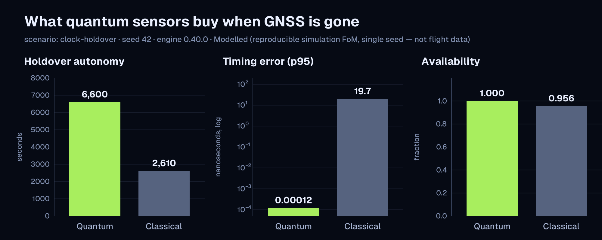
  <br><sub>O que os sensores quânticos garantem quando o GNSS se vai — <code>clock-holdover</code> · semente 42 · desenhado no motor 0.40.0, e cada número acima verificado novamente frente ao motor atual a cada compilação por <code>tests/published_figures_still_reproduce.rs</code> · <a href="docs/assets/figures/scenario-fom.svg">SVG</a></sub>
</p>

A vantagem **depende da interrupção e da vibração**, com um ponto de equilíbrio explícito em que o clássico vence — mostrado declaradamente ao longo da escada de maturidade tecnológica (os números do relógio óptico são metas de demonstradores em solo; nenhum relógio óptico de estrôncio voou):

<p align="center">
  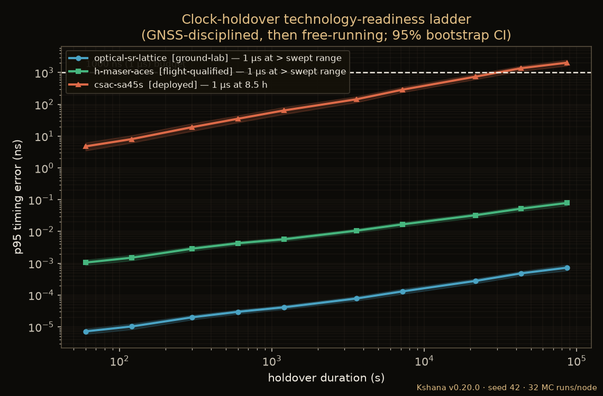
  <br>
  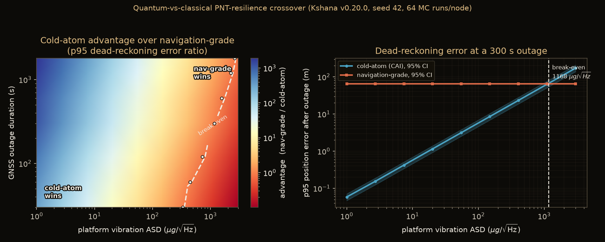
  <br><sub>Cruzamento de resiliência quântico vs clássico — escada de TRL do holdover de relógio (em cima) · mapa de vantagem inercial com contorno de equilíbrio (embaixo). Pode ser gerado novamente via <code>cargo run --release --bin crossover_study</code>.</sub>
</p>

<p align="center">
  
  <br><em>Erro de posição da navegação estimada durante uma interrupção do GNSS: o sensor quântico (azul)
  fica estável perto da especificação; o sensor clássico (vermelho) diverge para dezenas de quilômetros.
  Gerado pelo Kshana a partir de <code>scenarios/imu-deadreckoning.toml</code>.</em>
</p>

| Pacote | Cenário | Quântico | Clássico |
|------|----------|---------|-----------|
| **1 — Holdover de relógio** | `clock-holdover.toml` (especificação de 20 ns) | o relógio óptico se mantém durante toda a interrupção | o CSAC viola a especificação no meio da interrupção |
| **2 — Navegação inercial estimada** | `imu-deadreckoning.toml` (especificação de 100 m) | átomos frios: **~41 m**, mantém-se durante toda a interrupção | grau de navegação: viola em **~350 s** → dezenas de km |
| **3 — Transferência de tempo** (enlace óptico entre satélites) | `timetransfer.toml` | óptico: medição de distância de **~0.3 mm** | RF (TWSTFT): medição de distância de **~150 mm** |
| **4 — Fusão híbrida** (pacote final) | `hybrid-pnt.toml` | posição + temporização completas durante toda a interrupção | **limitado pela posição a ~350 s** |

O pacote final mostra a tese da fusão: a transferência de tempo óptica entre satélites mantém travado até mesmo
um *relógio* clássico, isolando o sensor *inercial* como o elo fraco do conjunto
clássico — ou seja, inercial quântico + temporização óptica juntos.

<p align="center">
  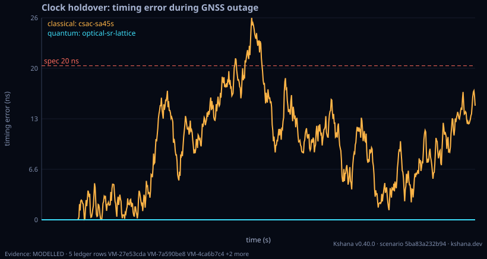
  <br><em>Holdover de relógio ao longo de uma interrupção do GNSS: o relógio óptico (azul) fica dentro da
  especificação de 20 ns durante toda a navegação livre; o relógio em escala de chip (vermelho) a viola no meio do caminho.
  Gerado pelo Kshana a partir de <code>scenarios/clock-holdover.toml</code>.</em>
</p>

Um cenário adicional, `orbit-gnss-challenged.toml`, deriva a disponibilidade GNSS da
**geometria orbital** em vez de janelas escritas à mão: uma espaçonave dentro da casca
GNSS é propagada frente a uma constelação Walker semelhante ao GPS, e a contagem de satélites
visíveis (linha de visada, ocultação pela Terra, máscara de elevação) define o estado da posição em cada
passo. Ao longo de um dia o usuário tem posição apenas ~59% do tempo; o relógio quântico mantém uma
solução de temporização de 5 ns ao longo de todas as lacunas (disponibilidade **1.0**), o relógio em escala de chip
apenas **~0.83**.

<p align="center">
  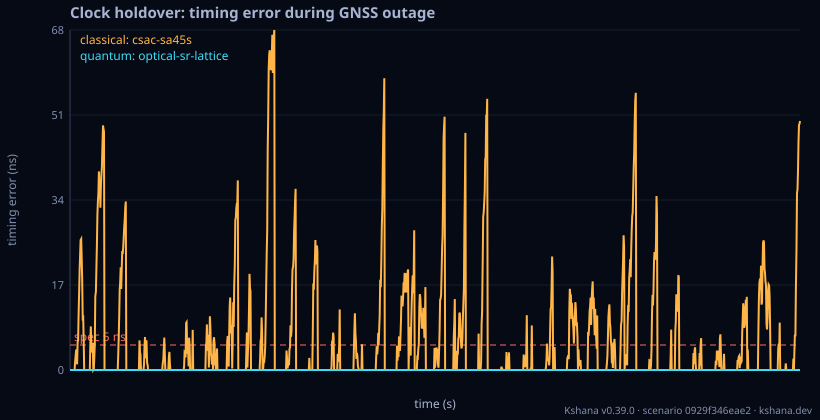
  <br><em>Erro de temporização ao longo de um dia com a disponibilidade GNSS derivada da geometria orbital: a
  contagem de satélites visíveis (linha de visada, ocultação pela Terra, máscara de elevação) define o estado da
  posição em cada passo, de modo que o relógio precisa navegar livre em cada lacuna — o relógio óptico mantém a especificação
  de 5 ns enquanto o relógio em escala de chip a viola. Gerado pelo Kshana a partir de
  <code>scenarios/orbit-gnss-challenged.toml</code>.</em>
</p>

A constelação também pode ser fornecida como conjuntos reais de elementos de duas linhas (TLEs). Um TLE *completo*
(linha 1 + linha 2) é propagado com o modelo **SGP4/SDP4** completo — incluindo
o arrasto atmosférico e os termos de espaço profundo lunissolares e de ressonância de 12 h / 24 h que
importam para órbitas GNSS de ~12 h — validado frente aos vetores oficiais do AIAA 2006-6753
a um pior caso de ≈ 4 mm. `scenarios/orbit-sgp4-gps.toml` traz um **instantâneo real do
`gps-ops` da Celestrak** da constelação GPS operacional (2021-07-28, 30 satélites)
e exige somas de verificação de TLE válidas — os conjuntos de elementos de duas linhas são dados abertos do catálogo da US
Space Force / 18th Space Defense Squadron, redistribuídos pela Celestrak
(Dr T. S. Kelso, [celestrak.org](https://celestrak.org)); atualize com
`scripts/fetch_tles.sh`. Um bloco apenas com a linha 2 mantém
a propagação analítica de dois corpos (`scenarios/orbit-real-tle.toml`); as duas formas podem
ser misturadas em uma mesma constelação. Uma constelação também pode ser construída a partir de um bloco de
registros de **efemérides transmitidas GPS RINEX-3** — o formato que um receptor decodifica —
propagados pelo algoritmo de usuário do IS-GPS-200 e passados pela mesma geometria
(`scenarios/orbit-rinex.toml`).

</details>

<details>
<summary>O que é / o que não é, por completo</summary>

<a id="what-it-is--is-not"></a>
### O que é / o que não é

**É:** um motor determinístico e com poucas dependências que abrange a pilha PNT — geometria
orbital, navegação inercial, fusão GNSS/INS, integridade, relógios e temporização. Ele
executa um cenário (muitas vezes uma interrupção do GNSS), faz evoluir modelos calibrados de erro de sensores
através do estimador apropriado e pontua o resultado frente às figuras de mérito
operacionais — emitindo um resultado JSON (JavaScript Object Notation) reproduzível e um gráfico SVG, a partir de uma
biblioteca Rust, de uma interface de linha de comando (CLI), de uma extensão Python, de um módulo WebAssembly no navegador, de um
**servidor Model Context Protocol (MCP)** para agentes de IA ou de um **plugin para IDEs (ambientes de
desenvolvimento integrado) JetBrains**.

**Não é:** hardware de voo, um projeto de carga útil quântica, um receptor de sinais GNSS
completo, um simulador de sinais de radiofrequência (RF) ou uma bancada hardware-in-the-loop, nem um
produto de aviônica certificado — e não substitui MATLAB/Simulink, STK (Systems Tool
Kit) ou Orekit; fica ao lado deles e troca arquivos com eles. A fidelidade do hardware quântico vem de
modelos de erro publicados, não desta ferramenta. A maturidade detalhada de cada
capacidade está documentada em [`docs/CAPABILITY.md`](docs/CAPABILITY.md).

**Não é (ainda):** um motor de física de interferometria atômica *completo* (a maioria dos sensores quânticos
consome coeficientes publicados de Allan/orçamento de ruído; o acelerômetro CAI (interferômetro de átomos frios) tem uma
camada de primeiros princípios — fase de Mach–Zehnder, ruído de projeção, decaimento de contraste e
acoplamento de vibração, além das sistemáticas de Coriolis e de deslocamento luminoso — mas as sistemáticas de frente de onda e
a resolução da ambiguidade de franjas continuam sendo uma camada **P2** do roteiro (fase 2 do roteiro, a camada de física quântica),
veja [`ROADMAP.md`](ROADMAP.md) e [`docs/QUANTUM-MODELS.md`](docs/QUANTUM-MODELS.md));
um receptor GNSS certificado ou de hardware (ele resolve uma posição **PVT** (posição, velocidade e tempo) por ponto simples
a partir de observações de código RINEX (Receiver Independent Exchange Format) reais — validado
em dados reais do IGS (International GNSS Service) — e a sua camada IQ (`kshana iq`, desde a 0.31.0)
adquire e rastreia amostras em banda base gravadas ou geradas em software, como um receptor de
análise: não aciona hardware de rádio nem transmite, não é um receptor certificado e não faz
posicionamento por fase da portadora (RTK ou PPP)); ou um conjunto completo de projeto de missões (tem blocos de construção de Lambert / porkchop /
manobras / determinação de órbita, mas é a camada de simulação de desempenho
*acima* do GMAT (General Mission Analysis Tool)/Orekit, não um substituto). Assumir este escopo é deliberado. Se você precisa de orçamentos de erro
de interferômetro de átomos frios a partir de primeiros princípios (por exemplo, de grau CARIOQA-PMP — Cold Atom Rubidium Interferometry
in Orbit for Quantum Accelerometry, Pathfinder Mission Preparation — ou validação no estilo do X-37B), veja
o roteiro P2 e [entre em contato](#support--professional-services) para colaborar.

</details>

### Navegação em órbita terrestre baixa

Os satélites em órbita terrestre baixa (LEO) passam rápido e com sinal forte. O tipo `leo-pnt-chain` acompanha um
sistema através de cada etapa: o sinal, a passagem e o seu enlace, a mensagem de navegação, e
a posição, velocidade e tempo (PVT) fundidos e o posicionamento por ponto preciso (PPP). Cada
etapa passa os seus números para a seguinte. Veja [`docs/LEO-PNT.md`](docs/LEO-PNT.md).

<picture>
  <source media="(prefers-color-scheme: dark)" srcset="docs/assets/readme/flow-leo-chain-dark.svg">
  <source media="(prefers-color-scheme: light)" srcset="docs/assets/readme/flow-leo-chain-light.svg">
  
</picture>

<a id="every-scenario-kind-by-family"></a>
### Cada tipo de cenário por família

Os tipos de cenário do motor, arquivados por famílias. Cada família tem uma página com uma entrada por tipo (a
descrição e os campos do motor, um comando de exemplo, os números principais de uma execução, as linhas da
[matriz de verificação](docs/VERIFICATION-MATRIX.md) que o nomeiam e o gráfico que o próprio motor escreve) e uma
folha de contatos desses gráficos; [`docs/KINDS.md`](docs/KINDS.md) indexa todos eles. A tabela é escrita por
[`tools/gen_readme_blocks.py`](tools/gen_readme_blocks.py) e as páginas por
[`tools/gen_kinds_index.py`](tools/gen_kinds_index.py), e ambos falham se o motor ganhar um tipo que nenhuma família nomeia.

<!-- generated:kind-families -->
| Família | O que ela responde | Tipos | Execute um |
|---|---|---|---|
| **[Relógios, temporização e holdover](docs/kinds/clocks-timing-and-holdover.md)** | por quanto tempo um relógio mantém a hora sem GNSS, e como um sistema de temporização se comporta frente às suas máscaras | [`clock`](docs/kinds/by-kind/clock.md), [`sweep`](docs/kinds/by-kind/sweep.md), [`sweep-nd`](docs/kinds/by-kind/sweep-nd.md), [`telecom-timing`](docs/kinds/by-kind/telecom-timing.md), [`slot-timing`](docs/kinds/by-kind/slot-timing.md), [`timetransfer`](docs/kinds/by-kind/timetransfer.md), [`time-transfer-budget`](docs/kinds/by-kind/time-transfer-budget.md), [`holdover-test`](docs/kinds/by-kind/holdover-test.md), [`quantum-time-transfer`](docs/kinds/by-kind/quantum-time-transfer.md) | `kshana scenarios/clock-holdover.toml` |
| **[Sensores inerciais, de fusão e quânticos](docs/kinds/inertial-fusion-and-quantum-sensors.md)** | navegação estimada e fusão de sensores ao longo de uma interrupção do GNSS, com sensores clássicos e quânticos | [`inertial`](docs/kinds/by-kind/inertial.md), [`hybrid`](docs/kinds/by-kind/hybrid.md), [`fusion`](docs/kinds/by-kind/fusion.md), [`hybrid-ukf`](docs/kinds/by-kind/hybrid-ukf.md), [`gnss-ins`](docs/kinds/by-kind/gnss-ins.md), [`ins-trn-coast`](docs/kinds/by-kind/ins-trn-coast.md), [`quantum-gnss-free-nav`](docs/kinds/by-kind/quantum-gnss-free-nav.md), [`quantum-anomaly-detect`](docs/kinds/by-kind/quantum-anomaly-detect.md), [`quantum-trade`](docs/kinds/by-kind/quantum-trade.md) | `kshana scenarios/gnss-ins.toml` |
| **[PNT alternativo sem GPS](docs/kinds/gps-denied-alternative-pnt.md)** | navegar a partir da gravidade, do terreno e de outros campos quando o GNSS se vai | [`gravity-map`](docs/kinds/by-kind/gravity-map.md), [`terrain-nav`](docs/kinds/by-kind/terrain-nav.md), [`terrain-slam`](docs/kinds/by-kind/terrain-slam.md), [`combined-altpnt`](docs/kinds/by-kind/combined-altpnt.md), [`conflict-resilience`](docs/kinds/by-kind/conflict-resilience.md) | `kshana scenarios/combined-altpnt.toml` |
| **[Constelações, cobertura e geometria](docs/kinds/constellations-coverage-and-geometry.md)** | onde estão os satélites, quem os vê e quão boa é a geometria, em torno da Terra, da Lua ou de Marte | [`orbit`](docs/kinds/by-kind/orbit.md), [`ephemeris`](docs/kinds/by-kind/ephemeris.md), [`constellation-design`](docs/kinds/by-kind/constellation-design.md), [`solar-system`](docs/kinds/by-kind/solar-system.md), [`body-pnt`](docs/kinds/by-kind/body-pnt.md), [`mars-pnt`](docs/kinds/by-kind/mars-pnt.md), [`passes`](docs/kinds/by-kind/passes.md) | `kshana scenarios/orbit-gnss-challenged.toml` |
| **[Medições GNSS, posicionamento e integridade](docs/kinds/gnss-measurements-positioning-and-integrity.md)** | pseudodistâncias, posições, níveis de proteção e o ambiente espacial | [`integrity`](docs/kinds/by-kind/integrity.md), [`gnss-sim`](docs/kinds/by-kind/gnss-sim.md), [`pvt`](docs/kinds/by-kind/pvt.md), [`araim-reference-check`](docs/kinds/by-kind/araim-reference-check.md), [`space-weather`](docs/kinds/by-kind/space-weather.md), [`realtime-frame-eop`](docs/kinds/by-kind/realtime-frame-eop.md) | `kshana scenarios/integrity-raim.toml` |
| **[Jamming, spoofing e o espectro](docs/kinds/jamming-spoofing-and-the-spectrum.md)** | como a interferência chega a um receptor e se ela é detectada | [`jamming`](docs/kinds/by-kind/jamming.md), [`spoof`](docs/kinds/by-kind/spoof.md), [`spoof-detect`](docs/kinds/by-kind/spoof-detect.md), [`tracking-loop`](docs/kinds/by-kind/tracking-loop.md), [`spectrum`](docs/kinds/by-kind/spectrum.md), [`impairment-eval`](docs/kinds/by-kind/impairment-eval.md) | `kshana scenarios/jamming-demo.toml` |
| **[Navegação em órbita terrestre baixa](docs/kinds/low-earth-orbit-navigation.md)** | uma passagem, um enlace, uma mensagem de navegação e uma posição fundida, etapa por etapa | [`leo-signal`](docs/kinds/by-kind/leo-signal.md), [`leo-pass`](docs/kinds/by-kind/leo-pass.md), [`leo-navmsg`](docs/kinds/by-kind/leo-navmsg.md), [`leo-pvt`](docs/kinds/by-kind/leo-pvt.md), [`leo-ppp`](docs/kinds/by-kind/leo-ppp.md), [`ntn-positioning`](docs/kinds/by-kind/ntn-positioning.md), [`leo-pnt-chain`](docs/kinds/by-kind/leo-pnt-chain.md) | `kshana scenarios/leo-pnt-end-to-end.toml` |
| **[Lunar e cislunar](docs/kinds/lunar-and-cislunar.md)** | navegação, tempo, referenciais e geodésia na Lua | [`lunar-integrity`](docs/kinds/by-kind/lunar-integrity.md), [`lunar-time-offset`](docs/kinds/by-kind/lunar-time-offset.md), [`lunar-time-budget`](docs/kinds/by-kind/lunar-time-budget.md), [`lunar-ascent`](docs/kinds/by-kind/lunar-ascent.md), [`lunar-surface`](docs/kinds/by-kind/lunar-surface.md), [`lunar-descent`](docs/kinds/by-kind/lunar-descent.md), [`lunar-orbit-rendezvous`](docs/kinds/by-kind/lunar-orbit-rendezvous.md), [`lunar-vlbi`](docs/kinds/by-kind/lunar-vlbi.md), [`lunar-vlbi-fim`](docs/kinds/by-kind/lunar-vlbi-fim.md), [`lunar-joint-od-clock`](docs/kinds/by-kind/lunar-joint-od-clock.md), [`lunar-frame-realisation`](docs/kinds/by-kind/lunar-frame-realisation.md), [`lunar-frame-campaign`](docs/kinds/by-kind/lunar-frame-campaign.md), [`lunar-llr-datum`](docs/kinds/by-kind/lunar-llr-datum.md), [`moonlight-service-volume`](docs/kinds/by-kind/moonlight-service-volume.md), [`lunar-differential-pnt`](docs/kinds/by-kind/lunar-differential-pnt.md), [`lunar-station-coverage`](docs/kinds/by-kind/lunar-station-coverage.md), [`lunar-beacon`](docs/kinds/by-kind/lunar-beacon.md), [`lunar-interop-export`](docs/kinds/by-kind/lunar-interop-export.md), [`cislunar-observability`](docs/kinds/by-kind/cislunar-observability.md), [`cislunar-arc-recovery`](docs/kinds/by-kind/cislunar-arc-recovery.md), [`lunar-attack-surface`](docs/kinds/by-kind/lunar-attack-surface.md), [`lunar-jamming`](docs/kinds/by-kind/lunar-jamming.md), [`earth-gnss-lunar`](docs/kinds/by-kind/earth-gnss-lunar.md), [`lunar-infrastructure`](docs/kinds/by-kind/lunar-infrastructure.md) | `kshana scenarios/lunar-infrastructure-od-consistency.toml` |
| **[Navegação de usuários espaciais](docs/kinds/space-user-navigation.md)** | sinais GNSS para espaçonaves acima, ao redor e além das órbitas GNSS | [`gnss-ssv`](docs/kinds/by-kind/gnss-ssv.md) | `kshana scenarios/gnss-ssv-shell.toml` |
| **[PNT óptico](docs/kinds/optical-pnt.md)** | enlaces ópticos através da atmosfera e figuras de mérito óptico mais RF | [`optical-atmosphere`](docs/kinds/by-kind/optical-atmosphere.md), [`hybrid-optical-rf`](docs/kinds/by-kind/hybrid-optical-rf.md) | `kshana scenarios/optical-atmosphere-network.toml` |
| **[Análise de missão, enlaces e operações espaciais](docs/kinds/mission-analysis-links-and-space-operations.md)** | lançamento, subida, reentrada, atitude, enlaces, planejamento de contatos e formatos de arquivo | [`launch-window`](docs/kinds/by-kind/launch-window.md), [`ascent-losses`](docs/kinds/by-kind/ascent-losses.md), [`reentry`](docs/kinds/by-kind/reentry.md), [`entry-heating`](docs/kinds/by-kind/entry-heating.md), [`eo-coverage`](docs/kinds/by-kind/eo-coverage.md), [`eo-radiometry`](docs/kinds/by-kind/eo-radiometry.md), [`attitude-budget`](docs/kinds/by-kind/attitude-budget.md), [`aocs`](docs/kinds/by-kind/aocs.md), [`link-budget`](docs/kinds/by-kind/link-budget.md), [`acm-link`](docs/kinds/by-kind/acm-link.md), [`contact-schedule`](docs/kinds/by-kind/contact-schedule.md), [`aperture-duty-cycle`](docs/kinds/by-kind/aperture-duty-cycle.md), [`space-packet`](docs/kinds/by-kind/space-packet.md), [`oem-interop`](docs/kinds/by-kind/oem-interop.md) | `kshana scenarios/launch-window.toml` |
| **[Fios de missão](docs/kinds/mission-threads.md)** | o orçamento de erro de navegação e temporização de uma cadeia de fases do lançamento à reentrada | [`mission-thread`](docs/kinds/by-kind/mission-thread.md) | `kshana scenarios/mission-thread-artemis-class.toml` |
| **[Campanhas](docs/kinds/campaigns.md)** | missões encadeadas, varreduras e conjuntos construídos a partir dos outros tipos | [`campaign`](docs/kinds/by-kind/campaign.md) | `kshana scenarios/campaign-jam-spoof-holdover-integrity.toml` |
<!-- /generated:kind-families -->

<a id="every-command"></a>
### Cada comando

`kshana <scenario.toml>` executa um cenário; todos os outros comandos são subcomandos, e `kshana --help` imprime o uso
de todos eles. Os comandos são `--study`, `--validate`, `kinds`, `example`, `receiver-trust` (com `live` e
`evidence`), `evidence` (`keygen`, `verify`, `attach-timestamp`, `round-trip`), `jammertest` (`import`, `score`),
`trust-telemetry`, `imu-fit`, `nmea-scenario`, `interference-map` (`adsb`, `ais`, `daily`, `sensitivity`,
`fetch-land`), `route-exposure`, `bench` (`spec`, `truth`, `cases`, `score`, `baseline`, `seal`, `reveal-check`,
`manifest`, `verify-manifest`, `validate`, `leaderboard`), `bench-export`, `compliance-report`,
`lunanet-afs-check`, `standards-pack`, `partner` (`check`), `osnma`, `iq` (`scene`, `acquire`, `track`, `sweep`, `labfit`, `campaign`,
`conditions`, `frontend`, `monitor`, `inventory`, `info`, `extract`, `convert`, `decimate`), `sky` e `skyline`.
[`docs/COMMANDS.md`](docs/COMMANDS.md) dá o propósito de cada um, um exemplo verificado e a sua página de documentação.

<a id="every-surface"></a>
### Cada superfície

Um único motor, os mesmos resultados em todo lugar: a linha de comando, a biblioteca Rust, Python, JavaScript e WebAssembly,
o servidor MCP com os seus comandos de plugin e skills, o Kshana Studio (cada página roda no navegador, sem instalação, nada enviado), as
integrações ROS 2, Signal K, OpenCPN, GNSS-SDR e `gnss_lib_py`, os kits de implantação systemd, Docker e Grafana, e o
plugin JetBrains. [`docs/ALL-SURFACES.md`](docs/ALL-SURFACES.md) os lista com a forma de obter cada um e os nomes de todos
os comandos de plugin, skills e páginas do Studio; [`docs/SURFACES.md`](docs/SURFACES.md) diz, para cada comando e tipo,
qual superfície o oferece e quais não, com a razão.

<a id="how-a-run-works"></a>
## Como funciona uma execução

Um cenário é um arquivo TOML (Tom's Obvious, Minimal Language): um tipo, uma semente e os
parâmetros. O motor o executa e escreve o resultado, um gráfico e um relatório ao lado dele, e
as exportações que você pedir.

<picture>
  <source media="(prefers-color-scheme: dark)" srcset="docs/assets/readme/flow-pipeline-dark.svg">
  <source media="(prefers-color-scheme: light)" srcset="docs/assets/readme/flow-pipeline-light.svg">
  
</picture>

Este cenário incluído dura 2 h: 10 min de GNSS, depois cerca de 1.8 h com o GNSS negado. Ele pergunta
por quanto tempo um relógio óptico de rede de estrôncio e um relógio atômico em escala de chip (CSAC) mantêm, cada um,
a hora dentro de 20 ns.

```bash
kshana example clock-holdover > clock-holdover.toml
kshana clock-holdover.toml
```

```text
scenario 5ba83a232b94 | quantum holdover 6600s p95 1.20e-4ns integrity 1.000 security n/a (no attack) | classical holdover 2610s p95 19.7ns integrity 1.000 security n/a (no attack)
wrote clock-holdover.result.json, clock-holdover.chart.svg, clock-holdover.report.html, and clock-holdover.report.json
```

O relógio óptico mantém o orçamento de 20 ns durante toda a interrupção de 6600 s; o CSAC o mantém por
2610 s, e fica dentro do orçamento durante 95.6% da execução frente a 100% para o relógio óptico.
`kshana example` lista todos os cenários incluídos.

<a id="missions"></a>
## Missões

Dez setores fazem dez perguntas diferentes ao mesmo motor. Cada um tem cenários incluídos pelos quais
começar.

| Setor | Comece por |
|---|---|
| Defesa e segurança | `campaign-jam-spoof-holdover-integrity`, `spoof-meaconing` |
| Espaço, órbita terrestre | `orbit-gnss-challenged`, `leo-pnt-end-to-end` |
| Lua, Marte e espaço profundo | `lunar-relay-constellation`, `mars-orbit-pnt` |
| Aviação e drones | `small-uas-jammed-nav`, `araim-gps-galileo` |
| Marítimo | `maritime-strait-jamming`, `maritime-port-approach-coast` |
| Rodoviário | `automotive-urban-canyon` |
| Ferroviário | `rail-tunnel-coast` |
| Infraestrutura crítica e temporização | `clock-holdover`, `clock-ensemble` |
| Telecomunicações e 5G (a quinta geração de redes móveis) | `telecom-prtc-holdover-24h`, `leo-vertical-5g-network-timing` |
| Ciência e pesquisa | `sweep-clock-stability`, `quantum-pnt-demonstrator.suite` |

<details>
<summary>A pergunta que cada setor faz</summary>

<br>

| Setor | A pergunta que ele faz | Comece por |
|---|---|---|
| **Defesa e segurança** | Por quanto tempo a nossa navegação e temporização continuam confiáveis sob jamming e spoofing, e quais camadas nos mantêm dentro da especificação? | `campaign-jam-spoof-holdover-integrity`, `spoof-meaconing` |
| **Espaço: órbita terrestre** | A minha espaçonave vê satélites de navegação suficientes, por quanto tempo o seu relógio mantém a hora entre posições, e o que uma camada de navegação em órbita baixa acrescentaria? | `orbit-gnss-challenged`, `leo-pnt-end-to-end` |
| **Lunar e espaço profundo** | Um módulo de pouso, um rover ou um orbitador na Lua, em Marte ou mais longe terá uma posição e uma hora confiáveis? | `lunar-relay-constellation`, `mars-orbit-pnt` |
| **Aviação e drones** | Depois que um jammer tira o GNSS, por quanto tempo o meu sistema de aeronave não tripulada (UAS) fica dentro do seu orçamento de posição, e há integridade disponível na minha rota? | `small-uas-jammed-nav`, `araim-gps-galileo` |
| **Marítimo** | Até onde sobre a água chega um jammer, um deslocamento de posição seria detectado, e por quanto tempo um navio consegue navegar livre até o porto? | `maritime-strait-jamming`, `maritime-spoof-position-push`, `maritime-port-approach-coast` |
| **Rodoviário e automotivo** | Quanto um carro deriva sob um viaduto ou ao passar por um jammer à beira da estrada? | `automotive-urban-canyon` |
| **Ferroviário** | Quantos segundos dentro de um túnel um trem ainda consegue dizer em qual via está? | `rail-tunnel-coast` |
| **Infraestrutura crítica e temporização** | Se a hora GNSS for perdida ou falsificada, por quanto tempo uma rede elétrica, uma plataforma de negociação ou um data center mantêm uma hora rastreável? | `clock-holdover`, `clock-ensemble` |
| **Telecomunicações e 5G** | Se a referência de tempo GNSS for perdida, o relógio da minha rede fica dentro das máscaras ITU-T, e por quanto tempo? | `telecom-prtc-holdover-24h`, `leo-vertical-5g-network-timing` |
| **Ciência e pesquisa** | Posso reproduzir, estender e citar um resultado de PNT, até a semente? | `sweep-clock-stability`, `quantum-pnt-demonstrator.suite` |

</details>

<a id="evidence"></a>
## Evidências

<p><a href="docs/SGP4-VALIDATION.md"></a></p>

<strong>176 de 401</strong> capacidades validadas frente a referências externas independentes; 221 rotuladas declaradamente como Modelled.
Cada linha da matriz de verificação nomeia uma capacidade, a referência frente à qual é verificada,
o teste que executa a verificação e o rótulo resultante. A integração contínua (CI) torna
impossível chamar uma capacidade de VALIDATED sem uma referência externa independente.

<picture>
  <source media="(prefers-color-scheme: dark)" srcset="docs/assets/readme/flow-verification-dark.svg">
  <source media="(prefers-color-scheme: light)" srcset="docs/assets/readme/flow-verification-light.svg">
  
</picture>

| Rótulo | Linhas | Significado |
|---|---|---|
| VALIDATED | 176 | uma referência externa independente concorda: dados reais, uma implementação independente ou vetores de referência publicados |
| MODELLED | 221 | verificado frente a uma verdade analítica ou à autoconsistência da simulação, e dito abertamente |
| PARTNER | 4 | de responsabilidade de um parceiro de hardware; o Kshana não tem referência para ela |

Algumas das verificações: todos os 666 vetores SGP4 (Simplified General Perturbations 4) do AIAA (American Institute of Aeronautics and Astronautics)
2006-6753 a 4.12 mm; o modelo de forças de Cowell
a 0.08 m frente ao Orekit 12.2; o Galileo a 0.61 m e o Swarm-A a 0.10 m frente a efemérides precisas reais
da Agência Espacial Europeia (ESA). Os testes mantêm perto de 95 % de cobertura de linhas de
`src/`, exigida em 85 % na CI. O registro é
[`docs/VERIFICATION-MATRIX.md`](docs/VERIFICATION-MATRIX.md), gerado a partir de
`src/verification.rs`: a [matriz completa de 401 linhas](docs/VERIFICATION-MATRIX.md), e por que cada
linha Modelled não tem referência externa em [`docs/MODELLED-RATIONALE.md`](docs/MODELLED-RATIONALE.md).

<details>
<summary>Como a validação funciona, a tabela de destaques selecionados e as figuras de evidência</summary>

### Validação, reprodutibilidade e honestidade

- Cada termo de ruído é calibrado a um valor **publicado e citado** e validado
  frente à relação padrão (desvio de Allan para relógios; crescimento do erro de navegação estimada de Groves
  para o inercial; a conversão temporização→distância para a transferência de tempo). O estado
  de cada termo é acompanhado em [`docs/VALIDATION.md`](docs/VALIDATION.md) como `validated` ou
  `not modeled` — nada é apresentado como validado sem o ser.
- **Reproduzível por construção:** `scenario + seed + engine version → identical
  bits`. `scripts/check-reproducible.sh` o garante; as execuções quânticas e clássicas usam
  sementes independentes para que os seus ruídos não sejam correlacionados.
- A maturidade é declarada honestamente: os números do relógio óptico e do enlace óptico são resultados de *metas /
  demonstradores em solo*, não voados.

### O rótulo de evidência em cada figura

Cada figura e tabela que uma execução escreve diz até que ponto se pode confiar nela, e em quais linhas do registro isso se apoia. O JSON de resultado tem uma
chave `evidence`, o SVG do gráfico uma linha abaixo do traçado (e um elemento `<metadata id="kshana-evidence">`), e a tabela CSV
linhas de comentário `# evidence:` no início (leia com `comment='#'`). Ele nomeia um nível, `VALIDATED`, `MODELLED` ou `PARTNER`, e
os ids (`VM-` e oito dígitos hexadecimais) das linhas da matriz de verificação que a execução exercitou. O nível é o mais fraco dessas
linhas, de modo que uma execução que se apoia em uma linha modelada é rotulada MODELLED por mais linhas validadas que estejam ao lado; o rótulo
nunca pode afirmar mais do que o registro. Linhas, estados e ids são lidos da matriz, não digitados
([`docs/VERIFICATION-MATRIX.md`](docs/VERIFICATION-MATRIX.md), [`docs/SCHEMA.md`](docs/SCHEMA.md)), e
`tests/evidence_labels_doc_sync.rs` falha se uma figura não tiver rótulo ou se um rótulo discordar da matriz.

### A validação em resumo

Cada linha é garantida por um teste nomeado na CI. Esta tabela é um **destaque selecionado**;
a matriz completa verificada por máquina tem **401 linhas — 176 VALIDATED, 221 MODELLED, 4 PARTNER**
(`src/verification.rs`), com as evidências completas (e o que declaradamente *ainda não* está
validado) em [`docs/VALIDATION.md`](docs/VALIDATION.md) e no artefato por versão
[`kshana-validation-summary.html`](https://github.com/ashfordeOU/kshana/releases)
(gerado por `cargo run --bin validation_report`, com atestação SLSA — Supply-chain
Levels for Software Artifacts).

A coluna **Estado** declara o *tipo* de evidência, de acordo com a escada de validação acima: **VALIDATED** = verificado frente a uma referência externa independente (dados reais, uma biblioteca independente ou vetores de referência publicados); **MODELLED** = verificado frente a uma verdade analítica ou à autoconsistência da simulação (sem conjunto de dados externo independente). VALIDATED descreve o *método* de verificação, não um aprovado/reprovado — uma falha honesta frente a uma referência externa real continua VALIDATED, enquanto uma comparação que nenhuma linha da matriz nomeia como referência (o ajuste do LRO — Lunar Reconnaissance Orbiter — acima) é mostrada como MODELLED. As linhas `CI` são salvaguardas de processo, não figuras de mérito. Algumas ilhas de dados reais (o relógio de césio medido, o PHASE.DAT do Stable32 e as verificações OPS-SAT/ICGEM em que as entradas brutas não têm licença de redistribuição) são **condicionadas aos dados**: o teste imprime um aviso de omissão e continua verde quando a entrada está ausente, e os números de referência públicos estão incluídos no repositório em `tests/fixtures/`. Reproduza as entradas brutas com o `scripts/fetch_*.sh` correspondente.

| Estado | Capacidade | Concordância | Referência |
|--------|------------|-----------|--------------------|
| **VALIDATED** | Propagação SGP4/SDP4 | 666/666 vetores, pior **4.12 mm** | AIAA 2006-6753 (Vallado `tcppver.out`) + confronto direto com o crate independente `sgp4` |
| **VALIDATED** | Referenciais — nutação IAU 2000A/B, cadeia CIO IAU 2006/2000A, ERA | **bit a bit** (X,Y a 1e-14, s a 1e-18, ERA a 1e-12) | ERFA/SOFA `eraXys06a` · `eraC2ixys` · `eraEra00` · `eraNut00a/b` |
| **MODELLED** | GCRS→ITRS frente a um motor SPICE independente | máx. **0.028″** → ≤ 0.86 m no solo, ≤ 3.6 m na órbita GNSS | ANISE (NAIF/SPICE em Rust puro), mesmos EOP `finals2000A` do IERS, 8 épocas 2020–2023 (comparado frente a esta referência; nenhuma linha da matriz de verificação a nomeia como referência externa, por isso não é rotulado VALIDATED) |
| **MODELLED** | Geopotencial EGM2008 (grau/ordem 70) | aceleração = ∇V a **< 1e-6**; colapso zonal para o J2 validado | Coeficientes EGM2008 da NGA + identidade analítica ∇V |
| **VALIDATED** | Síntese de funcionais da gravidade (mapa de navegação auxiliada por gravidade / sem GNSS) | GRS80 Somigliana + γ_e/γ_p a **3.5e-12**; mapa de perturbações EGM2008 real fisicamente plausível (RMS ≈ 26 mGal, g/o 70) | Gravidade normal de Somigliana GRS80 (Moritz 1980, IAG — International Association of Geodesy) + EGM2008 real do ICGEM (`tests/icgem_gravity_reference.rs`) |
| **VALIDATED** | Estimadores de Allan (ADEV/MDEV/TDEV/HDEV) + faixas de confiança | reproduzem os desvios de referência; as faixas χ² coincidem | NIST SP 1065 (Riley), Tabela 31/32 de 1000 pontos |
| **VALIDATED** | Estimadores de Allan em um **relógio de césio real medido** | OADEV/OHDEV a **1e-3** (observado ≤ 3e-5), 16 fatores de média | Stable32 sobre um Cs 5071A real frente a um maser de H, 556,990 pts (`tests/cs5071a_reference.rs`, condicionado aos dados) |
| **VALIDATED** | Estimadores de Allan no **PHASE.DAT canônico do Stable32** | OADEV/MDEV/TDEV a **1e-3** (observado ≤ 5e-5), 139 fatores de média | Desvios de referência do Stable32 para PHASE.DAT (`tests/phasedat_reference.rs`, condicionado aos dados) |
| **MODELLED** | Modelo de erro de IMU — ARW / VRW / instabilidade de viés | recuperado a **< 5 %** (instabilidade de viés < 15 %) | Folha de dados do Analog Devices ADIS16465; perfil de referência do NaveGo |
| **VALIDATED** | Propagador numérico de Cowell + modelo de forças (níveis conservativos) | pior erro de posição **0.08 m** em 24 h, 278 épocas (LEO + GTO) | Orekit 12.2 `NumericalPropagator`/`DormandPrince853` (CS GROUP), `tests/numerical_cowell_propagator_reference.rs` |
| **MODELLED** | Nível de arrasto do Cowell + entradas absolutas de efemérides Sol/Lua e de densidade | nível de arrasto caracterizado ≈ 333 m / 24 h; o caso não perturbado coincide com Kepler em variável universal abaixo de 1 m, energia/momento ~1e-9 | efeméride incluída de baixa precisão + Kepler analítico |
| **MODELLED** | Lambert · Tsiolkovsky · porkchop | ida e volta frente à verdade de dois corpos; ΔV **< 0.01 %** | Izzo 2015 · equação do foguete · piso analítico de Hohmann |
| **MODELLED** | Determinação de órbita (lote de Gauss–Newton) | abaixo de 1 m / mm·s⁻¹ sem ruído; ~2 m com um piso de ruído de 5 m | dois corpos + J2 sobre um arco RK4 |
| **MODELLED** | Ajuste do modelo de forças frente à efeméride precisa do Galileo (arco completo) | **0.61 m** RMS 3-D, 24 h, g/o 70, apenas forças | órbita final `ESA0MGNFIN` da ESA/ESOC (E11), EOP `finals2000A` reais (comparado frente a esta referência; nenhuma linha da matriz de verificação a nomeia como referência externa, por isso não é rotulado VALIDATED) |
| **MODELLED** | Ajuste do modelo de forças frente à efeméride precisa do Swarm-A (dinâmica reduzida) | **0.10 m** RMS 3-D (limite do nível empírico, não uma medida) | órbita precisa `SW_OPER_SP3ACOM_2_` da ESA (comparado frente a esta referência; nenhuma linha da matriz de verificação a nomeia como referência externa, por isso não é rotulado VALIDATED) |
| **MODELLED** | Ajuste do modelo de forças frente ao LRO lunar (falha honesta) | **6.67 m** com dinâmica reduzida, *acima* da meta de 5 m | JPL Horizons LRO (NAIF −85) + GRAIL (Gravity Recovery and Interior Laboratory) `GRGM660PRIM` (comparado frente a esta referência; nenhuma linha da matriz de verificação a nomeia como referência externa, por isso não é rotulado VALIDATED) |
| **MODELLED** | OD de Marte no espaço profundo (SRIF de dinâmica reduzida) | **≈ 0.2 m** Mars-LMO (FoM de simulação, *não* de missão real) | OD sintética em malha fechada — validação do mecanismo do estimador |
| **MODELLED** | Dinâmica de Marte com o Sol central frente ao JPL DE440 | **137 m @ arco de 1 dia** (cresce com o arco = n corpos não modelados) | JPL DE440 via ANISE (`xval/anise-mars-od`, condicionado ao kernel) (comparado frente a esta referência; nenhuma linha da matriz de verificação a nomeia como referência externa, por isso não é rotulado VALIDATED) |
| **VALIDATED** | Posicionamento por ponto simples frente a uma coordenada levantada do IGS (observações reais) | **5.7 m** RMS 3-D / **1.1 m** horizontal, SPP de código livre da ionosfera de dupla frequência | levantamento da estação IGS ABMF + efeméride transmitida GPS, 2018-05-13 (`tests/pvt_abmf.rs`) |
| **MODELLED** | UKF GNSS/INS fortemente acoplado | **0.77 m RMS** em uma passagem LEO de 30 min incl. uma interrupção de 120 s | navegação livre por modelo de forças, derivada à mão |
| **MODELLED** | Navegação por mapa de gravidade sem GPS | deriva da INS de ~70 km → **~145 m** recuperados | meta do *Quantum Wayfarer* do ESA NAVISP |
| **MODELLED** | Navegação referenciada ao terreno (TERCOM/SITAN) | deriva de 70 km → **< 500 m** (piso de resolução da grade ~140 m) | DEM `.hgt` do SRTM; deriva injetada à mão (verificação não circular) |
| **MODELLED** | Campo principal IGRF-14 (grau/ordem 13) | polo ~80.7°N, dipolo ~29.7 µT, faixa física de 22–67 µT | `igrf14coeffs.txt` da IAGA (International Association of Geomagnetism and Aeronomy) (semi-normalizado de Schmidt) |
| **MODELLED** | Modulação do sinal de navegação e rastreamento de código | auto-SSC de BPSK = **2/(3·R_c)**; PSDs de área unitária; jitter DLL do C/A **submétrico** @ 45 dB-Hz | Âncoras SSC/PSD em forma fechada + fórmula de ruído térmico DLL de Kaplan & Hegarty |
| **MODELLED** | Corretor diferencial halo/NRHO no CR3BP | STM = diferenças finitas; a órbita fecha com **precisão de máquina**; NRHO 9:2 de L2 **≈ 6.57 d / perilúnio ≈ 3,250 km** | verificação da STM por diferenças finitas + NRHO 9:2 sul de L2 publicada (≈ 6.56 d / ≈ 3,370 km) — CR3BP, não uma efeméride real do Gateway |
| **MODELLED** | Integridade ARAIM com dupla constelação | modo de falha de toda a constelação sobre GPS + Galileo reais | EU ARAIM TR (relatório técnico) / DO-316; Celestrak `gps-ops` 2021-07-28 (comparado frente a esta referência; nenhuma linha da matriz de verificação a nomeia como referência externa, por isso não é rotulado VALIDATED) |
| **VALIDATED** | Geometria GNSS / DOP (GDOP/PDOP/HDOP/VDOP/TDOP) | coincide a **1e-6 relativo** em 8 geometrias (bem condicionadas → quase singulares) | gnss_lib_py 1.0.4 (Stanford NAV Lab) — biblioteca independente (`tests/dop_reference.rs`) |
| **VALIDATED** | Métricas de avaliação de detectores de ML (AUC/ROC/confusão/Pd-Pmd/precisão/F1) | **contagens exatas + < 1e-9** em 5 conjuntos de dados × 24 limiares | scikit-learn 1.9.0 (Pedregosa et al., JMLR — Journal of Machine Learning Research — 2011) — biblioteca independente (`tests/eval_metrics_reference.rs`) |
| **VALIDATED** | ROC AUC de detecção de anomalias em **telemetria real do ESA OPS-SAT** | o AUC reproduz o scikit-learn a **< 1e-9**; AUC do detector por contagem de picos **≈ 0.85** na divisão de teste rotulada | `roc_auc_score` do scikit-learn na divisão de teste do OPSSAT-AD (Ruszczak et al. 2025, CC BY 4.0) — telemetria real do OPS-SAT (`tests/opssat_ad_reference.rs`) |
| **VALIDATED** | Kernels numéricos do compromisso quântico (ajuste ADEV NNLS · faixas de consistência χ² · Q de relógio de van-Loan) | NNLS + Q **exatos**; χ² **< 5e-4** com graus de liberdade operacionais ≥ 48 | scipy 1.17.1 — `optimize.nnls` / `stats.chi2.ppf` / `linalg.expm` (`tests/scipy_reference.rs`) |
| **VALIDATED** | Métricas de wander de telecomunicações MTIE / MDEV / TDEV (ITU-T G.810/G.823/G.8261/G.811 — as recomendações do Setor de Normalização das Telecomunicações da União Internacional de Telecomunicações) | MTIE (9 fatores de média, bit a bit) e MDEV + TDEV (8 fatores, **< 1e-9** relativo) na série LCG (gerador congruencial linear) do NIST SP 1065 | allantools 2024.06 `mtie` / `mdev` / `tdev` — biblioteca independente (`tests/mtie_reference.rs`, `tests/mdev_tdev_reference.rs`) |
| **VALIDATED** | Métodos de estudo de compromisso MCDA — as quatro famílias de decisão, nove agregadores validados externamente (WSM · WPM · WASPAS · MOORA · COPRAS · TOPSIS · VIKOR · PROMETHEE II · ELECTRE I) mais a ponderação de prioridades por comparação par a par **AHP** | pontuações / classificações / matrizes de concordância reproduzidas a **< 1e-9** | pymcdm + pyDecision (bibliotecas MCDA independentes de terceiros) + Saaty RI (Índice Aleatório) / eig SciPy-LAPACK (`tests/mcda_*_reference.rs`) |
| **VALIDATED** | Envelope Doppler LEO a partir da órbita e da portadora | máximo do Iridium dentro de **5 %** dos ±36 kHz publicados; Xona Pulsar X1 dentro dos **32–34 kHz** publicados | resultados de testes de PNT LEO da RNTF; Leclère, Marathe & Reid, arXiv:2509.19551 (`tests/leo_doppler_reference.rs`) |
| **MODELLED** | Convergência do PPP com aumentação LEO | 7.4 → 4.8 / 3.2 / 2.7 / 2.3 min com 60 / 96 / 192 / 288 satélites LEO, monótona; NEES do filtro dentro da faixa χ² | tendência comparada com Li et al., J. Geod. 93:749 (2019) (9.6 → 7.0 / 3.2 / 2.1 / 1.3 min); constelações e ruído não reproduzidos |
| **MODELLED** | Nível de Proteção de Temporização condicional (erro de tempo não detectado limitado pelo holdover sob spoofing) | a composição reproduz a recursão de covariância `clock_state` de vários passos; calibrado em um spoofing real gravado | escalares do JammerTest 2024 (Zenodo 15911589) + formas fechadas de van-Loan / CUSUM (`examples/tpl_jammertest`) |
| **MODELLED** | Pontuação de resiliência de PNT + instabilidade da decisão | 35 testes com referências derivadas à mão; artefato de estudo determinístico byte a byte (semente fixa) | mapeamento para o DHS RPCF v2.0 + formas fechadas de Dirichlet / τ de Kendall / Hill-N2 — arquiteturas sintéticas, não uma certificação |
| **MODELLED** | Estudo da lacuna de otimismo de degradações de RF (leis de escala + preditor leave-one-out) | significância por nula de permutação; artefato determinístico byte a byte (5 sementes) | corpus sintético fundamentado em parâmetros — as *métricas* de avaliação são VALIDATED frente ao scikit-learn (acima); o estudo é MODELLED |
| CI | Reprodutibilidade entre plataformas | entrada bit a bit idêntica + goldens de forma em 3 SOs (sistemas operacionais) | matriz de CI Linux / macOS / Windows, goldens SHA-256 |
| CI | Cobertura de testes | **~95 % de linhas** em `src/` excluindo `src/*_data.rs` e `src/main.rs`, exigida ≥ 85 % | cargo-tarpaulin (motor LLVM) |

<p align="center">
  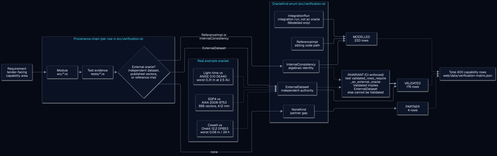
  <br><sub>Como uma capacidade conquista o seu rótulo — o invariante garantido pela CI: sem referência externa ⇒ não pode ser Validated · <a href="docs/assets/diagrams/validation-provenance.svg">SVG</a></sub>
</p>

<p align="center">
  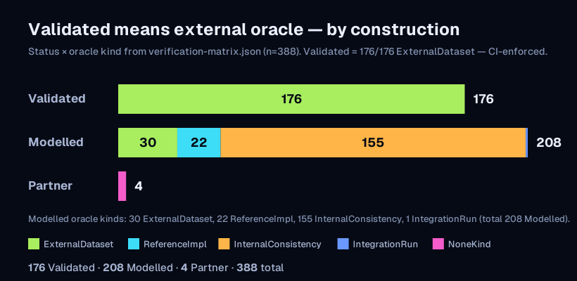
  <br>
  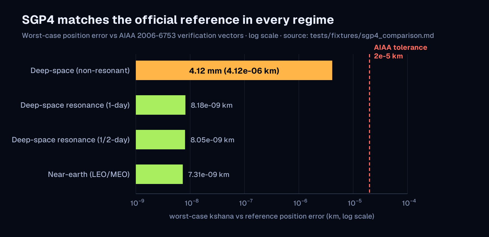
  <br><sub>Em cima: cada linha Validated é sustentada por um conjunto de dados externo, por construção. Embaixo: o SGP4 coincide com a referência oficial em todos os regimes (pior 4.12 mm). <a href="docs/assets/figures/oracle-kind-stacked.svg">SVG</a> · <a href="docs/assets/figures/sgp4-regime-bars.svg">SVG</a></sub>
</p>

<p align="center">
  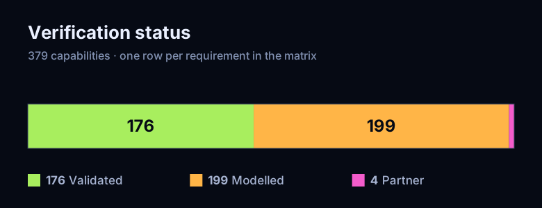
  <br><sub>176 Validated · 221 Modelled · 4 Partner — <a href="docs/assets/figures/validation-breakdown.svg">SVG</a></sub>
</p>

</details>

<a id="capability-domains"></a>
### Domínios de capacidade

Cada capacidade do mapa público, por domínio, com o seu rótulo no registro. A tabela de domínios é escrita por
[`tools/gen_readme_blocks.py`](tools/gen_readme_blocks.py) a partir de `web/capabilities.json`, o mesmo arquivo que
o mapa de tudo do Studio lê.

<picture>
  <source media="(prefers-color-scheme: dark)" srcset="docs/assets/figures/domain-coverage-map.svg">
  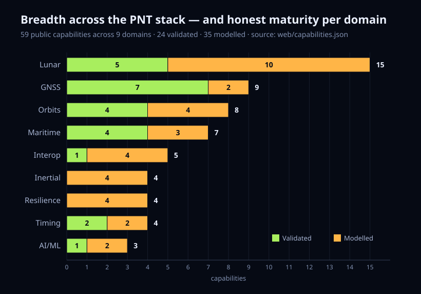
</picture>

A tabela completa, domínio por domínio, com cada capacidade e o seu rótulo, está em [`docs/CAPABILITY-DOMAINS.md`](docs/CAPABILITY-DOMAINS.md).

<a id="install"></a>
## Instalar

Uma linha basta para obter a ferramenta de linha de comando: **`cargo install kshana`**. Todos os canais distribuem
a v0.40.0 a partir do mesmo commit com tag.

<!-- channels:begin -->
| Canal | Instalação | Guia |
|---|---|---|
| Experimente no navegador | abra https://kshana.dev | [Guia do Studio](https://kshana.dev/docs/studio.html) |
| Linha de comando (Rust) | `cargo install kshana` | [Uso da linha de comando](https://kshana.dev/docs/rust.html#usage--cli) |
| Biblioteca Rust | `cargo add kshana` | [Referência da API no docs.rs](https://docs.rs/kshana) |
| Python | `pip install kshana` | [Guia da API Python](https://kshana.dev/docs/python-api.html) |
| JavaScript e WebAssembly | `npm install kshana` | [Guia de npm e WebAssembly](https://kshana.dev/docs/npm.html) |
| Assistente de IA (servidor MCP, cargo) | `cargo install kshana-mcp` | [Guia do servidor MCP](https://kshana.dev/docs/mcp.html) |
| Imagem Docker | `docker run --rm -i ghcr.io/ashfordeou/kshana-mcp` | [Guia do servidor MCP: Docker](https://kshana.dev/docs/mcp.html#install) |
| Extensão do Claude Desktop | clique duas vezes no `.mcpb` do seu sistema: [macOS (Apple silicon)](https://github.com/ashfordeOU/kshana/releases/download/v0.40.0/kshana-mcp-aarch64-apple-darwin.mcpb) · [macOS (Intel)](https://github.com/ashfordeOU/kshana/releases/download/v0.40.0/kshana-mcp-x86_64-apple-darwin.mcpb) · [Windows](https://github.com/ashfordeOU/kshana/releases/download/v0.40.0/kshana-mcp-x86_64-pc-windows-msvc.mcpb) · [Linux (x86-64)](https://github.com/ashfordeOU/kshana/releases/download/v0.40.0/kshana-mcp-x86_64-unknown-linux-gnu.mcpb) · [Linux (Arm)](https://github.com/ashfordeOU/kshana/releases/download/v0.40.0/kshana-mcp-aarch64-unknown-linux-gnu.mcpb) | [Todos os trechos de instalação do MCP](https://github.com/ashfordeOU/kshana/blob/main/docs/MCP-INSTALL.md) |
| Cursor (um clique) | [Adicionar ao Cursor (npx)](https://cursor.com/en/install-mcp?name=kshana&config=eyJjb21tYW5kIjoibnB4IiwiYXJncyI6WyIteSIsImtzaGFuYS1tY3BAMC40MC4wIl19) · [Adicionar ao Cursor (Docker)](https://cursor.com/en/install-mcp?name=kshana&config=eyJjb21tYW5kIjoiZG9ja2VyIiwiYXJncyI6WyJydW4iLCItaSIsIi0tcm0iLCJnaGNyLmlvL2FzaGZvcmRlb3Uva3NoYW5hLW1jcDowLjQwLjAiXX0%3D) · `npx -y kshana-mcp@0.40.0` | [Todos os trechos de instalação do MCP](https://github.com/ashfordeOU/kshana/blob/main/docs/MCP-INSTALL.md) |
| VS Code (um clique) | [Instalar no VS Code (npx)](https://insiders.vscode.dev/redirect?url=vscode%3Amcp%2Finstall%3F%257B%2522name%2522%253A%2522kshana%2522%252C%2522command%2522%253A%2522npx%2522%252C%2522args%2522%253A%255B%2522-y%2522%252C%2522kshana-mcp%25400.40.0%2522%255D%257D) · [Instalar no VS Code (Docker)](https://insiders.vscode.dev/redirect?url=vscode%3Amcp%2Finstall%3F%257B%2522name%2522%253A%2522kshana%2522%252C%2522command%2522%253A%2522docker%2522%252C%2522args%2522%253A%255B%2522run%2522%252C%2522-i%2522%252C%2522--rm%2522%252C%2522ghcr.io%252Fashfordeou%252Fkshana-mcp%253A0.40.0%2522%255D%257D) · `npx -y kshana-mcp@0.40.0` | [Todos os trechos de instalação do MCP](https://github.com/ashfordeOU/kshana/blob/main/docs/MCP-INSTALL.md) |
| Claude Code | `claude mcp add kshana -- npx -y kshana-mcp@0.40.0` | [Todos os trechos de instalação do MCP](https://github.com/ashfordeOU/kshana/blob/main/docs/MCP-INSTALL.md) |
| npx | `npx -y kshana-mcp@0.40.0` | [Todos os trechos de instalação do MCP](https://github.com/ashfordeOU/kshana/blob/main/docs/MCP-INSTALL.md) |
| uvx / pipx | `uvx kshana-mcp==0.40.0` | [Todos os trechos de instalação do MCP](https://github.com/ashfordeOU/kshana/blob/main/docs/MCP-INSTALL.md) |
| Homebrew | `brew install ashfordeOU/tap/kshana-mcp` | [Todos os trechos de instalação do MCP](https://github.com/ashfordeOU/kshana/blob/main/docs/MCP-INSTALL.md) |
| Scoop | `scoop bucket add ashforde https://github.com/ashfordeOU/scoop-bucket && scoop install kshana-mcp` | [Todos os trechos de instalação do MCP](https://github.com/ashfordeOU/kshana/blob/main/docs/MCP-INSTALL.md) |
| winget | `winget install AshfordeOU.KshanaMcp` | [Todos os trechos de instalação do MCP](https://github.com/ashfordeOU/kshana/blob/main/docs/MCP-INSTALL.md) |
| Binário pré-compilado | baixe kshana-mcp-<target> da versão e confira-o com SHA256SUMS | [Todos os trechos de instalação do MCP](https://github.com/ashfordeOU/kshana/blob/main/docs/MCP-INSTALL.md) |
| Registro oficial de MCP | procure io.github.ashfordeOU/kshana-mcp | [Todos os trechos de instalação do MCP](https://github.com/ashfordeOU/kshana/blob/main/docs/MCP-INSTALL.md) |
| Remoto (HTTP com streaming), auto-hospedado | `kshana-mcp --http 127.0.0.1:8080` | [Guia de auto-hospedagem](https://github.com/ashfordeOU/kshana/blob/main/docs/deploy/mcp-http.md) |
| Marketplace de plugins do Claude Code | `/plugin marketplace add ashfordeOU/kshana` | [Usar o Kshana a partir de um agente](https://github.com/ashfordeOU/kshana/blob/main/docs/AGENTS.md) |
| Plugin para IDEs JetBrains | Settings → Plugins → Marketplace → procure "Kshana" (ID do plugin dev.kshana.ide) | [Guia do plugin](https://kshana.dev/docs/jetbrains.html) |
| Plugin Signal K | `npm install signalk-kshana-trust` | [Guia do plugin Signal K](https://github.com/ashfordeOU/kshana/blob/main/integrations/signalk/README.md) |
| Plugin OpenCPN | baixe o tarball do plugin da versão | [Submissão ao catálogo do OpenCPN](https://github.com/ashfordeOU/kshana/blob/main/packaging/opencpn/SUBMITTING.md) |
| Painel Grafana | importe kshana-grafana-*.json da versão | [Fonte do painel](https://github.com/ashfordeOU/kshana/blob/main/deploy/grafana/kshana-gnss-trust.json) |
| Imagem da montagem de referência | `docker pull ghcr.io/ashfordeou/kshana-reference-build` | [Integrações marítimas](https://github.com/ashfordeOU/kshana/blob/main/docs/MARINE-INTEGRATIONS.md) |
<!-- channels:end -->

<p><a href="https://plugins.jetbrains.com/plugin/32181-kshana--pnt-simulator"></a> <a href="Cargo.toml"></a></p>

MCP é o Model Context Protocol. Fixe uma versão com `cargo install kshana --version 0.40.0`,
`pip install kshana==0.40.0` ou `npm install kshana@0.40.0`. Para compilar a partir do código-fonte, veja
[Instalação e compilação](#install--build) em Referência.

<details>
<summary>Executar um cenário a partir do Python e do WebAssembly</summary>

<br>

```python
import json, kshana

toml = open("clock-holdover.toml").read()
result = json.loads(kshana.run(toml))
print(kshana.version(), result["quantum"]["fom"]["holdover_s"], result["classical"]["fom"]["holdover_s"])
# 0.40.0 6600.0 2610.0
```

Além de `run`, o módulo expõe `run_full` (JSON, SVG e o resumo de uma linha de uma só vez),
`run_typed`, `validate_toml`, `list_kinds` / `scenario_kinds` e `error_kind`; veja
[`docs/PYTHON_API.md`](docs/PYTHON_API.md).

O pacote npm é o motor inteiro compilado para WebAssembly. No Node.js, entregue o binário a
`initSync`; em um navegador, `await init()` o baixa (veja [`README.npm.md`](README.npm.md)).

```js
import { readFileSync } from "node:fs";
import { createRequire } from "node:module";
import { initSync, run, summary, version } from "kshana";

const wasm = createRequire(import.meta.url).resolve("kshana/kshana_bg.wasm");
initSync({ module: readFileSync(wasm) });

const toml = readFileSync("clock-holdover.toml", "utf8");
const result = JSON.parse(run(toml));
console.log(version(), result.quantum.fom.holdover_s, result.classical.fom.holdover_s);
// 0.40.0 6600 2610
console.log(summary(toml));
```

</details>

<a id="architecture"></a>
## Arquitetura

Um único motor aberto fica no centro, e cada superfície o executa: a linha de comando, a biblioteca
Rust, Python, WebAssembly e o Kshana Studio, o servidor MCP, a imagem Docker e o
plugin JetBrains. O mesmo arquivo de cenário dá os mesmos bytes em cada uma. O Kshana Pro fica
por cima como uma camada separada que depende do motor e nunca o bifurca.

<picture>
  <source media="(prefers-color-scheme: dark)" srcset="docs/assets/readme/architecture-dark.svg">
  <source media="(prefers-color-scheme: light)" srcset="docs/assets/readme/architecture-light.svg">
  
</picture>

<details>
<summary>Dentro do motor: as camadas de domínio e o registro de verificação</summary>

<picture>
  <source media="(prefers-color-scheme: dark)" srcset="docs/assets/readme/flow-architecture-dark.svg">
  <source media="(prefers-color-scheme: light)" srcset="docs/assets/readme/flow-architecture-light.svg">
  
</picture>

**Um motor, muitas portas de entrada.** Um único núcleo Rust (`kshana`) executa cada cenário,
acessado por meio de uma CLI, de uma extensão Python, de um módulo WebAssembly no navegador, de um **servidor
MCP** para agentes de IA e de um **plugin para IDEs JetBrains** — todos convergindo em um único despacho
`api::run_toml`. Por dentro, os pacotes de sensores se encaixam em uma interface comum de modelo de
erro; ao lado deles ficam uma **camada de referenciais** (precessão–nutação IAU 2006/2000A
e a redução GCRS↔ITRS baseada no CIO), uma **camada astrodinâmica/numérica**
(SGP4/SDP4 analítico **e** um propagador numérico de Cowell com o seu modelo de forças
EGM2008/perturbações, projeto de manobras e determinação de órbita), uma
**camada de integridade/GNSS** (RAIM/ARAIM, SBAS, o domínio de medição, jamming, cislunar),
uma **camada de fusão / alt-PNT** (os estimadores GNSS/INS e os correspondentes de mapas de
gravidade/terreno/magnetismo), uma **camada de espaço profundo e lunar** (Mars-PNT radiométrico e o
conjunto de PNT lunar, com o nível de evidência de cada peça na matriz — tempo LTC, VLBI, OD+relógio conjuntos, realização do referencial, volume de serviço,
PNT diferencial, interoperabilidade), uma **camada de análise de missão** (orçamentos de lançamento / reentrada / cobertura /
apontamento / passagem / enlace e o ambiente de clima espacial) e a
**camada aberta de estudos de resiliência e IA/ML** (pontuação de resiliência RPCF, a lacuna de otimismo
de degradações de RF e o demonstrador de PNT habilitado por quântica), cujos artefatos reproduzíveis se apoiam nos
kernels validados.

Dois crates independentes, **excluídos do workspace**, ficam ao lado do núcleo — `mcp/kshana-mcp`
(o servidor MCP, construído sobre o SDK `rmcp` da edição 2024) e `xval/anise-frames` (a
verificação cruzada de referenciais ANISE/SPICE, que traz dependências MPL-2.0 (Mozilla Public License 2.0)) — mantidos fora do grafo de dependências do crate
publicado, do `Cargo.lock`, da verificação de licenças e da compilação MSRV (versão mínima suportada do Rust) pela lista
`exclude` do `Cargo.toml` raiz. O plugin JetBrains (`ide/jetbrains`) é um projeto Kotlin
separado. Veja [`docs/ARCHITECTURE.md`](docs/ARCHITECTURE.md) para o conjunto completo de diagramas.

Os diagramas renderizados (fluxo do motor, mapa de módulos, distribuição) estão em [`docs/ARCHITECTURE.md`](docs/ARCHITECTURE.md).

</details>

<a id="diagrams"></a>
### Diagramas

Os diagramas são fontes Mermaid em [`docs/diagrams/`](docs/diagrams/), renderizados para SVG e PNG em
[`docs/assets/diagrams/`](docs/assets/diagrams/) (`tools/render-diagram-chromium.sh <name>` no Linux, os outros dois
scripts `render-diagram` nos demais sistemas), e um registro liga cada PNG ao SVG exato de que veio. Os testes fixam as
contagens que eles declaram. Os gráficos das seções acima são desenhados por ferramentas a partir de execuções do motor; estes mostram como as
partes se encaixam.

<p align="center">
  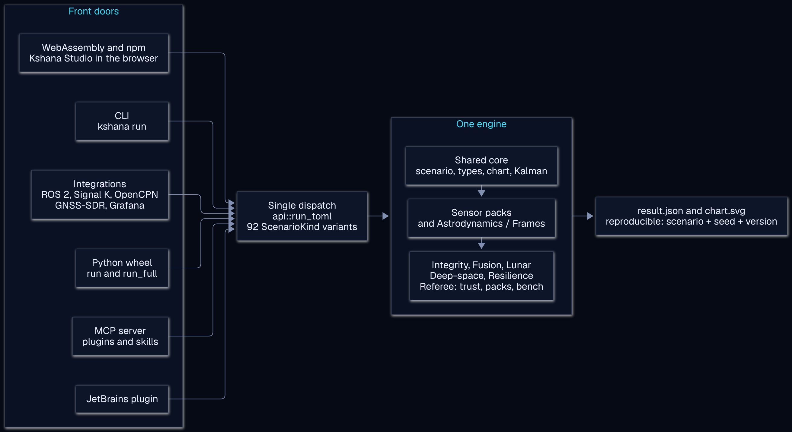<br>
  <sub>Um despacho, um motor, saída reproduzível · <a href="docs/assets/diagrams/system-overview.svg">SVG</a> · fonte <a href="docs/diagrams/system-overview.mmd">system-overview.mmd</a></sub>
</p>

<p align="center">
  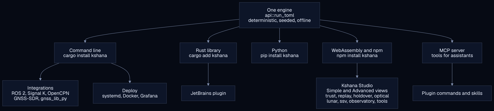<br>
  <sub>Cada superfície, a partir do mesmo motor · <a href="docs/assets/diagrams/surfaces.svg">SVG</a> · fonte <a href="docs/diagrams/surfaces.mmd">surfaces.mmd</a></sub>
</p>

<p align="center">
  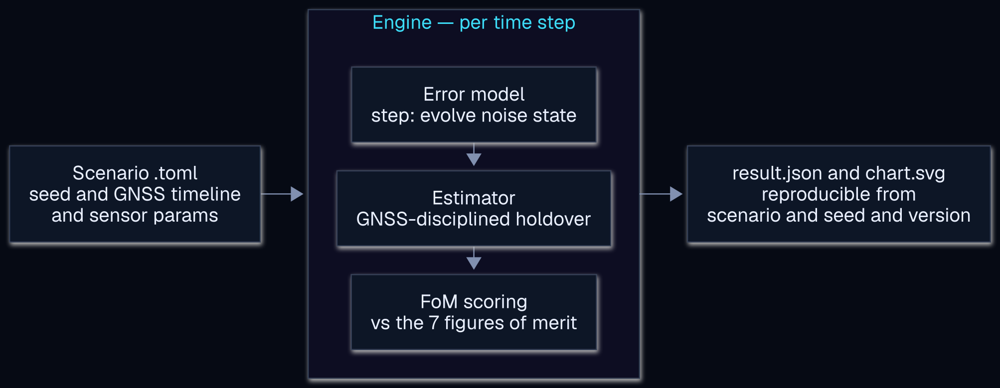<br>
  <sub>O ciclo interno de uma execução · <a href="docs/assets/diagrams/engine-flow.svg">SVG</a> · fonte <a href="docs/diagrams/engine-flow.mmd">engine-flow.mmd</a></sub>
</p>

<p align="center">
  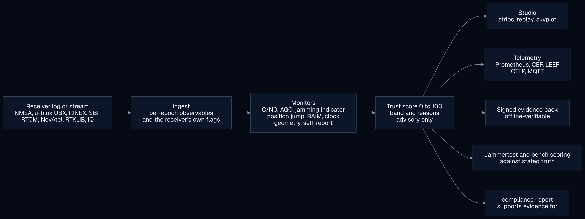<br>
  <sub>De um log de receptor a uma pontuação de confiança e ao que a utiliza · <a href="docs/assets/diagrams/trust-flow.svg">SVG</a> · fonte <a href="docs/diagrams/trust-flow.mmd">trust-flow.mmd</a></sub>
</p>

<p align="center">
  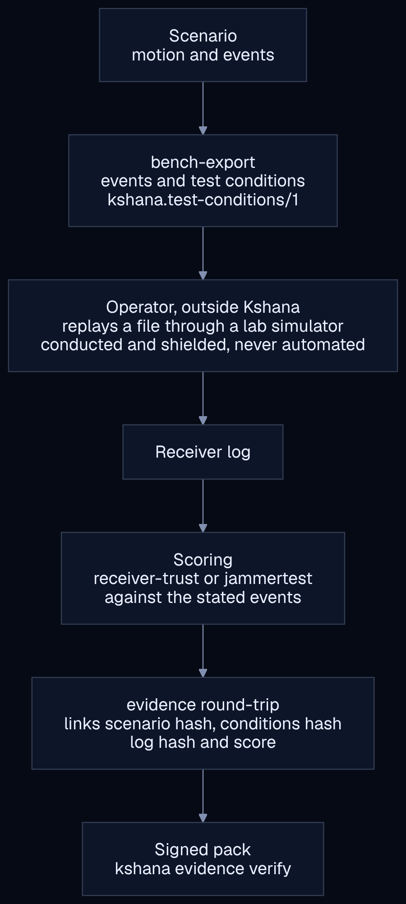<br>
  <sub>Do cenário ao pacote assinado; o Kshana nunca produz nem reproduz um sinal · <a href="docs/assets/diagrams/lab-round-trip.svg">SVG</a> · fonte <a href="docs/diagrams/lab-round-trip.mmd">lab-round-trip.mmd</a></sub>
</p>

<p align="center">
  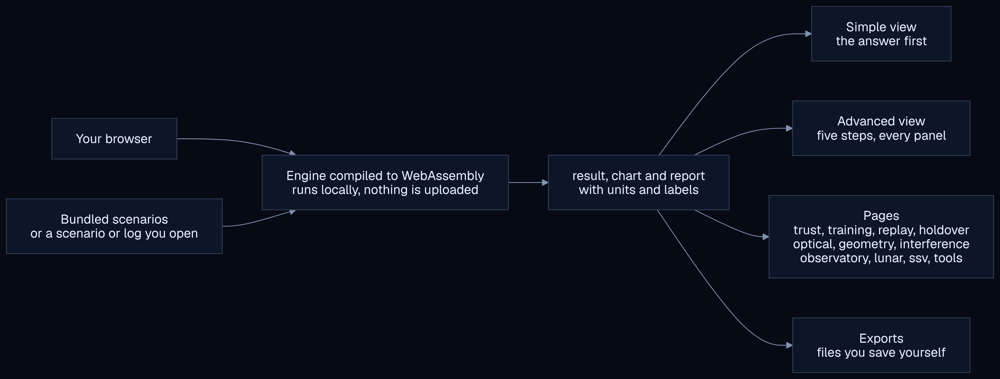<br>
  <sub>Como o Studio roda, localmente · <a href="docs/assets/diagrams/studio-flow.svg">SVG</a> · fonte <a href="docs/diagrams/studio-flow.mmd">studio-flow.mmd</a></sub>
</p>

<p align="center">
  <br>
  <sub>Fluxo de testes e de publicação, das verificações locais a uma versão verificada e ao caminho só para o site · <a href="docs/assets/diagrams/release-flow.svg">SVG</a> · fonte <a href="docs/diagrams/release-flow.mmd">release-flow.mmd</a> · <a href="docs/RELEASING.md">docs/RELEASING.md</a></sub>
</p>

<p align="center">
  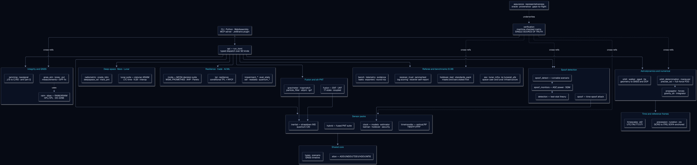<br>
  <sub>Onde o código fica · <a href="docs/assets/diagrams/module-map.svg">SVG</a> · fonte <a href="docs/diagrams/module-map.mmd">module-map.mmd</a></sub>
</p>

<p align="center">
  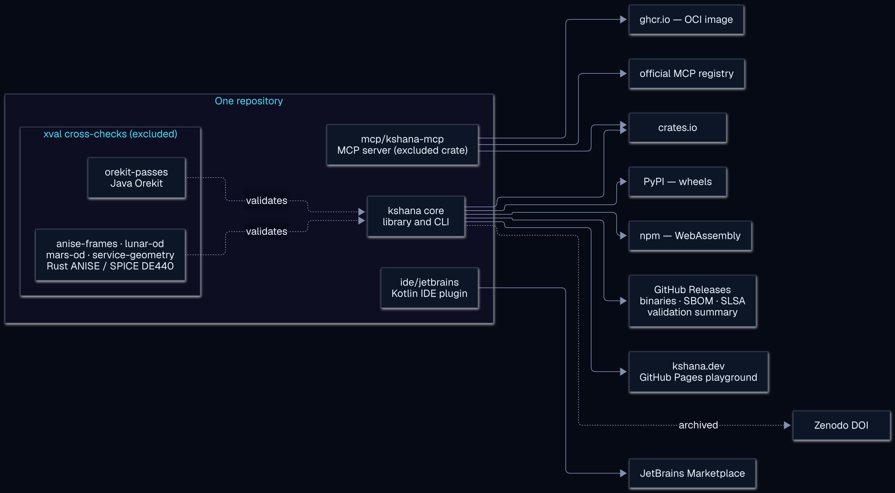<br>
  <sub>O que é distribuído onde, e o que o verifica · <a href="docs/assets/diagrams/distribution.svg">SVG</a> · fonte <a href="docs/diagrams/distribution.mmd">distribution.mmd</a></sub>
</p>

<a id="ai-assistant"></a>
## Assistente de IA

[`kshana-mcp`](mcp/kshana-mcp/) é um servidor MCP: o seu assistente executa o motor de verdade e
lê de volta o seu JSON, em vez de adivinhar a matemática. Cada uma das suas 49 ferramentas é um invólucro fino
sobre uma função pública da biblioteca `kshana`, de modo que nenhuma lógica de simulação fica no servidor.

### Instalar o servidor MCP

> Consultivo, não um equipamento de navegação homologado: o operador continua responsável pela navegação.
> O servidor roda no seu computador; nada é enviado à Ashforde OÜ.

Escolha qualquer canal. Cada link e trecho é gerado a partir de um único script
(`scripts/gen_mcp_install.py`) e verificado na integração contínua; os trechos para Claude Desktop,
Claude Code, Cursor, VS Code, Windsurf, Zed, Goose, Codex CLI, Gemini CLI e Continue estão em
[`docs/MCP-INSTALL.md`](docs/MCP-INSTALL.md).

<!-- mcp-install:begin -->
| Canal | Comando ou botão | Requer | Forma fixada |
|---|---|---|---|
| Extensão do Claude Desktop | clique duas vezes no `.mcpb` do seu sistema: [macOS (Apple silicon)](https://github.com/ashfordeOU/kshana/releases/download/v0.40.0/kshana-mcp-aarch64-apple-darwin.mcpb) · [macOS (Intel)](https://github.com/ashfordeOU/kshana/releases/download/v0.40.0/kshana-mcp-x86_64-apple-darwin.mcpb) · [Windows](https://github.com/ashfordeOU/kshana/releases/download/v0.40.0/kshana-mcp-x86_64-pc-windows-msvc.mcpb) | nada | `kshana-mcp-<target>.mcpb` da v0.40.0 |
| Cursor (um clique) | [npx (Node)](https://cursor.com/en/install-mcp?name=kshana&config=eyJjb21tYW5kIjoibnB4IiwiYXJncyI6WyIteSIsImtzaGFuYS1tY3BAMC40MC4wIl19) · [Docker](https://cursor.com/en/install-mcp?name=kshana&config=eyJjb21tYW5kIjoiZG9ja2VyIiwiYXJncyI6WyJydW4iLCItaSIsIi0tcm0iLCJnaGNyLmlvL2FzaGZvcmRlb3Uva3NoYW5hLW1jcDowLjQwLjAiXX0%3D) | Node, ou Docker | `kshana-mcp@0.40.0` / `ghcr.io/ashfordeou/kshana-mcp:0.40.0` |
| VS Code (um clique) | [npx (Node)](https://insiders.vscode.dev/redirect?url=vscode%3Amcp%2Finstall%3F%257B%2522name%2522%253A%2522kshana%2522%252C%2522command%2522%253A%2522npx%2522%252C%2522args%2522%253A%255B%2522-y%2522%252C%2522kshana-mcp%25400.40.0%2522%255D%257D) · [Docker](https://insiders.vscode.dev/redirect?url=vscode%3Amcp%2Finstall%3F%257B%2522name%2522%253A%2522kshana%2522%252C%2522command%2522%253A%2522docker%2522%252C%2522args%2522%253A%255B%2522run%2522%252C%2522-i%2522%252C%2522--rm%2522%252C%2522ghcr.io%252Fashfordeou%252Fkshana-mcp%253A0.40.0%2522%255D%257D) · [Insiders (npx)](https://insiders.vscode.dev/redirect?url=vscode-insiders%3Amcp%2Finstall%3F%257B%2522name%2522%253A%2522kshana%2522%252C%2522command%2522%253A%2522npx%2522%252C%2522args%2522%253A%255B%2522-y%2522%252C%2522kshana-mcp%25400.40.0%2522%255D%257D) | Node, ou Docker | `kshana-mcp@0.40.0` / `ghcr.io/ashfordeou/kshana-mcp:0.40.0` |
| Claude Code | `claude mcp add kshana -- npx -y kshana-mcp@0.40.0` · plugin: `/plugin marketplace add ashfordeOU/kshana` e depois `/plugin install kshana@ashforde` | Node (ou Docker) | `kshana-mcp@0.40.0` |
| npx | `npx -y kshana-mcp@0.40.0` | Node 18+ | `kshana-mcp@0.40.0` |
| uvx / pipx | `uvx kshana-mcp==0.40.0` · `pipx run kshana-mcp==0.40.0` | Python 3.9+ com uv ou pipx | `kshana-mcp==0.40.0` |
| Docker | `docker run -i --rm ghcr.io/ashfordeou/kshana-mcp:0.40.0` | Docker | `ghcr.io/ashfordeou/kshana-mcp:0.40.0` |
| Homebrew | `brew install ashfordeOU/tap/kshana-mcp` | brew | fórmula para a v0.40.0 |
| Scoop | `scoop bucket add ashforde https://github.com/ashfordeOU/scoop-bucket` e depois `scoop install kshana-mcp` | Scoop (Windows) | manifesto para a v0.40.0 |
| winget | `winget install AshfordeOU.KshanaMcp` | winget (Windows) | `--version 0.40.0` |
| cargo | `cargo install kshana-mcp --version 0.40.0` | Rust 1.88+ | `kshana-mcp 0.40.0` |
| Binário pré-compilado | [a página da versão](https://github.com/ashfordeOU/kshana/releases/tag/v0.40.0): `kshana-mcp` (Linux x86-64), `kshana-mcp-<target>[.exe]`, verificados por `SHA256SUMS` e `gh attestation verify` | nada | v0.40.0 |
| Registro MCP | `io.github.ashfordeOU/kshana-mcp` (encontrado por clientes que conhecem o registro) | um cliente que conheça o registro | `0.40.0` |
| Remoto (HTTP com streaming) | `kshana-mcp --http 127.0.0.1:8080`, auto-hospedado: veja [docs/deploy/mcp-http.md](docs/deploy/mcp-http.md) | o seu próprio host | v0.40.0 |
<!-- mcp-install:end -->

<p><a href="https://glama.ai/mcp/servers/ashfordeOU/kshana"></a></p>

No Claude Code o mesmo servidor chega como um plugin: `/plugin marketplace add ashfordeOU/kshana`, depois
`/plugin install kshana@ashforde`. O plugin acrescenta comandos de barra sobre as ferramentas: `/kshana-run`,
`/kshana-assess-receiver`, `/kshana-evidence-pack`, `/kshana-interference-map`,
`/kshana-training-scenario`, `/kshana-bench-export`, `/kshana-compliance-report`, `/kshana-iq`,
`/kshana-import-route`, `/kshana-marine-integrations` e `/kshana-jammertest`. As ferramentas de confiança na embarcação alimentam as integrações Signal K e
OpenCPN: [`docs/MARINE-INTEGRATIONS.md`](docs/MARINE-INTEGRATIONS.md).

A configuração por cliente está em [`docs/integrations.md`](docs/integrations.md). O servidor está listado
no registro oficial de MCP como `io.github.ashfordeOU/kshana-mcp`.

<details>
<summary>As 49 ferramentas</summary>

<br>

**Cenários e relatórios**

| Ferramenta | O que ela faz |
|---|---|
| `run_scenario` | Executa um cenário a partir de uma definição TOML (Tom's Obvious, Minimal Language) |
| `list_scenario_kinds` | Os 92 tipos de cenário incluídos com descrições + campos obrigatórios/opcionais — para que o agente possa construir um cenário válido |
| `validate_scenario` | Verificação prévia: analisa o TOML e detecta o seu tipo, sem executar |
| `list_example_scenarios` | Os cenários de referência incluídos, em JSON |
| `get_example_scenario` | O texto TOML de um cenário de referência incluído, byte a byte o arquivo em `scenarios/` |
| `report_scenario` | Executa um cenário e devolve o seu relatório |
| `animate_scenario` | Executa um cenário e devolve as suas séries temporais como uma animação |
| `sky_geometry` | Geometria do céu sob uma linha do horizonte dependente do azimute: os satélites visíveis e ocultos, o DOP, a covariância leste-norte-cima e a elipse de erro horizontal; ou uma predefinição de linha do horizonte com a sua proveniência |

**Exportação e interoperabilidade**

| Ferramenta | O que ela faz |
|---|---|
| `list_export_formats` | Quais formatos de interoperabilidade se aplicam a um cenário (`czml`, `kml`, `geojson`, `stk`, `sigmf`), a razão quando um não se aplica, e a especificação que cada escritor segue |
| `export_interop` | Exporta um cenário como CZML (Cesium Language), KML (Keyhole Markup Language), GeoJSON, efeméride STK (Systems Tool Kit) `.e`, ou SigMF (Signal Metadata  |
| `import_route` | Escreve uma rota GeoJSON `LineString` em um cenário que percorre uma trajetória de waypoints (`terrain-nav`, `terrain-slam`, `gravity-map`, `combined-altpnt`) e devolve o novo TOML |
| `export_sp3` | Exporta a constelação de um cenário `orbit` como efeméride precisa SP3-c (Standard Product 3, revisão c) |
| `export_omm` | Exporta os elementos de um cenário `orbit` como um catálogo OMM (Orbit Mean-elements Message) CCSDS (Consultative Committee for Space Data Systems) 502.0-B-2 |
| `export_oem` | Exporta a série de estados de um cenário `orbit` como efeméride CCSDS OEM (Orbit Ephemeris Message) 2.0 — a posição TEME (equador verdadeiro, equinócio médio) *e*  |
| `export_table_csv` | Executa um cenário e devolve a sua tabela de reprodutibilidade como CSV (valores separados por vírgula) — a tabela estável em bytes que a CLI (interface de linha de comando) escreve como `<scenario>.table.csv` |
| `export_test_bench` | O movimento do veículo e os eventos de um cenário para um simulador GNSS de laboratório (`kshana bench-export`) |

**Confiança no receptor e na embarcação**

| Ferramenta | O que ela faz |
|---|---|
| `assess_receiver_log` | Avalia a confiabilidade de um log real de receptor GNSS (sistema global de navegação por satélite) |
| `assess_vessel_stream` | Pontua um trecho limitado de NMEA 0183 (no máximo 2 MiB e 20,000 épocas |
| `assess_vessel_log` | O log NMEA 0183 de uma embarcação (no máximo 4 MiB) como uma execução em lote, com o TOML de sessão declarando os limites da embarcação |
| `create_evidence_pack` | Um pacote de evidências assinado para uma janela do log de uma embarcação (`kshana receiver-trust evidence`) |
| `attach_evidence_timestamp` | Vincula um token de carimbo de tempo RFC 3161 (base64 dos bytes do `.tsr`) a um pacote, em memória (`kshana evidence attach-timestamp`) |
| `verify_evidence_pack` | Verifica um pacote (`kshana evidence verify`) |
| `generate_training_nmea` | NMEA 0183 sintético de passadiço para treinamento de tripulações a partir de um TOML `nmea-scenario` (jamming, arrasto de posição, spoofing de tempo, atraso de repetição) com o log do instrutor (`kshana-nmea-training/1`) |
| `build_interference_map` | Um mapa de interferência GNSS a partir de relatos de posição ADS-B ou AIS como texto CSV (no máximo 4 MiB) |
| `route_exposure` | A fração do comprimento de uma rota em células degradadas, não degradadas, não avaliadas e não observadas de um ou mais mapas de interferência, opcionalmente dentro de um intervalo de datas |
| `trust_telemetry` | Um fluxo de confiança (linhas JSON) ou um resultado `receiver-trust` apresentado como texto Prometheus, linhas syslog CEF ou LEEF ou uma carga JSON OTLP, com os codificadores do `kshana trust-telemetry` |
| `jammertest_import` | Lê o catálogo de testes e o plano de transmissão publicados do Jammertest (NPRA/jammertest-plan, MIT) como verdade programada (`kshana jammertest import`): os intervalos de uma área de teste se tornam eventos de confiança no receptor com o id do catálogo e o ano em cada rótulo. Intervalos planejados, não horários de transmissão registrados; nenhum campo de contato do plano é lido. MODELLED. Veja [`docs/JAMMERTEST.md`](docs/JAMMERTEST.md). |
| `jammertest_score` | Pontua um log de receptor frente a esse cronograma (`kshana jammertest score`): por teste, a latência de detecção, os alarmes perdidos e o tempo até a recuperação, e os alarmes falsos fora de todos os intervalos. Logs de texto como `log`, binários (`ubx`, `sbf`) como `log_base64`. Um pacote assinado precisa de uma chave: linha de comando. Apenas consultivo; MODELLED. |
| `fit_imu_log` | Parâmetros do acelerômetro e do giroscópio dos cenários `hybrid` e `fusion` ajustados a partir de um log de IMU estacionária (CSV ou EuRoC) por desvio de Allan, com uma tabela `[accel_classical]` pronta para colar e o SHA-256 do log (`kshana imu-fit`). Texto na entrada, JSON na saída; MODELLED. |

**GNSS IQ (arquivos no diretório de trabalho; desativado no modo HTTP)**

| Ferramenta | O que ela faz |
|---|---|
| `iq_signals` | A configuração da camada GNSS IQ |
| `iq_info` | Descreve uma gravação IQ (em fase e quadratura) no diretório de trabalho sem processá-la |
| `iq_scene` | Gera uma cena GNSS IQ com vários satélites no diretório de trabalho (`kshana iq scene`) |
| `iq_acquire` | Aquisição por FFT (transformada rápida de Fourier) de um ou mais PRNs (códigos de ruído pseudoaleatório) sobre uma gravação (`kshana iq acquire`), opcionalmente após estágios de entrada |
| `iq_track` | Adquire e depois rastreia com o banco DLL/PLL/FLL (malha de travamento de atraso, de fase e de frequência) (`kshana iq track`), com as malhas de um `kshana.loop-desig |
| `iq_frontend` | Aplica DSP (processamento digital de sinais) de entrada do receptor e de mitigação de interferência |
| `iq_sweep` | Reproduz uma gravação IQ do diretório de trabalho com vários projetos de malha de rastreamento (`kshana iq sweep`) |
| `iq_monitor` | Executa os monitores de detecção de interferência e de spoofing sobre uma gravação IQ do diretório de trabalho (`kshana iq monitor`) |
| `iq_labfit` | Ajusta o modelo de perda de travamento da malha de rastreamento a execuções de laboratório (`kshana iq labfit`) a partir de um cenário `iq-labfit` cujos logs estão embutidos (`text` ou `base64` |
| `iq_test_conditions` | Valida um arquivo `kshana.test-conditions/1` fornecido como texto e devolve as condições resolvidas com o seu hash |
| `iq_campaign` | Executa uma campanha de reprodução em laboratório (`kshana iq campaign`) |
| `iq_campaign_status` | O progresso da pasta de saída de uma campanha |

**Mapeamento de conformidade**

| Ferramenta | O que ela faz |
|---|---|
| `compliance_report` | O mapeamento para frameworks públicos preenchido a partir de documentos de resultado fornecidos como texto (`kshana compliance-report`) |
| `compliance_mapping` | As tabelas de mapeamento estáticas (ou, com `sources`, os documentos de origem que elas citam com versões e URLs) como Markdown, encabeçadas pela mesma declaração |
| `list_standards_packs` | Os pacotes de normas (`kshana standards-pack list`): conjuntos de cenários pontuados para os perfis de teste do framework DHS Resilient PNT, IMO MSC.1/Circ.1575 e ICAO Doc 9849 Appendix F |
| `run_standards_pack` | A execução de um pacote frente a limiares declarados antes da execução: cada teste `MET`, `NOT MET` ou `NEEDS INPUT`; MODELLED, não classifica nenhum produto |
| `lunanet_afs_check` | O LunaNet Augmented Forward Signal verificado frente ao LNIS V5 AD1 Volume A (LSIS-AFS V1.0): os códigos frente às tabelas impressas, ou um fluxo de símbolos frente ao formato de quadro; LDPC e CRC-24Q dos subquadros 2 a 4 não são verificados |
| `create_round_trip_pack` | O pacote assinado de ida e volta com o laboratório: cenário, documento `kshana.test-conditions/1`, log do receptor e pontuação ligados por hash |

**Benchmark**

| Ferramenta | O que ela faz |
|---|---|
| `score_benchmark` | Uma submissão ao kshana-bench pontuada frente a um arquivo de verdade, ambos em texto JSON (`kshana bench score`, `bench/SPEC.md`): o arquivo de resultado com a versão da especificação, a divisão, os hashes de entrada e as métricas da tarefa. MODELLED; descreve um log ou corpus, nunca um produto. |
| `render_leaderboard` | Arquivos de resultado do kshana-bench apresentados como a página estática do placar (texto HTML), cada um validado antes. |

</details>

<a id="editions"></a>
## Edições

O motor inteiro é gratuito. O Kshana Pro e os estudos sob medida são para programas que precisam de mais,
e toda via paga começa com uma mensagem: não há preços aqui.

| | Free | Kshana Pro | Estudo sob medida |
|---|---|---|---|
| O que é | o motor aberto inteiro, os 92 tipos de cenário, sem bloqueio de funcionalidades | uma camada proprietária sobre o mesmo motor, sob contrato | um estudo MODELLED de resiliência de PNT do seu sistema, feito para você |
| Licença | AGPL-3.0 (GNU Affero General Public License, versão 3), ou uma licença comercial | proprietária | contrato |
| Como começar | [instale](#install) ou abra o [kshana.dev](https://kshana.dev) | [solicite uma avaliação do Pro](mailto:contact@ashforde.org?subject=Kshana%20Pro%20evaluation) | [solicite um estudo](mailto:contact@ashforde.org?subject=Kshana%20custom%20study) |

O que o Pro é, nas palavras de [`docs/PRO.md`](docs/PRO.md):

> **Um superconjunto estrito do Kshana aberto.** O Pro depende do motor aberto como biblioteca e
> nunca o bifurca. Cada tipo de cenário aberto roda no Pro sem alterações, e um cenário aberto roda
> no Pro sem nenhuma licença.
>
> **Nenhuma física nova.** O Pro não acrescenta nenhum modelo físico nem altera nenhum. Cada número do Pro vem
> de execuções do motor aberto, de modo que um número do Pro é tão confiável quanto o tipo de cenário aberto
> de que veio, e nunca mais.

O Pro responde às próximas perguntas de um programa: qual projeto voar (um otimizador de projeto e a sua
frente de Pareto), quão segura é a resposta (incerteza e sensibilidade) e se a missão
atende aos seus requisitos (um dossiê de missão, rastreabilidade de requisitos, estudos de compromisso, uma
verificação de regressão de cenários, gêmeos digitais de relógios, um dossiê de estudo e um serviço
on-premises). Ele também acompanha uma campanha de números e faz falhar um pipeline quando um deles piora,
testa planos de sinal candidatos frente aos sinais abertos de navegação por satélite nas duas
direções (coexistência espectral) e enfileira estudos em um serviço de tarefas on-premises com um
registro de entregas encadeado por hash. Cada um é descrito, com o que produz e o que não faz, em
[`docs/PRO.md`](docs/PRO.md). Nada do que o Pro produz é uma certificação, e um estudo sob medida
também não é uma certificação.

<details>
<summary>O que o Kshana Pro lê do motor aberto, e o suporte da Ashforde® OÜ</summary>

<br>

**Sobre o que o Kshana Pro se constrói.** Cada parte do Pro trabalha a partir do motor aberto e o deixa
inalterado:

- **O otimizador de projeto, o estudo de incerteza e o dossiê de missão** executam cenários do motor
  aberto por meio da interface pública do motor e calculam cada número a partir dos resultados
  das execuções. Cada saída mantém o nível VALIDATED, MODELLED ou PARTNER que o motor aberto deu a
  cada número, nunca um nível mais alto.
- **Os gêmeos digitais de relógios** usam o modelo de relógio do motor aberto e o seu estimador de
  desvio de Allan: um gêmeo é calibrado ao orçamento de Allan publicado do dispositivo, e depois verificado
  estimando o desvio de Allan do gêmeo com o estimador aberto.
- **Os estudos de compromisso** executam cada opção de arquitetura como um cenário do motor aberto, sem alterações,
  e classificam as opções segundo uma figura de mérito lida do resultado de cada execução.
- **O acompanhamento de campanhas** lê os seus números dos resultados de execuções do motor aberto dos
  cenários de um pacote e os compara com a execução aprovada anterior.
- **A coexistência espectral** lê cada número físico de execuções do motor aberto dos tipos
  `leo-signal` e `constellation-design`, e acrescenta apenas a soma sobre os satélites
  visíveis e a classificação dos planos.
- **O serviço de tarefas on-premises** executa cenários abertos e do Pro através do mesmo motor e
  armazena cada resultado tal como a execução o devolveu.
- **Os pacotes de evidências** registram, para cada execução, o hash do cenário que o motor aberto carimba no
  seu resultado, de modo que um número de um pacote pode ser reproduzido executando novamente o seu cenário.
- **Ferramentas de engenharia de sistemas e de programa.** As ferramentas de engenharia de sistemas
  baseada em modelos (MBSE) e de programa do Kshana Pro verificam os requisitos de um programa
  frente a execuções do motor aberto: importam requisitos como valores separados por vírgula
  (CSV), ou como um subconjunto documentado do Requirements Interchange Format (ReqIF) ou do
  texto da Systems Modeling Language versão 2 (SysML v2), avaliam cada critério de aceitação,
  com a sua unidade, frente aos valores que uma execução escreveu, e produzem uma matriz de referência cruzada
  de verificação (VCRM), um modelo SysML v2, um relatório de impacto de mudanças e um pacote de evidências
  off-line. Não executam nem recalculam nada de novo, e leem apenas o que o motor aberto
  publica: o `result.json` de cada execução (os campos que um critério nomeia, as suas unidades, o
  carimbo de reprodutibilidade com hash do cenário, semente, versão do motor e versão do esquema, e
  o rótulo da execução e os níveis dos números), o seu `report.json` (tipo, registro de reprodutibilidade e
  rótulos de capacidade), o arquivo do cenário (o seu hash, tipo, semente e parâmetros), o
  esquema de unidades dos campos (a unidade, a proveniência e o nível de evidência de cada campo) e a
  matriz de verificação (o rótulo VALIDATED, MODELLED ou PARTNER de cada capacidade).

<a id="support--professional-services"></a>
### Suporte e serviços profissionais

O Kshana é gratuito e de código aberto sob a AGPL-3.0 e **desenvolvido e
mantido profissionalmente pela Ashforde® OÜ** (Estônia). O motor aberto é completo e utilizável por
si só. Para organizações que precisam de mais, a Ashforde® OÜ oferece:

- **Suporte comercial e integração** — incorporação do Kshana na sua cadeia de ferramentas, cenários
  sob medida e correções prioritárias.
- **Modelos de sensores sob medida** — calibrados ao seu hardware, incluindo modelos de resiliência
  sensíveis a controles de exportação mantidos em uma camada privada.
- **Kshana Pro** — ferramentas proprietárias de engenharia de sistemas baseada em modelos (MBSE) e de
  programa que verificam os requisitos de um programa frente a execuções do motor aberto e
  produzem uma matriz de referência cruzada de verificação (VCRM), um modelo Systems Modeling Language
  versão 2 (SysML v2), um relatório de impacto de mudanças e um pacote de evidências off-line. Não
  executa nada de novo e lê apenas as saídas publicadas do motor: o `result.json`
  e o `report.json` de cada execução, o arquivo do cenário, o esquema de unidades dos campos e os rótulos
  da matriz de verificação (a lista completa está em [Edições](#editions)).
- **Ferramentas de projeto, incerteza e missão do Kshana Pro** — a frente de Pareto de um espaço
  de projeto, incerteza e sensibilidade ao longo de milhares de execuções, e um dossiê de missão
  com um único comando, com uma matriz de verificação e um PDF; veja [`docs/PRO.md`](docs/PRO.md).
- **Acompanhamento de campanhas, coexistência espectral e serviço de tarefas do Kshana Pro** — um pipeline que
  falha quando um número acompanhado piora, planos de sinal testados frente aos sinais abertos de
  navegação por satélite nas duas direções, e uma fila de tarefas on-premises com um
  registro de entregas encadeado por hash; veja [`docs/PRO.md`](docs/PRO.md).
- **Treinamento e consultoria** em análise de desempenho de PNT quântico/clássico.

Este é o modelo open-core: o motor tem, e continuará tendo, licença aberta; o negócio que o
sustenta é a especialização, o suporte e as extensões proprietárias — não taxas de licença.
Contato **contact@ashforde.org** · [ashforde.org](https://ashforde.org).

</details>

<a id="research"></a>
## Pesquisa

Os estudos construídos sobre o motor aberto são publicados no arXiv. Cada um nomeia o comando do motor
por trás dele, de modo que os seus números podem ser gerados novamente a partir de um cenário ou exemplo de estudo incluído no repositório.

<picture>
  <source media="(prefers-color-scheme: dark)" srcset="docs/assets/readme/research-dark.svg">
  <source media="(prefers-color-scheme: light)" srcset="docs/assets/readme/research-light.svg">
  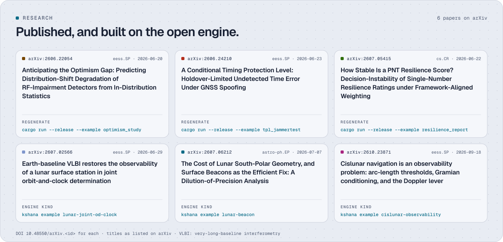
</picture>

| Artigo | O que ele mostra | Comando do motor |
|---|---|---|
| [*Anticipating the Optimism Gap: Predicting Distribution-Shift Degradation of RF-Impairment Detectors from In-Distribution Statistics*](https://arxiv.org/abs/2606.22054)<br><sub>arXiv:2606.22054 · [doi:10.48550/arXiv.2606.22054](https://doi.org/10.48550/arXiv.2606.22054)</sub> | A queda na pontuação de um detector de interferência GNSS quando as condições mudam pode ser prevista apenas a partir de estatísticas dentro da distribuição, em uma bancada sintética aberta e depois em gravações de campo abertas. | `cargo run --release --example optimism_study -- paper-artifacts/optimism-study.json` |
| [*A Conditional Timing Protection Level: Holdover-Limited Undetected Time Error Under GNSS Spoofing*](https://arxiv.org/abs/2606.24210)<br><sub>arXiv:2606.24210 · [doi:10.48550/arXiv.2606.24210](https://doi.org/10.48550/arXiv.2606.24210)</sub> | Um receptor de temporização GNSS sob spoofing não tem limite incondicional finito para o erro de tempo não detectado, por isso o artigo apresenta um limite condicional, calibrado em um spoofing gravado transmitido pelo ar da campanha pública JammerTest 2024. | `cargo run --release --example tpl_jammertest` |
| [*How Stable Is a PNT Resilience Score? Decision-Instability of Single-Number Resilience Ratings under Framework-Aligned Weighting*](https://arxiv.org/abs/2607.05415)<br><sub>arXiv:2607.05415 · [doi:10.48550/arXiv.2607.05415](https://doi.org/10.48550/arXiv.2607.05415)</sub> | Uma pontuação de resiliência composta única é uma base estável para uma decisão apenas onde um projeto domina; onde os projetos competem, apenas mudar os pesos pode trocar o vencedor. | `cargo run --release --example resilience_report -- paper-artifacts/resilience-study.json` |
| [*Earth-baseline VLBI restores the observability of a lunar surface station in joint orbit-and-clock determination*](https://arxiv.org/abs/2607.02566)<br><sub>arXiv:2607.02566 · [doi:10.48550/arXiv.2607.02566](https://doi.org/10.48550/arXiv.2607.02566)</sub> | A medição de distâncias dentro de uma constelação lunar deixa inobservável a posição absoluta de uma estação de superfície; um atraso de interferometria de linha de base muito longa (VLBI) a partir da Terra a restaura quando a constelação é esparsa, e a estreita quando é rica. | o tipo `lunar-joint-od-clock`: `kshana example lunar-joint-od-clock > s.toml && kshana s.toml` |
| [*The Cost of Lunar South-Polar Geometry, and Surface Beacons as the Efficient Fix: A Dilution-of-Precision Analysis*](https://arxiv.org/abs/2607.06212)<br><sub>arXiv:2607.06212 · [doi:10.48550/arXiv.2607.06212](https://doi.org/10.48550/arXiv.2607.06212)</sub> | As constelações planejadas de quatro a seis satélites dão uma geometria ruim no polo sul lunar, e algumas balizas de medição de distância na superfície a corrigem a um custo muito menor do que mais satélites. | o tipo `lunar-beacon`: `kshana example lunar-beacon > s.toml && kshana s.toml` |
| [*Cislunar navigation is an observability problem: arc-length thresholds, Gramian conditioning, and the Doppler lever*](https://arxiv.org/abs/2610.23871)<br><sub>arXiv:2610.23871 · [doi:10.48550/arXiv.2610.23871](https://doi.org/10.48550/arXiv.2610.23871)</sub> | A diluição da precisão não é definida para o rastreamento cislunar apenas por distância, porque a velocidade é inobservável em um instantâneo, por isso o artigo usa o gramiano de observabilidade em quatro órbitas retrógradas distantes planas: apenas distância tem posto 2 de 4 em um instantâneo e precisa de um arco de cerca de 2.09 h para se tornar totalmente observável, com o condicionamento melhorando à medida que o arco se alonga; a taxa de variação da distância (Doppler) dá posto 4 instantaneamente; e coestimar uma estação com os estados e relógios dos satélites continua deficiente em posto por um, a menos que se acrescente um observável interferométrico externo. Os requisitos pertencem a orçamentos de comprimento de arco, condicionamento e tipo de medição, não ao DOP. | o tipo `cislunar-observability`: `kshana scenarios/cislunar-observability.toml` (o seu irmão `cislunar-arc-recovery` testa o limiar com um estimador independente por diferenças finitas) |

Os três exemplos de estudo escrevem artefatos determinísticos byte a byte (sementes fixas) que registram a sua
versão do motor, as sementes e um hash de configuração. Os três artigos lunares e cislunares são construídos sobre o
conjunto lunar (o nível de evidência de cada peça está na matriz de verificação); as suas afirmações de geometria e de diluição da precisão também são verificadas de forma cruzada
frente a referências separadas em `tests/validate_p*.rs`. Mais em
[Artefatos de estudo reproduzíveis](#reproducible-study-artifacts) em Referência.

<a id="cite"></a>
## Citar

Se você usar o Kshana em trabalho acadêmico ou técnico, cite a versão que usou, com o
cenário e a semente. [`CITATION.cff`](CITATION.cff) contém os metadados legíveis por máquina, e
o GitHub mostra a partir dele um botão "Cite this repository". Cada versão é arquivada no Zenodo;
o DOI (Digital Object Identifier) conceitual
[10.5281/zenodo.20528627](https://doi.org/10.5281/zenodo.20528627) sempre resolve para a
versão mais recente.

> Baweja, C. (2026). *Kshana — a PNT-resilience simulator with quantum-sensor performance models*. [Ashforde OÜ](https://ashforde.org). https://doi.org/10.5281/zenodo.20528627

Os artigos acima:

> Baweja, C. (2026). *Anticipating the Optimism Gap: Predicting Distribution-Shift Degradation of RF-Impairment Detectors from In-Distribution Statistics*. arXiv:2606.22054. https://doi.org/10.48550/arXiv.2606.22054
>
> Baweja, C. (2026). *A Conditional Timing Protection Level: Holdover-Limited Undetected Time Error Under GNSS Spoofing*. arXiv:2606.24210. https://doi.org/10.48550/arXiv.2606.24210
>
> Baweja, C. (2026). *How Stable Is a PNT Resilience Score? Decision-Instability of Single-Number Resilience Ratings under Framework-Aligned Weighting*. arXiv:2607.05415. https://doi.org/10.48550/arXiv.2607.05415
>
> Baweja, C. (2026). *Earth-baseline VLBI restores the observability of a lunar surface station in joint orbit-and-clock determination*. arXiv:2607.02566. https://doi.org/10.48550/arXiv.2607.02566
>
> Baweja, C. (2026). *The Cost of Lunar South-Polar Geometry, and Surface Beacons as the Efficient Fix: A Dilution-of-Precision Analysis*. arXiv:2607.06212. https://doi.org/10.48550/arXiv.2607.06212
>
> Baweja, C. (2026). *Cislunar navigation is an observability problem: arc-length thresholds, Gramian conditioning, and the Doppler lever*. arXiv:2610.23871. https://doi.org/10.48550/arXiv.2610.23871

<a id="licence"></a>
## Licença

O Kshana tem licença dupla: a GNU **AGPL-3.0-only** ([`LICENSE`](LICENSE)), ou uma
**licença comercial** da Ashforde® OÜ para integração fechada à qual a AGPL não se adapte.
[`LICENSING.md`](LICENSING.md) explica qual se aplica. As contribuições são licenciadas na entrada
sob a AGPL e também concedem à Ashforde® OÜ o direito de incluí-las na edição
comercial; assine cada commit com `git commit -s` (veja [`CONTRIBUTING.md`](CONTRIBUTING.md)).
"Kshana" e as suas marcas são marcas registradas da Ashforde® OÜ: a licença cobre o código, não o
nome, por isso renomeie os forks.

<a id="reference"></a>
## Referência

O material longo, recolhido. Cada documento está listado em [Documentação](#documentation).

<details>
<summary>Instalação e compilação a partir do código-fonte</summary>

<a id="install--build"></a>
### Instalação e compilação

Requer uma toolchain Rust (≥ 1.88, a `rust-version` em Cargo.toml; desenvolvido na 1.93).

```bash
git clone https://github.com/ashfordeOU/kshana
cd kshana
cargo build --release
cargo test          # all tests pass
```

</details>

<details>
<summary>Uso: a linha de comando por completo</summary>

### Uso

Execute qualquer cenário; a CLI despacha pelo campo `kind` do cenário e escreve
`<scenario>.result.json`, `<scenario>.chart.svg`, `<scenario>.report.html` e
`<scenario>.report.json` ao lado dele — além de `<scenario>.table.csv` para os tipos que
publicam uma tabela. O relatório (uma página em HyperText Markup Language (HTML) e um documento JSON
com o mesmo conteúdo) traz um resumo executivo, cada entrada com a sua unidade, os
resultados e gráficos, as tabelas de varredura, de Monte Carlo ou de cadeia de uma campanha, uma linha do tempo de eventos,
o rótulo VALIDATED / MODELLED / PARTNER e a fonte de cada capacidade usada pela execução,
o que não é modelado e um registro de reprodutibilidade (versão do motor, resumos Secure Hash
Algorithm 256-bit (SHA-256), semente, plataforma e o comando exato). Ele é impresso em
um arquivo PDF (Portable Document Format) limpo a partir do navegador em papel A4 ou Letter; o
motor não escreve nenhum PDF por si só. Veja [`docs/REPORTS.md`](docs/REPORTS.md).

```bash
cargo run -- scenarios/clock-holdover.toml
cargo run -- scenarios/imu-deadreckoning.toml
cargo run -- scenarios/timetransfer.toml
cargo run -- scenarios/hybrid-pnt.toml
cargo run -- scenarios/orbit-gnss-challenged.toml
cargo run -- scenarios/orbit-sgp4-gps.toml
cargo run -- scenarios/orbit-rinex.toml
cargo run -- scenarios/integrity-raim.toml

# Export a propagated constellation to an SP3-c precise-ephemeris file:
cargo run -- scenarios/orbit-sgp4-gps.toml --export-sp3 gps.sp3

# Export the constellation's mean elements to a CCSDS OMM catalogue (one OMM
# message per TLE-defined satellite, with its real NORAD id / COSPAR designator):
cargo run -- scenarios/orbit-sgp4-gps.toml --export-omm gps.omm

# Export the velocity-carrying state to a CCSDS OEM 2.0 ephemeris (GMAT/Orekit/STK):
cargo run -- scenarios/orbit-sgp4-gps.toml --export-oem gps.oem

# Export the geometry for a globe, a map or a mission-analysis tool: CZML, KML,
# GeoJSON, STK .e, or SigMF for the spectrum kind (every format that applies):
cargo run -- scenarios/jamming-demo.toml --export all
```

`--export <czml|kml|geojson|stk|sigmf|all|list>` escreve CZML (a Cesium Language), KML
(Keyhole Markup Language), GeoJSON (Request for Comments 7946), efemérides `.e` do Ansys STK (Systems Tool Kit)
e gravações SigMF (Signal Metadata Format) ao lado do cenário, e
`--import-route <route.geojson>` alimenta uma linha GeoJSON nos tipos que percorrem trajetórias. Cada
formato é validado frente à sua especificação publicada, e um cenário ao qual um formato não
se aplica diz por quê: veja [docs/INTEROP.md](docs/INTEROP.md).

**Outros modos da CLI** — verificar um cenário, fornecer dados reais de orientação da Terra ou executar uma suíte inteira:

```bash
# Lint a scenario without running it (checks the kind + required fields):
cargo run -- --validate scenarios/integrity-raim.toml

# Feed a real IERS Earth-orientation file (finals2000A) for frame precision:
cargo run -- scenarios/orbit-sgp4-gps.toml --eop tests/fixtures/agency/eop/finals2000A_2022001.txt

# Run a SUITE of scenarios into one aggregated, stamped study artifact
# (writes <suite>.study.json + <suite>.study.html next to the manifest):
cargo run -- --study scenarios/quantum-pnt-demonstrator.suite.toml

# Animate a run's time series: an animated SVG, a self-contained HTML player, and a
# numbered SVG frame sequence with manifest.json (see docs/ANIMATION.md):
cargo run -- scenarios/campaign-jam-spoof-holdover-integrity.toml --animate all
```

**Exportação de animações.** `--animate svg|html|frames|all` escreve `<scenario>.animation.svg`
(keyframes de Cascading Style Sheets (CSS), sem script), `<scenario>.animation.html` (reproduzir, pausar, percorrer, velocidade e
painéis sincronizados, sem recurso externo) e `<scenario>.frames/` (`frame_0000.svg`, … mais
`manifest.json` com os quadros por segundo e a duração). Uma campanha reproduz as suas fases e
alarmes, uma execução de espectro a sua cascata; o tema segue `prefers-color-scheme` e
`prefers-reduced-motion` mostra a imagem final. Ela renderiza as próprias amostras da execução,
idênticas byte a byte em uma nova execução, e não acrescenta nenhuma evidência. Veja [docs/ANIMATION.md](docs/ANIMATION.md).

Um manifesto de **suíte** é um pequeno arquivo TOML (Tom's Obvious, Minimal Language) — um `title` e um array `scenarios = [ … ]` de
caminhos de cenários — que o motor executa um após o outro, reunindo cada resultado (com os seus
rótulos MODELLED / VALIDATED) em um único artefato de estudo autodescritivo. Veja
[`scenarios/quantum-pnt-demonstrator.suite.toml`](scenarios/quantum-pnt-demonstrator.suite.toml).

**Papel na interoperabilidade.** O Kshana é a camada de *simulação de desempenho* que fica
ao lado da cadeia de ferramentas de pós-processamento, não um substituto dela: passe a sua saída **RINEX**
ao RTKLIB ou ao gLAB para uma solução de posição, e use a sua saída **SP3** como um
produto de órbita precisa para ferramentas como o Ginan — o Kshana responde *que resiliência uma dada
arquitetura PNT garante* antes que você tenha sinais reais, em formatos que essas ferramentas já
ingerem (`--export-sp3`, ou `export_sp3 = true` em um cenário `orbit`, escreve
`<scenario>.sp3`). A mesma órbita pode ser publicada como elementos médios **CCSDS OMM**
normalizados (`--export-omm`, ou `export_omm = true`, escreve `<scenario>.omm`) —
uma mensagem OMM 502.0 KVN (notação palavra-chave = valor) por satélite definido por TLE, com o número de catálogo
NORAD (North American Aerospace Defense Command) real de cada objeto, o designador internacional COSPAR (Committee
on Space Research) e a época, para qualquer
consumidor que entenda OMM em vez de um conjunto de elementos de duas linhas improvisado.

Exemplo de saída (holdover de relógio — note como as figuras de mérito de Integridade e Segurança são informadas):

```
scenario 5ba83a232b94 | quantum holdover 6600s p95 1.20e-4ns integrity 1.000 security n/a (no attack) | classical holdover 2610s p95 19.7ns integrity 1.000 security n/a (no attack)
wrote scenarios/clock-holdover.result.json, scenarios/clock-holdover.chart.svg, scenarios/clock-holdover.report.html, and scenarios/clock-holdover.report.json
```

O erro de temporização no percentil 95 (p95) do relógio óptico é 1.20e-4 ns: o resumo
imprime valores pequenos com algarismos significativos em vez de arredondá-los para `0.0`.
`security` mostra `n/a (no attack)` porque este cenário não configura nenhum ataque, então não
há nada a detectar. O resultado JSON ainda traz o limite analítico de detectabilidade de spoofing
de cada relógio em `fom.security` (0.997 para o relógio óptico, 0.000 para o
relógio atômico em escala de chip, cujo próprio ruído ao longo da janela de monitoramento excede a especificação
de 20 ns), e o seu bloco `figure_tiers` marca esse número como `applicable: false`. O tipo de cenário `spoof`
pontua a detecção frente a um ataque injetado. `figure_tiers` também dá a
cada número informado o seu nível de verificação — VALIDATED (verificado frente a uma referência
externa) ou MODELLED — e a linha da matriz de verificação de que o nível é lido. O cenário de órbita
informa adicionalmente um bloco de geometria — fração de amostras com posição, e
o melhor/mediano valor de diluição da precisão de posição (PDOP) e de exatidão de posição — ao lado do
resultado do relógio.

> **Leia estes dois números com atenção.** `security` é um *limite analítico de detectabilidade
> de spoofing* derivado da estabilidade de cada relógio — só tem significado frente a um
> cenário de spoofing configurado e **não** é um detector RAIM de vários satélites. `integrity`
> aqui é a *autoconsistência* do filtro (fração das amostras da interrupção dentro do seu próprio limite de k
> sigmas), **não** um número de integridade HPL/VPL de aviação. Veja
> [`docs/INTEGRITY.md`](docs/INTEGRITY.md).
>
> Para uma integridade autônoma no receptor genuína, o **tipo de cenário `integrity`**
> (`scenarios/integrity-raim.toml`) executa RAIM real instantâneo e por separação de soluções
> (estilo ARAIM) sobre a geometria da constelação propagada: ele calcula
> **níveis de proteção horizontal/vertical (HPL/VPL)** por época e informa a
> fração de épocas que atendem aos limites de alerta configurados, com um diagrama de integridade
> de Stanford para a classificação erro vs PL (nível de proteção).

<a id="reproducible-study-artifacts"></a>
#### Artefatos de estudo reproduzíveis

Quatro estudos abertos geram novamente, cada um, um artefato determinístico byte a byte (semente fixa) a partir de um único
comando — os números por trás dos estudos de cruzamento quântico vs clássico, da lacuna de otimismo
de degradações de RF, da pontuação de resiliência de PNT e do nível de proteção de temporização:

```bash
# Quantum-vs-classical resilience crossover map (writes paper/crossover/*.json):
cargo run --release --bin crossover_study -- paper/crossover

# RF-impairment optimism-gap study (13-detector panel, scaling laws, LOO predictor):
cargo run --release --example optimism_study -- paper-artifacts/optimism-study.json

# Framework-aligned PNT-resilience scoring + decision-instability study:
cargo run --release --example resilience_report -- paper-artifacts/resilience-study.json

# Conditional Timing Protection Level, calibrated on a real recorded spoof:
cargo run --release --example tpl_jammertest
```

Cada artefato registra a sua versão do motor, as sementes e um hash de configuração e traz um rótulo
MODELLED/VALIDATED honesto. As sondas de dados reais (`*_probe`) executam o mesmo pipeline sobre
gravações que você fornece localmente; nenhum conjunto de dados é distribuído no repositório. O estudo da lacuna de otimismo
de degradações de RF está descrito no preprint
[arXiv:2606.22054](https://arxiv.org/abs/2606.22054), e o nível de proteção de temporização
condicional (`tpl_jammertest` acima) no preprint
[arXiv:2606.24210](https://arxiv.org/abs/2606.24210) (veja [Citar](#cite)).

Os estudos de PNT lunar publicados ([arXiv:2607.06212](https://arxiv.org/abs/2607.06212)
DOP com balizas de superfície, [arXiv:2607.02566](https://arxiv.org/abs/2607.02566) observabilidade
com VLBI e [arXiv:2610.23871](https://arxiv.org/abs/2610.23871) observabilidade cislunar por comprimento
de arco) têm as suas afirmações de geometria, de diluição da precisão, de previsão em tempo real de referencial /
parâmetros de orientação da Terra (EOP), de órbitas retrógradas distantes e de medição de distância por RF
verificadas de forma cruzada e independente em
`tests/validate_p*.rs` frente a referências separadas (`scipy.special.j1`, uma resolução de DOP independente em NumPy
`(HᵀH)⁻¹`, uma nova análise em NumPy das mesmas linhas `finals2000A` do IERS e a
NASA/JPL Three-Body Periodic Orbit Database). Estas são verificações de regressão adicionais sobre
o conjunto lunar **modelado**; não alteram a contagem da matriz verificada por máquina.

</details>

<details>
<summary>Formato de cenário</summary>

<a id="scenario-format"></a>
### Formato de cenário

Os cenários são TOML declarativo. Um `kind` no nível superior seleciona o pacote — **cinquenta** ao
todo (`clock` é o padrão se omitido): `inertial`, `timetransfer`, `hybrid`, `hybrid-ukf`, `fusion`,
`gnss-ins`, `orbit`, `ephemeris`, `gnss-sim`, `integrity`, `lunar-integrity`, `lunar-time-offset`, `spoof`,
`spoof-detect`, `jamming`, `sweep`, `sweep-nd`, `gravity-map`, `terrain-nav`, `terrain-slam`,
`combined-altpnt`, `pvt`, `mars-pnt`, `impairment-eval` (bancada de avaliação de detecção de degradações de RF por IA/ML
— corpus sintético rotulado + arcabouço ROC/AUC independente do detector +
lacuna de otimismo dentro/fora da distribuição), `quantum-trade` (compromisso de PNT quântico vs clássico
com ingestão de ADEV medido + envelope de resiliência sem GNSS; MODELLED),
`space-weather` (índices solares/geomagnéticos + temperatura exosférica de Jacchia-71 +
densidade termosférica dependente da atividade sobre a atmosfera estática; MODELLED),
`oem-interop` (ponte de importação/ida e volta CCSDS OEM para efemérides GMAT/Orekit/STK;
MODELLED), o trio de análise de missão `launch-window` (azimute de lançamento de dois corpos /
mudança de plano / oportunidades), `reentry` (corredor de reentrada balística de Allen-Eggers),
`eo-coverage` (geometria de faixa imageada / GSD / acesso / revisita de EO), `space-packet` (enquadramento de Space Packet
CCSDS 133.0 TM/TC — telemetria/telecomando — com layout exato de bits, verificado por ida e volta), e
`attitude-budget` (torque de gradiente de gravidade 3-DOF + orçamento de erro de apontamento RSS),
`passes` (previsão de passagens de nascer/pôr sobre estações terrestres — AOS/TCA/LOS, elevação máxima,
acesso), e `link-budget` (equação de enlace de uma via CCSDS/DSN — FSPL / Eb·N₀ /
margem / fechamento); `telecom-timing` (erro de tempo em holdover, MTIE e TDEV verificados
frente às máscaras ITU-T); `spectrum` (toda a banda L do GNSS como uma densidade espectral de potência:
uma cascata frequência por tempo sob uma linha do tempo roteirizada de jammer de onda contínua, banda estreita, chirp ou
ruído casado, razão jammer-sinal por banda e densidade portadora-ruído efetiva
a partir do coeficiente de separação espectral, e entrada e saída de gravações Signal Metadata
Format (SigMF) com estimativas espectrais de Welch; os espectros dos sinais
VALIDATED frente a valores de livros-texto, o cenário de jammer MODELLED; veja
[`docs/SPECTRUM.md`](docs/SPECTRUM.md); o mesmo tipo desenha painéis das bandas UHF, S e C com
sinais projetados para órbita terrestre baixa); `leo-signal` (projetos de sinais de posicionamento, navegação e
temporização em órbita terrestre baixa para qualquer sistema: espectros de banda limitada, jitter de rastreamento de código e exatidão
de medição de distância, busca e tempo de aquisição, separação espectral frente ao GPS e ao Galileo, tolerância a
jammers e um compromisso de UHF a banda C, a partir de predefinições públicas como Xona Pulsar, Iridium,
Starlink e CentiSpace ou de projetos embutidos; as formas fechadas e o Doppler LEO VALIDATED, os
projetos MODELLED; veja [`docs/LEO-SIGNAL.md`](docs/LEO-SIGNAL.md)); `solar-system` (o Sol, os planetas, Plutão, a Lua e sete luas
principais em uma época — posições, constantes, tempos-luz e traçados de órbita; posições dos planetas
VALIDATED frente ao JPL Horizons) e `body-pnt` (posicionamento em torno de qualquer um desses corpos com uma
constelação de navegação local e um enlace de espaço profundo a partir da Terra; MODELLED); `campaign` (tipos existentes compostos em uma linha do tempo de missão encadeada
com estado passado entre fases, uma varredura de parâmetros, um conjunto de Monte Carlo com semente, ou
vários cenários sob uma condição compartilhada; MODELLED, veja
[docs/CAMPAIGNS.md](docs/CAMPAIGNS.md)); `constellation-design` (padrões Walker delta e estrela,
listas de elementos e projetos de várias cascas com predefinições GPS, Galileo, BeiDou e GLONASS,
e cobertura e diluição da precisão sobre uma grade de latitude/longitude; o
gerador e o DOP global do GPS VALIDATED frente aos documentos de serviço publicados, veja
[`docs/CONSTELLATION-DESIGN.md`](docs/CONSTELLATION-DESIGN.md)); `leo-pass` (uma passagem de satélite de
posicionamento, navegação e temporização (PNT) em órbita terrestre baixa (LEO) e o seu orçamento de enlace banda
por banda, a partir de qualquer constelação e qualquer projeto de sinal: ângulos de visada, Doppler e taxa de Doppler,
chuva, gases, cintilação e perda de entrada em edificações segundo o ITU-R, densidade portadora-ruído frente aos
satélites GNSS MEO visíveis, os pares de ionosfera de primeira ordem e livres da ionosfera, e um
orçamento de posição de baixa energia, sondagem da ionosfera a partir de cada par de bandas, e monitores de spoofing por
consistência de Doppler e de geometria da passagem e por consistência entre bandas; os termos ITU-R e o
envelope Doppler do usuário estático VALIDATED, a passagem MODELLED, veja
[`docs/LEO-PASS.md`](docs/LEO-PASS.md)); `leo-navmsg` (a mensagem transmitida de
efemérides e de relógio de um satélite PNT em órbita terrestre baixa (LEO), para qualquer órbita e
portadora: um ajustador de uma órbita de verdade integrada para o conjunto kepleriano do Galileo, esse conjunto
com polinômios de correção ao longo do traço, através do traço e radial, o modelo de 22 parâmetros de Liu et al. 2025
ou o polinômio ECEF de relógio zero ATOMIC; erro de distância do sinal no espaço
(SISRE) em função do intervalo de ajuste e do período de atualização, uma verificação de continuidade da atualização no meio da passagem,
o quadro binário documentado próprio do Kshana com uma verificação de redundância cíclica CRC-24Q e um orçamento de quantização, e um
bloco no estilo RINEX-4 rotulado como extensão do Kshana; os pesos do SISRE, o algoritmo de usuário
do Galileo e o CRC-24Q VALIDATED, os ajustes MODELLED; predefinições opcionais para Xona Pulsar,
Iridium, Starlink, CentiSpace, um sistema representativo em banda C, ATOMIC e Celeste IOD; veja
[`docs/LEO-NAVMSG.md`](docs/LEO-NAVMSG.md)); o trio **PNT fundido MEO + LEO**
`leo-pvt` (posicionamento Doppler a partir da taxa de variação da distância em órbita terrestre baixa (LEO), posições
conjuntas por pseudodistância GNSS + LEO com vieses intersistema e o DOP em função do número de satélites
LEO, cobertura polar e ártica, e transferência de tempo LEO para UTC — sobre qualquer constelação,
com predefinições opcionais como sinais de oportunidade Xona Pulsar, Iridium e Starlink; o
envelope Doppler LEO VALIDATED frente aos números publicados do Iridium e do Xona), `leo-ppp`
(convergência do posicionamento por ponto preciso só com GNSS e com aumentação LEO, comparada
com Li et al. 2019) e `ntn-positioning` (posicionamento em rede não terrestre 5G a partir do
limite de Cramér-Rao da largura de banda do sinal), MODELLED exceto esse envelope, veja
[`docs/LEO-PNT-FUSION.md`](docs/LEO-PNT-FUSION.md); `leo-pnt-chain` (um sistema LEO-PNT de ponta
a ponta: um projeto `leo-signal` levado por uma banda `leo-pass`, o C/N0 da passagem e a navegação
o erro de distância do sinal no espaço da mensagem passados a uma posição fundida `leo-pvt` e à convergência `leo-ppp`,
com cada transferência listada; MODELLED, veja
[`docs/LEO-PNT.md`](docs/LEO-PNT.md#end-to-end-leo-pnt-chain), que é também a visão geral de
cada tipo e cenário LEO-PNT, incluindo as campanhas de resiliência, um cenário por
área de foco experimental e um por vertical de usuário final); o **conjunto de PNT lunar** `lunar-vlbi`, `lunar-joint-od-clock`,
`lunar-frame-realisation`, `moonlight-service-volume`, `lunar-differential-pnt`,
`lunar-interop-export`; o **demonstrador de PNT habilitado por quântica**
`quantum-time-transfer`, `quantum-gnss-free-nav`, `quantum-anomaly-detect`; e os
tipos de pesquisa de **segurança de sinais, cislunar e resiliência em camadas** `lunar-attack-surface`,
`realtime-frame-eop`, `lunar-time-budget`, `hybrid-optical-rf`, `cislunar-observability`,
`conflict-resilience` — o trio de análise de missão e esses tipos posteriores são todos MODELLED
(cada um com um núcleo validado em forma fechada; veja a matriz).
Campos comuns: `seed`, uma grade `[time]`, uma linha do tempo de disponibilidade `[gnss]` (o que
determina a interrupção) e blocos por sensor com strings `provenance` que citam a fonte de cada
número. Exemplo (relógio):

```toml
seed = 42
threshold_ns = 20.0
[time]
step_s = 10.0
duration_s = 7200.0
[gnss]
windows = [
  { t0 = 0.0,   t1 = 600.0,  state = "nominal" },  # 10 min GNSS sync
  { t0 = 600.0, t1 = 7200.0, state = "denied"  },  # ~1.8 h outage
]
[clock_quantum]
id = "optical-sr-lattice"
provenance = "Strontium optical lattice clock, space-oriented goal sigma_y(1s)=1e-15 (arXiv:1503.08457)"
y0 = 5.0e-17
q_wf = 1.0e-30   # white FM:  q_wf = sigma_y(1s)^2
q_rw = 0.0       # random-walk FM
drift = 0.0      # linear aging (per second)
[clock_classical]
id = "csac-sa45s"
provenance = "Microchip SA65 / SA.45s CSAC datasheet sigma_y(1s)=3e-10"
y0 = 5.0e-10
q_wf = 9.0e-20
q_rw = 0.0
drift = 0.0
```

Campos opcionais (desativados quando ausentes): um relógio pode acrescentar `flicker_floor` (piso de Allan de FM 1/f — modulação
de frequência); um sensor inercial pode acrescentar `gyro_bias` e `q_arw` (viés do giroscópio e passeio
aleatório angular), e `bias_instability` e `q_aa` (o piso de instabilidade de viés de Allan e o
passeio aleatório de aceleração) — juntos, um **orçamento de erro de acelerômetro de eixo único (1-DOF)**
(VRW/ARW — passeio aleatório de velocidade/angular — e instabilidade de viés). Este é o orçamento de erro que o *pacote*
de cenário `inertial` distribuído executa. Separadamente, a biblioteca agora traz um **navegador strapdown
de 3 eixos** verificado (`src/inertial/{attitude,mechanization,imu_errors}.rs`):
atitude por quatérnios com compensação de coning/sculling, uma mecanização NED completa
(termos de taxa da Terra e de taxa de transporte, gravidade de Somigliana WGS-84) e um
modelo determinístico de erros de IMU em que **fator de escala, desalinhamento,
sensibilidade a g, quantização e rampa de taxa são modelados** (IEEE Std 952-1997, a norma do IEEE
de especificação e procedimentos de teste de giroscópios, §A.2; Groves 2013 §4.3). Esse caminho de 3 eixos agora está **ligado a um pacote
GNSS/INS fracamente acoplado executável** (`kind = "gnss-ins"`): um EKF de estado de erro de 15 estados
disciplina a solução strapdown frente a posições ruidosas enquanto o GNSS está ativo, e depois
navega livre durante a interrupção, informando o erro horizontal fundido frente à
navegação livre da INS em malha aberta. Também está disponível uma atualização **fortemente acoplada por pseudodistância**
(ela forma a inovação no domínio da distância, de modo que continua corrigindo
com menos de quatro satélites). Um
cenário de holdover de relógio pode acrescentar `runs` (> 1) para executar um **conjunto de Monte Carlo** — cada
figura de mérito é então informada como uma média com uma dispersão do 5º ao 95º percentil e o
gráfico sombreia a faixa de confiança do erro (veja `scenarios/clock-ensemble.toml`).

Um cenário `fusion` (mesmos blocos que `hybrid`) executa **dois estimadores de Kalman independentes**
— um para o estado do relógio, outro para o estado da posição — disciplinados pelo GNSS e auxiliados pela
transferência de tempo óptica, e informa uma FoM de holdover combinada. Os dois blocos não compartilham
covariância cruzada: trata-se de um par empilhado de orçamentos de erro, **não** de um verdadeiro filtro conjunto acoplado
de relógio+posição (a covariância entre blocos é um item do roteiro). Veja
`scenarios/fusion-pnt.toml`.

Um cenário `spoof` injeta um spoofing de tempo — um de quatro tipos `[attack.shape]`
(`linear_ramp`, `step_jump`, `meaconing`, `replay`; um `rate_ns_per_s` isolado ainda é
aceito como rampa linear) — e executa o detector de spoofing de cada relógio. O detector é um
**teste de energia χ²₁ / Neyman–Pearson** bilateral sobre a estatística de monitor auxiliada pelo relógio:
o limiar é definido a partir de um orçamento alvo de alarmes falsos `target_pfa`, e a
**probabilidade de detecção perdida `P_md`** é informada tanto em forma fechada quanto por
Monte Carlo (`mc_runs` ensaios por hipótese — as duas concordam dentro de alguns ×1/√N). A
**figura de mérito de Segurança é `1 − P_md`** na magnitude operacionalmente prejudicial (especificação),
de modo que um relógio silencioso que detecta um spoofing do tamanho da especificação pontua ≈ 1 e um ruidoso
que muitas vezes o perde pontua menos (veja `scenarios/spoof-attack.toml`,
`scenarios/spoof-meaconing.toml`).

Um cenário `gnss-sim` é uma simulação no **domínio de medição**: para cada satélite
visível ele sintetiza a pseudodistância `ρ = geometric range + c·δt_rx − c·δt_sv +
I + T + noise + multipath` e o Doppler em L1, com a ionosfera de frequência única **Klobuchar**
(`[iono]`, IS-GPS-200 §20.3.3.5.2.5) e a troposfera zenital de **Saastamoinen**
projetada pela função de mapeamento de **Niell (1996)** (`[tropo]`). Os
resíduos alimentam o **RAIM instantâneo** para HPL/VPL por época, e a pseudodistância,
o Doppler, o C/N₀ e as correções de iono/tropo de cada satélite são emitidos no array JSON
`gnss_measurements`. É um simulador direto (gera medições a partir de
uma verdade conhecida), não um receptor/resolvedor — uma execução sem ruído reproduz a geometria mais as
correções com precisão submilimétrica (veja `scenarios/gnss-sim-raim.toml`).

Um cenário `jamming` modela a interferência de RF como um **orçamento de enlace**: um `[jammer]`
(posição ECEF, `power_dbw` de transmissão, tipo) eleva a razão jammer-sinal em um
`[receiver]` que observa uma `[constellation]` Walker. A partir da geometria (perda de propagação
em espaço livre e o ganho da antena receptora por direção) ele calcula o `J/S` de cada satélite,
o **C/N₀ efetivo** pela equação antijamming padrão (ganho de processamento por desespalhamento
× o fator de separação espectral `Q`; Kaplan & Hegarty §9.4), e
sinaliza a perda de travamento abaixo de um limiar de rastreamento configurável — informando uma figura de mérito
`availability_under_jamming`. Um jammer de banda larga de 10 W a 1 km
nega completamente o receptor (J/S ≈ 72 dB); o mesmo jammer a 100 km apenas
degrada os enlaces (veja `scenarios/jamming-demo.toml`).

Um cenário `sweep` executa um **estudo de compromisso**: varia um `parameter` (`threshold_ns`,
`duration_s`, `quantum_q_wf` ou `classical_q_wf`) de `start` a `stop` ao longo de `steps`
pontos em uma `scale` `lin` ou `log`, registra uma `metric` (por exemplo `holdover_s`) para os dois
relógios e traça as duas curvas. O cenário base fica em `[base]` (veja
`scenarios/sweep-clock-stability.toml`).

Um cenário `sweep-nd` generaliza isto para **qualquer pacote e qualquer número de eixos**: ele
varia chaves TOML com pontos de um cenário `[base]` (de qualquer `kind`) sobre o produto
cartesiano de `[[axes]]`, executa novamente cada nó da grade e registra `metrics` dadas como
caminhos JSON com pontos dentro do resultado (por exemplo `classical.fom.holdover_s`). Ele funciona para
todos os pacotes porque opera na fronteira TOML/resultado; as execuções nativas avaliam
a grade em paralelo (sem dependência extra, o wasm recorre à execução sequencial) e a
saída é determinística e em ordem de linhas (veja `scenarios/sweep-nd-inertial.toml`).

Um cenário `orbit` deriva a linha do tempo `[gnss]` da geometria em vez de escrevê-la
à mão — forneça uma órbita `[user]`, uma `[constellation]`, uma `mask_deg` de elevação e os dois
blocos de relógio. Ele também informa a exatidão de posição a partir da geometria dos satélites; o
`sigma_uere_m` opcional (erro de distância equivalente do usuário de 1 sigma, padrão 1 m) escala a
diluição da precisão de posição em um sigma de posição. A órbita do usuário pode ser tornada
**excêntrica** com `eccentricity` e `argp_deg`, e `j2 = true` acrescenta a deriva secular do achatamento
da Terra (veja `scenarios/orbit-molniya.toml`). A constelação pode, em vez disso, ser uma
**real**: forneça a `[constellation]` um bloco `tle` de conjuntos de elementos de duas linhas e os
satélites são analisados a partir dele (veja `scenarios/orbit-real-tle.toml`). Acrescente um ou mais
blocos `[[constellations]]` para **multi-GNSS** (por exemplo GPS + Galileo; veja
`scenarios/orbit-multignss.toml`):

```toml
kind = "orbit"
seed = 7
threshold_ns = 5.0
mask_deg = 10.0
sigma_uere_m = 1.0           # optional; position sigma = position-DOP * this
[time]
step_s = 60.0
duration_s = 86400.0
[user]                       # spacecraft (altitude in km, angles in deg)
altitude_km = 8000.0
inclination_deg = 0.0
[constellation]              # Walker-delta GNSS (GPS-like)
altitude_km = 20180.0
inclination_deg = 55.0
planes = 6
sats_per_plane = 4
phasing_f = 1.0
[clock_quantum]  # ... as above
[clock_classical]  # ... as above
```

Os tipos **alt-PNT sem GPS** navegam sem nenhum GNSS, fazendo a correspondência de uma sequência
de campo medida com um mapa por meio de um filtro de partículas. Um cenário `gravity-map` percorre uma trajetória
através de um campo de anomalias de gravidade em harmônicos esféricos e a recupera a partir da leitura de um
gravímetro de átomos frios (`scenarios/gps-denied-gravity-nav.toml`); um cenário `terrain-nav`
faz o mesmo frente a um DEM de elevação SRTM (TERCOM/SITAN, `scenarios/terrain-nav.toml`);
e um cenário `combined-altpnt` funde **gravidade + magnetismo IGRF + terreno** em um único filtro
(`scenarios/combined-altpnt.toml`).

Um cenário `lunar-integrity` avalia o PNT **cislunar**: executa uma passagem de nível de proteção
ARAIM no polo sul lunar frente a um conjunto de retransmissores LunaNet/LNIS e informa declaradamente a
lacuna de integridade — um σ_URE lunar de ~30 m leva o nível de proteção bem acima de um limite de alerta
de 50 m, de modo que o serviço fica *indisponível* sob regras de integridade no estilo da aviação
(`scenarios/lunanet-araim.toml`).

Um cenário `lunar-time-offset` informa a **taxa relativística dos relógios Terra–Lua** — a
base de uma escala de Tempo Coordenado Lunar (LTC/TCL). Uma identidade pós-newtoniana a partir de primeiros princípios
soma a diferença de autopotencial (o potencial do geoide `L_G` da IAU menos o autopotencial
da superfície da Lua) e o termo cinético da Lua (Doppler de segunda ordem) em uma taxa secular
de ≈ 57 µs/dia, informada junto com a faixa publicada de 56–59 µs/dia; também dá o
deslocamento LTC−TT acumulado ao longo de um horizonte e um conjunto por variância inversa (um
relógio de papel lunar). **MODELLED** — o número principal *depende da referência* (geoide terrestre
vs selenoide lunar, janela de média), e é por isso que se informa uma faixa, e não um único número
certificado (`scenarios/lunar-time-offset.toml`).

Veja `scenarios/` para pelo menos um exemplo resolvido de cada tipo (92 tipos, 193 arquivos de cenário
`.toml` + 1 manifesto de suíte — vários tipos trazem mais de um exemplo). Nem todo
tipo tem um arquivo com o seu nome: `lunar-integrity` → `scenarios/lunanet-araim.toml` e
`gravity-map` → `scenarios/gps-denied-gravity-nav.toml` são dois de vários casos assim.
Liste os tipos despacháveis a qualquer momento com os erros de `cargo run -- --validate <file>`,
o `list_kinds()` do Python ou a ferramenta MCP `list_scenario_kinds`.

</details>

<details>
<summary>Saída</summary>

### Saída

O artefato de resultado é JSON versionado e autodescritivo: séries temporais por passo, as
figuras de mérito pontuadas, as especificações dos modelos ativos (com proveniência), a semente, um
**hash do cenário** — para que qualquer gráfico possa ser reproduzido a partir do arquivo — e, para cada relógio,
uma `adev_curve` (`[{tau_s, adev, n_samples, noise, edf, ci_lo, ci_hi}]`): o desvio de Allan
sobreposto ao longo de tempos de média espaçados por oitavas — a forma padrão de ler a
estabilidade de um relógio — agora com uma **faixa de confiança de 95% específica do tipo de ruído** por ponto (o
tipo de lei de potência do registro é identificado a partir da sua inclinação de Allan modificada, e o intervalo χ² usa os
graus de liberdade efetivos correspondentes do NIST SP 1065). O playground no navegador o apresenta como um
gráfico log-log "Clock stability (ADEV)". (MDEV, TDEV e HDEV estão disponíveis como estimadores
da biblioteca; a curva de resultado exportada é o ADEV sobreposto.) Cada campo, com unidades e um
ponteiro para a fonte, está documentado em [`docs/SCHEMA.md`](docs/SCHEMA.md).

**Cada gráfico é autodescritivo.** O playground no navegador, a exportação `*.chart.svg`
da CLI e o quadro de pontuação em HTML (HyperText Markup Language) carimbam cada imagem de gráfico com um rodapé que diz
`Kshana v<version> · scenario <hash> · kshana.dev`. O `scenario <hash>` são os primeiros
12 caracteres hexadecimais do **hash do cenário** da execução — um resumo SHA-256 (o Secure Hash Algorithm de 256 bits) sobre a definição
canônica do cenário (semente, limiares, parâmetros dos modelos, janelas GNSS, …); os relatórios de integridade e
lunares, que não trazem hash próprio, recorrem a um SHA-256 da fonte do cenário.
É a **mesma impressão digital** mostrada no resumo de uma linha e no JSON de resultado, de modo que um
gráfico salvo ou colado sempre traz a sua versão, o cenário exato que o produziu (para
reprodução bit a bit) e a fonte — altere qualquer entrada e o hash muda.

As figuras de mérito seguem as figuras de mérito operacionais padrão de PNT:

| Figura de mérito | Como o Kshana a calcula |
|-----------------|------------------------|
| Desempenho de temporização (pacotes de relógio/órbita) | RMS + percentil 95 do erro de fase do relógio ao longo da interrupção, em **nanossegundos** (`timing_rms_ns`) — uma métrica de temporização, não de posição |
| Desempenho de posicionamento (pacotes inercial/híbrido) | RMS + percentil 95 do erro de posição 1-DOF ao longo da interrupção, em **metros** (`pos_rms_m`); eixo único. Uma execução isolada é marcada `monte_carlo: false`; defina `runs = N` para um conjunto de Monte Carlo que informa a média, a dispersão e o IC (intervalo de confiança) de 95% por bootstrap de cada métrica. Ainda **não** é um CEP/2DRMS 2-D (erro circular provável / duas vezes o valor quadrático médio da distância) nem uma exatidão ponderada por DOP (esses precisam do modelo de 3 eixos — roteiro) |
| Autonomia | duração do holdover — tempo dentro da especificação após a perda do GNSS (quantizada pela grade: um limite inferior) |
| Resiliência | inclinação do crescimento do erro durante a interrupção |
| Disponibilidade | fração da execução com uma solução dentro da especificação |
| Integridade | **autoconsistência** do filtro — fração das amostras da interrupção cujo erro fica dentro do próprio limite de k sigmas do filtro de Kalman. **Não** é um número de integridade HPL/VPL/RAIM de aviação (veja [`docs/INTEGRITY.md`](docs/INTEGRITY.md)) |
| Segurança | **limite analítico de *detectabilidade* de spoofing** a partir da estabilidade do relógio — quão pequeno/lento pode ser um spoofing de tempo que um monitor de consistência de relógio único conseguiria sinalizar. Só tem significado com um ataque configurado; **não** é um detector RAIM de vários satélites |

É novo nestes termos? Cada um é definido em linguagem simples no [glossário](docs/GLOSSARY.md).

</details>

<details>
<summary>Estrutura do repositório</summary>

### Estrutura do repositório

```
kshana/
├── src/                                       # the kshana core crate (library + CLI)
│   ├── api.rs · main.rs · lib.rs              # typed dispatch (92 kinds) + CLI + crate root
│   ├── python.rs · wasm.rs                    # optional PyO3 / wasm-bindgen bindings
│   ├── types.rs · scenario.rs · allan.rs      # shared core (time grid, GNSS timeline, Allan)
│   │
│   ├── models.rs · estimator.rs · kalman.rs   # Pack 1 — clock holdover + integrity
│   ├── security.rs · detection.rs · spoof.rs · spoof_monitors.rs  # spoof detection
│   ├── filter_health.rs · fom.rs · fom_label.rs · report.rs · chart.rs · run.rs  # health · FoM scoring + labelling · output
│   ├── suite.rs · study.rs                     # scenario suites + aggregated multi-scenario study artifacts (`--study`)
│   ├── inertial/                              # Pack 2 — strapdown INS (attitude · mechanization · imu_errors · quantum_imu)
│   ├── timetransfer.rs · timetransfer_adv.rs · timegeo.rs  # Pack 3 — TWSTFT/CV/PPP/optical, Sagnac
│   ├── hybrid.rs · ensemble.rs · sweep.rs     # Pack 4 — fused PNT, Monte-Carlo, trade sweeps
│   │
│   ├── timescales.rs · jd2.rs · ephem.rs      # time systems, two-part JD, Sun/Moon ephemeris
│   ├── precession.rs · nutation.rs · cio.rs   # IAU 2006/2000A precession-nutation + CIO GCRS↔ITRS
│   ├── frames.rs · *_data.rs                  # TEME↔ECEF + generated nutation/CIO/EGM2008/IGRF tables
│   │
│   ├── orbit.rs · sgp4.rs · tle.rs · walker.rs   # geometry, SGP4/SDP4, TLE, Walker design
│   ├── propagator.rs · forces.rs · gravity_sh.rs · integrator.rs  # Cowell + perturbations (EGM2008 d/o70, GR) + RK4/DOPRI
│   ├── maneuver.rs · batch_ls.rs · orbit_determination.rs  # burns/Lambert/porkchop, Gauss-Newton, OD
│   ├── cr3bp.rs · lunar.rs · lunar_frame.rs · lunar_od.rs  # Earth–Moon CR3BP + halo/NRHO STM corrector, cislunar/LunaNet ARAIM, MCI↔MCMF, lunar OD
│   ├── lunar_time.rs · lunar_vlbi.rs · lunar_combination.rs · lunar_frame_realise.rs · lunar_service.rs · lunar_dpnt.rs · lunar_interop.rs  # tiers per piece in the matrix lunar PNT suite — LTC time · geodetic VLBI · joint OD+clock · frame realisation · Moonlight service-volume · differential PNT · LunaNet/IOAG interop export
│   ├── body.rs · mars_frame.rs · ephem_provider.rs · radiometric.rs · ccsds_tdm.rs  # deep-space: multi-body · Mars frame · ephemeris seam · radiometric obs + CCSDS-TDM
│   ├── deepspace_od.rs · clock_state.rs · mars_atmos.rs · mars_pnt.rs · linkbudget.rs · gse_sim.rs  # SRIF OD · onboard clock · Mars drag · relay-PNT · link budget · GSE sim
│   │
│   ├── fusion/                                # GNSS/INS — EKF · UKF · tightly_coupled(17) · coupled · closed_loop
│   ├── raim.rs · sbas.rs                      # RAIM/ARAIM HPL/VPL, SBAS DO-229E PLs + L1/L5 iono-free
│   ├── gnss_sim.rs · ionex.rs · pvt.rs · jamming.rs  # measurement domain · ionosphere maps · single-point positioning · jamming
│   ├── navsignal.rs                            # nav-signal PSD (BPSK-R/BOC) · spectral-separation → anti-jam Q · DLL code-tracking jitter · multipath envelope
│   ├── gravimeter.rs · igrf.rs · mapmatch.rs · particle_filter.rs · altpnt/  # gravity/magnetic/terrain alt-PNT
│   ├── rinex.rs · rinex_obs.rs · glonass.rs · sp3.rs · oem.rs · omm.rs · permalink.rs  # interop formats
│   ├── launch.rs · reentry.rs · eo_payload.rs · attitude_budget.rs · passes.rs · space_packet.rs  # mission-analysis budgets + CCSDS Space Packet
│   ├── space_weather.rs · holdover.rs · tpl.rs   # space-weather environment · GNSS-denied clock-holdover calculator · conditional Timing Protection Level (under spoofing)
│   ├── resilience/                              # framework-aligned PNT-resilience scoring + decision-instability study (RPCF · Dirichlet · Kendall-τ · diversity collapse · assurance report)
│   ├── impairment_eval.rs · impairment_study.rs · impairment_ml.rs · eval_stats.rs  # AI/ML RF-impairment eval testbed · optimism-gap study · LR/MLP detectors · bootstrap/DeLong/Spearman stats
│   ├── sdr.rs · realdata/                       # software-defined-receiver front end (IQ/IF → E/P/L taps → SQM) + real-data ingest adapters (RINEX · UBX · GnssLogger · JammerTest · Yunnan · SatGrid)
│   ├── crossover.rs · quantum_trade.rs · frugal.rs · integrity_impact.rs  # quantum-vs-classical crossover map · PNT trade · cost-per-coverage ROI · integrity impact
│   ├── quantum_devices.rs · quantum_faults.rs · quantum_nav_od.rs · qtrade.rs · timetransfer_chain.rs · representativeness.rs  # Quantum-Enabled PNT demonstrator — device error models · fault catalogue · GNSS-free quantum OD · unified trade harness · quantum time-transfer chain · representativeness / gaps-to-flight ledger
│   ├── interchange.rs · verification.rs          # KIF artifact envelope · machine-checked verification matrix
│   └── bin/crossover_study.rs · bin/validation_report.rs  # crossover-study artifact generator · release validation-summary HTML
│
├── mcp/kshana-mcp/        # standalone, workspace-EXCLUDED crate — the MCP server (+ Dockerfile, server.json)
├── ide/jetbrains/         # standalone Kotlin/Gradle IntelliJ-Platform plugin
├── xval/                  # standalone, workspace-EXCLUDED external cross-checks: anise-{frames,lunar-od,mars-od,service-geometry} (Rust ANISE/SPICE DE440) + orekit-passes (Java Orekit)
│
├── examples/            # reproducible study generators: tpl_jammertest · resilience_report · optimism_study + real-data probes (jammertest_probe · yunnan_probe · satgrid_probe · texbat_probe · ingest_realdata)
├── paper-artifacts/     # byte-deterministic study artifacts, regenerable from examples/ (optimism-study.json · resilience-study.json); raw datasets stay out
├── scenarios/            # one cited .toml per kind + geometry-driven + GPS-denied
├── scripts/              # reproducibility + repo-hygiene + SBOM guards
├── docs/                 # CONCEPTS, ARCHITECTURE, CAPABILITY, VALIDATION, PROVENANCE, GLOSSARY, …
├── web/                  # the WebAssembly playground + kshana.dev site
├── tools/                # table generators (EGM2008 · IGRF · nutation · CIO) + fetch_tles.sh
├── .github/workflows/    # ci · release · publish · wheels · pages · mcp-publish · jetbrains-plugin · frame-xval
├── pyproject.toml        # Python packaging (maturin)
├── CHANGELOG.md          # Keep a Changelog + SemVer
└── CITATION.cff · ROADMAP.md · CONTRIBUTING.md · SECURITY.md
```
</details>

<details>
<summary>Perguntas frequentes (FAQ)</summary>

### Perguntas frequentes

**Preciso entender física quântica para usar isto?**
Não. Se você sabe executar uma linha de comando, sabe executar o Kshana. Comece pelo
[guia em linguagem simples](docs/CONCEPTS.md); consulte os termos no [glossário](docs/GLOSSARY.md).

**Isto é um projeto de hardware quântico ou software de voo?**
Não. É um *simulador* de desempenho. A fidelidade do hardware quântico vem de
modelos de erro publicados, não desta ferramenta. Veja [O que é / o que não é](#what-it-is--is-not).

**Os resultados quânticos são realistas, ou marketing?**
Cada parâmetro é citado a partir de uma folha de dados ou de um artigo, cada modelo é validado frente a uma
relação de livro-texto, e a maturidade é rotulada honestamente em
[VALIDATION.md](docs/VALIDATION.md) — incluindo o fato de que nenhum relógio óptico de estrôncio
voou. O motor é neutro: quântico e clássico são o mesmo código com números
publicados diferentes.

**Posso confiar que duas execuções vão concordar?**
Sim — as execuções são determinísticas: `scenario + seed + engine version → bit-identical output`,
garantido por `scripts/check-reproducible.sh`.

**Posso usá-lo a partir do Python ou em um navegador?**
Sim — veja [Instalar](#install): os exemplos em Python e WebAssembly estão nessa seção. Os dois chamam o mesmo motor.

**Como modelo o meu próprio sensor?**
Escreva um cenário `.toml` com os números publicados do seu sensor nos campos
`provenance`. Veja [Formato de cenário](#scenario-format) e os exemplos em `scenarios/`.

**É gratuito para uso comercial?**
Sim — sob a AGPL-3.0, inclusive em contextos comerciais, desde que você respeite o
copyleft da AGPL (notadamente: se você modificar o Kshana e oferecê-lo através de uma rede, deve
oferecer a esses usuários o seu código-fonte modificado). Se isso não lhe servir — por exemplo, se você precisa
incorporar o Kshana em um produto proprietário ou operar um serviço de rede fechado — uma licença
comercial está disponível junto à Ashforde® OÜ; veja [`LICENSING.md`](LICENSING.md) e
[Suporte](#support--professional-services).

</details>

<details>
<summary>Solução de problemas</summary>

### Solução de problemas

**`cargo build` falha em uma toolchain antiga.** O Kshana precisa de Rust ≥ 1.88. Atualize com
`rustup update`.

**A compilação da extensão Python falha na ligação no macOS** (`Undefined symbols … _Py…`).
Uma extensão Python resolve os seus símbolos no momento do carregamento. O `maturin` define automaticamente a flag
de ligação correta — use `maturin develop --features python` em vez de um simples
`cargo build`.

**A compilação Python reclama que o interpretador é mais novo do que o PyO3 conhece.** Defina
`PYO3_USE_ABI3_FORWARD_COMPATIBILITY=1` (as wheels abi3 são compatíveis com versões futuras do
CPython).

**A compilação WebAssembly não encontra o alvo.** Instale-o uma vez com
`rustup target add wasm32-unknown-unknown`, e depois `wasm-pack build --target web -- --features wasm`.

**Para onde foi a minha saída?** Cada execução escreve `<scenario>.result.json`,
`<scenario>.chart.svg`, `<scenario>.report.html` e `<scenario>.report.json` ao lado
do `.toml` de entrada, e também `<scenario>.table.csv` para os tipos que publicam uma tabela. Todos eles são
ignorados pelo git por projeto.

</details>

<details>
<summary>Versionamento e publicações</summary>

### Versionamento e publicações

O Kshana segue o [Versionamento Semântico](https://semver.org). Enquanto estiver antes da 1.0, o esquema público
de cenário/resultado ainda pode mudar; as mudanças incompatíveis são assinaladas explicitamente no
[`CHANGELOG.md`](CHANGELOG.md). Cada resultado é reproduzível a partir de
`scenario + seed + engine version`.

**Cada tag `vX.Y.Z` publica todos os canais automaticamente, em uma ordem** — a suíte completa de
testes roda primeiro no commit com tag, nada é publicado até que ela passe, e
depois o pipeline verifica se cada registro realmente serve a nova versão
([`docs/RELEASING.md`](docs/RELEASING.md)). Os canais:

| Canal | Instalar / obter | Conteúdo |
|---------|---------------|----------|
| [crates.io](https://crates.io/crates/kshana) | `cargo install kshana` · `kshana = "0.35"` | biblioteca Rust + CLI |
| [crates.io](https://crates.io/crates/kshana-mcp) | `cargo install kshana-mcp` | o servidor MCP |
| [PyPI (Python Package Index)](https://pypi.org/project/kshana/) | `pip install kshana` | wheels abi3 (Linux/macOS/Windows) + sdist (distribuição de código-fonte) |
| [npm](https://www.npmjs.com/package/kshana) | `npm install kshana` | módulo WebAssembly + invólucro JS |
| [ghcr.io](https://github.com/ashfordeOU/kshana/pkgs/container/kshana-mcp) | `docker run -i ghcr.io/ashfordeou/kshana-mcp` | imagem OCI (Open Container Initiative) multiarquitetura — nenhuma toolchain necessária |
| [npm](https://www.npmjs.com/package/kshana-mcp) | `npx -y kshana-mcp@0.40.0` | lançador: baixa o binário da versão, verifica `SHA256SUMS`, executa-o |
| [PyPI](https://pypi.org/project/kshana-mcp/) | `uvx kshana-mcp==0.40.0` · `pipx run kshana-mcp==0.40.0` | o mesmo lançador para Python |
| Homebrew · Scoop · winget | `brew install ashfordeOU/tap/kshana-mcp` · `scoop install kshana-mcp` · `winget install AshfordeOU.KshanaMcp` | o binário `kshana-mcp`, gerado a partir do `SHA256SUMS` de cada versão |
| Claude Desktop | clique duas vezes em `kshana-mcp-<target>.mcpb` da versão | a extensão, com o binário dentro |
| registro oficial de MCP | descoberto automaticamente pelos clientes MCP | `io.github.ashfordeOU/kshana-mcp` (imagem OCI, pacotes npm e PyPI) |
| [JetBrains Marketplace](https://plugins.jetbrains.com/plugin/32181-kshana--pnt-simulator) | IDE → Plugins → procure "Kshana" | o plugin de IDE **Kshana — PNT simulator** |
| [GitHub Releases](https://github.com/ashfordeOU/kshana/releases) | download | o binário de linha de comando `kshana` para Linux x86-64, macOS (Apple silicon e Intel) e Windows x86-64, o binário `kshana-mcp` para cada um desses sistemas e Linux Arm, uma extensão `.mcpb` do Claude Desktop por sistema, um **SBOM** CycloneDX, proveniência de compilação **SLSA**, um resumo de validação em HTML e um arquivo de somas de verificação `SHA256SUMS` |
| [Zenodo](https://doi.org/10.5281/zenodo.20528627) | DOI | um arquivo citável de cada versão |
| [kshana.dev](https://kshana.dev) | abra em um navegador | o Kshana Studio, o aplicativo WebAssembly no navegador, recompilado a partir de cada tag de versão (de modo que a versão que ele mostra é a versão que ele executa) |

A versão do crate / da imagem / do registro do servidor MCP acompanha a do motor (ele inclui a
biblioteca); o plugin JetBrains tem versionamento independente (ele chama o binário `kshana`
instalado).

</details>

<details>
<summary>Roteiro</summary>

### Roteiro

Veja [`ROADMAP.md`](ROADMAP.md) para o roteiro em fases, [`CHANGELOG.md`](CHANGELOG.md)
para o histórico de versões e [`docs/CAPABILITY.md`](docs/CAPABILITY.md) para o
roteiro por capacidade. A ordem de prioridade é: **primeiro, evidências de temporização e holdover para
infraestrutura crítica** (máscaras de telecomunicações, holdover mais longo com envelhecimento e ruído
flicker, ingestão de dados de relógio medidos); **em segundo lugar, o método neutro de compromisso quântico vs clássico**
(resultados rotulados MODELLED até que os dados medidos de um parceiro os promovam); e
**a navegação lunar / cislunar e de espaço profundo mantida**, não expandida como prioridade. A **redução de referencial com precisão ITRF** já foi entregue — a
cadeia GCRS↔ITRS IAU 2006/2000A completa baseada no CIO (movimento do polo + nutação abaixo do segundo de arco),
validada bit a bit frente ao SOFA/ERFA e verificada de forma cruzada e independente frente ao ANISE
(SPICE em Rust puro) a ≤ 3.6 m na órbita GNSS. Os itens de curto prazo incluem a fusão fortemente acoplada por fase da portadora e a exposição do
navegador GNSS/INS fracamente/fortemente acoplado em mais pacotes; o motor de **navegação radiométrica
de espaço profundo / Marte** chegou na v0.17.0 (validado por simulação). A
**camada de física quântica** é um item **P2**: o acelerômetro CAI agora é simulado a partir de
primeiros princípios (fase de Mach–Zehnder, ruído de projeção, decaimento de contraste, acoplamento
de vibração), enquanto os sensores de relógio/transferência de tempo ainda são conduzidos por coeficientes
publicados de Allan/orçamento de ruído. O TEME&harr;ECEF baseado no GMST, os sistemas de tempo com segundos intercalares
do IERS (UTC/TAI/TT/UT1), a propagação orbital SGP4/SDP4 (v0.7.0,
validada frente aos vetores do AIAA 2006-6753) e o pacote de fusão executável `gnss-ins`
foram todos **entregues**, e a velocidade inercial é exposta a jusante. Um detector
estocástico ativo de spoofing de tempo (teste de energia Neyman–Pearson / χ²₁ com P_fa/P_md por Monte Carlo
e uma FoM de Segurança de 1−P_md), um modelo de jamming por orçamento de enlace (J/S → C/N₀
efetivo → perda de travamento), disponibilidade multiconstelação, um orçamento de erro de IMU de eixo único (1-DOF),
dois estimadores de Kalman independentes (relógio + posição) informados como uma
FoM combinada, geometria real de constelações a partir de TLEs, um relatório de quadro de pontuação em HTML,
disponibilidade GNSS derivada da geometria
*e* diluição da precisão a partir de órbitas keplerianas com excentricidade e deriva de J2,
faixas de confiança de Monte Carlo, varreduras de parâmetros para estudos de compromisso, um playground WebAssembly
no navegador e bindings opcionais para Python (PyO3) e WebAssembly (wasm-bindgen) já
chegaram ao `main`.

</details>

<details>
<summary>Contribuição</summary>

### Contribuição

Veja [`CONTRIBUTING.md`](CONTRIBUTING.md). Em resumo: os testes passam (`cargo test`), os
dois scripts de salvaguarda passam, Conventional Commits, e uma entrada `[Unreleased]` no `CHANGELOG.md`
para cada mudança visível ao usuário. A participação é regida pelo nosso
[Código de Conduta](CODE_OF_CONDUCT.md). Para relatar um problema de segurança, veja a
[Política de segurança](SECURITY.md) — não abra uma issue pública para vulnerabilidades.

</details>

<details>
<summary>Documentação: cada documento, e para quem ele é</summary>

<a id="documentation"></a>
### Documentação

| Documento | Para quem | O que ele contém |
|----------|----------|--------------|
| [Guia de conceitos](docs/CONCEPTS.md) | todos, comece aqui | o que o Kshana faz e por quê, do zero até a física |
| [Kshana Studio](web/README.md) | todos | execute o motor no seu navegador (WebAssembly); notas de compilação e implantação |
| [Glossário](docs/GLOSSARY.md) | todos | definições em linguagem simples de cada termo |
| [Tipos de cenário](docs/KINDS.md) | todos | cada tipo que o motor despacha: o que faz, os seus campos, um comando de exemplo, as suas linhas do registro e o gráfico que o motor escreve para ele |
| [Dados de parceiros](docs/PARTNER-DATA.md) | laboratórios e fabricantes que têm dados medidos | quais linhas MODELLED um registro medido de relógio ou de IMU poderia promover, os formatos, como uma submissão é verificada (`kshana partner check`), pontuada e creditada |
| [Arquitetura](docs/ARCHITECTURE.md) | desenvolvedores / revisores | mapa de módulos, pipeline do motor, despacho e diagramas |
| [Estado da validação](docs/VALIDATION.md) | revisores / quem cita | o que é `validated` vs `not modeled`, com evidências |
| [Matriz de verificação](docs/VERIFICATION-MATRIX.md) | revisores / quem cita | o registro de evidências verificado por máquina — cada linha de capacidade com o seu estado, módulo, teste e referência externa, gerado a partir de `src/verification.rs` |
| [Justificativa das linhas Modelled](docs/MODELLED-RATIONALE.md) | revisores | por que cada linha **Modelled** não tem referência externa, declarado linha a linha |
| [Proveniência](docs/PROVENANCE.md) | revisores / quem cita | cada parâmetro de sensor, modelo e conjunto de dados rastreado até a sua fonte publicada, em uma única tabela citável |
| [Reprodutibilidade e proveniência](docs/REPRODUCIBILITY.md) | revisores / empacotadores | garantias de determinismo, fixação de goldens, SBOM (lista de materiais de software), proveniência de compilação |
| [Tags de plataforma das wheels](docs/WHEEL_TAGS.md) | empacotadores | a matriz de wheels Python abi3 — qual tag de plataforma `pip install kshana` resolve |
| [Posicionamento](docs/POSITIONING.md) | avaliadores | onde o Kshana se situa frente a RTKLIB/gLAB (complementar), e o nível de navegador sem instalação |
| [Kshana Pro](docs/PRO.md) | avaliadores / gerentes de programa | o que a camada proprietária Pro acrescenta sobre o mesmo motor: otimizador de projeto, incerteza e sensibilidade, dossiê de missão, acompanhamento de campanhas, coexistência espectral, serviço de tarefas on-premises, rastreabilidade de requisitos; o que cada um produz e o que não faz |
| [Relatório técnico](paper/kshana-technical-report.md) · [Artigo JOSS](paper/paper.md) | revisores / quem cita / avaliadores | o artigo de pesquisa estendido completo — arquitetura, modelos por domínio, validação, estudos de caso e limitações — mais a submissão concisa ao JOSS (Journal of Open Source Software) |
| [Validação do SGP4](docs/SGP4-VALIDATION.md) | revisores / quem cita | concordância com a referência AIAA 2006-6753 (666 estados, ~4 mm) **e** um confronto direto com o crate independente `sgp4` (concordam abaixo do mícron / 4.12 mm) |
| [Validação do modelo de forças](docs/AGENCY-ORBIT-VALIDATION.md) | revisores / quem cita | o motor de forças completo (`src/precise_od.rs`) ajustado a efemérides de agências — metodologia e resíduos validados |
| [Guia de TLEs reais](docs/REAL_TLE_GUIDE.md) | usuários | conduzir cenários a partir de TLEs reais de constelações da Celestrak / Space-Track (vs o conjunto Walker sintético incluído) |
| [FoM de integridade](docs/INTEGRITY.md) | avaliadores | o que significam os números `integrity` / `security` — e o que eles **não** são frente ao HPL/VPL da aviação |
| [Referência ARAIM](docs/ARAIM_REFERENCE.md) | revisores / integradores | a implementação aberta do nível de proteção ARAIM MHSS — a projeção do viés nominal `b_k`, σ_URA vs σ_URE e as probabilidades a priori dos modos de falha |
| [Modelos quânticos](docs/QUANTUM.md) · [detalhes](docs/QUANTUM-MODELS.md) | revisores | a camada de física do interferômetro de átomos frios, e onde os coeficientes ainda são consultados em tabelas |
| [Conformidade](docs/COMPLIANCE.md) | avaliadores | escopo dos algoritmos DO-229E / DO-316, e o que **não** é uma declaração de conformidade |
| [Confiança marítima](docs/MARITIME-TRUST.md) | navegantes / integradores | a pontuação de confiança GNSS de 0-100 para o NMEA de uma embarcação, os seus monitores e os seus limites (consultivo, não um equipamento de navegação homologado) |
| [Fluxos NMEA de treinamento](docs/NMEA-TRAINING.md) | instrutores marítimos | NMEA sintético de passadiço com jamming e spoofing roteirizados e um log do instrutor; apenas texto, nunca para navegação em operação |
| [Mapa de interferência](docs/INTERFERENCE-MAP.md) | analistas / navegantes | onde aeronaves e navios relataram dados de navegação degradados, e quanto de uma rota isso atinge |
| [Pacotes de evidências](docs/EVIDENCE-PACKS.md) | operadores / seguradoras | registros técnicos assinados de um evento de confiança e como verificar um |
| [Telemetria de confiança](docs/TRUST-TELEMETRY.md) | equipes de operações / segurança | o fluxo de confiança como métricas Prometheus, eventos SIEM e OpenTelemetry, com um painel Grafana |
| [Integrações marítimas](docs/MARINE-INTEGRATIONS.md) | proprietários de embarcações / integradores | o plugin Signal K, o modo de bloqueio do OpenCPN e a montagem de referência |
| [Bancada de testes](docs/TEST-BENCH.md) | fabricantes de receptores | reproduzir um cenário exportado em um simulador de laboratório e pontuar o log do receptor |
| [Mapeamento de conformidade](docs/compliance/README.md) | avaliadores | frameworks públicos de resiliência mapeados para as saídas do Kshana, com fontes e lacunas; `kshana compliance-report` |
| [Notebooks](notebooks/README.md) | usuários | tutoriais executáveis com o seu texto renderizado |
| [Normas e interoperabilidade](docs/STANDARDS.md) | integradores | os formatos de intercâmbio GNSS / de dinâmica de voo / de agências que o Kshana lê e escreve (RINEX, SP3, CCSDS OEM/OMM/TDM/Space-Packet, …) |
| [Fusão PNT LEO](docs/LEO-PNT-FUSION.md) | usuários / avaliadores | posicionamento, navegação e temporização fundidos MEO + LEO: Doppler, pseudodistância conjunta, convergência do PPP, 5G NTN, cobertura polar e transferência de tempo LEO sobre qualquer constelação; as predefinições opcionais e as suas fontes públicas |
| [Campanhas](docs/CAMPAIGNS.md) | usuários / avaliadores | compor cenários: linhas do tempo de missões encadeadas, varreduras de parâmetros, conjuntos de Monte Carlo e execuções sob condição compartilhada, com as identidades de composição que os testes fixam |
| [Catálogo de cenários](docs/SCENARIOS.md) | usuários / integradores | cada tipo despachável com os seus campos TOML obrigatórios e opcionais — gerado a partir de `api::list_scenario_kinds()` |
| [Esquema de resultado](docs/SCHEMA.md) | integradores | cada campo do JSON de resultado, com unidades e um ponteiro para a fonte |
| [API Python](docs/PYTHON_API.md) | usuários de Python | a superfície do binding PyO3 — chamar o motor, os tipos de cenário/resultado e exemplos |
| [Afirmações vs realidade](docs/CLAIMS-VS-REALITY.md) | revisores | o registro de fechamento de afirmações exageradas + a salvaguarda de CI (`tests/no_overclaims.rs`) que o mantém resolvido |
| [Roteiro](ROADMAP.md) | todos | o roteiro em fases — o que foi entregue e o que vem a seguir |
| [Servidor MCP](mcp/kshana-mcp/README.md) · [Plugin JetBrains](ide/jetbrains/README.md) | agentes / usuários de IDE | executar o Kshana a partir de um assistente de IA ou de uma IDE JetBrains |
| [Guia para agentes](docs/AGENTS.md) · [Superfícies](docs/SURFACES.md) | agentes / integradores | qual ferramenta responde a qual pergunta, o que guardar com cada resposta; onde cada capacidade é acessível (CLI, Rust, Python, WASM, MCP, plugin, JetBrains, notebooks) e por que uma célula é N/A |
| [Changelog](CHANGELOG.md) | todos | histórico de versões (Keep a Changelog + SemVer, Versionamento Semântico) |
| [Contribuição](CONTRIBUTING.md) | contribuidores | compilação, salvaguardas, disciplina de testes/citações, DCO (Developer Certificate of Origin) |
| [Governança](GOVERNANCE.md) | contribuidores / comunidade | como o Kshana é governado — quem decide, como, e a fronteira entre aberto e fechado |
| [Código de Conduta](CODE_OF_CONDUCT.md) | comunidade | conduta esperada (Contributor Covenant) |
| [Política de segurança](SECURITY.md) | quem relata | como relatar uma vulnerabilidade; nota sobre uso dual |

</details>

<details>
<summary>Referências principais</summary>

### Referências principais

**Referências de validação e normas** — as autoridades externas às quais as verificações do Kshana estão ancoradas:

- Vallado, Crawford, Hujsak & Kelso — *Revisiting Spacetrack Report #3* ([AIAA 2006-6753](https://doi.org/10.2514/6.2006-6753); [dados de teste](https://celestrak.org/publications/AIAA/2006-6753/)): o conjunto de verificação SGP4/SDP4 com o qual o Kshana coincide a 4.12 mm, e os exemplos resolvidos de referenciais frente aos quais a cadeia TEME→ITRF é verificada.
- IAU [SOFA](https://www.iausofa.org/) / [ERFA](https://github.com/liberfa/erfa) — as rotinas de referência de tempo e de referenciais frente às quais a nutação IAU 2000A e a redução GCRS↔ITRS baseada no CIO são validadas bit a bit.
- Petit & Luzum (eds.) — *IERS Conventions (2010)*, [IERS TN (Nota Técnica) 36](https://iers-conventions.obspm.fr/) (normas de orientação da Terra, movimento do polo e referenciais).
- Riley — *Handbook of Frequency Stability Analysis*, [NIST SP 1065](https://nvlpubs.nist.gov/nistpubs/Legacy/SP/nistspecialpublication1065.pdf) (relações do desvio de Allan e a série de referência NBS14; NBS = o antigo National Bureau of Standards dos EUA).
- Pedregosa et al. — *scikit-learn: Machine Learning in Python*, [JMLR 12 (2011)](https://jmlr.org/papers/v12/pedregosa11a.html): as implementações de referência de ROC/AUC, matriz de confusão e precisão/revocação/F1 com as quais a bancada de avaliação de degradações de RF coincide exatamente (`tests/eval_metrics_reference.rs`).
- Virtanen et al. — *SciPy 1.0*, [Nature Methods 17 (2020)](https://doi.org/10.1038/s41592-019-0686-2): `optimize.nnls`, `stats.chi2` e `linalg.expm` — as rotinas de referência frente às quais o ajuste NNLS de ADEV medido do compromisso quântico, as faixas de consistência χ² e a covariância de ruído de processo do relógio de van-Loan são validados (`tests/scipy_reference.rs`).
- Knowles, Kanhere, Neamati & Gao — *gnss_lib_py*, [SoftwareX 27 (2024)](https://doi.org/10.1016/j.softx.2024.101811): usado tanto como estado da arte aberto (veja *Comparação e estado da arte aberto* abaixo) quanto como a **referência independente de DOP** com a qual o cálculo de GDOP/PDOP/HDOP/VDOP/TDOP coincide a 1e-6 (`tests/dop_reference.rs`).
- Montenbruck & Gill — *Satellite Orbits: Models, Methods and Applications* ([Springer](https://doi.org/10.1007/978-3-642-58351-3)): os modelos de forças por trás do ajuste do modelo de forças a efemérides precisas de agências.
- Howell — *Three-dimensional, periodic, halo orbits*, Celestial Mechanics 32(1) (1984), [doi:10.1007/BF01358403](https://doi.org/10.1007/BF01358403); Zimovan-Spreen, Howell & Davis — *Near rectilinear halo orbits and nearby higher-period dynamical structures*, Astrodynamics 6 (2022), [doi:10.1007/s42064-021-0125-x](https://doi.org/10.1007/s42064-021-0125-x) (as famílias halo/NRHO que o corretor diferencial do CR3BP reproduz).

**Física de dispositivos e de métodos** — as fontes citadas por trás dos modelos de sensores:

- Origlia, Schiller, Bongs et al. — [arXiv:1503.08457](https://arxiv.org/abs/1503.08457) (relógio óptico de rede de estrôncio, meta voltada ao espaço).
- Oelker et al., *Nature Photonics* (2019) — [doi:10.1038/s41566-019-0493-4](https://doi.org/10.1038/s41566-019-0493-4) (relógio de Sr de laboratório, 4.8×10⁻¹⁷).
- Templier et al., *Science Advances* (2022) — [arXiv:2209.13209](https://arxiv.org/abs/2209.13209) (tríade de acelerômetros quânticos híbridos).
- Groves, *Principles of GNSS, Inertial, and Multisensor Integrated Navigation* — [tutorial da IEEE AESS (Aerospace and Electronic Systems Society) (repositório Discovery da University College London)](https://discovery.ucl.ac.uk/id/eprint/1470141/) (crescimento do erro da navegação estimada).
- Giorgetta et al., *Nature Photonics* 7, 434 (2013) — [arXiv:1211.4902](https://arxiv.org/abs/1211.4902); Deschênes et al., *Phys. Rev. X* 6, 021016 (2016) — [APS (American Physical Society)](https://journals.aps.org/prx/abstract/10.1103/PhysRevX.6.021016) (transferência óptica bidirecional de tempo e frequência; o enlace óptico entre satélites modela o seu orçamento de não reciprocidade com base nestes).
- Betz — *Binary Offset Carrier Modulations for Radionavigation*, NAVIGATION 48(4) (2001), [doi:10.1002/j.2161-4296.2001.tb00247.x](https://doi.org/10.1002/j.2161-4296.2001.tb00247.x) (a modulação BOC e a teoria de separação espectral por trás de `src/navsignal.rs`).
- Kaplan & Hegarty (eds.) — *Understanding GPS/GNSS: Principles and Applications* (3ª ed., Artech House, 2017): a equação antijamming do C/N₀ efetivo e o jitter de ruído térmico do rastreamento de código DLL early–late que os modelos de sinal de navegação e de jamming usam.

**Comparação e estado da arte aberto** — as ferramentas e revisões em relação às quais o Kshana se posiciona:

- Humphreys et al. — [*TEXBAT*](https://radionavlab.ae.utexas.edu/texbat/) (the Texas Spoofing Test Battery; ION — Institute of Navigation — GNSS 2012): os parâmetros da bateria de testes de spoofing frente aos quais o detector de várias camadas é caracterizado.
- González et al. — [NaveGo](https://github.com/rodralez/NaveGo) (2017): os perfis de erro de navegação inercial abertos e validados usados como linha de base clássica.
- Iiyama, Casadesús Vila & Gao — [*LuPNT*](https://github.com/Stanford-NavLab/LuPNT) (ION GNSS+ 2023, Stanford NavLab): simulador aberto de PNT lunar.
- Knowles, Kanhere, Neamati & Gao — *gnss\_lib\_py*, SoftwareX 27 (2024), [doi:10.1016/j.softx.2024.101811](https://doi.org/10.1016/j.softx.2024.101811): análise aberta de dados GNSS.
- Li, Zaminpardaz, Kealy & Greentree — *Quantum sensors for enhanced positioning and navigation: a comprehensive review*, GPS Solutions 30(1):62 (2026), [doi:10.1007/s10291-026-02030-y](https://doi.org/10.1007/s10291-026-02030-y).
- Bertone et al. — *Earth and Space Science* 8(6) (2021), [doi:10.1029/2020EA001454](https://doi.org/10.1029/2020EA001454): OD de dinâmica reduzida do GRAIL, o piso de aceleração empírica que o ajuste do LRO reproduz.

</details>
