> 本文是 v0.40.0 版 README.md 的机器翻译，尚未经母语人士审校；以英文版 README 为准。[English](README.md)

<!-- The images under docs/assets/readme/ are generated from real engine runs by
     tools/gen_readme_assets.py (light and dark variants); regenerate them with
     `python3 tools/gen_readme_assets.py --kshana <path to kshana>` and check with `--check`.
     The Kshana Studio screenshots under docs/assets/readme/studio/ are taken from the
     running Studio by tools/capture_studio_shots.mjs and recorded in studio/SHOTS.json. -->

<p align="center">
  <picture>
    <source media="(prefers-color-scheme: dark)" srcset="docs/assets/readme/kshana-logo-dark.svg">
    <source media="(prefers-color-scheme: light)" srcset="docs/assets/readme/kshana-logo-light.svg">
    
  </picture>
</p>

<p align="center">
  <strong>Kshana · <span lang="sa">क्षण</span> · <em>精确的瞬间</em></strong><br>
  开源的 PNT（定位、导航与授时）韧性仿真器。
</p>

<p align="center">
  <a href="https://github.com/ashfordeOU/kshana/actions/workflows/ci.yml"></a>
  <a href="docs/COVERAGE.md"></a>
  <a href="#evidence"></a>
  <a href="https://sonarcloud.io/summary/overall?id=ashfordeOU_kshana"></a>
  <a href="https://github.com/ashfordeOU/kshana/releases"></a>
  <a href="docs/i18n.md"></a>
  <a href="LICENSE"></a>
  <br>
  <a href="https://doi.org/10.5281/zenodo.20528627"></a>
  <a href="#editions"></a>
  <a href="https://crates.io/crates/kshana"></a>
  <a href="https://pypi.org/project/kshana/"></a>
  <a href="https://www.npmjs.com/package/kshana"></a>
</p>

<p align="center">
  <a href="https://kshana.dev">打开 Kshana Studio</a> ·
  <a href="#install">安装</a> ·
  <a href="#capabilities">能力</a> ·
  <a href="#evidence">证据</a> ·
  <a href="#research">研究</a> ·
  <a href="docs/CONCEPTS.md">文档</a> ·
  <a href="#cite">引用</a>
</p>

<p align="center">
  <strong>语言：</strong> <a href="README.md">English</a> ·
  <a href="README.nl.md"><span lang="nl">Nederlands</span></a> ·
  <a href="README.pl.md"><span lang="pl">Polski</span></a> ·
  <a href="README.pt-BR.md"><span lang="pt-BR">Português (Brasil)</span></a> ·
  <a href="README.pt-PT.md"><span lang="pt-PT">Português (Portugal)</span></a> ·
  <a href="README.fi.md"><span lang="fi">Suomi</span></a> ·
  <a href="README.sv.md"><span lang="sv">Svenska</span></a> ·
  <a href="README.da.md"><span lang="da">Dansk</span></a> ·
  <a href="README.nb.md"><span lang="nb">Norsk bokmål</span></a> ·
  <a href="README.cs.md"><span lang="cs">Čeština</span></a> ·
  <a href="README.uk.md"><span lang="uk">Українська</span></a> ·
  <a href="README.ru.md"><span lang="ru">Русский</span></a> ·
  <a href="README.de.md"><span lang="de">Deutsch</span></a> ·
  <a href="README.fr.md"><span lang="fr">Français</span></a> ·
  <a href="README.es.md"><span lang="es">Español</span></a> ·
  <a href="README.et.md"><span lang="et">Eesti</span></a> ·
  <a href="README.ja.md"><span lang="ja">日本語</span></a> ·
  <a href="README.zh-Hans.md"><span lang="zh-Hans">简体中文</span></a><br>
  <sub>命令行、运行摘要、图表和报告可通过 <code>--lang &lt;tag&gt;</code> 以各语言输出
  （例如 <code>kshana scenarios/holdover-test-example.toml --lang de</code>），Python、WebAssembly 和 MCP 接口同样如此。
  这些是尚未经母语人士审校的机器翻译；以英文为准。
  见<a href="docs/i18n.md">本地化</a>。</sub>
</p>

<picture>
  <source media="(prefers-color-scheme: dark)" srcset="docs/assets/readme/hero-dark.svg">
  <source media="(prefers-color-scheme: light)" srcset="docs/assets/readme/hero-light.svg">
  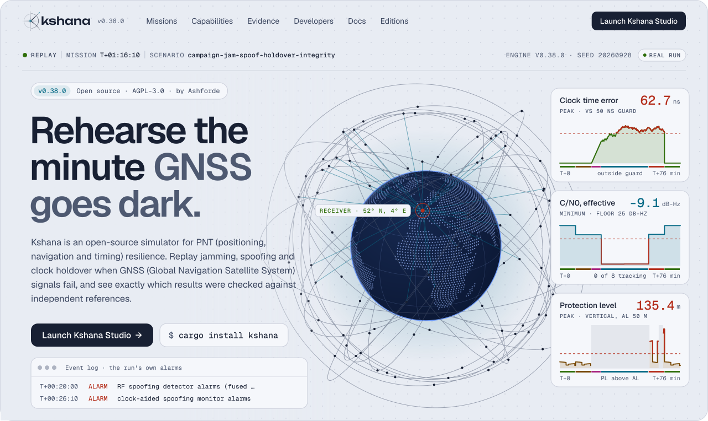
</picture>

<details>
<summary><strong>目录</strong></summary>

- [演练 GNSS 失效的那一分钟](#rehearse-the-minute-gnss-goes-dark)
- [0.40 新增内容](#whats-new-in-040)、[0.39 新增内容](#whats-new-in-039)、[0.38 新增内容](#whats-new-in-038)，以及 [0.38 详解](#038-in-depth)：jammertest 评分、接收机自身的标志、机器输入、授时与守时、标准包、LunaNet AFS、实验室往返、kshana-bench、观测站、导出器、光学、[空间用户导航](#space-user-navigation-gnss-ssv) 和 [月球基础设施](#lunar-infrastructure-lunar-infrastructure)
- [Kshana Studio](#kshana-studio) 及 Studio 的每个页面
- [能力](#capabilities)：领域表、[按族划分的每种场景类型](#every-scenario-kind-by-family)、[每条命令](#every-command)、[每种接口](#every-surface)
- [一次运行如何进行](#how-a-run-works)、[任务](#missions)
- [证据](#evidence)：台账、[能力领域](#capability-domains)
- [安装](#install)、[架构](#architecture)（及[图示](#diagrams)）、[AI 助手](#ai-assistant)
- [版本](#editions)、[研究](#research)、[引用](#cite)、[许可证](#licence)
- [参考](#reference)：用法、场景格式、输出、仓库结构、常见问题、故障排除、版本管理、路线图、贡献、文档

</details>

<a id="rehearse-the-minute-gnss-goes-dark"></a>
## 演练 GNSS 失效的那一分钟

当 GNSS（全球导航卫星系统）信号失效时，Kshana 会重演干扰压制、欺骗和时钟守时过程，
并告诉你一个系统能在其预算之内保持时间和位置多久，以及哪种时钟或传感器能换来最多的
余量。它是一个 Rust 引擎，可在终端、笔记本、IDE（集成开发环境）、AI（人工智能）
助手中运行，也可在浏览器中运行。

每次运行都可以根据场景、随机种子和引擎版本逐位复现。
每项能力在一份经机器检查的台账中带有三种标签之一：**VALIDATED**（独立的外部参考基准
与之一致）、**MODELLED**（内部自洽，并明确说明这一点）
或 **PARTNER**（由硬件合作方负责）。

> **状态：v0.40.0。** 一个经过验证、可复现的 PNT 韧性仿真基础。
> 授时与守时优先，因为这是验证最充分的领域。Kshana 是一个
> 研究和权衡工具：不是射频（RF）信号发生器硬件（它
> 不驱动任何无线电，也不发射任何信号；其信号级输出为供软件接收机使用的基带 IQ 采样文件），
> 不是硬件或经认证的 GNSS 接收机（其软件接收机
> 是一款分析工具），也不是飞行产品。初次接触这一领域？请从
> [通俗入门](docs/CONCEPTS.md) 和 [术语表](docs/GLOSSARY.md) 开始。

<a id="whats-new-in-040"></a>
## 0.40 新增内容

0.40 新增了任务级误差预算，为每张图和每个表标注其证据等级，可读取实测时钟日志，
检查数据合作方提交的数据，估计干扰发射源可能所在的区域，并在英语之外支持十七种语言。
台账现有 401 行：176 行 VALIDATED、221 行 MODELLED、4 行 PARTNER。没有任何一行被提升为 VALIDATED，下面每一项未达标
都由一项测试固定下来。

- **任务链。** `mission-thread` 类型将从发射到再入的各阶段串联起来（`launch-ascent`、`leo-rendezvous`、
  `tli-and-cruise`、`entry` 以及四种月球类型），带有明确规定的交接规则、相对明确规定的需求的余量以及最薄弱
  环节；一个端到端的 Artemis 级示例，共 11 个阶段（地球段和月球段），总计 92 种场景类型。每个数字均为 MODELLED。地月空间传播与公开的 Artemis I 轨迹相比
  **未达到**其预先登记的判据（45.3 km 和 0.25 m/s，判据为 5 km 和 0.05 m/s；原因是模型未包含的小型机动），月球传播器与 CAPSTONE
  轨道相比**未达到**判据（一圈结束时为 136.8 km，判据为 25 km）；与 LRO 的比较达到判据。这些行仍为 MODELLED
  （[任务链](docs/MISSION-THREAD.md)、[月球段](docs/MISSION-THREAD-LUNAR.md)）。在 Studio 中，任务链在 `/studio/mission-thread/` 查看。
- **证据标签。** 一次运行写出的每张图和每个表都带有其等级以及所依据的台账行 id，这些信息读自矩阵。
- **实测时钟。** 可读取八种时钟日志格式（[`docs/CLOCK-LOG-FORMATS.md`](docs/CLOCK-LOG-FORMATS.md)），拟合后的
  序列可以驱动守时。对照预先登记的判据，拟合在六条记录中的五条上**未达到** F1(a)，在一条上未达到 F2；两者
  均仍为 MODELLED（[变更日志](CHANGELOG.md#0400---2026-10-29)）。
- **数据合作方。** `kshana partner check` 检查提交数据的格式，不对任何内容评分（[`docs/PARTNER-DATA.md`](docs/PARTNER-DATA.md)）。
- **发射源区域。** `kshana interference-map locate` 根据 ADS-B 或 AIS
  报告给出一个区域和一个椭圆，从不给出单独一个点。与 Jammertest 2025 发射站点比较过一次，两种数据源的结果均为 **NOT ASSESSABLE**（开放数据中
  已排定的测试场次太少），因此该行仍为 MODELLED（[干扰地图](docs/INTERFERENCE-MAP.md#emitter-region-interference-map-locate)）。
- **基准测试。** 0.40 的重新测试达到 A3、D3（均为 EXPLORATORY）、R3 和 R4；A2、D1 和 R1 仍为 NOT MET（[Bench](docs/BENCH.md)）。
- **语言。** nl、pl、pt-BR、pt-PT、fi、sv、da、nb、cs、uk、ru、de、fr、es、et、ja 和 zh-Hans，均为**尚未经母语人士
  审校的机器翻译**；以英文为准，非英语运行耗时约为两倍
  （[`docs/i18n.md`](docs/i18n.md)）。

<a id="whats-new-in-039"></a>
## 0.39 新增内容

0.39 没有新增功能，也没有改变任何结果；引擎的输出与 0.38 相同。它修复了命令行上的
一个问题，更新了交叉验证工具的依赖项，并完整列出了基准测试的
判定结果。

- **命令行。** `kshana kinds | head`（任何被关闭的标准输出）不再引发 panic：程序以状态 141
  静默退出，与其他工具在管道关闭时的做法一致。其他写入错误仍会自行报告。
- **依赖项。** 两个 ANISE 交叉检查锁文件中的 `memmap2` 0.9.11，以及参考基准环境固定版本中的 `pillow` 13.0.0 和
  `certifi` 2026.10.19，全部位于 `xval/` 之下：发布的内容没有任何变化。
- **kshana-bench，全部判定。** 对照预先登记的判据，有三项为 NOT MET，每项都由一项测试固定：
  A2（`agc_k_sigma` AUC 0.766，判据为至少 0.80）、D1（最大差距 0.0301）和任务 (b) R1（沿用，
  未重新运行）。没有放宽任何判据（[Bench](docs/BENCH.md)）。

<a id="whats-new-in-038"></a>
## 0.38 新增内容

0.38 使中立的评判者变得可测量：它对照已公布的测试
时间表为接收机日志评分，可读取更多接收机和传感器，测试授时系统，并提供一个基准测试和一个
干扰观测站。它仍然仅供参考：这里没有任何内容经过认证，没有任何结果是型式认可，
也没有任何东西发射信号。每一行都说明台账对它记录了什么（[标签如何获得](#evidence)）；
状态只说明检查了什么，台账行和链接的页面会说明没有检查什么。

| 0.38 新增 | 它做什么，以及为什么 | 台账状态 | 阅读 |
|---|---|---|---|
| **Jammertest 评分** | `kshana jammertest import` 读取已公布的 NPRA 测试目录和发射计划，作为排定的真值；`jammertest score` 按每项测试为接收机日志评分（检测延迟、漏警、虚警、恢复时间），如果你提供密钥，则输出为签名的证据包 | **MODELLED**：一个台账行。判据在任何评分运行之前已预先登记；在 JammerTest 2024 数据上，最少数据规则在两次运行中均未满足（分别为 4 个和 7 个可评分窗口，要求为 10 个），因此**没有任何判据可评估**，也不作任何声明 | [Jammertest](docs/JAMMERTEST.md) |
| **接收机自身的标志** | 将 UBX-NAV-STATUS `spoofDetState`、UBX-SEC-SIG 和 NovAtel RXSTATUS 读入逐历元的 `self_report`，并与 Kshana 的告警进行比较（两者都报、仅接收机报、仅 Kshana 报、都不报）；一个 Septentrio SBF 读取器和只读的 `--serial` 输入 | **MODELLED**；接收机的检测器与 Kshana 的检测器一致并不构成验证 | [接收机信任度](docs/RECEIVER-TRUST.md) |
| **更多接收机和传感器** | RTKLIB `.pos`、NovAtel OEM7、RTCM 3 MSM4/MSM7 C/N0（来自采用 BSD 许可的 pyrtcm 表，而非 RTCM 文本）、GNSS-SDR 监测流、作为第二传感器的 IMU 日志、一个 ROS 2 软件包、一个 `gnss_lib_py` 桥接，以及用于混合传感器参数的 `imu-fit` | **MODELLED**：六个台账行；仅使用自行编写的测试数据，没有读取过来自真实接收机、IMU、GNSS-SDR 运行或 ROS 图的任何采集数据 | [机器输入](docs/MACHINE-INPUTS.md) |
| **授时与守时测试** | `holdover-test` 类型根据实测的时间误差记录，对照 ITU-T 模板为守时测试（由操作人员移除 GNSS、守时、恢复）评分，表述为“对照模板测量”；linuxptp 和 chrony 日志读取器；硬件阶段以及 `lab-attestation` 字段 | **MODELLED**：两个台账行；时间是操作人员的陈述，未经核实 | [授时 HIL](docs/TIMING-HIL.md)、[硬件安全](docs/HARDWARE-SAFETY.md) |
| **标准包、LunaNet AFS、实验室往返** | 针对 DHS RPCF、IMO MSC.1/Circ.1575 和 ICAO Doc 9849 Appendix F 的评分包，对照运行前已说明的判据，表述为“为……提供支持证据”；一份 NIST IR 8323r1 对照表；一个 LunaNet AFS 码生成器和检查器；一个将实验室运行的场景、测试条件、接收机日志和评分关联起来的签名包 | 标准包和往返为 **MODELLED**；AFS 码检查对照其印出的校验列为 **VALIDATED**（见台账行） | [标准](docs/STANDARDS.md)、[LunaNet AFS](docs/LUNANET-AFS.md) |
| **kshana-bench 和观测站** | 用于干扰检测、IQ 检测、守时预测和乐观偏差的固定任务、划分和指标，带有封存的保留集和静态排行榜；一个可复现的每日干扰产品，延迟 24 h，网格粗略，不作归因 | 没有自己的台账行：它为提交内容评分，其基线在结果文件中标为 MODELLED；对照预先登记的判据，评分器、C1 至 C3 和 D2 达到判据，有三项判据为 **NOT MET**（由测试固定）：A2（`agc_k_sigma` AUC 0.766，在测试划分上判据为至少 0.80）、D1（最大差距 0.0301）和任务 (b) R1（沿用，未重新运行）；见 `xval/bench/RESULTS-v2.md` | [Bench](docs/BENCH.md)、[观测站](docs/observatory/METHOD.md) |
| **导出器** | 除 Prometheus、CEF、LEEF 和 OTLP 之外，还以 Home Assistant MQTT 发现和状态消息的形式输出信任遥测（仅发布，不含凭据） | **MODELLED**：一个台账行 | [信任遥测](docs/TRUST-TELEMETRY.md) |
| **随时间变化的光学链路余量** | `optical-atmosphere` 类型可以将某站点天气的一次带种子的实现写为链路余量序列 | **MODELLED**：一个台账行；是模型的一次抽样，而不是气候 | [光学大气](docs/OPTICAL-ATMOSPHERE.md) |

0.37 的要点：[变更日志](CHANGELOG.md#0370---2026-10-17)。0.38 的完整列表见
[变更日志](CHANGELOG.md#0380---2026-10-19)。

<a id="038-in-depth"></a>
## 0.38 详解

上表中的每项能力，用几行文字说明：它做什么，用一条命令运行它，一张
绘自引擎真实运行的图，以及台账对它记录了什么。这些图
由 [`tools/gen_figures_038.py`](tools/gen_figures_038.py) 写入
[`docs/figures/0.38/`](docs/figures/0.38/)（从不手工绘制）：`python3 tools/gen_figures_038.py`
根据已构建的引擎重新生成它们，如果某张图已过时或此处的图注不同，`--check` 会失败。
当输入是日志时，它是脚本编写的虚构日志，因为真实的第三方日志
从不纳入仓库，图注也会说明这一点。以下所有内容都仅供参考：未经认证，不是
型式认可，也没有任何东西发射信号。状态只说明检查了什么，仅此而已；
[标签如何获得](#evidence)。

### Jammertest 评分

`kshana jammertest import` 将已公布的 NPRA 测试目录和发射计划转换为
排定的真值，`kshana jammertest score` 对照它为接收机日志评分：对每项
排定的测试，判断是否被检测到、延迟多少、接收机花了多长时间恢复，另外还有
所有时段之外的虚警。测试目录在使用时获取，从不纳入仓库。

```sh
xval/jammertest-plan/fetch.sh ../jammertest-plan
kshana jammertest score session.toml --catalog ../jammertest-plan/testcatalog2025.json \
    --plan ../jammertest-plan/plan-tuesday-2025-09-16.json --location 1 --json
```

<picture>
  <source media="(prefers-color-scheme: dark)" srcset="docs/figures/0.38/jammertest-dark.svg">
  <source media="(prefers-color-scheme: light)" srcset="docs/figures/0.38/jammertest-light.svg">
  
</picture>

**台账状态：MODELLED。** 判据在任何评分运行之前已固定；在 JammerTest 2024 数据上，
最少数据规则在两次运行中均未满足，因此没有任何判据可评估，也不作任何声明。
[Jammertest](docs/JAMMERTEST.md)。

### 接收机自身的标志

UBX-NAV-STATUS `spoofDetState`、UBX-SEC-SIG 和 NovAtel RXSTATUS 被读入逐历元的
`self_report`，并与 Kshana 的告警并列比较：两者都报、仅接收机报、仅 Kshana 报，或都不报。一个
Septentrio SBF 读取器和只读的 `--serial` 输入也参与同样的比较。任何一方都不是
真值。

```sh
kshana receiver-trust session.toml     # [log] format = "ubx", path = "receiver.ubx"
```

<picture>
  <source media="(prefers-color-scheme: dark)" srcset="docs/figures/0.38/receiver-flags-dark.svg">
  <source media="(prefers-color-scheme: light)" srcset="docs/figures/0.38/receiver-flags-light.svg">
  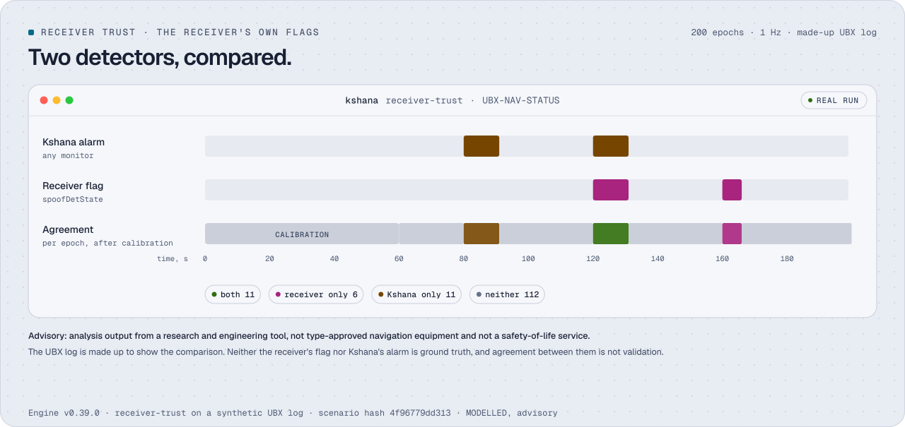
</picture>

**台账状态：MODELLED。** 接收机的检测器与 Kshana 的检测器一致并不构成
验证。[接收机信任度](docs/RECEIVER-TRUST.md)。

### 更多接收机和传感器

RTKLIB `.pos`、NovAtel OEM7、RTCM 3 MSM4/MSM7 C/N0、GNSS-SDR 监测流、作为第二传感器的 IMU 日志、
一个 ROS 2 软件包和一个 `gnss_lib_py` 桥接，最终都汇入同一条接收机信任度时间线。
`imu-fit` 从一份静止 IMU 日志中读出混合与融合场景所需的传感器参数，
从而可以用你实际拥有的传感器来运行场景。

```sh
kshana imu-fit still.csv --format csv --axis x --expected-mean 0 --id bench-imu
```

<picture>
  <source media="(prefers-color-scheme: dark)" srcset="docs/figures/0.38/machine-inputs-dark.svg">
  <source media="(prefers-color-scheme: light)" srcset="docs/figures/0.38/machine-inputs-light.svg">
  
</picture>

**台账状态：MODELLED。** 仅使用自行编写的测试数据；没有读取过来自真实接收机、IMU、
GNSS-SDR 运行或 ROS 图的任何采集数据。[机器输入](docs/MACHINE-INPUTS.md)。

### 授时与守时测试

`holdover-test` 类型根据实测的时间误差记录，对照 ITU-T 模板为守时测试（由操作人员移除 GNSS、守时、恢复）
评分，并用这样的措辞说明：对照模板
测量。linuxptp 和 chrony 日志读取器为它提供输入；硬件阶段和
`lab-attestation` 字段说明谁陈述了什么。

```sh
kshana scenarios/holdover-test-example.toml
```

<picture>
  <source media="(prefers-color-scheme: dark)" srcset="docs/figures/0.38/timing-dark.svg">
  <source media="(prefers-color-scheme: light)" srcset="docs/figures/0.38/timing-light.svg">
  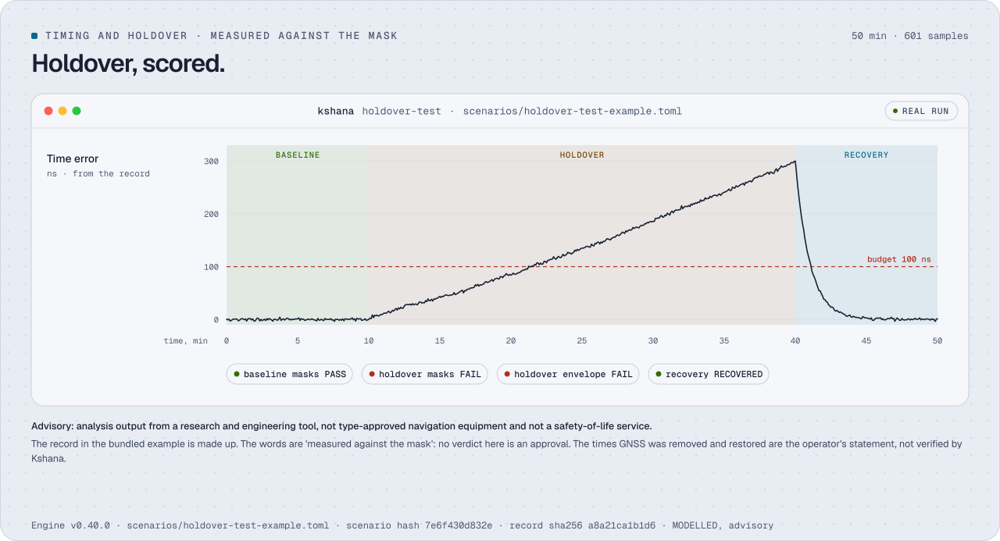
</picture>

**台账状态：MODELLED。** 移除和恢复 GNSS 的时间是操作人员的陈述，
未经核实。[授时 HIL](docs/TIMING-HIL.md)、[硬件安全](docs/HARDWARE-SAFETY.md)。

### 标准包

针对 DHS Resilient PNT 测试剖面、IMO MSC.1/Circ.1575 和 ICAO Doc 9849
Appendix F 的评分包，以及 `compliance-report` 中的一份 NIST IR 8323r1 对照表。每项测试运行一个随附的
场景，并将一个结果字段与运行前已说明的判据进行比较；需要接收机
日志的测试被列为需要输入，不予评分。措辞是“为……提供支持证据”。

```sh
kshana standards-pack list
kshana standards-pack run imo-circ-1575
```

<picture>
  <source media="(prefers-color-scheme: dark)" srcset="docs/figures/0.38/standards-dark.svg">
  <source media="(prefers-color-scheme: light)" srcset="docs/figures/0.38/standards-light.svg">
  
</picture>

**台账状态：MODELLED。** 达到判据只说明一个建模场景达到了一项已说明的判据，并不涉及任何
产品；每项未达到都被保留，并由一项测试固定。[标准](docs/STANDARDS.md)。

### LunaNet AFS

LunaNet 增强前向信号（Augmented Forward Signal）码生成器（Gold 码、Weil 码和三级码、电文
帧及其纠错编码），以及用于已记录或已生成符号流的检查器，固定对应规范的
一个版本。

```sh
kshana lunanet-afs-check spec
kshana lunanet-afs-check generate --frames 2 --out afs.sym
kshana lunanet-afs-check symbols afs.sym
```

<picture>
  <source media="(prefers-color-scheme: dark)" srcset="docs/figures/0.38/lunanet-afs-dark.svg">
  <source media="(prefers-color-scheme: light)" srcset="docs/figures/0.38/lunanet-afs-light.svg">
  
</picture>

**台账状态：VALIDATED**，适用于码和同步检查，对照的是
规范印出的值（规范将其标为 TBC）；有一项检查为 NOT MET，予以保留并固定（规范印出的一个
三级码列不同：文档对两个 PRN 印出了相同的值）。子帧 2 至 4 的 LDPC 和 CRC 字
未被检查。台账行准确说明了是哪些。[LunaNet AFS](docs/LUNANET-AFS.md)。

### 实验室往返

`kshana.test-conditions/1` 是对实验室所做内容（事件、时间、
功率）的公开描述格式。`kshana evidence round-trip` 将场景哈希、条件哈希、接收机日志
哈希和评分关联成一个签名包，如果某个包的条件与评分场景
在事件上不一致，则拒绝该包。Kshana 从不产生或回放信号：场景如何到达
接收机由操作人员负责。

```sh
kshana evidence --help
```

<picture>
  <source media="(prefers-color-scheme: dark)" srcset="docs/assets/readme/evidence-pack-dark.svg">
  <source media="(prefers-color-scheme: light)" srcset="docs/assets/readme/evidence-pack-light.svg">
  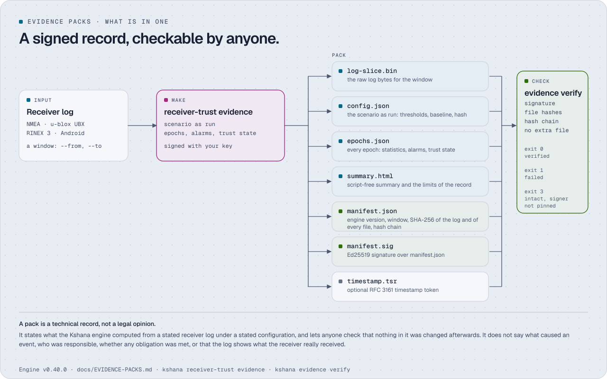
</picture>

图中所示为证据包的结构。**台账状态：MODELLED。**
[测试条件](docs/spec/TEST-CONDITIONS.md)、[测试台](docs/TEST-BENCH.md)。

### kshana-bench

用于干扰检测、IQ 检测、守时预测和
乐观偏差的固定任务、划分和指标，带有封存的保留集和静态排行榜。它为提交内容评分；它不是
接收机排名。

```sh
kshana bench baseline --task d --split test --out results/
```

<picture>
  <source media="(prefers-color-scheme: dark)" srcset="docs/figures/0.38/bench-dark.svg">
  <source media="(prefers-color-scheme: light)" srcset="docs/figures/0.38/bench-light.svg">
  
</picture>

**台账状态：** 没有自己的台账行；基线在结果文件中标为 MODELLED。
对照预先登记的判据，评分器、C1 至 C3 和 D2 达到判据，有三项判据为 NOT MET，每项都
由一项测试固定：A2（`agc_k_sigma` AUC 0.766，在测试划分上判据为至少 0.80）、D1（最大差距
0.0301）和任务 (b) R1（沿用自早先的测试，未重新运行）。数据见
[`xval/bench/RESULTS-v2.md`](xval/bench/RESULTS-v2.md)。[Bench](docs/BENCH.md)。

### 干扰观测站

根据一个开放的航空器位置档案，按每个 UTC 日和每个区域生成一个产品，网格固定且粗略：
每个网格单元为已劣化、未劣化或未观测（未观测不等于“无干扰”）。最早在
当日结束 24 h 后发布，小单元会被抑制，并且不对原因作任何归因。

```sh
kshana interference-map daily /path/to/extracted/2026-09-15 \
    --dataset adsb-lol --day 2026-09-15 --bbox 53.5,9.0,66.0,31.0 --out products/
```

<picture>
  <source media="(prefers-color-scheme: dark)" srcset="docs/assets/readme/interference-map-dark.svg">
  <source media="(prefers-color-scheme: light)" srcset="docs/assets/readme/interference-map-light.svg">
  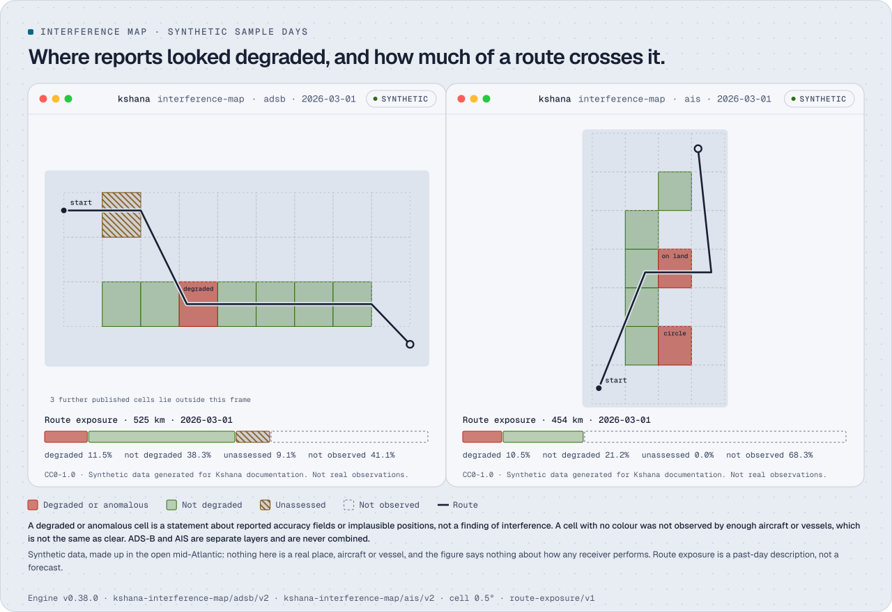
</picture>

图中所示为已提交的样本日，不是观测站产品。**台账状态：MODELLED**：
没有外部参考基准，没有真值，也不作原因归因；未观测的单元未经
评估，这与无干扰不同。[观测站方法](docs/observatory/METHOD.md)。

### 导出器

以 Prometheus 文本、CEF、LEEF、OTLP 以及 Home Assistant MQTT 发现和状态
消息的形式输出信任遥测。该命令只向你指定的目的地发布，且不持有任何凭据。

```sh
kshana trust-telemetry --result session.result.json --print-metrics
kshana trust-telemetry --result session.result.json --print-syslog --format cef
```

<picture>
  <source media="(prefers-color-scheme: dark)" srcset="docs/figures/0.38/exporters-dark.svg">
  <source media="(prefers-color-scheme: light)" srcset="docs/figures/0.38/exporters-light.svg">
  
</picture>

**台账状态：MODELLED。** [信任遥测](docs/TRUST-TELEMETRY.md)。

### 随时间变化的光学链路余量

`optical-atmosphere` 类型可以将某站点天气的一次带种子的实现写为链路余量
序列：云层时段、每个时段的液态水柱、每个步长一个闪烁样本。
Studio 的光学 PNT 页面会打开 optical-atmosphere 场景。

```sh
kshana scenarios/optical-atmosphere-network.toml
```

<picture>
  <source media="(prefers-color-scheme: dark)" srcset="docs/figures/0.38/optical-dark.svg">
  <source media="(prefers-color-scheme: light)" srcset="docs/figures/0.38/optical-light.svg">
  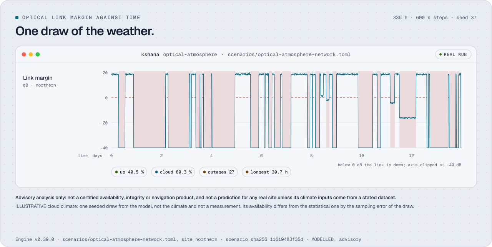
</picture>

**台账状态：MODELLED。** 模型的一次抽样，不是气候。[光学大气](docs/OPTICAL-ATMOSPHERE.md)。

### 新的 Studio 视图

[kshana.dev/studio](https://kshana.dev/studio/) 新增了驾驶台回放（Bridge replay）（在同一任务时钟上并排显示两次运行，
位于 [`/studio/replay/`](https://kshana.dev/studio/replay/)）、光学 PNT 页面
（`/studio/optical/`）、守时测试页面（`/studio/holdover/`）和观测站查看器
（`/studio/observatory/`）。它们在浏览器中运行同一个引擎，不上传任何内容，并带有
相同的“仅供参考”声明。上面的图是由脚本根据引擎自身的输出绘制的；
它们不是这些页面的截图。

<a id="space-user-navigation-gnss-ssv"></a>
### 空间用户导航（`gnss-ssv`）

针对位于 GNSS 轨道之上、周围或远在其外的航天器：它能使用多少 GNSS 信号，这些信号有多
强，几何构型有多好，以及星载滤波器能用它们做什么。一种类型，
四种模式，由场景的表选择：用户**球壳**（按星座统计有一个和四个
信号的时间比例）、**轨迹**（沿轨道的信号、C/N0、精度因子以及
临边射线介质）、**导航**运行（基于伪距的九状态滤波器，直至
月球）以及**编队**（若干从星相对一颗主星的相对导航）。可用性比较的公开来源是
可互操作 GNSS 空间服务体积手册（UN OOSA
ST/SPACE/75，来自 International Committee on GNSS），该手册本身也是一项仿真；它在使用时获取，从不
纳入仓库。完整页面：[docs/SSV.md](docs/SSV.md)。

```sh
kshana scenarios/gnss-ssv-shell.toml            # shell: the upper space service volume, reduced size
kshana scenarios/gnss-ssv-heo.toml              # trajectory: a high Earth orbit, limb medium
kshana scenarios/gnss-ssv-nav-lunar.toml        # navigation: an onboard filter toward the Moon
kshana scenarios/gnss-ssv-formation-heo.toml    # formation: relative navigation
```

<picture>
  <source media="(prefers-color-scheme: dark)" srcset="docs/figures/0.38/ssv-shell-dark.svg">
  <source media="(prefers-color-scheme: light)" srcset="docs/figures/0.38/ssv-shell-light.svg">
  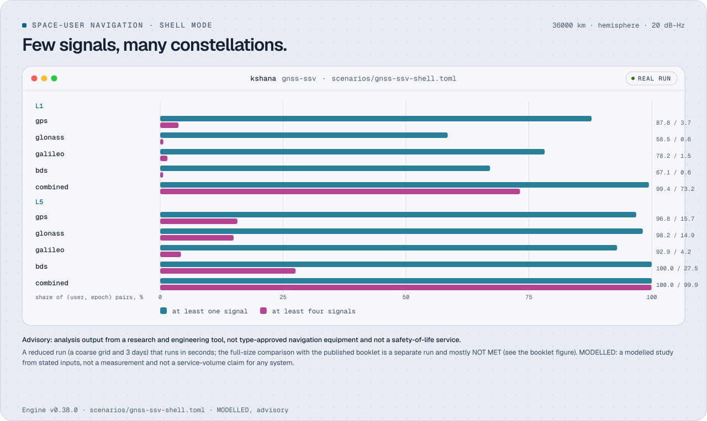
</picture>

<picture>
  <source media="(prefers-color-scheme: dark)" srcset="docs/figures/0.38/ssv-heo-dark.svg">
  <source media="(prefers-color-scheme: light)" srcset="docs/figures/0.38/ssv-heo-light.svg">
  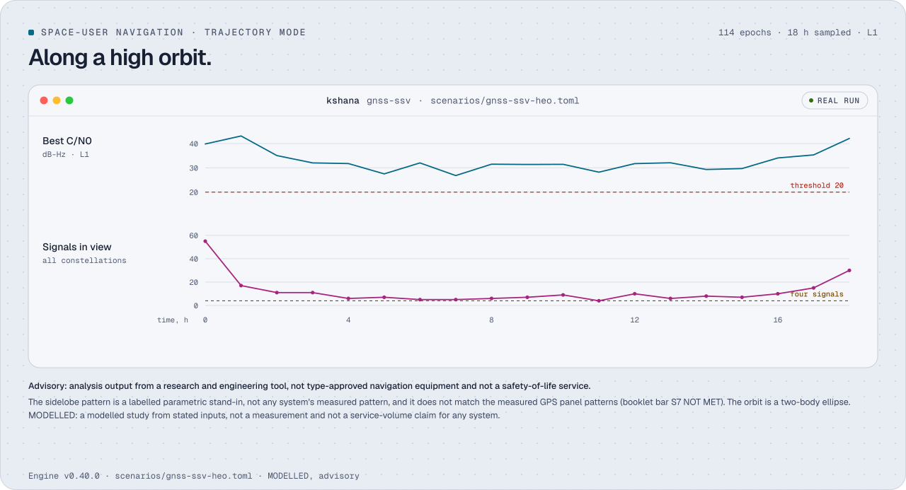
</picture>

<picture>
  <source media="(prefers-color-scheme: dark)" srcset="docs/figures/0.38/ssv-nav-dark.svg">
  <source media="(prefers-color-scheme: light)" srcset="docs/figures/0.38/ssv-nav-light.svg">
  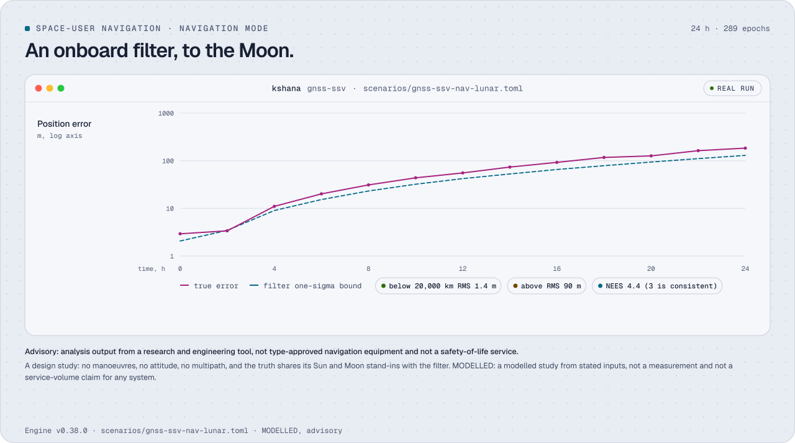
</picture>

<picture>
  <source media="(prefers-color-scheme: dark)" srcset="docs/figures/0.38/ssv-formation-dark.svg">
  <source media="(prefers-color-scheme: light)" srcset="docs/figures/0.38/ssv-formation-light.svg">
  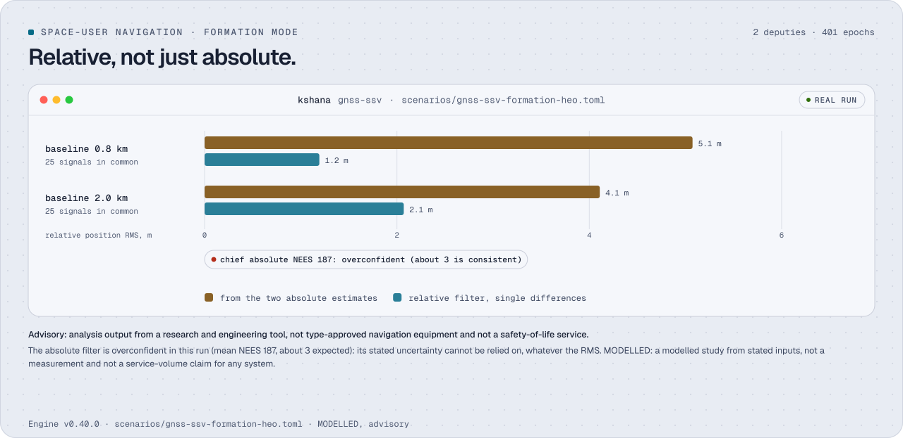
</picture>

**台账状态：MODELLED，与手册的比较大多未达到判据。** 判据在运行之前
已固定。八项中只有 S0（逆向链路预算，13 个值中 13 个）和 S6（月球任务）
达到。**S1 至 S5 以及 S7 为 NOT MET**：上部和下部服务体积几何（52 个单元中 43 个和 52 个中
48 个）、15/20/25 dB-Hz 上部服务体积、六个 GEO 任务、HEO 任务，以及
参数化旁瓣方向图与实测 GPS 面板方向图的比较。S1 至 S5 中几乎每项未达到都涉及
GLONASS，而手册为它印出了两个不同的参考角；使用
另一组角度的诊断变体使 S1、S2 和 S4 的每个单元都达到，但它不取代正式记录的运行，也没有任何行
为 VALIDATED。编队运行的绝对滤波器也过于自信（平均归一化误差平方
远高于一致滤波器给出的约 3 的值）。

<picture>
  <source media="(prefers-color-scheme: dark)" srcset="docs/figures/0.38/ssv-booklet-dark.svg">
  <source media="(prefers-color-scheme: light)" srcset="docs/figures/0.38/ssv-booklet-light.svg">
  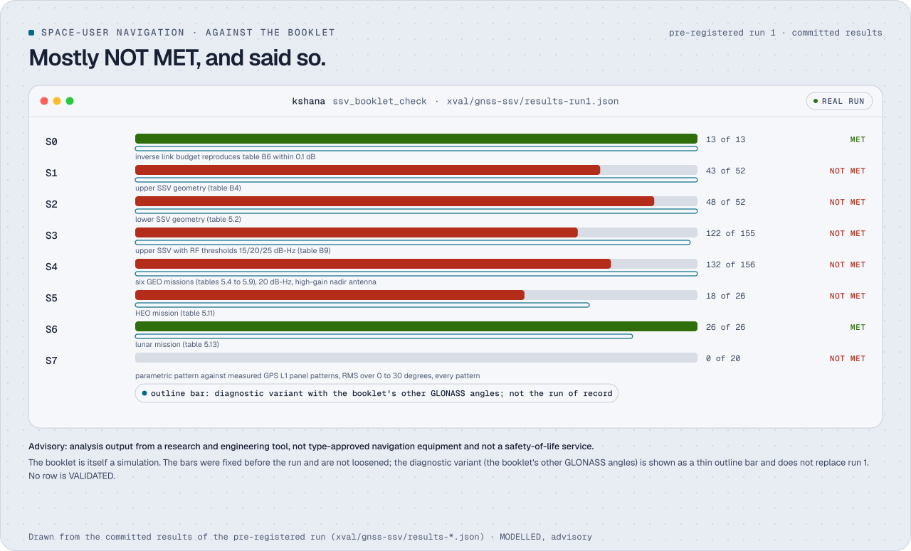
</picture>

[空间用户导航](docs/SSV.md)、[比较显示了什么](docs/SSV.md#what-the-comparison-with-the-booklet-shows)。

<a id="lunar-infrastructure-lunar-infrastructure"></a>
### 月球基础设施（`lunar-infrastructure`）

将月球的轨道和表面作为导航与大地测量基础设施，分为五项研究，由
`study` 选择：**od-consistency**（晕轨道中的星载地球 GNSS 定轨与
独立的地面定轨相比较）、**carrier-phase**（月面站与
轨道器之间的整周模糊度固定）、**frame-coestimation**（利用地面站测距、有无轨道器
链路两种情况下的月球基准）、**space-tie**（同一航天器上激光、VLBI 和 GNSS 偏移量与局部连接误差的比较）以及
**geodesy-sensitivity**（哪一类观测量能感知勒夫数 h2、k2 和 l2）。该模型是一个
带有明确简化和示意性输入的限制性三体模型。完整页面：
[docs/LUNAR-INFRASTRUCTURE.md](docs/LUNAR-INFRASTRUCTURE.md)。

```sh
kshana scenarios/lunar-infrastructure-od-consistency.toml
kshana scenarios/lunar-infrastructure-carrier-phase.toml            # quick; the scored run takes about eight minutes
kshana scenarios/lunar-infrastructure-frame-coestimation.toml
kshana scenarios/lunar-infrastructure-space-tie.toml
kshana scenarios/lunar-infrastructure-geodesy-sensitivity.toml
```

<picture>
  <source media="(prefers-color-scheme: dark)" srcset="docs/figures/0.38/lunar-od-dark.svg">
  <source media="(prefers-color-scheme: light)" srcset="docs/figures/0.38/lunar-od-light.svg">
  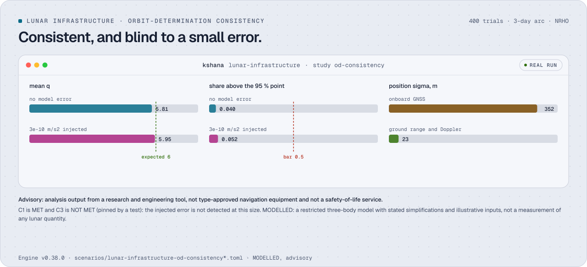
</picture>

<picture>
  <source media="(prefers-color-scheme: dark)" srcset="docs/figures/0.38/lunar-carrier-dark.svg">
  <source media="(prefers-color-scheme: light)" srcset="docs/figures/0.38/lunar-carrier-light.svg">
  
</picture>

<picture>
  <source media="(prefers-color-scheme: dark)" srcset="docs/figures/0.38/lunar-frame-dark.svg">
  <source media="(prefers-color-scheme: light)" srcset="docs/figures/0.38/lunar-frame-light.svg">
  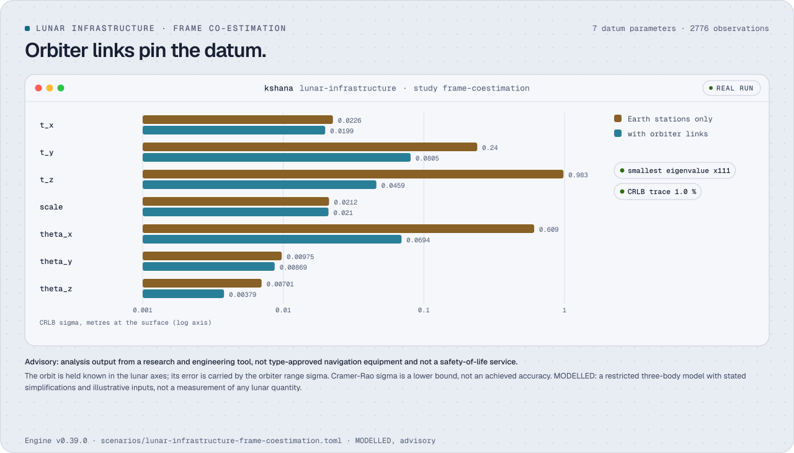
</picture>

<picture>
  <source media="(prefers-color-scheme: dark)" srcset="docs/figures/0.38/lunar-tie-dark.svg">
  <source media="(prefers-color-scheme: light)" srcset="docs/figures/0.38/lunar-tie-light.svg">
  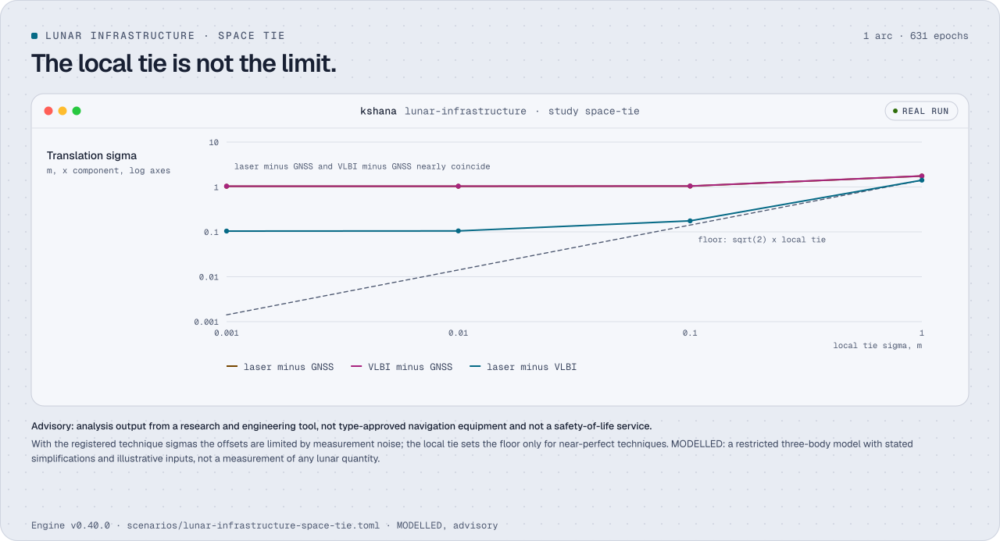
</picture>

<picture>
  <source media="(prefers-color-scheme: dark)" srcset="docs/figures/0.38/lunar-geodesy-dark.svg">
  <source media="(prefers-color-scheme: light)" srcset="docs/figures/0.38/lunar-geodesy-light.svg">
  
</picture>

**台账状态：MODELLED，有三项判据为 NOT MET。** 数值计算已对照独立的
numpy 和 scipy 程序检查；没有任何内容与月球量的测量值进行比较，也没有任何内容为
VALIDATED。达到的：两个轨道解是一致的（平均 q 为 5.81，期望值为 6），并且在假设轨道已知的情况下，轨道器
链路使最小基准特征值提高约 111 倍。**未达到的**：
注入的 3e-10 m/s2 模型误差**未被检测到**（C3：星载解的已知精度约为 350 m，因此
约十米的位移隐藏在其协方差之中）；**未能实现整周固定**（在
25 dBi 下成功率为 1 % 至 3 %，而在登记的 12 dBi 下无法构建该问题）；以及加入一类
观测量时 G3 的迹那一半（28 次加入中有 12 次迹增大，每次都是因为该类观测量提高了秩）。
每项未达到都由一项测试固定。[月球基础设施](docs/LUNAR-INFRASTRUCTURE.md)。

<a id="kshana-studio"></a>
## Kshana Studio

打开 [kshana.dev/studio](https://kshana.dev/studio/)，整个引擎就会编译为 WebAssembly，在你的
浏览器中运行。无需安装任何东西，也不上传任何内容。Studio 对同一个引擎提供
两种视图，页眉中的一个开关可在两者之间切换，并保留
场景、视图以及你更改过的任何设置。

**简单视图**是 Studio 打开时显示的视图。它从问题出发（我能看到多少颗卫星，
我能否信任我的定位，时钟能保持时间多久，干扰源会对
我的接收机造成什么影响），也从一张展示引擎全部能力的地图出发，每个领域都标有其
经验证方法的比例。打开一个场景，答案会首先出现：一句通俗的话，针对
该场景所测量的内容而写，然后是其关键数字和一张图表。最多显示五项设置，
即对答案影响最大的那些；其余的放在**高级设置**之下。
**这是如何计算的**解释方法，**供研究人员使用**给出引擎自身的
数字、场景文件、从 Python 运行它的代码以及引用信息。

<picture>
  <source media="(prefers-color-scheme: dark)" srcset="docs/assets/readme/studio/studio-task-dark.jpg">
  <source media="(prefers-color-scheme: light)" srcset="docs/assets/readme/studio/studio-task-light.jpg">
  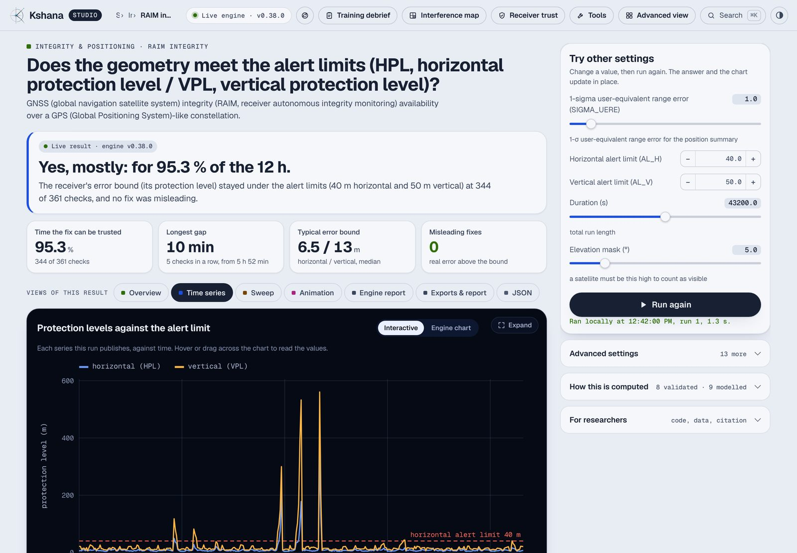
</picture>

**高级视图**是完整的仪表板：场景库、五个编号步骤
（选择、设置、运行、阅读结果、分享或导出）、关键数字（在运行说明了阈值处带有 PASS 和 FAIL 标记），
以及每个面板：概览、图表、地图、回放、
引擎的报告和导出。一个搜索框即可找到场景、领域以及其中的
字段，你还可以固定最多四次运行并将它们并排比较。

<details>
<summary>简单视图的起始界面，以及运行后的高级视图</summary>

<br>

<picture>
  <source media="(prefers-color-scheme: dark)" srcset="docs/assets/readme/studio/studio-home-dark.jpg">
  <source media="(prefers-color-scheme: light)" srcset="docs/assets/readme/studio/studio-home-light.jpg">
  
</picture>

<picture>
  <source media="(prefers-color-scheme: dark)" srcset="docs/assets/readme/studio/studio-advanced-dark.jpg">
  <source media="(prefers-color-scheme: light)" srcset="docs/assets/readme/studio/studio-advanced-light.jpg">
  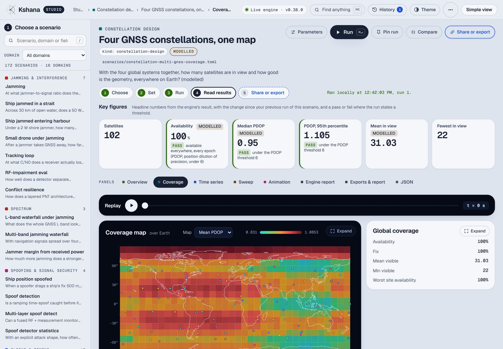
</picture>

</details>

Studio 的源代码及其构建说明见 [`web/README.md`](web/README.md)。

### 网站

[kshana.dev](https://kshana.dev) 的其余部分由本仓库自身的文件和
引擎运行构建而成：任务、能力、证据台账、已发表的研究以及
版本。

<picture>
  <source media="(prefers-color-scheme: dark)" srcset="docs/assets/readme/site/site-strip-dark.jpg">
  <source media="(prefers-color-scheme: light)" srcset="docs/assets/readme/site/site-strip-light.jpg">
  
</picture>

<a id="capabilities"></a>
## 能力

一个引擎覆盖整条失效链，从第一颗受干扰的卫星到时钟守时的最后
一纳秒。引擎有 92 种场景类型；`kshana kinds` 列出
它们，[`docs/SCENARIOS.md`](docs/SCENARIOS.md) 记录了每个字段。

| 能力 | 它回答什么问题 |
|---|---|
| [频谱](docs/SPECTRUM.md) | 干扰源如何逐频段、逐秒地占据 GNSS L 频段 |
| [时钟与授时](docs/TELECOM-TIMING.md) | 失去 GNSS 后每种时钟能保持时间多久 |
| [围绕任意天体的星座](docs/CONSTELLATION-DESIGN.md) | 地球、月球或火星周围的覆盖、精度因子和可用性 |
| [太阳系](docs/SOLAR-SYSTEM.md) | 每颗行星在哪里，以及任一链路的光行时 |
| [低地球轨道导航](docs/LEO-PNT.md) | 一次过境、一条链路、一条导航电文和一个融合定位，逐阶段呈现 |
| [战役](docs/CAMPAIGNS.md) | 在一个场景中运行链式任务、参数扫描或蒙特卡洛集合 |
| [动画](docs/ANIMATION.md) | 将一次运行的时间序列呈现为动画图、播放器或帧序列 |
| [报告](docs/REPORTS.md) | 每个数字都带有单位和标签，以 HTML（超文本标记语言）和 JSON（JavaScript 对象表示法）输出 |
| [互操作导出](docs/INTEROP.md) | 供其他工具使用的轨道和几何：SP3、CCSDS OMM 和 OEM、CZML、KML、GeoJSON、STK 和 SigMF |
| [海事信任度](docs/MARITIME-TRUST.md) | 驾驶台能否信任这一定位：针对船舶的 NMEA（实时或来自日志）给出 0-100 的分数和理由（仅供参考，不是经型式认可的导航设备） |
| [NMEA 训练数据流](docs/NMEA-TRAINING.md) | 带有脚本化压制干扰和欺骗以及教员日志的合成驾驶台 NMEA，用于船员训练（仅为文本；绝不可用于船舶的实时导航系统；仅供参考，不是经型式认可的导航设备） |
| [干扰地图](docs/INTERFERENCE-MAP.md) | 航空器和船舶在哪里报告了劣化的导航数据，以及它影响了航线的多大部分 |
| [发射源区域](docs/INTERFERENCE-MAP.md#emitter-region-interference-map-locate) | 在已说明的假设下，劣化位置报告的来源可能位于何处：给定置信度的区域、带椭圆的质心，从不给出单独一个点（MODELLED；`kshana interference-map locate`） |
| [证据包](docs/EVIDENCE-PACKS.md) | 对船舶日志的一个时间窗口以及引擎据此计算出的内容所作的签名、可离线验证的技术记录，用于事件报告（仅供参考，不是经型式认可的导航设备） |
| [信任遥测](docs/TRUST-TELEMETRY.md) | 以 Prometheus 指标、SIEM 事件和可选的 OpenTelemetry 形式输出的信任数据流，附带一个示例 Grafana 仪表板（`deploy/grafana/kshana-gnss-trust.json`） |
| [Signal K 和 OpenCPN](docs/MARINE-INTEGRATIONS.md) | 船上 Signal K 服务器和 OpenCPN 中的信任度，附带一个用于接收机旁小型计算机的参考构建（仅供参考，不是经型式认可的导航设备） |
| [测试台导出](docs/TEST-BENCH.md) | `kshana bench-export`：为实验室 GNSS 模拟器导出场景的载体运动和事件（不写出任何信号），以及之后如何为接收机日志评分 |
| [合规映射与报告](docs/compliance/README.md) | `kshana compliance-report`：一组运行为公共韧性框架中的哪些行提供支持证据，以及剩余的差距 |
| [笔记本](notebooks/README.md) | 可运行的教程：船舶信任度和训练数据流、干扰地图航线暴露、合规映射和测试台、量子与经典 GDOP 的比较 |
| [Galileo OSNMA 验证器](docs/OSNMA.md) | 接收机能以密码学方式认证哪些卫星的导航数据，以及检查为何失败；Kshana 不授予欧盟 OSNMA ICD IPR 下的任何权利（见该页面中的 NOTICE） |

导出格式全称：SP3 是 Standard Product 3；CCSDS OMM 和 OEM 是空间数据系统咨询委员会（Consultative Committee for Space Data
Systems）的轨道平根数电文（Orbit Mean-elements Message）和轨道星历电文（Orbit Ephemeris Message）；
CZML 和 KML 是 Cesium 和 Keyhole 标记语言；STK 是 Systems Tool Kit；
SigMF 是信号元数据格式（Signal Metadata Format）。

<picture>
  <source media="(prefers-color-scheme: dark)" srcset="docs/assets/readme/campaign-timeline-dark.svg">
  <source media="(prefers-color-scheme: light)" srcset="docs/assets/readme/campaign-timeline-light.svg">
  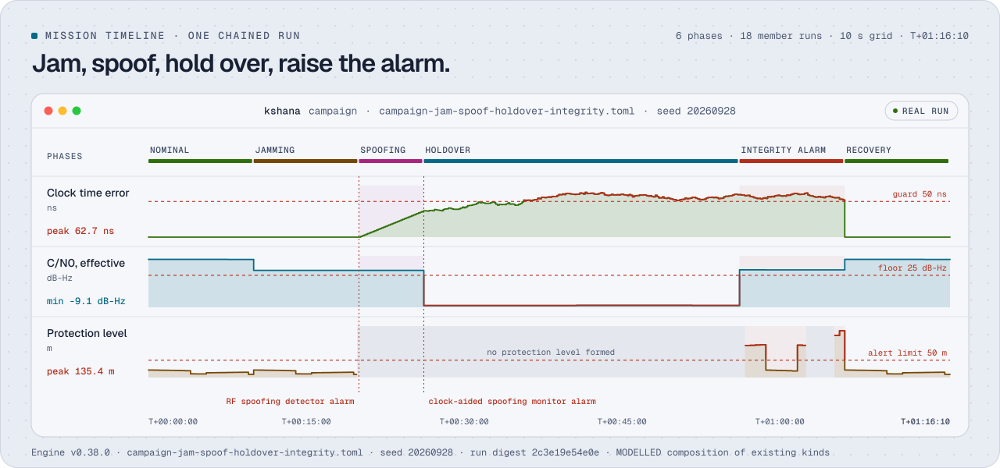
</picture>

<details>
<summary>每项能力，绘自一次真实运行：L 频段瀑布图、覆盖地图、太阳系和一次低地球轨道过境</summary>

<br>

<picture>
  <source media="(prefers-color-scheme: dark)" srcset="docs/assets/readme/lband-waterfall-dark.svg">
  <source media="(prefers-color-scheme: light)" srcset="docs/assets/readme/lband-waterfall-light.svg">
  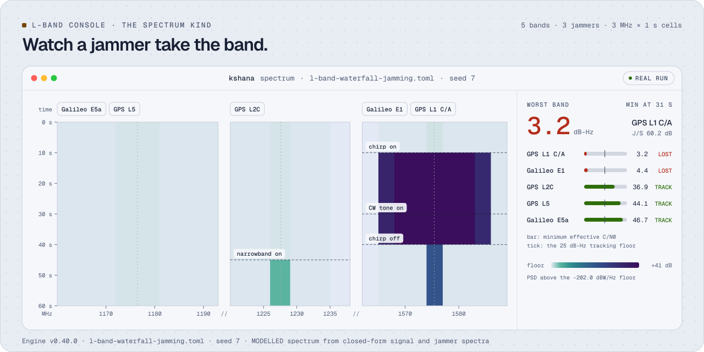
</picture>

<picture>
  <source media="(prefers-color-scheme: dark)" srcset="docs/assets/readme/coverage-map-dark.svg">
  <source media="(prefers-color-scheme: light)" srcset="docs/assets/readme/coverage-map-light.svg">
  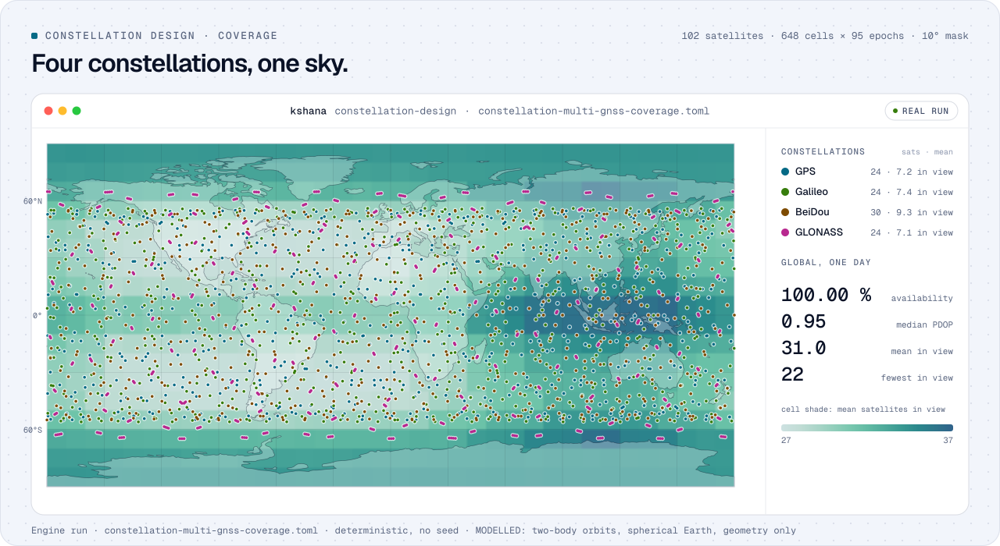
</picture>

<picture>
  <source media="(prefers-color-scheme: dark)" srcset="docs/assets/readme/solar-system-dark.svg">
  <source media="(prefers-color-scheme: light)" srcset="docs/assets/readme/solar-system-light.svg">
  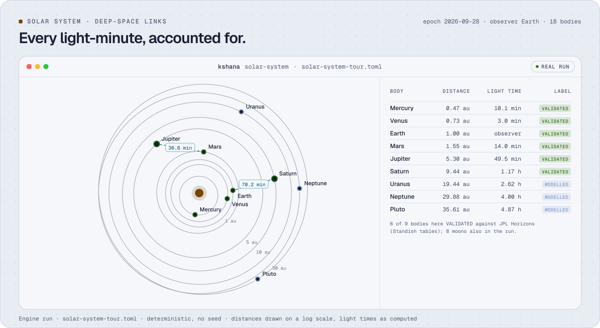
</picture>

<picture>
  <source media="(prefers-color-scheme: dark)" srcset="docs/assets/readme/leo-pass-dark.svg">
  <source media="(prefers-color-scheme: light)" srcset="docs/assets/readme/leo-pass-light.svg">
  
</picture>

可用 `kshana example <scenario> > s.toml && kshana s.toml` 运行其中任何一个：场景
为 `l-band-waterfall-jamming`、`constellation-multi-gnss-coverage`、`solar-system-tour`
和 `leo-pass-iridium`。

</details>

<details>
<summary>海事与干扰能力，绘自已提交的合成输入：信任度、带航线暴露的干扰地图、训练数据流和证据包</summary>

<br>

<picture>
  <source media="(prefers-color-scheme: dark)" srcset="docs/assets/readme/trust-timeline-dark.svg">
  <source media="(prefers-color-scheme: light)" srcset="docs/assets/readme/trust-timeline-light.svg">
  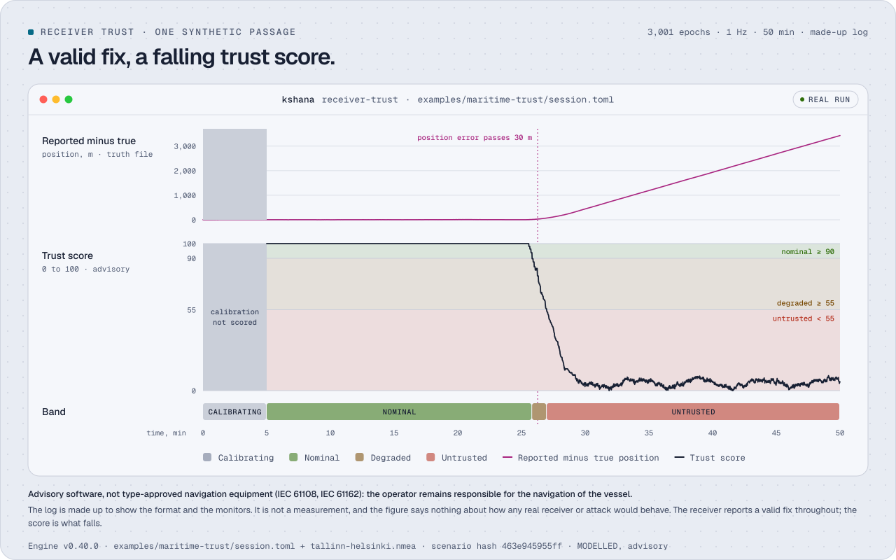
</picture>

<picture>
  <source media="(prefers-color-scheme: dark)" srcset="docs/assets/readme/interference-map-dark.svg">
  <source media="(prefers-color-scheme: light)" srcset="docs/assets/readme/interference-map-light.svg">
  
</picture>

<picture>
  <source media="(prefers-color-scheme: dark)" srcset="docs/assets/readme/training-track-dark.svg">
  <source media="(prefers-color-scheme: light)" srcset="docs/assets/readme/training-track-light.svg">
  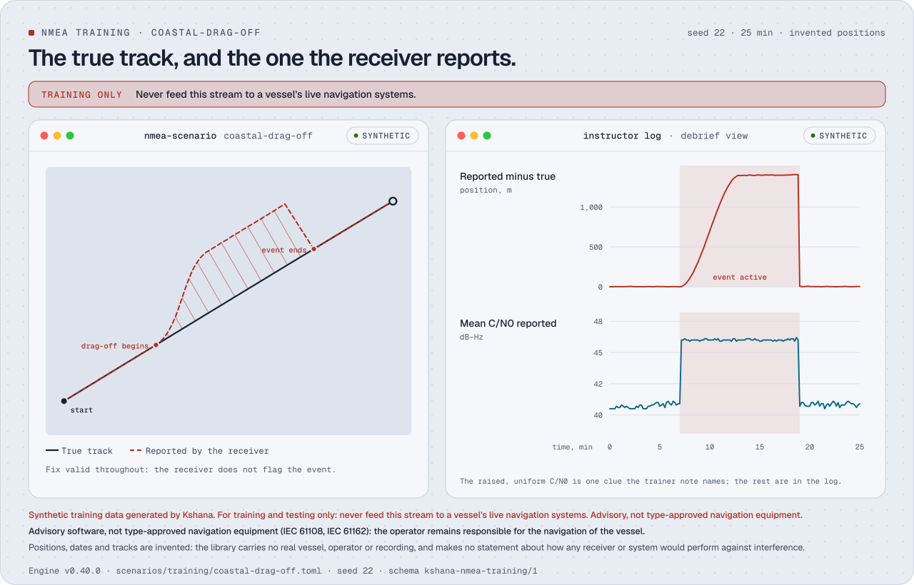
</picture>

<picture>
  <source media="(prefers-color-scheme: dark)" srcset="docs/assets/readme/evidence-pack-dark.svg">
  <source media="(prefers-color-scheme: light)" srcset="docs/assets/readme/evidence-pack-light.svg">
  
</picture>

这四项都是虚构数据且仅供参考：它们展示的是软件的格式和行为，而不是任何接收机或系统在干扰下的表现。第一项用 `kshana receiver-trust examples/maritime-trust/session.toml` 运行，第二项在 `examples/interference-map/` 中的样本上用 `kshana route-exposure` 运行，第三项用 `kshana nmea-scenario scenarios/training/coastal-drag-off.toml --out drag.nmea` 运行（仅用于训练：绝不可输入实时导航设备），第四项按 [`docs/EVIDENCE-PACKS.md`](docs/EVIDENCE-PACKS.md) 中的说明运行。

</details>

<details>
<summary>完整的能力表，按领域逐一列出</summary>

以下是按领域逐一列出的完整细节；关于逐项能力的成熟度台账，见
[`docs/CAPABILITY.md`](docs/CAPABILITY.md) 和 [`docs/VALIDATION.md`](docs/VALIDATION.md)。

| 领域 | 能力 |
|--------|------------|
| **轨道与几何** | SGP4/SDP4 传播（对照全部 666 个 AIAA 2006-6753 向量验证到 4.12 mm）；真实两行根数（一份已提交、带日期戳的 Celestrak `gps-ops` 快照）或合成的 Walker-delta 星座，其平根数在 24 h 传播中以低于 1 km 的误差实现 `i:T/P/F` 公式；多星座可见性、**精度因子——几何、位置、水平、垂直和时间（GDOP/PDOP/HDOP/VDOP/TDOP），对照 gnss_lib_py 1.0.4（Stanford NAV Lab）验证到 1e-6**（Navigation and Autonomous Vehicles Laboratory，导航与自主载具实验室），以及 GNSS 可用性；一个无梯度星座设计优化器、覆盖带（streets-of-coverage）最少卫星数估算、一个多星座比较工具，以及一个 Walker **设计扫描**，它在轨道面数 × 卫星数网格上列出覆盖 / PDOP / 重访时间，并报告帕累托最优设计。 |
| **数值传播器** | 一个 **Cowell** 数值传播器（`src/propagator.rs`），作为解析 SGP4/SDP4 路径的补充，带有分层的**七种摄动**力模型（`src/forces.rs`）：二体 + 完整的 **J2–J6 带谐**场（地球扁率带谐系数 J2 至 J6；其扰动位的精确解析梯度）、可选的 **EGM2008 田谐球谐重力位，阶/次 70**（Earth Gravitational Model 2008；`src/gravity_sh.rs`；真实的 NGA——美国（United States）国家地理空间情报局（National Geospatial-Intelligence Agency）——系数，Holmes–Featherstone 归一化勒让德递推，已对照闭式勒让德函数和解析 ∇V 恒等式交叉检查）、**由历元驱动的太阳和月球第三体**引力（内置低精度星历，无需 DE/SPK——Development Ephemeris / SPICE Spacecraft and Planet Kernel——内核）、**太阳辐射压**（炮弹模型，带锥形本影 + 半影阴影）、**大气阻力**（Vallado 分段指数密度，随地球共转的大气）、**后牛顿 Schwarzschild 相对论修正**，以及 **Lense–Thirring 参考系拖曳**项（IERS——国际地球自转与参考系服务（International Earth Rotation and Reference Systems Service）——Conventions 2010 §10，与地球角动量成线性关系，比 Schwarzschild 项小约 1–2 个数量级）——由两种自适应积分器之一驱动（RK4——四阶龙格–库塔——步长加倍法，或 **Dormand–Prince RK5(4)** 嵌入式对）。**对照 Orekit 12.2 验证**（CS GROUP，Apache-2.0）`NumericalPropagator`/`DormandPrince853`——LEO（低地球轨道）+ GTO（地球静止转移轨道）共 278 个历元，保守力各层级在最坏情况下一致到 **\|Δr\| 0.08 m，历时 24 h**（`tests/numerical_cowell_propagator_reference.rs`）；大气阻力层级另行表征（≈ 333 m / 24 h），绝对的太阳/月球星历和密度输入如实保持为 **Modelled**。另外的内部证据（不是外部验证）：无摄动轨道对照精确的通用变量开普勒解检查到 **24 h 内亚米级**，能量/角动量守恒到约 1e-9，每种摄动都与手工推导的闭式特征相符。 |
| **机动与轨迹设计** | 带 6×6 协方差传播的脉冲 ΔV 节点（ECI——地心惯性——/ LVLH——当地垂直当地水平——执行误差坐标系）、有限推力积分（对照闭式 **Tsiolkovsky** 火箭方程检查到 < 0.01 %）、一个 **Izzo-2015** 单圈 **Lambert** 求解器、一个精确的通用变量 **Kepler** 传播器，以及一个 **porkchop**（发射 × 到达）C3（发射能量）/ 到达 V∞ 扫描，以 JSON 等值线网格输出——位于 GMAT/Orekit 之上的性能仿真层，每个 Lambert 输出都对照二体真值往返检查，porkchop 最小值对照解析 Hohmann 下限检查。 |
| **时间系统与坐标系** | IERS 闰秒 **UTC / TAI / TT / UT1** 时间尺度（协调世界时、国际原子时、地球时，以及地球自转时间世界时 1）、儒略日 API（应用程序编程接口）、IAU-2000（国际天文学联合会）**地球自转角**（ERA）、基于 GMST（格林尼治平恒星时）的 **TEME ↔ ECEF**（真赤道、平春分点 ↔ 地心地固）以及 WGS-84（1984 世界大地坐标系）大地坐标系、IAU 2006 岁差（Fukushima–Williams）、完整的 **IAU 2000A/2000B 章动**、IERS **极移**，以及不依赖春分点的**基于 CIO 的 IAU 2006/2000A GCRS↔ITRS** 归算（CIO = 天球中间零点（Celestial Intermediate Origin））——全部对照 SOFA/ERFA 向量**逐位**验证，并**独立对照 ANISE 交叉检查**（纯 Rust 实现的 NAIF/SPICE 重写；NAIF = NASA（美国国家航空航天局）的导航与辅助信息设施（Navigation and Ancillary Information Facility））：kshana 的 GCRS→ITRS 与 ANISE 基于 JPL `earth_latest_high_prec.bpc` 的 ITRF93（1993 国际地球参考框架）相比，在向两者输入相同 IERS 地球定向参数的情况下，在 2020–2023 年的八个历元上一致到**地面 ≤ 0.86 m / GNSS 轨道处 ≤ 3.6 m**（最大 0.028″）。 |
| **惯性** | 三轴捷联 INS——四元数姿态、WGS-84 NED（北-东-地）力学编排、圆锥/划桨补偿，以及确定性的 IMU 误差模型（标度因数、安装误差、g 敏感性、量化、漂移）；一个**基于第一性原理的冷原子干涉仪加速度计**（Mach–Zehnder 相位、量子投影噪声、对比度衰减、振动耦合），可*推导出*速度随机游走系数；以及一个序贯重要性重采样**粒子滤波器**，用于地图辅助（地形/重力参考）的无 GPS 导航。 |
| **替代 PNT（无 GPS）** | 一个冷原子**重力仪测量模型**，其白噪声底（`σ = ASD/√τ`，ASD = 幅度谱密度）由 CAI 加速度计物理推导；一个低阶、完全归一化的**球谐重力异常场**（对照闭式勒让德函数和手工推导的单项异常检查）以及合成质量瘤；**重力泛函综合核**（`gravity_sh::gravity_magnitude` / `gravity_disturbance_mgal`）——重力辅助导航器用来匹配的“地图读取器”——对照 **GRS80 正常重力标准**（1980 大地参考系）验证，以 **3.5e-12** 复现闭式 Somigliana 正常重力和已公布的 γ_e / γ_p，并根据真实的 ICGEM（国际全球地球模型中心）**EGM2008** 场生成物理上有界的扰动图（RMS——均方根——≈ 26 mGal，在阶/次 70 时最大 ≈ 89 mGal；`tests/icgem_gravity_reference.rs`）；以及一个**重力地图匹配粒子滤波器**，可根据所飞越的异常序列恢复无 GPS 航迹。它扩展到**地形参考导航**（TERCOM/SITAN——地形等高线匹配 / Sandia 惯性地形辅助导航——对照 SRTM（航天飞机雷达地形测绘任务）`.hgt` DEM（数字高程模型），`src/altpnt/terrain.rs`）、阶/次 13 的 **IGRF-14 地磁主磁场**（第 14 代国际地磁参考场）（`src/igrf.rs`，对照倾斜偶极子闭式解和 ∇V 有限差分检查），以及一个**重力 + 磁场 + 地形组合**导航器，它通过一个粒子滤波器融合全部三个标量通道（信息是可加的——没有哪个通道会使定位变差）。一个 **60 分钟无 GPS 基准**（约 700 km / 一小时的中断，期间惯性解漂移到约 70 km）由分层由粗到精的匹配器恢复到 **约 145 m（< 500 m）**——ESA NAVISP（导航创新与支持计划）*Quantum Wayfarer* 目标。 |
| **融合** | 带闭环反馈的松耦合 15 状态 GNSS/INS 误差状态 EKF（扩展卡尔曼滤波器）（`gnss-ins` 包）；在少于四颗卫星时仍持续修正的**紧耦合**伪距更新；一个耦合的**时钟 + 位置**滤波器；一个用于强非线性测量的通用**无迹（sigma 点）卡尔曼**估计器；一个紧耦合 GNSS/INS **UKF 导航器**（伪距 + 多普勒），其力模型轨道外推在一次 30 分钟、包含 120 秒 GNSS 中断的弯曲 LEO 过境上自洽性检查到 **0.77 m RMS**（这是滤波器一致性数字，不是外部参考基准验证——该导航器保持 MODELLED）；以及一个完整的 **17 状态紧耦合 GNSS/INS UKF**（位置、速度、姿态误差、加速度计和陀螺仪零偏、时钟偏差和漂移），其**量子 CAI 航位推算**依靠冷原子加速度计推导的速度随机游走外推度过 120 秒中断。 |
| **定轨** | 根据地面站测距跟踪恢复轨道状态 `[r, v]`，将二体 + J2 力模型和 RK4 积分器与 **Gauss–Newton 批处理**校正器（`determine_orbit_batch`，无噪声测距下为亚米 / mm·s⁻¹ 级，5 m 噪声底下约 2 m）以及一个**序贯**无迹滤波器变体（`determine_orbit_sequential`）组合起来。 |
| **可观测性与估计理论** | 一个通用、可复用的 **Fisher 信息 / Cramér–Rao** 层（`src/fim.rs`）：信息矩阵 M = HᵀWH、**Cramér–Rao 下界**、可观测性**秩和基准亏损零空间**（Moore–Penrose 伪逆），以及来自对称 Jacobi 特征求解器的 **D/A/E/T 最优**试验设计标量。**已验证**——特征值对照 `numpy.linalg.eigh`，CRLB 协方差对照通过 `numpy.linalg.inv` 计算的 σ²(XᵀX)⁻¹，以及由信息矩阵得到的 GNSS DOP，全部一致到 **1e-9**（`tests/fim_observability_reference.rs`），另外还对照 **Kay (1993)** 闭式界及蒙特卡洛 CRLB 可达性进行了交叉检查。它是 DOP 引擎、无源定位 CRLB 以及月球绝对台站**可观测性定理**（见下文）的基础。 |
| **月球与地月空间** | 旋转坐标系中的地月**圆形限制性三体（CR3BP）**传播器——守恒的 Jacobi 常数和全部五个拉格朗日点（`src/cr3bp.rs`）——现在带有 **6×6 状态转移矩阵（STM）和单次打靶微分校正器**（`cr3bp_jacobian`、`propagate_state_stm`、`differential_correct_halo`），可生成真正周期性的**晕轨道 / NRHO**（近直线晕轨道）：STM 对照有限差分验证，校正后的轨道闭合到机器精度，以已公布的远月点状态为初值可复现 **L2 南向 9:2 NRHO**（L2 = 第二地月拉格朗日点；Gateway 轨道），周期 ≈ 6.57 d / 近月点 ≈ 3,250 km，与已公布的 ≈ 6.56 d / ≈ 3,370 km 一致（这是 CR3BP——圆形、不含太阳——解，**未**对照真实的 LANS（月球增强导航服务）/Gateway 星历验证；校正后轨道的月心 MCI/MCMF（月心惯性 / 月心月固）转换是后续工作）；此外还有 **LunaNet / LNIS**（LunaNet 互操作性规范）地月空间 PNT 几何（MCI↔MCMF 归算、月面坐标），以及一次**月球南极 ARAIM** 过境，如实呈现完好性差距：约 30 m 的 σ_URE（用户测距误差）使保护级远高于 50 m 告警限值（`src/lunar.rs`、`scenarios/lunanet-araim.toml`）；以及一个**月面信标 DOP 增强**（`src/lunar_beacon.rs`），说明少数经测量的月面测距信标如何提供纯轨道、全部位于头顶的卫星组所缺少的低仰角、宽方位视线行——从而大幅降低病态的南极 GDOP，并通过和方根误差预算降低以米计的实际位置精度（复用经 gnss_lib_py 验证的 DOP 核以及无大气地平线可见性闭式解；精度因子分析已写成论文 [arXiv:2607.06212](https://arxiv.org/abs/2607.06212)）。 |
| **月球 PNT 套件** | 构建在 CR3BP 核心之上的月球/地月空间导航套件，每项都是一个可运行的 `kind`：**月球坐标时**（`lunar-time-offset`，`src/lunar_time.rs`——由自身引力位差 + 动能项得出的长期 LTC/TCL − TT 速率（LTC = 月球坐标时（Lunar Coordinate Time）；TCL 为其法语形式 Temps-Coordonnée Lunaire），并与已公布的 56–59 µs/天区间一并报告）；一个大地测量**月球 VLBI**（甚长基线干涉测量）时延观测量（`lunar-vlbi`，`src/lunar_vlbi.rs`——地球基线近场双距离差时延 + 时延率，在远场极限下对照同一代码库中的平面波 Δ-DOR（差分单向测距）交叉检查，偏导数经有限差分验证）；一个**联合多技术定轨 + 时钟**批处理估计器（`lunar-joint-od-clock`，`src/lunar_combination.rs`——融合 VLBI + 月球本地测距 + 星间测距的 Gauss–Newton 拟合），附带一个 **Fisher 信息可观测性**结果：仅靠内部测距会留下六自由度刚体**基准亏损**，因此在加入地球坐标系连接之前，月面站的*绝对*位置不可观测——地球基线 **VLBI** 时延对稀疏星座可*恢复*可观测性，对密集星座可*收紧* Cramér–Rao 界，绝对基准在有**三个**不共线地面站时闭合（该可观测性结果已写成论文 [arXiv:2607.02566](https://arxiv.org/abs/2607.02566)）；**参考框架实现**（`lunar-frame-realisation`，`src/lunar_frame_realise.rs`——7 参数 Helmert 基准拟合 + IAU 2015 WGCCRE 定向连接——WGCCRE = IAU 制图坐标与自转要素工作组）；一个 **Moonlight/LCNS 级服务体积**分析（LCNS = 月球通信与导航服务；`moonlight-service-volume`，`src/lunar_service.rs`——DOP / 覆盖 / 可用性 + 广义月球 ARAIM HPL/VPL（水平/垂直保护级）包络，复用经 gnss_lib_py 验证的 DOP 核以及 LunaNet σ_URE≈30 m 的机制）；**月球差分 PNT**（`lunar-differential-pnt`，`src/lunar_dpnt.rs`——月球差分 GNSS / 星基增强系统（SBAS）的类比：精确的共模时钟抵消 + 随基线的一阶空间去相关，复用 DO-229E SBAS 保护级——DO-229E 是 RTCA（原无线电航空技术委员会）针对 SBAS 接收机的最低运行性能标准）；以及一个**与 LunaNet/IOAG 对齐的互操作导出**（IOAG = 机构间运行咨询组；`lunar-interop-export`，`src/lunar_interop.rs`——在 IAU 2015 月球本体坐标系中进行 CCSDS-OEM（轨道星历电文）+ 月球时间尺度往返，封装在 KIF 信封中）。各部分的证据等级见[验证矩阵](docs/VERIFICATION-MATRIX.md)：月球坐标时、联合定轨 + 时钟估计器、参考框架实现以及服务体积几何为 **VALIDATED**（各自对照其所在行指明的独立参考基准，VLBI 时延的核路径亦然）；VLBI 观测量、基准亏损可观测性结果、差分 PNT 和互操作导出为 **MODELLED**。参数为**示意性的公开来源**值——**未**对照真实 VLBI/Gateway 跟踪数据验证，**与**任何机构**无关联**、**未**获任何机构认可，不作 TRL（技术成熟度等级）/ 飞行继承性声明。 |
| **深空与火星 PNT** | 一个开放的**无线电测量导航引擎**：迭代光行时 + **Shapiro** 相对论时延、双程/单程/三程**多普勒与测距**（Moyer 双段）、相干应答机转发比、再生/PN（伪噪声）测距（CCSDS 414，伪噪声测距标准），以及 **Δ-DOR** 天空平面测量（CCSDS 506，Delta-DOR 标准），带太阳等离子体/对流层/电离层介质；**CCSDS-TDM (503)** 跟踪数据电文解析 + 输出；一个**简化动力学平方根信息滤波器**（RTN——径向、横向、法向——经验加速度 + 3 状态星载时钟 + 火星大气阻力），在合成闭环中实现**火星 LMO 定轨到 ≈ 0.2 m**；一个联合**单程 + 双程融合**估计器；一个多体动力学核心（`Body{μ, re, zonals, gravity, IAU-pole}`、火星 GMM-3（Goddard Mars Model 3）重力场、IAU 火星本体固连坐标系、可插拔的 `EphemerisProvider` 接口、两段式儒略日 + TT↔TDB（质心动力学时））；以及 **`mars-pnt`** 中继 PNT 场景（MARCONI 火星静止中继星座），带端到端的 **GSE 性能仿真器**（GSE = 地面支持设备）（几何 → 链路预算 → 观测量 → SRIF → 协方差）。**经仿真验证**（协方差 / 闭环品质因数）；以太阳为中心的火星动力学对照 JPL **DE440** 交叉检查（1 天弧段 137 m，`xval/anise-mars-od`）。使用真实 DSN/ESTRACK 跟踪数据的验证列在路线图中。 |
| **太阳系与任意天体 PNT** | 一个无需内核的**全太阳系星历**（`src/ephem.rs`、`src/ephem_provider.rs`）：每颗行星来自 JPL **Standish 开普勒根数**（表 1，公元 1800–2050 年；表 2a/2b，公元前 3000 年至公元 3000 年），附带每颗行星已公布的标称误差，地球和月球由月球级数分离，Phobos、Deimos、Io、Europa、Ganymede、Callisto 和 Titan 来自 JPL 平根数和 IAU（国际天文学联合会）自转模型；在 ICRF（国际天球参考框架）中给出**任意天体相对于任意其他天体**的位置。`Body` 现在为**十八个天体**携带 **GM（引力参数）、半径、J2（第二带谐系数，若已公布）以及 IAU 极和本初子午线**。**`solar-system`** 类型报告任意两个天体之间的位置、速度、常数、**光行时和单程/双程距离**（使用现有的无线电光行时求解器，含太阳 Shapiro 时延）以及每个天体的轨道轨迹——足以绘制一个交互式太阳系；**`body-pnt`** 类型为**围绕任意天体**的轨道器或着陆器定位（`scenarios/mars-orbit-pnt.toml`、`scenarios/europa-surface-pnt.toml`），使用本地 Walker 星座、精度因子和 Gauss–Newton 机制，以及来自地球的深空测距。**对照 JPL Horizons（DE441，JPL Development Ephemeris 441）验证**：表 1 中的水星至土星以及地球在标称误差的两倍以内（最差 1.87×），表 2a/2b 中的全部八颗行星（最差 1.71×），以及地球–火星/木星光行时。**Modelled**：表 1 中的天王星和海王星（对照 DE441 分别为所述误差的 2.0× 和 5.2×）、冥王星、各卫星以及 `body-pnt` 导航结果。 |
| **MEO + LEO 融合 PNT** | `src/leo_fusion/`：适用于任意星座（Walker 壳层、根数集、GNSS 预设）和任意信号（载波、码速率、C/N0 包络、空间信号测距误差）的、与具体系统无关的 LEO 定位、导航与授时，可选用附带来源的单文件预设（Xona Pulsar X1/X5、Iridium STL、Starlink 机会信号、CentiSpace、一个代表性 C 频段系统、ATOMIC 零钟星历模型）。**`leo-pvt`**：基于距离变化率的批处理**多普勒定位**（单星和多星、时钟漂移和速度状态、单次过境的沿迹/跨迹几何以及镜像解）、带逐系统系统间偏差和调用方提供的逐信号 sigma 的**联合 GNSS + LEO 加权最小二乘**、DOP 随 LEO 卫星数的变化、**极地和北极**覆盖，以及相对于 C/N0 和振荡器的 **LEO 到 UTC 时间传递**。**`leo-ppp`**：一个浮点 PPP（精密单点定位）EKF（扩展卡尔曼滤波器），分别仅用 GNSS 和加入 LEO，给出其收敛时间以及卡方 NEES 一致性检验。**`ntn-positioning`**：基于带宽 Cramér-Rao 界的 5G 非地面网络定位。**已验证**：LEO 多普勒包络对照已公布的 Iridium 和 Xona 数据。**Modelled**：其余部分，PPP 趋势与 Li et al. (2019) 进行了比较——见 [`docs/LEO-PNT-FUSION.md`](docs/LEO-PNT-FUSION.md)。 |
| **完好性** | 快照式和解分离（ARAIM 风格）RAIM——接收机自主完好性监测——带水平/垂直保护级（HPL/VPL）、故障检测与排除，以及 Stanford 完好性图；一个显式完好性风险预算的**多假设解分离（MHSS）**保护级，包括**双/多星座全星座故障模式**（EU（欧盟）ARAIM / DO-316，即 RTCA 针对带机载增强的 GPS 机载设备的性能标准），在真实的 GPS + Galileo 快照上运行（`scenarios/araim-gps-galileo.toml`）。保护级对每种故障模式应用单侧**标称偏差**投影 `b_k = Σ_i|s_i|·b_nom`，并使用来自完好性支持电文的**完好性** sigma σ_URA（用户测距精度；不同于精度 σ_URE，即用户测距误差）——见 [`docs/ARAIM_REFERENCE.md`](docs/ARAIM_REFERENCE.md)。检测核（χ²/非中心 χ²/正态门限和 K 乘数）在 171 个案例上**对照 SciPy 进行了外部验证**（`tests/raim_reference.rs`）；几何部分复用经 gnss_lib_py 验证的 DOP 核。ARAIM MHSS 完好性风险*预算分配*本身没有已公布的数值参考基准，如实保持为 Modelled。 |
| **增强（SBAS）** | DO-229E 加权最小二乘形式的 **SBAS / WAAS 保护级**（WAAS = 广域增强系统）（精密进近和航路 K 因子），以及作为 DO-316 基础的 **L1/L5 双频无电离层**组合（L1 和 L5 是 GPS 的两个民用信号频段；IS-GPS-705，即 GPS L5 信号接口规范，γ₁₅ ≈ 1.793）——`src/sbas.rs`。保护级算法**对照 RTKLIB SBAS-PL 分支进行了外部验证**（RTKLIB = 开源实时动态定位库；PL = 保护级）（`zsiki/rtklib_ws` `waasprotlevels()`，Siki & Takács 2017，DO-229D——DO-229 的上一修订版——附录 J），在**真实 EGNOS 数据**（欧洲地球静止导航重叠服务）上运行，以 < 2e-3 m 复现其 HPL（`tests/sbas_reference.rs`）；gLAB（GNSS Laboratory 工具套件）v6.0.0 确认了相同的约定。 |
| **时钟与授时** | 两状态卡尔曼守时（Joseph 形式协方差、NIS/NEES——归一化新息平方 / 归一化估计误差平方——一致性健康度）；Allan 族稳定度（ADEV / MDEV / TDEV / HDEV / MTIE——Allan 偏差、修正 Allan 偏差、时间偏差和 Hadamard 偏差，以及最大时间间隔误差），带针对噪声类型的置信区间以及完整的 **IEEE-1139 五系数幂律拟合**（IEEE Std 1139，电气电子工程师学会的频率与时间计量定义）——这些估计器在真实硬件上对照 **Stable32** 验证：一台**真实的 5071A 铯原子一级标准对比一台氢钟**（556,990 个相位采样，16 个平均因子，OADEV/OHDEV——重叠 Allan/Hadamard 偏差——到 1e-3；`tests/cs5071a_reference.rs`），以及**标准的 Stable32 PHASE.DAT** 回归序列（139 个平均因子，OADEV/MDEV/TDEV 到 1e-3；`tests/phasedat_reference.rs`）；ADEV/MDEV/TDEV 估计器以及电信 **MTIE** 漂移指标另外在 NIST SP 1065 序列上对照**独立的 allantools 2024.06** 库交叉检查到 **< 1e-9**（`tests/mtie_reference.rs`、`tests/mdev_tdev_reference.rs`）；几何修正（Sagnac、GNSS 共视）；以及实际使用的时间传递方法——**TWSTFT**（卫星双向时间频率传递），使用 BIPM（国际计量局）Sagnac 闭式解、**GNSS 共视**、**PPP**（精密单点定位）无电离层时间传递、带湍流闪烁的自由空间**光学**链路，以及低于最佳参与时钟的逆方差加权**时钟组（纸面）时间尺度**。一个**无 GNSS 时钟守时计算器**（`src/holdover.rs`）将闭式 van-Loan 外推误差增长表示为*守时到阈值*的反演——时钟在授时误差超出预算之前能自由运行多久——涵盖代表性的经典和量子时钟类别；**modelled**（对照多步 `clock_state` 协方差递推交叉检查），并如实说明：对于非常稳定的时钟，到严格阈值的守时时间由*假设的*长 tau 噪声底决定，而不是由引用的 ADEV 决定。一个**条件授时保护级**（`src/tpl.rs`）将守时扩展到欺骗：在有独立交叉检查的前提下，对*未被检测到的*时间误差给出一个界，它组合了 k-sigma 监测器底、检测延迟期间的 van-Loan 外推方差，以及 CUSUM（累积和）告警时间。在一次真实记录的欺骗（JammerTest 2024）上校准，可通过 `cargo run --example tpl_jammertest` 复现；组合为 **MODELLED**（没有每小时完好性风险预算），以检测为条件——不存在有限的*无条件*界。 |
| **GNSS 测量域** | 正向伪距 / 多普勒合成，带 **Klobuchar**（广播）和 **IONEX / TEC 格网**（电离层图交换格式 / 总电子含量；实测）电离层——包括 IONEX 文件解析器、地图之间的时间插值以及薄壳斜向投影映射——**Saastamoinen + Niell** 对流层，以及快照 RAIM（HPL/VPL）。 |
| **韧性** | 链路预算**压制干扰**（J/S → 有效 C/N₀ → 失锁——干信比、载噪比——其中抗干扰频谱分离因子 `Q` 现在**由实际信号和干扰功率谱推导**，通过 `src/navsignal.rs`——`Q = 1/(R_c·κ)`，在 CI 中对照之前的代表性常数交叉检查）；一个随机**时间欺骗检测器**（Neyman–Pearson / χ²₁ 能量检验，带闭式和蒙特卡洛 P_fa/P_md，以及安全品质因数（FoM）1 − P_md）；一个**多层欺骗检测器**，融合 RAIM 一致性奇偶检验（如实建模了共模盲区）、射频 AGC 功率（自动增益控制）监测器和信号质量（SQM——信号质量监测，超前减滞后）监测器；以及一个**量子惯性航位推算误差预算**（`QuantumNavBudget`，`src/inertial/quantum_imu.rs`），将冷原子干涉仪白噪声速度随机游走与残余零偏（对照独立的 `AccelModel` 积分器交叉检查）和标度因数误差组合成守时期间的位置漂移数字——时钟守时的惯性对应物。一个**与框架对齐的韧性评分引擎**（`src/resilience/`）将某一架构的仿真行为映射为 Kshana 自己的七个韧性类别（不是 DHS 术语）上的逐维度子分数，这些类别与美国国土安全部 Resilient PNT Conformance Framework 对齐，然后在 Dirichlet 权重单纯形和五种威胁的集合下研究任一综合分数或成熟度等级的**决策稳定性**——Kendall-τ 排名不稳定性、第一名翻转率，以及共模**多样性塌缩**（Hill-N2），并附有经完整性哈希的保证报告（35 个手工推导的参考基准测试）。可通过 `cargo run --example resilience_report` 复现；**MODELLED** 合成架构，是与 RPCF v2.0 对齐的自我评估，**不是**认证。见 [`docs/RESILIENCE-CROSSWALK.md`](docs/RESILIENCE-CROSSWALK.md)。 |
| **无源射频定位** | **TDOA/FDOA 发射源定位**（到达时间差 / 到达频率差；`src/geolocation.rs`）——根据接收机网络上的**到达时间差**双曲面，用 Gauss–Newton 最小二乘求解，确定干扰或欺骗信号源（或用于反向 PNT 的机会信号源）的位置；在接收机运动时加入**到达频率差**，可联合恢复发射源的位置*和*速度，位置协方差的 **Cramér–Rao** 界由网络几何推导。**MODELLED**（内部一致性参考基准：正向→逆向往返、J·CRLB = I 恒等式、GDOP 单调性，以及估计器在蒙特卡洛下达到其自身的 CRLB）——点源视距模型，不含多径 / NLOS（非视距）、接收机时钟偏差或折射项。 |
| **导航信号与码跟踪** | 介于链路预算和测量域之间的**信号层**（`src/navsignal.rs`）：**BPSK-R(n)**（矩形码片二进制相移键控）和 **sine-BOC(m,n)**（二进制偏移载波）的单位面积**功率谱密度**（PSD）；**频谱分离系数**（SSC）κ = ∫ G_s·G_i df，它根据实际信号/干扰频谱**推导出**压制干扰模型使用的**抗干扰 `Q`**（`Q = 1/(R_c·κ)`），而不是使用代表性常数；**RMS（Gabor）带宽**（BOC > BPSK——测距信息 / Cramér–Rao 度量）；**相干超前–滞后 DLL 码跟踪热噪声抖动**（DLL = 延迟锁定环；Kaplan & Hegarty；对于 C/A——GPS 粗捕获码——在 45 dB-Hz 时约为亚米级）；以及**多径误差包络**（相干 EML，超前减滞后——窄相关器抑制）。对照闭式基准验证（BPSK 自身 SSC = 2/(3·R_c)、单位面积 PSD、亚米级 C/A 抖动）。这是信号**性能**分析，**不是**天线 / 射频载荷硬件设计（那是载荷合作方的职责）。 |
| **互操作性** | **RINEX-3** 多 GNSS 广播星历导入（GPS、Galileo、QZSS——日本的准天顶卫星系统——、BeiDou MEO/IGSO——中地球轨道 / 倾斜地球同步轨道——通过 IS-GPS-200，即 GPS 接口规范；GLONASS，俄罗斯的全球导航卫星系统，通过 PZ-90——俄罗斯 Parametry Zemli 1990 基准——状态向量 RK4），可用作星座来源（输入 RINEX，输出 PNT 几何）；一个 **RINEX-3** 观测文件解析器（伪距、载波相位、多普勒、信号强度；4.00 观测文件布局预期可以解析但未经测试，RINEX 4 导航文件会按名称拒绝，而不是被错误解码），现在可**输入单点定位（SPP）求解器**（`pvt`）——输入真实的码观测量，输出真实的**接收机位置**，已在 IGS 数据上验证；一个带 9 阶拉格朗日插值的 **SP3-c/d** 精密星历读写器；面向飞行动力学工具（GMAT、Orekit、STK——Systems Tool Kit）的 **CCSDS OEM 2.0 + OMM**（轨道平根数电文）导出；以及用于深空无线电跟踪的 **CCSDS-TDM (503)** 跟踪数据电文解析 + 输出。 |
| **任务分析（系统工程）** | 一阶任务设计预算，每项都是一个可运行的类型：二体**发射与上升几何**（`launch-window`——发射方位角 `sin Az = cos i/cos lat`、最小倾角、地球自转增益、狗腿式轨道面改变 Δv、每日发射机会；`src/launch.rs`）；**Allen–Eggers 弹道再入走廊**（`reentry`——峰值减速度、峰值过载时的速度/高度、峰值加热速度；`src/reentry.rs`）；**对地观测覆盖几何**（`eo-coverage`——幅宽 / 星下点 GSD（地面采样距离）/ 侧摆访问 / 通过 SMAD（*Space Mission Analysis and Design*）空间三角形计算的重访；`src/eo_payload.rs`）；**3-DOF 姿态与指向误差预算**（三自由度；`attitude-budget`——最坏情况重力梯度力矩 + RSS（和方根）指向预算；`src/attitude_budget.rs`）；**地面站过境预报**（`passes`——AOS/TCA/LOS，即信号获取 / 最近接近时刻 / 信号丢失，最大仰角，访问时间；`src/passes.rs`）；以及基于 CCSDS 401 / DSN 810-005 链路方程的**单程链路预算**（CCSDS 射频与调制标准 / 深空网链路设计手册；`link-budget`——FSPL（自由空间路径损耗）、C/N₀、Eb/N₀（每比特能量与噪声密度之比）、余量、闭合；`src/linkbudget.rs`）。**MODELLED** 一阶解析预算——位于 STK/GMAT/Basilisk 之下的硬件前层，不能替代 6 自由度或无线电测量工具。 |
| **决策分析与权衡（MCDA）** | 一个完整的**多准则决策分析**（MCDA）套件（`src/mcda/`），涵盖全部四个方法族——价值聚合（**WSM**、**WPM**、**WASPAS**——加权和模型、加权积模型、加权聚合和积评估）、到理想解距离（**TOPSIS**，逼近理想解排序法）、折衷规划（**VIKOR**，源自塞尔维亚语，意为多准则优化与折衷解）以及级别优先（**PROMETHEE II**，丰富评估的偏好排序组织方法；**ELECTRE I**，源自法语，意为表达现实的消去与选择），另外还有比率系统 **MOORA**（基于比率分析的多目标优化）和比例法 **COPRAS**（复杂比例评估）——带 **AHP**（层次分析法）两两比较优先级加权（一致性比率）、**帕累托**非支配前沿、权重**敏感性**分析以及多属性**效用**评分。九种聚合器以 **< 1e-9** 复现独立的第三方库 **pymcdm**（WSM / WPM / WASPAS / MOORA / TOPSIS / VIKOR / PROMETHEE II）和 **pyDecision**（ELECTRE I、COPRAS），AHP 优先级向量 + 一致性比率与 Saaty 随机指数表以及 SciPy/LAPACK 主特征求解器一致到 < 1e-9（`tests/mcda_*_reference.rs`）。**VALIDATED**——权衡研究引擎之下的决策层。 |
| **空间环境** | 一个**空间天气环境模型**（`space-weather`，`src/space_weather.rs`）：太阳（F10.7 / 81 天中心化 F10.7a——10.7 cm 太阳射电通量）和地磁（Kp，行星 K 指数，带定义性的 Kp↔ap 表——ap 是其线性行星幅度）活动指数、它们驱动的 **Jacchia-1971** 外逸层温度（对照已公布的太阳活动最小/平均/最大值验证），以及给定高度处经活动修正与静态的热层中性密度对比——即静态 USSA76（1976 美国标准大气）大气所忽略的太阳周期密度依赖性。**MODELLED**：经校准的一阶标高耦合，**不是**经数据验证的（NRLMSISE——美国海军研究实验室质谱仪与非相干散射雷达外逸层模型）大气。 |
| **AI/ML 评估与权衡** | 一个**射频损伤检测评估测试平台**（`impairment-eval`，`src/impairment_eval.rs`）：一个带标签、以参数为依据的**合成**语料库（标称 / 压制干扰 / 时间欺骗 / 位置欺骗 / 多径），一个与检测器无关的 **ROC/AUC**（接收者操作特征 / 曲线下面积）框架，可为任何检测器（energy \| agc \| sqm \| parity \| fused）评分，给出目标 Pfa（虚警概率）下的逐类 Pd（检测概率），以及分布内与分布外之间的**乐观偏差**（分布偏移模式）。此外还有一个**量子与经典 PNT 权衡**（`quantum-trade`，`src/quantum_trade.rs`），根据**实测 ADEV** 曲线与经典基线对比，量化候选时钟在授时/惯性守时上的收益，长 τ 底的注意事项随产物一并携带，并给出无 GNSS 时韧性随时间变化的包络。评估**指标**（AUC / 混淆矩阵 / Pd-Pmd，Pmd 为漏检概率）**对照 scikit-learn 1.9.0 验证为完全一致**——包括在**真实的 ESA OPS-SAT 遥测数据**上（OPSSAT-AD 异常检测数据集，Ruszczak et al. 2025，CC BY 4.0——知识共享署名 4.0），Kshana 的 Mann–Whitney ROC AUC 在保留测试划分上以 < 1e-9 复现 scikit-learn 的 `roc_auc_score`，一个透明的峰值计数检测器以 AUC ≈ 0.85 区分出带标签的异常（`tests/opssat_ad_reference.rs`）——权衡引擎的数值**核**（ADEV NNLS——非负最小二乘——拟合、χ² 一致性区间、van-Loan 时钟 Q）**对照 scipy 1.17.1** 验证；在此之上构建的设备收益数字保持为 **MODELLED** 工作特性——从不是实地/IQ（同相/正交采样）数据，不给出好/坏判定。在该测试平台的基础上，更深入的**乐观偏差研究**（`src/impairment_study.rs`、`impairment_ml.rs`、`eval_stats.rs`）为一个 **13 检测器**面板评分（能量/AGC/SQM/奇偶，加上带种子的逻辑回归和单隐层 MLP——多层感知器——检测器），用置换零假设拟合分布内与分布外的**缩放规律**，并学习一个**留一法预测器**，根据分布内统计量预测分布外性能下降（`cargo run --example optimism_study`）。一个**软件定义接收机前端**（`src/sdr.rs`——原始 IQ/IF（中频）→ 相关器超前/即时/滞后抽头 → SQM）和**真实数据导入适配器**（`src/realdata/`——RINEX、u-blox UBX（u-blox 二进制协议）、GnssLogger、JammerTest、Yunnan、SatGrid）使相同的检测器可以在本地提供的录制数据上运行（不提交任何数据集）。参数不确定性下的**量子与经典韧性交叉图**（`src/crossover.rs`；`cargo run --bin crossover_study`）重新生成“结果”图表背后的惯性和时钟交叉研究。 |
| **量子赋能 PNT 演示器** | 开源引擎背后的三个可运行的 **MODELLED** 应用领域，每个都输出如实的 `TradeEvidence` + 代表性 / 距飞行差距记录（`src/representativeness.rs`）：**可信量子时间传递**（`quantum-time-transfer`，`src/timetransfer_chain.rs`——端到端光晶格钟 + 光子链路与 CSAC（芯片级原子钟）+ 射频双向预算的对比，复用授时保护级，带时延/重放攻击安全 FoM（1 − P_md）以及时钟异常检测 + CUSUM 延迟）；**无 GNSS 量子导航**（`quantum-gnss-free-nav`，`src/quantum_nav_od.rs`——在 GNSS 中断期间，冷原子干涉仪惯性外推与导航级 INS 的对比，并如实说明在没有外部定位时加速度计零偏不可观测，因此误差仍会增长）；以及量子系统**故障/异常检测**（`quantum-anomaly-detect`，`src/quantum_faults.rs`——带标签的故障目录，使用经外部验证的 `eval_stats` 给出带自助法 CI（置信区间）的 ROC AUC，以及固定虚警率下的最小可检测故障）。一个共享的**量子器件误差模型库**（`src/quantum_devices.rs`）和一个统一的**量子与经典权衡框架**（`src/qtrade.rs`）是它们的基础。它们所依赖的经验证核（评估指标对照 scikit-learn，权衡核对照 scipy）被复用；在此之上构建的设备收益数字保持为 **MODELLED**——**示意性的公开来源**器件/链路参数，建模的是*类别*，不作 TRL / 飞行继承性 / 认证声明，未获任何机构认可。 |
| **节俭工程与完好性影响** | 一个**单位覆盖成本 ROI**（投资回报）视角（`src/frugal.rs`）——架构权衡中每单位交付覆盖的成本——以及一个**漏检 → 完好性影响**映射（`src/integrity_impact.rs`），将监测器的漏检率转换为其对完好性风险的贡献。**MODELLED** 决策支持预算，可叠加。 |
| **产物交换** | **Kshana 交换格式（KIF）**（`src/interchange.rs`）——一个带版本、自描述的信封，封装场景结果及其类型、模式版本以及 MODELLED/VALIDATED 标签，使存储的产物保持自文档化，旧版本信封也能以前向兼容方式读取。 |

每项能力都可以作为 Rust API、可运行的场景 `kind` 或两者兼有来使用。
每项能力的成熟度——*validated*、*runnable* 或 *library*——记录在
[`docs/CAPABILITY.md`](docs/CAPABILITY.md) 中。一个**经机器检查的验证矩阵**
（`src/verification.rs`）呈现需求 → 模块 → 测试 → 参考基准 → 状态的
交叉引用，并带有经单元测试的诚实性不变式：只有在独立的**外部**参考基准支持时
才允许使用 *validated* 标签——并记录 Kshana 有意**不**提供的
硬件/PA（产品保证）能力。

</details>

<details>
<summary>四个传感器包，按最初发布时的内容（结果）</summary>

### 结果

每个场景都在一次约 1.8 h 的 GNSS 中断期间，将一种量子传感器与其经典对应物进行
比较。数字可复现（`scenario + seed + version`）。

<p align="center">
  
  <br><sub>GNSS 失效时量子传感器能带来什么——<code>clock-holdover</code> · 随机种子 42 · 绘于引擎 0.40.0，上面的每个数字在每次构建时都由 <code>tests/published_figures_still_reproduce.rs</code> 对照当前引擎重新检查 · <a href="docs/assets/figures/scenario-fom.svg">SVG</a></sub>
</p>

这一优势**取决于中断时长和振动**，存在一个明确的盈亏平衡点，超过该点则经典方案胜出——在整个技术成熟度阶梯上如实展示（光钟数字是地面演示器目标；还没有任何锶光钟飞上太空）：

<p align="center">
  
  <br>
  
  <br><sub>量子与经典韧性交叉——时钟守时 TRL 阶梯（上）· 带盈亏平衡等值线的惯性优势图（下）。可通过 <code>cargo run --release --bin crossover_study</code> 重新生成。</sub>
</p>

<p align="center">
  
  <br><em>GNSS 中断期间的航位推算位置误差：量子传感器（蓝色）
  在指标附近保持平稳；经典传感器（红色）发散到数十公里。
  由 Kshana 根据 <code>scenarios/imu-deadreckoning.toml</code> 生成。</em>
</p>

| 包 | 场景 | 量子 | 经典 |
|------|----------|---------|-----------|
| **1 — 时钟守时** | `clock-holdover.toml`（20 ns 指标） | 光钟在整个中断期间保持指标 | CSAC 在中断中途超出指标 |
| **2 — 惯性航位推算** | `imu-deadreckoning.toml`（100 m 指标） | 冷原子：**约 41 m**，在整个中断期间保持 | 导航级：在**约 350 s** 时超出 → 数十公里 |
| **3 — 时间传递**（光学星间链路） | `timetransfer.toml` | 光学：测距 **约 0.3 mm** | 射频（TWSTFT）：测距 **约 150 mm** |
| **4 — 混合融合**（综合） | `hybrid-pnt.toml` | 整个中断期间完整的位置 + 授时 | **在约 350 s 时受位置限制** |

综合场景展示了融合的论点：光学星间时间传递甚至能让经典*时钟*
保持锁定，从而把*惯性*传感器孤立出来，成为经典组合的
薄弱环节——即量子惯性 + 光学授时相结合。

<p align="center">
  
  <br><em>GNSS 中断期间的时钟守时：光钟（蓝色）在整个外推期间保持在
  20 ns 指标以内；芯片级时钟（红色）在中途超出指标。
  由 Kshana 根据 <code>scenarios/clock-holdover.toml</code> 生成。</em>
</p>

另一个场景 `orbit-gnss-challenged.toml` 根据**轨道几何**推导 GNSS 可用性，
而不是使用手工编写的窗口：将一个位于 GNSS
壳层内的航天器相对于一个类 GPS 的 Walker 星座进行传播，可见卫星
数量（视线、地球遮挡、高度截止角）决定每一步的定位状态。
在一天中，用户仅约 59% 的时间处于定位状态；量子时钟在每个间隙中都保持
5 ns 的授时解（可用性 **1.0**），芯片级时钟
仅为 **约 0.83**。

<p align="center">
  
  <br><em>GNSS 可用性由轨道几何推导时一天内的授时误差：
  可见卫星数量（视线、地球遮挡、高度截止角）决定每一步的定位
  状态，因此时钟必须外推度过每个间隙——光钟保持 5 ns
  指标，而芯片级时钟超出指标。由 Kshana 根据
  <code>scenarios/orbit-gnss-challenged.toml</code> 生成。</em>
</p>

星座也可以用真实的两行根数（TLE）给出。*完整的* TLE
（第 1 行 + 第 2 行）用完整的 **SGP4/SDP4** 模型传播——包括
大气阻力以及对约 12 h GNSS 轨道有影响的深空日月项和 12 h / 24 h 共振项
——已对照官方 AIAA 2006-6753 向量验证，
最坏情况约为 ≈ 4 mm。`scenarios/orbit-sgp4-gps.toml` 附带运行中 GPS 星座的**真实 Celestrak
`gps-ops` 快照**（2021-07-28，30 颗卫星），
并要求 TLE 校验和有效——两行根数是来自美国
太空军 / 第 18 太空防御中队目录的开放数据，由 Celestrak 再分发
（Dr T. S. Kelso，[celestrak.org](https://celestrak.org)）；用
`scripts/fetch_tles.sh` 更新。仅含第 2 行的块保留
解析二体传播（`scenarios/orbit-real-tle.toml`）；两种形式可以
在一个星座中混用。星座同样可以由一组
**RINEX-3 GPS 广播星历**记录构建——即接收机解码的格式——
用 IS-GPS-200 用户算法传播，并输入同样的几何计算
（`scenarios/orbit-rinex.toml`）。

</details>

<details>
<summary>它是什么 / 不是什么（完整版）</summary>

<a id="what-it-is--is-not"></a>
### 它是什么 / 不是什么

**它是：** 一个确定性的、依赖很少的引擎，覆盖 PNT 技术栈——轨道
几何、惯性导航、GNSS/INS 融合、完好性、时钟和授时。它
运行一个场景（通常是一次 GNSS 中断），通过合适的估计器演化经校准的传感器误差模型，
并对照实际使用的
品质因数为结果评分——输出可复现的 JSON（JavaScript 对象表示法）结果和 SVG 图表，可以来自
Rust 库、命令行界面（CLI）、Python 扩展、浏览器内 WebAssembly 模块、
面向 AI 代理的**模型上下文协议（MCP）服务器**，或 **JetBrains IDE（集成
开发环境）插件**。

**它不是：** 飞行硬件、量子载荷设计、完整的 GNSS 信号
接收机、射频（RF）信号模拟器或硬件在环装置，也不是
经认证的航电产品——它也不取代 MATLAB/Simulink、STK（Systems Tool
Kit）或 Orekit；它与它们并列使用，并与它们交换文件。量子硬件的保真度来自
已发表的误差模型，而不是来自本工具。每项
能力的细粒度成熟度记录在 [`docs/CAPABILITY.md`](docs/CAPABILITY.md) 中。

**它（目前还）不是：** 一个*完整的*原子干涉物理引擎（大多数量子传感器
使用已发表的 Allan/噪声预算系数；CAI（冷原子干涉仪）加速度计有一个
第一性原理层——Mach–Zehnder 相位、投影噪声、对比度衰减和
振动耦合，以及 Coriolis 和光频移系统误差——但波前系统误差和
条纹模糊度解算仍属于 **P2**（路线图第 2 阶段，量子物理层）
路线图层，见 [`ROADMAP.md`](ROADMAP.md) 和 [`docs/QUANTUM-MODELS.md`](docs/QUANTUM-MODELS.md)）；
经认证的或硬件 GNSS 接收机（它根据真实的 RINEX（Receiver Independent Exchange Format，与接收机无关的交换格式）码观测量求解单点 **PVT**（位置、速度和时间）定位
——已在真实的 IGS（国际 GNSS 服务）数据上验证——其 IQ 层（`kshana iq`，自 0.31.0 起）
以软件方式捕获和跟踪已录制或已生成的基带采样，作为一台分析
接收机：它不驱动无线电硬件，也不发射信号，不是经认证的接收机，也不
进行载波相位定位（RTK 或 PPP））；或完整的任务设计套件（它有 Lambert / porkchop /
机动 / 定轨构建模块，但它是位于 GMAT（通用任务分析工具）/Orekit *之上*的性能仿真层，
而不是替代品）。界定这一范围是有意为之。如果你需要第一性原理的冷原子
干涉仪误差预算（例如 CARIOQA-PMP 级——Cold Atom Rubidium Interferometry
in Orbit for Quantum Accelerometry, Pathfinder Mission Preparation——或 X-37B 式验证），请参阅
P2 路线图并[与我们联系](#support--professional-services)开展合作。

</details>

### 低地球轨道导航

低地球轨道（LEO）卫星过境快、信号强。`leo-pnt-chain` 类型对一个
系统逐阶段跟踪：信号、过境及其链路、导航电文，以及
融合的位置、速度和时间（PVT）定位与精密单点定位（PPP）。每个
阶段都把它的数字传给下一阶段。见 [`docs/LEO-PNT.md`](docs/LEO-PNT.md)。

<picture>
  <source media="(prefers-color-scheme: dark)" srcset="docs/assets/readme/flow-leo-chain-dark.svg">
  <source media="(prefers-color-scheme: light)" srcset="docs/assets/readme/flow-leo-chain-light.svg">
  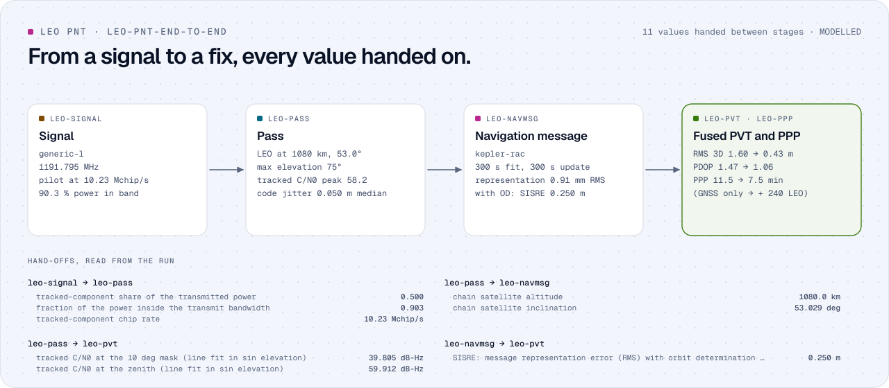
</picture>

<a id="every-scenario-kind-by-family"></a>
### 按族划分的每种场景类型

引擎的场景类型，按族归档。每个族都有一个页面，每种类型一个条目（引擎的
描述和字段、一条示例命令、一次运行的主要数字、提及它的
[验证矩阵](docs/VERIFICATION-MATRIX.md)行，以及引擎自己写出的图表），并附有这些图表的
缩略图集；[`docs/KINDS.md`](docs/KINDS.md) 为它们全部编制了索引。该表由
[`tools/gen_readme_blocks.py`](tools/gen_readme_blocks.py) 写出，页面由
[`tools/gen_kinds_index.py`](tools/gen_kinds_index.py) 写出，如果引擎新增了某个没有归入任何族的类型，两者都会失败。

<!-- generated:kind-families -->
| 族 | 它回答什么问题 | 类型 | 运行一个 |
|---|---|---|---|
| **[时钟、授时与守时](docs/kinds/clocks-timing-and-holdover.md)** | 没有 GNSS 时时钟能保持时间多久，以及授时系统对照其模板表现如何 | [`clock`](docs/kinds/by-kind/clock.md), [`sweep`](docs/kinds/by-kind/sweep.md), [`sweep-nd`](docs/kinds/by-kind/sweep-nd.md), [`telecom-timing`](docs/kinds/by-kind/telecom-timing.md), [`slot-timing`](docs/kinds/by-kind/slot-timing.md), [`timetransfer`](docs/kinds/by-kind/timetransfer.md), [`time-transfer-budget`](docs/kinds/by-kind/time-transfer-budget.md), [`holdover-test`](docs/kinds/by-kind/holdover-test.md), [`quantum-time-transfer`](docs/kinds/by-kind/quantum-time-transfer.md) | `kshana scenarios/clock-holdover.toml` |
| **[惯性、融合与量子传感器](docs/kinds/inertial-fusion-and-quantum-sensors.md)** | 使用经典和量子传感器，在 GNSS 中断期间进行航位推算和传感器融合 | [`inertial`](docs/kinds/by-kind/inertial.md), [`hybrid`](docs/kinds/by-kind/hybrid.md), [`fusion`](docs/kinds/by-kind/fusion.md), [`hybrid-ukf`](docs/kinds/by-kind/hybrid-ukf.md), [`gnss-ins`](docs/kinds/by-kind/gnss-ins.md), [`ins-trn-coast`](docs/kinds/by-kind/ins-trn-coast.md), [`quantum-gnss-free-nav`](docs/kinds/by-kind/quantum-gnss-free-nav.md), [`quantum-anomaly-detect`](docs/kinds/by-kind/quantum-anomaly-detect.md), [`quantum-trade`](docs/kinds/by-kind/quantum-trade.md) | `kshana scenarios/gnss-ins.toml` |
| **[无 GPS 的替代 PNT](docs/kinds/gps-denied-alternative-pnt.md)** | GNSS 失效时利用重力、地形和其他场进行导航 | [`gravity-map`](docs/kinds/by-kind/gravity-map.md), [`terrain-nav`](docs/kinds/by-kind/terrain-nav.md), [`terrain-slam`](docs/kinds/by-kind/terrain-slam.md), [`combined-altpnt`](docs/kinds/by-kind/combined-altpnt.md), [`conflict-resilience`](docs/kinds/by-kind/conflict-resilience.md) | `kshana scenarios/combined-altpnt.toml` |
| **[星座、覆盖与几何](docs/kinds/constellations-coverage-and-geometry.md)** | 在地球、月球或火星周围，卫星在哪里、谁能看到它们、几何构型有多好 | [`orbit`](docs/kinds/by-kind/orbit.md), [`ephemeris`](docs/kinds/by-kind/ephemeris.md), [`constellation-design`](docs/kinds/by-kind/constellation-design.md), [`solar-system`](docs/kinds/by-kind/solar-system.md), [`body-pnt`](docs/kinds/by-kind/body-pnt.md), [`mars-pnt`](docs/kinds/by-kind/mars-pnt.md), [`passes`](docs/kinds/by-kind/passes.md) | `kshana scenarios/orbit-gnss-challenged.toml` |
| **[GNSS 测量、定位与完好性](docs/kinds/gnss-measurements-positioning-and-integrity.md)** | 伪距、定位、保护级和空间环境 | [`integrity`](docs/kinds/by-kind/integrity.md), [`gnss-sim`](docs/kinds/by-kind/gnss-sim.md), [`pvt`](docs/kinds/by-kind/pvt.md), [`araim-reference-check`](docs/kinds/by-kind/araim-reference-check.md), [`space-weather`](docs/kinds/by-kind/space-weather.md), [`realtime-frame-eop`](docs/kinds/by-kind/realtime-frame-eop.md) | `kshana scenarios/integrity-raim.toml` |
| **[压制干扰、欺骗与频谱](docs/kinds/jamming-spoofing-and-the-spectrum.md)** | 干扰如何到达接收机，以及它是否被检测到 | [`jamming`](docs/kinds/by-kind/jamming.md), [`spoof`](docs/kinds/by-kind/spoof.md), [`spoof-detect`](docs/kinds/by-kind/spoof-detect.md), [`tracking-loop`](docs/kinds/by-kind/tracking-loop.md), [`spectrum`](docs/kinds/by-kind/spectrum.md), [`impairment-eval`](docs/kinds/by-kind/impairment-eval.md) | `kshana scenarios/jamming-demo.toml` |
| **[低地球轨道导航](docs/kinds/low-earth-orbit-navigation.md)** | 一次过境、一条链路、一条导航电文和一个融合定位，逐阶段呈现 | [`leo-signal`](docs/kinds/by-kind/leo-signal.md), [`leo-pass`](docs/kinds/by-kind/leo-pass.md), [`leo-navmsg`](docs/kinds/by-kind/leo-navmsg.md), [`leo-pvt`](docs/kinds/by-kind/leo-pvt.md), [`leo-ppp`](docs/kinds/by-kind/leo-ppp.md), [`ntn-positioning`](docs/kinds/by-kind/ntn-positioning.md), [`leo-pnt-chain`](docs/kinds/by-kind/leo-pnt-chain.md) | `kshana scenarios/leo-pnt-end-to-end.toml` |
| **[月球与地月空间](docs/kinds/lunar-and-cislunar.md)** | 月球上的导航、时间、坐标系和大地测量 | [`lunar-integrity`](docs/kinds/by-kind/lunar-integrity.md), [`lunar-time-offset`](docs/kinds/by-kind/lunar-time-offset.md), [`lunar-time-budget`](docs/kinds/by-kind/lunar-time-budget.md), [`lunar-ascent`](docs/kinds/by-kind/lunar-ascent.md), [`lunar-surface`](docs/kinds/by-kind/lunar-surface.md), [`lunar-descent`](docs/kinds/by-kind/lunar-descent.md), [`lunar-orbit-rendezvous`](docs/kinds/by-kind/lunar-orbit-rendezvous.md), [`lunar-vlbi`](docs/kinds/by-kind/lunar-vlbi.md), [`lunar-vlbi-fim`](docs/kinds/by-kind/lunar-vlbi-fim.md), [`lunar-joint-od-clock`](docs/kinds/by-kind/lunar-joint-od-clock.md), [`lunar-frame-realisation`](docs/kinds/by-kind/lunar-frame-realisation.md), [`lunar-frame-campaign`](docs/kinds/by-kind/lunar-frame-campaign.md), [`lunar-llr-datum`](docs/kinds/by-kind/lunar-llr-datum.md), [`moonlight-service-volume`](docs/kinds/by-kind/moonlight-service-volume.md), [`lunar-differential-pnt`](docs/kinds/by-kind/lunar-differential-pnt.md), [`lunar-station-coverage`](docs/kinds/by-kind/lunar-station-coverage.md), [`lunar-beacon`](docs/kinds/by-kind/lunar-beacon.md), [`lunar-interop-export`](docs/kinds/by-kind/lunar-interop-export.md), [`cislunar-observability`](docs/kinds/by-kind/cislunar-observability.md), [`cislunar-arc-recovery`](docs/kinds/by-kind/cislunar-arc-recovery.md), [`lunar-attack-surface`](docs/kinds/by-kind/lunar-attack-surface.md), [`lunar-jamming`](docs/kinds/by-kind/lunar-jamming.md), [`earth-gnss-lunar`](docs/kinds/by-kind/earth-gnss-lunar.md), [`lunar-infrastructure`](docs/kinds/by-kind/lunar-infrastructure.md) | `kshana scenarios/lunar-infrastructure-od-consistency.toml` |
| **[空间用户导航](docs/kinds/space-user-navigation.md)** | 位于 GNSS 轨道之上、周围和之外的航天器可用的 GNSS 信号 | [`gnss-ssv`](docs/kinds/by-kind/gnss-ssv.md) | `kshana scenarios/gnss-ssv-shell.toml` |
| **[光学 PNT](docs/kinds/optical-pnt.md)** | 穿过大气的光学链路以及光学加射频的品质因数 | [`optical-atmosphere`](docs/kinds/by-kind/optical-atmosphere.md), [`hybrid-optical-rf`](docs/kinds/by-kind/hybrid-optical-rf.md) | `kshana scenarios/optical-atmosphere-network.toml` |
| **[任务分析、链路与空间运行](docs/kinds/mission-analysis-links-and-space-operations.md)** | 发射、上升、再入、姿态、链路、测控计划和文件格式 | [`launch-window`](docs/kinds/by-kind/launch-window.md), [`ascent-losses`](docs/kinds/by-kind/ascent-losses.md), [`reentry`](docs/kinds/by-kind/reentry.md), [`entry-heating`](docs/kinds/by-kind/entry-heating.md), [`eo-coverage`](docs/kinds/by-kind/eo-coverage.md), [`eo-radiometry`](docs/kinds/by-kind/eo-radiometry.md), [`attitude-budget`](docs/kinds/by-kind/attitude-budget.md), [`aocs`](docs/kinds/by-kind/aocs.md), [`link-budget`](docs/kinds/by-kind/link-budget.md), [`acm-link`](docs/kinds/by-kind/acm-link.md), [`contact-schedule`](docs/kinds/by-kind/contact-schedule.md), [`aperture-duty-cycle`](docs/kinds/by-kind/aperture-duty-cycle.md), [`space-packet`](docs/kinds/by-kind/space-packet.md), [`oem-interop`](docs/kinds/by-kind/oem-interop.md) | `kshana scenarios/launch-window.toml` |
| **[任务链](docs/kinds/mission-threads.md)** | 从发射到再入的一系列阶段的导航与授时误差预算 | [`mission-thread`](docs/kinds/by-kind/mission-thread.md) | `kshana scenarios/mission-thread-artemis-class.toml` |
| **[战役](docs/kinds/campaigns.md)** | 由其他类型构建的链式任务、参数扫描和集合 | [`campaign`](docs/kinds/by-kind/campaign.md) | `kshana scenarios/campaign-jam-spoof-holdover-integrity.toml` |
<!-- /generated:kind-families -->

<a id="every-command"></a>
### 每条命令

`kshana <scenario.toml>` 运行一个场景；其他每条命令都是一个子命令，`kshana --help` 打印
所有命令的用法。命令有 `--study`、`--validate`、`kinds`、`example`、`receiver-trust`（带 `live` 和
`evidence`）、`evidence`（`keygen`、`verify`、`attach-timestamp`、`round-trip`）、`jammertest`（`import`、`score`）、
`trust-telemetry`、`imu-fit`、`nmea-scenario`、`interference-map`（`adsb`、`ais`、`daily`、`sensitivity`、
`fetch-land`）、`route-exposure`、`bench`（`spec`、`truth`、`cases`、`score`、`baseline`、`seal`、`reveal-check`、
`manifest`、`verify-manifest`、`validate`、`leaderboard`）、`bench-export`、`compliance-report`、
`lunanet-afs-check`、`standards-pack`、`partner`（`check`）、`osnma`、`iq`（`scene`、`acquire`、`track`、`sweep`、`labfit`、`campaign`、
`conditions`、`frontend`、`monitor`、`inventory`、`info`、`extract`、`convert`、`decimate`）、`sky` 和 `skyline`。
[`docs/COMMANDS.md`](docs/COMMANDS.md) 给出每条命令的用途、一个经验证的示例及其文档页面。

<a id="every-surface"></a>
### 每种接口

一个引擎，处处得到相同的结果：命令行、Rust 库、Python、JavaScript 和 WebAssembly、
带插件命令和技能的 MCP 服务器、Kshana Studio（每个页面都在浏览器中运行，无需安装，不上传任何内容）、
ROS 2、Signal K、OpenCPN、GNSS-SDR 和 `gnss_lib_py` 集成、systemd、Docker 和 Grafana 部署套件，以及
JetBrains 插件。[`docs/ALL-SURFACES.md`](docs/ALL-SURFACES.md) 列出了它们、各自的获取方式，以及全部
插件命令、技能和 Studio 页面的名称；[`docs/SURFACES.md`](docs/SURFACES.md) 针对每条命令和每种类型，
说明哪些接口提供它、哪些不提供，以及原因。

<a id="how-a-run-works"></a>
## 一次运行如何进行

场景是一个 TOML（Tom's Obvious, Minimal Language）文件：一种类型、一个随机种子和
参数。引擎运行它，并在旁边写出结果、一张图表和一份报告，以及
你要求的导出文件。

<picture>
  <source media="(prefers-color-scheme: dark)" srcset="docs/assets/readme/flow-pipeline-dark.svg">
  <source media="(prefers-color-scheme: light)" srcset="docs/assets/readme/flow-pipeline-light.svg">
  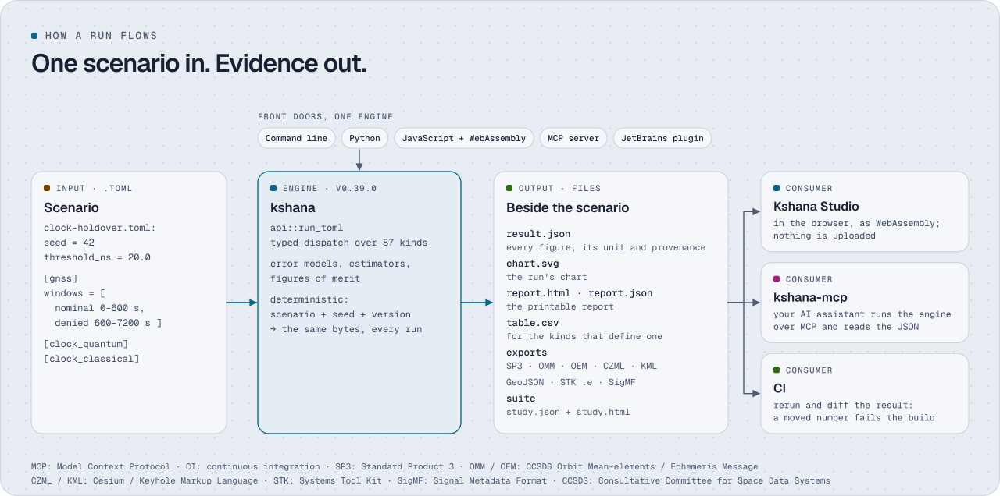
</picture>

这个随附场景运行 2 h：10 min 有 GNSS，然后约 1.8 h 没有 GNSS。它要问的是
锶光晶格钟和芯片级原子钟（CSAC）各自能在 20 ns 以内保持时间
多久。

```bash
kshana example clock-holdover > clock-holdover.toml
kshana clock-holdover.toml
```

```text
scenario 5ba83a232b94 | quantum holdover 6600s p95 1.20e-4ns integrity 1.000 security n/a (no attack) | classical holdover 2610s p95 19.7ns integrity 1.000 security n/a (no attack)
wrote clock-holdover.result.json, clock-holdover.chart.svg, clock-holdover.report.html, and clock-holdover.report.json
```

光钟在整个 6600 s 的中断期间都保持在 20 ns 预算以内；CSAC 保持了
2610 s，在运行期间有 95.6% 的时间处于预算以内，而光钟为 100%。
`kshana example` 列出每个随附场景。

<a id="missions"></a>
## 任务

十个行业向同一个引擎提出十个不同的问题。每个行业都有可作为起点的随附
场景。

| 行业 | 从这里开始 |
|---|---|
| 国防与安全 | `campaign-jam-spoof-holdover-integrity`, `spoof-meaconing` |
| 航天，地球轨道 | `orbit-gnss-challenged`, `leo-pnt-end-to-end` |
| 月球、火星与深空 | `lunar-relay-constellation`, `mars-orbit-pnt` |
| 航空与无人机 | `small-uas-jammed-nav`, `araim-gps-galileo` |
| 海事 | `maritime-strait-jamming`, `maritime-port-approach-coast` |
| 道路 | `automotive-urban-canyon` |
| 铁路 | `rail-tunnel-coast` |
| 关键基础设施与授时 | `clock-holdover`, `clock-ensemble` |
| 电信与 5G（第五代移动通信网络） | `telecom-prtc-holdover-24h`, `leo-vertical-5g-network-timing` |
| 科学与研究 | `sweep-clock-stability`, `quantum-pnt-demonstrator.suite` |

<details>
<summary>每个行业提出的问题</summary>

<br>

| 行业 | 它提出的问题 | 从这里开始 |
|---|---|---|
| **国防与安全** | 在压制干扰和欺骗下，我们的导航和授时能保持可信多久，哪些层能让我们保持在指标之内？ | `campaign-jam-spoof-holdover-integrity`, `spoof-meaconing` |
| **航天：地球轨道** | 我的航天器能否看到足够多的导航卫星，它的时钟在两次定位之间能保持时间多久，低轨导航层又能增加什么？ | `orbit-gnss-challenged`, `leo-pnt-end-to-end` |
| **月球与深空** | 位于月球、火星或更远处的着陆器、巡视器或轨道器能否获得可信的位置和时间？ | `lunar-relay-constellation`, `mars-orbit-pnt` |
| **航空与无人机** | 干扰源使 GNSS 失效后，我的无人航空器系统（UAS）能在其位置预算内保持多久，我的航线上是否有完好性保障？ | `small-uas-jammed-nav`, `araim-gps-galileo` |
| **海事** | 干扰源能在水面上影响多远，位置推移能否被发现，船舶能靠外推进港多久？ | `maritime-strait-jamming`, `maritime-spoof-position-push`, `maritime-port-approach-coast` |
| **道路与汽车** | 汽车在立交桥下或经过路边干扰源时会漂移多远？ | `automotive-urban-canyon` |
| **铁路** | 列车进入隧道后多少秒内仍能分辨自己在哪条股道上？ | `rail-tunnel-coast` |
| **关键基础设施与授时** | 如果 GNSS 时间丢失或被欺骗，电网、交易场所或数据中心能保持可溯源的时间多久？ | `clock-holdover`, `clock-ensemble` |
| **电信与 5G** | 如果 GNSS 时间参考丢失，我的网络时钟能否保持在 ITU-T 模板之内，能保持多久？ | `telecom-prtc-holdover-24h`, `leo-vertical-5g-network-timing` |
| **科学与研究** | 我能否复现、扩展并引用一个 PNT 结果，精确到随机种子？ | `sweep-clock-stability`, `quantum-pnt-demonstrator.suite` |

</details>

<a id="evidence"></a>
## 证据

<p><a href="docs/SGP4-VALIDATION.md"></a></p>

<strong>401 项中有 176 项</strong>能力已对照独立的外部参考基准验证；221 项如实标为 Modelled。
验证矩阵的每一行都列出一项能力、用于检查它的参考基准、
运行检查的测试，以及由此得出的标签。持续集成（CI）使得
在没有独立外部参考基准的情况下不可能把一项能力称为 VALIDATED。

<picture>
  <source media="(prefers-color-scheme: dark)" srcset="docs/assets/readme/flow-verification-dark.svg">
  <source media="(prefers-color-scheme: light)" srcset="docs/assets/readme/flow-verification-light.svg">
  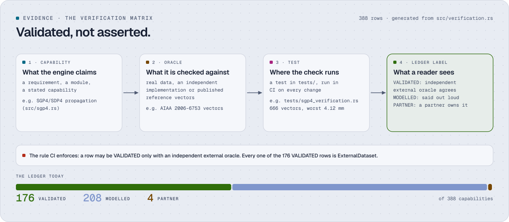
</picture>

| 标签 | 行数 | 含义 |
|---|---|---|
| VALIDATED | 176 | 独立的外部参考基准与之一致：真实数据、独立实现或已公布的参考向量 |
| MODELLED | 221 | 对照解析真值或仿真自洽性检查，并明确说明这一点 |
| PARTNER | 4 | 由硬件合作方负责；Kshana 对其没有参考基准 |

部分检查：全部 666 个 AIAA（美国航空航天学会）
2006-6753 SGP4（简化一般摄动模型 4）向量，误差 4.12 mm；Cowell 力
模型对照 Orekit 12.2 误差 0.08 m；Galileo 对照欧洲航天局（ESA）的真实精密星历误差 0.61 m，Swarm-A 误差 0.10 m。
测试使 `src/` 的行覆盖率保持在 95 % 左右，
CI 中的门槛为 85 %。台账为
[`docs/VERIFICATION-MATRIX.md`](docs/VERIFICATION-MATRIX.md)，由
`src/verification.rs` 生成：[完整的 401 行矩阵](docs/VERIFICATION-MATRIX.md)，以及每个
Modelled 行为何没有外部参考基准，见 [`docs/MODELLED-RATIONALE.md`](docs/MODELLED-RATIONALE.md)。

<details>
<summary>验证如何进行、精选要点表和证据图</summary>

### 验证、可复现性与诚实性

- 每个噪声项都按一个**已发表、有引用**的数字校准，并对照
  标准关系验证（时钟用 Allan 偏差；惯性用 Groves 航位推算
  误差增长；时间传递用授时→测距换算）。每一项的状态
  记录在 [`docs/VALIDATION.md`](docs/VALIDATION.md) 中，为 `validated` 或
  `not modeled`——没有任何未经验证的内容被表述为已验证。
- **按构造可复现：** `scenario + seed + engine version → identical
  bits`。`scripts/check-reproducible.sh` 强制保证这一点；量子运行和经典运行使用
  独立的随机种子，因此它们的噪声互不相关。
- 成熟度如实说明：光钟和光学链路数字是*目标 /
  地面演示器*结果，没有上过天。

### 每张图上的证据标签

一次运行写出的每张图和每个表都说明它可信到什么程度，以及它依据的是哪些台账行。结果 JSON 有一个
`evidence` 键，图表 SVG 在绘图下方有一行（以及一个 `<metadata id="kshana-evidence">` 元素），CSV 表
在开头有 `# evidence:` 注释行（用 `comment='#'` 读取）。它给出一个等级——`VALIDATED`、`MODELLED` 或 `PARTNER`——以及
该运行所用到的验证矩阵行的 id（`VM-` 加八位十六进制数字）。等级取这些行中最弱的一个，
因此一次依赖某个 modelled 行的运行会被标为 MODELLED，无论旁边有多少 validated 行；标签
永远不能声称比台账更多的内容。行、状态和 id 都读自矩阵，而不是手工输入
（[`docs/VERIFICATION-MATRIX.md`](docs/VERIFICATION-MATRIX.md)、[`docs/SCHEMA.md`](docs/SCHEMA.md)），
如果某张图没有标签或标签与矩阵不一致，`tests/evidence_labels_doc_sync.rs` 会失败。

### 验证一览

每一行都由 CI 中一个具名测试强制保证。此表是**精选要点**；
完整的经机器检查的矩阵有 **401 行——176 行 VALIDATED、221 行 MODELLED、4 行 PARTNER**
（`src/verification.rs`），完整证据（以及如实说明的尚*未*
验证的内容）见 [`docs/VALIDATION.md`](docs/VALIDATION.md) 以及每个发布版本的
[`kshana-validation-summary.html`](https://github.com/ashfordeOU/kshana/releases)
产物（由 `cargo run --bin validation_report` 生成，带 SLSA 证明——Supply-chain
Levels for Software Artifacts，软件制品供应链等级）。

**状态**列说明证据的*类型*，与上面的验证阶梯一致：**VALIDATED** = 对照独立的外部参考基准检查（真实数据、独立库或已公布的参考向量）；**MODELLED** = 对照解析真值或仿真自洽性检查（没有独立的外部数据集）。VALIDATED 描述的是检查的*方法*，而不是通过/不通过——对照真实外部参考基准的如实未达标仍为 VALIDATED，而没有任何矩阵行将其列为参考基准的比较（上文的 LRO——月球勘测轨道器——拟合）则显示为 MODELLED。`CI` 行是流程防护，不是品质因数。少数真实数据孤岛（实测铯钟、Stable32 PHASE.DAT，以及原始输入不带再分发许可的 OPS-SAT/ICGEM 检查）是**依赖数据的**：当输入不存在时，测试打印跳过提示并保持通过，公开的参考数字已提交在 `tests/fixtures/` 下。用对应的 `scripts/fetch_*.sh` 复现原始输入。

| 状态 | 能力 | 一致程度 | 参考 / 参考基准 |
|--------|------------|-----------|--------------------|
| **VALIDATED** | SGP4/SDP4 传播 | 666/666 个向量，最差 **4.12 mm** | AIAA 2006-6753（Vallado `tcppver.out`）+ 与独立的 `sgp4` crate 直接对比 |
| **VALIDATED** | 坐标系——IAU 2000A/B 章动、IAU 2006/2000A CIO 链、ERA | **逐位一致**（X、Y 到 1e-14，s 到 1e-18，ERA 到 1e-12） | ERFA/SOFA `eraXys06a` · `eraC2ixys` · `eraEra00` · `eraNut00a/b` |
| **MODELLED** | GCRS→ITRS 对比独立的 SPICE 引擎 | 最大 **0.028″** → 地面 ≤ 0.86 m，GNSS 轨道 ≤ 3.6 m | ANISE（纯 Rust NAIF/SPICE），相同的 IERS `finals2000A` EOP，2020–2023 年 8 个历元（已对照此参考比较；没有任何验证矩阵行将其列为外部参考基准，因此不标为 VALIDATED） |
| **MODELLED** | EGM2008 重力位（阶/次 70） | 加速度 = ∇V 到 **< 1e-6**；带谐退化到已验证的 J2 | NGA EGM2008 系数 + 解析 ∇V 恒等式 |
| **VALIDATED** | 重力泛函综合（重力辅助 / 无 GNSS 导航地图） | GRS80 Somigliana + γ_e/γ_p 到 **3.5e-12**；真实 EGM2008 扰动图符合物理（RMS ≈ 26 mGal，阶/次 70） | GRS80（Moritz 1980，IAG——国际大地测量协会）Somigliana 正常重力 + 真实 ICGEM EGM2008（`tests/icgem_gravity_reference.rs`） |
| **VALIDATED** | Allan 估计器（ADEV/MDEV/TDEV/HDEV）+ 置信区间 | 复现参考偏差；χ² 区间一致 | NIST SP 1065（Riley），1000 点表 31/32 |
| **VALIDATED** | **真实实测铯钟**上的 Allan 估计器 | OADEV/OHDEV 到 **1e-3**（实测 ≤ 3e-5），16 个平均因子 | 真实 5071A Cs 对比 H 氢钟的 Stable32 结果，556,990 点（`tests/cs5071a_reference.rs`，依赖数据） |
| **VALIDATED** | **标准 Stable32 PHASE.DAT** 上的 Allan 估计器 | OADEV/MDEV/TDEV 到 **1e-3**（实测 ≤ 5e-5），139 个平均因子 | PHASE.DAT 的 Stable32 参考偏差（`tests/phasedat_reference.rs`，依赖数据） |
| **MODELLED** | IMU 误差模型——ARW / VRW / 零偏不稳定性 | 恢复到 **< 5 %**（零偏不稳定性 < 15 %） | Analog Devices ADIS16465 数据手册；NaveGo 参考配置 |
| **VALIDATED** | 数值 Cowell 传播器 + 力模型（保守力层级） | 24 h 内最差位置误差 **0.08 m**，278 个历元（LEO + GTO） | Orekit 12.2 `NumericalPropagator`/`DormandPrince853`（CS GROUP），`tests/numerical_cowell_propagator_reference.rs` |
| **MODELLED** | Cowell 阻力层级 + 绝对太阳/月球星历和密度输入 | 阻力层级表征为 ≈ 333 m / 24 h；无摄动情形与通用变量开普勒解一致到亚米级，能量/动量约 1e-9 | 内置低精度星历 + 解析开普勒解 |
| **MODELLED** | Lambert · Tsiolkovsky · porkchop | 对照二体真值往返；ΔV **< 0.01 %** | Izzo 2015 · 火箭方程 · 解析 Hohmann 下限 |
| **MODELLED** | 定轨（Gauss–Newton 批处理） | 无噪声时为亚米 / mm·s⁻¹ 级；5 m 噪声底下约 2 m | 二体 + J2，基于 RK4 弧段 |
| **MODELLED** | 力模型拟合对比 Galileo 精密星历（全弧段） | **0.61 m** 3-D RMS，24 h，阶/次 70，仅力模型 | ESA/ESOC `ESA0MGNFIN` 最终轨道（E11），真实 `finals2000A` EOP（已对照此参考比较；没有任何验证矩阵行将其列为外部参考基准，因此不标为 VALIDATED） |
| **MODELLED** | 力模型拟合对比 Swarm-A 精密星历（简化动力学） | **0.10 m** 3-D RMS（经验层级的界，不是测量值） | ESA `SW_OPER_SP3ACOM_2_` 精密轨道（已对照此参考比较；没有任何验证矩阵行将其列为外部参考基准，因此不标为 VALIDATED） |
| **MODELLED** | 力模型拟合对比 LRO 月球轨道（如实未达标） | 简化动力学 **6.67 m**，*高于* 5 m 目标 | JPL Horizons LRO（NAIF −85）+ GRAIL（重力恢复与内部实验室）`GRGM660PRIM`（已对照此参考比较；没有任何验证矩阵行将其列为外部参考基准，因此不标为 VALIDATED） |
| **MODELLED** | 深空火星定轨（简化动力学 SRIF） | 火星 LMO **≈ 0.2 m**（仿真品质因数，*不是*真实任务） | 合成闭环定轨——估计器机制验证 |
| **MODELLED** | 以太阳为中心的火星动力学对比 JPL DE440 | **1 天弧段 137 m**（随弧段增长 = 未建模的 n 体效应） | 通过 ANISE 使用 JPL DE440（`xval/anise-mars-od`，依赖内核）（已对照此参考比较；没有任何验证矩阵行将其列为外部参考基准，因此不标为 VALIDATED） |
| **VALIDATED** | 单点定位对比经测量的 IGS 坐标（真实观测） | **5.7 m** 3-D RMS / 水平 **1.1 m**，双频无电离层码 SPP | IGS 站 ABMF 测量坐标 + GPS 广播星历，2018-05-13（`tests/pvt_abmf.rs`） |
| **MODELLED** | 紧耦合 GNSS/INS UKF | 30 min LEO 过境（含 120 s 中断）内 **0.77 m RMS** | 力模型外推，手工推导 |
| **MODELLED** | 无 GPS 重力地图导航 | 约 70 km INS 漂移 → 恢复到 **约 145 m** | ESA NAVISP *Quantum Wayfarer* 目标 |
| **MODELLED** | 地形参考导航（TERCOM/SITAN） | 70 km 漂移 → **< 500 m**（网格分辨率下限约 140 m） | SRTM `.hgt` DEM；手工注入漂移（非循环检查） |
| **MODELLED** | IGRF-14 主磁场（阶/次 13） | 磁极约北纬 80.7°，偶极子约 29.7 µT，物理范围 22–67 µT | IAGA（国际地磁与高层大气物理协会）`igrf14coeffs.txt`（Schmidt 半归一化） |
| **MODELLED** | 导航信号调制与码跟踪 | BPSK 自身 SSC = **2/(3·R_c)**；单位面积 PSD；45 dB-Hz 时 C/A DLL 抖动为**亚米级** | 闭式 SSC/PSD 基准 + Kaplan & Hegarty DLL 热噪声公式 |
| **MODELLED** | CR3BP 晕轨道/NRHO 微分校正器 | STM = 有限差分；轨道闭合到**机器精度**；L2 9:2 NRHO **≈ 6.57 d / 近月点 ≈ 3,250 km** | 有限差分 STM 检查 + 已公布的 L2 南向 9:2 NRHO（≈ 6.56 d / ≈ 3,370 km）——CR3BP，不是真实的 Gateway 星历 |
| **MODELLED** | ARAIM 双星座完好性 | 真实 GPS + Galileo 上的全星座故障模式 | EU ARAIM TR（技术报告）/ DO-316；Celestrak `gps-ops` 2021-07-28（已对照此参考比较；没有任何验证矩阵行将其列为外部参考基准，因此不标为 VALIDATED） |
| **VALIDATED** | GNSS 几何 / DOP（GDOP/PDOP/HDOP/VDOP/TDOP） | 在 8 种几何构型（良态 → 近奇异）上**相对误差 1e-6** 以内一致 | gnss_lib_py 1.0.4（Stanford NAV Lab）——独立库（`tests/dop_reference.rs`） |
| **VALIDATED** | ML 检测器评估指标（AUC/ROC/混淆矩阵/Pd-Pmd/精确率/F1） | 在 5 个数据集 × 24 个阈值上**计数完全一致 + < 1e-9** | scikit-learn 1.9.0（Pedregosa et al.，JMLR——Journal of Machine Learning Research——2011）——独立库（`tests/eval_metrics_reference.rs`） |
| **VALIDATED** | **真实 ESA OPS-SAT 遥测数据**上的异常检测 ROC AUC | AUC 以 **< 1e-9** 复现 scikit-learn；峰值计数检测器在带标签测试划分上 AUC **≈ 0.85** | OPSSAT-AD 测试划分上的 scikit-learn `roc_auc_score`（Ruszczak et al. 2025，CC BY 4.0）——真实 OPS-SAT 遥测数据（`tests/opssat_ad_reference.rs`） |
| **VALIDATED** | 量子权衡数值核（ADEV NNLS 拟合 · χ² 一致性区间 · van-Loan 时钟 Q） | NNLS + Q **完全一致**；工作自由度 ≥ 48 时 χ² **< 5e-4** | scipy 1.17.1——`optimize.nnls` / `stats.chi2.ppf` / `linalg.expm`（`tests/scipy_reference.rs`） |
| **VALIDATED** | MTIE / MDEV / TDEV 电信漂移指标（ITU-T G.810/G.823/G.8261/G.811——国际电信联盟电信标准化部门的建议书） | 在 NIST SP 1065 LCG（线性同余发生器）序列上 MTIE（9 个平均因子，逐位一致）以及 MDEV + TDEV（8 个因子，相对误差 **< 1e-9**） | allantools 2024.06 `mtie` / `mdev` / `tdev`——独立库（`tests/mtie_reference.rs`、`tests/mdev_tdev_reference.rs`） |
| **VALIDATED** | MCDA 权衡研究方法——全部四个决策方法族，九种经外部验证的聚合器（WSM · WPM · WASPAS · MOORA · COPRAS · TOPSIS · VIKOR · PROMETHEE II · ELECTRE I），加上 **AHP** 两两比较优先级加权 | 分数 / 排名 / 和谐矩阵复现到 **< 1e-9** | pymcdm + pyDecision（独立的第三方 MCDA 库）+ Saaty RI（随机指数）/ SciPy-LAPACK eig（`tests/mcda_*_reference.rs`） |
| **VALIDATED** | 由轨道和载波得出的 LEO 多普勒包络 | Iridium 最大值与已公布的 ±36 kHz 相差在 **5 %** 以内；Xona Pulsar X1 位于已公布的 **32–34 kHz** 之内 | RNTF LEO PNT 测试结果；Leclère, Marathe & Reid, arXiv:2509.19551（`tests/leo_doppler_reference.rs`） |
| **MODELLED** | 带 LEO 增强的 PPP 收敛 | 60 / 96 / 192 / 288 颗 LEO 卫星时为 7.4 → 4.8 / 3.2 / 2.7 / 2.3 min，单调；滤波器 NEES 位于 χ² 区间内 | 趋势与 Li et al., J. Geod. 93:749 (2019)（9.6 → 7.0 / 3.2 / 2.1 / 1.3 min）比较；星座和噪声未复现 |
| **MODELLED** | 条件授时保护级（欺骗下受守时限制的未检测时间误差） | 组合复现多步 `clock_state` 协方差递推；在一次真实记录的欺骗上校准 | JammerTest 2024（Zenodo 15911589）标量 + van-Loan / CUSUM 闭式解（`examples/tpl_jammertest`） |
| **MODELLED** | PNT 韧性评分 + 决策不稳定性 | 35 个手工推导的参考基准测试；逐字节确定的研究产物（固定随机种子） | DHS RPCF v2.0 映射 + Dirichlet / Kendall-τ / Hill-N2 闭式解——合成架构，不是认证 |
| **MODELLED** | 射频损伤乐观偏差研究（缩放规律 + 留一法预测器） | 置换零假设显著性；逐字节确定的产物（5 个随机种子） | 以参数为依据的合成语料库——评估*指标*对照 scikit-learn 为 VALIDATED（见上）；该研究为 MODELLED |
| CI | 跨平台可复现性 | 在 3 种 OS（操作系统）上输入逐位一致 + 形状基准一致 | Linux / macOS / Windows CI 矩阵，SHA-256 基准 |
| CI | 测试覆盖率 | `src/` 上**约 95 % 行覆盖率**（不含 `src/*_data.rs` 和 `src/main.rs`），门槛 ≥ 85 % | cargo-tarpaulin（LLVM 引擎） |

<p align="center">
  
  <br><sub>一项能力如何获得其标签——由 CI 强制执行的不变式：没有外部参考基准 ⇒ 不能被标为 Validated · <a href="docs/assets/diagrams/validation-provenance.svg">SVG</a></sub>
</p>

<p align="center">
  
  <br>
  
  <br><sub>上：按构造，每个 Validated 行都由外部数据集支持。下：SGP4 在每种轨道类型中都与官方参考一致（最差 4.12 mm）。<a href="docs/assets/figures/oracle-kind-stacked.svg">SVG</a> · <a href="docs/assets/figures/sgp4-regime-bars.svg">SVG</a></sub>
</p>

<p align="center">
  
  <br><sub>176 Validated · 221 Modelled · 4 Partner — <a href="docs/assets/figures/validation-breakdown.svg">SVG</a></sub>
</p>

</details>

<a id="capability-domains"></a>
### 能力领域

公开地图上的每项能力，按领域列出，并附其台账标签。领域表由
[`tools/gen_readme_blocks.py`](tools/gen_readme_blocks.py) 根据 `web/capabilities.json` 写出，
Studio 的全能力地图读取的也是同一个文件。

<picture>
  <source media="(prefers-color-scheme: dark)" srcset="docs/assets/figures/domain-coverage-map.svg">
  
</picture>

按领域逐一列出每项能力及其标签的完整表格见 [`docs/CAPABILITY-DOMAINS.md`](docs/CAPABILITY-DOMAINS.md)。

<a id="install"></a>
## 安装

一行命令即可获得命令行工具：**`cargo install kshana`**。每个渠道发布的都是
来自同一个带标签提交的 v0.40.0。

<!-- channels:begin -->
| 渠道 | 安装 | 指南 |
|---|---|---|
| 在浏览器中试用 | 打开 https://kshana.dev | [Studio 指南](https://kshana.dev/docs/studio.html) |
| 命令行（Rust） | `cargo install kshana` | [命令行用法](https://kshana.dev/docs/rust.html#usage--cli) |
| Rust 库 | `cargo add kshana` | [docs.rs 上的 API 参考](https://docs.rs/kshana) |
| Python | `pip install kshana` | [Python API 指南](https://kshana.dev/docs/python-api.html) |
| JavaScript 和 WebAssembly | `npm install kshana` | [npm 与 WebAssembly 指南](https://kshana.dev/docs/npm.html) |
| AI 助手（MCP 服务器，cargo） | `cargo install kshana-mcp` | [MCP 服务器指南](https://kshana.dev/docs/mcp.html) |
| Docker 镜像 | `docker run --rm -i ghcr.io/ashfordeou/kshana-mcp` | [MCP 服务器指南：Docker](https://kshana.dev/docs/mcp.html#install) |
| Claude Desktop 扩展 | 双击适用于你系统的 `.mcpb`：[macOS（Apple 芯片）](https://github.com/ashfordeOU/kshana/releases/download/v0.40.0/kshana-mcp-aarch64-apple-darwin.mcpb) · [macOS（Intel）](https://github.com/ashfordeOU/kshana/releases/download/v0.40.0/kshana-mcp-x86_64-apple-darwin.mcpb) · [Windows](https://github.com/ashfordeOU/kshana/releases/download/v0.40.0/kshana-mcp-x86_64-pc-windows-msvc.mcpb) · [Linux（x86-64）](https://github.com/ashfordeOU/kshana/releases/download/v0.40.0/kshana-mcp-x86_64-unknown-linux-gnu.mcpb) · [Linux（Arm）](https://github.com/ashfordeOU/kshana/releases/download/v0.40.0/kshana-mcp-aarch64-unknown-linux-gnu.mcpb) | [所有 MCP 安装片段](https://github.com/ashfordeOU/kshana/blob/main/docs/MCP-INSTALL.md) |
| Cursor（一键安装） | [添加到 Cursor（npx）](https://cursor.com/en/install-mcp?name=kshana&config=eyJjb21tYW5kIjoibnB4IiwiYXJncyI6WyIteSIsImtzaGFuYS1tY3BAMC40MC4wIl19) · [添加到 Cursor（Docker）](https://cursor.com/en/install-mcp?name=kshana&config=eyJjb21tYW5kIjoiZG9ja2VyIiwiYXJncyI6WyJydW4iLCItaSIsIi0tcm0iLCJnaGNyLmlvL2FzaGZvcmRlb3Uva3NoYW5hLW1jcDowLjQwLjAiXX0%3D) · `npx -y kshana-mcp@0.40.0` | [所有 MCP 安装片段](https://github.com/ashfordeOU/kshana/blob/main/docs/MCP-INSTALL.md) |
| VS Code（一键安装） | [在 VS Code 中安装（npx）](https://insiders.vscode.dev/redirect?url=vscode%3Amcp%2Finstall%3F%257B%2522name%2522%253A%2522kshana%2522%252C%2522command%2522%253A%2522npx%2522%252C%2522args%2522%253A%255B%2522-y%2522%252C%2522kshana-mcp%25400.40.0%2522%255D%257D) · [在 VS Code 中安装（Docker）](https://insiders.vscode.dev/redirect?url=vscode%3Amcp%2Finstall%3F%257B%2522name%2522%253A%2522kshana%2522%252C%2522command%2522%253A%2522docker%2522%252C%2522args%2522%253A%255B%2522run%2522%252C%2522-i%2522%252C%2522--rm%2522%252C%2522ghcr.io%252Fashfordeou%252Fkshana-mcp%253A0.40.0%2522%255D%257D) · `npx -y kshana-mcp@0.40.0` | [所有 MCP 安装片段](https://github.com/ashfordeOU/kshana/blob/main/docs/MCP-INSTALL.md) |
| Claude Code | `claude mcp add kshana -- npx -y kshana-mcp@0.40.0` | [所有 MCP 安装片段](https://github.com/ashfordeOU/kshana/blob/main/docs/MCP-INSTALL.md) |
| npx | `npx -y kshana-mcp@0.40.0` | [所有 MCP 安装片段](https://github.com/ashfordeOU/kshana/blob/main/docs/MCP-INSTALL.md) |
| uvx / pipx | `uvx kshana-mcp==0.40.0` | [所有 MCP 安装片段](https://github.com/ashfordeOU/kshana/blob/main/docs/MCP-INSTALL.md) |
| Homebrew | `brew install ashfordeOU/tap/kshana-mcp` | [所有 MCP 安装片段](https://github.com/ashfordeOU/kshana/blob/main/docs/MCP-INSTALL.md) |
| Scoop | `scoop bucket add ashforde https://github.com/ashfordeOU/scoop-bucket && scoop install kshana-mcp` | [所有 MCP 安装片段](https://github.com/ashfordeOU/kshana/blob/main/docs/MCP-INSTALL.md) |
| winget | `winget install AshfordeOU.KshanaMcp` | [所有 MCP 安装片段](https://github.com/ashfordeOU/kshana/blob/main/docs/MCP-INSTALL.md) |
| 预编译二进制文件 | 从发布页下载 kshana-mcp-<target>，并对照 SHA256SUMS 检查 | [所有 MCP 安装片段](https://github.com/ashfordeOU/kshana/blob/main/docs/MCP-INSTALL.md) |
| 官方 MCP 注册表 | 搜索 io.github.ashfordeOU/kshana-mcp | [所有 MCP 安装片段](https://github.com/ashfordeOU/kshana/blob/main/docs/MCP-INSTALL.md) |
| 远程（可流式 HTTP），自托管 | `kshana-mcp --http 127.0.0.1:8080` | [自托管指南](https://github.com/ashfordeOU/kshana/blob/main/docs/deploy/mcp-http.md) |
| Claude Code 插件市场 | `/plugin marketplace add ashfordeOU/kshana` | [从代理中使用 Kshana](https://github.com/ashfordeOU/kshana/blob/main/docs/AGENTS.md) |
| JetBrains IDE 插件 | Settings → Plugins → Marketplace → 搜索 "Kshana"（插件 ID dev.kshana.ide） | [插件指南](https://kshana.dev/docs/jetbrains.html) |
| Signal K 插件 | `npm install signalk-kshana-trust` | [Signal K 插件指南](https://github.com/ashfordeOU/kshana/blob/main/integrations/signalk/README.md) |
| OpenCPN 插件 | 从发布页下载插件 tarball | [OpenCPN 目录提交](https://github.com/ashfordeOU/kshana/blob/main/packaging/opencpn/SUBMITTING.md) |
| Grafana 仪表板 | 从发布页导入 kshana-grafana-*.json | [仪表板源文件](https://github.com/ashfordeOU/kshana/blob/main/deploy/grafana/kshana-gnss-trust.json) |
| 参考构建镜像 | `docker pull ghcr.io/ashfordeou/kshana-reference-build` | [海事集成](https://github.com/ashfordeOU/kshana/blob/main/docs/MARINE-INTEGRATIONS.md) |
<!-- channels:end -->

<p><a href="https://plugins.jetbrains.com/plugin/32181-kshana--pnt-simulator"></a> <a href="Cargo.toml"></a></p>

MCP 是模型上下文协议（Model Context Protocol）。用 `cargo install kshana --version 0.40.0`、
`pip install kshana==0.40.0` 或 `npm install kshana@0.40.0` 固定一个发布版本。要从源代码构建，见
“参考”下的[安装与构建](#install--build)。

<details>
<summary>从 Python 和 WebAssembly 运行场景</summary>

<br>

```python
import json, kshana

toml = open("clock-holdover.toml").read()
result = json.loads(kshana.run(toml))
print(kshana.version(), result["quantum"]["fom"]["holdover_s"], result["classical"]["fom"]["holdover_s"])
# 0.40.0 6600.0 2610.0
```

除 `run` 之外，该模块还提供 `run_full`（一次返回 JSON、SVG 和单行摘要）、
`run_typed`、`validate_toml`、`list_kinds` / `scenario_kinds` 和 `error_kind`；见
[`docs/PYTHON_API.md`](docs/PYTHON_API.md)。

npm 软件包是编译为 WebAssembly 的整个引擎。在 Node.js 中，把二进制文件交给
`initSync`；在浏览器中，`await init()` 会获取它（见 [`README.npm.md`](README.npm.md)）。

```js
import { readFileSync } from "node:fs";
import { createRequire } from "node:module";
import { initSync, run, summary, version } from "kshana";

const wasm = createRequire(import.meta.url).resolve("kshana/kshana_bg.wasm");
initSync({ module: readFileSync(wasm) });

const toml = readFileSync("clock-holdover.toml", "utf8");
const result = JSON.parse(run(toml));
console.log(version(), result.quantum.fom.holdover_s, result.classical.fom.holdover_s);
// 0.40.0 6600 2610
console.log(summary(toml));
```

</details>

<a id="architecture"></a>
## 架构

一个开源引擎位于中心，每种接口都运行它：命令行、Rust
库、Python、WebAssembly 和 Kshana Studio、MCP 服务器、Docker 镜像以及
JetBrains 插件。同一个场景文件在每种接口上都给出相同的字节。Kshana Pro 作为
独立的叠加层位于其上，它依赖引擎，从不分叉引擎。

<picture>
  <source media="(prefers-color-scheme: dark)" srcset="docs/assets/readme/architecture-dark.svg">
  <source media="(prefers-color-scheme: light)" srcset="docs/assets/readme/architecture-light.svg">
  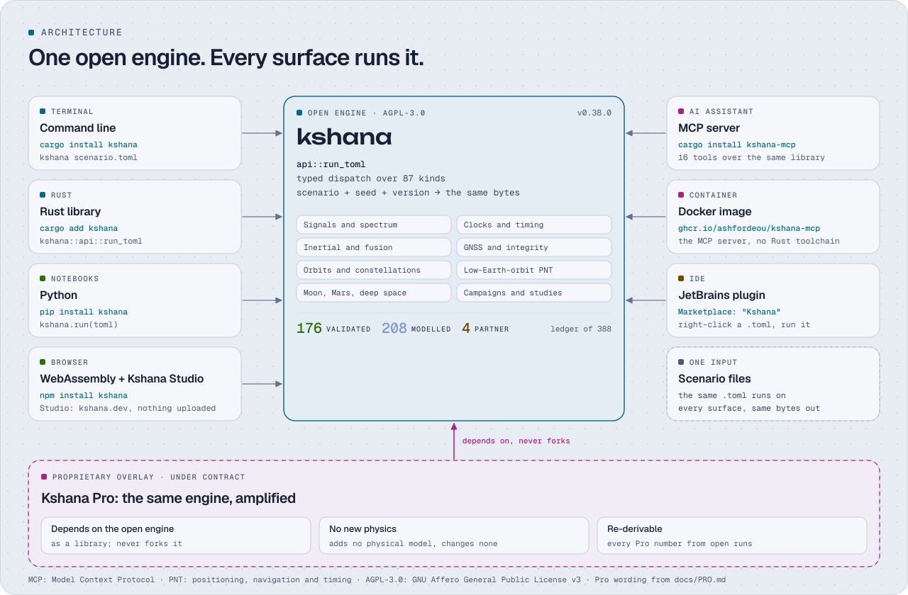
</picture>

<details>
<summary>引擎内部：各领域层和验证台账</summary>

<picture>
  <source media="(prefers-color-scheme: dark)" srcset="docs/assets/readme/flow-architecture-dark.svg">
  <source media="(prefers-color-scheme: light)" srcset="docs/assets/readme/flow-architecture-light.svg">
  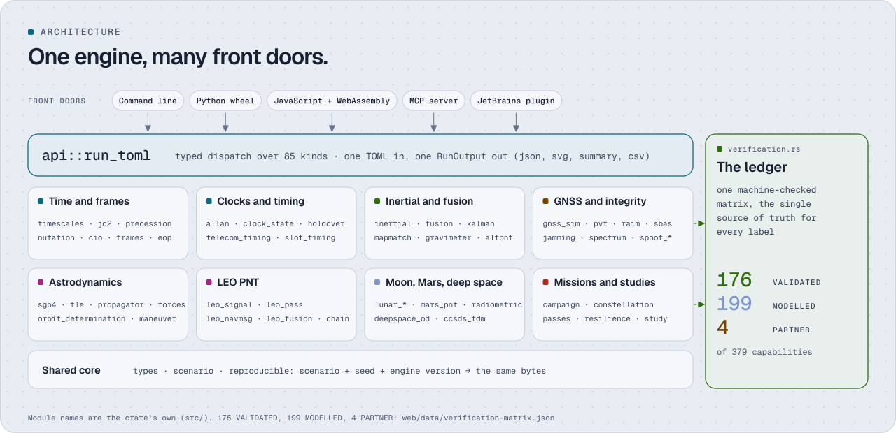
</picture>

**一个引擎，多个入口。** 单一的 Rust 核心（`kshana`）运行每个场景，
可通过 CLI、Python 扩展、浏览器内 WebAssembly 模块、面向 AI 代理的 **MCP
服务器**以及 **JetBrains IDE 插件**访问——全部汇聚到同一个
`api::run_toml` 分派。在内部，各传感器包接入一个通用的误差模型
接口；与之并列的有**坐标系层**（IAU 2006/2000A
岁差–章动以及基于 CIO 的 GCRS↔ITRS 归算）、**航天动力学/数值
层**（解析 SGP4/SDP4 **和**带有
EGM2008/摄动力模型的数值 Cowell 传播器、机动设计以及定轨）、
**完好性/GNSS 层**（RAIM/ARAIM、SBAS、测量域、压制干扰、地月空间）、
**融合 / 替代 PNT 层**（GNSS/INS 估计器以及重力/地形/磁场
地图匹配器）、**深空与月球层**（无线电测量火星 PNT 以及
月球 PNT 套件，其各部分的证据等级见矩阵——LTC 时间、VLBI、联合定轨 + 时钟、坐标系实现、服务体积、
差分 PNT、互操作）、**任务分析层**（发射 / 再入 / 覆盖 /
指向 / 过境 / 链路预算以及空间天气环境），以及开源的
**韧性与 AI/ML 研究层**（RPCF 韧性评分、射频损伤乐观
偏差以及量子赋能 PNT 演示器），其可复现产物建立在
经验证的核之上。

两个独立的、**不属于工作区**的 crate 位于核心旁边——`mcp/kshana-mcp`
（MCP 服务器，基于 edition-2024 的 `rmcp` SDK 构建）和 `xval/anise-frames`（
ANISE/SPICE 坐标系交叉检查，它会引入 MPL-2.0（Mozilla Public License 2.0）依赖）——通过根目录
`Cargo.toml` 的 `exclude` 列表，它们被排除在已发布 crate 的依赖图、`Cargo.lock`、许可证门禁和 MSRV（最低支持 Rust 版本）构建之外。
JetBrains 插件（`ide/jetbrains`）是一个独立的 Kotlin
项目。完整的图示集见 [`docs/ARCHITECTURE.md`](docs/ARCHITECTURE.md)。

渲染后的图示（引擎流程、模块地图、分发）见 [`docs/ARCHITECTURE.md`](docs/ARCHITECTURE.md)。

</details>

<a id="diagrams"></a>
### 图示

图示是位于 [`docs/diagrams/`](docs/diagrams/) 中的 Mermaid 源文件，被渲染为 SVG 和 PNG 并写入
[`docs/assets/diagrams/`](docs/assets/diagrams/)（在 Linux 上用 `tools/render-diagram-chromium.sh <name>`，在其他系统上用另外两个
`render-diagram` 脚本），一份记录将每个 PNG 绑定到它所来源的确切 SVG。测试固定了图中
所述的计数。上面各节中的图表是由工具根据引擎运行绘制的；这些图示则展示
各部分如何组合在一起。

<p align="center">
  <br>
  <sub>一个分派，一个引擎，可复现的输出 · <a href="docs/assets/diagrams/system-overview.svg">SVG</a> · 源文件 <a href="docs/diagrams/system-overview.mmd">system-overview.mmd</a></sub>
</p>

<p align="center">
  <br>
  <sub>每种接口，来自同一个引擎 · <a href="docs/assets/diagrams/surfaces.svg">SVG</a> · 源文件 <a href="docs/diagrams/surfaces.mmd">surfaces.mmd</a></sub>
</p>

<p align="center">
  <br>
  <sub>一次运行的内循环 · <a href="docs/assets/diagrams/engine-flow.svg">SVG</a> · 源文件 <a href="docs/diagrams/engine-flow.mmd">engine-flow.mmd</a></sub>
</p>

<p align="center">
  <br>
  <sub>从接收机日志到信任度，以及使用它的各方 · <a href="docs/assets/diagrams/trust-flow.svg">SVG</a> · 源文件 <a href="docs/diagrams/trust-flow.mmd">trust-flow.mmd</a></sub>
</p>

<p align="center">
  <br>
  <sub>从场景到签名包；Kshana 从不产生或回放信号 · <a href="docs/assets/diagrams/lab-round-trip.svg">SVG</a> · 源文件 <a href="docs/diagrams/lab-round-trip.mmd">lab-round-trip.mmd</a></sub>
</p>

<p align="center">
  <br>
  <sub>Studio 如何在本地运行 · <a href="docs/assets/diagrams/studio-flow.svg">SVG</a> · 源文件 <a href="docs/diagrams/studio-flow.mmd">studio-flow.mmd</a></sub>
</p>

<p align="center">
  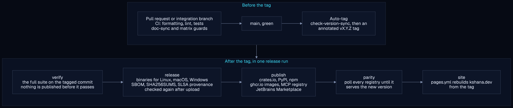<br>
  <sub>测试与发布流程，从本地门禁到经验证的发布以及仅限网站的路径 · <a href="docs/assets/diagrams/release-flow.svg">SVG</a> · 源文件 <a href="docs/diagrams/release-flow.mmd">release-flow.mmd</a> · <a href="docs/RELEASING.md">docs/RELEASING.md</a></sub>
</p>

<p align="center">
  <br>
  <sub>代码在哪里 · <a href="docs/assets/diagrams/module-map.svg">SVG</a> · 源文件 <a href="docs/diagrams/module-map.mmd">module-map.mmd</a></sub>
</p>

<p align="center">
  <br>
  <sub>什么发布到哪里，以及由什么检查 · <a href="docs/assets/diagrams/distribution.svg">SVG</a> · 源文件 <a href="docs/diagrams/distribution.mmd">distribution.mmd</a></sub>
</p>

<a id="ai-assistant"></a>
## AI 助手

[`kshana-mcp`](mcp/kshana-mcp/) 是一个 MCP 服务器：你的助手运行真正的引擎并
读回其 JSON，而不是去猜数学结果。它的 49 个工具中的每一个都是对
`kshana` 库某个公共函数的薄封装，因此服务器中不包含任何仿真逻辑。

### 安装 MCP 服务器

> 仅供参考，不是经型式认可的导航设备：导航责任仍由操作人员承担。
> 服务器在你的计算机上运行；不会向 Ashforde OÜ 发送任何内容。

任选一个渠道。每个链接和片段都由同一个脚本
（`scripts/gen_mcp_install.py`）生成，并在持续集成中检查；Claude Desktop、
Claude Code、Cursor、VS Code、Windsurf、Zed、Goose、Codex CLI、Gemini CLI 和 Continue 的片段见
[`docs/MCP-INSTALL.md`](docs/MCP-INSTALL.md)。

<!-- mcp-install:begin -->
| 渠道 | 命令或按钮 | 需要 | 固定版本形式 |
|---|---|---|---|
| Claude Desktop 扩展 | 双击适用于你系统的 `.mcpb`：[macOS（Apple 芯片）](https://github.com/ashfordeOU/kshana/releases/download/v0.40.0/kshana-mcp-aarch64-apple-darwin.mcpb) · [macOS（Intel）](https://github.com/ashfordeOU/kshana/releases/download/v0.40.0/kshana-mcp-x86_64-apple-darwin.mcpb) · [Windows](https://github.com/ashfordeOU/kshana/releases/download/v0.40.0/kshana-mcp-x86_64-pc-windows-msvc.mcpb) | 无 | v0.40.0 的 `kshana-mcp-<target>.mcpb` |
| Cursor（一键安装） | [npx（Node）](https://cursor.com/en/install-mcp?name=kshana&config=eyJjb21tYW5kIjoibnB4IiwiYXJncyI6WyIteSIsImtzaGFuYS1tY3BAMC40MC4wIl19) · [Docker](https://cursor.com/en/install-mcp?name=kshana&config=eyJjb21tYW5kIjoiZG9ja2VyIiwiYXJncyI6WyJydW4iLCItaSIsIi0tcm0iLCJnaGNyLmlvL2FzaGZvcmRlb3Uva3NoYW5hLW1jcDowLjQwLjAiXX0%3D) | Node 或 Docker | `kshana-mcp@0.40.0` / `ghcr.io/ashfordeou/kshana-mcp:0.40.0` |
| VS Code（一键安装） | [npx（Node）](https://insiders.vscode.dev/redirect?url=vscode%3Amcp%2Finstall%3F%257B%2522name%2522%253A%2522kshana%2522%252C%2522command%2522%253A%2522npx%2522%252C%2522args%2522%253A%255B%2522-y%2522%252C%2522kshana-mcp%25400.40.0%2522%255D%257D) · [Docker](https://insiders.vscode.dev/redirect?url=vscode%3Amcp%2Finstall%3F%257B%2522name%2522%253A%2522kshana%2522%252C%2522command%2522%253A%2522docker%2522%252C%2522args%2522%253A%255B%2522run%2522%252C%2522-i%2522%252C%2522--rm%2522%252C%2522ghcr.io%252Fashfordeou%252Fkshana-mcp%253A0.40.0%2522%255D%257D) · [Insiders（npx）](https://insiders.vscode.dev/redirect?url=vscode-insiders%3Amcp%2Finstall%3F%257B%2522name%2522%253A%2522kshana%2522%252C%2522command%2522%253A%2522npx%2522%252C%2522args%2522%253A%255B%2522-y%2522%252C%2522kshana-mcp%25400.40.0%2522%255D%257D) | Node 或 Docker | `kshana-mcp@0.40.0` / `ghcr.io/ashfordeou/kshana-mcp:0.40.0` |
| Claude Code | `claude mcp add kshana -- npx -y kshana-mcp@0.40.0` · 插件：先 `/plugin marketplace add ashfordeOU/kshana`，然后 `/plugin install kshana@ashforde` | Node（或 Docker） | `kshana-mcp@0.40.0` |
| npx | `npx -y kshana-mcp@0.40.0` | Node 18+ | `kshana-mcp@0.40.0` |
| uvx / pipx | `uvx kshana-mcp==0.40.0` · `pipx run kshana-mcp==0.40.0` | 带 uv 或 pipx 的 Python 3.9+ | `kshana-mcp==0.40.0` |
| Docker | `docker run -i --rm ghcr.io/ashfordeou/kshana-mcp:0.40.0` | Docker | `ghcr.io/ashfordeou/kshana-mcp:0.40.0` |
| Homebrew | `brew install ashfordeOU/tap/kshana-mcp` | brew | v0.40.0 的 formula |
| Scoop | 先 `scoop bucket add ashforde https://github.com/ashfordeOU/scoop-bucket`，然后 `scoop install kshana-mcp` | Scoop（Windows） | v0.40.0 的清单 |
| winget | `winget install AshfordeOU.KshanaMcp` | winget（Windows） | `--version 0.40.0` |
| cargo | `cargo install kshana-mcp --version 0.40.0` | Rust 1.88+ | `kshana-mcp 0.40.0` |
| 预编译二进制文件 | [发布页面](https://github.com/ashfordeOU/kshana/releases/tag/v0.40.0)：`kshana-mcp`（Linux x86-64）、`kshana-mcp-<target>[.exe]`，用 `SHA256SUMS` 和 `gh attestation verify` 检查 | 无 | v0.40.0 |
| MCP 注册表 | `io.github.ashfordeOU/kshana-mcp`（可由支持注册表的客户端找到） | 支持注册表的客户端 | `0.40.0` |
| 远程（可流式 HTTP） | `kshana-mcp --http 127.0.0.1:8080`，自托管：见 [docs/deploy/mcp-http.md](docs/deploy/mcp-http.md) | 你自己的主机 | v0.40.0 |
<!-- mcp-install:end -->

<p><a href="https://glama.ai/mcp/servers/ashfordeOU/kshana"></a></p>

在 Claude Code 中，同一个服务器以插件形式提供：先 `/plugin marketplace add ashfordeOU/kshana`，然后
`/plugin install kshana@ashforde`。该插件在工具之上添加斜杠命令：`/kshana-run`、
`/kshana-assess-receiver`、`/kshana-evidence-pack`、`/kshana-interference-map`、
`/kshana-training-scenario`、`/kshana-bench-export`、`/kshana-compliance-report`、`/kshana-iq`、
`/kshana-import-route`、`/kshana-marine-integrations` 和 `/kshana-jammertest`。船舶信任度工具为 Signal K 和
OpenCPN 集成提供数据：[`docs/MARINE-INTEGRATIONS.md`](docs/MARINE-INTEGRATIONS.md)。

各客户端的设置见 [`docs/integrations.md`](docs/integrations.md)。该服务器以
`io.github.ashfordeOU/kshana-mcp` 的名称列在官方 MCP 注册表中。

<details>
<summary>49 个工具</summary>

<br>

**场景与报告**

| 工具 | 它做什么 |
|---|---|
| `run_scenario` | 根据 TOML（Tom's Obvious, Minimal Language）定义运行场景 |
| `list_scenario_kinds` | 92 种内置场景类型，附描述 + 必需/可选字段——使代理能够构造有效的场景 |
| `validate_scenario` | 预检：解析 TOML 并检测其类型，不运行 |
| `list_example_scenarios` | 以 JSON 形式给出随附的参考场景 |
| `get_example_scenario` | 一个随附参考场景的 TOML 文本，与 `scenarios/` 下的文件逐字节一致 |
| `report_scenario` | 运行场景并返回其报告 |
| `animate_scenario` | 运行场景并以动画形式返回其时间序列 |
| `sky_geometry` | 随方位变化的天际线下的天空几何：可见和被遮挡的卫星、DOP、东-北-天协方差和水平误差椭圆；或带来源说明的天际线预设 |

**导出与互操作**

| 工具 | 它做什么 |
|---|---|
| `list_export_formats` | 哪些互操作格式适用于某个场景（`czml`、`kml`、`geojson`、`stk`、`sigmf`），某格式不适用时的原因，以及每个写出器遵循的规范 |
| `export_interop` | 将场景导出为 CZML（Cesium Language）、KML（Keyhole Markup Language）、GeoJSON、STK（Systems Tool Kit）星历 `.e` 或 SigMF（Signal Metadata  |
| `import_route` | 将 GeoJSON `LineString` 航线写入一个沿航点航迹飞行的场景（`terrain-nav`、`terrain-slam`、`gravity-map`、`combined-altpnt`），并返回新的 TOML |
| `export_sp3` | 将 `orbit` 场景的星座导出为 SP3-c（Standard Product 3，修订版 c）精密星历 |
| `export_omm` | 将 `orbit` 场景的根数导出为 CCSDS（空间数据系统咨询委员会）502.0-B-2 OMM（轨道平根数电文）目录 |
| `export_oem` | 将 `orbit` 场景的状态序列导出为 CCSDS OEM（轨道星历电文）2.0 星历——TEME（真赤道、平春分点）位置*和*  |
| `export_table_csv` | 运行场景并以 CSV（逗号分隔值）返回其可复现性表——即 CLI（命令行界面）写为 `<scenario>.table.csv` 的字节稳定的表 |
| `export_test_bench` | 为实验室 GNSS 模拟器导出场景的载体运动和事件（`kshana bench-export`） |

**接收机与船舶信任度**

| 工具 | 它做什么 |
|---|---|
| `assess_receiver_log` | 评估真实 GNSS（全球导航卫星系统）接收机日志的可信度 |
| `assess_vessel_stream` | 为有界的 NMEA 0183 片段评分（最多 2 MiB 和 20,000 个历元 |
| `assess_vessel_log` | 将船舶的 NMEA 0183 日志（最多 4 MiB）作为批处理运行，会话 TOML 中说明船舶的限值 |
| `create_evidence_pack` | 为船舶日志的一个时间窗口生成签名证据包（`kshana receiver-trust evidence`） |
| `attach_evidence_timestamp` | 在内存中将 RFC 3161 时间戳令牌（`.tsr` 字节的 base64）绑定到证据包（`kshana evidence attach-timestamp`） |
| `verify_evidence_pack` | 验证证据包（`kshana evidence verify`） |
| `generate_training_nmea` | 根据 `nmea-scenario` TOML 生成用于船员训练的合成驾驶台 NMEA 0183（压制干扰、位置拖离、时间欺骗、重放时延），附教员日志（`kshana-nmea-training/1`） |
| `build_interference_map` | 根据 CSV 文本形式的 ADS-B 或 AIS 位置报告（最多 4 MiB）生成 GNSS 干扰地图 |
| `route_exposure` | 一条航线的长度在一张或多张干扰地图的已劣化、未劣化、未评估和未观测单元中所占的比例，可选限定日期范围 |
| `trust_telemetry` | 用 `kshana trust-telemetry` 编码器，将信任数据流（JSON 行）或 `receiver-trust` 结果呈现为 Prometheus 文本、CEF 或 LEEF syslog 行或 OTLP JSON 载荷 |
| `jammertest_import` | 读取已公布的 Jammertest 测试目录和发射计划（NPRA/jammertest-plan，MIT），作为排定的真值（`kshana jammertest import`）：一个测试区域的时段成为接收机信任度事件，每个标签中带有目录 id 和年份。是计划的时段，不是记录的实际发射时间；不读取计划中的任何联系人字段。MODELLED。见 [`docs/JAMMERTEST.md`](docs/JAMMERTEST.md)。 |
| `jammertest_score` | 对照该时间表为接收机日志评分（`kshana jammertest score`）：每项测试的检测延迟、漏警和恢复时间，以及所有时段之外的虚警。文本日志作为 `log`，二进制日志（`ubx`、`sbf`）作为 `log_base64`。签名包需要密钥：请用命令行。仅供参考；MODELLED。 |
| `fit_imu_log` | 通过 Allan 偏差，从静止 IMU 日志（CSV 或 EuRoC）拟合 `hybrid` 和 `fusion` 场景的加速度计和陀螺仪参数，给出可直接粘贴的 `[accel_classical]` 表以及日志的 SHA-256（`kshana imu-fit`）。输入文本，输出 JSON；MODELLED。 |

**GNSS IQ（工作目录文件；在 HTTP 模式下关闭）**

| 工具 | 它做什么 |
|---|---|
| `iq_signals` | GNSS IQ 层的设置 |
| `iq_info` | 描述工作目录中的一个 IQ（同相和正交）录制文件，不对其处理 |
| `iq_scene` | 在工作目录中生成一个多卫星 GNSS IQ 场景（`kshana iq scene`） |
| `iq_acquire` | 对录制文件中的一个或多个 PRN（伪随机噪声码）进行 FFT（快速傅里叶变换）捕获（`kshana iq acquire`），可选地经过前端各级处理 |
| `iq_track` | 先捕获，然后用 DLL/PLL/FLL（延迟、相位和频率锁定环）组进行跟踪（`kshana iq track`），环路来自 `kshana.loop-desig |
| `iq_frontend` | 应用接收机前端和干扰抑制 DSP（数字信号处理 |
| `iq_sweep` | 在多种跟踪环设计下回放工作目录中的一个 IQ 录制文件（`kshana iq sweep`） |
| `iq_monitor` | 对工作目录中的 IQ 录制文件运行干扰和欺骗检测监测器（`kshana iq monitor`） |
| `iq_labfit` | 根据日志内联（`text` 或 `base64` 的 `iq-labfit` 场景，将跟踪环失锁模型拟合到实验室运行（`kshana iq labfit`） |
| `iq_test_conditions` | 验证以文本给出的 `kshana.test-conditions/1` 文件，并返回解析后的条件及其哈希 |
| `iq_campaign` | 运行实验室回放战役（`kshana iq campaign`） |
| `iq_campaign_status` | 战役输出文件夹的进度 |

**合规映射**

| 工具 | 它做什么 |
|---|---|
| `compliance_report` | 根据以文本给出的结果文档填写的公共框架映射（`kshana compliance-report`） |
| `compliance_mapping` | 以 Markdown 形式给出的静态映射表（或者在使用 `sources` 时，给出它们引用的源文档及其版本和 URL），开头为同样的声明 |
| `list_standards_packs` | 标准包（`kshana standards-pack list`）：针对 DHS Resilient PNT 框架测试剖面、IMO MSC.1/Circ.1575 和 ICAO Doc 9849 Appendix F 的评分场景集 |
| `run_standards_pack` | 对照运行前已说明的判据运行一个包：每项测试为 `MET`、`NOT MET` 或 `NEEDS INPUT`；MODELLED，不为任何产品评级 |
| `lunanet_afs_check` | 对照 LNIS V5 AD1 Volume A（LSIS-AFS V1.0）检查 LunaNet 增强前向信号：码对照印出的表，或符号流对照帧格式；子帧 2 至 4 的 LDPC 和 CRC-24Q 未经验证 |
| `create_round_trip_pack` | 签名的实验室往返包：场景、`kshana.test-conditions/1` 文档、接收机日志和评分通过哈希关联 |

**基准测试**

| 工具 | 它做什么 |
|---|---|
| `score_benchmark` | 对照真值文件为 kshana-bench 提交评分，两者均为 JSON 文本（`kshana bench score`，`bench/SPEC.md`）：结果文件包含规范版本、划分、输入哈希和该任务的指标。MODELLED；描述的是日志或语料库，从不是产品。 |
| `render_leaderboard` | 将 kshana-bench 结果文件呈现为静态排行榜页面（HTML 文本），每个文件先经过验证。 |

</details>

<a id="editions"></a>
## 版本

整个引擎是免费的。Kshana Pro 和定制研究面向有更多需求的项目，
每条付费途径都从一条消息开始：这里不列价格。

| | 免费版 | Kshana Pro | 定制研究 |
|---|---|---|---|
| 它是什么 | 整个开源引擎，全部 92 种场景类型，没有功能限制 | 同一引擎之上的专有叠加层，依合同提供 | 为你完成的、针对你的系统的 MODELLED PNT 韧性研究 |
| 许可证 | AGPL-3.0（GNU Affero 通用公共许可证第 3 版），或商业许可证 | 专有 | 合同 |
| 如何开始 | [安装](#install)或打开 [kshana.dev](https://kshana.dev) | [申请 Pro 评估](mailto:contact@ashforde.org?subject=Kshana%20Pro%20evaluation) | [申请研究](mailto:contact@ashforde.org?subject=Kshana%20custom%20study) |

Pro 是什么，用 [`docs/PRO.md`](docs/PRO.md) 中的话来说：

> **开源 Kshana 的严格超集。** Pro 将开源引擎作为库来依赖，
> 从不分叉它。每种开源场景类型都能在 Pro 中原样运行，开源场景
> 在 Pro 中运行完全不需要许可证。
>
> **没有新的物理。** Pro 不添加也不改变任何物理模型。Pro 的每个数字都
> 来自开源引擎的运行，因此 Pro 的数字与其所来源的开源场景类型一样可信，
> 绝不会更可信。

Pro 回答项目的下一步问题：飞哪种设计（设计优化器及其
帕累托前沿），答案有多确定（不确定性与敏感性），以及任务
是否满足其需求（任务档案、需求可追溯性、权衡研究、
场景回归检查、时钟数字孪生、研究档案以及本地部署
服务）。它还监视一组战役数字，当某个数字变差时使流水线失败，
在两个方向上对照开放的卫星导航信号测试候选信号计划
（频谱共存），并在带哈希链交付台账的本地作业服务中
排队执行研究。每一项及其产出和不做的事情，都在
[`docs/PRO.md`](docs/PRO.md) 中说明。Pro 产出的任何内容都不是认证，定制研究
也不是认证。

<details>
<summary>Kshana Pro 从开源引擎读取什么，以及来自 Ashforde® OÜ 的支持</summary>

<br>

**Kshana Pro 建立在什么之上。** Pro 的每个部分都基于开源引擎工作，并保持
引擎不变：

- **设计优化器、不确定性研究和任务档案**通过引擎的公共接口运行开源引擎
  场景，并根据运行结果计算每个数字。每项输出都保留开源引擎为
  每个数字给出的 VALIDATED、MODELLED 或 PARTNER 等级，绝不会更高。
- **时钟数字孪生**使用开源引擎的时钟模型及其 Allan 偏差
  估计器：孪生体按器件已公布的 Allan 预算校准，然后用
  开源估计器估计孪生体的 Allan 偏差来进行检查。
- **权衡研究**将每个架构选项作为开源引擎场景原样运行，
  并根据从每次运行结果中读取的品质因数对选项排序。
- **战役监视**从包中各场景的开源引擎运行结果中读取其数字，
  并与上一次通过的运行进行比较。
- **频谱共存**从 `leo-signal` 和 `constellation-design` 类型的开源引擎运行中
  读取每个物理数字，只添加对可见卫星的求和
  以及对各计划的排序。
- **本地作业服务**通过同一个引擎运行开源和 Pro 场景，
  并按运行返回的原样存储每个结果。
- **证据包**为每次运行记录开源引擎在其结果上标记的场景哈希，
  因此包中的数字可以通过重新运行其场景来复现。
- **系统工程与项目工具。** Kshana Pro 的基于模型的
  系统工程（MBSE）与项目工具对照开源引擎的运行检查项目的需求：
  它导入以逗号分隔值（CSV）形式表示的需求，或以需求交换格式（ReqIF）或
  系统建模语言第 2 版（SysML v2）文本的一个有文档说明的子集表示的需求，
  根据一次运行写出的值，带单位地评估每条验收
  准则，并生成验证交叉引用矩阵（VCRM）、SysML v2 模型、变更影响报告和离线
  证据包。它不重新运行也不重新计算任何内容，只读取开源引擎
  发布的内容：每次运行的 `result.json`（准则所指的字段、其单位、
  由场景哈希、随机种子、引擎版本和模式版本组成的可复现性标记，以及
  该运行的标签和数字等级）、其 `report.json`（类型、可复现性记录和
  能力标签）、场景文件（其哈希、类型、随机种子和参数）、
  字段单位模式（每个字段的单位、来源和证据等级）以及
  验证矩阵（每项能力的 VALIDATED、MODELLED 或 PARTNER 标签）。

<a id="support--professional-services"></a>
### 支持与专业服务

Kshana 采用 AGPL-3.0 免费开源，**由 Ashforde® OÜ**（爱沙尼亚）**专业开发和
维护**。开源引擎本身是完整且可用的。
对于有更多需求的组织，Ashforde® OÜ 提供：

- **商业支持与集成**——将 Kshana 嵌入你的工具链、定制
  场景以及优先修复。
- **定制传感器模型**——按你的硬件校准，包括在私有叠加层中维护的
  出口敏感韧性模型。
- **Kshana Pro**——专有的基于模型的系统工程（MBSE）与项目
  工具，对照开源引擎的运行检查项目的需求，并
  生成验证交叉引用矩阵（VCRM）、系统建模语言
  第 2 版（SysML v2）模型、变更影响报告和离线证据包。它
  不重新运行任何内容，只读取引擎发布的输出：每次运行的 `result.json`
  和 `report.json`、场景文件、字段单位模式以及验证
  矩阵的标签（完整列表见[版本](#editions)）。
- **Kshana Pro 设计、不确定性与任务工具**——设计空间的帕累托前沿、
  数千次运行上的不确定性与敏感性，以及带验证矩阵和 PDF 的
  一条命令生成的任务档案；见 [`docs/PRO.md`](docs/PRO.md)。
- **Kshana Pro 战役监视、频谱共存与作业服务**——当被监视的数字变差时
  失败的流水线、在两个方向上对照开放卫星导航信号测试的信号计划，
  以及带哈希链交付台账的本地作业队列；见 [`docs/PRO.md`](docs/PRO.md)。
- 关于量子/经典 PNT 性能分析的**培训与咨询**。

这是开放核心模式：引擎采用开放许可，并将一直如此；维持
业务的是专业知识、支持和专有扩展——而不是许可费。
联系 **contact@ashforde.org** · [ashforde.org](https://ashforde.org)。

</details>

<a id="research"></a>
## 研究

基于开源引擎的研究发表在 arXiv 上。每篇都列出其背后的引擎命令，
因此其数字可以根据已提交的场景或研究示例重新生成。

<picture>
  <source media="(prefers-color-scheme: dark)" srcset="docs/assets/readme/research-dark.svg">
  <source media="(prefers-color-scheme: light)" srcset="docs/assets/readme/research-light.svg">
  
</picture>

| 论文 | 它表明了什么 | 引擎命令 |
|---|---|---|
| [*Anticipating the Optimism Gap: Predicting Distribution-Shift Degradation of RF-Impairment Detectors from In-Distribution Statistics*](https://arxiv.org/abs/2606.22054)<br><sub>arXiv:2606.22054 · [doi:10.48550/arXiv.2606.22054](https://doi.org/10.48550/arXiv.2606.22054)</sub> | 条件偏移后 GNSS 干扰检测器分数的下降，仅凭分布内统计量即可预测，先在一个开放的合成测试平台上，然后在开放的实地录制数据上。 | `cargo run --release --example optimism_study -- paper-artifacts/optimism-study.json` |
| [*A Conditional Timing Protection Level: Holdover-Limited Undetected Time Error Under GNSS Spoofing*](https://arxiv.org/abs/2606.24210)<br><sub>arXiv:2606.24210 · [doi:10.48550/arXiv.2606.24210](https://doi.org/10.48550/arXiv.2606.24210)</sub> | 受欺骗的 GNSS 授时接收机对未检测时间误差没有有限的无条件界，因此该论文给出一个条件界，并在公开的 JammerTest 2024 测试活动中一次录制的空中欺骗上进行了校准。 | `cargo run --release --example tpl_jammertest` |
| [*How Stable Is a PNT Resilience Score? Decision-Instability of Single-Number Resilience Ratings under Framework-Aligned Weighting*](https://arxiv.org/abs/2607.05415)<br><sub>arXiv:2607.05415 · [doi:10.48550/arXiv.2607.05415](https://doi.org/10.48550/arXiv.2607.05415)</sub> | 单一的综合韧性分数只有在某一设计占优时才是稳定的决策依据；在各设计相互竞争时，仅重新加权就可能改变胜出者。 | `cargo run --release --example resilience_report -- paper-artifacts/resilience-study.json` |
| [*Earth-baseline VLBI restores the observability of a lunar surface station in joint orbit-and-clock determination*](https://arxiv.org/abs/2607.02566)<br><sub>arXiv:2607.02566 · [doi:10.48550/arXiv.2607.02566](https://doi.org/10.48550/arXiv.2607.02566)</sub> | 月球星座内部的测距使月面站的绝对位置不可观测；来自地球的甚长基线干涉测量（VLBI）时延在星座稀疏时可恢复其可观测性，在星座密集时可使其更精确。 | `lunar-joint-od-clock` 类型：`kshana example lunar-joint-od-clock > s.toml && kshana s.toml` |
| [*The Cost of Lunar South-Polar Geometry, and Surface Beacons as the Efficient Fix: A Dilution-of-Precision Analysis*](https://arxiv.org/abs/2607.06212)<br><sub>arXiv:2607.06212 · [doi:10.48550/arXiv.2607.06212](https://doi.org/10.48550/arXiv.2607.06212)</sub> | 计划中的四至六颗卫星的星座在月球南极几何构型很差，少数月面测距信标能以远低于增加卫星的成本解决这一问题。 | `lunar-beacon` 类型：`kshana example lunar-beacon > s.toml && kshana s.toml` |
| [*Cislunar navigation is an observability problem: arc-length thresholds, Gramian conditioning, and the Doppler lever*](https://arxiv.org/abs/2610.23871)<br><sub>arXiv:2610.23871 · [doi:10.48550/arXiv.2610.23871](https://doi.org/10.48550/arXiv.2610.23871)</sub> | 对于仅测距的地月空间跟踪，精度因子没有定义，因为在单一快照中速度不可观测，因此该论文在四条平面远距离逆行轨道上使用可观测性 Gram 矩阵：仅测距在快照中秩为 4 中的 2，需要约 2.09 h 的弧段才能完全可观测，且条件数随弧段延长而改善；距离变化率（多普勒）可立即给出秩 4；而将一个台站与卫星状态和时钟联合估计时，除非加入外部干涉测量观测量，否则秩始终亏损一。需求应以弧长、条件数和测量类型预算来表述，而不是 DOP。 | `cislunar-observability` 类型：`kshana scenarios/cislunar-observability.toml`（其姊妹类型 `cislunar-arc-recovery` 用一个独立的有限差分估计器检验该阈值） |

三个研究示例写出逐字节确定的产物（固定随机种子），记录其
引擎版本、随机种子和配置哈希。三篇月球与地月空间论文构建在
月球套件之上（各部分的证据等级见验证矩阵）；它们关于几何和精度因子的结论还在
`tests/validate_p*.rs` 中对照独立的参考基准进行了交叉检查。更多内容见“参考”下的
[可复现研究产物](#reproducible-study-artifacts)。

<a id="cite"></a>
## 引用

如果你在学术或技术工作中使用 Kshana，请引用你所使用的版本，并注明
场景和随机种子。[`CITATION.cff`](CITATION.cff) 包含机器可读的元数据，
GitHub 据此显示“Cite this repository”按钮。每个发布版本都存档在 Zenodo 上；
概念 DOI（数字对象标识符）
[10.5281/zenodo.20528627](https://doi.org/10.5281/zenodo.20528627) 始终解析到
最新版本。

> Baweja, C. (2026). *Kshana — a PNT-resilience simulator with quantum-sensor performance models*. [Ashforde OÜ](https://ashforde.org). https://doi.org/10.5281/zenodo.20528627

上述论文：

> Baweja, C. (2026). *Anticipating the Optimism Gap: Predicting Distribution-Shift Degradation of RF-Impairment Detectors from In-Distribution Statistics*. arXiv:2606.22054. https://doi.org/10.48550/arXiv.2606.22054
>
> Baweja, C. (2026). *A Conditional Timing Protection Level: Holdover-Limited Undetected Time Error Under GNSS Spoofing*. arXiv:2606.24210. https://doi.org/10.48550/arXiv.2606.24210
>
> Baweja, C. (2026). *How Stable Is a PNT Resilience Score? Decision-Instability of Single-Number Resilience Ratings under Framework-Aligned Weighting*. arXiv:2607.05415. https://doi.org/10.48550/arXiv.2607.05415
>
> Baweja, C. (2026). *Earth-baseline VLBI restores the observability of a lunar surface station in joint orbit-and-clock determination*. arXiv:2607.02566. https://doi.org/10.48550/arXiv.2607.02566
>
> Baweja, C. (2026). *The Cost of Lunar South-Polar Geometry, and Surface Beacons as the Efficient Fix: A Dilution-of-Precision Analysis*. arXiv:2607.06212. https://doi.org/10.48550/arXiv.2607.06212
>
> Baweja, C. (2026). *Cislunar navigation is an observability problem: arc-length thresholds, Gramian conditioning, and the Doppler lever*. arXiv:2610.23871. https://doi.org/10.48550/arXiv.2610.23871

<a id="licence"></a>
## 许可证

Kshana 采用双重许可：GNU **AGPL-3.0-only**（[`LICENSE`](LICENSE)），或
Ashforde® OÜ 提供的**商业许可证**，用于不适合 AGPL 的闭源集成。
[`LICENSING.md`](LICENSING.md) 说明适用哪一种。贡献以 AGPL
入站许可，并同时授予 Ashforde® OÜ 将其纳入商业
版本的权利；请用 `git commit -s` 为每个提交签署（见 [`CONTRIBUTING.md`](CONTRIBUTING.md)）。
“Kshana”及其标志是 Ashforde® OÜ 的商标：许可证涵盖的是代码，而不是
名称，因此请为分叉另行命名。

<a id="reference"></a>
## 参考

篇幅较长的资料，已折叠。每份文档都列在[文档](#documentation)中。

<details>
<summary>从源代码安装与构建</summary>

<a id="install--build"></a>
### 安装与构建

需要 Rust 工具链（≥ 1.88，即 Cargo.toml 中的 `rust-version`；开发时使用 1.93）。

```bash
git clone https://github.com/ashfordeOU/kshana
cd kshana
cargo build --release
cargo test          # all tests pass
```

</details>

<details>
<summary>用法：完整的命令行说明</summary>

### 用法

运行任意场景；CLI 根据场景的 `kind` 字段分派，并在其旁边写出
`<scenario>.result.json`、`<scenario>.chart.svg`、`<scenario>.report.html` 和
`<scenario>.report.json`——对于发布表格的类型，还会写出 `<scenario>.table.csv`。
报告（一个超文本标记语言（HTML）页面和一个内容相同的 JSON 文档）
包含执行摘要、每个输入及其单位、
结果和图表、战役的参数扫描、蒙特卡洛或链式表格、事件时间线、
本次运行所用每项能力的 VALIDATED / MODELLED / PARTNER 标签及来源、
未建模的内容，以及一份可复现性记录（引擎版本、安全哈希
算法 256 位（SHA-256）摘要、随机种子、平台和确切的命令）。它可以从浏览器
在 A4 或 Letter 纸上打印为整洁的 PDF（便携式文档格式）文件；
引擎本身不写出 PDF。见 [`docs/REPORTS.md`](docs/REPORTS.md)。

```bash
cargo run -- scenarios/clock-holdover.toml
cargo run -- scenarios/imu-deadreckoning.toml
cargo run -- scenarios/timetransfer.toml
cargo run -- scenarios/hybrid-pnt.toml
cargo run -- scenarios/orbit-gnss-challenged.toml
cargo run -- scenarios/orbit-sgp4-gps.toml
cargo run -- scenarios/orbit-rinex.toml
cargo run -- scenarios/integrity-raim.toml

# Export a propagated constellation to an SP3-c precise-ephemeris file:
cargo run -- scenarios/orbit-sgp4-gps.toml --export-sp3 gps.sp3

# Export the constellation's mean elements to a CCSDS OMM catalogue (one OMM
# message per TLE-defined satellite, with its real NORAD id / COSPAR designator):
cargo run -- scenarios/orbit-sgp4-gps.toml --export-omm gps.omm

# Export the velocity-carrying state to a CCSDS OEM 2.0 ephemeris (GMAT/Orekit/STK):
cargo run -- scenarios/orbit-sgp4-gps.toml --export-oem gps.oem

# Export the geometry for a globe, a map or a mission-analysis tool: CZML, KML,
# GeoJSON, STK .e, or SigMF for the spectrum kind (every format that applies):
cargo run -- scenarios/jamming-demo.toml --export all
```

`--export <czml|kml|geojson|stk|sigmf|all|list>` 在场景旁边写出 CZML（Cesium Language）、KML
（Keyhole Markup Language）、GeoJSON（Request for Comments 7946）、Ansys STK（Systems Tool Kit）`.e`
星历和 SigMF（Signal Metadata Format）录制文件，
`--import-route <route.geojson>` 将 GeoJSON 线输入沿航迹飞行的类型。每种
格式都对照其已公布的规范验证，某格式不适用的场景
会说明原因：见 [docs/INTEROP.md](docs/INTEROP.md)。

**其他 CLI 模式**——检查场景、输入真实的地球定向数据，或运行整个套件：

```bash
# Lint a scenario without running it (checks the kind + required fields):
cargo run -- --validate scenarios/integrity-raim.toml

# Feed a real IERS Earth-orientation file (finals2000A) for frame precision:
cargo run -- scenarios/orbit-sgp4-gps.toml --eop tests/fixtures/agency/eop/finals2000A_2022001.txt

# Run a SUITE of scenarios into one aggregated, stamped study artifact
# (writes <suite>.study.json + <suite>.study.html next to the manifest):
cargo run -- --study scenarios/quantum-pnt-demonstrator.suite.toml

# Animate a run's time series: an animated SVG, a self-contained HTML player, and a
# numbered SVG frame sequence with manifest.json (see docs/ANIMATION.md):
cargo run -- scenarios/campaign-jam-spoof-holdover-integrity.toml --animate all
```

**动画导出。** `--animate svg|html|frames|all` 写出 `<scenario>.animation.svg`
（层叠样式表（CSS）关键帧，无脚本）、`<scenario>.animation.html`（播放、暂停、拖动、调速以及
同步面板，不依赖任何外部资源）和 `<scenario>.frames/`（`frame_0000.svg`、……以及
带有帧率和时长的 `manifest.json`）。战役会播放其阶段和
告警，频谱运行会播放其瀑布图；主题跟随 `prefers-color-scheme`，
`prefers-reduced-motion` 时显示最终画面。它呈现的是本次运行自身的采样，
重新运行时逐字节一致，且不增加任何证据。见 [docs/ANIMATION.md](docs/ANIMATION.md)。

**套件**清单是一个小型 TOML（Tom's Obvious, Minimal Language）文件——一个 `title` 和一个由场景路径组成的 `scenarios = [ … ]` 数组——
引擎依次运行这些场景，将每个结果（及其
MODELLED / VALIDATED 标签）汇入一个自描述的研究产物。见
[`scenarios/quantum-pnt-demonstrator.suite.toml`](scenarios/quantum-pnt-demonstrator.suite.toml)。

**互操作角色。** Kshana 是与后处理工具链并列的*性能仿真*层，
而不是其替代品：将其 **RINEX**
输出输入 RTKLIB 或 gLAB 以获得定位解，并将其 **SP3** 输出用作
Ginan 等工具的精密轨道产品——Kshana 在你拥有真实信号之前，以这些工具已经能够
导入的格式回答*某一 PNT 架构能换来多少韧性*
（`--export-sp3`，或在 `orbit` 场景中设置 `export_sp3 = true`，会写出
`<scenario>.sp3`）。同一轨道也可以发布为标准化的 **CCSDS OMM**
平根数（`--export-omm`，或 `export_omm = true`，写出 `<scenario>.omm`）——
每颗由 TLE 定义的卫星一条 OMM 502.0 KVN（关键字 = 值表示法）电文，携带每个目标真实的
NORAD（北美空天防御司令部）编目号、COSPAR（空间研究
委员会）国际编号和历元，供任何
支持 OMM 的使用方使用，而不是定制的两行根数。

示例输出（时钟守时——注意完好性和安全品质因数是如何报告的）：

```
scenario 5ba83a232b94 | quantum holdover 6600s p95 1.20e-4ns integrity 1.000 security n/a (no attack) | classical holdover 2610s p95 19.7ns integrity 1.000 security n/a (no attack)
wrote scenarios/clock-holdover.result.json, scenarios/clock-holdover.chart.svg, scenarios/clock-holdover.report.html, and scenarios/clock-holdover.report.json
```

光钟的第 95 百分位（p95）授时误差为 1.20e-4 ns：摘要
以有效数字打印小数值，而不是将其舍入为 `0.0`。
`security` 显示为 `n/a (no attack)`，因为此场景未配置任何攻击，因此
没有可检测的内容。JSON 结果仍在 `fom.security` 中携带每个时钟的解析
欺骗可检测性界（光钟为 0.997，
芯片级原子钟为 0.000，后者在监测窗口内的自身噪声超过 20 ns
指标），其 `figure_tiers` 块将该数字标为 `applicable: false`。`spoof`
场景类型针对注入的攻击为检测评分。`figure_tiers` 还为
每个报告的数字给出其验证等级——VALIDATED（对照外部
参考基准检查）或 MODELLED——以及读取该等级的验证矩阵行。轨道
场景另外报告一个几何块——有定位的采样比例，以及
最佳/中位位置精度因子（PDOP）和位置精度——与
时钟结果并列。

> **请仔细解读这两个数字。** `security` 是由每个时钟的稳定度推导出的*解析欺骗可检测性
> 界*——它只有在针对已配置的欺骗场景时才有意义，**不是**多卫星 RAIM 检测器。这里的 `integrity`
> 是滤波器的*自洽性*（中断期间位于其自身 k-sigma
> 界之内的采样比例），**不是**航空 HPL/VPL 完好性数字。见
> [`docs/INTEGRITY.md`](docs/INTEGRITY.md)。
>
> 要获得真正的接收机自主完好性，**`integrity` 场景类型**
> （`scenarios/integrity-raim.toml`）会在传播得到的星座几何上运行真正的快照式和解分离
> （ARAIM 风格）RAIM：它逐历元计算
> 水平/垂直**保护级（HPL/VPL）**，并报告
> 满足所配置告警限值的历元比例，同时给出用于误差与 PL（保护级）分类的 Stanford
> 完好性图。

<a id="reproducible-study-artifacts"></a>
#### 可复现研究产物

四项开放研究各自用一条命令重新生成一个逐字节确定的产物（固定随机种子）
——即量子与经典交叉、射频损伤
乐观偏差、PNT 韧性评分以及授时保护级研究背后的数字：

```bash
# Quantum-vs-classical resilience crossover map (writes paper/crossover/*.json):
cargo run --release --bin crossover_study -- paper/crossover

# RF-impairment optimism-gap study (13-detector panel, scaling laws, LOO predictor):
cargo run --release --example optimism_study -- paper-artifacts/optimism-study.json

# Framework-aligned PNT-resilience scoring + decision-instability study:
cargo run --release --example resilience_report -- paper-artifacts/resilience-study.json

# Conditional Timing Protection Level, calibrated on a real recorded spoof:
cargo run --release --example tpl_jammertest
```

每个产物都记录其引擎版本、随机种子和配置哈希，并带有如实的
MODELLED/VALIDATED 标签。真实数据探针（`*_probe`）在你本地提供的
录制数据上运行相同的流程；仓库中不附带任何数据集。射频损伤
乐观偏差研究已写成预印本
[arXiv:2606.22054](https://arxiv.org/abs/2606.22054)，条件授时
保护级（上面的 `tpl_jammertest`）已写成预印本
[arXiv:2606.24210](https://arxiv.org/abs/2606.24210)（见[引用](#cite)）。

已发表的月球 PNT 研究（[arXiv:2607.06212](https://arxiv.org/abs/2607.06212)
月面信标 DOP、[arXiv:2607.02566](https://arxiv.org/abs/2607.02566) VLBI
可观测性以及 [arXiv:2610.23871](https://arxiv.org/abs/2610.23871) 地月空间弧长
可观测性）中关于几何、精度因子、实时坐标系 /
地球定向参数（EOP）预测、远距离逆行轨道和射频测距的
结论，已在 `tests/validate_p*.rs` 中对照独立的参考基准进行了独立交叉检查
（`scipy.special.j1`、一个独立的 NumPy
`(HᵀH)⁻¹` DOP 求解、对相同 IERS `finals2000A` 行的 NumPy 重新解析，以及
NASA/JPL 三体周期轨道数据库）。这些是针对 **modelled** 月球套件的额外回归检查；
它们不改变经机器检查的矩阵计数。

</details>

<details>
<summary>场景格式</summary>

<a id="scenario-format"></a>
### 场景格式

场景是声明式的 TOML。顶层的 `kind` 选择所用的包——共**五十**个
（省略时默认为 `clock`）：`inertial`、`timetransfer`、`hybrid`、`hybrid-ukf`、`fusion`、
`gnss-ins`、`orbit`、`ephemeris`、`gnss-sim`、`integrity`、`lunar-integrity`、`lunar-time-offset`、`spoof`、
`spoof-detect`、`jamming`、`sweep`、`sweep-nd`、`gravity-map`、`terrain-nav`、`terrain-slam`、
`combined-altpnt`、`pvt`、`mars-pnt`、`impairment-eval`（AI/ML 射频损伤检测
评估测试平台——带标签的合成语料库 + 与检测器无关的 ROC/AUC 框架 +
分布内/分布外乐观偏差）、`quantum-trade`（量子与经典 PNT
权衡，导入实测 ADEV + 无 GNSS 韧性包络；MODELLED）、
`space-weather`（太阳/地磁指数 + Jacchia-71 外逸层温度 +
相对于静态大气的、由活动驱动的热层密度；MODELLED）、
`oem-interop`（面向 GMAT/Orekit/STK 星历的 CCSDS OEM 导入/往返桥接；
MODELLED）、任务分析三件套 `launch-window`（二体发射方位角 /
轨道面改变 / 发射机会）、`reentry`（Allen-Eggers 弹道再入走廊）、
`eo-coverage`（对地观测幅宽 / GSD / 访问 / 重访几何）、`space-packet`（CCSDS
133.0 TM/TC——遥测/遥控——空间包成帧——精确的比特布局，经往返验证），以及
`attitude-budget`（3-DOF 重力梯度力矩 + RSS 指向误差预算）、
`passes`（地面站升起/落下过境预报——AOS/TCA/LOS、最大仰角、
访问）和 `link-budget`（单程 CCSDS/DSN 链路方程——FSPL / Eb·N₀ /
余量 / 闭合）；`telecom-timing`（守时时间误差、MTIE 和 TDEV 对照
ITU-T 模板检查）；`spectrum`（将整个 GNSS L 频段表示为一个功率谱密度：
在脚本化的连续波、窄带、线性调频或
匹配噪声干扰时间线下的频率-时间瀑布图，由频谱分离系数得出的逐频段干信比和有效
载噪比，以及带 Welch 谱估计的信号元数据
格式（SigMF）录制文件输入和输出；信号
频谱对照教科书数值为 VALIDATED，干扰场景为 MODELLED；见
[`docs/SPECTRUM.md`](docs/SPECTRUM.md)；同一类型还会绘制带有
设计的低地球轨道信号的 UHF、S 和 C 频段面板）；`leo-signal`（适用于任意系统的低地球轨道定位、导航与
授时信号设计：带限频谱、码跟踪抖动和测距
精度、捕获搜索和时间、相对 GPS 和 Galileo 的频谱分离、抗干扰
容限以及 UHF 至 C 频段的权衡，来自 Xona Pulsar、Iridium、
Starlink 和 CentiSpace 等公开预设或内联设计；闭式解和 LEO 多普勒为 VALIDATED，
设计为 MODELLED；见 [`docs/LEO-SIGNAL.md`](docs/LEO-SIGNAL.md)）；`solar-system`（某一历元的太阳、各行星、冥王星、月球和七颗主要
卫星——位置、常数、光行时和轨道轨迹；行星位置
对照 JPL Horizons 为 VALIDATED）和 `body-pnt`（围绕这些天体中任意一个进行定位，使用
本地导航星座和来自地球的深空链路；MODELLED）；`campaign`（将现有类型组合成链式任务时间线，
在阶段之间传递状态，或组合成参数扫描、带种子的蒙特卡洛集合，或
在同一共享条件下的若干场景；MODELLED，见
[docs/CAMPAIGNS.md](docs/CAMPAIGNS.md)）；`constellation-design`（Walker delta 和 star
构型、根数列表以及带 GPS、Galileo、BeiDou 和 GLONASS
预设的多壳层设计，以及纬度/经度网格上的覆盖和精度因子；
生成器和 GPS 全球 DOP 对照已公布的服务文件为 VALIDATED，见
[`docs/CONSTELLATION-DESIGN.md`](docs/CONSTELLATION-DESIGN.md)）；`leo-pass`（一颗低地球
轨道（LEO）定位、导航与授时（PNT）卫星的过境及其逐频段
链路预算，适用于任意星座和任意信号设计：视角、多普勒和多普勒变化率、
ITU-R 降雨、气体、闪烁和建筑物穿透损耗、相对于可见 MEO GNSS 卫星的
载噪比、一阶电离层和无电离层组合，以及
低能量定位预算、基于每个频段对的电离层探测，以及基于
多普勒与过境几何一致性和跨频段一致性的欺骗监测器；ITU-R 各项和
静止用户多普勒包络为 VALIDATED，过境为 MODELLED，见
[`docs/LEO-PASS.md`](docs/LEO-PASS.md)）；`leo-navmsg`（适用于任意轨道和
载波的低地球轨道（LEO）PNT 卫星广播
星历和时钟电文：从积分得到的真值轨道到 Galileo 开普勒参数集的拟合器、该参数集
加上沿迹、跨迹和径向修正多项式、Liu et al. 2025
22 参数模型或 ATOMIC 零钟 ECEF 多项式；空间信号测距误差
（SISRE）随拟合区间和更新周期的变化、过境中途更新连续性检查、
Kshana 自己的有文档说明的二进制帧（带 CRC-24Q 循环冗余校验和量化预算），以及一个
标为 Kshana 扩展的 RINEX-4 风格块；SISRE 权重、Galileo 用户
算法和 CRC-24Q 为 VALIDATED，拟合为 MODELLED；可选预设包括 Xona Pulsar、
Iridium、Starlink、CentiSpace、一个代表性 C 频段系统、ATOMIC 和 Celeste IOD；见
[`docs/LEO-NAVMSG.md`](docs/LEO-NAVMSG.md)）；**MEO + LEO 融合
PNT** 三件套 `leo-pvt`（基于低地球轨道（LEO）距离变化率的多普勒定位、带系统间偏差的联合
GNSS + LEO 伪距定位以及 DOP 随 LEO
卫星数的变化、极地和北极覆盖，以及 LEO 到 UTC 的时间传递——适用于任意星座，
可选预设包括 Xona Pulsar、Iridium 和 Starlink 机会信号；
LEO 多普勒包络对照已公布的 Iridium 和 Xona 数据为 VALIDATED）、`leo-ppp`
（仅 GNSS 和加入 LEO 增强时的精密单点定位收敛，与
Li et al. 2019 比较）和 `ntn-positioning`（基于信号带宽 Cramér-Rao 界的
5G 非地面网络定位），除该包络外均为 MODELLED，见
[`docs/LEO-PNT-FUSION.md`](docs/LEO-PNT-FUSION.md)；`leo-pnt-chain`（一个 LEO-PNT 系统的端到
端链：由一个 `leo-pass` 频段承载的 `leo-signal` 设计，过境的 C/N0 和导航
电文的空间信号测距误差被传给融合的 `leo-pvt` 定位和 `leo-ppp`
收敛，列出每次交接；MODELLED，见
[`docs/LEO-PNT.md`](docs/LEO-PNT.md#end-to-end-leo-pnt-chain)，该页面也是
每种 LEO-PNT 类型和场景的概览，包括韧性战役、每个
试验重点领域一个场景以及每个最终用户行业一个场景）；**月球 PNT 套件** `lunar-vlbi`、`lunar-joint-od-clock`、
`lunar-frame-realisation`、`moonlight-service-volume`、`lunar-differential-pnt`、
`lunar-interop-export`；**量子赋能 PNT 演示器**
`quantum-time-transfer`、`quantum-gnss-free-nav`、`quantum-anomaly-detect`；以及
**信号安全、地月空间与分层韧性**研究类型 `lunar-attack-surface`、
`realtime-frame-eop`、`lunar-time-budget`、`hybrid-optical-rf`、`cislunar-observability`、
`conflict-resilience`——任务分析三件套和这些较新的类型全部为 MODELLED
（各自带有一个经验证的闭式核心；见矩阵）。
通用字段：`seed`、一个 `[time]` 网格、一个 `[gnss]` 可用性时间线（中断的
驱动因素），以及带有 `provenance` 字符串的逐传感器块，`provenance` 引用每个
数字的来源。示例（clock）：

```toml
seed = 42
threshold_ns = 20.0
[time]
step_s = 10.0
duration_s = 7200.0
[gnss]
windows = [
  { t0 = 0.0,   t1 = 600.0,  state = "nominal" },  # 10 min GNSS sync
  { t0 = 600.0, t1 = 7200.0, state = "denied"  },  # ~1.8 h outage
]
[clock_quantum]
id = "optical-sr-lattice"
provenance = "Strontium optical lattice clock, space-oriented goal sigma_y(1s)=1e-15 (arXiv:1503.08457)"
y0 = 5.0e-17
q_wf = 1.0e-30   # white FM:  q_wf = sigma_y(1s)^2
q_rw = 0.0       # random-walk FM
drift = 0.0      # linear aging (per second)
[clock_classical]
id = "csac-sa45s"
provenance = "Microchip SA65 / SA.45s CSAC datasheet sigma_y(1s)=3e-10"
y0 = 5.0e-10
q_wf = 9.0e-20
q_rw = 0.0
drift = 0.0
```

可选字段（缺省时关闭）：时钟可以添加 `flicker_floor`（1/f FM——调频
——Allan 底）；惯性传感器可以添加 `gyro_bias` 和 `q_arw`（陀螺仪零偏和角度
随机游走），以及 `bias_instability` 和 `q_aa`（Allan 零偏不稳定性底和
加速度随机游走）——合起来构成一个**单轴（1-DOF）加速度计误差
预算**（VRW/ARW——速度/角度随机游走——以及零偏不稳定性）。这就是随附的
`inertial` 场景*包*所运行的误差预算。另外，该库现在还带有一个经验证的
**三轴捷联导航器**（`src/inertial/{attitude,mechanization,imu_errors}.rs`）：
带圆锥/划桨补偿的四元数姿态、完整的 NED 力学编排
（地球自转角速率和牵连角速率项、WGS-84 Somigliana 重力），以及一个
确定性的 IMU 误差模型，其中**标度因数、安装误差、
g 敏感性、量化和速率斜坡均已建模**（IEEE Std 952-1997，即 IEEE
陀螺仪规范和测试程序标准，§A.2；Groves 2013 §4.3）。该三轴路径现在已**接入一个可运行的
松耦合 GNSS/INS 包**（`kind = "gnss-ins"`）：一个 15 状态误差状态 EKF
在 GNSS 可用时利用带噪声的定位约束捷联解，然后
外推度过中断，并报告融合的水平误差与
开环自由 INS 外推的对比。还提供**紧耦合伪距**更新
（它在测距域中构成新息，因此在
少于四颗卫星时仍能持续修正）。
时钟守时场景可以添加 `runs`（> 1）来运行**蒙特卡洛集合**——此时每个
品质因数都以均值加第 5–95 百分位范围报告，
图表会给误差置信区间着色（见 `scenarios/clock-ensemble.toml`）。

`fusion` 场景（与 `hybrid` 使用相同的块）运行**两个独立的卡尔曼估计器**
——一个用于时钟状态，一个用于位置状态——由 GNSS 约束并由
光学时间传递辅助，并报告组合的守时品质因数。两个块之间没有
交叉协方差：这是两个叠放的误差预算，**不是**真正耦合的
时钟 + 位置联合滤波器（跨块协方差是路线图中的一项）。见
`scenarios/fusion-pnt.toml`。

`spoof` 场景注入一次时间欺骗——四种 `[attack.shape]` 类型之一
（`linear_ramp`、`step_jump`、`meaconing`、`replay`；单独的 `rate_ns_per_s` 仍被
接受为线性斜坡）——并运行每个时钟的欺骗检测器。该检测器是
对时钟辅助监测统计量进行的双侧 **χ²₁ 能量 / Neyman–Pearson 检验**：
门限根据目标虚警预算 `target_pfa` 设定，
**漏检概率 `P_md`** 同时以闭式解和
蒙特卡洛（每个假设 `mc_runs` 次试验——两者一致到几倍 ×1/√N）报告。
**安全品质因数为 `1 − P_md`**，在具有实际危害（指标）的
幅度下计算，因此能发现指标大小欺骗的安静时钟得分 ≈ 1，而经常漏检的
嘈杂时钟得分较低（见 `scenarios/spoof-attack.toml`、
`scenarios/spoof-meaconing.toml`）。

`gnss-sim` 场景是**测量域**仿真：对每颗可见
卫星，它合成伪距 `ρ = geometric range + c·δt_rx − c·δt_sv +
I + T + noise + multipath` 和 L1 多普勒，使用 **Klobuchar** 单频
电离层（`[iono]`，IS-GPS-200 §20.3.3.5.2.5）以及由 **Niell (1996)** 映射函数投影的
**Saastamoinen** 天顶对流层（`[tropo]`）。
残差输入**快照 RAIM** 以得到逐历元 HPL/VPL，每颗卫星的
伪距、多普勒、C/N₀ 以及电离层/对流层修正都在 JSON
`gnss_measurements` 数组中输出。它是一个正向仿真器（根据已知真值
生成测量值），不是接收机/求解器——零噪声运行可将几何加上
修正复现到亚毫米级（见 `scenarios/gnss-sim-raim.toml`）。

`jamming` 场景将射频干扰建模为**链路预算**：一个 `[jammer]`
（ECEF 位置、发射功率 `power_dbw`、类型）提高了观测 Walker `[constellation]` 的
`[receiver]` 处的干信比。根据几何（自由空间
路径损耗和逐方向的接收天线增益），它计算每颗卫星的
`J/S`、通过标准抗干扰方程得到的**有效 C/N₀**（解扩
处理增益 × 频谱分离因子 `Q`；Kaplan & Hegarty §9.4），并
在低于可配置跟踪门限时标记失锁——报告
`availability_under_jamming` 品质因数。1 km 处的 10 W 宽带干扰源
会使接收机完全无法工作（J/S ≈ 72 dB）；同一干扰源在 100 km 处只会
使链路劣化（见 `scenarios/jamming-demo.toml`）。

`sweep` 场景运行一项**权衡研究**：它在 `lin` 或 `log` `scale` 上以 `steps`
个点将一个 `parameter`（`threshold_ns`、
`duration_s`、`quantum_q_wf` 或 `classical_q_wf`）从 `start` 变化到 `stop`，为两个
时钟记录一个 `metric`（例如 `holdover_s`），并绘制两条曲线。基础场景放在 `[base]` 下（见
`scenarios/sweep-clock-stability.toml`）。

`sweep-nd` 场景将其推广到**任意包和任意数量的轴**：它
在 `[[axes]]` 的笛卡尔积上变化 `[base]` 场景（任意 `kind`）的点分 TOML 键，
重新运行每个网格节点，并记录以结果中点分 JSON 路径给出的 `metrics`
（例如 `classical.fom.holdover_s`）。由于它在 TOML/结果边界上操作，
因此适用于每个包；原生运行并行计算网格（无额外依赖，wasm 回退为顺序执行），
输出是确定性的且按行优先排列（见 `scenarios/sweep-nd-inertial.toml`）。

`orbit` 场景根据几何推导 `[gnss]` 时间线，而不是手工编写
——给出一个 `[user]` 轨道、一个 `[constellation]`、一个高度截止角 `mask_deg` 以及两个
时钟块。它还根据卫星几何报告位置精度；
可选的 `sigma_uere_m`（1-sigma 用户等效测距误差，默认 1 m）将
位置精度因子换算为位置 sigma。用户轨道可以通过 `eccentricity` 和 `argp_deg`
设为**偏心**轨道，`j2 = true` 加入地球扁率
长期漂移（见 `scenarios/orbit-molniya.toml`）。星座也可以是一个
**真实的星座**：为 `[constellation]` 提供一个由两行根数组成的 `tle` 块，
卫星即从中解析（见 `scenarios/orbit-real-tle.toml`）。添加一个或多个
`[[constellations]]` 块即可实现**多 GNSS**（例如 GPS + Galileo；见
`scenarios/orbit-multignss.toml`）：

```toml
kind = "orbit"
seed = 7
threshold_ns = 5.0
mask_deg = 10.0
sigma_uere_m = 1.0           # optional; position sigma = position-DOP * this
[time]
step_s = 60.0
duration_s = 86400.0
[user]                       # spacecraft (altitude in km, angles in deg)
altitude_km = 8000.0
inclination_deg = 0.0
[constellation]              # Walker-delta GNSS (GPS-like)
altitude_km = 20180.0
inclination_deg = 55.0
planes = 6
sats_per_plane = 4
phasing_f = 1.0
[clock_quantum]  # ... as above
[clock_classical]  # ... as above
```

**无 GPS 替代 PNT** 类型完全不使用 GNSS 进行导航，通过粒子滤波器将实测的场
序列与地图进行匹配。`gravity-map` 场景沿一条航迹飞越
球谐重力异常场，并根据冷原子
重力仪的读数恢复航迹（`scenarios/gps-denied-gravity-nav.toml`）；`terrain-nav` 场景
对照 SRTM 高程 DEM 做同样的事（TERCOM/SITAN，`scenarios/terrain-nav.toml`）；
`combined-altpnt` 场景在一个滤波器中融合**重力 + IGRF 磁场 + 地形**
（`scenarios/combined-altpnt.toml`）。

`lunar-integrity` 场景评估**地月空间** PNT：它针对 LunaNet/LNIS 中继卫星组
运行一次月球南极 ARAIM 保护级过境，并如实报告
完好性差距——约 30 m 的月球 σ_URE 使保护级远高于 50 m 告警
限值，因此按航空式完好性规则该服务*不可用*
（`scenarios/lunanet-araim.toml`）。

`lunar-time-offset` 场景报告**相对论地月时钟速率**——即
月球坐标时尺度（LTC/TCL）的基础。一个基于第一性原理的后牛顿
恒等式将自身引力位差（IAU `L_G` 大地水准面位减去月球
表面自身引力位）与月球的动能（二阶多普勒）项相加，得到约 ≈ 57 µs/天的长期
速率，并与已公布的 56–59 µs/天区间一并报告；它还给出
某一时段内累积的 LTC−TT 偏差以及逆方差加权的时钟组（月球
纸面时钟）。**MODELLED**——这一主要数字*取决于参考*（地球大地水准面
与月球月面水准面、平均窗口），这正是报告一个区间而不是单一经认证
数字的原因（`scenarios/lunar-time-offset.toml`）。

每种类型至少有一个实例见 `scenarios/`（92 种类型，193 个场景
`.toml` 文件 + 1 个套件清单——若干类型附带不止一个示例）。并非每种
类型都有以其命名的文件：`lunar-integrity` → `scenarios/lunanet-araim.toml` 和
`gravity-map` → `scenarios/gps-denied-gravity-nav.toml` 是其中两个例子。
随时可以通过 `cargo run -- --validate <file>` 的
错误信息、Python 的 `list_kinds()` 或 MCP 的 `list_scenario_kinds` 工具列出可分派的类型。

</details>

<details>
<summary>输出</summary>

### 输出

结果产物是带版本、自描述的 JSON：逐步的时间序列、
已评分的品质因数、当前使用的模型规格（附来源）、随机种子、
**场景哈希**——因此任何图表都可以根据该文件复现——以及每个时钟的
`adev_curve`（`[{tau_s, adev, n_samples, noise, edf, ci_lo, ci_hi}]`）：在按倍频程间隔的平均时间上的重叠
Allan 偏差——这是读取时钟稳定度的标准方式——现在每个点都带有**针对噪声类型的 95% 置信区间**
（根据记录的修正 Allan 斜率识别其幂律类型，χ² 区间使用
对应的 NIST SP 1065 等效自由度）。浏览器演练场将其呈现为
双对数“时钟稳定度（ADEV）”图表。（MDEV、TDEV 和 HDEV 作为库
估计器提供；导出的结果曲线为重叠 ADEV。）每个字段及其单位和
来源指针都记录在 [`docs/SCHEMA.md`](docs/SCHEMA.md) 中。

**每张图表都是自描述的。** 浏览器演练场、CLI 的 `*.chart.svg`
导出以及 HTML（超文本标记语言）评分卡都会在每张图表图像上加上页脚，内容为
`Kshana v<version> · scenario <hash> · kshana.dev`。`scenario <hash>` 是本次运行
**场景哈希**的前 12 个十六进制字符——即对规范化场景
定义（随机种子、门限、模型参数、GNSS 窗口……）计算的 SHA-256（256 位安全哈希算法）摘要；完好性和月球
报告没有自己的哈希，会退而使用场景源文件的 SHA-256。
它与单行摘要和结果 JSON 中显示的是**同一个指纹**，因此
保存或粘贴的图表始终带有其版本、产生它的确切场景（用于
逐位复现）以及来源——更改任何输入，哈希都会改变。

品质因数遵循标准的实用 PNT 品质因数：

| 品质因数 | Kshana 如何计算 |
|-----------------|------------------------|
| 授时性能（clock/orbit 包） | 中断期间时钟相位误差的 RMS + 第 95 百分位，单位为**纳秒**（`timing_rms_ns`）——这是授时指标，不是位置指标 |
| 定位性能（inertial/hybrid 包） | 中断期间 1-DOF 位置误差的 RMS + 第 95 百分位，单位为**米**（`pos_rms_m`）；单轴。单次运行标记为 `monte_carlo: false`；设置 `runs = N` 可运行蒙特卡洛集合，报告每个指标的均值、离散程度和自助法 95% CI（置信区间）。仍**不是** 2-D CEP/2DRMS（圆概率误差 / 两倍距离均方根）或 DOP 加权精度（这些需要三轴模型——见路线图） |
| 自主性 | 守时时长——失去 GNSS 后保持在指标内的时间（按网格量化：是一个下界） |
| 韧性 | 中断期间的误差增长斜率 |
| 可用性 | 运行中有符合指标的解的时间比例 |
| 完好性 | 滤波器**自洽性**——中断期间误差保持在卡尔曼滤波器自身 k-sigma 界之内的采样比例。**不是**航空 HPL/VPL/RAIM 完好性数字（见 [`docs/INTEGRITY.md`](docs/INTEGRITY.md)） |
| 安全性 | 由时钟稳定度得出的**解析欺骗*可检测性*界**——单时钟一致性监测器能够标记多小/多慢的时间欺骗。只有在配置了攻击时才有意义；**不是**多卫星 RAIM 检测器 |

初次接触这些术语？每个术语都在[术语表](docs/GLOSSARY.md)中用通俗语言给出了定义。

</details>

<details>
<summary>仓库结构</summary>

### 仓库结构

```
kshana/
├── src/                                       # the kshana core crate (library + CLI)
│   ├── api.rs · main.rs · lib.rs              # typed dispatch (92 kinds) + CLI + crate root
│   ├── python.rs · wasm.rs                    # optional PyO3 / wasm-bindgen bindings
│   ├── types.rs · scenario.rs · allan.rs      # shared core (time grid, GNSS timeline, Allan)
│   │
│   ├── models.rs · estimator.rs · kalman.rs   # Pack 1 — clock holdover + integrity
│   ├── security.rs · detection.rs · spoof.rs · spoof_monitors.rs  # spoof detection
│   ├── filter_health.rs · fom.rs · fom_label.rs · report.rs · chart.rs · run.rs  # health · FoM scoring + labelling · output
│   ├── suite.rs · study.rs                     # scenario suites + aggregated multi-scenario study artifacts (`--study`)
│   ├── inertial/                              # Pack 2 — strapdown INS (attitude · mechanization · imu_errors · quantum_imu)
│   ├── timetransfer.rs · timetransfer_adv.rs · timegeo.rs  # Pack 3 — TWSTFT/CV/PPP/optical, Sagnac
│   ├── hybrid.rs · ensemble.rs · sweep.rs     # Pack 4 — fused PNT, Monte-Carlo, trade sweeps
│   │
│   ├── timescales.rs · jd2.rs · ephem.rs      # time systems, two-part JD, Sun/Moon ephemeris
│   ├── precession.rs · nutation.rs · cio.rs   # IAU 2006/2000A precession-nutation + CIO GCRS↔ITRS
│   ├── frames.rs · *_data.rs                  # TEME↔ECEF + generated nutation/CIO/EGM2008/IGRF tables
│   │
│   ├── orbit.rs · sgp4.rs · tle.rs · walker.rs   # geometry, SGP4/SDP4, TLE, Walker design
│   ├── propagator.rs · forces.rs · gravity_sh.rs · integrator.rs  # Cowell + perturbations (EGM2008 d/o70, GR) + RK4/DOPRI
│   ├── maneuver.rs · batch_ls.rs · orbit_determination.rs  # burns/Lambert/porkchop, Gauss-Newton, OD
│   ├── cr3bp.rs · lunar.rs · lunar_frame.rs · lunar_od.rs  # Earth–Moon CR3BP + halo/NRHO STM corrector, cislunar/LunaNet ARAIM, MCI↔MCMF, lunar OD
│   ├── lunar_time.rs · lunar_vlbi.rs · lunar_combination.rs · lunar_frame_realise.rs · lunar_service.rs · lunar_dpnt.rs · lunar_interop.rs  # tiers per piece in the matrix lunar PNT suite — LTC time · geodetic VLBI · joint OD+clock · frame realisation · Moonlight service-volume · differential PNT · LunaNet/IOAG interop export
│   ├── body.rs · mars_frame.rs · ephem_provider.rs · radiometric.rs · ccsds_tdm.rs  # deep-space: multi-body · Mars frame · ephemeris seam · radiometric obs + CCSDS-TDM
│   ├── deepspace_od.rs · clock_state.rs · mars_atmos.rs · mars_pnt.rs · linkbudget.rs · gse_sim.rs  # SRIF OD · onboard clock · Mars drag · relay-PNT · link budget · GSE sim
│   │
│   ├── fusion/                                # GNSS/INS — EKF · UKF · tightly_coupled(17) · coupled · closed_loop
│   ├── raim.rs · sbas.rs                      # RAIM/ARAIM HPL/VPL, SBAS DO-229E PLs + L1/L5 iono-free
│   ├── gnss_sim.rs · ionex.rs · pvt.rs · jamming.rs  # measurement domain · ionosphere maps · single-point positioning · jamming
│   ├── navsignal.rs                            # nav-signal PSD (BPSK-R/BOC) · spectral-separation → anti-jam Q · DLL code-tracking jitter · multipath envelope
│   ├── gravimeter.rs · igrf.rs · mapmatch.rs · particle_filter.rs · altpnt/  # gravity/magnetic/terrain alt-PNT
│   ├── rinex.rs · rinex_obs.rs · glonass.rs · sp3.rs · oem.rs · omm.rs · permalink.rs  # interop formats
│   ├── launch.rs · reentry.rs · eo_payload.rs · attitude_budget.rs · passes.rs · space_packet.rs  # mission-analysis budgets + CCSDS Space Packet
│   ├── space_weather.rs · holdover.rs · tpl.rs   # space-weather environment · GNSS-denied clock-holdover calculator · conditional Timing Protection Level (under spoofing)
│   ├── resilience/                              # framework-aligned PNT-resilience scoring + decision-instability study (RPCF · Dirichlet · Kendall-τ · diversity collapse · assurance report)
│   ├── impairment_eval.rs · impairment_study.rs · impairment_ml.rs · eval_stats.rs  # AI/ML RF-impairment eval testbed · optimism-gap study · LR/MLP detectors · bootstrap/DeLong/Spearman stats
│   ├── sdr.rs · realdata/                       # software-defined-receiver front end (IQ/IF → E/P/L taps → SQM) + real-data ingest adapters (RINEX · UBX · GnssLogger · JammerTest · Yunnan · SatGrid)
│   ├── crossover.rs · quantum_trade.rs · frugal.rs · integrity_impact.rs  # quantum-vs-classical crossover map · PNT trade · cost-per-coverage ROI · integrity impact
│   ├── quantum_devices.rs · quantum_faults.rs · quantum_nav_od.rs · qtrade.rs · timetransfer_chain.rs · representativeness.rs  # Quantum-Enabled PNT demonstrator — device error models · fault catalogue · GNSS-free quantum OD · unified trade harness · quantum time-transfer chain · representativeness / gaps-to-flight ledger
│   ├── interchange.rs · verification.rs          # KIF artifact envelope · machine-checked verification matrix
│   └── bin/crossover_study.rs · bin/validation_report.rs  # crossover-study artifact generator · release validation-summary HTML
│
├── mcp/kshana-mcp/        # standalone, workspace-EXCLUDED crate — the MCP server (+ Dockerfile, server.json)
├── ide/jetbrains/         # standalone Kotlin/Gradle IntelliJ-Platform plugin
├── xval/                  # standalone, workspace-EXCLUDED external cross-checks: anise-{frames,lunar-od,mars-od,service-geometry} (Rust ANISE/SPICE DE440) + orekit-passes (Java Orekit)
│
├── examples/            # reproducible study generators: tpl_jammertest · resilience_report · optimism_study + real-data probes (jammertest_probe · yunnan_probe · satgrid_probe · texbat_probe · ingest_realdata)
├── paper-artifacts/     # byte-deterministic study artifacts, regenerable from examples/ (optimism-study.json · resilience-study.json); raw datasets stay out
├── scenarios/            # one cited .toml per kind + geometry-driven + GPS-denied
├── scripts/              # reproducibility + repo-hygiene + SBOM guards
├── docs/                 # CONCEPTS, ARCHITECTURE, CAPABILITY, VALIDATION, PROVENANCE, GLOSSARY, …
├── web/                  # the WebAssembly playground + kshana.dev site
├── tools/                # table generators (EGM2008 · IGRF · nutation · CIO) + fetch_tles.sh
├── .github/workflows/    # ci · release · publish · wheels · pages · mcp-publish · jetbrains-plugin · frame-xval
├── pyproject.toml        # Python packaging (maturin)
├── CHANGELOG.md          # Keep a Changelog + SemVer
└── CITATION.cff · ROADMAP.md · CONTRIBUTING.md · SECURITY.md
```

</details>

<details>
<summary>常见问题（FAQ）</summary>

### 常见问题

**使用它需要懂量子物理吗？**
不需要。只要你会运行命令行，就能运行 Kshana。请从
[通俗入门](docs/CONCEPTS.md)开始；在[术语表](docs/GLOSSARY.md)中查找术语。

**这是量子硬件设计或飞行软件吗？**
不是。它是一个性能*仿真器*。量子硬件的保真度来自已发表的
误差模型，而不是来自本工具。见[它是什么 / 不是什么](#what-it-is--is-not)。

**量子结果是现实的，还是营销？**
每个参数都引用了数据手册或论文，每个模型都对照
教科书关系进行了验证，成熟度在
[VALIDATION.md](docs/VALIDATION.md) 中如实标注——包括还没有任何锶光钟
上过天这一点。引擎是中立的：量子和经典是同一套代码，只是使用不同的
已发表数字。

**我能相信两次运行会一致吗？**
能——运行是确定性的：`scenario + seed + engine version → bit-identical output`，
由 `scripts/check-reproducible.sh` 强制保证。

**我能从 Python 或在浏览器中使用它吗？**
能——见[安装](#install)：Python 和 WebAssembly 示例就在其下。两者调用的是同一个引擎。

**如何为我自己的传感器建模？**
编写一个场景 `.toml`，在 `provenance`
字段中填写你的传感器已公布的数字。见[场景格式](#scenario-format)以及 `scenarios/` 中的示例。

**它可以免费用于商业用途吗？**
可以——依据 AGPL-3.0，包括在商业环境中，只要你遵守
AGPL 的著佐权（copyleft）条款（特别是：如果你修改了 Kshana 并通过网络提供它，你必须
向这些用户提供你修改后的源代码）。如果这不适合你——例如你需要
将 Kshana 嵌入专有产品或运行闭源网络服务——可以从 Ashforde® OÜ 获得商业
许可证；见 [`LICENSING.md`](LICENSING.md) 和
[支持](#support--professional-services)。

</details>

<details>
<summary>故障排除</summary>

### 故障排除

**`cargo build` 在旧工具链上失败。** Kshana 需要 Rust ≥ 1.88。用
`rustup update` 更新。

**在 macOS 上构建 Python 扩展时链接失败**（`Undefined symbols … _Py…`）。
Python 扩展在加载时解析其符号。`maturin` 会自动设置正确的链接器
标志——请使用 `maturin develop --features python`，而不是直接使用
`cargo build`。

**Python 构建报告解释器比 PyO3 所知的版本更新。** 设置
`PYO3_USE_ABI3_FORWARD_COMPATIBILITY=1`（abi3 wheel 在各
CPython 版本间前向兼容）。

**WebAssembly 构建找不到目标。** 用
`rustup target add wasm32-unknown-unknown` 安装一次，然后运行 `wasm-pack build --target web -- --features wasm`。

**我的输出去哪儿了？** 每次运行都会在输入的 `.toml` 旁边写出 `<scenario>.result.json`、
`<scenario>.chart.svg`、`<scenario>.report.html` 和 `<scenario>.report.json`，
对于发布表格的类型，
还会写出 `<scenario>.table.csv`。这些文件全部
按设计被 git 忽略。

</details>

<details>
<summary>版本管理与发布</summary>

### 版本管理与发布

Kshana 遵循[语义化版本](https://semver.org)。在 1.0 之前，公开的
场景/结果模式仍可能变化；破坏性变更会在
[`CHANGELOG.md`](CHANGELOG.md) 中明确指出。每个结果都可以根据
`scenario + seed + engine version` 复现。

**每个 `vX.Y.Z` 标签都会按固定顺序自动发布到所有渠道**——完整的
测试套件首先在带标签的提交上运行，测试通过之前不发布任何内容，
之后流水线会检查每个注册表是否确实提供了新版本
（[`docs/RELEASING.md`](docs/RELEASING.md)）。各渠道：

| 渠道 | 安装 / 获取 | 内容 |
|---------|---------------|----------|
| [crates.io](https://crates.io/crates/kshana) | `cargo install kshana` · `kshana = "0.35"` | Rust 库 + CLI |
| [crates.io](https://crates.io/crates/kshana-mcp) | `cargo install kshana-mcp` | MCP 服务器 |
| [PyPI（Python 软件包索引）](https://pypi.org/project/kshana/) | `pip install kshana` | abi3 wheel（Linux/macOS/Windows）+ sdist（源代码分发包） |
| [npm](https://www.npmjs.com/package/kshana) | `npm install kshana` | WebAssembly 模块 + JS 封装 |
| [ghcr.io](https://github.com/ashfordeOU/kshana/pkgs/container/kshana-mcp) | `docker run -i ghcr.io/ashfordeou/kshana-mcp` | 多架构 OCI（开放容器倡议）镜像——无需工具链 |
| [npm](https://www.npmjs.com/package/kshana-mcp) | `npx -y kshana-mcp@0.40.0` | 启动器：下载发布的二进制文件，验证 `SHA256SUMS`，然后运行 |
| [PyPI](https://pypi.org/project/kshana-mcp/) | `uvx kshana-mcp==0.40.0` · `pipx run kshana-mcp==0.40.0` | 面向 Python 的同一启动器 |
| Homebrew · Scoop · winget | `brew install ashfordeOU/tap/kshana-mcp` · `scoop install kshana-mcp` · `winget install AshfordeOU.KshanaMcp` | `kshana-mcp` 二进制文件，根据每个发布版本的 `SHA256SUMS` 生成 |
| Claude Desktop | 双击发布页中的 `kshana-mcp-<target>.mcpb` | 扩展，内含二进制文件 |
| 官方 MCP 注册表 | 由 MCP 客户端自动发现 | `io.github.ashfordeOU/kshana-mcp`（OCI 镜像、npm 和 PyPI 软件包） |
| [JetBrains Marketplace](https://plugins.jetbrains.com/plugin/32181-kshana--pnt-simulator) | IDE → Plugins → 搜索 "Kshana" | **Kshana — PNT simulator** IDE 插件 |
| [GitHub Releases](https://github.com/ashfordeOU/kshana/releases) | 下载 | 适用于 Linux x86-64、macOS（Apple 芯片和 Intel）和 Windows x86-64 的 `kshana` 命令行二进制文件，适用于上述各系统及 Linux Arm 的 `kshana-mcp` 二进制文件，每个系统一个 `.mcpb` Claude Desktop 扩展，一份 CycloneDX **SBOM**、**SLSA** 构建来源证明、一份 HTML 验证摘要以及一个 `SHA256SUMS` 校验和文件 |
| [Zenodo](https://doi.org/10.5281/zenodo.20528627) | DOI | 每个发布版本的可引用存档 |
| [kshana.dev](https://kshana.dev) | 在浏览器中打开 | Kshana Studio，浏览器内的 WebAssembly 应用，根据每个发布标签重新构建（因此它显示的版本就是它运行的版本） |

MCP 服务器的 crate / 镜像 / 注册表版本跟随引擎（它捆绑了
库）；JetBrains 插件独立设定版本（它调用你已安装的
`kshana` 二进制文件）。

</details>

<details>
<summary>路线图</summary>

### 路线图

分阶段路线图见 [`ROADMAP.md`](ROADMAP.md)，已发布的历史见 [`CHANGELOG.md`](CHANGELOG.md)，
逐项能力的路线图见 [`docs/CAPABILITY.md`](docs/CAPABILITY.md)。优先顺序为：**首先是面向
关键基础设施的授时与守时证据**（电信模板、考虑老化和闪烁
噪声的更长守时、实测时钟数据导入）；**其次是中立的量子与经典权衡方法**
（结果标为 MODELLED，直到合作方的实测数据使其得到提升）；以及
**维护月球 / 地月空间和深空导航**，而不将其作为重点扩展。**ITRF 精度的坐标系归算**现已交付——
完整的基于 CIO 的 IAU 2006/2000A GCRS↔ITRS 链（极移 + 亚角秒级章动），
对照 SOFA/ERFA 逐位验证，并独立对照 ANISE
（纯 Rust SPICE）交叉检查到 GNSS 轨道处 ≤ 3.6 m。近期事项包括紧耦合载波相位融合，以及在更多包中提供
松耦合/紧耦合 GNSS/INS 导航器；**深空 / 火星
无线电测量导航**引擎已在 v0.17.0 中落地（经仿真验证）。
**量子物理层**是 **P2** 事项：CAI 加速度计现在已按
第一性原理仿真（Mach–Zehnder 相位、投影噪声、对比度衰减、振动
耦合），而时钟/时间传递传感器仍由已发表的
Allan/噪声预算系数驱动。基于 GMST 的 TEME&harr;ECEF、IERS
闰秒时间系统（UTC/TAI/TT/UT1）、SGP4/SDP4 轨道传播（v0.7.0，
对照 AIAA 2006-6753 向量验证）以及可运行的 `gnss-ins` 融合
包都已**发布**，惯性速度也已向下游提供。一个主动的
随机时间欺骗检测器（Neyman–Pearson / χ²₁ 能量检验，带蒙特卡洛
P_fa/P_md 以及安全品质因数 1−P_md）、一个链路预算压制干扰模型（J/S → 有效
C/N₀ → 失锁）、多星座可用性、一个单轴（1-DOF）
IMU 误差预算、两个独立的（时钟 + 位置）卡尔曼估计器（以
组合品质因数报告）、来自 TLE 的真实星座几何、一份 HTML 评分卡报告、
根据带偏心率和 J2 漂移的开普勒轨道推导的 GNSS 可用性
*和*精度因子、
蒙特卡洛置信区间、权衡研究参数扫描、一个浏览器内 WebAssembly
演练场，以及可选的 Python（PyO3）和 WebAssembly（wasm-bindgen）绑定，都已
合入 `main`。

</details>

<details>
<summary>贡献</summary>

### 贡献

见 [`CONTRIBUTING.md`](CONTRIBUTING.md)。简而言之：测试通过（`cargo test`），
两个防护脚本通过，使用 Conventional Commits，并且每个用户可见的变更都有一条 `CHANGELOG.md` `[Unreleased]`
条目。参与需遵守我们的
[行为准则](CODE_OF_CONDUCT.md)。要报告安全问题，请参阅
[安全策略](SECURITY.md)——请不要为漏洞创建公开 issue。

</details>

<details>
<summary>文档：每份文档及其面向的读者</summary>

<a id="documentation"></a>
### 文档

| 文档 | 面向谁 | 内容 |
|----------|----------|--------------|
| [概念入门](docs/CONCEPTS.md) | 所有人，从这里开始 | Kshana 做什么以及为什么，从零讲到物理 |
| [Kshana Studio](web/README.md) | 所有人 | 在浏览器中运行引擎（WebAssembly）；构建与部署说明 |
| [术语表](docs/GLOSSARY.md) | 所有人 | 每个术语的通俗定义 |
| [场景类型](docs/KINDS.md) | 所有人 | 引擎分派的每种类型：它做什么、它的字段、一条示例命令、它的台账行，以及引擎为它写出的图表 |
| [合作方数据](docs/PARTNER-DATA.md) | 持有实测数据的实验室和制造商 | 实测时钟或 IMU 记录可以提升哪些 MODELLED 行、格式、提交如何被检查（`kshana partner check`）、评分和致谢 |
| [架构](docs/ARCHITECTURE.md) | 开发者 / 审阅者 | 模块地图、引擎流程、分派和图示 |
| [验证状态](docs/VALIDATION.md) | 审阅者 / 引用者 | 哪些是 `validated`，哪些是 `not modeled`，附证据 |
| [验证矩阵](docs/VERIFICATION-MATRIX.md) | 审阅者 / 引用者 | 经机器检查的证据台账——每个能力行及其状态、模块、测试和外部参考基准，由 `src/verification.rs` 生成 |
| [Modelled 理由](docs/MODELLED-RATIONALE.md) | 审阅者 | 每个 **Modelled** 行为何没有外部参考基准，逐行说明 |
| [来源](docs/PROVENANCE.md) | 审阅者 / 引用者 | 每个传感器参数、模型和数据集都追溯到其已发表的来源，列在一张可引用的表中 |
| [可复现性与来源](docs/REPRODUCIBILITY.md) | 审阅者 / 打包者 | 确定性保证、基准固定、SBOM（软件物料清单）、构建来源证明 |
| [Wheel 平台标签](docs/WHEEL_TAGS.md) | 打包者 | abi3 Python wheel 矩阵——`pip install kshana` 解析到哪个平台标签 |
| [定位](docs/POSITIONING.md) | 评估者 | Kshana 相对于 RTKLIB/gLAB 的位置（互补），以及无需安装的浏览器层 |
| [Kshana Pro](docs/PRO.md) | 评估者 / 项目经理 | 专有的 Pro 叠加层在同一引擎之上增加了什么：设计优化器、不确定性与敏感性、任务档案、战役监视、频谱共存、本地作业服务、需求可追溯性；每项产出什么以及不做什么 |
| [技术报告](paper/kshana-technical-report.md) · [JOSS 论文](paper/paper.md) | 审阅者 / 引用者 / 评估者 | 完整的扩展研究论文——架构、各领域模型、验证、案例研究和局限——以及简洁的 JOSS（Journal of Open Source Software）投稿 |
| [SGP4 验证](docs/SGP4-VALIDATION.md) | 审阅者 / 引用者 | 与 AIAA 2006-6753 参考的一致性（666 个状态，约 4 mm）**以及**与独立的 `sgp4` crate 的直接对比（一致到亚微米 / 4.12 mm） |
| [力模型验证](docs/AGENCY-ORBIT-VALIDATION.md) | 审阅者 / 引用者 | 全力模型引擎（`src/precise_od.rs`）对机构星历的拟合——方法和经验证的残差 |
| [真实 TLE 指南](docs/REAL_TLE_GUIDE.md) | 用户 | 用真实的 Celestrak / Space-Track 星座 TLE 驱动场景（相对于随附的合成 Walker 组） |
| [完好性品质因数](docs/INTEGRITY.md) | 评估者 | `integrity` / `security` 数字的含义——以及相对于航空 HPL/VPL 它们**不是**什么 |
| [ARAIM 参考](docs/ARAIM_REFERENCE.md) | 审阅者 / 集成者 | 开源的 MHSS ARAIM 保护级实现——`b_k` 标称偏差投影、σ_URA 与 σ_URE 的区别，以及故障模式先验 |
| [量子模型](docs/QUANTUM.md) · [详情](docs/QUANTUM-MODELS.md) | 审阅者 | 冷原子干涉仪物理层，以及哪些系数仍是查表获得 |
| [合规](docs/COMPLIANCE.md) | 评估者 | DO-229E / DO-316 算法范围，以及哪些**不是**符合性声明 |
| [海事信任度](docs/MARITIME-TRUST.md) | 海员 / 集成者 | 针对船舶 NMEA 的 0-100 GNSS 信任度、其监测器及其局限（仅供参考，不是经型式认可的导航设备） |
| [NMEA 训练数据流](docs/NMEA-TRAINING.md) | 海事培训人员 | 带有脚本化压制干扰和欺骗以及教员日志的合成驾驶台 NMEA；仅为文本，绝不用于实时导航 |
| [干扰地图](docs/INTERFERENCE-MAP.md) | 分析人员 / 海员 | 航空器和船舶在哪里报告了劣化的导航数据，以及它影响了航线的多大部分 |
| [证据包](docs/EVIDENCE-PACKS.md) | 运营方 / 保险方 | 信任事件的签名技术记录，以及如何验证 |
| [信任遥测](docs/TRUST-TELEMETRY.md) | 运维 / 安全团队 | 以 Prometheus 指标、SIEM 事件和 OpenTelemetry 形式输出的信任数据流，附 Grafana 仪表板 |
| [海事集成](docs/MARINE-INTEGRATIONS.md) | 船主 / 集成者 | Signal K 插件、OpenCPN 门控模式以及参考构建 |
| [测试台](docs/TEST-BENCH.md) | 接收机制造商 | 通过实验室模拟器回放导出的场景，并为接收机日志评分 |
| [合规映射](docs/compliance/README.md) | 评估者 | 公共韧性框架与 Kshana 输出的映射，附来源和差距；`kshana compliance-report` |
| [笔记本](notebooks/README.md) | 用户 | 可运行的教程及其渲染文本 |
| [标准与互操作](docs/STANDARDS.md) | 集成者 | Kshana 读写的 GNSS / 飞行动力学 / 机构交换格式（RINEX、SP3、CCSDS OEM/OMM/TDM/Space-Packet……） |
| [LEO PNT 融合](docs/LEO-PNT-FUSION.md) | 用户 / 评估者 | 适用于任意星座的 MEO + LEO 融合定位、导航与授时：多普勒、联合伪距、PPP 收敛、5G NTN、极地覆盖和 LEO 时间传递；可选预设及其公开来源 |
| [战役](docs/CAMPAIGNS.md) | 用户 / 评估者 | 组合场景：链式任务时间线、参数扫描、蒙特卡洛集合和共享条件运行，以及测试固定的组合恒等式 |
| [场景目录](docs/SCENARIOS.md) | 用户 / 集成者 | 每种可分派的类型及其必需和可选 TOML 字段——由 `api::list_scenario_kinds()` 生成 |
| [结果模式](docs/SCHEMA.md) | 集成者 | 结果 JSON 的每个字段，附单位和来源指针 |
| [Python API](docs/PYTHON_API.md) | Python 用户 | PyO3 绑定接口——调用引擎、场景/结果类型以及示例 |
| [声明与现实](docs/CLAIMS-VS-REALITY.md) | 审阅者 | 过度声明清理台账 + 保持其已解决状态的 CI 防护（`tests/no_overclaims.rs`） |
| [路线图](ROADMAP.md) | 所有人 | 分阶段路线图——已发布的内容和接下来的内容 |
| [MCP 服务器](mcp/kshana-mcp/README.md) · [JetBrains 插件](ide/jetbrains/README.md) | 代理 / IDE 用户 | 从 AI 助手或 JetBrains IDE 运行 Kshana |
| [代理指南](docs/AGENTS.md) · [接口](docs/SURFACES.md) | 代理 / 集成者 | 哪个工具回答哪个问题，每个答案应附带保留什么；每项能力可以从哪里使用（CLI、Rust、Python、WASM、MCP、插件、JetBrains、笔记本），以及某个单元格为何为 N/A |
| [变更日志](CHANGELOG.md) | 所有人 | 已发布的历史（Keep a Changelog + SemVer，语义化版本） |
| [贡献](CONTRIBUTING.md) | 贡献者 | 构建、防护、测试/引用规范、DCO（开发者原创证书） |
| [治理](GOVERNANCE.md) | 贡献者 / 社区 | Kshana 如何治理——谁做决定、如何决定，以及开放/闭源的边界 |
| [行为准则](CODE_OF_CONDUCT.md) | 社区 | 期望的行为（Contributor Covenant） |
| [安全策略](SECURITY.md) | 报告者 | 如何报告漏洞；两用说明 |

</details>

<details>
<summary>主要参考文献</summary>

### 主要参考文献

**验证参考基准与标准**——Kshana 的检查所锚定的外部权威：

- Vallado, Crawford, Hujsak & Kelso — *Revisiting Spacetrack Report #3*（[AIAA 2006-6753](https://doi.org/10.2514/6.2006-6753)；[测试数据](https://celestrak.org/publications/AIAA/2006-6753/)）：Kshana 以 4.12 mm 匹配的 SGP4/SDP4 验证集，以及 TEME→ITRF 链所对照检查的坐标系算例。
- IAU [SOFA](https://www.iausofa.org/) / [ERFA](https://github.com/liberfa/erfa)——IAU 2000A 章动和 CIO GCRS↔ITRS 归算所对照逐位验证的参考时间与坐标系例程。
- Petit & Luzum (eds.) — *IERS Conventions (2010)*，[IERS TN（技术说明）36](https://iers-conventions.obspm.fr/)（地球定向、极移和坐标系标准）。
- Riley — *Handbook of Frequency Stability Analysis*，[NIST SP 1065](https://nvlpubs.nist.gov/nistpubs/Legacy/SP/nistspecialpublication1065.pdf)（Allan 偏差关系和 NBS14 参考序列；NBS = 原美国国家标准局）。
- Pedregosa et al. — *scikit-learn: Machine Learning in Python*，[JMLR 12 (2011)](https://jmlr.org/papers/v12/pedregosa11a.html)：射频损伤评估测试平台与之完全匹配的参考 ROC/AUC、混淆矩阵和精确率/召回率/F1 实现（`tests/eval_metrics_reference.rs`）。
- Virtanen et al. — *SciPy 1.0*，[Nature Methods 17 (2020)](https://doi.org/10.1038/s41592-019-0686-2)：`optimize.nnls`、`stats.chi2` 和 `linalg.expm`——量子权衡的实测 ADEV NNLS 拟合、χ² 一致性区间以及 van-Loan 时钟过程噪声协方差所对照验证的参考例程（`tests/scipy_reference.rs`）。
- Knowles, Kanhere, Neamati & Gao — *gnss_lib_py*，[SoftwareX 27 (2024)](https://doi.org/10.1016/j.softx.2024.101811)：既作为开放的已有工作（见下文*比较与开放的已有工作*），也作为 GDOP/PDOP/HDOP/VDOP/TDOP 计算以 1e-6 匹配的**独立 DOP 参考基准**（`tests/dop_reference.rs`）。
- Montenbruck & Gill — *Satellite Orbits: Models, Methods and Applications*（[Springer](https://doi.org/10.1007/978-3-642-58351-3)）：对机构精密星历进行力模型拟合所依据的力模型。
- Howell — *Three-dimensional, periodic, halo orbits*，Celestial Mechanics 32(1) (1984)，[doi:10.1007/BF01358403](https://doi.org/10.1007/BF01358403)；Zimovan-Spreen, Howell & Davis — *Near rectilinear halo orbits and nearby higher-period dynamical structures*，Astrodynamics 6 (2022)，[doi:10.1007/s42064-021-0125-x](https://doi.org/10.1007/s42064-021-0125-x)（CR3BP 微分校正器所复现的晕轨道/NRHO 族）。

**器件与方法物理**——传感器模型背后引用的来源：

- Origlia, Schiller, Bongs et al. — [arXiv:1503.08457](https://arxiv.org/abs/1503.08457)（锶光晶格钟，面向空间的目标）。
- Oelker et al., *Nature Photonics* (2019) — [doi:10.1038/s41566-019-0493-4](https://doi.org/10.1038/s41566-019-0493-4)（实验室 Sr 钟，4.8×10⁻¹⁷）。
- Templier et al., *Science Advances* (2022) — [arXiv:2209.13209](https://arxiv.org/abs/2209.13209)（混合量子加速度计三轴组）。
- Groves, *Principles of GNSS, Inertial, and Multisensor Integrated Navigation* — [IEEE AESS（航空航天与电子系统学会）教程（伦敦大学学院 Discovery 存储库）](https://discovery.ucl.ac.uk/id/eprint/1470141/)（航位推算误差增长）。
- Giorgetta et al., *Nature Photonics* 7, 434 (2013) — [arXiv:1211.4902](https://arxiv.org/abs/1211.4902)；Deschênes et al., *Phys. Rev. X* 6, 021016 (2016) — [APS（美国物理学会）](https://journals.aps.org/prx/abstract/10.1103/PhysRevX.6.021016)（光学双向时间频率传递；光学星间链路参照这些工作建模其非互易性预算）。
- Betz — *Binary Offset Carrier Modulations for Radionavigation*，NAVIGATION 48(4) (2001)，[doi:10.1002/j.2161-4296.2001.tb00247.x](https://doi.org/10.1002/j.2161-4296.2001.tb00247.x)（`src/navsignal.rs` 背后的 BOC 调制和频谱分离理论）。
- Kaplan & Hegarty (eds.) — *Understanding GPS/GNSS: Principles and Applications*（第 3 版，Artech House，2017）：导航信号和压制干扰模型所使用的抗干扰有效 C/N₀ 方程以及超前–滞后 DLL 码跟踪热噪声抖动。

**比较与开放的已有工作**——Kshana 所对照定位的工具和综述：

- Humphreys et al. — [*TEXBAT*](https://radionavlab.ae.utexas.edu/texbat/)（Texas Spoofing Test Battery；ION——美国导航学会——GNSS 2012）：多层检测器所对照表征的欺骗测试集参数。
- González et al. — [NaveGo](https://github.com/rodralez/NaveGo)（2017）：用作经典基线的开放、经验证的惯性导航误差配置。
- Iiyama, Casadesús Vila & Gao — [*LuPNT*](https://github.com/Stanford-NavLab/LuPNT)（ION GNSS+ 2023，Stanford NavLab）：开源月球 PNT 仿真器。
- Knowles, Kanhere, Neamati & Gao — *gnss\_lib\_py*，SoftwareX 27 (2024)，[doi:10.1016/j.softx.2024.101811](https://doi.org/10.1016/j.softx.2024.101811)：开放的 GNSS 数据分析。
- Li, Zaminpardaz, Kealy & Greentree — *Quantum sensors for enhanced positioning and navigation: a comprehensive review*，GPS Solutions 30(1):62 (2026)，[doi:10.1007/s10291-026-02030-y](https://doi.org/10.1007/s10291-026-02030-y)。
- Bertone et al. — *Earth and Space Science* 8(6) (2021)，[doi:10.1029/2020EA001454](https://doi.org/10.1029/2020EA001454)：GRAIL 简化动力学定轨，LRO 拟合所复现的经验加速度下限。

</details>
