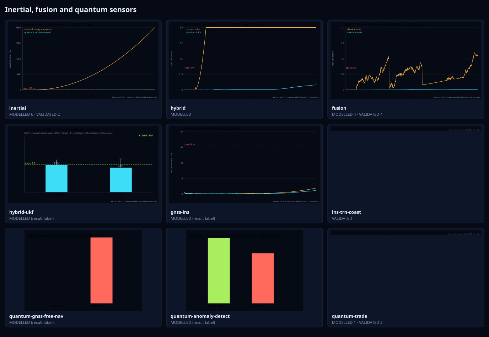
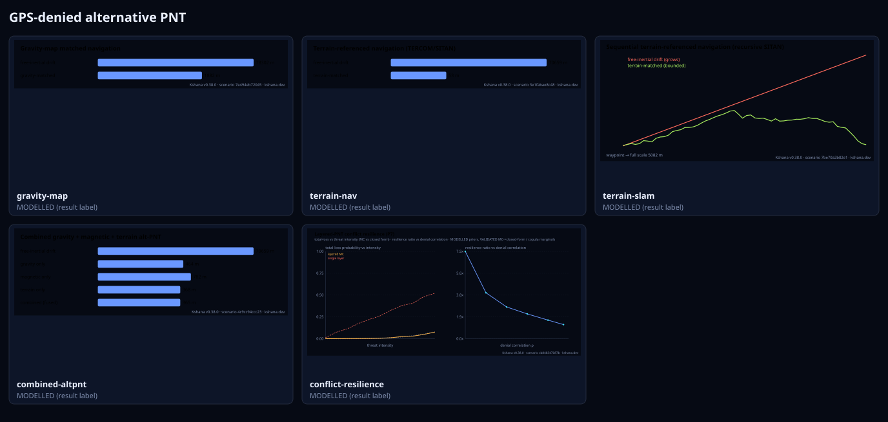
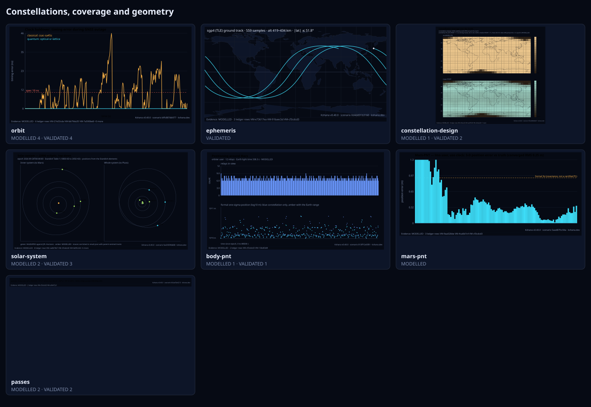
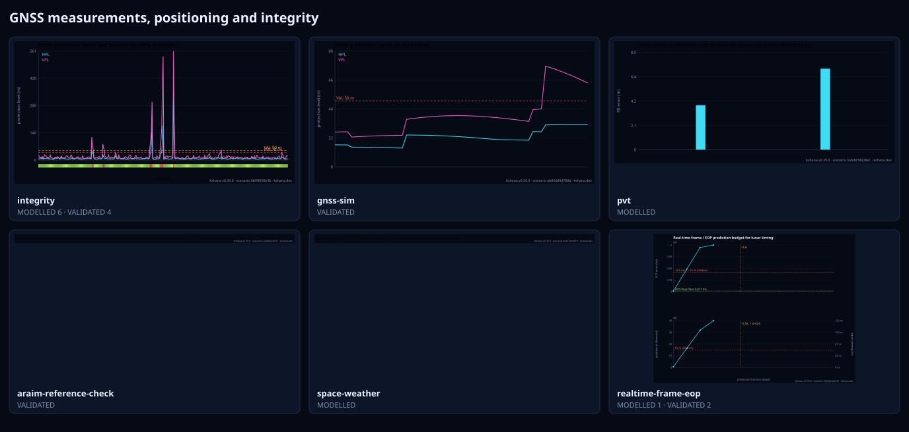
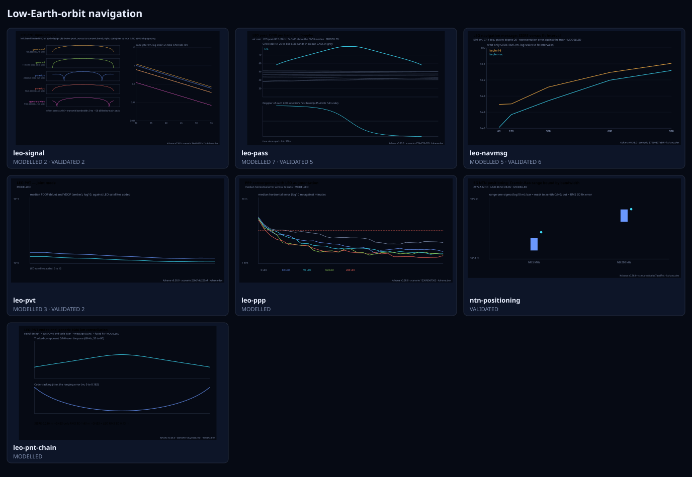
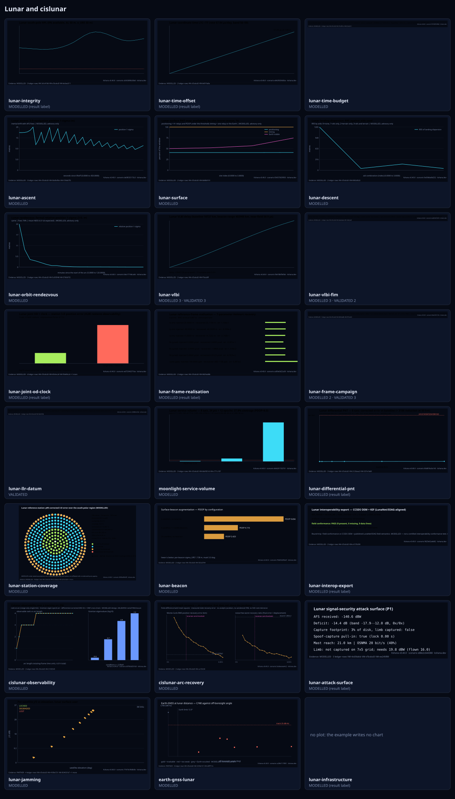
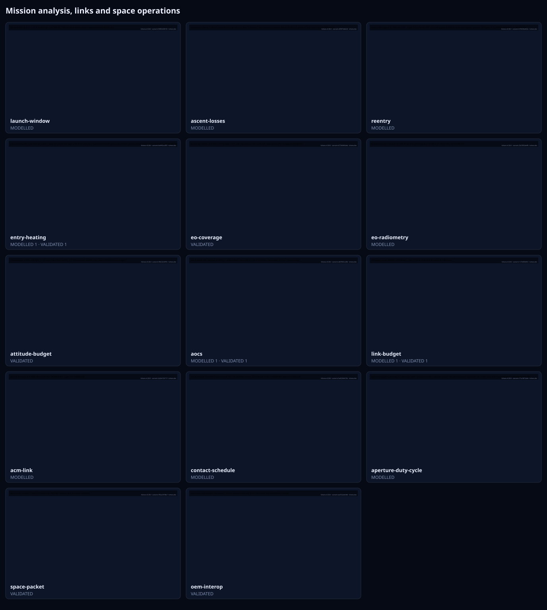
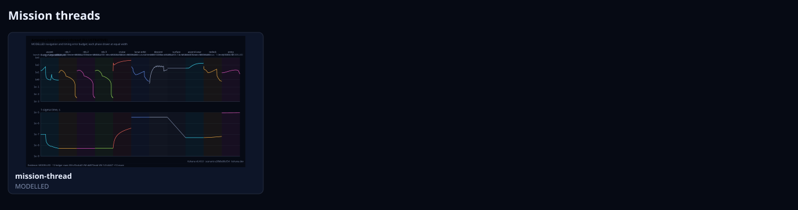
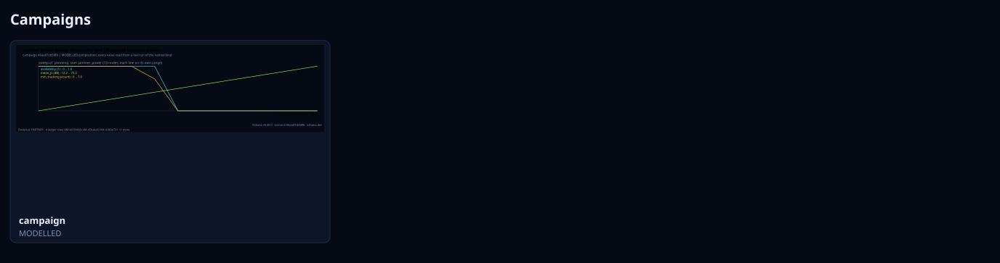

<!-- SPDX-License-Identifier: AGPL-3.0-only -->
<!-- Generated by tools/gen_kinds_index.py from the engine (`kshana kinds --json`), the bundled scenarios, web/data/verification-matrix.json and the charts the engine writes. Do not edit by hand. -->
# Scenario kinds

Every scenario kind the engine v0.39.0 dispatches (92), filed under 13 families. Each family has a page with one entry per kind (the engine's description and fields, the example command, headline numbers from a run, the matrix rows that name it, and the chart the engine writes) and a contact sheet of those charts. Advisory: analysis output from a research and engineering tool, not type-approved navigation equipment and not a safety-of-life service. Every label here is the engine's or the verification matrix's; a kind is MODELLED unless the matrix says otherwise (how a label is earned: the README's Evidence section).

## Families

### [Clocks, timing and holdover](kinds/clocks-timing-and-holdover.md)

### [Inertial, fusion and quantum sensors](kinds/inertial-fusion-and-quantum-sensors.md)

### [GPS-denied alternative PNT](kinds/gps-denied-alternative-pnt.md)

### [Constellations, coverage and geometry](kinds/constellations-coverage-and-geometry.md)

### [GNSS measurements, positioning and integrity](kinds/gnss-measurements-positioning-and-integrity.md)

### [Jamming, spoofing and the spectrum](kinds/jamming-spoofing-and-the-spectrum.md)

### [Low-Earth-orbit navigation](kinds/low-earth-orbit-navigation.md)

### [Lunar and cislunar](kinds/lunar-and-cislunar.md)

### [Space-user navigation](kinds/space-user-navigation.md)

### [Optical PNT](kinds/optical-pnt.md)

### [Mission analysis, links and space operations](kinds/mission-analysis-links-and-space-operations.md)

### [Mission threads](kinds/mission-threads.md)

### [Campaigns](kinds/campaigns.md)

## Every kind

| Kind | Family | Ledger | Example |
|---|---|---|---|
| [`acm-link`](kinds/by-kind/acm-link.md) | [Mission analysis, links and space operations](kinds/mission-analysis-links-and-space-operations.md#acm-link) | MODELLED | `kshana scenarios/acm-link.toml` |
| [`aocs`](kinds/by-kind/aocs.md) | [Mission analysis, links and space operations](kinds/mission-analysis-links-and-space-operations.md#aocs) | MODELLED 1 · VALIDATED 1 | `kshana scenarios/aocs-slew.toml` |
| [`aperture-duty-cycle`](kinds/by-kind/aperture-duty-cycle.md) | [Mission analysis, links and space operations](kinds/mission-analysis-links-and-space-operations.md#aperture-duty-cycle) | MODELLED | `kshana scenarios/aperture-duty-cycle.toml` |
| [`araim-reference-check`](kinds/by-kind/araim-reference-check.md) | [GNSS measurements, positioning and integrity](kinds/gnss-measurements-positioning-and-integrity.md#araim-reference-check) | VALIDATED | `kshana scenarios/araim-reference-check.toml` |
| [`ascent-losses`](kinds/by-kind/ascent-losses.md) | [Mission analysis, links and space operations](kinds/mission-analysis-links-and-space-operations.md#ascent-losses) | MODELLED | `kshana scenarios/ascent-losses.toml` |
| [`attitude-budget`](kinds/by-kind/attitude-budget.md) | [Mission analysis, links and space operations](kinds/mission-analysis-links-and-space-operations.md#attitude-budget) | VALIDATED | `kshana scenarios/attitude-budget.toml` |
| [`body-pnt`](kinds/by-kind/body-pnt.md) | [Constellations, coverage and geometry](kinds/constellations-coverage-and-geometry.md#body-pnt) | MODELLED 1 · VALIDATED 1 | `kshana scenarios/mars-orbit-pnt.toml` |
| [`campaign`](kinds/by-kind/campaign.md) | [Campaigns](kinds/campaigns.md#campaign) | MODELLED | `kshana scenarios/campaign-sweep-jammer-power.toml` |
| [`cislunar-arc-recovery`](kinds/by-kind/cislunar-arc-recovery.md) | [Lunar and cislunar](kinds/lunar-and-cislunar.md#cislunar-arc-recovery) | MODELLED | `kshana scenarios/cislunar-arc-recovery.toml` |
| [`cislunar-observability`](kinds/by-kind/cislunar-observability.md) | [Lunar and cislunar](kinds/lunar-and-cislunar.md#cislunar-observability) | MODELLED | `kshana scenarios/cislunar-observability.toml` |
| [`clock`](kinds/by-kind/clock.md) | [Clocks, timing and holdover](kinds/clocks-timing-and-holdover.md#clock) | MODELLED | `kshana scenarios/clock-ensemble.toml` |
| [`combined-altpnt`](kinds/by-kind/combined-altpnt.md) | [GPS-denied alternative PNT](kinds/gps-denied-alternative-pnt.md#combined-altpnt) | MODELLED (result label) | `kshana scenarios/combined-altpnt.toml` |
| [`conflict-resilience`](kinds/by-kind/conflict-resilience.md) | [GPS-denied alternative PNT](kinds/gps-denied-alternative-pnt.md#conflict-resilience) | MODELLED (result label) | `kshana scenarios/conflict-resilience.toml` |
| [`constellation-design`](kinds/by-kind/constellation-design.md) | [Constellations, coverage and geometry](kinds/constellations-coverage-and-geometry.md#constellation-design) | MODELLED 1 · VALIDATED 2 | `kshana scenarios/leo-pnt-mega-shell.toml` |
| [`contact-schedule`](kinds/by-kind/contact-schedule.md) | [Mission analysis, links and space operations](kinds/mission-analysis-links-and-space-operations.md#contact-schedule) | MODELLED | `kshana scenarios/contact-schedule.toml` |
| [`earth-gnss-lunar`](kinds/by-kind/earth-gnss-lunar.md) | [Lunar and cislunar](kinds/lunar-and-cislunar.md#earth-gnss-lunar) | MODELLED | `kshana scenarios/earth-gnss-lunar.toml` |
| [`entry-heating`](kinds/by-kind/entry-heating.md) | [Mission analysis, links and space operations](kinds/mission-analysis-links-and-space-operations.md#entry-heating) | MODELLED 1 · VALIDATED 1 | `kshana scenarios/entry-heating-stardust.toml` |
| [`eo-coverage`](kinds/by-kind/eo-coverage.md) | [Mission analysis, links and space operations](kinds/mission-analysis-links-and-space-operations.md#eo-coverage) | VALIDATED | `kshana scenarios/eo-coverage.toml` |
| [`eo-radiometry`](kinds/by-kind/eo-radiometry.md) | [Mission analysis, links and space operations](kinds/mission-analysis-links-and-space-operations.md#eo-radiometry) | MODELLED | `kshana scenarios/eo-radiometry.toml` |
| [`ephemeris`](kinds/by-kind/ephemeris.md) | [Constellations, coverage and geometry](kinds/constellations-coverage-and-geometry.md#ephemeris) | VALIDATED | `kshana scenarios/ephemeris.toml` |
| [`fusion`](kinds/by-kind/fusion.md) | [Inertial, fusion and quantum sensors](kinds/inertial-fusion-and-quantum-sensors.md#fusion) | MODELLED 4 · VALIDATED 4 | `kshana scenarios/fusion-pnt.toml` |
| [`gnss-ins`](kinds/by-kind/gnss-ins.md) | [Inertial, fusion and quantum sensors](kinds/inertial-fusion-and-quantum-sensors.md#gnss-ins) | MODELLED (result label) | `kshana scenarios/gnss-ins.toml` |
| [`gnss-sim`](kinds/by-kind/gnss-sim.md) | [GNSS measurements, positioning and integrity](kinds/gnss-measurements-positioning-and-integrity.md#gnss-sim) | VALIDATED | `kshana scenarios/gnss-sim-raim.toml` |
| [`gnss-ssv`](kinds/by-kind/gnss-ssv.md) | [Space-user navigation](kinds/space-user-navigation.md#gnss-ssv) | MODELLED | `kshana scenarios/gnss-ssv-heo.toml` |
| [`gravity-map`](kinds/by-kind/gravity-map.md) | [GPS-denied alternative PNT](kinds/gps-denied-alternative-pnt.md#gravity-map) | MODELLED (result label) | `kshana scenarios/gravity-map-nav.toml` |
| [`holdover-test`](kinds/by-kind/holdover-test.md) | [Clocks, timing and holdover](kinds/clocks-timing-and-holdover.md#holdover-test) | MODELLED | `kshana scenarios/holdover-test-ptp4l.toml` |
| [`hybrid`](kinds/by-kind/hybrid.md) | [Inertial, fusion and quantum sensors](kinds/inertial-fusion-and-quantum-sensors.md#hybrid) | MODELLED | `kshana scenarios/hybrid-pnt.toml` |
| [`hybrid-optical-rf`](kinds/by-kind/hybrid-optical-rf.md) | [Optical PNT](kinds/optical-pnt.md#hybrid-optical-rf) | HETEROGENEOUS (result label) | `kshana scenarios/hybrid-optical-rf.toml` |
| [`hybrid-ukf`](kinds/by-kind/hybrid-ukf.md) | [Inertial, fusion and quantum sensors](kinds/inertial-fusion-and-quantum-sensors.md#hybrid-ukf) | MODELLED (result label) | `kshana scenarios/hybrid-ukf.toml` |
| [`impairment-eval`](kinds/by-kind/impairment-eval.md) | [Jamming, spoofing and the spectrum](kinds/jamming-spoofing-and-the-spectrum.md#impairment-eval) | MODELLED 1 · VALIDATED 2 | `kshana scenarios/impairment-eval.toml` |
| [`inertial`](kinds/by-kind/inertial.md) | [Inertial, fusion and quantum sensors](kinds/inertial-fusion-and-quantum-sensors.md#inertial) | MODELLED 6 · VALIDATED 2 | `kshana scenarios/imu-deadreckoning.toml` |
| [`ins-trn-coast`](kinds/by-kind/ins-trn-coast.md) | [Inertial, fusion and quantum sensors](kinds/inertial-fusion-and-quantum-sensors.md#ins-trn-coast) | VALIDATED | `kshana scenarios/ins-trn-coast.toml` |
| [`integrity`](kinds/by-kind/integrity.md) | [GNSS measurements, positioning and integrity](kinds/gnss-measurements-positioning-and-integrity.md#integrity) | MODELLED 6 · VALIDATED 4 | `kshana scenarios/integrity-raim.toml` |
| [`jamming`](kinds/by-kind/jamming.md) | [Jamming, spoofing and the spectrum](kinds/jamming-spoofing-and-the-spectrum.md#jamming) | MODELLED | `kshana scenarios/jamming-demo.toml` |
| [`launch-window`](kinds/by-kind/launch-window.md) | [Mission analysis, links and space operations](kinds/mission-analysis-links-and-space-operations.md#launch-window) | MODELLED | `kshana scenarios/launch-window.toml` |
| [`leo-navmsg`](kinds/by-kind/leo-navmsg.md) | [Low-Earth-orbit navigation](kinds/low-earth-orbit-navigation.md#leo-navmsg) | MODELLED 5 · VALIDATED 6 | `kshana scenarios/leo-navmsg-celeste-iod.toml` |
| [`leo-pass`](kinds/by-kind/leo-pass.md) | [Low-Earth-orbit navigation](kinds/low-earth-orbit-navigation.md#leo-pass) | MODELLED 7 · VALIDATED 5 | `kshana scenarios/leo-pass-iridium.toml` |
| [`leo-pnt-chain`](kinds/by-kind/leo-pnt-chain.md) | [Low-Earth-orbit navigation](kinds/low-earth-orbit-navigation.md#leo-pnt-chain) | MODELLED | `kshana scenarios/leo-pnt-end-to-end.toml` |
| [`leo-ppp`](kinds/by-kind/leo-ppp.md) | [Low-Earth-orbit navigation](kinds/low-earth-orbit-navigation.md#leo-ppp) | MODELLED | `kshana scenarios/leo-ppp-convergence.toml` |
| [`leo-pvt`](kinds/by-kind/leo-pvt.md) | [Low-Earth-orbit navigation](kinds/low-earth-orbit-navigation.md#leo-pvt) | MODELLED 3 · VALIDATED 2 | `kshana scenarios/leo-pvt-fjord-skyline.toml` |
| [`leo-signal`](kinds/by-kind/leo-signal.md) | [Low-Earth-orbit navigation](kinds/low-earth-orbit-navigation.md#leo-signal) | MODELLED 2 · VALIDATED 2 | `kshana scenarios/leo-band-trade.toml` |
| [`link-budget`](kinds/by-kind/link-budget.md) | [Mission analysis, links and space operations](kinds/mission-analysis-links-and-space-operations.md#link-budget) | MODELLED 1 · VALIDATED 1 | `kshana scenarios/link-budget.toml` |
| [`lunar-ascent`](kinds/by-kind/lunar-ascent.md) | [Lunar and cislunar](kinds/lunar-and-cislunar.md#lunar-ascent) | MODELLED (result label) | `kshana scenarios/lunar-ascent.toml` |
| [`lunar-attack-surface`](kinds/by-kind/lunar-attack-surface.md) | [Lunar and cislunar](kinds/lunar-and-cislunar.md#lunar-attack-surface) | MODELLED (result label) | `kshana scenarios/lunar-attack-surface.toml` |
| [`lunar-beacon`](kinds/by-kind/lunar-beacon.md) | [Lunar and cislunar](kinds/lunar-and-cislunar.md#lunar-beacon) | MODELLED | `kshana scenarios/lunar-beacon.toml` |
| [`lunar-descent`](kinds/by-kind/lunar-descent.md) | [Lunar and cislunar](kinds/lunar-and-cislunar.md#lunar-descent) | MODELLED (result label) | `kshana scenarios/lunar-descent.toml` |
| [`lunar-differential-pnt`](kinds/by-kind/lunar-differential-pnt.md) | [Lunar and cislunar](kinds/lunar-and-cislunar.md#lunar-differential-pnt) | MODELLED (result label) | `kshana scenarios/lunar-differential-pnt.toml` |
| [`lunar-frame-campaign`](kinds/by-kind/lunar-frame-campaign.md) | [Lunar and cislunar](kinds/lunar-and-cislunar.md#lunar-frame-campaign) | MODELLED 2 · VALIDATED 3 | `kshana scenarios/lunar-frame-campaign.toml` |
| [`lunar-frame-realisation`](kinds/by-kind/lunar-frame-realisation.md) | [Lunar and cislunar](kinds/lunar-and-cislunar.md#lunar-frame-realisation) | MODELLED (result label) | `kshana scenarios/lunar-frame-realisation.toml` |
| [`lunar-infrastructure`](kinds/by-kind/lunar-infrastructure.md) | [Lunar and cislunar](kinds/lunar-and-cislunar.md#lunar-infrastructure) | MODELLED (result label) | `kshana scenarios/lunar-infrastructure-space-tie.toml` |
| [`lunar-integrity`](kinds/by-kind/lunar-integrity.md) | [Lunar and cislunar](kinds/lunar-and-cislunar.md#lunar-integrity) | MODELLED (result label) | `kshana scenarios/lunanet-araim.toml` |
| [`lunar-interop-export`](kinds/by-kind/lunar-interop-export.md) | [Lunar and cislunar](kinds/lunar-and-cislunar.md#lunar-interop-export) | MODELLED (result label) | `kshana scenarios/lunar-interop-export.toml` |
| [`lunar-jamming`](kinds/by-kind/lunar-jamming.md) | [Lunar and cislunar](kinds/lunar-and-cislunar.md#lunar-jamming) | MODELLED | `kshana scenarios/lunar-jamming.toml` |
| [`lunar-joint-od-clock`](kinds/by-kind/lunar-joint-od-clock.md) | [Lunar and cislunar](kinds/lunar-and-cislunar.md#lunar-joint-od-clock) | MODELLED (result label) | `kshana scenarios/lunar-joint-od-clock.toml` |
| [`lunar-llr-datum`](kinds/by-kind/lunar-llr-datum.md) | [Lunar and cislunar](kinds/lunar-and-cislunar.md#lunar-llr-datum) | VALIDATED | `kshana scenarios/lunar-llr-datum.toml` |
| [`lunar-orbit-rendezvous`](kinds/by-kind/lunar-orbit-rendezvous.md) | [Lunar and cislunar](kinds/lunar-and-cislunar.md#lunar-orbit-rendezvous) | MODELLED (result label) | `kshana scenarios/lunar-orbit-rendezvous.toml` |
| [`lunar-station-coverage`](kinds/by-kind/lunar-station-coverage.md) | [Lunar and cislunar](kinds/lunar-and-cislunar.md#lunar-station-coverage) | MODELLED | `kshana scenarios/lunar-station-coverage.toml` |
| [`lunar-surface`](kinds/by-kind/lunar-surface.md) | [Lunar and cislunar](kinds/lunar-and-cislunar.md#lunar-surface) | MODELLED (result label) | `kshana scenarios/lunar-surface.toml` |
| [`lunar-time-budget`](kinds/by-kind/lunar-time-budget.md) | [Lunar and cislunar](kinds/lunar-and-cislunar.md#lunar-time-budget) | MODELLED | `kshana scenarios/lunar-time-budget.toml` |
| [`lunar-time-offset`](kinds/by-kind/lunar-time-offset.md) | [Lunar and cislunar](kinds/lunar-and-cislunar.md#lunar-time-offset) | MODELLED (result label) | `kshana scenarios/lunar-time-offset.toml` |
| [`lunar-vlbi`](kinds/by-kind/lunar-vlbi.md) | [Lunar and cislunar](kinds/lunar-and-cislunar.md#lunar-vlbi) | MODELLED 3 · VALIDATED 3 | `kshana scenarios/lunar-vlbi.toml` |
| [`lunar-vlbi-fim`](kinds/by-kind/lunar-vlbi-fim.md) | [Lunar and cislunar](kinds/lunar-and-cislunar.md#lunar-vlbi-fim) | MODELLED 3 · VALIDATED 2 | `kshana scenarios/lunar-vlbi-fim.toml` |
| [`mars-pnt`](kinds/by-kind/mars-pnt.md) | [Constellations, coverage and geometry](kinds/constellations-coverage-and-geometry.md#mars-pnt) | MODELLED | `kshana scenarios/mars-pnt-lmo.toml` |
| [`mission-thread`](kinds/by-kind/mission-thread.md) | [Mission threads](kinds/mission-threads.md#mission-thread) | MODELLED (result label) | `kshana scenarios/mission-thread-artemis-class.toml` |
| [`moonlight-service-volume`](kinds/by-kind/moonlight-service-volume.md) | [Lunar and cislunar](kinds/lunar-and-cislunar.md#moonlight-service-volume) | MODELLED (result label) | `kshana scenarios/moonlight-service-volume.toml` |
| [`ntn-positioning`](kinds/by-kind/ntn-positioning.md) | [Low-Earth-orbit navigation](kinds/low-earth-orbit-navigation.md#ntn-positioning) | VALIDATED | `kshana scenarios/ntn-5g-positioning.toml` |
| [`oem-interop`](kinds/by-kind/oem-interop.md) | [Mission analysis, links and space operations](kinds/mission-analysis-links-and-space-operations.md#oem-interop) | VALIDATED | `kshana scenarios/oem-interop.toml` |
| [`optical-atmosphere`](kinds/by-kind/optical-atmosphere.md) | [Optical PNT](kinds/optical-pnt.md#optical-atmosphere) | MODELLED | `kshana scenarios/optical-atmosphere-network.toml` |
| [`orbit`](kinds/by-kind/orbit.md) | [Constellations, coverage and geometry](kinds/constellations-coverage-and-geometry.md#orbit) | MODELLED 4 · VALIDATED 4 | `kshana scenarios/orbit-rinex.toml` |
| [`passes`](kinds/by-kind/passes.md) | [Constellations, coverage and geometry](kinds/constellations-coverage-and-geometry.md#passes) | MODELLED 2 · VALIDATED 2 | `kshana scenarios/passes.toml` |
| [`pvt`](kinds/by-kind/pvt.md) | [GNSS measurements, positioning and integrity](kinds/gnss-measurements-positioning-and-integrity.md#pvt) | MODELLED | `kshana scenarios/pvt-abmf.toml` |
| [`quantum-anomaly-detect`](kinds/by-kind/quantum-anomaly-detect.md) | [Inertial, fusion and quantum sensors](kinds/inertial-fusion-and-quantum-sensors.md#quantum-anomaly-detect) | MODELLED (result label) | `kshana scenarios/quantum-anomaly-detect.toml` |
| [`quantum-gnss-free-nav`](kinds/by-kind/quantum-gnss-free-nav.md) | [Inertial, fusion and quantum sensors](kinds/inertial-fusion-and-quantum-sensors.md#quantum-gnss-free-nav) | MODELLED (result label) | `kshana scenarios/quantum-gnss-free-nav.toml` |
| [`quantum-time-transfer`](kinds/by-kind/quantum-time-transfer.md) | [Clocks, timing and holdover](kinds/clocks-timing-and-holdover.md#quantum-time-transfer) | MODELLED (result label) | `kshana scenarios/quantum-time-transfer.toml` |
| [`quantum-trade`](kinds/by-kind/quantum-trade.md) | [Inertial, fusion and quantum sensors](kinds/inertial-fusion-and-quantum-sensors.md#quantum-trade) | MODELLED 1 · VALIDATED 2 | `kshana scenarios/quantum-trade.toml` |
| [`realtime-frame-eop`](kinds/by-kind/realtime-frame-eop.md) | [GNSS measurements, positioning and integrity](kinds/gnss-measurements-positioning-and-integrity.md#realtime-frame-eop) | MODELLED 1 · VALIDATED 2 | `kshana scenarios/realtime-frame-eop.toml` |
| [`reentry`](kinds/by-kind/reentry.md) | [Mission analysis, links and space operations](kinds/mission-analysis-links-and-space-operations.md#reentry) | MODELLED | `kshana scenarios/reentry.toml` |
| [`slot-timing`](kinds/by-kind/slot-timing.md) | [Clocks, timing and holdover](kinds/clocks-timing-and-holdover.md#slot-timing) | MODELLED 2 · VALIDATED 1 | `kshana scenarios/slot-timing-ocxo-leo.toml` |
| [`solar-system`](kinds/by-kind/solar-system.md) | [Constellations, coverage and geometry](kinds/constellations-coverage-and-geometry.md#solar-system) | MODELLED 2 · VALIDATED 3 | `kshana scenarios/solar-system-tour.toml` |
| [`space-packet`](kinds/by-kind/space-packet.md) | [Mission analysis, links and space operations](kinds/mission-analysis-links-and-space-operations.md#space-packet) | VALIDATED | `kshana scenarios/space-packet.toml` |
| [`space-weather`](kinds/by-kind/space-weather.md) | [GNSS measurements, positioning and integrity](kinds/gnss-measurements-positioning-and-integrity.md#space-weather) | MODELLED | `kshana scenarios/space-weather.toml` |
| [`spectrum`](kinds/by-kind/spectrum.md) | [Jamming, spoofing and the spectrum](kinds/jamming-spoofing-and-the-spectrum.md#spectrum) | MODELLED 3 · VALIDATED 2 | `kshana scenarios/l-band-waterfall-jamming.toml` |
| [`spoof`](kinds/by-kind/spoof.md) | [Jamming, spoofing and the spectrum](kinds/jamming-spoofing-and-the-spectrum.md#spoof) | MODELLED | `kshana scenarios/spoof-attack.toml` |
| [`spoof-detect`](kinds/by-kind/spoof-detect.md) | [Jamming, spoofing and the spectrum](kinds/jamming-spoofing-and-the-spectrum.md#spoof-detect) | MODELLED | `kshana scenarios/spoof-detect.toml` |
| [`sweep`](kinds/by-kind/sweep.md) | [Clocks, timing and holdover](kinds/clocks-timing-and-holdover.md#sweep) | MODELLED | `kshana scenarios/sweep-clock-stability.toml` |
| [`sweep-nd`](kinds/by-kind/sweep-nd.md) | [Clocks, timing and holdover](kinds/clocks-timing-and-holdover.md#sweep-nd) | MODELLED (result label) | `kshana scenarios/sweep-nd-inertial.toml` |
| [`telecom-timing`](kinds/by-kind/telecom-timing.md) | [Clocks, timing and holdover](kinds/clocks-timing-and-holdover.md#telecom-timing) | MODELLED 5 · VALIDATED 1 | `kshana scenarios/telecom-synce-eec.toml` |
| [`terrain-nav`](kinds/by-kind/terrain-nav.md) | [GPS-denied alternative PNT](kinds/gps-denied-alternative-pnt.md#terrain-nav) | MODELLED (result label) | `kshana scenarios/terrain-nav.toml` |
| [`terrain-slam`](kinds/by-kind/terrain-slam.md) | [GPS-denied alternative PNT](kinds/gps-denied-alternative-pnt.md#terrain-slam) | MODELLED (result label) | `kshana scenarios/terrain-slam.toml` |
| [`time-transfer-budget`](kinds/by-kind/time-transfer-budget.md) | [Clocks, timing and holdover](kinds/clocks-timing-and-holdover.md#time-transfer-budget) | MODELLED | `kshana scenarios/time-transfer-budget.toml` |
| [`timetransfer`](kinds/by-kind/timetransfer.md) | [Clocks, timing and holdover](kinds/clocks-timing-and-holdover.md#timetransfer) | MODELLED | `kshana scenarios/timetransfer.toml` |
| [`tracking-loop`](kinds/by-kind/tracking-loop.md) | [Jamming, spoofing and the spectrum](kinds/jamming-spoofing-and-the-spectrum.md#tracking-loop) | MODELLED | `kshana scenarios/tracking-loop.toml` |
