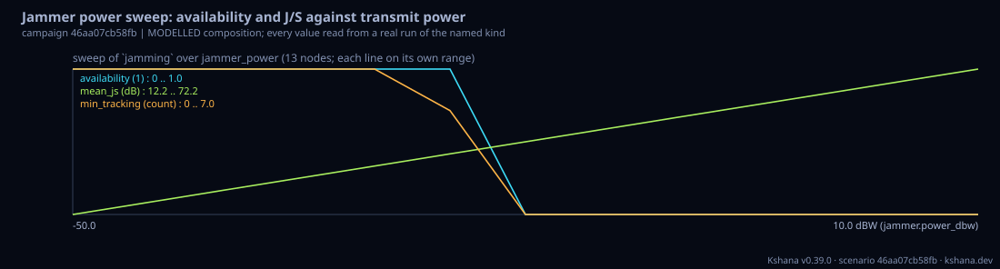

<!-- SPDX-License-Identifier: AGPL-3.0-only -->
<!-- Generated by tools/gen_kinds_index.py from the engine, the schema, the verification matrix and one run of the example. Do not edit by hand. -->
# `campaign`

Scenario kind of the engine v0.39.0, family [Campaigns](../campaigns.md). Advisory: analysis output from a research and engineering tool, not type-approved navigation equipment and not a safety-of-life service. Every label here is the engine's or the verification matrix's; a kind is MODELLED unless the matrix says otherwise (how a label is earned: the README's Evidence section).

## What it does

Campaign: existing scenario kinds composed into one run, with every number read from a real run of the named kind. Four sections, in any combination. PHASES: a chained mission on one shared timeline -- each phase runs one or more scenarios (for example jamming, then spoofing, then a clock in holdover with an inertial navigation system coasting beside it, then an integrity alarm, then recovery), their outputs are read into named channels (clock time error against its guard, carrier-to-noise density ratio against the tracking floor, protection level against the alert limit, position error, satellites tracking, alarm flags) by a per-kind preset or by explicit result paths, and resampled onto a common grid by zero-order hold, with phase boundaries and events; state is handed on by carry (a channel continues from the previous phase's end value), handoff (a previous phase's number written into this phase's scenario) and end_at (a phase ends at a time a run computed, such as a spoofing monitor's detection time). SWEEP: a grid over one to three dotted scenario keys of any kind (a whole-number segment indexes an array of tables, as in system.2.sisre_m), with metrics read by result path and, with runs above one, a seeded Monte Carlo ensemble at every node. MONTE_CARLO: realisation k runs at base_seed + k; each metric reports mean, standard deviation, nearest-rank 5th/50th/95th percentiles and a fixed-seed bootstrap 95% confidence interval on the mean. COMPOSE: several scenarios under shared values (one jammer's power and position written into a maritime and a road receiver), with a combined best/worst summary. The result carries a campaign hash, a digest over every member result, and a units entry for every emitted number; the interoperability exports write each member scenario that has geometry as its own file set. Composition identities are tested: a one-phase campaign reproduces the stand-alone run bit for bit, a fixed-seed ensemble is byte-stable, and on a white-frequency-noise clock the ensemble mean falls inside the reported interval with the spread matching sqrt(q_wf * tau). MODELLED: the additive carry and the zero-order hold are modelling choices, and each phase carries the label of the kind that ran it.

One run of `scenarios/campaign-sweep-jammer-power.toml` summarises as: campaign 46aa07cb58fb | Jammer power sweep: availability and J/S against transmit power | sweep of `jamming`: 13 nodes over [jammer_power] | 13 member runs (MODELLED)

## Inputs

From the schema (`kshana kinds --json`):

- Required fields: none
- Optional fields: `title`, `seed`, `timeline`, `phases`, `sweep`, `monte_carlo`, `compose`

The example `scenarios/campaign-sweep-jammer-power.toml` sets, among others:

| Field | Value | Unit |
|---|---|---|
| `kind` | campaign | text |
| `seed` | 20260928 | 1 |
| `sweep.axes[0].key` | jammer.power_dbw | text |
| `sweep.axes[0].name` | jammer_power | text |
| `sweep.axes[0].start` | -50 | not stated |
| `sweep.axes[0].steps` | 13 | not stated |
| `sweep.axes[0].stop` | 10 | not stated |
| `sweep.axes[0].unit` | dBW | text |
| `sweep.metrics[0].name` | availability | text |
| `sweep.metrics[0].path` | fom.availability_under_jamming | text |
| `sweep.metrics[1].name` | mean_js | text |
| `sweep.metrics[1].path` | fom.mean_js_db | text |

## Run it

```sh
kshana scenarios/campaign-sweep-jammer-power.toml
```

22 bundled scenarios use this kind; the others are in [`scenarios/`](../../../scenarios/).

## What it gives

The scalar results of that run, with the units the engine states:

| Result | Value | Unit |
|---|---|---|
| `reproducibility.campaign_hash` | 46aa07cb58fbfbd3784c2e1ef8d6070508ad5f5c | text |
| `reproducibility.run_digest` | a2eb8762700e16a9ee46cd84731607a73a23fbe4 | text |
| `reproducibility.runs_total` | 13 | count |
| `seed` | 20260928 | 1 |
| `sweep.axes.jammer_power.key` | jammer.power_dbw | text |
| `sweep.axes.jammer_power.scale` | lin | text |
| `sweep.axes.jammer_power.unit` | dBW | text |
| `sweep.metrics.availability.path` | fom.availability_under_jamming | text |
| `sweep.metrics.availability.unit` | 1 | text |
| `sweep.metrics.mean_js.path` | fom.mean_js_db | text |

Result label (the engine's): MODELLED composition of existing scenario kinds. Every number is read from a real run of the named kind; the chaining (additive carry of a channel across a phase boundary, zero-order hold onto the timeline grid, a phase ended at a computed time) is a modelling choice, and each phase carries the labe



## Evidence

MODELLED: the [verification matrix](../../VERIFICATION-MATRIX.md) rows that name this kind.

- **MODELLED** iq::campaign::detect and the campaign runner: an optional [monitors] table runs the IQ monitors on every cell in the runner's single pass. Tests: [iq_campaign.rs](../../../tests/iq_campaign.rs).
- **MODELLED** iq::campaign::detect (windows, roc) and iq::campaign::report::rocs: each cell of a campaign with monitors keeps, per alarm kind and channel, the maximum of the monitor's own test statistic over each stated event window (positive) and over t
- **MODELLED** iq::labfit (campaign, cn0, iqfit, iqreport) and `[input] campaign` on `kshana iq labfit`, Python `kshana.iq_labfit` and the MCP labfit tool (campaign folders inside its work directory only): reads a `kshana iq campaign` output folder by its Tests: [iq_labfit_followup.rs](../../../tests/iq_labfit_followup.rs).
- **MODELLED** The `campaign` kind's phases: each phase runs one or more scenarios of existing kinds through run_toml, reads their outputs into named channels (clock time error and guard, mean effective carrier-to-noise density ratio and tracking floor, v Tests: [campaign_composition_reference.rs](../../../tests/campaign_composition_reference.rs).
- and 4 more in the matrix.

The rows the run itself exercised, with the oracle the matrix gives each (the public sources are named there):

- **MODELLED** Geometry J/S link budget, anti-jam C/N₀, per-satellite loss-of-lock. Oracle (InternalConsistency): Anti-jam C/N₀ link-budget equation cross-checked against an independent numpy re-derivation (shares the same closed form → InternalConsistency) plus a real-JammerTest-2024 C/N₀ degradation characterisation. 0.30 round 2, blocked (stays MODELLED): the measured JammerTest 2024 C/N0 drop against a link-budget prediction (pre-registered 6a66994b, within 3 dB) was not run because the F8.1 antenna position and pointing at 
- **MODELLED** Deterministic, scenario-hashed, SBOM + cross-platform golden gates. Oracle (ExternalDataset): SBOM conformance to the official CycloneDX 1.5 JSON Schema (+ valid SPDX identifiers) — an external published standard, zero validation errors over the full dependency graph; the FoM-determinism / byte-reproducibility part remains a pinned self-consistency check, so the row stays MODELLED
- **PARTNER** Not provided — Kshana models signal performance, not payload/antenna hardware. Oracle (NoneKind): none: a partner-owned discipline, with no module and no test by design
- **MODELLED** The `campaign` kind's sweep (one to three dotted keys of any kind, on the generic sweep's axis values, optionally an ensemble at every node) and monte_carlo sec. Oracle (InternalConsistency): The closed form of the phase random walk under white frequency noise, variance q_wf tau (NIST Technical Note 1337), for the statistics machinery, and byte equality with the stand-alone runs for the seeding. It checks the ensemble arithmetic on the engine's own clock model, not an external dataset

## Limitations

What the run's own report says is not modelled or not validated:

- MODELLED composition of existing scenario kinds. Every number is read from a real run of the named kind; the chaining (additive carry of a channel across a phase boundary, zero-order hold onto the timeline grid, a phase ended at a computed time) is a modelling choice, and each phase carries the label of the kind that produced it. (result `label`)
- MODELLED: the additive carry and the zero-order hold are modelling choices, and each phase carries the label of the kind that ran it. (kind catalogue (`kshana kinds --json`))
- MODELLED: as the `jamming` kind is. (scenario file comment, line 14)
- GNSS-denied jamming resilience is MODELLED, not validated: checked against its own closed-form / analytic identity — catches transcription and coefficient errors, but is not an external oracle. (verification matrix (docs/MODELLED-RATIONALE.md))
- Reproducibility & software assurance is MODELLED, not validated: a sub-claim is externally checked, but the whole capability composes modelled pieces, so the capability stays Modelled. (verification matrix (docs/MODELLED-RATIONALE.md))
- Parameter sweeps and seeded Monte Carlo ensembles over any scenario kind is MODELLED, not validated: checked against its own closed-form / analytic identity — catches transcription and coefficient errors, but is not an external oracle. (verification matrix (docs/MODELLED-RATIONALE.md))

## See also

- Family page: [Campaigns](../campaigns.md#campaign)
- All kinds: [KINDS.md](../../KINDS.md)
- Topic page: [LEO-PNT.md](../../LEO-PNT.md)
- Topic page: [RESILIENCE-CROSSWALK.md](../../RESILIENCE-CROSSWALK.md)
