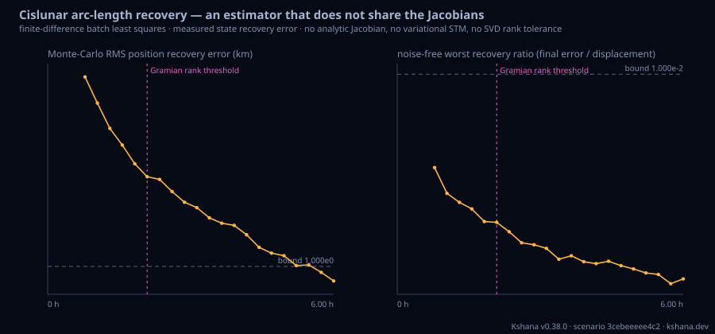

<!-- SPDX-License-Identifier: AGPL-3.0-only -->
<!-- Generated by tools/gen_kinds_index.py from the engine, the schema, the verification matrix and one run of the example. Do not edit by hand. -->
# `cislunar-arc-recovery`

Scenario kind of the engine v0.39.0, family [Lunar and cislunar](../lunar-and-cislunar.md). Advisory: analysis output from a research and engineering tool, not type-approved navigation equipment and not a safety-of-life service. Every label here is the engine's or the verification matrix's; a kind is MODELLED unless the matrix says otherwise (how a label is earned: the README's Evidence section).

## What it does

MODELLED independent-estimator test of the cislunar arc-length observability threshold. That threshold is a RANK read on the observability matrix assembled from the ANALYTIC range Jacobian rows and the ANALYTIC variational state-transition matrix, and its square-root-information-filter cross-check folds those same rows — a consistency check between two numerical machines, not corroboration. This kind supplies the missing arbiter: a batch least-squares estimator that actually RECOVERS the chief's initial state from simulated measurements, with the measurement partials taken as CENTRAL FINITE DIFFERENCES of the composed forward model. It calls no analytic Jacobian row, no variational STM, no singular-value or eigen decomposition, no rank tolerance and no square-root information filter — a source-text guard in tests/cislunar_arc_recovery_reference.rs makes that enforceable — while the dynamics (the same RK4 CR3BP flow), the initial conditions (the same differential-corrected constellation), the scalar observable and the epoch grid are shared deliberately and named in the emitted `independence` block, because two analyses of one physical problem must agree about the physics to be comparable. Two criteria, each swept over five decades of its own bound: NOISE-FREE RECOVERY (every seeded trial's final state error at most recovery_factor times its a-priori displacement — the rank analogue, with no singular-value tolerance in it) and MONTE-CARLO ESTIMABILITY (the measured RMS position error over a seeded noise ensemble below a stated bound — the estimability analogue, measured rather than predicted). Supports the planar four-state and the spatial six-state, the DRO / L2 halo / L2 NRHO families, range and range-rate observables, and a Moon-centred polar parameterisation in which the transformation is applied to the STATE and the forward model re-differenced there. MEASURED on the published planar DRO grid: the estimator recovers the four-state from 0.782609 h against the rank criterion's 2.086957 h at rel_tol 1e-6 (ratio 0.375) — the rank threshold is NOT corroborated as a recoverability boundary — while the measured estimability boundary lands in the same grid cell as the formal one, 5.739130 h, and the measured error curve reproduces the formal 1-sigma over 21 arc lengths to a geometric-mean ratio of 0.98. MODELLED: the constellation design, the epoch grid, the single tracked link, the displacement magnitude, the measurement sigma and the two stated bounds. Not a certified navigation-performance product.

One run of `scenarios/cislunar-arc-recovery.toml` summarises as: cislunar-arc-recovery | dro family, 4-state, 4 s/c, range observable, cartesian parameterisation | 6.0 h arc, 24 epochs (grid 0.260870 h), 32 trials, seed 20260920 | finite-difference partials, no analytic Jacobian / STM / SVD / SRIF | noise-free recovery from 0.782609 h (factor 1e-2) vs Gramian rank threshold 2.086957 h | Monte-Carlo estimability from 5.739130 h (RMS pos ≤ 1.000 km, σ 1.000 m) vs Gramian estimability 5.739130 h | end-of-arc RMS pos 0.6026 km

## Inputs

From the schema (`kshana kinds --json`):

- Required fields: none
- Optional fields: `mu`, `arc_hours`, `epochs`, `steps`, `spatial`, `family`, `n_spacecraft`, `observable`, `coordinates`, `trials`, `seed`, `displacement_nd`, `recovery_factor`, `sigma_range_m`, `sigma_range_rate_mm_s`, `error_bound_km`, `max_iterations`, `rel_tol`

The example `scenarios/cislunar-arc-recovery.toml` sets, among others:

| Field | Value | Unit |
|---|---|---|
| `kind` | cislunar-arc-recovery | text |

## Run it

```sh
kshana scenarios/cislunar-arc-recovery.toml
```

## What it gives

The scalar results of that run, with the units the engine states:

| Result | Value | Unit |
|---|---|---|
| `arc_hours` | 6 | h |
| `claim_under_test.comparable` | true | flag |
| `claim_under_test.estimability_ratio_estimator_over_gramian` | 1 | ratio (dimensionless) |
| `claim_under_test.estimator_estimability_boundary_hours` | 5.73913 | h |
| `claim_under_test.estimator_noise_free_boundary_hours` | 0.782609 | h |
| `claim_under_test.gramian_estimability_threshold_hours` | 5.73913 | h |
| `claim_under_test.gramian_rank_threshold_hours` | 2.086957 | h |
| `claim_under_test.rank_ratio_estimator_over_gramian` | 0.375 | ratio (dimensionless) |
| `claim_under_test.rel_tol` | 1.0000e-6 | fraction (dimensionless) |
| `claim_under_test.source` | cislunar-observability on the identical  | text |

Result label (the engine's): MODELLED cislunar arc-length recovery test (independent-estimator corroboration of the P6 observability threshold). VALIDATED core: the estimator is the crate's pre-existing weighted Gauss-Newton batch corrector (crate::batch_ls), whose design matrix is a CENTRAL FINITE DIFFERENCE of the composed fo



## Evidence

MODELLED: the [verification matrix](../../VERIFICATION-MATRIX.md) rows that name this kind.

- **MODELLED** A batch least-squares estimator that RECOVERS the chief's initial state from simulated inter-satellite measurements over growing prefixes of the same epoch grid the rank-vs-arc table uses, with the measurement partials taken as central fini Tests: [cislunar_arc_recovery_reference.rs](../../../tests/cislunar_arc_recovery_reference.rs).

The rows the run itself exercised, with the oracle the matrix gives each (the public sources are named there):

- **MODELLED** Deterministic, scenario-hashed, SBOM + cross-platform golden gates. Oracle (ExternalDataset): SBOM conformance to the official CycloneDX 1.5 JSON Schema (+ valid SPDX identifiers) — an external published standard, zero validation errors over the full dependency graph; the FoM-determinism / byte-reproducibility part remains a pinned self-consistency check, so the row stays MODELLED
- **MODELLED** A batch least-squares estimator that RECOVERS the chief's initial state from simulated inter-satellite measurements over growing prefixes of the same epoch grid. Oracle (ReferenceImpl): A separate estimator in this codebase on a different algorithm and a disjoint code path: nonlinear weighted Gauss-Newton with finite-difference partials, its verdict read as a measured state-recovery error in km and mm/s. It has no expression in common with the Gramian's rank-and-covariance route, and the separation is ENFORCED by a source-text guard rather than asserted. MEASURED on the published planar DRO grid: th

## Limitations

What the run's own report says is not modelled or not validated:

- MODELLED cislunar arc-length recovery test (independent-estimator corroboration of the P6 observability threshold). VALIDATED core: the estimator is the crate's pre-existing weighted Gauss-Newton batch corrector (crate::batch_ls), whose design matrix is a CENTRAL FINITE DIFFERENCE of the composed forward model - it calls no analytic measurement Jacobian row, no variational state-transition matrix, no singular-value o (result `label`)
- MODELLED independent-estimator test of the cislunar arc-length observability threshold. (kind catalogue (`kshana kinds --json`))
- MODELLED: the constellation design, the epoch grid, the single tracked link, the displacement magnitude, the measurement sigma and the two stated bounds. (kind catalogue (`kshana kinds --json`))
- MODELLED: the constellation design, the epoch grid, the single tracked link, the displacement magnitude, the measurement sigma and the two stated bounds. Not a certified navigation-performance product. (scenario file comment, lines 33 to 35)
- Reproducibility & software assurance is MODELLED, not validated: a sub-claim is externally checked, but the whole capability composes modelled pieces, so the capability stays Modelled. (verification matrix (docs/MODELLED-RATIONALE.md))
- Independent-estimator corroboration of the cislunar arc-length threshold is MODELLED, not validated: checked against a separate implementation in this same codebase — independent of the unit under test, but not externally authoritative. (verification matrix (docs/MODELLED-RATIONALE.md))

## See also

- Family page: [Lunar and cislunar](../lunar-and-cislunar.md#cislunar-arc-recovery)
- All kinds: [KINDS.md](../../KINDS.md)
