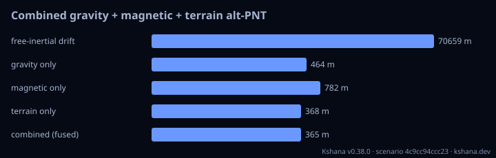

<!-- SPDX-License-Identifier: AGPL-3.0-only -->
<!-- Generated by tools/gen_kinds_index.py from the engine, the schema, the verification matrix and one run of the example. Do not edit by hand. -->
# `combined-altpnt`

Scenario kind of the engine v0.38.0, family [GPS-denied alternative PNT](../gps-denied-alternative-pnt.md). Advisory: analysis output from a research and engineering tool, not type-approved navigation equipment and not a safety-of-life service. Every label here is the engine's or the verification matrix's; a kind is MODELLED unless the matrix says otherwise (how a label is earned: the README's Evidence section).

## What it does

GPS-denied combined gravity + magnetic + terrain navigator: three scalar field channels fused per waypoint for a sharper (lower-CRLB) drift fix than any single field.

One run of `scenarios/combined-altpnt.toml` summarises as: combined-altpnt | free-inertial drift 70659 m | gravity 464 m magnetic 782 m terrain 368 m | FUSED 365 m

## Inputs

From the schema (`kshana kinds --json`):

- Required fields: `start_lat_deg`, `start_lon_deg`, `step_lat_deg`, `step_lon_deg`, `waypoints`, `drift_lat_deg`, `drift_lon_deg`, `search_half_deg`, `search_step_deg`, `nmax`, `gravity_sigma_mgal`, `igrf_year`, `magnetic_sigma_nt`, `dem_seed`, `terrain_sigma_m`
- Optional fields: `coeffs`, `mascons`, `magnetic_mascons`, `igrf_alt_km`, `refine_stages`, `refine_factor`, `noise_seed`, `magnetic_grid`

The example `scenarios/combined-altpnt.toml` sets, among others:

| Field | Value | Unit |
|---|---|---|
| `coeffs[0].cbar` | 6.0000e-6 | not stated |
| `coeffs[0].m` | 0 | not stated |
| `coeffs[0].n` | 2 | not stated |
| `coeffs[0].sbar` | 0 | not stated |
| `coeffs[1].cbar` | 3.0000e-6 | not stated |
| `coeffs[1].m` | 1 | not stated |
| `coeffs[1].n` | 3 | not stated |
| `coeffs[1].sbar` | 2.0000e-6 | not stated |
| `dem_seed` | 1 | not stated |
| `drift_lat_deg` | 0.5 | deg |
| `drift_lon_deg` | -0.4 | deg |
| `gravity_sigma_mgal` | 3 | mGal |

## Run it

```sh
kshana scenarios/combined-altpnt.toml
```

## What it gives

The scalar results of that run, with the units the engine states:

| Result | Value | Unit |
|---|---|---|
| `combined_m` | 364.881333 | m |
| `free_inertial_drift_m` | 70658.643788 | m |
| `gravity_only_m` | 464.136358 | m |
| `magnetic_only_m` | 782.430009 | m |
| `terrain_only_m` | 367.623242 | m |



## Evidence

No matrix row names this kind by name; the label on its result is the engine's own, above.

The rows the run itself exercised, with the oracle the matrix gives each (the public sources are named there):

- **MODELLED** Gravity-map matching, terrain-referenced (TERCOM/SITAN), magnetic anomaly. Oracle (InternalConsistency): IGRF-14 coefficients; first-principles matched-filter CRLB. The real-field gravity benchmark's field is externally checked (row 'Gravity-anomaly synthesis from a spherical-harmonic model'), but its navigation outcome has no external oracle
- **MODELLED** Deterministic, scenario-hashed, SBOM + cross-platform golden gates. Oracle (ExternalDataset): SBOM conformance to the official CycloneDX 1.5 JSON Schema (+ valid SPDX identifiers) — an external published standard, zero validation errors over the full dependency graph; the FoM-determinism / byte-reproducibility part remains a pinned self-consistency check, so the row stays MODELLED

## Limitations

What the run's own report says is not modelled or not validated:

- Alternative / complementary PNT is MODELLED, not validated: checked against its own closed-form / analytic identity — catches transcription and coefficient errors, but is not an external oracle. (verification matrix (docs/MODELLED-RATIONALE.md))
- Reproducibility & software assurance is MODELLED, not validated: a sub-claim is externally checked, but the whole capability composes modelled pieces, so the capability stays Modelled. (verification matrix (docs/MODELLED-RATIONALE.md))

## See also

- Family page: [GPS-denied alternative PNT](../gps-denied-alternative-pnt.md#combined-altpnt)
- All kinds: [KINDS.md](../../KINDS.md)
