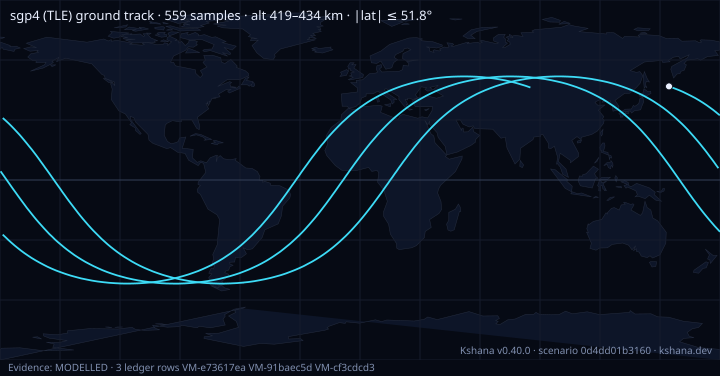

<!-- SPDX-License-Identifier: AGPL-3.0-only -->
<!-- Generated by tools/gen_kinds_index.py from the engine, the schema, the verification matrix and one run of the example. Do not edit by hand. -->
# `ephemeris`

Scenario kind of the engine v0.40.0, family [Constellations, coverage and geometry](../constellations-coverage-and-geometry.md). Advisory: analysis output from a research and engineering tool, not type-approved navigation equipment and not a safety-of-life service. Every label here is the engine's or the verification matrix's; a kind is MODELLED unless the matrix says otherwise (how a label is earned: the README's Evidence section).

## What it does

Ephemeris & ground track: propagate one satellite (TLE→SGP4 or analytic orbit) and emit its TEME/GCRS state (position + velocity), ITRF/ECEF position, WGS-84 sub-satellite lat/lon/alt, and per-step station az/el/range + range-rate (Doppler). The satellite comes from a `tle` or from an analytic `orbit` with its `epoch` (a `tle` wins when both are given); with a `tle`, an `epoch` overrides the TLE's own epoch as t = 0.

One run of `scenarios/ephemeris.toml` summarises as: scenario 0d4dd01b3160 | sgp4 (TLE) | 559 samples | alt 419–434 km | |lat| ≤ 51.8° | speed 7653–7661 m/s | max el 25.7° peak Doppler 34.3 kHz

## Inputs

From the schema (`kshana kinds --json`):

- Required fields: `tle|orbit+epoch`
- Optional fields: `step_s`, `duration_s`, `station`, `dut1_s`, `xp_arcsec`, `yp_arcsec`, `carrier_hz`, `eop_finals2000a`

The example `scenarios/ephemeris.toml` sets, among others:

| Field | Value | Unit |
|---|---|---|
| `duration_s` | 16740 | s |
| `dut1_s` | 0 | s |
| `kind` | ephemeris | text |
| `station.alt_m` | 144 | m |
| `station.lat_deg` | 49.8707 | deg |
| `station.lon_deg` | 8.6217 | deg |
| `step_s` | 30 | s |
| `tle` | 1 25544U 98067A   20045.18587073  .00000950  00000-0  25302- | text |
| `xp_arcsec` | 0 | arcsec |
| `yp_arcsec` | 0 | arcsec |

## Run it

```sh
kshana scenarios/ephemeris.toml
```

## What it gives

The scalar results of that run, with the units the engine states:

| Result | Value | Unit |
|---|---|---|
| `alt_max_km` | 433.646 | km |
| `alt_min_km` | 419.45893 | km |
| `evidence.id_rule` | the stable id of the matrix row (the ID  | text |
| `evidence.matrix` | docs/VERIFICATION-MATRIX.md | text |
| `evidence.tier` | MODELLED | text |
| `jd_utc0` | 2.4589e6 | day |
| `lat_max_deg` | 51.799739 | deg |
| `lat_min_deg` | -51.799121 | deg |
| `max_elevation_deg` | 25.703587 | deg |
| `n_samples` | 559 | count |



## Evidence

VALIDATED: the [verification matrix](../../VERIFICATION-MATRIX.md) rows that name this kind.

- **VALIDATED** Earth rotation from a two-part UT1 Julian date on the orbit path, so the Earth-fixed position keeps the microsecond a single-f64 date loses (about 3e-9 rad near 2020): jd2::gmst82 (IAU 1982 GMST, the TEME convention, on the two parts), cio:

The rows the run itself exercised, with the oracle the matrix gives each (the public sources are named there):

- **VALIDATED** SGP4/SDP4, Cowell 6-DOF + perturbations, batch/sequential OD. Oracle (ExternalDataset): AIAA 2006-6753 SGP4 verification vectors
- **VALIDATED** IAU 2006/2000A precession-nutation, CIO GCRS↔ITRS, leap-second timescales. Oracle (ExternalDataset): IAU SOFA / ERFA reference vectors; Vallado AIAA 2006-6753 (0.1–4 mm)
- **MODELLED** Deterministic, scenario-hashed, SBOM + cross-platform golden gates. Oracle (ExternalDataset): SBOM conformance to the official CycloneDX 1.5 JSON Schema (+ valid SPDX identifiers) — an external published standard, zero validation errors over the full dependency graph; the FoM-determinism / byte-reproducibility part remains a pinned self-consistency check, so the row stays MODELLED

## Limitations

What the run's own report says is not modelled or not validated:

- Reproducibility & software assurance is MODELLED, not validated: a sub-claim is externally checked, but the whole capability composes modelled pieces, so the capability stays Modelled. (verification matrix (docs/MODELLED-RATIONALE.md))

## See also

- Family page: [Constellations, coverage and geometry](../constellations-coverage-and-geometry.md#ephemeris)
- All kinds: [KINDS.md](../../KINDS.md)
- Topic page: [SOLAR-SYSTEM.md](../../SOLAR-SYSTEM.md)
- Topic page: [AGENCY-ORBIT-VALIDATION.md](../../AGENCY-ORBIT-VALIDATION.md)
