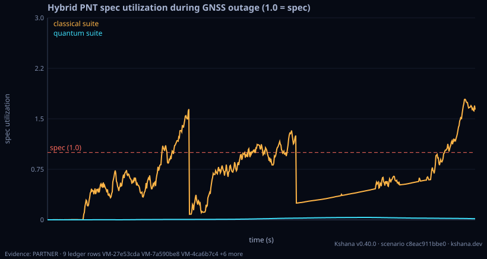

<!-- SPDX-License-Identifier: AGPL-3.0-only -->
<!-- Generated by tools/gen_kinds_index.py from the engine, the schema, the verification matrix and one run of the example. Do not edit by hand. -->
# `fusion`

Scenario kind of the engine v0.39.0, family [Inertial, fusion and quantum sensors](../inertial-fusion-and-quantum-sensors.md). Advisory: analysis output from a research and engineering tool, not type-approved navigation equipment and not a safety-of-life service. Every label here is the engine's or the verification matrix's; a kind is MODELLED unless the matrix says otherwise (how a label is earned: the README's Evidence section).

## What it does

Joint Kalman sensor-fusion PNT over the same hybrid inputs.

One run of `scenarios/fusion-pnt.toml` summarises as: scenario c8eac911bbe0 | fused | quantum PNT-holdover 6600s (t 6600s/p 6600s) integrity 1.000 security n/a (no attack) | classical PNT-holdover 1330s (t 1330s/p 6600s) integrity 0.973 security n/a (no attack)

## Inputs

From the schema (`kshana kinds --json`):

- Required fields: `seed`, `timing_spec_ns`, `position_spec_m`, `time`, `gnss`, `resync`, `clock_quantum`, `clock_classical`, `accel_quantum`, `accel_classical`
- Optional fields: `coupled`

The example `scenarios/fusion-pnt.toml` sets, among others:

| Field | Value | Unit |
|---|---|---|
| `accel_classical.bias` | 0 | m/s^2 |
| `accel_classical.id` | nav-grade-quartz | text |
| `accel_classical.provenance` | Navigation-grade quartz accelerometer; illustrative noise-dr | text |
| `accel_classical.q_va` | 1.0000e-7 | (m/s^2)^2/Hz |
| `accel_quantum.bias` | 0 | m/s^2 |
| `accel_quantum.id` | cold-atom-quat | text |
| `accel_quantum.provenance` | Cold-atom accelerometer, low long-tau velocity-random-walk;  | text |
| `accel_quantum.q_va` | 1.0000e-9 | (m/s^2)^2/Hz |
| `clock_classical.drift` | 0 | 1/s |
| `clock_classical.id` | csac-sa45s | text |
| `clock_classical.provenance` | Microchip SA65 / SA.45s CSAC datasheet sigma_y(1s)=3e-10 | text |
| `clock_classical.q_rw` | 0 | 1/s |

## Run it

```sh
kshana scenarios/fusion-pnt.toml
```

2 bundled scenarios use this kind; the others are in [`scenarios/`](../../../scenarios/).

## What it gives

The scalar results of that run, with the units the engine states:

| Result | Value | Unit |
|---|---|---|
| `classical.accel_spec.id` | nav-grade-quartz | text |
| `classical.accel_spec.kind` | inertial | text |
| `classical.accel_spec.params.bias` | 0 | m/s^2 |
| `classical.accel_spec.params.bias_instability` | false | flag |
| `classical.accel_spec.params.gyro_bias` | 0 | rad/s |
| `classical.accel_spec.params.q_aa` | 0 | (m/s^2)^2/s |
| `classical.accel_spec.params.q_arw` | 0 | (rad/s)^2/Hz |
| `classical.accel_spec.params.q_va` | 1.0000e-7 | (m/s^2)^2/Hz |
| `classical.accel_spec.provenance` | Navigation-grade quartz accelerometer; i | text |
| `classical.clock_spec.id` | csac-sa45s | text |



## Evidence

MODELLED 4 · VALIDATED 4: the [verification matrix](../../VERIFICATION-MATRIX.md) rows that name this kind.

- **VALIDATED** Recover an epoch state [r,v] from ground-station ranges via a Gauss–Newton batch differential corrector and a sequential filter, over a two-body+J2 force model Tests: [batch_sequential_orbit_determination_reference.rs](../../../tests/batch_sequential_orbit_determination_reference.rs).
- **MODELLED** Error-state EKF over 15 INS states, a two-state receiver clock and one float carrier ambiguity per tracked satellite; pseudorange, carrier phase and optional range rate from an SGP4 Walker constellation (light-time and Sagnac), Klobuchar an Tests: [fusion_carrier_tc.rs](../../../tests/fusion_carrier_tc.rs).
- **MODELLED** Three gnss-ins scenarios on the trajectory library (a vessel weaving at 8 m/s with a five-minute outage; a train through a two-satellite cutting and a tunnel; an aircraft whose outage covers a 25-degree banked turn) and the pack's optional  Tests: [gnss_ins_packs.rs](../../../tests/gnss_ins_packs.rs).
- **MODELLED** One stacked Kalman filter over position, velocity, clock phase and frequency fed pseudoranges that couple position and clock (Joseph-form updates carrying the cross-covariance); a 1-DOF variant augmented with a constant accelerometer-bias s Tests: [fusion_coupled_filters.rs](../../../tests/fusion_coupled_filters.rs).
- and 4 more in the matrix.

The rows the run itself exercised, with the oracle the matrix gives each (the public sources are named there):

- **VALIDATED** Allan/modified/Hadamard deviation + power-law noise ID with χ² CIs. Oracle (ExternalDataset): NIST SP 1065 (Riley) / Stable32 reference deviations on NBS14
- **MODELLED** Closed-form coast-error growth + holdover-to-threshold; quantum-clock classes. Oracle (ReferenceImpl): Multi-step clock_state covariance recursion (same-codebase cross-check); the underlying coast-variance & holdover-inversion kernel is externally validated vs scipy (see 'Clock-holdover coast-variance & threshold inversion'). The per-class red-noise-floor holdover figures stay MODELLED
- **MODELLED** 3-state (phase/freq/drift) van-Loan Kalman clock, Joseph-stabilised. Oracle (ReferenceImpl): filterpy 1.4.5 KalmanFilter (R. Labbe, MIT), with F via scipy.linalg.expm and Q via the Van-Loan 1978 block-matrix — an independent reference implementation reproducing kshana's full filter trajectory. Cross-implementation consistency: the clock physics / Allan calibration are not externally validated, so this stays MODELLED. 0.30 external comparison, a finding (stays MODELLED): on IGS final 30 s clocks of 11 GPS Blo
- **MODELLED** Cold-atom interferometer accelerometer from first principles (k_eff·T², QPN). Oracle (ExternalDataset): Published CAI primary-paper numeric vectors (Cheinet 2008 transfer function; Peters/Freier sensitivity): k_eff·T² matched exactly, shot-noise ASD a one-sided floor within ~2× of each published instrument (real devices carry technical noise above the quantum floor). A bracket, not parity. 0.30 round 2 (pre-registered fcb9ac64), a finding (stays MODELLED): the QPN-only rotation noise against the measured Gauguet et al.
- **MODELLED** Composed bias + scale-factor + VRW + stability-decay position budget over holdover. Oracle (ReferenceImpl): Independent numpy Monte-Carlo SDE integration of double-integrated white-acceleration noise (validates the analytic VRW variance by a genuinely independent algorithm) + a Groves 2013 published-value anchor for the bias/scale-factor terms; the CAI device numbers quantify partner hardware and stay MODELLED

## Limitations

What the run's own report says is not modelled or not validated:

- GNSS-denied clock holdover is MODELLED, not validated: checked against a separate implementation in this same codebase — independent of the unit under test, but not externally authoritative. (verification matrix (docs/MODELLED-RATIONALE.md))
- Onboard clock state estimation is MODELLED, not validated: checked against a separate implementation in this same codebase — independent of the unit under test, but not externally authoritative. (verification matrix (docs/MODELLED-RATIONALE.md))
- Quantum inertial sensor performance is MODELLED, not validated: a sub-claim is externally checked, but the whole capability composes modelled pieces, so the capability stays Modelled. (verification matrix (docs/MODELLED-RATIONALE.md))
- Quantum inertial dead-reckoning resilience is MODELLED, not validated: checked against a separate implementation in this same codebase — independent of the unit under test, but not externally authoritative. (verification matrix (docs/MODELLED-RATIONALE.md))
- Spoofing detection is MODELLED, not validated: a sub-claim is externally checked, but the whole capability composes modelled pieces, so the capability stays Modelled. (verification matrix (docs/MODELLED-RATIONALE.md))
- Reproducibility & software assurance is MODELLED, not validated: a sub-claim is externally checked, but the whole capability composes modelled pieces, so the capability stays Modelled. (verification matrix (docs/MODELLED-RATIONALE.md))

## See also

- Family page: [Inertial, fusion and quantum sensors](../inertial-fusion-and-quantum-sensors.md#fusion)
- All kinds: [KINDS.md](../../KINDS.md)
- Topic page: [INTEGRITY.md](../../INTEGRITY.md)
- Topic page: [LEO-PNT-FUSION.md](../../LEO-PNT-FUSION.md)
