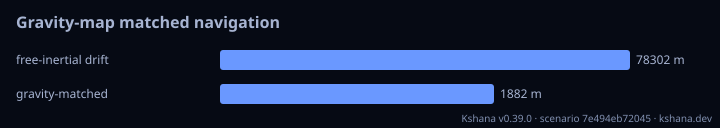

<!-- SPDX-License-Identifier: AGPL-3.0-only -->
<!-- Generated by tools/gen_kinds_index.py from the engine, the schema, the verification matrix and one run of the example. Do not edit by hand. -->
# `gravity-map`

Scenario kind of the engine v0.40.0, family [GPS-denied alternative PNT](../gps-denied-alternative-pnt.md). Advisory: analysis output from a research and engineering tool, not type-approved navigation equipment and not a safety-of-life service. Every label here is the engine's or the verification matrix's; a kind is MODELLED unless the matrix says otherwise (how a label is earned: the README's Evidence section).

## What it does

GPS-denied gravity-map-matching navigation: a cold-atom gravimeter recovers a constant INS drift from the gravity-anomaly sequence it flies through.

One run of `scenarios/gravity-map-nav.toml` summarises as: gravity-map | free-inertial drift 78302 m | gravity-matched 1882 m | matching sigma 2.000e0 mGal

## Inputs

From the schema (`kshana kinds --json`):

- Required fields: `nmax`, `start_lat_deg`, `start_lon_deg`, `step_lat_deg`, `step_lon_deg`, `waypoints`, `drift_lat_deg`, `drift_lon_deg`, `gravimeter_asd`, `averaging_time_s`, `map_sigma_mgal`, `search_half_deg`, `search_step_deg`
- Optional fields: `coeffs`, `mascons`, `refine_stages`, `refine_factor`, `noise_seed`, `reference`, `map_error_mc`

The example `scenarios/gravity-map-nav.toml` sets, among others:

| Field | Value | Unit |
|---|---|---|
| `averaging_time_s` | 100 | s |
| `coeffs[0].cbar` | 4.0000e-6 | not stated |
| `coeffs[0].m` | 0 | not stated |
| `coeffs[0].n` | 2 | not stated |
| `coeffs[0].sbar` | 0 | not stated |
| `coeffs[1].cbar` | 2.0000e-6 | not stated |
| `coeffs[1].m` | 1 | not stated |
| `coeffs[1].n` | 3 | not stated |
| `coeffs[1].sbar` | 1.0000e-6 | not stated |
| `drift_lat_deg` | 0.55 | deg |
| `drift_lon_deg` | -0.45 | deg |
| `gravimeter_asd` | 1.0000e-7 | not stated |

## Run it

```sh
kshana scenarios/gravity-map-nav.toml
```

4 bundled scenarios use this kind; the others are in [`scenarios/`](../../../scenarios/).

## What it gives

The scalar results of that run, with the units the engine states:

| Result | Value | Unit |
|---|---|---|
| `evidence.id_rule` | the stable id of the matrix row (the ID  | text |
| `evidence.matrix` | docs/VERIFICATION-MATRIX.md | text |
| `evidence.tier` | MODELLED | text |
| `free_inertial_drift_m` | 78301.878584 | m |
| `map_matched_error_m` | 1881.790568 | m |
| `measurement_sigma_mgal` | 2 | mGal |



## Evidence

No matrix row names this kind by name; the label on its result is the engine's own, above.

The rows the run itself exercised, with the oracle the matrix gives each (the public sources are named there):

- **MODELLED** Gravity-map matching, terrain-referenced (TERCOM/SITAN), magnetic anomaly. Oracle (InternalConsistency): IGRF-14 coefficients; first-principles matched-filter CRLB. The real-field gravity benchmark's field is externally checked (row 'Gravity-anomaly synthesis from a spherical-harmonic model'), but its navigation outcome has no external oracle
- **MODELLED** Deterministic, scenario-hashed, SBOM + cross-platform golden gates. Oracle (ExternalDataset): SBOM conformance to the official CycloneDX 1.5 JSON Schema (+ valid SPDX identifiers) — an external published standard, zero validation errors over the full dependency graph; the FoM-determinism / byte-reproducibility part remains a pinned self-consistency check, so the row stays MODELLED

## Limitations

What the run's own report says is not modelled or not validated:

- Alternative / complementary PNT is MODELLED, not validated: checked against its own closed-form / analytic identity — catches transcription and coefficient errors, but is not an external oracle. (verification matrix (docs/MODELLED-RATIONALE.md))
- Reproducibility & software assurance is MODELLED, not validated: a sub-claim is externally checked, but the whole capability composes modelled pieces, so the capability stays Modelled. (verification matrix (docs/MODELLED-RATIONALE.md))

## See also

- Family page: [GPS-denied alternative PNT](../gps-denied-alternative-pnt.md#gravity-map)
- All kinds: [KINDS.md](../../KINDS.md)
