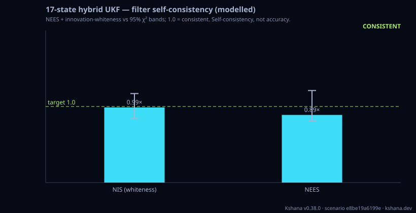

<!-- SPDX-License-Identifier: AGPL-3.0-only -->
<!-- Generated by tools/gen_kinds_index.py from the engine, the schema, the verification matrix and one run of the example. Do not edit by hand. -->
# `hybrid-ukf`

Scenario kind of the engine v0.39.0, family [Inertial, fusion and quantum sensors](../inertial-fusion-and-quantum-sensors.md). Advisory: analysis output from a research and engineering tool, not type-approved navigation equipment and not a safety-of-life service. Every label here is the engine's or the verification matrix's; a kind is MODELLED unless the matrix says otherwise (how a label is earned: the README's Evidence section).

## What it does

17-state hybrid quantum+classical tightly-coupled GNSS/INS UKF (MODELLED): 15 INS error states + CAI-derived accel-bias correction + a 2-state (phase+frequency) clock from the q-parameter clock engine, driven by the bracketed CAI error model. The figure of merit is filter self-consistency (NEES + innovation-whiteness vs χ² bounds) — a self-consistency statement, NOT a real-world accuracy guarantee. Simulation only; no TRL>3, no flight heritage, no external validation.

One run of `scenarios/hybrid-ukf.toml` summarises as: scenario e8be19a6199e | hybrid-ukf (17-state, MODELLED) | sensor quantum-CAI (q_va 4.82e-14) | clock q_wf 1.00e-26 q_rw 3.00e-30 | NIS 11.85/12 in [10.12,14.04] | NEES 7.11/8 in [6.48,9.68] | CONSISTENT | aided 0.4m -> coast 7.7m over 120s | self-consistency, not accuracy

## Inputs

From the schema (`kshana kinds --json`):

- Required fields: `seed`, `time`, `gnss`, `accel`, `clock`
- Optional fields: `residual_accel_bias_m_s2`, `speed_m_s`, `sigma_pr_m`, `sigma_rr_mps`, `consistency_seeds`, `q_factor`, `r_factor`

The example `scenarios/hybrid-ukf.toml` sets, among others:

| Field | Value | Unit |
|---|---|---|
| `accel.bias` | 0 | not stated |
| `accel.cai.atom_number` | 1000000 | not stated |
| `accel.cai.contrast` | 0.5 | not stated |
| `accel.cai.cycle_time_s` | 0.5 | s |
| `accel.cai.pulse_sep_t` | 0.02 | not stated |
| `accel.cai.wavelength_m` | 7.8024e-7 | m |
| `accel.id` | cold-atom-interferometer | text |
| `accel.provenance` | Cold-atom (Rb-87 D2) interferometric accelerometer; brackete | text |
| `accel.q_va` | 1.0000e-9 | not stated |
| `clock.id` | ultrastable-optical | text |
| `clock.provenance` | Ultra-stable/optical onboard oscillator class, white-FM sigm | text |
| `clock.rw_fm_level` | 1.0000e-15 | not stated |

## Run it

```sh
kshana scenarios/hybrid-ukf.toml
```

## What it gives

The scalar results of that run, with the units the engine states:

| Result | Value | Unit |
|---|---|---|
| `clock_q_rw` | 3.0000e-30 | 1/s |
| `clock_q_wf` | 1.0000e-26 | s^2/s |
| `coast.aided_pos_rms_m` | 0.360944 | m |
| `coast.coast_duration_s` | 120 | s |
| `coast.coast_end_pos_rms_m` | 7.69085 | m |
| `consistency.consistent` | true | flag |
| `consistency.nees_chi2_lower_95` | 6.479865 | 1 |
| `consistency.nees_chi2_upper_95` | 9.677811 | 1 |
| `consistency.nees_dof` | 8 | count |
| `consistency.nees_mean` | 7.113875 | 1 |



## Evidence

No matrix row names this kind by name; the label on its result is the engine's own, above.

The rows the run itself exercised, with the oracle the matrix gives each (the public sources are named there):

- **MODELLED** Cold-atom interferometer accelerometer from first principles (k_eff·T², QPN). Oracle (ExternalDataset): Published CAI primary-paper numeric vectors (Cheinet 2008 transfer function; Peters/Freier sensitivity): k_eff·T² matched exactly, shot-noise ASD a one-sided floor within ~2× of each published instrument (real devices carry technical noise above the quantum floor). A bracket, not parity. 0.30 round 2 (pre-registered fcb9ac64), a finding (stays MODELLED): the QPN-only rotation noise against the measured Gauguet et al.
- **VALIDATED** 15-state error-state EKF, loosely coupled (validated on a real IMU/GNSS drive against NaveGo); a tightly coupled pseudorange/Doppler UKF and a coupled clock+pos. Oracle (ExternalDataset): NaveGo v1.4 (R. Gonzalez, LGPL-3.0, run as a tool under GNU Octave, never linked): its loosely coupled ins_gnss on its own real Ekinox IMU/GNSS land-vehicle drive, both solutions scored against the Ekinox reference trajectory. Both filters read the same 20 Hz float32 input, and Kshana's configuration is mapped mechanically from the dataset's published parameters. Kshana's horizontal and vertical position RMS and its 
- **MODELLED** Deterministic, scenario-hashed, SBOM + cross-platform golden gates. Oracle (ExternalDataset): SBOM conformance to the official CycloneDX 1.5 JSON Schema (+ valid SPDX identifiers) — an external published standard, zero validation errors over the full dependency graph; the FoM-determinism / byte-reproducibility part remains a pinned self-consistency check, so the row stays MODELLED
- **MODELLED** Bracketed (best/nominal/conservative) cold-atom-interferometer performance — bias instability, velocity/angle random walk, scale-factor stability, interrogation. Oracle (InternalConsistency): Internal consistency: the cited VRW bracket cross-checked against CaiAccelerometer::accel_asd physics + raw dynamic range computed from the fringe-ambiguity limit; numbers are MODELLED literature-survey brackets (needs_source_confirmation), no device validated, no validation halo

## Limitations

What the run's own report says is not modelled or not validated:

- MODELLED SIMULATION. Filter self-consistency (NEES + innovation-whiteness) under bracketed CAI and clock noise inputs — a self-consistency statement, NOT a real-world accuracy guarantee. Not field/flight results; no TRL>3, no flight heritage, no external validation. CAI hardware is partner-owned. (result `modelled_note`)
- 17-state hybrid quantum+classical tightly-coupled GNSS/INS UKF (MODELLED): 15 INS error states + CAI-derived accel-bias correction + a 2-state (phase+frequency) clock from the q-parameter clock engine, driven by the bracketed CAI error model. (kind catalogue (`kshana kinds --json`))
- 17-state hybrid quantum + classical tightly-coupled GNSS/INS UKF (MODELLED). (scenario file comment, line 1)
- FIGURE OF MERIT — filter self-consistency (NEES + innovation-whiteness), the only thing a simulation can honestly assert about an estimator. Over a Monte-Carlo ensemble whose truth is generated from exactly the noise the filter assumes, the pooled NIS (whiteness) and NEES means must land inside their 95% chi-squared bands. This is a SELF-CONSISTENCY statement, NOT a real-world accuracy guarantee. (scenario file comment, lines 21 to 25)
- HONESTY: everything here is MODELLED / SIMULATION. The CAI and clock inputs are bracketed, literature-representative values, not measured hardware; the CAI hardware and its Key-Person stay partner-owned. No TRL>3, no flight heritage, no external validation. (scenario file comment, lines 27 to 29)
- Monte-Carlo seeds the consistency oracle pools over, and the filter mistuning multipliers. 24 seeds give run-based chi-squared NEES bands (8*24 DOF) tight enough to discriminate a matched from a mistuned filter while keeping the run cheap. Set q_factor / r_factor away from 1.0 to mistune the filter and watch the consistency gate reject it (q_factor scales the assumed process noise, r_factor the assumed measurement no (scenario file comment, lines 44 to 48)
- Quantum inertial sensor performance is MODELLED, not validated: a sub-claim is externally checked, but the whole capability composes modelled pieces, so the capability stays Modelled. (verification matrix (docs/MODELLED-RATIONALE.md))
- Reproducibility & software assurance is MODELLED, not validated: a sub-claim is externally checked, but the whole capability composes modelled pieces, so the capability stays Modelled. (verification matrix (docs/MODELLED-RATIONALE.md))

## See also

- Family page: [Inertial, fusion and quantum sensors](../inertial-fusion-and-quantum-sensors.md#hybrid-ukf)
- All kinds: [KINDS.md](../../KINDS.md)
- Topic page: [QUANTUM-MODELS.md](../../QUANTUM-MODELS.md)
- Topic page: [QUANTUM.md](../../QUANTUM.md)
