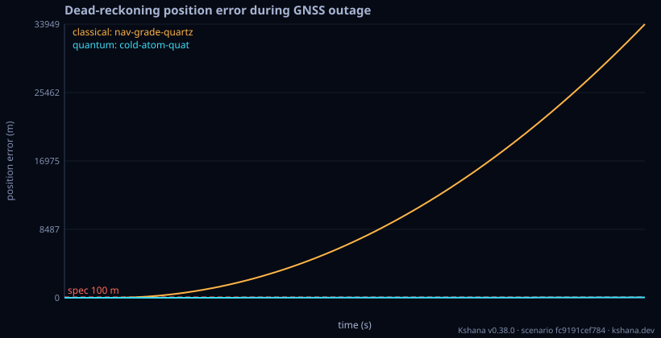

<!-- SPDX-License-Identifier: AGPL-3.0-only -->
<!-- Generated by tools/gen_kinds_index.py from the engine, the schema, the verification matrix and one run of the example. Do not edit by hand. -->
# `inertial`

Scenario kind of the engine v0.40.0, family [Inertial, fusion and quantum sensors](../inertial-fusion-and-quantum-sensors.md). Advisory: analysis output from a research and engineering tool, not type-approved navigation equipment and not a safety-of-life service. Every label here is the engine's or the verification matrix's; a kind is MODELLED unless the matrix says otherwise (how a label is earned: the README's Evidence section).

## What it does

1-DOF inertial dead-reckoning during a GNSS outage.

One run of `scenarios/imu-deadreckoning.toml` summarises as: scenario fc9191cef784 | quantum holdover 6600s p95 41.39m | classical holdover 350s p95 30629.9m

## Inputs

From the schema (`kshana kinds --json`):

- Required fields: `seed`, `threshold_m`, `time`, `gnss`, `accel_quantum`, `accel_classical`
- Optional fields: `runs`

The example `scenarios/imu-deadreckoning.toml` sets, among others:

| Field | Value | Unit |
|---|---|---|
| `accel_classical.bias` | 0.00157 | m/s^2 |
| `accel_classical.bias_instability` | 1.0000e-5 | not stated |
| `accel_classical.id` | nav-grade-quartz | text |
| `accel_classical.provenance` | Navigation-grade quartz accelerometer (Honeywell QA-2000 / G | text |
| `accel_classical.q_aa` | 1.0000e-13 | (m/s^2)^2/s |
| `accel_classical.q_va` | 3.8416e-8 | (m/s^2)^2/Hz |
| `accel_quantum.bias` | 5.8800e-7 | m/s^2 |
| `accel_quantum.id` | cold-atom-quat | text |
| `accel_quantum.provenance` | Exail hybrid quantum accelerometer triad: bias stability 6e- | text |
| `accel_quantum.q_va` | 4.6656e-8 | (m/s^2)^2/Hz |
| `gnss.windows[0].state` | nominal | text |
| `gnss.windows[0].t0` | 0 | not stated |

## Run it

```sh
kshana scenarios/imu-deadreckoning.toml
```

2 bundled scenarios use this kind; the others are in [`scenarios/`](../../../scenarios/).

## What it gives

The scalar results of that run, with the units the engine states:

| Result | Value | Unit |
|---|---|---|
| `classical.fom.availability` | 0.131761 | 1 |
| `classical.fom.drift_slope_m_per_s` | 5.138079 | m/s |
| `classical.fom.holdover_s` | 350 | s |
| `classical.fom.integrity` | no value | not stated |
| `classical.fom.pos_p95_m` | 30629.852742 | m |
| `classical.fom.pos_rms_m` | 15189.151543 | m |
| `classical.fom.security` | no value | not stated |
| `classical.monte_carlo` | false | flag |
| `classical.spec.id` | nav-grade-quartz | text |
| `classical.spec.kind` | inertial | text |



## Evidence

MODELLED 6 · VALIDATED 2: the [verification matrix](../../VERIFICATION-MATRIX.md) rows that name this kind.

- **VALIDATED** Quaternion-attitude, WGS-84 NED strapdown inertial mechanization (coning/sculling-compensated) propagating a navigation state from (Δθ, Δv) increments Tests: [classical_strapdown_ins_reference.rs](../../../tests/classical_strapdown_ins_reference.rs).
- **MODELLED** Cold-atom interferometer accelerometer from first principles (k_eff·T², QPN) Tests: [quantum_inertial_sensor_reference.rs](../../../tests/quantum_inertial_sensor_reference.rs).
- **MODELLED** Mach–Zehnder fringe-ambiguity dynamic range: the 2π-periodic fringe readout sets a maximum unambiguous specific force a_max=π/(k_eff·T²), and the unambiguous range in resolution cells a_max/σ_a=π/σ_Φ is independent of the optical scale fact
- **MODELLED** Composed bias + scale-factor + VRW + stability-decay position budget over holdover Tests: [quantum_inertial_dead_reckoning_reference.rs](../../../tests/quantum_inertial_dead_reckoning_reference.rs).
- and 4 more in the matrix.

The rows the run itself exercised, with the oracle the matrix gives each (the public sources are named there):

- **MODELLED** Cold-atom interferometer accelerometer from first principles (k_eff·T², QPN). Oracle (ExternalDataset): Published CAI primary-paper numeric vectors (Cheinet 2008 transfer function; Peters/Freier sensitivity): k_eff·T² matched exactly, shot-noise ASD a one-sided floor within ~2× of each published instrument (real devices carry technical noise above the quantum floor). A bracket, not parity. 0.30 round 2 (pre-registered fcb9ac64), a finding (stays MODELLED): the QPN-only rotation noise against the measured Gauguet et al.
- **MODELLED** Composed bias + scale-factor + VRW + stability-decay position budget over holdover. Oracle (ReferenceImpl): Independent numpy Monte-Carlo SDE integration of double-integrated white-acceleration noise (validates the analytic VRW variance by a genuinely independent algorithm) + a Groves 2013 published-value anchor for the bias/scale-factor terms; the CAI device numbers quantify partner hardware and stay MODELLED
- **MODELLED** Deterministic, scenario-hashed, SBOM + cross-platform golden gates. Oracle (ExternalDataset): SBOM conformance to the official CycloneDX 1.5 JSON Schema (+ valid SPDX identifiers) — an external published standard, zero validation errors over the full dependency graph; the FoM-determinism / byte-reproducibility part remains a pinned self-consistency check, so the row stays MODELLED
- **PARTNER** Not provided — performance models only; cold-atom/clock hardware is a partner's. Oracle (NoneKind): none: a partner-owned discipline, with no module and no test by design

## Limitations

What the run's own report says is not modelled or not validated:

- Quantum inertial sensor performance is MODELLED, not validated: a sub-claim is externally checked, but the whole capability composes modelled pieces, so the capability stays Modelled. (verification matrix (docs/MODELLED-RATIONALE.md))
- Quantum inertial dead-reckoning resilience is MODELLED, not validated: checked against a separate implementation in this same codebase — independent of the unit under test, but not externally authoritative. (verification matrix (docs/MODELLED-RATIONALE.md))
- Reproducibility & software assurance is MODELLED, not validated: a sub-claim is externally checked, but the whole capability composes modelled pieces, so the capability stays Modelled. (verification matrix (docs/MODELLED-RATIONALE.md))

## See also

- Family page: [Inertial, fusion and quantum sensors](../inertial-fusion-and-quantum-sensors.md#inertial)
- All kinds: [KINDS.md](../../KINDS.md)
- Topic page: [QUANTUM-MODELS.md](../../QUANTUM-MODELS.md)
- Topic page: [QUANTUM.md](../../QUANTUM.md)
