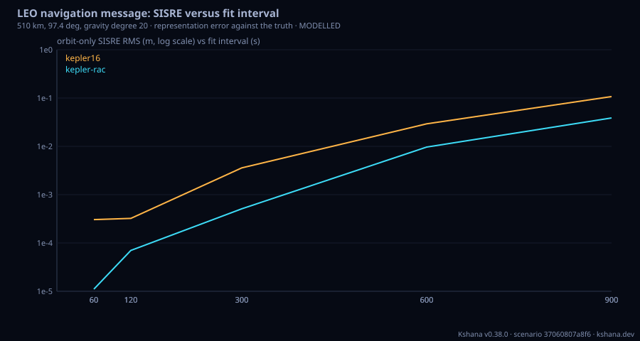

<!-- SPDX-License-Identifier: AGPL-3.0-only -->
<!-- Generated by tools/gen_kinds_index.py from the engine, the schema, the verification matrix and one run of the example. Do not edit by hand. -->
# `leo-navmsg`

Scenario kind of the engine v0.38.0, family [Low-Earth-orbit navigation](../low-earth-orbit-navigation.md). Advisory: analysis output from a research and engineering tool, not type-approved navigation equipment and not a safety-of-life service. Every label here is the engine's or the verification matrix's; a kind is MODELLED unless the matrix says otherwise (how a label is earned: the README's Evidence section).

## What it does

LEO navigation message: the broadcast ephemeris and clock of a low Earth orbit (LEO) positioning, navigation and timing satellite, for any orbit, carrier and model, with optional named presets (Xona Pulsar, Iridium, Starlink, CentiSpace, a representative C-band system, the ATOMIC zero-clock model, Celeste IOD). CONTENT: auxiliary data (SVID, issue of data, band, signal health), synchronisation (week, time of week, a second-order clock polynomial af0-af2 about toc), ephemeris in one of four models -- the Galileo OS SIS ICD 16-parameter Keplerian set; that set plus along-track, cross-track and radial correction polynomials; the Liu et al. 2025 22-parameter model; an ECEF polynomial with no clock terms (ATOMIC zero-clock) -- and other services (a Klobuchar broadcast set, NeQuick-G ai0-ai2 with the effective ionisation level, and system-time-to-UTC parameters with the ICD leap-second logic). FITTER: a truth orbit integrated with zonal J2-J6 or EGM2008 gravity to the chosen degree and drag, and a seeded free or steered clock; Levenberg-Marquardt fit of the Keplerian set on non-singular elements, then linear least-squares correction polynomials; clock fitted net of the relativistic term the user adds. ANALYSES: fit-interval-trade (signal-in-space range error, SISRE, with global-average weights for the orbit altitude, versus fit interval and update period, orbit-only and with clock), model-comparison (four models, parameter count, encoded bits, and Kshana's fit at the Liu et al. altitudes beside the published figures), midpass-update (the highest pass over a user, each message switch's position, clock and user-range jump, worst-geometry jump, PASS/FAIL against a continuity threshold), encode-decode (Kshana's own documented binary frame with CRC-24Q, a per-field half-step quantisation budget, a corrupted-frame check, a RINEX-4-style record export and import labelled a Kshana extension, and a CSV table). VALIDATED: the SISRE weights against the published MEO/GEO table (Montenbruck et al. 2018); the Galileo user algorithm against RTKLIB on real Galileo broadcast ephemerides; CRC-24Q against its catalogue check value and the RTCM 1005 example frame. MODELLED: every fit and SISRE figure is representation error against a Kshana-integrated truth (no orbit determination or prediction error); the Liu et al. comparison uses different orbits; the encoding and text formats are Kshana's own.

One run of `scenarios/leo-navmsg-celeste-iod.toml` summarises as: LEO navigation message — 510 km, 97.4 deg, gravity degree 20, model kepler-rac
  SISRE weights: w_R 0.459, w_AC^2 1/2.53 (mask 0 deg)
  encode-decode: kepler-rac model, frame 152 bytes (1156 payload bits, 891 ephemeris+clock bits), CRC-24Q 0x58ADF2
    quantisation: largest position change 0.52 mm, clock 0.09 mm; SISRE exact 0.0013 m, quantised 0.0013 m
    corrupted frame rejected: true; RINEX round trip 4.43e-6 m; CSV round trip 0.00e0 m
  fit-interval trade over 1800 s (usage period = fit interval):
    kepler16      60 s  SISRE orbit RMS   0.0003 m  max   0.0015 m  with clock RMS   0.0006 m
    kepler16     120 s  SISRE orbit RMS   0.0003 m  max   0.0015 m  with clock RMS   0.0007 m
    kepler16     300 s  SISRE orbit RMS   0.0036 m  max   0.0141 m  with clock RMS   0.0037 m
    kepler16     600 s  SISRE orbit RMS   0.0293 m  max   0.1023 m  with clock RMS   0.0293 m
    kepler16     900 s  SISRE orbit RMS   0.1073 m  max   0.3812 m  with clock RMS   0.1075 m
    kepler-rac    60 s  SISRE orbit RMS   0.0000 m  max   0.0000 m  with clock RMS   0.0005 m
    kepler-rac   120 s  SISRE orbit RMS   0.0001 m  max   0.0002 m  with clock RMS   0.0007 m
    kepler-rac   300 s  SISRE orbit RMS   0.0005 m  max   0.0021 m  with clock RMS   0.0012 m
    kepler-rac   600 s  SISRE orbit RMS   0.0097 m  max   0.0395 m  with clock RMS   0.0096 m
    kepler-rac   900 s  SISRE orbit RMS   0.0388 m  max   0.1143 m  with clock RMS   0.0390 m
    The 16-parameter Keplerian set degrades from 0.0003 m at 60 s to 0.1073 m at 900 s: one Keplerian set with twice-per-revolution harmonics cannot follow the higher-frequency gravity terms and the drag of a LEO arc for more than a few minutes, and its least-squares residual oscillates across the window. The along/cross/radial polynomials, of higher degree than the Keplerian set spans, absorb what is left, giving 0.0388 m at 900 s.


## Inputs

From the schema (`kshana kinds --json`):

- Required fields: none
- Optional fields: `name`, `description`, `seed`, `analysis`, `preset`, `orbit`, `clock`, `message`, `trade`, `comparison`, `midpass`

The example `scenarios/leo-navmsg-celeste-iod.toml` sets, among others:

| Field | Value | Unit |
|---|---|---|
| `analysis` | [encode-decode, fit-interval-trade] | not stated |
| `kind` | leo-navmsg | text |
| `message.csv_schema` | celeste-iod | text |
| `name` | Celeste IOD message (workshop preset) | text |
| `preset` | celeste-iod | text |
| `seed` | 15 | not stated |
| `trade.fit_intervals_s` | [60, 120, 300, 600, 900] | s |
| `trade.models` | [kepler16, kepler-rac] | not stated |
| `trade.span_s` | 1800 | s |
| `trade.update_fit_interval_s` | 300 | s |
| `trade.update_periods_s` | [60, 150, 300] | s |

## Run it

```sh
kshana scenarios/leo-navmsg-celeste-iod.toml
```

5 bundled scenarios use this kind; the others are in [`scenarios/`](../../../scenarios/).

## What it gives

The scalar results of that run, with the units the engine states:

| Result | Value | Unit |
|---|---|---|
| `encode_decode.corrupted_frame_rejected` | true | flag |
| `encode_decode.crc24q` | 0x58ADF2 | text |
| `encode_decode.crc24q_check_value_123456789` | 0xCDE703 | text |
| `encode_decode.csv_round_trip_max_pos_m` | 0 | m |
| `encode_decode.csv_schema` | celeste-iod | text |
| `encode_decode.ephemeris_clock_bits` | 891 | bit |
| `encode_decode.frame_bytes` | 152 | byte |
| `encode_decode.model` | kepler-rac | text |
| `encode_decode.payload_bits` | 1156 | bit |
| `encode_decode.quantised_max_clock_m` | 9.4929e-5 | m |

Result label (the engine's): MIXED — VALIDATED building blocks, MODELLED results. The SISRE weights reproduce the published MEO/GEO table (Montenbruck et al. 2018), the Galileo ICD user algorithm reproduces RTKLIB on real Galileo broadcast ephemerides, and CRC-24Q reproduces its catalogue check value and the RTCM 1005 example f



## Evidence

MODELLED 5 · VALIDATED 6: the [verification matrix](../../VERIFICATION-MATRIX.md) rows that name this kind.

- **VALIDATED** leo_navmsg::sisre::sisre_weights: the radial weight w_R and the squared transverse weight w_AC^2 as averages of cos^2 and half sin^2 of the line-of-sight nadir angle over users uniformly distributed on the visible Earth cap above an elevati
- **VALIDATED** leo_navmsg::elements::kepler_point: the Galileo OS SIS ICD Keplerian evaluation (Kepler's equation, second-harmonic corrections, Earth-fixed node) written separately from the engine's RINEX evaluator, returning the position with the argumen Tests: [leo_navmsg_reference.rs](../../../tests/leo_navmsg_reference.rs).
- **VALIDATED** leo_navmsg::codec::crc24q: generator polynomial 0x1864CFB, initial value 0, no reflection, no final XOR, the check the Kshana LEO frame carries over every preceding byte
- **VALIDATED** The `leo-navmsg` kind's fitter and trade: a truth orbit integrated with zonal J2-J6 or EGM2008 gravity to the chosen degree and drag, and a seeded free or steered clock; a Levenberg-Marquardt fit of the Galileo Keplerian set on non-singular
- and 7 more in the matrix.

The rows the run itself exercised, with the oracle the matrix gives each (the public sources are named there):

- **MODELLED** Deterministic, scenario-hashed, SBOM + cross-platform golden gates. Oracle (ExternalDataset): SBOM conformance to the official CycloneDX 1.5 JSON Schema (+ valid SPDX identifiers) — an external published standard, zero validation errors over the full dependency graph; the FoM-determinism / byte-reproducibility part remains a pinned self-consistency check, so the row stays MODELLED
- **VALIDATED** leo_navmsg::sisre::sisre_weights: the radial weight w_R and the squared transverse weight w_AC^2 as averages of cos^2 and half sin^2 of the line-of-sight nadir . Oracle (ExternalDataset): The published SISRE weighting-factor table of Montenbruck, Steigenberger and Hauschild (2018), Multi-GNSS signal-in-space range error assessment - Methodology and results, Advances in Space Research 61(12):3020-3038, doi 10.1016/j.asr.2018.03.041: GPS 0.98 and 1/49, GLONASS 0.98 and 1/45, Galileo 0.98 and 1/61, BeiDou MEO 0.98 and 1/54, BeiDou IGSO/GEO 0.99 and 1/126. The same average evaluated at LEO radii gives the
- **VALIDATED** leo_navmsg::elements::kepler_point: the Galileo OS SIS ICD Keplerian evaluation (Kepler's equation, second-harmonic corrections, Earth-fixed node) written separ. Oracle (ExternalDataset): RTKLIB 2.4.2-p13 eph2pos ECEF positions (an independent implementation of the same ICD algorithm) for real BKG/IGS broadcast records of 2024-09-10, both committed with provenance in tests/fixtures/rinex_sp3_interop (NOTICE, rinex_ecef_reference.txt, brdc_multignss_slice.rnx). This validates the Keplerian user algorithm; the along/cross/radial corrections added on top are covered by their own rows, and the Liu terms b
- **VALIDATED** leo_navmsg::codec::crc24q: generator polynomial 0x1864CFB, initial value 0, no reflection, no final XOR, the check the Kshana LEO frame carries over every prece. Oracle (ExternalDataset): The CRC catalogue check value for these parameters (reveng.sourceforge.io CRC catalogue, CRC-24/LTE-A: width 24, poly 0x864CFB, init 0, check 0xCDE703), which are the CRC-24Q parameters of RTCM 10403 and the Galileo OS SIS ICD, and the message-type 1005 example frame printed in RTCM 10403
- **VALIDATED** The `leo-navmsg` kind's fitter and trade: a truth orbit integrated with zonal J2-J6 or EGM2008 gravity to the chosen degree and drag, and a seeded free or steer. Oracle (ExternalDataset): Real precise science orbits as truth (TU Graz IfG/ITSG operational reduced-dynamic orbits, free for any use with acknowledgment; SHA-256 values in the fixture NOTICE) fitted by the 16-parameter set over 20 and 30 min arcs, against the statistics Liu et al. 2025 (Remote Sensing 17(16):2894, CC BY 4.0) publish for the same satellites and days: along, cross and radial RMS each within 1.5x (measured 0.804 to 1.087), SISR

## Limitations

What the run's own report says is not modelled or not validated:

- SISRE is the message's representation error against the truth it was fitted to; orbit determination and orbit prediction error are not modelled. (result `limitations[0]`)
- The truth orbit is a Kshana numerical integration (zonal or EGM2008 gravity, static exponential drag), not a real satellite's precise orbit; no third body, solar radiation pressure or tides. (result `limitations[1]`)
- The binary format is Kshana's own documented encoding modelled on the published message components; it is not the bit layout of Celeste or any other system (none is public). (result `limitations[2]`)
- The RINEX-style block is a documented Kshana extension; RINEX 4.02 defines no LEO navigation records. (result `limitations[3]`)
- NeQuick-G coefficients are carried and the effective ionisation level is computed, but the NeQuick electron-density integration that turns it into a delay is not implemented; the Klobuchar delay is, scaled to the carrier by 1/f^2 with no correction for a satellite flying inside the ionosphere. (result `limitations[4]`)
- The Liu et al. 2025 22-parameter terms follow the paper's user algorithm (Eq. 1-7) and fitting strategy (Section 2.3); its SISRE-versus-altitude figures used real precise orbits, so this comparison on a Kshana-integrated orbit is MODELLED, not VALIDATED (the real-orbit comparison is tests/leo_navmsg_fit_real_orbit_oracle.rs). (result `limitations[5]`)
- MIXED — VALIDATED building blocks, MODELLED results. The SISRE weights reproduce the published MEO/GEO table (Montenbruck et al. 2018), the Galileo ICD user algorithm reproduces RTKLIB on real Galileo broadcast ephemerides, and CRC-24Q reproduces its catalogue check value and the RTCM 1005 example frame. Every fit, SISRE, continuity and quantisation figure is MODELLED: the representation error of a message against a  (result `label`)
- MODELLED: every fit and SISRE figure is representation error against a Kshana-integrated truth (no orbit determination or prediction error); the Liu et al. (kind catalogue (`kshana kinds --json`))

## See also

- Family page: [Low-Earth-orbit navigation](../low-earth-orbit-navigation.md#leo-navmsg)
- All kinds: [KINDS.md](../../KINDS.md)
- Topic page: [LEO-PNT.md](../../LEO-PNT.md)
- Topic page: [LEO-NAVMSG.md](../../LEO-NAVMSG.md)
