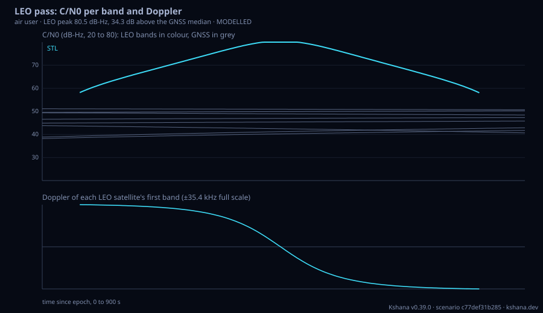

<!-- SPDX-License-Identifier: AGPL-3.0-only -->
<!-- Generated by tools/gen_kinds_index.py from the engine, the schema, the verification matrix and one run of the example. Do not edit by hand. -->
# `leo-pass`

Scenario kind of the engine v0.38.0, family [Low-Earth-orbit navigation](../low-earth-orbit-navigation.md). Advisory: analysis output from a research and engineering tool, not type-approved navigation equipment and not a safety-of-life service. Every label here is the engine's or the verification matrix's; a kind is MODELLED unless the matrix says otherwise (how a label is earned: the README's Evidence section).

## What it does

LEO pass and link budget, band by band, for LEO-PNT (positioning, navigation and timing from low Earth orbit), system-agnostic: a user (ground, maritime, air or indoor, static or moving) and one or more LEO satellites from a DESIGNED PASS (a circular orbit placed so the user sees one pass of a chosen maximum elevation at a chosen time, sun-synchronous if asked), explicit ELEMENTS, a TLE (two-line element set) through the engine's SGP4, or a WALKER constellation built by the constellation-design code (the highest passes reported). Bands come from a named preset (generic multi-band UHF/L/S/C, generic C band, Xona Pulsar X1/X5, Iridium STL, Starlink as a Doppler-only signal of opportunity, CentiSpace, and an optional Celeste IOD preset marked WORKSHOP) or are written into the scenario; each preset states whether its numbers are PUBLIC (with URL), REPRESENTATIVE or WORKSHOP. Per satellite, band and epoch: elevation, azimuth, range, range rate and range acceleration; free-space path loss; EIRP and the satellite pattern gain (isoflux, Gaussian beam or flat); user antenna gain against elevation (patch, hemispherical or isotropic); gaseous attenuation (ITU-R P.676-10 Annex 2), rain attenuation (ITU-R P.838-3 coefficients and the P.618-14 procedure, from a rain rate and rain height), tropospheric scintillation (ITU-R P.618-14 section 2.4.1), building entry loss for an indoor user (ITU-R P.2109-2), polarisation mismatch, system noise temperature and C/N0 (carrier-to-noise density); Doppler and Doppler rate in closed form from the range rate and range acceleration, each checked against central differences; the first-order ionospheric delay 40.3 STEC/f^2 from a Klobuchar or vertical-TEC slant TEC scaled to the part of the ionosphere below the satellite. Band pairs get the ionosphere-free coefficients, noise amplification and code noise at the pass peak. MEO GNSS satellites (Galileo or GPS presets) are evaluated with the same antenna and noise model from their interface-document received powers, so the LEO bell-shaped pass and the flat GNSS carriers share one plot. An optional [iot] section gives time to first fix, energy per fix and battery life against duty cycle for a stated receiver power budget (MODELLED). Each band pair also gives the slant TEC its geometry-free combination recovers at the peak and that estimate's code-noise sigma (ionosphere sounding). An optional [spoofer] section counterfeits the signals of a claimed position that jumps or is pushed from the true one after an onset and runs two monitors with stated false-alarm and missed-detection probabilities: Doppler and pass-geometry consistency (measured range rates against those predicted from the orbits and an independent prior position and velocity, a generalised least-squares chi-square test over a window, on the GNSS, LEO and all channels) and cross-band consistency (the epoch-to-epoch step of each LEO band pair's model-corrected geometry-free combination), reporting per-epoch statistics and when each monitor detects (MODELLED). VALIDATED components: free-space loss, the P.838-3 coefficients against its Table 5, the P.618-14 rain and scintillation procedures and the P.2109 building entry loss against the ITU-R Study Group 3 validation examples, the IS-GPS-200 L1/L2 group-delay ratio, and the static-user maximum Doppler of a circular orbit against arXiv 2509.19551 Table 1. MODELLED: EIRPs, patterns, the Chapman fraction of TEC below the satellite and the whole pass.

One run of `scenarios/leo-pass-iridium.toml` summarises as: LEO pass link budget, air user at 50.00, -30.00; 1 LEO satellite(s), 900 s window
  Iridium-pass [iridium-stl PUBLIC]: 781 km, max elevation 65.0 deg at 444 s, 750 s above the mask
         STL   1621.000 MHz: C/N0 peak 80.5 dB-Hz median 71.3 dB-Hz; |Doppler| max 35.4 kHz; iono 7.53 m
  GNSS gps-baseline L1: 8 in view, C/N0 38.2 dB-Hz to 51.1 dB-Hz (median 46.2 dB-Hz)
  LEO STL peak 80.5 dB-Hz is 34.3 dB above the GNSS median; above the strongest GNSS carrier for 750 s


## Inputs

From the schema (`kshana kinds --json`):

- Required fields: none
- Optional fields: `epoch`, `duration_s`, `step_s`, `user`, `atmosphere`, `ionosphere`, `satellite`, `leo_constellation`, `gnss`, `iono_free_pairs`, `iot`, `spoofer`, `name`, `description`, `skyline`

The example `scenarios/leo-pass-iridium.toml` sets, among others:

| Field | Value | Unit |
|---|---|---|
| `duration_s` | 900 | s |
| `epoch` | 2026-09-28T14:00:00 | text |
| `gnss.band` | L1 | text |
| `gnss.constellation` | gps-baseline | text |
| `kind` | leo-pass | text |
| `name` | Iridium STL from an aircraft | text |
| `satellite[0].direction` | descending | text |
| `satellite[0].id` | Iridium-pass | text |
| `satellite[0].max_elevation_deg` | 65 | deg |
| `satellite[0].system` | iridium-stl | text |
| `satellite[0].tca_s` | 450 | s |
| `step_s` | 5 | s |

## Run it

```sh
kshana scenarios/leo-pass-iridium.toml
```

8 bundled scenarios use this kind; the others are in [`scenarios/`](../../../scenarios/).

## What it gives

The scalar results of that run, with the units the engine states:

| Result | Value | Unit |
|---|---|---|
| `comparison.gnss_max_cn0_dbhz` | 51.118739 | dB-Hz |
| `comparison.gnss_median_cn0_dbhz` | 46.19413 | dB-Hz |
| `comparison.leo_band` | STL | text |
| `comparison.leo_pass_duration_s` | 750 | s |
| `comparison.leo_peak_above_gnss_median_db` | 34.294097 | dB |
| `comparison.leo_peak_cn0_dbhz` | 80.488227 | dB-Hz |
| `comparison.leo_satellite` | Iridium-pass | text |
| `comparison.leo_seconds_above_gnss_max` | 750 | s |
| `duration_s` | 900 | s |
| `epoch` | 2026-09-28T14:00:00 | text |

Result label (the engine's): MODELLED: LEO pass geometry and per-band link budget from stated EIRPs and idealised antenna patterns with ITU-R propagation terms; component models carry their own labels in the verification matrix. Not a measurement of any satellite.



## Evidence

MODELLED 7 · VALIDATED 5: the [verification matrix](../../VERIFICATION-MATRIX.md) rows that name this kind.

- **VALIDATED** ITU-R (International Telecommunication Union, Radiocommunication Sector) P.838-3 equations (1) to (5): k_H, alpha_H, k_V, alpha_V from the Tables 1 to 4 curve fits, the path- and polarisation-dependent (k, alpha) and the specific attenuatio Tests: [leo_link_reference.rs](../../../tests/leo_link_reference.rs).
- **VALIDATED** ITU-R P.618-14 section 2.2.1.1 steps 2 to 10 (slant and horizontal path below the rain height, horizontal reduction and vertical adjustment factors, A0.01 and its scaling to 0.001 % to 5 % of an average year), with the rain height (P.839) a Tests: [leo_link_reference.rs](../../../tests/leo_link_reference.rs).
- **VALIDATED** ITU-R P.618-14 section 2.4.1 steps 3 to 9 (reference sigma from N_wet, effective path length, antenna averaging factor, fade depth for 0.01 % to 50 % of the time), with N_wet an input or computed from temperature, humidity and pressure by t Tests: [leo_link_reference.rs](../../../tests/leo_link_reference.rs).
- **VALIDATED** ITU-R P.2109-2 Annex 1 equations (1) to (10) with Table 1: the loss not exceeded with probability P for traditional and thermally-efficient buildings at the elevation of the path at the facade, 80 MHz to 100 GHz; applied per band and epoch  Tests: [leo_link_reference.rs](../../../tests/leo_link_reference.rs).
- and 8 more in the matrix.

The rows the run itself exercised, with the oracle the matrix gives each (the public sources are named there):

- **MODELLED** Deterministic, scenario-hashed, SBOM + cross-platform golden gates. Oracle (ExternalDataset): SBOM conformance to the official CycloneDX 1.5 JSON Schema (+ valid SPDX identifiers) — an external published standard, zero validation errors over the full dependency graph; the FoM-determinism / byte-reproducibility part remains a pinned self-consistency check, so the row stays MODELLED
- **VALIDATED** ITU-R P.618-14 section 2.4.1 steps 3 to 9 (reference sigma from N_wet, effective path length, antenna averaging factor, fade depth for 0.01 % to 50 % of the tim. Oracle (ExternalDataset): ITU-R Study Group 3 validation examples (CG-3M3J-13-ValEx-Rev8.3.0) for P.618-14 scintillation, with each site's P.453-14 N_wet from the same examples; committed in tests/fixtures/leo_link/p618_14_scintillation.csv with the URLs and retrieval date. The wet-refractivity expression from temperature and humidity is not covered by this row
- **VALIDATED** Group delay 40.3 STEC/f^2 per band; the ionosphere-free coefficients f1^2/(f1^2 - f2^2) and -f2^2/(f1^2 - f2^2) and the noise amplification sqrt(a1^2 s1^2 + a2^. Oracle (ExternalDataset): IS-GPS-200 section 20.3.3.3.3.2, which states the L1/L2 group-delay ratio gamma = (77/60)^2 that follows from first-order 1/f^2 scaling, and the Friis transmission formula (Proc. IRE, 1946). Validates the scaling laws, not a slant TEC
- **VALIDATED** leo_link::geometry::max_static_user_range_rate: a search over every orbit position and every user on the satellite's horizon of a circular orbit, with the Earth. Oracle (ExternalDataset): Leclere, Marathe and Reid, Insights into Xona Pulsar LEO PNT: Constellation, Signals, and Receiver Design, ION GNSS+ 2025, arXiv 2509.19551, Table 1 (static receiver on a 6371 km sphere, Earth rotation the only other effect): 37751.7 / 33628.5 / 31813.4 / 4018.4 Hz on L1. Covers circular two-body orbits
- **MODELLED** The `leo-pass` kind: satellites from a designed pass, elements, a TLE through SGP4 or a Walker constellation from constellation-design; per band and epoch the l. Oracle (InternalConsistency): Closed forms and self-consistency: the range-rate and range-acceleration identities against numerical derivatives, the isoflux gain cancelling the range growth, the textbook polarisation-loss limits, the qualitative LEO-versus-GNSS observation (a bell-shaped pass of minutes peaking several dB above flat 44-51 dB-Hz GNSS carriers). The EIRPs and patterns are published received powers turned into an EIRP or representat

## Limitations

What the run's own report says is not modelled or not validated:

- MODELLED: LEO pass geometry and per-band link budget from stated EIRPs and idealised antenna patterns with ITU-R propagation terms; component models carry their own labels in the verification matrix. Not a measurement of any satellite. (result `label`)
- An optional [iot] section gives time to first fix, energy per fix and battery life against duty cycle for a stated receiver power budget (MODELLED). (kind catalogue (`kshana kinds --json`))
- An optional [spoofer] section counterfeits the signals of a claimed position that jumps or is pushed from the true one after an onset and runs two monitors with stated false-alarm and missed-detection probabilities: Doppler and pass-geometry consistency (measured range rates against those predicted from the orbits and an independent prior position and velocity, a generalised least-squares chi-square test over a windo (kind catalogue (`kshana kinds --json`))
- MODELLED: EIRPs, patterns, the Chapman fraction of TEC below the satellite and the whole pass. (kind catalogue (`kshana kinds --json`))
- MODELLED. The spot beams, the burst schedule and the STL waveform are not modelled. (scenario file comment, line 14)
- Reproducibility & software assurance is MODELLED, not validated: a sub-claim is externally checked, but the whole capability composes modelled pieces, so the capability stays Modelled. (verification matrix (docs/MODELLED-RATIONALE.md))
- A LEO-PNT pass and its per-band link budget against the MEO GNSS satellites in view is MODELLED, not validated: checked against its own closed-form / analytic identity — catches transcription and coefficient errors, but is not an external oracle. (verification matrix (docs/MODELLED-RATIONALE.md))
- Named LEO-PNT system presets with stated sources, and a system-agnostic engine is MODELLED, not validated: checked against its own closed-form / analytic identity — catches transcription and coefficient errors, but is not an external oracle. (verification matrix (docs/MODELLED-RATIONALE.md))

## See also

- Family page: [Low-Earth-orbit navigation](../low-earth-orbit-navigation.md#leo-pass)
- All kinds: [KINDS.md](../../KINDS.md)
- Topic page: [LEO-PNT.md](../../LEO-PNT.md)
- Topic page: [LEO-PASS.md](../../LEO-PASS.md)
