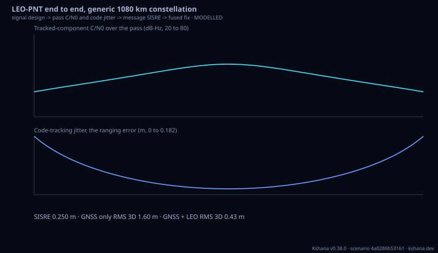

<!-- SPDX-License-Identifier: AGPL-3.0-only -->
<!-- Generated by tools/gen_kinds_index.py from the engine, the schema, the verification matrix and one run of the example. Do not edit by hand. -->
# `leo-pnt-chain`

Scenario kind of the engine v0.39.0, family [Low-Earth-orbit navigation](../low-earth-orbit-navigation.md). Advisory: analysis output from a research and engineering tool, not type-approved navigation equipment and not a safety-of-life service. Every label here is the engine's or the verification matrix's; a kind is MODELLED unless the matrix says otherwise (how a label is earned: the README's Evidence section).

## What it does

One LEO-PNT (positioning, navigation and timing from low Earth orbit) system end to end, for any constellation and signal: the leo-signal design named by signal_design (a public preset or an inline [signal] design) sets a [pass] band's centre, bandwidth, chip rate and EIRP split, the leo-pass link budget gives the tracked C/N0 and band-limited code jitter over the pass, a C/N0 line in sin(elevation) and the [navmsg] message's broadcast SISRE (fitted at the pass satellite's altitude) feed every LEO system of the [fusion] leo-pvt joint fix, and optionally the [ppp] leo-ppp cases; every hand-off is listed with its value and unit. MODELLED.

One run of `scenarios/leo-pnt-end-to-end.toml` summarises as: LEO-PNT end to end, generic 1080 km constellation
  signal generic-l (https://www.itu.int/pub/R-REG-RR), tracked pilot at 10.230 Mchip/s, C/N0 offset -2.57 dB
  pass LEO-1 1080 km: tracked C/N0 peak 58.2 dB-Hz, code jitter median 0.050 m; C/N0 line 35.6 + 24.3 sin(el) dB-Hz
  message kepler-rac 300 s fit / 300 s update: representation SISRE 0.907 mm RMS (orbit 0.005 mm), with 0.250 m orbit determination: 0.250 m handed on
  fused fix: GNSS only PDOP 1.47 RMS 3D 1.60 m -> GNSS + LEO PDOP 1.06 RMS 3D 0.43 m
  PPP convergence: GNSS only 11.5 min, 240 LEO 7.5 min
  11 values handed between stages. MODELLED.

## Inputs

From the schema (`kshana kinds --json`):

- Required fields: `signal_design`, `pass`, `fusion`
- Optional fields: `name`, `description`, `seed`, `signal`, `navmsg`, `od_sisre_m`, `ppp`

The example `scenarios/leo-pnt-end-to-end.toml` sets, among others:

| Field | Value | Unit |
|---|---|---|
| `fusion.duration_s` | 1800 | s |
| `fusion.joint.max_leo_sweep` | 8 | not stated |
| `fusion.mode` | joint | text |
| `fusion.step_s` | 30 | s |
| `fusion.system[0].cn0_dbhz` | [38, 48] | dB-Hz |
| `fusion.system[0].name` | GPS | text |
| `fusion.system[0].preset` | gps-baseline | text |
| `fusion.system[0].sisre_m` | 0.6 | m |
| `fusion.system[1].cn0_dbhz` | [38, 48] | dB-Hz |
| `fusion.system[1].isb_ns` | 12 | ns |
| `fusion.system[1].name` | Galileo | text |
| `fusion.system[1].preset` | galileo | text |

## Run it

```sh
kshana scenarios/leo-pnt-end-to-end.toml
```

3 bundled scenarios use this kind; the others are in [`scenarios/`](../../../scenarios/).

## What it gives

The scalar results of that run, with the units the engine states:

| Result | Value | Unit |
|---|---|---|
| `fusion.fraction_epochs_with_leo` | 1 | 1 |
| `fusion.fused.availability` | 1 | 1 |
| `fusion.fused.median_pdop` | 1.064778 | 1 |
| `fusion.fused.median_sigma_3d_m` | 0.433791 | m |
| `fusion.fused.rms_error_3d_m` | 0.434888 | m |
| `fusion.gnss.availability` | 1 | 1 |
| `fusion.gnss.median_pdop` | 1.47453 | 1 |
| `fusion.gnss.median_sigma_3d_m` | 1.575655 | m |
| `fusion.gnss.rms_error_3d_m` | 1.60216 | m |
| `fusion.leo.availability` | 1 | 1 |

Result label (the engine's): MODELLED — the chain hands each stage's output to the next; the stages keep their own labels (leo-signal, leo-pass, leo-navmsg, leo-pvt and leo-ppp rows of the verification matrix).



## Evidence

MODELLED: the [verification matrix](../../VERIFICATION-MATRIX.md) rows that name this kind.

- **MODELLED** The `leo-pnt-chain` kind: a leo-signal design (public preset or inline) sets a leo-pass band's centre, bandwidth, chip rate and EIRP split; the pass gives the tracked-component C/N0 and band-limited code jitter per epoch; a least-squares C/ Tests: [leo_pnt_chain.rs](../../../tests/leo_pnt_chain.rs).

The rows the run itself exercised, with the oracle the matrix gives each (the public sources are named there):

- **MODELLED** Deterministic, scenario-hashed, SBOM + cross-platform golden gates. Oracle (ExternalDataset): SBOM conformance to the official CycloneDX 1.5 JSON Schema (+ valid SPDX identifiers) — an external published standard, zero validation errors over the full dependency graph; the FoM-determinism / byte-reproducibility part remains a pinned self-consistency check, so the row stays MODELLED
- **VALIDATED** navsignal: the sine integral (sine_integral), the BPSK-R fraction of power inside a double-sided band in closed form (bpsk_power_in_band_closed_form), the band-. Oracle (ExternalDataset): Externally pinned: 90.3 per cent main-lobe power, the coherent early-late jitter at the stated operating point, the sine-integral table values, and the BPSK self spectral separation coefficient 2/(3 R_c) at zero offset. Internal cross-checks only, not external validation: the band-limited BPSK Gabor-bandwidth closed form and its asymptote, and the offset BPSK spectral separation coefficient at non-zero offsets, both 
- **MODELLED** The `leo-signal` kind: parameterised signal designs (band, transmit bandwidth, ITU allocation; acquisition, data and pilot components with BPSK(n), BOC(m,n), MB. Oracle (InternalConsistency): The validated closed forms of the two rows above, the square-law false-alarm identity P_d(snr = 0) = P_fa and Holmes's mean acquisition time, and reduction to the spectrum kind's own SSC chain (the same Jammer::ssc code). The designs themselves are inputs: presets marked REPRESENTATIVE or WORKSHOP are not published specifications, enhanced Feher QPSK, code shift keying and OFDM spectra are approximated, and the shape
- **VALIDATED** ITU-R P.618-14 section 2.4.1 steps 3 to 9 (reference sigma from N_wet, effective path length, antenna averaging factor, fade depth for 0.01 % to 50 % of the tim. Oracle (ExternalDataset): ITU-R Study Group 3 validation examples (CG-3M3J-13-ValEx-Rev8.3.0) for P.618-14 scintillation, with each site's P.453-14 N_wet from the same examples; committed in tests/fixtures/leo_link/p618_14_scintillation.csv with the URLs and retrieval date. The wet-refractivity expression from temperature and humidity is not covered by this row
- **VALIDATED** Group delay 40.3 STEC/f^2 per band; the ionosphere-free coefficients f1^2/(f1^2 - f2^2) and -f2^2/(f1^2 - f2^2) and the noise amplification sqrt(a1^2 s1^2 + a2^. Oracle (ExternalDataset): IS-GPS-200 section 20.3.3.3.3.2, which states the L1/L2 group-delay ratio gamma = (77/60)^2 that follows from first-order 1/f^2 scaling, and the Friis transmission formula (Proc. IRE, 1946). Validates the scaling laws, not a slant TEC

## Limitations

What the run's own report says is not modelled or not validated:

- The positioning stage models C/N0 as a straight line in the sine of the elevation between the mask and the zenith; the chain fits that line to the pass's tracked C/N0, so a pass-specific shape (an isoflux plateau, a beam edge) is reduced to two numbers. (result `limitations[0]`)
- The SISRE handed to the positioning stages is the navigation message's representation error against a Kshana-integrated truth orbit, plus the scenario's stated od_sisre_m in root-sum-square; the message stage itself models no orbit determination or prediction. (result `limitations[1]`)
- The positioning stage computes its own delay-lock-loop jitter from the handed-on C/N0 with an unlimited-bandwidth formula; the pass reports the band-limited jitter of the actual design beside it. (result `limitations[2]`)
- The precise point positioning stage takes the message's SISRE as the LEO orbit-and-clock error; its code and phase noise stay the stage's own inputs. (result `limitations[3]`)
- One satellite, the first whose band carries the design, stands for the whole LEO system in the pass and message stages. (result `limitations[4]`)
- MODELLED — the chain hands each stage's output to the next; the stages keep their own labels (leo-signal, leo-pass, leo-navmsg, leo-pvt and leo-ppp rows of the verification matrix). (result `label`)
- MODELLED. (kind catalogue (`kshana kinds --json`))
- MODELLED: every stage keeps its own label; the chain adds no physics. (scenario file comment, line 25)

## See also

- Family page: [Low-Earth-orbit navigation](../low-earth-orbit-navigation.md#leo-pnt-chain)
- All kinds: [KINDS.md](../../KINDS.md)
- Topic page: [LEO-PNT.md](../../LEO-PNT.md)
- Topic page: [LEO-PASS.md](../../LEO-PASS.md)
