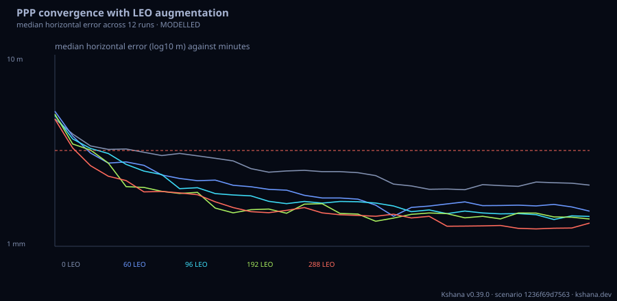

<!-- SPDX-License-Identifier: AGPL-3.0-only -->
<!-- Generated by tools/gen_kinds_index.py from the engine, the schema, the verification matrix and one run of the example. Do not edit by hand. -->
# `leo-ppp`

Scenario kind of the engine v0.40.0, family [Low-Earth-orbit navigation](../low-earth-orbit-navigation.md). Advisory: analysis output from a research and engineering tool, not type-approved navigation equipment and not a safety-of-life service. Every label here is the engine's or the verification matrix's; a kind is MODELLED unless the matrix says otherwise (how a label is earned: the README's Evidence section).

## What it does

Precise point positioning (PPP) convergence with GNSS only and with LEO augmentation: a float extended Kalman filter on ionosphere-free code and carrier phase with the static station coordinates, a white receiver clock, one inter-system bias per extra system, a random-walk zenith wet delay mapped by 1/sin(elevation) and a float ambiguity per satellite arc; the precise orbit-and-clock error is white and common to the code and phase of a satellite, so each satellite is one correlated two-row update in a Joseph-stabilised form. Measurements are simulated from the same model with seeded noise over several sites and seeds, and each case (GNSS only first, then each [[case]] of LEO systems, any constellation or preset) reports the median convergence time (the first epoch after which the horizontal and vertical errors stay below the thresholds, 10 cm by default), the fraction converged, the median error curves and the filter consistency (the run-averaged position NEES against the two-sided 95% chi-square band). Optionally beside the published Li et al. (2019, J. Geod. 93:749, doi 10.1007/s00190-018-1195-2) mid-latitude figures: 9.6 min for multi-GNSS shortened to 7.0, 3.2, 2.1 and 1.3 min with 60, 96, 192 and 288 LEO satellites. MODELLED: a consistency comparison of the trend, not a reproduction of that study's constellations, noise or stations; no ambiguity resolution, cycle slips, phase wind-up, tides or time-correlated product errors.

One run of `scenarios/leo-ppp-convergence.toml` summarises as: PPP convergence to 0.10 m horizontal / 0.10 m vertical, 12 runs per case, 96 GNSS satellites
  GNSS only                       0 LEO  median 7.4 min  converged 100%  NEES mean 3.13
  60 LEO                         60 LEO  median 4.8 min  converged 100%  NEES mean 3.08
  96 LEO                         96 LEO  median 3.2 min  converged 100%  NEES mean 2.74
  192 LEO                       192 LEO  median 2.7 min  converged 100%  NEES mean 2.65
  288 LEO                       288 LEO  median 2.3 min  converged 100%  NEES mean 3.06
  Li et al. 2019 (published, min) vs modelled: 0:9.6/7.4 60:7.0/4.8 96:3.2/3.2 192:2.1/2.7 288:1.3/2.3


## Inputs

From the schema (`kshana kinds --json`):

- Required fields: none
- Optional fields: `seed`, `duration_s`, `step_s`, `runs`, `criterion_horizontal_m`, `criterion_vertical_m`, `compare_li_2019`, `noise`, `site`, `gnss`, `case`

The example `scenarios/leo-ppp-convergence.toml` sets, among others:

| Field | Value | Unit |
|---|---|---|
| `case[0].name` | 60 LEO | text |
| `case[0].system[0].mask_deg` | 7 | deg |
| `case[0].system[0].name` | LEO-60 | text |
| `case[0].system[0].shell[0].altitude_km` | 1000 | km |
| `case[0].system[0].shell[0].inclination_deg` | 60 | deg |
| `case[0].system[0].shell[0].phasing` | 1 | not stated |
| `case[0].system[0].shell[0].planes` | 6 | not stated |
| `case[0].system[0].shell[0].total` | 60 | not stated |
| `case[1].name` | 96 LEO | text |
| `case[1].system[0].mask_deg` | 7 | deg |
| `case[1].system[0].name` | LEO-96 | text |
| `case[1].system[0].shell[0].altitude_km` | 1000 | km |

## Run it

```sh
kshana scenarios/leo-ppp-convergence.toml
```

## What it gives

The scalar results of that run, with the units the engine states:

| Result | Value | Unit |
|---|---|---|
| `criterion_horizontal_m` | 0.1 | m |
| `criterion_vertical_m` | 0.1 | m |
| `duration_s` | 1800 | s |
| `evidence.id_rule` | the stable id of the matrix row (the ID  | text |
| `evidence.matrix` | docs/VERIFICATION-MATRIX.md | text |
| `evidence.tier` | MODELLED | text |
| `n_gnss` | 96 | count |
| `noise.amb0_sigma_m` | 30 | m |
| `noise.clock_sigma_m` | 1000 | m |
| `noise.isb0_sigma_m` | 10 | m |

Result label (the engine's): MODELLED float PPP (ionosphere-free code and phase, white clock, random-walk wet delay, float ambiguities per arc) on simulated measurements from the same model; the Li et al. (2019) figures are a comparison of trend, not a reproduction



## Evidence

MODELLED: the [verification matrix](../../VERIFICATION-MATRIX.md) rows that name this kind.

- **MODELLED** A float PPP extended Kalman filter on ionosphere-free code and phase: static coordinates, a white receiver clock, one inter-system bias per extra system, a random-walk zenith wet delay mapped by 1/sin(elevation), a float ambiguity per satel Tests: [leo_fusion_scenarios.rs](../../../tests/leo_fusion_scenarios.rs).

The rows the run itself exercised, with the oracle the matrix gives each (the public sources are named there):

- **MODELLED** Deterministic, scenario-hashed, SBOM + cross-platform golden gates. Oracle (ExternalDataset): SBOM conformance to the official CycloneDX 1.5 JSON Schema (+ valid SPDX identifiers) — an external published standard, zero validation errors over the full dependency graph; the FoM-determinism / byte-reproducibility part remains a pinned self-consistency check, so the row stays MODELLED
- **MODELLED** A float PPP extended Kalman filter on ionosphere-free code and phase: static coordinates, a white receiver clock, one inter-system bias per extra system, a rand. Oracle (ExternalDataset): The NEES chi-square test is an internal consistency check (truth and filter share the model). The trend is compared with Li et al., LEO constellation-augmented multi-GNSS for rapid PPP convergence, J. Geod. 93:749-764 (2019), doi 10.1007/s00190-018-1195-2: multi-GNSS 9.6 min shortened to 7.0, 3.2, 2.1 and 1.3 min with 60, 96, 192 and 288 LEO satellites. The bundled scenario gives 7.4, 4.8, 3.2, 2.7 and 2.3 min with i

## Limitations

What the run's own report says is not modelled or not validated:

- MODELLED float PPP (ionosphere-free code and phase, white clock, random-walk wet delay, float ambiguities per arc) on simulated measurements from the same model; the Li et al. (2019) figures are a comparison of trend, not a reproduction (result `label`)
- MODELLED: a consistency comparison of the trend, not a reproduction of that study's constellations, noise or stations; no ambiguity resolution, cycle slips, phase wind-up, tides or time-correlated product errors. (kind catalogue (`kshana kinds --json`))
- The four LEO constellations here are representative Walker delta shells at 1000 km and 60 deg with 60, 96, 192 and 288 satellites; they are NOT the paper's designs, and the noise, stations and convergence definition (horizontal and vertical errors below 10 cm until the end of the run) are this model's. The comparison is therefore a MODELLED consistency check on the trend: convergence must shorten monotonically with t (scenario file comment, lines 10 to 14)
- Reproducibility & software assurance is MODELLED, not validated: a sub-claim is externally checked, but the whole capability composes modelled pieces, so the capability stays Modelled. (verification matrix (docs/MODELLED-RATIONALE.md))
- Precise point positioning convergence with GNSS only and with LEO augmentation is MODELLED, not validated: a sub-claim is externally checked, but the whole capability composes modelled pieces, so the capability stays Modelled. (verification matrix (docs/MODELLED-RATIONALE.md))

## See also

- Family page: [Low-Earth-orbit navigation](../low-earth-orbit-navigation.md#leo-ppp)
- All kinds: [KINDS.md](../../KINDS.md)
- Topic page: [LEO-PNT.md](../../LEO-PNT.md)
- Topic page: [LEO-PNT-FUSION.md](../../LEO-PNT-FUSION.md)
