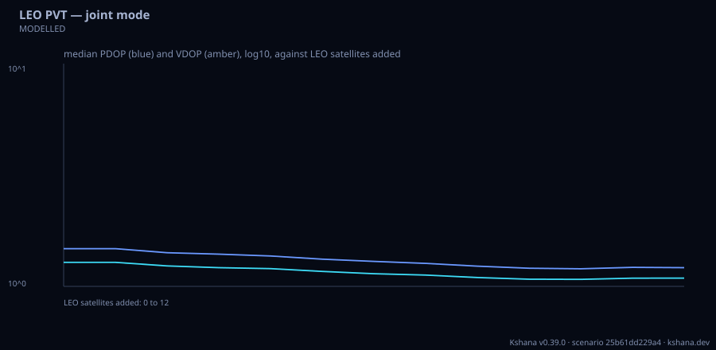

<!-- SPDX-License-Identifier: AGPL-3.0-only -->
<!-- Generated by tools/gen_kinds_index.py from the engine, the schema, the verification matrix and one run of the example. Do not edit by hand. -->
# `leo-pvt`

Scenario kind of the engine v0.38.0, family [Low-Earth-orbit navigation](../low-earth-orbit-navigation.md). Advisory: analysis output from a research and engineering tool, not type-approved navigation equipment and not a safety-of-life service. Every label here is the engine's or the verification matrix's; a kind is MODELLED unless the matrix says otherwise (how a label is earned: the README's Evidence section).

## What it does

Fused medium-Earth-orbit (MEO) and low-Earth-orbit (LEO) positioning, navigation and timing (PNT) over ANY constellations: each [[system]] is a GNSS preset of the constellation-design kind, a LEO preset (xona-pulsar, iridium-stl, starlink-sop, centispace, generic-c-band, the atomic-zero-clock ephemeris model, or another preset file, each in its own file with its sources marked PUBLIC, WORKSHOP or DERIVED), Walker shells or explicit element sets, with a carrier, a chip rate, a carrier-to-noise density (C/N0) envelope from the elevation mask to the zenith, a signal-in-space range error (SISRE), a Doppler sigma and a clock model (its own receiver clock, so the inter-system bias is estimated, or a known broadcast offset). Four modes. DOPPLER: batch Gauss-Newton positioning from range rate with analytic partials, clock-drift and optional velocity states and an optional height constraint, single- or multi-satellite, the error against window length, the Doppler, Doppler-rate and jerk envelope of each LEO system, and the single-pass along-track and cross-track accuracy against the cross-track offset (the cross-track error grows without bound as the pass goes overhead; a single pass also has a mirror solution across the ground track). A Doppler-only signal of opportunity (starlink-sop) runs here. JOINT: per-epoch weighted least-squares pseudorange fixes from GNSS alone, LEO alone and both, per-measurement sigmas from a delay-lock-loop thermal-noise model at C/N0 plus the SISRE (or a fixed sigma, so a signal model can feed them), the estimated inter-system biases, and PDOP/HDOP/VDOP against the number of LEO satellites added. POLAR: satellites in view and DOP against latitude for GNSS, LEO and both. TIMING: time transfer to Coordinated Universal Time (UTC) from LEO satellites at a known position with a two-state clock filter whose process noise comes from the engine's oscillator classes, against C/N0 and the oscillator, and the IS-GPS-200 system-time-to-UTC expression; with [timing] trace = true every row also reports its time error and predicted sigma at every epoch. VALIDATED: the largest Doppler of an overhead-to-horizon pass against the published Iridium (up to 36 kHz) and Xona Pulsar X1 (32 to 34 kHz) figures. MODELLED: everything else; the DOP is checked against a hand-derived case, the fixes against their covariance, and the Doppler model against the range-acceleration identity.

One run of `scenarios/leo-pvt-fjord-skyline.toml` summarises as: LEO PVT (joint) at 61.10, 6.60 over 1800 s
  GPS          gnss    24 sats at  20182 km, 1575.42 MHz
  Galileo      gnss    24 sats at  23222 km, 1575.42 MHz
  Pulsar X5    leo    258 sats at   1080 km, 1190.52 MHz
  LEO ranging satellite in view on 100.0% of epochs
  GNSS only  availability 1.000, median PDOP 1.48, RMS 3D error 1.29 m
  LEO only   availability 1.000, median PDOP 2.33, RMS 3D error 0.69 m
  fused      availability 1.000, median PDOP 1.14, RMS 3D error 0.63 m


## Inputs

From the schema (`kshana kinds --json`):

- Required fields: none
- Optional fields: `mode`, `seed`, `duration_s`, `step_s`, `user`, `dll`, `doppler`, `joint`, `polar`, `timing`, `system`, `skyline`

The example `scenarios/leo-pvt-fjord-skyline.toml` sets, among others:

| Field | Value | Unit |
|---|---|---|
| `duration_s` | 1800 | s |
| `joint.max_leo_sweep` | 12 | not stated |
| `kind` | leo-pvt | text |
| `mode` | joint | text |
| `seed` | 3 | not stated |
| `skyline.preset` | fjord | text |
| `step_s` | 30 | s |
| `system[0].cn0_dbhz` | [38, 48] | dB-Hz |
| `system[0].name` | GPS | text |
| `system[0].preset` | gps-baseline | text |
| `system[0].sisre_m` | 0.6 | m |
| `system[1].cn0_dbhz` | [38, 48] | dB-Hz |

## Run it

```sh
kshana scenarios/leo-pvt-fjord-skyline.toml
```

7 bundled scenarios use this kind; the others are in [`scenarios/`](../../../scenarios/).

## What it gives

The scalar results of that run, with the units the engine states:

| Result | Value | Unit |
|---|---|---|
| `doppler` | no value | not stated |
| `duration_s` | 1800 | s |
| `joint.fraction_epochs_with_leo` | 1 | 1 |
| `joint.fused.availability` | 1 | 1 |
| `joint.fused.median_pdop` | 1.144767 | 1 |
| `joint.fused.median_sigma_3d_m` | 0.583155 | m |
| `joint.fused.rms_error_3d_m` | 0.625294 | m |
| `joint.gnss.availability` | 1 | 1 |
| `joint.gnss.median_pdop` | 1.47636 | 1 |
| `joint.gnss.median_sigma_3d_m` | 1.242532 | m |

Result label (the engine's): MODELLED joint weighted least-squares pseudorange positioning with one clock per system or a known offset; noise from the delay-lock-loop model at the C/N0 envelope plus the signal-in-space range error



## Evidence

MODELLED 3 · VALIDATED 2: the [verification matrix](../../VERIFICATION-MATRIX.md) rows that name this kind.

- **VALIDATED** Exact range rate of a satellite whose Earth-fixed position and velocity come from a two-body orbit with the secular J2 drift and the Earth's rotation (leo_fusion::geom::EarthOrbit::state, velocity the exact time derivative of the position), Tests: [leo_doppler_reference.rs](../../../tests/leo_doppler_reference.rs).
- **MODELLED** Batch Gauss-Newton positioning from range rate with analytic partials (d rho_dot / d r = -(I - u u^T)(v_s - v_u)/rho, d/dv = -u, d/d drift = 1), a constant user velocity as an option, a height pseudo-measurement for a surface user, damped s Tests: [leo_fusion_scenarios.rs](../../../tests/leo_fusion_scenarios.rs).
- **MODELLED** Weighted least-squares Gauss-Newton fixes over any mix of systems, one receiver clock per system (the inter-system bias estimated with the position) or a known broadcast offset on the reference time scale; per-measurement sigmas supplied by Tests: [leo_fusion_scenarios.rs](../../../tests/leo_fusion_scenarios.rs).
- **MODELLED** Clock measurements from every LEO satellite in view at a known position, combined by inverse variance from the pseudorange noise model, filtered by a two-state (phase, frequency) Kalman filter whose process noise is the oscillator class's w Tests: [leo_fusion_scenarios.rs](../../../tests/leo_fusion_scenarios.rs).
- and 1 more in the matrix.

The rows the run itself exercised, with the oracle the matrix gives each (the public sources are named there):

- **MODELLED** Deterministic, scenario-hashed, SBOM + cross-platform golden gates. Oracle (ExternalDataset): SBOM conformance to the official CycloneDX 1.5 JSON Schema (+ valid SPDX identifiers) — an external published standard, zero validation errors over the full dependency graph; the FoM-determinism / byte-reproducibility part remains a pinned self-consistency check, so the row stays MODELLED
- **MODELLED** Weighted least-squares Gauss-Newton fixes over any mix of systems, one receiver clock per system (the inter-system bias estimated with the position) or a known . Oracle (InternalConsistency): A hand-derived four-satellite DOP (one satellite at the zenith and three on the horizon 120 deg apart, whose normal matrix inverts by hand), the structural identity that a system with its own clock and one satellite adds no geometry, noise-free recovery of position, clock and bias, and seeded errors against the covariance. Internal checks only; not compared with a receiver's output. 0.30 external comparison, a findin
- **MODELLED** System-agnostic inputs: every system is Walker shells, explicit elements or a GNSS preset, a signal (carrier, chip rate, bandwidth, received power or C/N0 range. Oracle (InternalConsistency): Transcription of the cited public values, checked for structure (every public source has a URL, Walker patterns divide evenly, the C/N0 from received power over kT at 290 K), not against an external oracle. Representative values are named in each preset and are illustrative

## Limitations

What the run's own report says is not modelled or not validated:

- MODELLED joint weighted least-squares pseudorange positioning with one clock per system or a known offset; noise from the delay-lock-loop model at the C/N0 envelope plus the signal-in-space range error (result `label`)
- MODELLED: everything else; the DOP is checked against a hand-derived case, the fixes against their covariance, and the Doppler model against the range-acceleration identity. (kind catalogue (`kshana kinds --json`))
- The skyline preset is REPRESENTATIVE (provenance in docs/SKYLINE.md and `kshana skyline --preset fjord`): the order of the width and relief of the deep west-Norwegian fjords, not a survey of any fjord. Line of sight only: no diffraction, reflection or non-line-of-sight reception. Remove the [skyline] section to compare with open sky. MODELLED. (scenario file comment, lines 15 to 18)
- Reproducibility & software assurance is MODELLED, not validated: a sub-claim is externally checked, but the whole capability composes modelled pieces, so the capability stays Modelled. (verification matrix (docs/MODELLED-RATIONALE.md))
- Joint GNSS and LEO pseudorange positioning with inter-system biases and per-signal error models is MODELLED, not validated: checked against its own closed-form / analytic identity — catches transcription and coefficient errors, but is not an external oracle. (verification matrix (docs/MODELLED-RATIONALE.md))
- Named LEO PNT systems as optional data presets, each with its source is MODELLED, not validated: checked against its own closed-form / analytic identity — catches transcription and coefficient errors, but is not an external oracle. (verification matrix (docs/MODELLED-RATIONALE.md))

## See also

- Family page: [Low-Earth-orbit navigation](../low-earth-orbit-navigation.md#leo-pvt)
- All kinds: [KINDS.md](../../KINDS.md)
- Topic page: [LEO-PNT-FUSION.md](../../LEO-PNT-FUSION.md)
- Topic page: [LEO-PNT.md](../../LEO-PNT.md)
