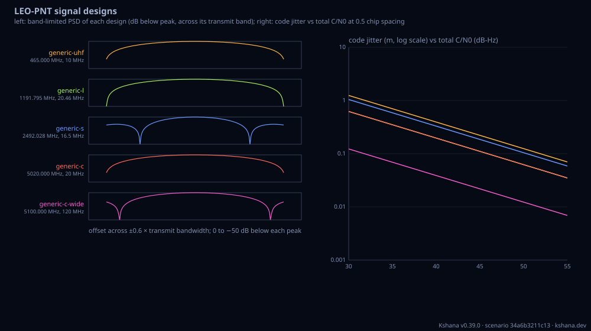

<!-- SPDX-License-Identifier: AGPL-3.0-only -->
<!-- Generated by tools/gen_kinds_index.py from the engine, the schema, the verification matrix and one run of the example. Do not edit by hand. -->
# `leo-signal`

Scenario kind of the engine v0.39.0, family [Low-Earth-orbit navigation](../low-earth-orbit-navigation.md). Advisory: analysis output from a research and engineering tool, not type-approved navigation equipment and not a safety-of-life service. Every label here is the engine's or the verification matrix's; a kind is MODELLED unless the matrix says otherwise (how a label is earned: the README's Evidence section).

## What it does

LEO-PNT signal designs: parameterised low Earth orbit (LEO) positioning, navigation and timing (PNT) signals for any system, band and structure. A SIGNAL is a band (centre frequency, transmit bandwidth, ITU allocation RNSS/RDSS/MSS/EESS/non-RNSS/other) and components (acquisition, data, pilot; any subset), each with a modulation (BPSK(n) with fractional n, BOC(m,n), MBOC(6,1,p) or a flat OFDM-like band), a power share, optional FDMA sub-carrier offsets, a code length and a data rate. Signals come from compiled-in public preset files (xona-pulsar, iridium-stl, starlink-soo, centispace, generic-c-band, generic-bands; each with its source URL and every unpublished value labelled REPRESENTATIVE) or are written inline. PER SIGNAL: the band-limited power spectral density and the fraction of each component's power the transmit band passes (BPSK closed form beside the numeric value), the RMS (Gabor) bandwidth, the delay-lock-loop code-tracking thermal-noise jitter against C/N0 and early-late spacing from the band-limited coherent (or non-coherent) early-late formula of Betz & Kolodziejski 2009 with its unlimited-band textbook form and its vanishing-spacing Gabor bound, the ranging accuracy in metres, the acquisition search space (Doppler bins from the orbit's maximum Doppler plus oscillator and user terms, times code bins), square-law detection probability and the mean serial and code-parallel acquisition time, the spectral separation coefficient of the signal into GPS L1 C/A, Galileo E1, GPS L5, Galileo E5a, E5b and E5 AltBOC and of each into the signal with the C/N0 degradation, and the CW, wideband and matched J/S the tracked component tolerates, from the spectrum kind's own SSC machinery. A BAND TRADE: first-order ionospheric delay (40.3 TEC/f^2), free-space loss, ranging accuracy at equal C/N0 and at equal EIRP, and jammer tolerance. Optional SHAPE CHECKS hold a design's spectrum against a described measurement (MODELLED consistency). VALIDATED: the BPSK power-in-band (90.3 % in the main lobe) and Gabor-bandwidth closed forms, the band-limited jitter reducing to the textbook coherent early-late form and to its Gabor bound, the offset BPSK spectral separation coefficient against its Parseval closed form, the AltBOC spectrum's unit area, and the maximum LEO Doppler against the published Xona Pulsar (32-34 kHz) and Iridium (36 kHz) figures. MODELLED: every design, power split, C/N0 and jammer level; EFQPSK, CSK and OFDM spectra are approximated.

One run of `scenarios/leo-band-trade.toml` summarises as: scenario leo-signal | 5 signals | noise floor -202.0 dBW/Hz | finest ranging generic-c-wide 0.022 m at 45.0 dB-Hz

## Inputs

From the schema (`kshana kinds --json`):

- Required fields: none
- Optional fields: `presets`, `signals`, `receiver`, `acquisition`, `compatibility`, `trade`, `shape_checks`, `psd_points`

The example `scenarios/leo-band-trade.toml` sets, among others:

| Field | Value | Unit |
|---|---|---|
| `acquisition.altitude_km` | 550 | km |
| `acquisition.coherent_ms` | 1 | ms |
| `acquisition.noncoherent` | 1 | count |
| `acquisition.oscillator_ppm` | 0.5 | ppm |
| `acquisition.pfa_cell` | 1.0000e-4 | 1 |
| `kind` | leo-signal | text |
| `presets` | [generic-bands] | not stated |
| `receiver.antenna_temp_k` | 290 | K |
| `receiver.cn0_dbhz` | [30, 35, 40, 45, 50, 55] | dB-Hz |
| `receiver.correlator_spacings_chips` | [1, 0.5, 0.2, 0.1] | chip |
| `receiver.integration_time_s` | 0.02 | s |
| `receiver.loop_bandwidth_hz` | 1 | Hz |

## Run it

```sh
kshana scenarios/leo-band-trade.toml
```

3 bundled scenarios use this kind; the others are in [`scenarios/`](../../../scenarios/).

## What it gives

The scalar results of that run, with the units the engine states:

| Result | Value | Unit |
|---|---|---|
| `receiver.antenna_temp_k` | 290 | K |
| `receiver.early_late` | coherent | text |
| `receiver.integration_time_s` | 0.02 | s |
| `receiver.loop_bandwidth_hz` | 1 | Hz |
| `receiver.noise_density_dbw_per_hz` | -201.975187 | dBW/Hz |
| `receiver.noise_figure_db` | 2 | dB |
| `receiver.reference_cn0_dbhz` | 45 | dB-Hz |
| `receiver.reference_spacing_chips` | 0.5 | chip |
| `receiver.system_temp_k` | 459.619026 | K |
| `receiver.tracking_threshold_dbhz` | 25 | dB-Hz |

Result label (the engine's): MODELLED: parameterised low Earth orbit (LEO) positioning, navigation and timing (PNT) signal designs, band-limited to their transmit bandwidth. The closed forms underneath are VALIDATED (BPSK power in band and Gabor bandwidth, the band-limited early-late code-tracking jitter reducing to the textboo



## Evidence

MODELLED 2 · VALIDATED 2: the [verification matrix](../../VERIFICATION-MATRIX.md) rows that name this kind.

- **VALIDATED** navsignal: the sine integral (sine_integral), the BPSK-R fraction of power inside a double-sided band in closed form (bpsk_power_in_band_closed_form), the band-limited BPSK Gabor bandwidth in closed form (bpsk_gabor_bandwidth_closed_form_hz
- **VALIDATED** leo_signal::max_doppler_hz: the largest satellite Doppler on an overhead pass at the elevation mask for a circular orbit, v R_E cos(el) / (R_E + h) times f / c, from each preset's own carrier and orbit altitude; the `leo-signal` kind adds o
- **MODELLED** The `leo-signal` kind: parameterised signal designs (band, transmit bandwidth, ITU allocation; acquisition, data and pilot components with BPSK(n), BOC(m,n), MBOC or flat spectra, power shares, FDMA sub-carriers, code lengths and data rates Tests: [leo_signal_reference.rs](../../../tests/leo_signal_reference.rs).
- **MODELLED** The `spectrum` kind extended beyond the L band: bands given as a preset signal design (drawn with every component, band-limited to the transmit bandwidth, C/N0 and J/S referred to the tracked component) or as a custom carrier and modulation Tests: [leo_signal_reference.rs](../../../tests/leo_signal_reference.rs).

The rows the run itself exercised, with the oracle the matrix gives each (the public sources are named there):

- **MODELLED** Deterministic, scenario-hashed, SBOM + cross-platform golden gates. Oracle (ExternalDataset): SBOM conformance to the official CycloneDX 1.5 JSON Schema (+ valid SPDX identifiers) — an external published standard, zero validation errors over the full dependency graph; the FoM-determinism / byte-reproducibility part remains a pinned self-consistency check, so the row stays MODELLED
- **VALIDATED** navsignal: the sine integral (sine_integral), the BPSK-R fraction of power inside a double-sided band in closed form (bpsk_power_in_band_closed_form), the band-. Oracle (ExternalDataset): Externally pinned: 90.3 per cent main-lobe power, the coherent early-late jitter at the stated operating point, the sine-integral table values, and the BPSK self spectral separation coefficient 2/(3 R_c) at zero offset. Internal cross-checks only, not external validation: the band-limited BPSK Gabor-bandwidth closed form and its asymptote, and the offset BPSK spectral separation coefficient at non-zero offsets, both 
- **VALIDATED** leo_signal::max_doppler_hz: the largest satellite Doppler on an overhead pass at the elevation mask for a circular orbit, v R_E cos(el) / (R_E + h) times f / c,. Oracle (ExternalDataset): Published figures: Xona Pulsar X1 maximum Doppler 32 to 34 kHz (Leclère, Marathe & Reid, ION GNSS+ 2025, https://arxiv.org/abs/2509.19551); Iridium Doppler up to +/-36 kHz (Resilient Navigation and Timing Foundation, Recent PNT Improvements and Test Results Based on Low Earth Orbit Satellites). Earth rotation is left out, which moves the figure by up to about 2.3 kHz; both published figures are met without it.
- **MODELLED** The `leo-signal` kind: parameterised signal designs (band, transmit bandwidth, ITU allocation; acquisition, data and pilot components with BPSK(n), BOC(m,n), MB. Oracle (InternalConsistency): The validated closed forms of the two rows above, the square-law false-alarm identity P_d(snr = 0) = P_fa and Holmes's mean acquisition time, and reduction to the spectrum kind's own SSC chain (the same Jammer::ssc code). The designs themselves are inputs: presets marked REPRESENTATIVE or WORKSHOP are not published specifications, enhanced Feher QPSK, code shift keying and OFDM spectra are approximated, and the shape

## Limitations

What the run's own report says is not modelled or not validated:

- the exact spectra of enhanced Feher QPSK, code shift keying and OFDM: a rectangular-chip BPSK envelope or a flat band stands in, as each preset states (result `not_modelled[0]`)
- spreading-code line structure and multiple-access cross-correlation between codes (result `not_modelled[1]`)
- the transmit and receive filters beyond an ideal brick wall at the transmit bandwidth: no out-of-band emission, no filter group delay (result `not_modelled[2]`)
- multipath, receiver quantisation and automatic gain control (result `not_modelled[3]`)
- Earth rotation in the Doppler bound (up to about 0.46 km/s of range rate at the equator) (result `not_modelled[4]`)
- ionospheric delay beyond first order, and the split of the electron content above and below a LEO satellite: the slant TEC is an input (result `not_modelled[5]`)
- atmospheric, rain and polarisation losses: the free-space loss alone is compared (rain matters at C band) (result `not_modelled[6]`)
- acquisition beyond a single dwell with a false-alarm penalty: no multi-dwell verification logic, a uniform code-phase prior, the worst-case straddle (result `not_modelled[7]`)

## See also

- Family page: [Low-Earth-orbit navigation](../low-earth-orbit-navigation.md#leo-signal)
- All kinds: [KINDS.md](../../KINDS.md)
- Topic page: [LEO-PNT.md](../../LEO-PNT.md)
- Topic page: [LEO-PASS.md](../../LEO-PASS.md)
