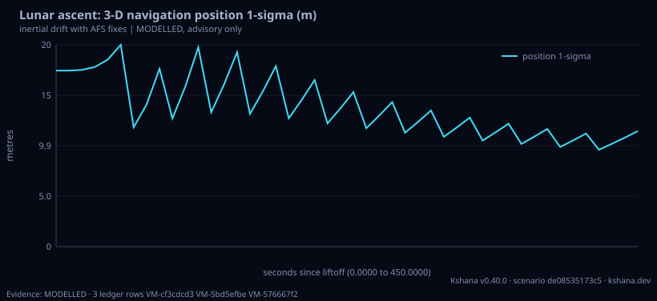

<!-- SPDX-License-Identifier: AGPL-3.0-only -->
<!-- Generated by tools/gen_kinds_index.py from the engine, the schema, the verification matrix and one run of the example. Do not edit by hand. -->
# `lunar-ascent`

Scenario kind of the engine v0.39.0, family [Lunar and cislunar](../lunar-and-cislunar.md). Advisory: analysis output from a research and engineering tool, not type-approved navigation equipment and not a safety-of-life service. Every label here is the engine's or the verification matrix's; a kind is MODELLED unless the matrix says otherwise (how a label is earned: the README's Evidence section).

## What it does

MODELLED powered ascent from a south-polar surface site to the rendezvous orbit, and the position-velocity covariance it carries back to orbit (Artemis-class). The five-state per-axis inertial error model of lunar-descent (position, velocity, accelerometer bias, attitude tilt, gyro bias, driven by the specific force) runs on all three site axes from the surface state the phase enters with; an AFS position fix from the visible relays of an ILLUSTRATIVE LCNS-class constellation (standalone, or differential using the correction-link residual of lunar-differential-pnt, with the clock aided when only three relays are visible) is taken at a stated interval, with lunar time entering through the vehicle clock and a time-tag error along track. Reports the closed-form inertial sources, the aid's contribution, the ablation, the navigation 1-sigmas over the ascent, the engine cutoff dispersion beside the navigation knowledge, and the full 6x6 MCI covariance at insertion with the position-velocity correlation kept. MODELLED: illustrative IMU class, specific force, relay set and cutoff dispersion; errors held in the launch site axes; the nominal exit state is a stand-in. Not agency-endorsed; advisory software, not certified navigation equipment.

One run of `scenarios/lunar-ascent.toml` summarises as: lunar-ascent | -89.50 deg | inertial only 785 m / 3.49 m/s | with AFS 11.4 m / 0.071 m/s | insertion dispersion 1.73 m/s (MODELLED)

## Inputs

From the schema (`kshana kinds --json`):

- Required fields: none
- Optional fields: `site_lat_deg`, `site_lon_deg`, `ascent_s`, `specific_force_m_s2`, `insertion_altitude_km`, `accel_bias_ug`, `align_arcmin`, `gyro_bias_deg_per_hr`, `surface_pos_sigma_m`, `surface_vel_sigma_m_s`, `cutoff_sigma_m_s`, `afs_mode`, `n_relays`, `mask_deg`, `afs_cn0_dbhz`, `sis_ure_m`, `afs_first_fix_s`, `afs_interval_s`, `baseline_km`, `lunar_time_mode`, `time_since_sync_days`

The example `scenarios/lunar-ascent.toml` sets, among others:

| Field | Value | Unit |
|---|---|---|
| `accel_bias_ug` | 100 | not stated |
| `afs_cn0_dbhz` | 35 | dB-Hz |
| `afs_first_fix_s` | 60 | s |
| `afs_interval_s` | 30 | s |
| `afs_mode` | differential | text |
| `align_arcmin` | 3 | not stated |
| `ascent_s` | 450 | s |
| `baseline_km` | 10 | km |
| `cutoff_sigma_m_s` | 1 | m/s |
| `gyro_bias_deg_per_hr` | 0.01 | not stated |
| `insertion_altitude_km` | 100 | km |
| `kind` | lunar-ascent | text |

## Run it

```sh
kshana scenarios/lunar-ascent.toml
```

## What it gives

The scalar results of that run, with the units the engine states:

| Result | Value | Unit |
|---|---|---|
| `afs_mode` | differential | text |
| `aids.afs.clock_aided_three_relay_fix` | false | flag |
| `aids.afs.differential_range_sigma_m` | 5.011955 | m |
| `aids.afs.fix_sigma_east_m` | 6.446378 | m |
| `aids.afs.fix_sigma_north_m` | 3.879611 | m |
| `aids.afs.fix_sigma_up_m` | 14.218387 | m |
| `aids.afs.fixes_used` | 13 | 1 |
| `aids.afs.relays_visible` | 7 | 1 |
| `aids.time.clock_sigma_s` | 3.8037e-6 | s |
| `aids.time.ltc_offset_us` | 171.130897 | us |

Result label (the engine's): MODELLED



## Evidence

No matrix row names this kind by name; the label on its result is the engine's own, above.

The rows the run itself exercised, with the oracle the matrix gives each (the public sources are named there):

- **MODELLED** Deterministic, scenario-hashed, SBOM + cross-platform golden gates. Oracle (ExternalDataset): SBOM conformance to the official CycloneDX 1.5 JSON Schema (+ valid SPDX identifiers) — an external published standard, zero validation errors over the full dependency graph; the FoM-determinism / byte-reproducibility part remains a pinned self-consistency check, so the row stays MODELLED

## Limitations

What the run's own report says is not modelled or not validated:

- MODELLED (result `label`)
- MODELLED powered ascent from a south-polar surface site to the rendezvous orbit, and the position-velocity covariance it carries back to orbit (Artemis-class). (kind catalogue (`kshana kinds --json`))
- MODELLED: illustrative IMU class, specific force, relay set and cutoff dispersion; errors held in the launch site axes; the nominal exit state is a stand-in. (kind catalogue (`kshana kinds --json`))
- HONESTY: MODELLED. The IMU class, the alignment, the specific force and the cutoff dispersion are ILLUSTRATIVE inputs, not measurements. The errors are held in the launch site's east-north-up axes, without the downrange curvature of the path, and the nominal exit state is a stand-in at the site's local vertical: only the covariance is the result. No agreement with any real vehicle is claimed. Advisory software, not c (scenario file comment, lines 11 to 15)
- Reproducibility & software assurance is MODELLED, not validated: a sub-claim is externally checked, but the whole capability composes modelled pieces, so the capability stays Modelled. (verification matrix (docs/MODELLED-RATIONALE.md))

## See also

- Family page: [Lunar and cislunar](../lunar-and-cislunar.md#lunar-ascent)
- All kinds: [KINDS.md](../../KINDS.md)
- Topic page: [MISSION-THREAD-LUNAR.md](../../MISSION-THREAD-LUNAR.md)
