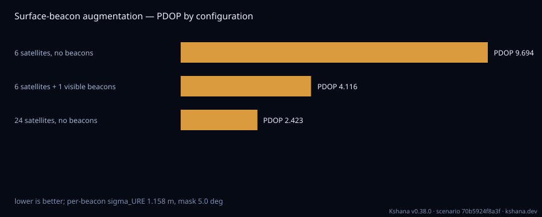

<!-- SPDX-License-Identifier: AGPL-3.0-only -->
<!-- Generated by tools/gen_kinds_index.py from the engine, the schema, the verification matrix and one run of the example. Do not edit by hand. -->
# `lunar-beacon`

Scenario kind of the engine v0.39.0, family [Lunar and cislunar](../lunar-and-cislunar.md). Advisory: analysis output from a research and engineering tool, not type-approved navigation equipment and not a safety-of-life service. Every label here is the engine's or the verification matrix's; a kind is MODELLED unless the matrix says otherwise (how a label is earned: the README's Evidence section).

## What it does

Surface-beacon augmentation of a lunar orbital navigation service, as a runnable before/after table. A south-polar user sees a sparse orbital set in a narrow patch of sky, so the ranging geometry is ill-conditioned; a few SURVEYED SURFACE BEACONS supply the low-elevation, wide-azimuth line-of-sight rows an all-overhead set lacks, and the horizontal dilution of precision collapses. The scenario reports three configurations at one epoch — satellites alone, satellites plus the visible beacons, and a larger constellation as the alternative route to the same geometry — each with its visible-source counts, its full DOP, and the realised 1-sigma accuracy in METRES obtained by multiplying through a per-beacon user-equivalent ranging error assembled as the root-sum-square of clock-synchronisation, multipath and survey terms. Beacon visibility is the airless-Moon two-height geometric horizon (no atmosphere, so the bound is exact), and the DOP assembly is the same kernel cross-checked against gnss_lib_py in tests/dop_reference.rs. WHY THIS KIND EXISTS: the module behind it has been in the engine and checked against an independent DOP path since L08/L09, but it was not reachable from a run — no kind, no dispatch arm, no bundled file. The README advertised the capability and the verification matrix carried NO row for it at all, so it was simultaneously claimed in prose and unclaimed in the ledger, while being unreachable in the engine. The defaults are the geometry that already carries a committed golden (a user at -80 deg with a 2 m antenna, three beacons at -80/0, -79/+60 and -79/-60 at 2 km, a six-satellite illustrative LCNS snapshot at t=0, a 5 deg mask), so a bare run reproduces a table an oracle already covers rather than inventing fresh numbers. MODELLED: the constellation design, the beacon placement and every error-budget magnitude are illustrative inputs, not a fielded survey or a measured link; only the DOP arithmetic, the horizon closed form and the sigma = DOP x sigma_URE relation are externally anchored. Not a service-performance commitment.

One run of `scenarios/lunar-beacon.toml` summarises as: Lunar surface-beacon augmentation — mask 5.0 deg, epoch +0 s, per-beacon sigma_URE 1.1576 m
  6 satellites, no beacons                      sats  5  beacons  0  GDOP 11.6627  PDOP 9.6941  HDOP 3.4868  VDOP 9.0454  TDOP 6.4840
                                                realised 1-sigma: 3D 11.222 m  H 4.036 m  V 10.471 m
  6 satellites + 1 visible beacons              sats  5  beacons  1  GDOP 4.9979  PDOP 4.1160  HDOP 1.9721  VDOP 3.6128  TDOP 2.8350
                                                realised 1-sigma: 3D 4.765 m  H 2.283 m  V 4.182 m
  24 satellites, no beacons                     sats 19  beacons  0  GDOP 2.8929  PDOP 2.4226  HDOP 1.0199  VDOP 2.1974  TDOP 1.5811
                                                realised 1-sigma: 3D 2.804 m  H 1.181 m  V 2.544 m
  beacons improve PDOP by 2.355x; a larger constellation instead, 4.002x
  MODELLED: the constellation, the beacon placement and the error budget are illustrative inputs.
  The DOP kernel underneath is the gnss_lib_py-validated one and the beacon horizon is the L01 closed form.


## Inputs

From the schema (`kshana kinds --json`):

- Required fields: none
- Optional fields: `user`, `beacons`, `n_satellites`, `comparison_n_satellites`, `epoch_s`, `elevation_mask_deg`, `clock_sync_m`, `multipath_m`, `survey_m`

The example `scenarios/lunar-beacon.toml` sets, among others:

| Field | Value | Unit |
|---|---|---|
| `beacons[0].alt_m` | 2000 | m |
| `beacons[0].lat_deg` | -80 | deg |
| `beacons[0].lon_deg` | 0 | deg |
| `beacons[1].alt_m` | 2000 | m |
| `beacons[1].lat_deg` | -79 | deg |
| `beacons[1].lon_deg` | 60 | deg |
| `beacons[2].alt_m` | 2000 | m |
| `beacons[2].lat_deg` | -79 | deg |
| `beacons[2].lon_deg` | -60 | deg |
| `clock_sync_m` | 1 | m |
| `comparison_n_satellites` | 24 | not stated |
| `elevation_mask_deg` | 5 | deg |

## Run it

```sh
kshana scenarios/lunar-beacon.toml
```

## What it gives

The scalar results of that run, with the units the engine states:

| Result | Value | Unit |
|---|---|---|
| `beacon_pdop_improvement` | 2.355211 | 1 |
| `constellation_pdop_improvement` | 4.001566 | 1 |
| `elevation_mask_deg` | 5 | deg |
| `epoch_s` | 0 | s |
| `sigma_ure_m` | 1.157584 | m |



## Evidence

MODELLED: the [verification matrix](../../VERIFICATION-MATRIX.md) rows that name this kind.

- **MODELLED** Beacon-augmented dilution of precision for a lunar surface user: the visible-satellite line-of-sight rows and the visible-surface-beacon ranging rows are concatenated into one design matrix and evaluated through the shared DOP kernel, and t Tests: [validate_p2_beacon_before_after_table.rs](../../../tests/validate_p2_beacon_before_after_table.rs).

The rows the run itself exercised, with the oracle the matrix gives each (the public sources are named there):

- **MODELLED** Deterministic, scenario-hashed, SBOM + cross-platform golden gates. Oracle (ExternalDataset): SBOM conformance to the official CycloneDX 1.5 JSON Schema (+ valid SPDX identifiers) — an external published standard, zero validation errors over the full dependency graph; the FoM-determinism / byte-reproducibility part remains a pinned self-consistency check, so the row stays MODELLED
- **MODELLED** Beacon-augmented dilution of precision for a lunar surface user: the visible-satellite line-of-sight rows and the visible-surface-beacon ranging rows are concat. Oracle (ReferenceImpl): The DOP arithmetic is the crate::orbit::dop kernel, separately externally validated against gnss_lib_py in tests/dop_reference.rs; this row does not re-borrow that row's status. The beacon-visibility horizon is the L01 closed form, and sigma = DOP x sigma_URE is the standard GNSS relation (Kaplan and Hegarty, Understanding GPS/GNSS, section 7). Within this row the augmentation itself is checked against an independent

## Limitations

What the run's own report says is not modelled or not validated:

- MODELLED: the constellation design, the beacon placement and every error-budget magnitude are illustrative inputs, not a fielded survey or a measured link; only the DOP arithmetic, the horizon closed form and the sigma = DOP x sigma_URE relation are externally anchored. (kind catalogue (`kshana kinds --json`))
- WHAT IS ANCHORED AND WHAT IS NOT Anchored: the DOP assembly is the kernel cross-checked against gnss_lib_py in tests/dop_reference.rs; beacon visibility is the airless-Moon two-height geometric horizon closed form (no atmosphere, so there is no refractive extension and the bound is exact); and sigma = DOP x sigma_URE is the standard relation (Kaplan & Hegarty, Understanding GPS/GNSS, section 7). NOT anchored — MODELL (scenario file comment, lines 40 to 49)
- Reproducibility & software assurance is MODELLED, not validated: a sub-claim is externally checked, but the whole capability composes modelled pieces, so the capability stays Modelled. (verification matrix (docs/MODELLED-RATIONALE.md))
- Lunar surface-beacon DOP augmentation is MODELLED, not validated: checked against a separate implementation in this same codebase — independent of the unit under test, but not externally authoritative. (verification matrix (docs/MODELLED-RATIONALE.md))

## See also

- Family page: [Lunar and cislunar](../lunar-and-cislunar.md#lunar-beacon)
- All kinds: [KINDS.md](../../KINDS.md)
