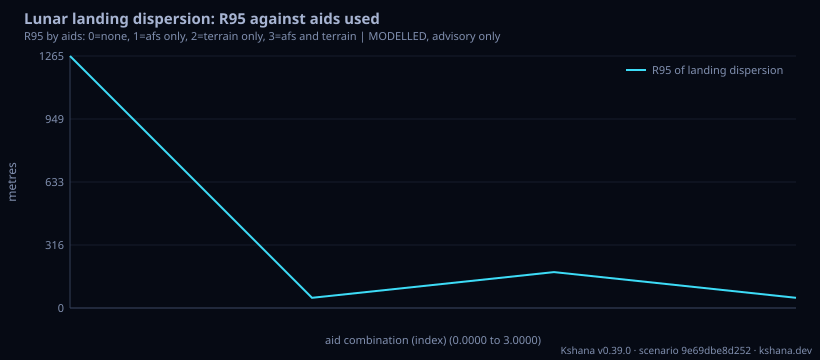

<!-- SPDX-License-Identifier: AGPL-3.0-only -->
<!-- Generated by tools/gen_kinds_index.py from the engine, the schema, the verification matrix and one run of the example. Do not edit by hand. -->
# `lunar-descent`

Scenario kind of the engine v0.39.0, family [Lunar and cislunar](../lunar-and-cislunar.md). Advisory: analysis output from a research and engineering tool, not type-approved navigation equipment and not a safety-of-life service. Every label here is the engine's or the verification matrix's; a kind is MODELLED unless the matrix says otherwise (how a label is earned: the README's Evidence section).

## What it does

MODELLED landing-dispersion budget for a powered descent to a south-polar site (Artemis-class). Per horizontal axis a five-state inertial error model (position, velocity, accelerometer bias, attitude tilt, gyro bias) is driven by the descent's specific force; a sequential filter takes position fixes from the enabled aids: an AFS fix from the visible relays of an ILLUSTRATIVE LCNS-class constellation (standalone, or differential using the correction-link residual of lunar-differential-pnt, with the clock aided when only three relays are visible) and a terrain-relative fix (the crate's TERCOM/SITAN matcher on a synthetic relief, or the Cramer-Rao bound of matching an elevation window of the real LOLA south-polar DEM). Lunar time enters through the vehicle clock at the fixes (the LTC-TT offset of lunar-time-offset, or the uncertainty of its published band) and as a time-tag error along track. Reports the 3-sigma landing ellipse, R95, the closed-form inertial sources, each aid's contribution, the ablation of every aid combination, a Monte Carlo calibration of the ellipse, and the covariance handed on. MODELLED: illustrative IMU class, relay set, descent profile and guidance term; terrain-nav uses a synthetic relief on an Earth metre scale; AFS availability is one epoch on a flat mask. Not agency-endorsed; advisory software, not certified navigation equipment.

One run of `scenarios/lunar-descent.toml` summarises as: lunar-descent | -89.50 deg | inertial only 517/517 m (E/N) | with aids 7.6/4.8 m | dispersion R95 51 m | 3-sigma ellipse 64 x 62 m | 99.1% inside (expect 98.9%) (MODELLED)

## Inputs

From the schema (`kshana kinds --json`):

- Required fields: none
- Optional fields: `site_lat_deg`, `site_lon_deg`, `more_site_lats_deg`, `descent_s`, `specific_force_m_s2`, `horizontal_speed_m_s`, `accel_bias_ug`, `align_arcmin`, `gyro_bias_deg_per_hr`, `carried_pos_sigma_m`, `carried_vel_sigma_m_s`, `guidance_sigma_m`, `afs_mode`, `n_relays`, `mask_deg`, `afs_cn0_dbhz`, `sis_ure_m`, `afs_first_fix_s`, `afs_interval_s`, `baseline_km`, `trn_source`, `trn_fix_time_s`, `trn_altimeter_sigma_m`, `trn_map_sigma_m`, `dem_descriptor`, `trn_window_m`, `trn_height_sigma_m`, `trn_registration_sigma_m`, `lunar_time_mode`, `time_since_sync_days`, `n_trials`, `seed`

The example `scenarios/lunar-descent.toml` sets, among others:

| Field | Value | Unit |
|---|---|---|
| `accel_bias_ug` | 100 | not stated |
| `afs_cn0_dbhz` | 35 | dB-Hz |
| `afs_first_fix_s` | 60 | s |
| `afs_interval_s` | 60 | s |
| `afs_mode` | differential | text |
| `align_arcmin` | 3 | not stated |
| `baseline_km` | 10 | km |
| `carried_pos_sigma_m` | 100 | m |
| `carried_vel_sigma_m_s` | 0.1 | m/s |
| `descent_s` | 600 | s |
| `guidance_sigma_m` | 20 | m |
| `gyro_bias_deg_per_hr` | 0.01 | not stated |

## Run it

```sh
kshana scenarios/lunar-descent.toml
```

2 bundled scenarios use this kind; the others are in [`scenarios/`](../../../scenarios/).

## What it gives

The scalar results of that run, with the units the engine states:

| Result | Value | Unit |
|---|---|---|
| `afs_mode` | differential | text |
| `aids.afs.clock_aided_three_relay_fix` | false | flag |
| `aids.afs.differential_range_sigma_m` | 5.011955 | m |
| `aids.afs.fix_sigma_east_m` | 6.446378 | m |
| `aids.afs.fix_sigma_north_m` | 3.879611 | m |
| `aids.afs.fixes_used` | 9 | 1 |
| `aids.afs.relays_visible` | 7 | 1 |
| `aids.terrain.fix_sigma_east_m` | 29.602636 | m |
| `aids.terrain.fix_sigma_north_m` | 29.602636 | m |
| `aids.terrain.fix_time_s` | 480 | s |

Result label (the engine's): MODELLED



## Evidence

MODELLED: the [verification matrix](../../VERIFICATION-MATRIX.md) rows that name this kind.

- **MODELLED** The `lunar-descent` kind and phase: a five-state per-axis inertial error model (position, velocity, accelerometer bias, tilt, gyro bias) over a powered descent, aided by AFS fixes (standalone or differential, with the clock-aided three-rela

The rows the run itself exercised, with the oracle the matrix gives each (the public sources are named there):

- **MODELLED** Deterministic, scenario-hashed, SBOM + cross-platform golden gates. Oracle (ExternalDataset): SBOM conformance to the official CycloneDX 1.5 JSON Schema (+ valid SPDX identifiers) — an external published standard, zero validation errors over the full dependency graph; the FoM-determinism / byte-reproducibility part remains a pinned self-consistency check, so the row stays MODELLED
- **MODELLED** The `lunar-descent` kind and phase: a five-state per-axis inertial error model (position, velocity, accelerometer bias, tilt, gyro bias) over a powered descent,. Oracle (InternalConsistency): The closed-form inertial drift, the reused kinds' own results and the calibration of the 3-sigma ellipse (the fraction inside agrees with its expectation) in the tests. No flown or tested landing is compared

## Limitations

What the run's own report says is not modelled or not validated:

- MODELLED (result `label`)
- MODELLED landing-dispersion budget for a powered descent to a south-polar site (Artemis-class). (kind catalogue (`kshana kinds --json`))
- MODELLED: illustrative IMU class, relay set, descent profile and guidance term; terrain-nav uses a synthetic relief on an Earth metre scale; AFS availability is one epoch on a flat mask. (kind catalogue (`kshana kinds --json`))
- HONESTY: MODELLED. The IMU class, the descent profile, the relay set, the signal-in-space error and the guidance term are ILLUSTRATIVE inputs, not measurements. The terrain-nav mode uses the self-contained synthetic relief and an Earth metre scale, so the terrain term here is the matcher's behaviour on a stand-in, not a statement about south-polar relief: the lola-crlb variant (lunar-descent-lola.toml) uses the real  (scenario file comment, lines 14 to 20)
- Reproducibility & software assurance is MODELLED, not validated: a sub-claim is externally checked, but the whole capability composes modelled pieces, so the capability stays Modelled. (verification matrix (docs/MODELLED-RATIONALE.md))
- Landing-dispersion budget at a lunar polar site (`lunar-descent`) is MODELLED, not validated: checked against its own closed-form / analytic identity — catches transcription and coefficient errors, but is not an external oracle. (verification matrix (docs/MODELLED-RATIONALE.md))

## See also

- Family page: [Lunar and cislunar](../lunar-and-cislunar.md#lunar-descent)
- All kinds: [KINDS.md](../../KINDS.md)
- Topic page: [MISSION-THREAD-LUNAR.md](../../MISSION-THREAD-LUNAR.md)
- Topic page: [MISSION-THREAD.md](../../MISSION-THREAD.md)
