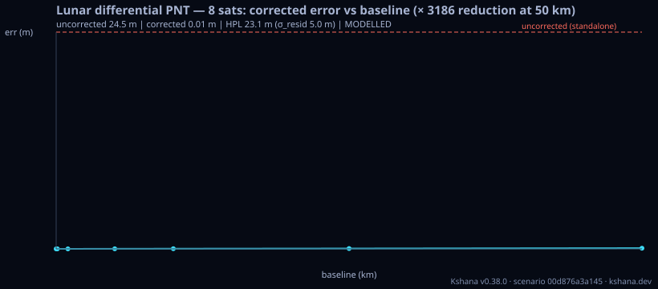

<!-- SPDX-License-Identifier: AGPL-3.0-only -->
<!-- Generated by tools/gen_kinds_index.py from the engine, the schema, the verification matrix and one run of the example. Do not edit by hand. -->
# `lunar-differential-pnt`

Scenario kind of the engine v0.40.0, family [Lunar and cislunar](../lunar-and-cislunar.md). Advisory: analysis output from a research and engineering tool, not type-approved navigation equipment and not a safety-of-life service. Every label here is the engine's or the verification matrix's; a kind is MODELLED unless the matrix says otherwise (how a label is earned: the README's Evidence section).

## What it does

Modelled lunar DIFFERENTIAL PNT (a lunar DGNSS/SBAS analogue): a NovaMoon-class reference station at a KNOWN selenographic location computes per-satellite differential corrections from an ILLUSTRATIVE, public-source Moonlight/LCNS-class constellation (NovaMoon referenced only as a system CLASS, not affiliated with ESA), and a user offset by baseline_km applies them so the COMMON-MODE orbit + clock errors cancel. The clock term cancels EXACTLY (an algebraic identity); the orbit term leaves only the line-of-sight-difference projection, which → 0 as baseline → 0 (the spatial-decorrelation floor) and grows ≈ linearly with baseline. Reports the user 3-D position error WITH vs WITHOUT corrections, the reduction factor, the error-vs-baseline curve, and a user protection level that REUSES the DO-229E SBAS machinery (crate::sbas) with the differential residual σ. MODELLED — exact cancellation identity + first-order decorrelation model; not real-data validated; no TRL/heritage/agency endorsement. Deterministic if seeded.

One run of `scenarios/lunar-differential-pnt.toml` summarises as: lunar-differential-pnt | 8 sats (illustrative LCNS-class, not affiliated) | baseline 50 km | user error 24.46 m → 0.0077 m (3186× reduction) | HPL 23.1 m (σ_resid 5.0 m) | MODELLED

## Inputs

From the schema (`kshana kinds --json`):

- Required fields: none
- Optional fields: `n_sats`, `sma_km`, `eccentricity`, `inc_deg`, `argp_deg`, `ref_lat_deg`, `ref_lon_deg`, `baseline_km`, `orbit_err_m`, `clock_err_m`, `noise_m`, `seed`, `t_s`, `residual_sigma_m`, `p_hmi`, `survey_sigma_m`, `latency_s`, `quantization_bits`

The example `scenarios/lunar-differential-pnt.toml` sets, among others:

| Field | Value | Unit |
|---|---|---|
| `argp_deg` | 90 | deg |
| `baseline_km` | 50 | km |
| `clock_err_m` | 30 | m |
| `eccentricity` | 0.6 | not stated |
| `inc_deg` | 57.7 | deg |
| `kind` | lunar-differential-pnt | text |
| `latency_s` | 10 | s |
| `n_sats` | 8 | count |
| `noise_m` | 0 | m |
| `orbit_err_m` | 100 | m |
| `p_hmi` | 1.0000e-4 | not stated |
| `quantization_bits` | 8 | bit |

## Run it

```sh
kshana scenarios/lunar-differential-pnt.toml
```

## What it gives

The scalar results of that run, with the units the engine states:

| Result | Value | Unit |
|---|---|---|
| `baseline_km` | 50 | km |
| `clock_err_ns` | 100.069229 | ns |
| `correction_link.ageing_clock_class` | rafs | text |
| `correction_link.ageing_clock_time_error_s` | 3.1623e-11 | s |
| `correction_link.ageing_orbit_rate_m_per_s` | 0.006035 | m/s |
| `correction_link.latency_clock_position_sigma_m` | 0.011305 | m |
| `correction_link.latency_clock_range_sigma_m` | 0.00948 | m |
| `correction_link.latency_orbit_position_sigma_m` | 0.093596 | m |
| `correction_link.latency_orbit_range_sigma_m` | 0.060348 | m |
| `correction_link.latency_position_sigma_m` | 0.094276 | m |



## Evidence

No matrix row names this kind by name; the label on its result is the engine's own, above.

The rows the run itself exercised, with the oracle the matrix gives each (the public sources are named there):

- **MODELLED** Deterministic, scenario-hashed, SBOM + cross-platform golden gates. Oracle (ExternalDataset): SBOM conformance to the official CycloneDX 1.5 JSON Schema (+ valid SPDX identifiers) — an external published standard, zero validation errors over the full dependency graph; the FoM-determinism / byte-reproducibility part remains a pinned self-consistency check, so the row stays MODELLED
- **MODELLED** NovaMoon-class differential reference station: common-mode cancellation + baseline-growing residual + DGNSS protection levels. Oracle (InternalConsistency): Differential error-cancellation identity + reuse of the DO-229E SBAS PL machinery; the single-difference + WLS solve is additionally cross-checked against RTKLIB's lsq()/matinv() (Takasu, BSD-2-Clause, compiled C) — independent solver code, but the same first-order LOS-difference algebra, so still InternalConsistency
- **MODELLED** The three terms a differential correction picks up between the epoch it is computed at and the epoch it is used at, each previously left as unmodelled headroom:. Oracle (InternalConsistency): Closed-form identities and self-consistency: the uniform-quantizer step²/12 variance, the exact (GᵀG)⁻¹GᵀRG(GᵀG)⁻¹ covariance propagation collapsing to σ·PDOP for equal σ, the survey term's 1:1 transfer as a consequence of û_user ≈ û_ref, and switching-off quadrature closure. The PDOP cross-check against orbit::dop shares the [−û, 1] normal matrix, so it is a consistency check and is labelled as one rather than an in

## Limitations

What the run's own report says is not modelled or not validated:

- MODELLED — exact cancellation identity + first-order decorrelation model; not real-data validated; no TRL/heritage/agency endorsement. (kind catalogue (`kshana kinds --json`))
- HONESTY: MODELLED. The common-mode cancellation is an EXACT algebraic identity; the spatial-decorrelation residual is a FIRST-ORDER geometric model (the LOS-difference projection of an injected orbit error), not a fitted decorrelation model from real lunar tracking. The user protection level REUSES the DO-229E SBAS protection-level machinery (crate::sbas) with the differential residual sigma as the per-satellite erro (scenario file comment, lines 23 to 28)
- ── THE CORRECTION LINK ────────────────────────────────────────────────────────────── The identity above assumes a PERFECT correction: computed by a station that knows exactly where it stands, delivered instantly, at infinite resolution. None of the three holds, and the three inputs below model what each costs. They feed the `correction_link` block of the result document ONLY -- with all three at the values written h (scenario file comment, lines 57 to 62)
- 1. SURVEY ERROR. The station forms its correction against the coordinate it BELIEVES. An error there rides on every correction it broadcasts and reaches the user as -delta . u_ref -- which contains no user geometry at all, so unlike the orbit term it neither vanishes at zero baseline nor grows with baseline, and it transfers about one-for-one into the user's position. Default 0.30 m is the crate's own lunar reference (scenario file comment, lines 64 to 70)
- 2. CORRECTION AGEING. A correction computed at t and applied at t+tau is stale two ways. Orbit: the satellite has MOVED, so the frozen orbit-error vector now projects onto a rotated line of sight; the rotation comes from this crate's own propagator, so no orbit-error rate is assumed anywhere. Clock: the satellite clock has drifted by c*sigma_y(tau)*tau for the full-RAFS power law in crate::clock_specs, calibrated the (scenario file comment, lines 73 to 79)
- Reproducibility & software assurance is MODELLED, not validated: a sub-claim is externally checked, but the whole capability composes modelled pieces, so the capability stays Modelled. (verification matrix (docs/MODELLED-RATIONALE.md))
- Lunar differential PNT is MODELLED, not validated: checked against its own closed-form / analytic identity — catches transcription and coefficient errors, but is not an external oracle. (verification matrix (docs/MODELLED-RATIONALE.md))
- Lunar differential PNT — correction-link residual budget is MODELLED, not validated: checked against its own closed-form / analytic identity — catches transcription and coefficient errors, but is not an external oracle. (verification matrix (docs/MODELLED-RATIONALE.md))

## See also

- Family page: [Lunar and cislunar](../lunar-and-cislunar.md#lunar-differential-pnt)
- All kinds: [KINDS.md](../../KINDS.md)
- Topic page: [LUNAR-REFERENCE-STATION.md](../../LUNAR-REFERENCE-STATION.md)
- Topic page: [MISSION-THREAD-LUNAR.md](../../MISSION-THREAD-LUNAR.md)
