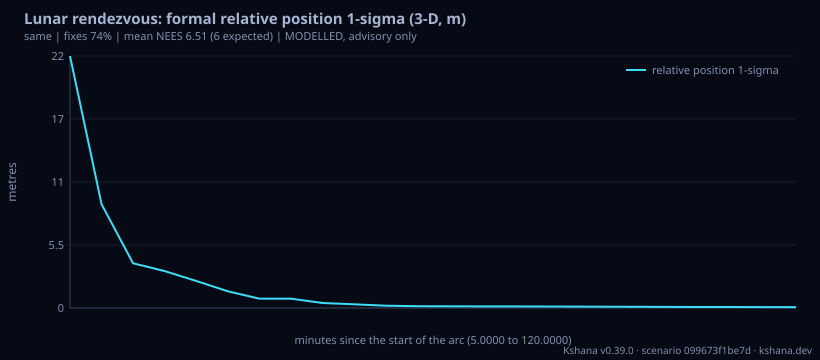

<!-- SPDX-License-Identifier: AGPL-3.0-only -->
<!-- Generated by tools/gen_kinds_index.py from the engine, the schema, the verification matrix and one run of the example. Do not edit by hand. -->
# `lunar-orbit-rendezvous`

Scenario kind of the engine v0.39.0, family [Lunar and cislunar](../lunar-and-cislunar.md). Advisory: analysis output from a research and engineering tool, not type-approved navigation equipment and not a safety-of-life service. Every label here is the engine's or the verification matrix's; a kind is MODELLED unless the matrix says otherwise (how a label is earned: the README's Evidence section).

## What it does

MODELLED relative navigation for an Orion-lander style docking in a low lunar orbit or an elliptical polar orbit (Artemis-class). A chaser and a target fly the same orbit under the crate's lunar force model; a joint 12-state extended Kalman filter fuses an absolute position fix per vehicle from an ILLUSTRATIVE LCNS-class relay set (relays behind the Moon dropped, four needed, the common-mode signal-in-space error cancelling between the vehicles) and a crosslink range, with ranging precision from the code-tracking bound on the LunaNet AFS pilot. Reports the formal and Monte Carlo relative position and velocity error in the target LVLH axes, fix availability, the mean normalised estimation error squared against its expected value, the drift from ignoring the gravity harmonics, and the full 6x6 covariance handed on. A closed-form Hill/Clohessy-Wiltshire check applies to the circular case. MODELLED: illustrative relay set, error budget and priors; the extended filter is optimistic when a sub-metre range meets a prior of tens of metres, and the report says so through its NEES. Not agency-endorsed; advisory software, not certified navigation equipment.

One run of `scenarios/lunar-orbit-rendezvous.toml` summarises as: lunar-orbit-rendezvous | llo 100x100 km | sep 2000 m | fixes 74% | rel pos 1-sigma R/A/C 0.03/0.06/0.04 m | mean NEES 1024047388.46 (6 expected) | converged at 2000 s (MODELLED)

## Inputs

From the schema (`kshana kinds --json`):

- Required fields: none
- Optional fields: `orbit`, `sma_km`, `eccentricity`, `inc_deg`, `argp_deg`, `mean_anomaly_deg`, `separation_m`, `arc_s`, `step_s`, `n_relays`, `afs_cn0_dbhz`, `isl_cn0_dbhz`, `integration_s`, `sis_ure_m`, `common_mode_fraction`, `target_pos_sigma_m`, `target_vel_sigma_m_s`, `carried_pos_sigma_m`, `carried_vel_sigma_m_s`, `filter_model`, `n_trials`, `seed`, `conv_threshold_m`, `gravity_table_path`, `gravity_degree`

The example `scenarios/lunar-orbit-rendezvous.toml` sets, among others:

| Field | Value | Unit |
|---|---|---|
| `afs_cn0_dbhz` | 35 | dB-Hz |
| `arc_s` | 7200 | s |
| `carried_pos_sigma_m` | 100 | m |
| `carried_vel_sigma_m_s` | 0.1 | m/s |
| `common_mode_fraction` | 0.9 | 1 |
| `isl_cn0_dbhz` | 35 | dB-Hz |
| `kind` | lunar-orbit-rendezvous | text |
| `n_relays` | 8 | 1 |
| `n_trials` | 50 | not stated |
| `orbit` | llo | text |
| `seed` | 20261024 | not stated |
| `separation_m` | 2000 | m |

## Run it

```sh
kshana scenarios/lunar-orbit-rendezvous.toml
```

2 bundled scenarios use this kind; the others are in [`scenarios/`](../../../scenarios/).

## What it gives

The scalar results of that run, with the units the engine states:

| Result | Value | Unit |
|---|---|---|
| `advisory` | Advisory software, not certified navigat | text |
| `arc_s` | 7200 | s |
| `common_mode_fraction` | 0.9 | 1 |
| `converged_at_s` | 2000 | s |
| `cw_check.max_position_difference_m` | 41.035408 | m |
| `cw_check.ratio_to_separation` | 0.020518 | 1 |
| `cw_check.separation_m` | 2000 | m |
| `estimator` | batch Gauss-Newton over the arc | text |
| `exit_state.evidence` | MODELLED | text |
| `exit_state.frame` | mci | text |

Result label (the engine's): MODELLED



## Evidence

No matrix row names this kind by name; the label on its result is the engine's own, above.

The rows the run itself exercised, with the oracle the matrix gives each (the public sources are named there):

- **MODELLED** Deterministic, scenario-hashed, SBOM + cross-platform golden gates. Oracle (ExternalDataset): SBOM conformance to the official CycloneDX 1.5 JSON Schema (+ valid SPDX identifiers) — an external published standard, zero validation errors over the full dependency graph; the FoM-determinism / byte-reproducibility part remains a pinned self-consistency check, so the row stays MODELLED

## Limitations

What the run's own report says is not modelled or not validated:

- MODELLED (result `label`)
- MODELLED relative navigation for an Orion-lander style docking in a low lunar orbit or an elliptical polar orbit (Artemis-class). (kind catalogue (`kshana kinds --json`))
- MODELLED: illustrative relay set, error budget and priors; the extended filter is optimistic when a sub-metre range meets a prior of tens of metres, and the report says so through its NEES. (kind catalogue (`kshana kinds --json`))
- HONESTY: MODELLED. The relay set, the signal-in-space error, the common-mode fraction and the priors are ILLUSTRATIVE inputs, not measurements; the truth and the filter share the force model (a built-in central term, J2 and C22). The pre-registered consistency check (mean NEES in [5.2, 6.8]) is met at 35 dB-Hz and NOT met at 45 dB-Hz: see xval/mission-thread-lunar/RESULTS.md. No agreement with any real vehicle is cla (scenario file comment, lines 10 to 14)
- Reproducibility & software assurance is MODELLED, not validated: a sub-claim is externally checked, but the whole capability composes modelled pieces, so the capability stays Modelled. (verification matrix (docs/MODELLED-RATIONALE.md))

## See also

- Family page: [Lunar and cislunar](../lunar-and-cislunar.md#lunar-orbit-rendezvous)
- All kinds: [KINDS.md](../../KINDS.md)
- Topic page: [MISSION-THREAD-LUNAR.md](../../MISSION-THREAD-LUNAR.md)
