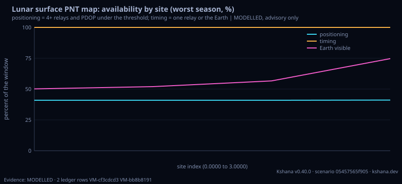

<!-- SPDX-License-Identifier: AGPL-3.0-only -->
<!-- Generated by tools/gen_kinds_index.py from the engine, the schema, the verification matrix and one run of the example. Do not edit by hand. -->
# `lunar-surface`

Scenario kind of the engine v0.39.0, family [Lunar and cislunar](../lunar-and-cislunar.md). Advisory: analysis output from a research and engineering tool, not type-approved navigation equipment and not a safety-of-life service. Every label here is the engine's or the verification matrix's; a kind is MODELLED unless the matrix says otherwise (how a label is earned: the README's Evidence section).

## What it does

MODELLED surface positioning and timing availability by site and season for Artemis-class south-polar sites. For each site and season (an epoch and a window after it) it reports relay positioning (four or more relays of an ILLUSTRATIVE LCNS-class constellation in view and PDOP under a threshold, from the same functions as moonlight-service-volume and, with a terrain section, the ray-marched skyline of lunar-station-coverage's terrain), whether the Earth and the Sun are above the site's horizon (analytic Sun, Moon and lunar orientation, libration included, which is what moves with the season), and timing availability (a relay or the Earth in view) with the longest stretch of neither, the holdover a surface clock must ride out. A single-site result equals moonlight-service-volume's to the bit. MODELLED: illustrative Keplerian relay set on a mean-rotation Moon; the relay figure does not change with season; the terrain is the 1200 m LOLA crop. Not agency-endorsed; advisory software, not certified navigation equipment.

One run of `scenarios/lunar-surface.toml` summarises as: lunar-surface | 4 sites x 4 seasons | positioning 41% to 41% | worst timing availability 100.0% | longest timing gap 0.0 h (MODELLED)

## Inputs

From the schema (`kshana kinds --json`):

- Required fields: none
- Optional fields: `sites`, `season_dates`, `window_days`, `step_min`, `stay_days`, `timing_floor_s`, `n_sats`, `sma_km`, `eccentricity`, `inc_deg`, `argp_deg`, `mask_deg`, `pdop_threshold`, `earth_mask_deg`, `sun_mask_deg`, `terrain`

The example `scenarios/lunar-surface.toml` sets, among others:

| Field | Value | Unit |
|---|---|---|
| `argp_deg` | 90 | deg |
| `earth_mask_deg` | 0 | deg |
| `eccentricity` | 0.6 | not stated |
| `inc_deg` | 57.7 | deg |
| `kind` | lunar-surface | text |
| `mask_deg` | 5 | deg |
| `n_sats` | 8 | not stated |
| `pdop_threshold` | 6 | 1 |
| `season_dates` | [2028-01-01, 2028-04-01, 2028-07-01, 2028-09-30] | not stated |
| `sites[0].lat_deg` | -89.9 | deg |
| `sites[0].lon_deg` | 0 | deg |
| `sites[0].name` | south-polar 89.9 | text |

## Run it

```sh
kshana scenarios/lunar-surface.toml
```

2 bundled scenarios use this kind; the others are in [`scenarios/`](../../../scenarios/).

## What it gives

The scalar results of that run, with the units the engine states:

| Result | Value | Unit |
|---|---|---|
| `advisory` | Advisory software, not certified navigat | text |
| `exit_state.clock_sigma_s` | 5.0000e-8 | s |
| `exit_state.evidence` | MODELLED | text |
| `exit_state.frame` | mci | text |
| `exit_state.longest_timing_gap_h` | 0 | h |
| `exit_state.position_velocity_covariance` | passes through unchanged | text |
| `exit_state.stay_days` | 27.3217 | d |
| `exit_state.timing_floor_s` | 5.0000e-8 | s |
| `frames_note` | relays: mean-rotation Moon (no libration | text |
| `mask_deg` | 5 | deg |

Result label (the engine's): MODELLED



## Evidence

No matrix row names this kind by name; the label on its result is the engine's own, above.

The rows the run itself exercised, with the oracle the matrix gives each (the public sources are named there):

- **MODELLED** Deterministic, scenario-hashed, SBOM + cross-platform golden gates. Oracle (ExternalDataset): SBOM conformance to the official CycloneDX 1.5 JSON Schema (+ valid SPDX identifiers) — an external published standard, zero validation errors over the full dependency graph; the FoM-determinism / byte-reproducibility part remains a pinned self-consistency check, so the row stays MODELLED

## Limitations

What the run's own report says is not modelled or not validated:

- MODELLED (result `label`)
- MODELLED surface positioning and timing availability by site and season for Artemis-class south-polar sites. (kind catalogue (`kshana kinds --json`))
- MODELLED: illustrative Keplerian relay set on a mean-rotation Moon; the relay figure does not change with season; the terrain is the 1200 m LOLA crop. (kind catalogue (`kshana kinds --json`))
- HONESTY: MODELLED. The relay set is illustrative and Keplerian, with the Moon turning at the mean rate for the relays (no libration) as in moonlight-service-volume; the Earth and Sun use the analytic orientation, so the two frames differ by that omission. The relay positioning figure does not change with the season in this model; the Earth and Sun figures do. No agreement with any real service or site is claimed. Adv (scenario file comment, lines 11 to 15)
- Reproducibility & software assurance is MODELLED, not validated: a sub-claim is externally checked, but the whole capability composes modelled pieces, so the capability stays Modelled. (verification matrix (docs/MODELLED-RATIONALE.md))

## See also

- Family page: [Lunar and cislunar](../lunar-and-cislunar.md#lunar-surface)
- All kinds: [KINDS.md](../../KINDS.md)
- Topic page: [MISSION-THREAD-LUNAR.md](../../MISSION-THREAD-LUNAR.md)
