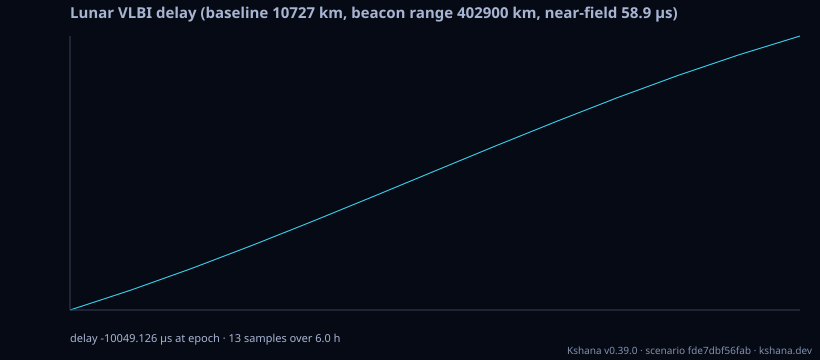

<!-- SPDX-License-Identifier: AGPL-3.0-only -->
<!-- Generated by tools/gen_kinds_index.py from the engine, the schema, the verification matrix and one run of the example. Do not edit by hand. -->
# `lunar-vlbi`

Scenario kind of the engine v0.40.0, family [Lunar and cislunar](../lunar-and-cislunar.md). Advisory: analysis output from a research and engineering tool, not type-approved navigation equipment and not a safety-of-life service. Every label here is the engine's or the verification matrix's; a kind is MODELLED unless the matrix says otherwise (how a label is earned: the README's Evidence section).

## What it does

Modelled lunar geodetic VLBI delay observable: an Earth baseline (two ground stations, GCRS) observes a one-way signal from a NovaMoon-class lunar-surface beacon. Emits the near-field two-range-difference delay, its rate, and the wavefront-curvature near-field correction over a pass — cross-checked against the same-codebase plane-wave Δ-DOR observable in the far-field limit, with finite-difference-verified partials. The default analytic path is MODELLED and carries the frame-consistency, xp=yp=0 polar-motion and plane-wave-vs-near-field caveats. Setting planetary_kernel_path, earth_orientation_kernel_path and moon_orientation_kernel_path runs the kernel path instead (DE440, MOON_PA_DE440, ITRF93; converged barycentric light times; adds the epoch's beacon and station partials), whose Newtonian delay and partials agree with NAIF SPICE converged light times to 0.06 ps and 7.4e-9. Not validated against real VLBI data.

One run of `scenarios/lunar-vlbi.toml` summarises as: lunar-vlbi | baseline 10727 km | beacon range 402900 km | delay -10049.126 µs (rate 1.312e-6 s/s) | near-field 58.9 µs | 13 samples over 6.0 h

## Inputs

From the schema (`kshana kinds --json`):

- Required fields: none
- Optional fields: `station1_lat_deg`, `station1_lon_deg`, `station1_alt_m`, `station2_lat_deg`, `station2_lon_deg`, `station2_alt_m`, `beacon_lat_deg`, `beacon_lon_deg`, `beacon_alt_m`, `epoch_year`, `epoch_month`, `epoch_day`, `horizon_hours`, `step_min`, `planetary_kernel_path`, `earth_orientation_kernel_path`, `moon_orientation_kernel_path`

The example `scenarios/lunar-vlbi.toml` sets, among others:

| Field | Value | Unit |
|---|---|---|
| `beacon_alt_m` | 0 | m |
| `beacon_lat_deg` | 0 | deg |
| `beacon_lon_deg` | 0 | deg |
| `epoch_day` | 1 | d |
| `epoch_month` | 1 | not stated |
| `epoch_year` | 2024 | not stated |
| `horizon_hours` | 6 | hr |
| `kind` | lunar-vlbi | text |
| `station1_alt_m` | 1000 | m |
| `station1_lat_deg` | 40.4256 | deg |
| `station1_lon_deg` | -116.8893 | deg |
| `station2_alt_m` | 688 | m |

## Run it

```sh
kshana scenarios/lunar-vlbi.toml
```

## What it gives

The scalar results of that run, with the units the engine states:

| Result | Value | Unit |
|---|---|---|
| `baseline_km` | 10726.748487 | km |
| `beacon_range_km` | 4.0290e5 | km |
| `delay_rate_s_per_s` | 1.3118e-6 | s/s |
| `delay_s` | -0.010049 | s |
| `evidence.id_rule` | the stable id of the matrix row (the ID  | text |
| `evidence.matrix` | docs/VERIFICATION-MATRIX.md | text |
| `evidence.tier` | MODELLED | text |
| `geometry_path` | analytic | text |
| `horizon_hours` | 6 | hr |
| `max_delay_s` | 0.022437 | s |



## Evidence

MODELLED 3 · VALIDATED 3: the [verification matrix](../../VERIFICATION-MATRIX.md) rows that name this kind.

- **MODELLED** Near-field VLBI delay for an Earth baseline observing a lunar beacon + partials
- **VALIDATED** Near-field VLBI delay for an Earth baseline observing a lunar beacon, with beacon and station partials, on the kernel path (lunar_vlbi::KernelGeometry): DE440 Earth and Moon, DE440 lunar principal axes, ITRF93 Earth orientation with UT1 and Tests: [naif_kernel_reader_check.rs](../../../tests/naif_kernel_reader_check.rs).
- **VALIDATED** Delay partials accumulated over a schedule of baselines × epochs into a Fisher information matrix, inverted to the station coordinate covariance and the per-coordinate station sigma, replacing an assumed isotropic equipartition link from a 
- **MODELLED** A third datum choice, `all-stations-fixed`, that holds every Earth station and estimates the BEACON's Moon-body-fixed coordinates alone — the configuration a lunar surface-point uncertainty is actually quoted for, since Earth station coordi
- and 2 more in the matrix.

The rows the run itself exercised, with the oracle the matrix gives each (the public sources are named there):

- **MODELLED** Deterministic, scenario-hashed, SBOM + cross-platform golden gates. Oracle (ExternalDataset): SBOM conformance to the official CycloneDX 1.5 JSON Schema (+ valid SPDX identifiers) — an external published standard, zero validation errors over the full dependency graph; the FoM-determinism / byte-reproducibility part remains a pinned self-consistency check, so the row stays MODELLED
- **MODELLED** Near-field VLBI delay for an Earth baseline observing a lunar beacon + partials. Oracle (ReferenceImpl): Plane-wave delta_dor (same-codebase) in the far-field limit; finite-difference partials. 0.30 external comparison, a finding (stays MODELLED): against ANISE 0.10 converged light times through DE440 (75 delays on 2024-01-01 over three DSN baselines, generated by xval/anise-lunar-od without Kshana code), no delay is within the 1 ps tolerance. The largest gap is 24 µs, from the analytic Moon centre (about 200 km from DE

## Limitations

What the run's own report says is not modelled or not validated:

- The default analytic path is MODELLED and carries the frame-consistency, xp=yp=0 polar-motion and plane-wave-vs-near-field caveats. (kind catalogue (`kshana kinds --json`))
- Honesty: MODELLED, NOT validated against real VLBI data. Polar motion is dropped (xp = yp = 0) so station inertial positions carry a few-metre frame error; the beacon mixes a mean-equator-of-date Moon series with an ICRF body-fixed offset (jd_tdb ~ jd_tt), a frame-consistency mismatch below model fidelity; no light-time iteration, media or aberration beyond the differenced Shapiro. No TRL, flight heritage or agency e (scenario file comment, lines 17 to 21)
- Reproducibility & software assurance is MODELLED, not validated: a sub-claim is externally checked, but the whole capability composes modelled pieces, so the capability stays Modelled. (verification matrix (docs/MODELLED-RATIONALE.md))
- Lunar geodetic VLBI is MODELLED, not validated: checked against a separate implementation in this same codebase — independent of the unit under test, but not externally authoritative. (verification matrix (docs/MODELLED-RATIONALE.md))

## See also

- Family page: [Lunar and cislunar](../lunar-and-cislunar.md#lunar-vlbi)
- All kinds: [KINDS.md](../../KINDS.md)
