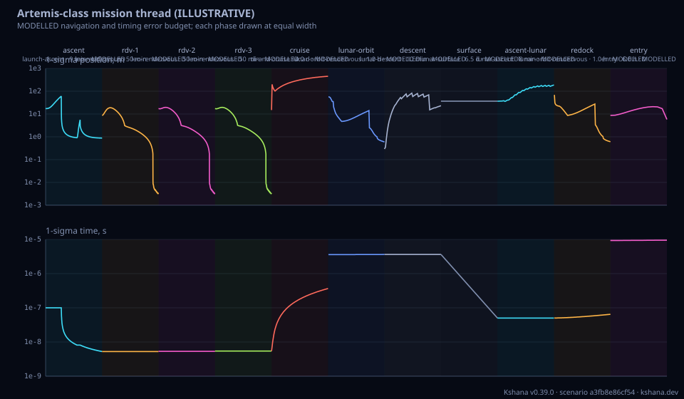

<!-- SPDX-License-Identifier: AGPL-3.0-only -->
<!-- Generated by tools/gen_kinds_index.py from the engine, the schema, the verification matrix and one run of the example. Do not edit by hand. -->
# `mission-thread`

Scenario kind of the engine v0.39.0, family [Mission threads](../mission-threads.md). Advisory: analysis output from a research and engineering tool, not type-approved navigation equipment and not a safety-of-life service. Every label here is the engine's or the verification matrix's; a kind is MODELLED unless the matrix says otherwise (how a label is earned: the README's Evidence section).

## What it does

MODELLED navigation and timing error budget of a stated chain of mission phases, from launch to entry: launch and ascent, low-Earth-orbit rendezvous and docking (repeatable), trans-lunar injection and cislunar cruise, lunar-orbit rendezvous, descent, surface stay, ascent and the return and entry, each phase one of eight registered kinds with its own sensors and filter. The 6x6 covariance, the clock and the frame are handed from phase to phase under a stated rule (carry, inflate or reacquire); frame and timescale conversions (GCRF, MCI, MCMF, UTC, TT, TDB, LTC) are their own budget rows, with the Moon's state from an optional DE440 kernel cut and the analytic series as the stated fallback. An optional ground-network overlay sets the tracking duty of each phase. Reports the per-phase budget (entry, peak and exit 1-sigmas, every contribution with its unit), the margin against a stated requirement, the weakest link, the events and a timeline figure. MODELLED: every number is a stated input; the chain follows one stack and no vehicle is modelled. Public sources only; not affiliated with or endorsed by any agency; advisory software, not certified navigation equipment.

One run of `scenarios/mission-thread-artemis-class.toml` summarises as: mission-thread | 11 phases | Artemis-class mission thread (ILLUSTRATIVE) | weakest link descent | MODELLED

## Inputs

From the schema (`kshana kinds --json`):

- Required fields: `epoch_utc`, `entry`, `phase`
- Optional fields: `kind`, `title`, `seed`, `moon_kernel_path`, `ground_network`

The example `scenarios/mission-thread-artemis-class.toml` sets, among others:

| Field | Value | Unit |
|---|---|---|
| `entry.frame` | gcrf | text |
| `entry.sigma_drift_s_per_s` | 1.0000e-12 | s |
| `entry.sigma_pos_m` | 10 | m |
| `entry.sigma_time_s` | 1.0000e-7 | s |
| `entry.sigma_vel_mps` | 0.01 | m/s |
| `entry.timescale` | utc | text |
| `entry.x` | [5.2850e6, 1.8802e6, 3.0253e6, -137.105, 385.389, 0] | not stated |
| `epoch_utc` | 2028-01-01T00:00:00Z | text |
| `ground_network.handover_gap_s` | 120 | s |
| `ground_network.min_elevation_deg` | 10 | deg |
| `ground_network.phases[0].geometry` | moon-direction | text |
| `ground_network.phases[0].phase` | cruise | text |

## Run it

```sh
kshana scenarios/mission-thread-artemis-class.toml
```

## What it gives

The scalar results of that run, with the units the engine states:

| Result | Value | Unit |
|---|---|---|
| `epoch_utc` | 2028-01-01T00:00:00Z | text |
| `schema` | kshana-mission-thread/1 | text |
| `seed` | 20261024 | 1 |
| `weakest_link.basis` | smallest margin against a stated require | text |
| `weakest_link.limiting_source` | inertial drift, no aid, east | text |
| `weakest_link.margin` | 1.213087 | 1 |
| `weakest_link.phase_id` | descent | text |

Result label (the engine's): MODELLED



## Evidence

No matrix row names this kind by name; the label on its result is the engine's own, above.

The rows the run itself exercised, with the oracle the matrix gives each (the public sources are named there):

- **MODELLED** Deterministic, scenario-hashed, SBOM + cross-platform golden gates. Oracle (ExternalDataset): SBOM conformance to the official CycloneDX 1.5 JSON Schema (+ valid SPDX identifiers) — an external published standard, zero validation errors over the full dependency graph; the FoM-determinism / byte-reproducibility part remains a pinned self-consistency check, so the row stays MODELLED

## Limitations

What the run's own report says is not modelled or not validated:

- MODELLED navigation and timing error budget of a stated chain of mission phases, from launch to entry: launch and ascent, low-Earth-orbit rendezvous and docking (repeatable), trans-lunar injection and cislunar cruise, lunar-orbit rendezvous, descent, surface stay, ascent and the return and entry, each phase one of eight registered kinds with its own sensors and filter. (kind catalogue (`kshana kinds --json`))
- MODELLED: every number is a stated input; the chain follows one stack and no vehicle is modelled. (kind catalogue (`kshana kinds --json`))
- HONESTY. Every number here is ILLUSTRATIVE: a round figure chosen to make the chain run, not the performance of any vehicle, sensor, station or network. The chain follows one stack as a stated simplification; vehicle changes, crew transfers and the lunar-orbit station are not modelled, the lunar orbits are the 100 km circular and polar ones the lunar kinds fly (not the near-rectilinear halo orbit), and the TLI burn i (scenario file comment, lines 11 to 17)
- Reproducibility & software assurance is MODELLED, not validated: a sub-claim is externally checked, but the whole capability composes modelled pieces, so the capability stays Modelled. (verification matrix (docs/MODELLED-RATIONALE.md))

## See also

- Family page: [Mission threads](../mission-threads.md#mission-thread)
- All kinds: [KINDS.md](../../KINDS.md)
- Topic page: [MISSION-THREAD.md](../../MISSION-THREAD.md)
- Topic page: [MISSION-THREAD-LUNAR.md](../../MISSION-THREAD-LUNAR.md)
