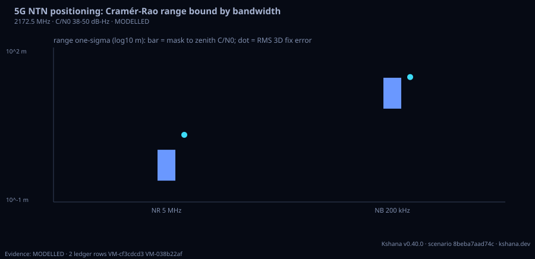

<!-- SPDX-License-Identifier: AGPL-3.0-only -->
<!-- Generated by tools/gen_kinds_index.py from the engine, the schema, the verification matrix and one run of the example. Do not edit by hand. -->
# `ntn-positioning`

Scenario kind of the engine v0.40.0, family [Low-Earth-orbit navigation](../low-earth-orbit-navigation.md). Advisory: analysis output from a research and engineering tool, not type-approved navigation equipment and not a safety-of-life service. Every label here is the engine's or the verification matrix's; a kind is MODELLED unless the matrix says otherwise (how a label is earned: the README's Evidence section).

## What it does

Positioning from a 5G non-terrestrial network (NTN) downlink in the mobile-satellite service (MSS) S band (3GPP band n256, downlink 2170 to 2200 MHz; default carrier 2172.5 MHz): the Cramér-Rao bound (CRB) on time of arrival, c / (2 pi beta sqrt(2 (C/N0) T)) with beta the root-mean-square (Gabor) bandwidth of the flat OFDM spectrum (B/sqrt(12)), and on the Doppler of a complex tone, sqrt(3 / (2 pi^2 (C/N0) T^3)), for each signal (default a 5 MHz New Radio channel with 4.5 MHz occupied and a 200 kHz narrowband channel with 180 kHz occupied); then, over any LEO constellation, downlink time-of-arrival fixes with an unknown receiver clock (seeded, with the bound plus a network synchronisation error as the sigma), their PDOP and formal 3D sigma, and a single-satellite Doppler fix over the longest pass with the height held. MODELLED: the bandwidth-to-bound step is the textbook closed form, checked against numerical integration of the flat and band-limited BPSK spectra (internal consistency, no published worked figure pinned), and the positioning accuracy is a bound on a multipath-free channel with a stated synchronisation error, not an achieved result.

One run of `scenarios/ntn-5g-positioning.toml` summarises as: 5G NTN positioning at 2172.5 MHz, C/N0 38 to 50 dB-Hz, 324 satellites (10.0 in view)
  NR 5 MHz: 4500 kHz, CRB range 0.26 to 1.03 m; median formal 3D 2.09 m, RMS error 2.01 m
  NB 200 kHz: 180 kHz, CRB range 6.49 to 25.85 m; median formal 3D 25.94 m, RMS error 26.73 m
  one-satellite Doppler pass: 53 samples over 520 s, horizontal error 1.9 m


## Inputs

From the schema (`kshana kinds --json`):

- Required fields: none
- Optional fields: `seed`, `carrier_hz`, `signal`, `integration_s`, `doppler_integration_s`, `cn0_dbhz`, `sync_error_m`, `user`, `duration_s`, `step_s`, `system`

The example `scenarios/ntn-5g-positioning.toml` sets, among others:

| Field | Value | Unit |
|---|---|---|
| `carrier_hz` | 2172500000 | Hz |
| `cn0_dbhz` | [38, 50] | dB-Hz |
| `doppler_integration_s` | 1 | s |
| `duration_s` | 600 | s |
| `integration_s` | 0.1 | s |
| `kind` | ntn-positioning | text |
| `seed` | 5 | not stated |
| `signal[0].bandwidth_hz` | 4500000 | Hz |
| `signal[0].name` | NR 5 MHz | text |
| `signal[1].bandwidth_hz` | 180000 | Hz |
| `signal[1].name` | NB 200 kHz | text |
| `step_s` | 10 | s |

## Run it

```sh
kshana scenarios/ntn-5g-positioning.toml
```

## What it gives

The scalar results of that run, with the units the engine states:

| Result | Value | Unit |
|---|---|---|
| `carrier_hz` | 2172500000 | Hz |
| `doppler_integration_s` | 1 | s |
| `doppler_pass.duration_s` | 520 | s |
| `doppler_pass.horizontal_error_m` | 1.872198 | m |
| `doppler_pass.n_obs` | 53 | count |
| `doppler_pass.satellite` | 255 | index |
| `doppler_pass.sigma_range_rate_mps` | 0.001 | m/s |
| `doppler_sigma_zenith_hz` | 0.001233 | Hz |
| `evidence.id_rule` | the stable id of the matrix row (the ID  | text |
| `evidence.matrix` | docs/VERIFICATION-MATRIX.md | text |

Result label (the engine's): MODELLED positioning from Cramér-Rao bounds: the bandwidth-to-bound step is a textbook closed form (checked against numerical integration, not against a published worked figure); the accuracy is a bound on a multipath-free channel with a stated synchronisation error, not an achieved result



## Evidence

VALIDATED: the [verification matrix](../../VERIFICATION-MATRIX.md) rows that name this kind.

- **VALIDATED** The Cramér-Rao bound on time of arrival from the root-mean-square (Gabor) bandwidth, c/(2 pi beta sqrt(2 (C/N0) T)), for a flat OFDM spectrum (beta = B/sqrt(12)), a band-limited BPSK spectrum (closed-form numerator) or any spectrum by quadr Tests: [leo_fusion_scenarios.rs](../../../tests/leo_fusion_scenarios.rs).

The rows the run itself exercised, with the oracle the matrix gives each (the public sources are named there):

- **MODELLED** Deterministic, scenario-hashed, SBOM + cross-platform golden gates. Oracle (ExternalDataset): SBOM conformance to the official CycloneDX 1.5 JSON Schema (+ valid SPDX identifiers) — an external published standard, zero validation errors over the full dependency graph; the FoM-determinism / byte-reproducibility part remains a pinned self-consistency check, so the row stays MODELLED
- **VALIDATED** The Cramér-Rao bound on time of arrival from the root-mean-square (Gabor) bandwidth, c/(2 pi beta sqrt(2 (C/N0) T)), for a flat OFDM spectrum (beta = B/sqrt(12). Oracle (ExternalDataset): Published worked values (P1): Bachl, Lei and Nabeel, arXiv:2608.10270 (2026), single-SSB bounds of NR NTN reproduced from the 3GPP TS 38.211 SSB map through Kshana own numeric functions (W_rms 1.9616 vs 1.96 MHz, sigma_t 38.755 vs 39 us, sigma_f 100.79/87.28 vs 101/87 Hz, sigma_rho 0.5970/0.5831 vs 0.60/0.58 m, each within half a unit of the printed last digit); Betz 2001 Table 1 BPSK-R RMS bandwidths (1.128/3.477 vs

## Limitations

What the run's own report says is not modelled or not validated:

- MODELLED positioning from Cramér-Rao bounds: the bandwidth-to-bound step is a textbook closed form (checked against numerical integration, not against a published worked figure); the accuracy is a bound on a multipath-free channel with a stated synchronisation error, not an achieved result (result `label`)
- MODELLED: the bandwidth-to-bound step is the textbook closed form, checked against numerical integration of the flat and band-limited BPSK spectra (internal consistency, no published worked figure pinned), and the positioning accuracy is a bound on a multipath-free channel with a stated synchronisation error, not an achieved result. (kind catalogue (`kshana kinds --json`))
- The bandwidth-to-bound step is a textbook closed form; the positioning accuracy is MODELLED (a bound on a multipath-free channel, not an achieved result). (scenario file comment, lines 12 to 13)
- Reproducibility & software assurance is MODELLED, not validated: a sub-claim is externally checked, but the whole capability composes modelled pieces, so the capability stays Modelled. (verification matrix (docs/MODELLED-RATIONALE.md))

## See also

- Family page: [Low-Earth-orbit navigation](../low-earth-orbit-navigation.md#ntn-positioning)
- All kinds: [KINDS.md](../../KINDS.md)
- Topic page: [LEO-PNT.md](../../LEO-PNT.md)
- Topic page: [LEO-PNT-FUSION.md](../../LEO-PNT-FUSION.md)
