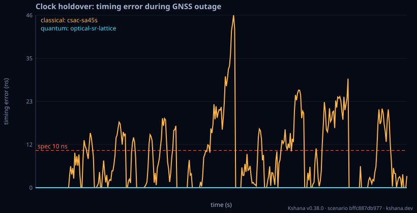

<!-- SPDX-License-Identifier: AGPL-3.0-only -->
<!-- Generated by tools/gen_kinds_index.py from the engine, the schema, the verification matrix and one run of the example. Do not edit by hand. -->
# `orbit`

Scenario kind of the engine v0.38.0, family [Constellations, coverage and geometry](../constellations-coverage-and-geometry.md). Advisory: analysis output from a research and engineering tool, not type-approved navigation equipment and not a safety-of-life service. Every label here is the engine's or the verification matrix's; a kind is MODELLED unless the matrix says otherwise (how a label is earned: the README's Evidence section).

## What it does

GNSS availability + DOP from an orbital constellation (Walker / TLE / RINEX).

One run of `scenarios/orbit-rinex.toml` summarises as: scenario bffc887db977 | 77/361 samples GNSS-nominal | best PDOP 2.53 pos 2.53m | quantum holdover 0s p95 6.49e-5ns integrity 1.000 security n/a (no attack) | classical holdover 0s p95 25.0ns integrity 1.000 security n/a (no attack)

## Inputs

From the schema (`kshana kinds --json`):

- Required fields: `seed`, `threshold_ns`, `mask_deg`, `time`, `user|user_site`, `constellation`, `clock_quantum`, `clock_classical`
- Optional fields: `sigma_uere_m`, `constellations`, `epoch`, `export_sp3`, `export_omm`, `export_oem`, `skyline`

The example `scenarios/orbit-rinex.toml` sets, among others:

| Field | Value | Unit |
|---|---|---|
| `clock_classical.id` | csac-sa45s | text |
| `clock_classical.provenance` | Microchip SA.45s / SA65 chip-scale atomic clock, sigma_y(1s) | text |
| `clock_classical.q_rw` | 1.0000e-28 | 1/s |
| `clock_classical.q_wf` | 9.0000e-20 | s^2/s |
| `clock_classical.y0` | 1.0000e-11 | 1 |
| `clock_quantum.id` | optical-sr-lattice | text |
| `clock_quantum.provenance` | Strontium optical lattice clock, space-oriented goal sigma_y | text |
| `clock_quantum.q_rw` | 1.0000e-40 | 1/s |
| `clock_quantum.q_wf` | 1.0000e-30 | s^2/s |
| `clock_quantum.y0` | 1.0000e-15 | 1 |
| `constellation.rinex` |      3.04           N: GNSS NAV DATA    G: GPS               | text |
| `kind` | orbit | text |

## Run it

```sh
kshana scenarios/orbit-rinex.toml
```

7 bundled scenarios use this kind; the others are in [`scenarios/`](../../../scenarios/).

## What it gives

The scalar results of that run, with the units the engine states:

| Result | Value | Unit |
|---|---|---|
| `classical.filter_health.consistent` | true | flag |
| `classical.filter_health.nees_chi2_lower_95` | 1.540167 | 1 |
| `classical.filter_health.nees_chi2_upper_95` | 2.518928 | 1 |
| `classical.filter_health.nees_mean` | 1.963599 | 1 |
| `classical.filter_health.nis_chi2_lower_95` | 0.975649 | 1 |
| `classical.filter_health.nis_chi2_upper_95` | 1.024647 | 1 |
| `classical.filter_health.nis_mean` | 1.000119 | 1 |
| `classical.fom.availability` | 0.645429 | 1 |
| `classical.fom.holdover_s` | 0 | s |
| `classical.fom.integrity` | 1 | 1 |



## Evidence

MODELLED 4 · VALIDATED 4: the [verification matrix](../../VERIFICATION-MATRIX.md) rows that name this kind.

- **VALIDATED** Earth rotation from a two-part UT1 Julian date on the orbit path, so the Earth-fixed position keeps the microsecond a single-f64 date loses (about 3e-9 rad near 2020): jd2::gmst82 (IAU 1982 GMST, the TEME convention, on the two parts), cio:
- **VALIDATED** GDOP/PDOP/HDOP/VDOP/TDOP from line-of-sight geometry via Q=(HᵀH)⁻¹ with a local ENU split Tests: [dop_reference.rs](../../../tests/dop_reference.rs).
- **MODELLED** dop_error_mc::run_geometry and check: a seeded Monte Carlo (N = 20,000 epochs per geometry, sigma = 1.5 m, ChaCha8 seed 36 + i) of the engine's own iterated least-squares fix (pvt::solve_spp, unit weights, solved from the true position) on  Tests: [uere_dop_monte_carlo.rs](../../../tests/uere_dop_monte_carlo.rs).
- **VALIDATED** skyline + frames::look_angles + geometry::sky_geometry: the geodetic (WGS-84) azimuth and elevation of a satellite from a ground site, an azimuth/elevation mask table linearly interpolated in azimuth with wrap at 360 deg, the visible set el Tests: [skyline_orekit_oracle.rs](../../../tests/skyline_orekit_oracle.rs).
- and 4 more in the matrix.

The rows the run itself exercised, with the oracle the matrix gives each (the public sources are named there):

- **VALIDATED** Allan/modified/Hadamard deviation + power-law noise ID with χ² CIs. Oracle (ExternalDataset): NIST SP 1065 (Riley) / Stable32 reference deviations on NBS14
- **VALIDATED** GDOP/PDOP/HDOP/VDOP/TDOP from line-of-sight geometry via Q=(HᵀH)⁻¹ with a local ENU split. Oracle (ExternalDataset): gnss_lib_py 1.0.4 (Stanford NAV Lab) DOP — independent library, matched to 1e-6 relative
- **MODELLED** Closed-form coast-error growth + holdover-to-threshold; quantum-clock classes. Oracle (ReferenceImpl): Multi-step clock_state covariance recursion (same-codebase cross-check); the underlying coast-variance & holdover-inversion kernel is externally validated vs scipy (see 'Clock-holdover coast-variance & threshold inversion'). The per-class red-noise-floor holdover figures stay MODELLED
- **MODELLED** 3-state (phase/freq/drift) van-Loan Kalman clock, Joseph-stabilised. Oracle (ReferenceImpl): filterpy 1.4.5 KalmanFilter (R. Labbe, MIT), with F via scipy.linalg.expm and Q via the Van-Loan 1978 block-matrix — an independent reference implementation reproducing kshana's full filter trajectory. Cross-implementation consistency: the clock physics / Allan calibration are not externally validated, so this stays MODELLED. 0.30 external comparison, a finding (stays MODELLED): on IGS final 30 s clocks of 11 GPS Blo
- **MODELLED** Clock-aided χ², RAIM, AGC, SQM fused per-epoch security FoM. Oracle (ExternalDataset): TEXBAT scenario parameters (Humphreys 2012) — characterisation, not pinned vectors. 0.30 external comparison, a finding (stays MODELLED): on JammerTest 2024 (Bleik; GPL-3.0 data) the observable-level monitors (clock-aided chi-square, RAIM, solve failure) raised no alarm within 10 s of any of the 8 evaluable published spoofing onsets (where the pre-onset window was clean, the first alarm came 10.2 to 39 s after the pu

## Limitations

What the run's own report says is not modelled or not validated:

- GNSS-denied clock holdover is MODELLED, not validated: checked against a separate implementation in this same codebase — independent of the unit under test, but not externally authoritative. (verification matrix (docs/MODELLED-RATIONALE.md))
- Onboard clock state estimation is MODELLED, not validated: checked against a separate implementation in this same codebase — independent of the unit under test, but not externally authoritative. (verification matrix (docs/MODELLED-RATIONALE.md))
- Spoofing detection is MODELLED, not validated: a sub-claim is externally checked, but the whole capability composes modelled pieces, so the capability stays Modelled. (verification matrix (docs/MODELLED-RATIONALE.md))
- Reproducibility & software assurance is MODELLED, not validated: a sub-claim is externally checked, but the whole capability composes modelled pieces, so the capability stays Modelled. (verification matrix (docs/MODELLED-RATIONALE.md))

## See also

- Family page: [Constellations, coverage and geometry](../constellations-coverage-and-geometry.md#orbit)
- All kinds: [KINDS.md](../../KINDS.md)
- Topic page: [SKYLINE.md](../../SKYLINE.md)
- Topic page: [LEO-PASS.md](../../LEO-PASS.md)
