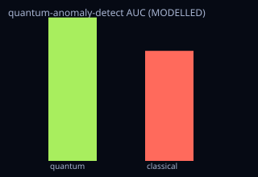

<!-- SPDX-License-Identifier: AGPL-3.0-only -->
<!-- Generated by tools/gen_kinds_index.py from the engine, the schema, the verification matrix and one run of the example. Do not edit by hand. -->
# `quantum-anomaly-detect`

Scenario kind of the engine v0.40.0, family [Inertial, fusion and quantum sensors](../inertial-fusion-and-quantum-sensors.md). Advisory: analysis output from a research and engineering tool, not type-approved navigation equipment and not a safety-of-life service. Every label here is the engine's or the verification matrix's; a kind is MODELLED unless the matrix says otherwise (how a label is earned: the README's Evidence section).

## What it does

MODELLED fault/anomaly detection for quantum PNT systems: a labelled fault catalog (clock frequency-jump/drift/lock-loss; sensor bias-step/dropout), a detection-statistic ROC AUC (with a bootstrap CI from the externally-validated eval_stats) and a minimum-detectable-fault at a fixed false-alarm rate, with the quantum-clock-aided monitor (lower noise) detecting smaller faults — as honest TradeEvidence + representativeness. Gaussian detection-statistic model (AUC = Phi(mu/(sigma*sqrt2))); models the class, illustrative public-source params, no TRL/flight/certification.

One run of `scenarios/quantum-anomaly-detect.toml` summarises as: quantum-anomaly-detect | AUC quantum 0.9908 vs classical 0.7603 | min-detectable fault quantum 1.312 vs classical 4.372 | 5 fault classes | trade quantum wins 2/2 | MODELLED

## Inputs

From the schema (`kshana kinds --json`):

- Required fields: none
- Optional fields: `fault_mu`, `quantum_sigma`, `classical_sigma`, `pfa`, `pd`, `samples`, `seed`

The example `scenarios/quantum-anomaly-detect.toml` sets, among others:

| Field | Value | Unit |
|---|---|---|
| `classical_sigma` | 1 | not stated |
| `fault_mu` | 1 | not stated |
| `kind` | quantum-anomaly-detect | text |
| `pd` | 0.9 | not stated |
| `pfa` | 0.001 | not stated |
| `quantum_sigma` | 0.3 | not stated |
| `samples` | 2000 | not stated |
| `seed` | 42 | 1 |

## Run it

```sh
kshana scenarios/quantum-anomaly-detect.toml
```

## What it gives

The scalar results of that run, with the units the engine states:

| Result | Value | Unit |
|---|---|---|
| `classical_auc` | 0.76025 | 1 |
| `classical_min_detectable` | 4.371784 | 1 |
| `evidence.id_rule` | the stable id of the matrix row (the ID  | text |
| `evidence.matrix` | docs/VERIFICATION-MATRIX.md | text |
| `evidence.tier` | PARTNER | text |
| `quantum_auc` | 0.990789 | 1 |
| `quantum_min_detectable` | 1.311535 | 1 |
| `trade.frame.engine_version` | 0.40.0 | text |
| `trade.frame.scenario` | quantum-anomaly-detect | text |
| `trade.frame.seed` | 42 | 1 |



## Evidence

No matrix row names this kind by name; the label on its result is the engine's own, above.

The rows the run itself exercised, with the oracle the matrix gives each (the public sources are named there):

- **VALIDATED** Analytic binormal ROC AUC = Φ(μ/(σ√2)) and the minimum detectable fault σ·(Φ⁻¹(1−P_fa)+Φ⁻¹(P_d)) underpinning the quantum-fault and anomaly detectors. Oracle (ExternalDataset): scipy 1.17 (Cephes ndtr/ndtri) + scikit-learn roc_auc_score (Pedregosa et al., JMLR 2011), both BSD-3-Clause — independent libraries computing the same uniquely-defined Gaussian-tail / AUC quantities, matched to the A&S-erf floor (~7e-8). The quantum-vs-classical advantage built on top stays MODELLED
- **MODELLED** Deterministic, scenario-hashed, SBOM + cross-platform golden gates. Oracle (ExternalDataset): SBOM conformance to the official CycloneDX 1.5 JSON Schema (+ valid SPDX identifiers) — an external published standard, zero validation errors over the full dependency graph; the FoM-determinism / byte-reproducibility part remains a pinned self-consistency check, so the row stays MODELLED
- **PARTNER** Not provided — performance models only; cold-atom/clock hardware is a partner's. Oracle (NoneKind): none: a partner-owned discipline, with no module and no test by design
- **MODELLED** One reproducible TradeEvidence object (fixed frame: scenario+seed+engine; common per-FoM quantum-vs-classical values with polarity-correct benefit, optional 95%. Oracle (InternalConsistency): Closed-form benefit/winner identities + faithful wrap of the existing quantum_trade::TradeResult; honesty tied to the representativeness ledger and verification labels
- **MODELLED** Labelled quantum-fault catalog (clock frequency-jump/drift/lock-loss; sensor bias-step/dropout), a detection-statistic ROC AUC with a bootstrap CI, and a minimu. Oracle (InternalConsistency): Closed-form Gaussian AUC = Phi(mu/(sigma*sqrt2)) cross-checked against the externally-validated eval_stats::bootstrap_auc_ci (vs scikit-learn) + detection analytic thresholds

## Limitations

What the run's own report says is not modelled or not validated:

- MODELLED fault/anomaly detection for quantum PNT systems: a labelled fault catalog (clock frequency-jump/drift/lock-loss; sensor bias-step/dropout), a detection-statistic ROC AUC (with a bootstrap CI from the externally-validated eval_stats) and a minimum-detectable-fault at a fixed false-alarm rate, with the quantum-clock-aided monitor (lower noise) detecting smaller faults — as honest TradeEvidence + representative (kind catalogue (`kshana kinds --json`))
- Fault/anomaly detection for quantum PNT systems — labelled fault catalog + ROC AUC + minimum-detectable fault, quantum-clock-aided vs classical monitor. MODELLED; illustrative public-source params; models the class, no TRL/flight claim. (scenario file comment, lines 1 to 3)
- Reproducibility & software assurance is MODELLED, not validated: a sub-claim is externally checked, but the whole capability composes modelled pieces, so the capability stays Modelled. (verification matrix (docs/MODELLED-RATIONALE.md))
- Quantum-vs-classical trade evidence (common shape) is MODELLED, not validated: checked against its own closed-form / analytic identity — catches transcription and coefficient errors, but is not an external oracle. (verification matrix (docs/MODELLED-RATIONALE.md))
- Fault/anomaly detection for quantum PNT systems is MODELLED, not validated: checked against its own closed-form / analytic identity — catches transcription and coefficient errors, but is not an external oracle. (verification matrix (docs/MODELLED-RATIONALE.md))

## See also

- Family page: [Inertial, fusion and quantum sensors](../inertial-fusion-and-quantum-sensors.md#quantum-anomaly-detect)
- All kinds: [KINDS.md](../../KINDS.md)
- Topic page: [QUANTUM-MODELS.md](../../QUANTUM-MODELS.md)
