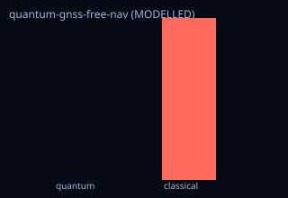

<!-- SPDX-License-Identifier: AGPL-3.0-only -->
<!-- Generated by tools/gen_kinds_index.py from the engine, the schema, the verification matrix and one run of the example. Do not edit by hand. -->
# `quantum-gnss-free-nav`

Scenario kind of the engine v0.38.0, family [Inertial, fusion and quantum sensors](../inertial-fusion-and-quantum-sensors.md). Advisory: analysis output from a research and engineering tool, not type-approved navigation equipment and not a safety-of-life service. Every label here is the engine's or the verification matrix's; a kind is MODELLED unless the matrix says otherwise (how a label is earned: the README's Evidence section).

## What it does

MODELLED GNSS-free quantum navigation: during a GNSS outage, a quantum (cold-atom interferometer) inertial budget vs a classical navigation-grade INS — position-error growth over the coast, holdover to a position threshold, and the quantum-vs-classical trade as honest TradeEvidence with representativeness. Honest observability note: with no external fix the accelerometer bias is unobservable so the error grows; the quantum sensor slows but does not close that gap. Illustrative public-source device params; models the class, no TRL/flight/certification.

One run of `scenarios/quantum-gnss-free-nav.toml` summarises as: quantum-gnss-free-nav | outage 300s | quantum pos err 0.00 m vs classical 37.31 m (8289.5x) | holdover quantum 44721s vs classical 534s (thr 100 m) | trade quantum wins 2/2 | MODELLED

## Inputs

From the schema (`kshana kinds --json`):

- Required fields: none
- Optional fields: `outage_s`, `threshold_m`, `quantum_bias_m_s2`, `classical_bias_m_s2`

The example `scenarios/quantum-gnss-free-nav.toml` sets, among others:

| Field | Value | Unit |
|---|---|---|
| `classical_bias_m_s2` | 5.0000e-5 | m/s^2 |
| `kind` | quantum-gnss-free-nav | text |
| `outage_s` | 300 | s |
| `quantum_bias_m_s2` | 1.0000e-7 | m/s^2 |
| `threshold_m` | 100 | m |

## Run it

```sh
kshana scenarios/quantum-gnss-free-nav.toml
```

## What it gives

The scalar results of that run, with the units the engine states:

| Result | Value | Unit |
|---|---|---|
| `classical_holdover_s` | 533.733798 | s |
| `classical_pos_err_m` | 37.31297 | m |
| `improvement_x` | 8289.499001 | 1 |
| `outage_s` | 300 | s |
| `quantum_holdover_s` | 44721.318429 | s |
| `quantum_pos_err_m` | 0.004501 | m |
| `threshold_m` | 100 | m |
| `trade.frame.engine_version` | 0.38.0 | text |
| `trade.frame.scenario` | quantum-gnss-free-nav | text |
| `trade.frame.seed` | 0 | 1 |



## Evidence

No matrix row names this kind by name; the label on its result is the engine's own, above.

The rows the run itself exercised, with the oracle the matrix gives each (the public sources are named there):

- **MODELLED** Cold-atom interferometer accelerometer from first principles (k_eff·T², QPN). Oracle (ExternalDataset): Published CAI primary-paper numeric vectors (Cheinet 2008 transfer function; Peters/Freier sensitivity): k_eff·T² matched exactly, shot-noise ASD a one-sided floor within ~2× of each published instrument (real devices carry technical noise above the quantum floor). A bracket, not parity. 0.30 round 2 (pre-registered fcb9ac64), a finding (stays MODELLED): the QPN-only rotation noise against the measured Gauguet et al.
- **MODELLED** Deterministic, scenario-hashed, SBOM + cross-platform golden gates. Oracle (ExternalDataset): SBOM conformance to the official CycloneDX 1.5 JSON Schema (+ valid SPDX identifiers) — an external published standard, zero validation errors over the full dependency graph; the FoM-determinism / byte-reproducibility part remains a pinned self-consistency check, so the row stays MODELLED
- **PARTNER** Not provided — performance models only; cold-atom/clock hardware is a partner's. Oracle (NoneKind): none: a partner-owned discipline, with no module and no test by design
- **MODELLED** One reproducible TradeEvidence object (fixed frame: scenario+seed+engine; common per-FoM quantum-vs-classical values with polarity-correct benefit, optional 95%. Oracle (InternalConsistency): Closed-form benefit/winner identities + faithful wrap of the existing quantum_trade::TradeResult; honesty tied to the representativeness ledger and verification labels
- **MODELLED** Quantum (cold-atom interferometer) vs classical navigation-grade INS dead-reckoning over a GNSS outage: position-error growth, holdover to a position threshold,. Oracle (InternalConsistency): Reused inertial budgets cross-checked against an independent Octave double-integration of the same dead-reckoning ODE (different runtime, shared model → ReferenceImpl) plus the Freier-2016 published short-term noise as a one-sided anchor; the quantum-vs-classical composite stays MODELLED

## Limitations

What the run's own report says is not modelled or not validated:

- MODELLED GNSS-free quantum navigation: during a GNSS outage, a quantum (cold-atom interferometer) inertial budget vs a classical navigation-grade INS — position-error growth over the coast, holdover to a position threshold, and the quantum-vs-classical trade as honest TradeEvidence with representativeness. (kind catalogue (`kshana kinds --json`))
- GNSS-free quantum navigation — quantum (cold-atom interferometer) vs classical navigation-grade INS dead-reckoning over a GNSS outage. MODELLED; illustrative, public-source device parameters; models the class, no TRL/flight claim. (scenario file comment, lines 1 to 3)
- Quantum inertial sensor performance is MODELLED, not validated: a sub-claim is externally checked, but the whole capability composes modelled pieces, so the capability stays Modelled. (verification matrix (docs/MODELLED-RATIONALE.md))
- Reproducibility & software assurance is MODELLED, not validated: a sub-claim is externally checked, but the whole capability composes modelled pieces, so the capability stays Modelled. (verification matrix (docs/MODELLED-RATIONALE.md))
- Quantum-vs-classical trade evidence (common shape) is MODELLED, not validated: checked against its own closed-form / analytic identity — catches transcription and coefficient errors, but is not an external oracle. (verification matrix (docs/MODELLED-RATIONALE.md))
- GNSS-free quantum navigation is MODELLED, not validated: checked against its own closed-form / analytic identity — catches transcription and coefficient errors, but is not an external oracle. (verification matrix (docs/MODELLED-RATIONALE.md))

## See also

- Family page: [Inertial, fusion and quantum sensors](../inertial-fusion-and-quantum-sensors.md#quantum-gnss-free-nav)
- All kinds: [KINDS.md](../../KINDS.md)
- Topic page: [QUANTUM-MODELS.md](../../QUANTUM-MODELS.md)
- Topic page: [QUANTUM.md](../../QUANTUM.md)
