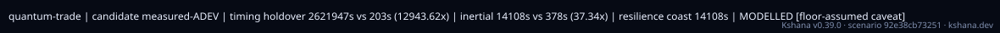

<!-- SPDX-License-Identifier: AGPL-3.0-only -->
<!-- Generated by tools/gen_kinds_index.py from the engine, the schema, the verification matrix and one run of the example. Do not edit by hand. -->
# `quantum-trade`

Scenario kind of the engine v0.40.0, family [Inertial, fusion and quantum sensors](../inertial-fusion-and-quantum-sensors.md). Advisory: analysis output from a research and engineering tool, not type-approved navigation equipment and not a safety-of-life service. Every label here is the engine's or the verification matrix's; a kind is MODELLED unless the matrix says otherwise (how a label is earned: the README's Evidence section).

## What it does

Quantum-vs-classical PNT trade (13503): timing-holdover + inertial-holdover benefit of a candidate clock (a measured-ADEV curve — the defensibility hinge — or a quantum clock class) vs a classical baseline class, with the long-tau floor-assumption caveat carried on the artifact, plus a GNSS-denied resilience-vs-time envelope. MODELLED; quantifies (never validates) a partner device. The candidate clock is a measured curve (`candidate_adev_taus` + `candidate_adev_values`, equal length, at least 2 points; it wins when both forms are given) or a `candidate_clock_class`.

One run of `scenarios/quantum-trade.toml` summarises as: quantum-trade | candidate measured-ADEV | timing holdover 2621947s vs 203s (12943.62x) | inertial 14108s vs 378s (37.34x) | resilience coast 14108s | MODELLED [floor-assumed caveat]

## Inputs

From the schema (`kshana kinds --json`):

- Required fields: `timing_threshold_s`, `position_threshold_m`, `baseline_clock_class`, `candidate_adev_taus+candidate_adev_values|candidate_clock_class`
- Optional fields: `baseline_ins`, `candidate_ins`, `resilience_times_s`, `alt_pnt_bound_m`

The example `scenarios/quantum-trade.toml` sets, among others:

| Field | Value | Unit |
|---|---|---|
| `baseline_clock_class` | csac | text |
| `candidate_adev_taus` | [1, 10, 100, 1000, 10000, 100000] | not stated |
| `candidate_adev_values` | [5.0000e-16, 1.6000e-16, 6.0000e-17, 4.0000e-17, 6.0000e-17, | not stated |
| `kind` | quantum-trade | text |
| `position_threshold_m` | 100 | m |
| `resilience_times_s` | [1, 60, 600, 1800, 3600, 7200, 14400, 28800] | s |
| `timing_threshold_s` | 2.0000e-8 | s |

## Run it

```sh
kshana scenarios/quantum-trade.toml
```

## What it gives

The scalar results of that run, with the units the engine states:

| Result | Value | Unit |
|---|---|---|
| `candidate_source` | measured-ADEV | text |
| `evidence.id_rule` | the stable id of the matrix row (the ID  | text |
| `evidence.matrix` | docs/VERIFICATION-MATRIX.md | text |
| `evidence.tier` | PARTNER | text |
| `resilience.alt_pnt_active` | false | flag |
| `resilience.coast_time_s` | 14108.310907 | s |
| `resilience.exceeds_horizon` | false | flag |
| `resilience.threshold_m` | 100 | m |
| `trade.baseline.floor_assumed` | true | flag |
| `trade.baseline.inertial_holdover_s` | 377.849037 | s |

Result label (the engine's): MODELLED — quantifies (never validates) a partner clock/sensor; not flight-demonstrated



## Evidence

MODELLED 1 · VALIDATED 2: the [verification matrix](../../VERIFICATION-MATRIX.md) rows that name this kind.

- **VALIDATED** Power-law (white-FM + red-noise-floor) NNLS recovery from a published measured ⁸⁸Sr optical-clock-transition Allan deviation — reproducing σ_y(τ) and the headline 4.7e-16/√τ short-τ scaling with a genuine measured long-τ floor, rather than  Tests: [optical_clock_adev_reference.rs](../../../tests/optical_clock_adev_reference.rs).
- **VALIDATED** Measured-ADEV NNLS fit, NEES/NIS χ² consistency bands, and the clock van-Loan discrete process-noise (holdover-coast) covariance — the trade engine's computational spine Tests: [scipy_reference.rs](../../../tests/scipy_reference.rs).
- **MODELLED** Measured-ADEV ingestion (NNLS), trade table (timing/inertial holdover + benefit), resilience-vs-time envelope; floor caveat carried on the artifact.

The rows the run itself exercised, with the oracle the matrix gives each (the public sources are named there):

- **VALIDATED** Measured-ADEV NNLS fit, NEES/NIS χ² consistency bands, and the clock van-Loan discrete process-noise (holdover-coast) covariance — the trade engine's computatio. Oracle (ExternalDataset): scipy 1.17.1 — optimize.nnls / stats.chi2.ppf / linalg.expm; NNLS+Q exact, χ² <5e-4 at operating dof. Kernels only — device-performance numbers stay Modelled (next row)
- **MODELLED** Deterministic, scenario-hashed, SBOM + cross-platform golden gates. Oracle (ExternalDataset): SBOM conformance to the official CycloneDX 1.5 JSON Schema (+ valid SPDX identifiers) — an external published standard, zero validation errors over the full dependency graph; the FoM-determinism / byte-reproducibility part remains a pinned self-consistency check, so the row stays MODELLED
- **MODELLED** Measured-ADEV ingestion (NNLS), trade table (timing/inertial holdover + benefit), resilience-vs-time envelope; floor caveat carried on the artifact. Runnable fr. Oracle (ExternalDataset): The measured-ADEV→PSD fit (NNLS) kernel is matched to scipy.optimize.nnls (tests/scipy_reference.rs / tests/quantum_vs_classical_pnt_trade_reference.rs) — an independent external kernel; but the trade NUMBERS quantify (never validate) a partner clock/CAI, so the trade itself stays MODELLED, no validation halo
- **PARTNER** Not provided — performance models only; cold-atom/clock hardware is a partner's. Oracle (NoneKind): none: a partner-owned discipline, with no module and no test by design

## Limitations

What the run's own report says is not modelled or not validated:

- MODELLED — quantifies (never validates) a partner clock/sensor; not flight-demonstrated (result `label`)
- Quantum-vs-classical PNT trade (13503): timing-holdover + inertial-holdover benefit of a candidate clock (a measured-ADEV curve — the defensibility hinge — or a quantum clock class) vs a classical baseline class, with the long-tau floor-assumption caveat carried on the artifact, plus a GNSS-denied resilience-vs-time envelope. (kind catalogue (`kshana kinds --json`))
- MODELLED; quantifies (never validates) a partner device. (kind catalogue (`kshana kinds --json`))
- Computes the timing-holdover and inertial-holdover benefit of a CANDIDATE clock over a CLASSICAL baseline, plus a GNSS-denied resilience-vs-time envelope. The candidate floor is driven by a partner clock's MEASURED overlapping-ADEV curve (the defensibility hinge) fitted by non-negative least squares — so the holdover budget rests on real data, not an assumed long-tau floor. (scenario file comment, lines 3 to 7)
- HONEST SCOPE: MODELLED — it QUANTIFIES a partner's quantum-clock benefit; it does NOT validate the device, and never borrows the SGP4/Allan/IGS validation islands. When any row's floor is an assumed class default, a floor caveat renders on the artifact. Run: kshana scenarios/quantum-trade.toml (scenario file comment, lines 9 to 12)
- Reproducibility & software assurance is MODELLED, not validated: a sub-claim is externally checked, but the whole capability composes modelled pieces, so the capability stays Modelled. (verification matrix (docs/MODELLED-RATIONALE.md))
- Quantum-vs-classical PNT trade & GNSS-denied resilience (13503) is MODELLED, not validated: a sub-claim is externally checked, but the whole capability composes modelled pieces, so the capability stays Modelled. (verification matrix (docs/MODELLED-RATIONALE.md))

## See also

- Family page: [Inertial, fusion and quantum sensors](../inertial-fusion-and-quantum-sensors.md#quantum-trade)
- All kinds: [KINDS.md](../../KINDS.md)
- Topic page: [POSITIONING.md](../../POSITIONING.md)
- Topic page: [QUANTUM-MODELS.md](../../QUANTUM-MODELS.md)
