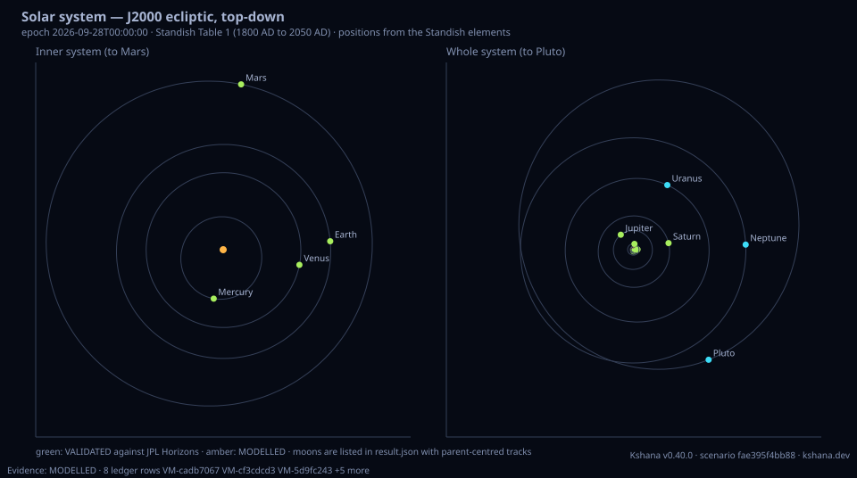

<!-- SPDX-License-Identifier: AGPL-3.0-only -->
<!-- Generated by tools/gen_kinds_index.py from the engine, the schema, the verification matrix and one run of the example. Do not edit by hand. -->
# `solar-system`

Scenario kind of the engine v0.39.0, family [Constellations, coverage and geometry](../constellations-coverage-and-geometry.md). Advisory: analysis output from a research and engineering tool, not type-approved navigation equipment and not a safety-of-life service. Every label here is the engine's or the verification matrix's; a kind is MODELLED unless the matrix says otherwise (how a label is earned: the README's Evidence section).

## What it does

The whole solar system at one epoch, for PNT (positioning, navigation and timing) around any body. For the Sun, the eight planets, Pluto, the Moon, Phobos, Deimos, Io, Europa, Ganymede, Callisto and Titan it reports the heliocentric position and velocity in the ICRF (International Celestial Reference Frame, equatorial J2000), the heliocentric distance and J2000 ecliptic longitude and latitude, the gravitational parameter, equatorial and mean radius, J2 where published and its reference radius, the sidereal rotation period, the IAU pole and the prime meridian at the epoch, an orbit track sampled over one revolution (heliocentric for planets, parent-centred for moons), and the light time, one-way and two-way range, solar Shapiro delay and Sun separation from an observer body (default Earth); extra from/to links get the same treatment. Positions: the JPL Keplerian elements of Standish and Williams (Table 1 for 1800 AD to 2050 AD, Tables 2a/2b for 3000 BC to 3000 AD) with each planet's nominal error, the Montenbruck & Gill lunar series for the Earth-Moon split, JPL mean elements with the IAU synchronous rotation rate for the Martian and Galilean moons, and the IAU rotation model for Titan. Light time: the radiometric fixed-point solve, transmitter at its retarded position; Newtonian, with the Shapiro delay reported separately. VALIDATED against JPL Horizons (DE441) within twice the nominal error: Mercury to Saturn and the Earth from Table 1 (worst 1.87 times nominal) and all eight planets from Tables 2a/2b (worst 1.71 times), and the Earth to Mars and Jupiter light time. MODELLED, each row labelled: Uranus and Neptune from Table 1 (2.0 and 5.2 times the nominal error against DE441), Pluto (the 1992 row; no stated error), the Moon and the seven moons (measured against Horizons, no published bound).

One run of `scenarios/solar-system-tour.toml` summarises as: Solar system at 2026-09-28T00:00:00 (JD 2461311.50080 TDB), 18 bodies, observer Earth
  Standish Table 1 (1800 AD to 2050 AD)
  Sun         0.0000 au  lon    0.00 deg  light time     500.1 s  [origin]
  Mercury     0.4666 au  lon  259.05 deg  light time     605.3 s  [VALIDATED]
  Venus       0.7272 au  lon  348.72 deg  light time     182.1 s  [VALIDATED]
  Earth       1.0022 au  lon    4.52 deg  observer  [VALIDATED]
  Moon        1.0046 au  lon    4.56 deg  light time       1.3 s  [MODELLED]
  Mars        1.5544 au  lon   83.81 deg  light time     841.1 s  [VALIDATED]
  Phobos      1.5545 au  lon   83.81 deg  light time     841.2 s  [MODELLED]
  Deimos      1.5545 au  lon   83.80 deg  light time     841.1 s  [MODELLED]
  Jupiter     5.3036 au  lon  130.91 deg  light time    2970.6 s  [VALIDATED]
  Io          5.3049 au  lon  130.94 deg  light time    2971.5 s  [MODELLED]
  Europa      5.2995 au  lon  130.93 deg  light time    2968.7 s  [MODELLED]
  Ganymede    5.3005 au  lon  130.98 deg  light time    2969.6 s  [MODELLED]
  Callisto    5.3153 au  lon  130.96 deg  light time    2976.7 s  [MODELLED]
  Saturn      9.4356 au  lon   10.77 deg  light time    4212.2 s  [VALIDATED]
  Titan       9.4401 au  lon   10.74 deg  light time    4214.3 s  [MODELLED]
  Uranus     19.4363 au  lon   62.62 deg  light time    9444.1 s  [MODELLED]
  Neptune    29.8775 au  lon    2.62 deg  light time   14409.3 s  [MODELLED]
  Pluto      35.6122 au  lon  304.19 deg  light time   17529.1 s  [MODELLED]
  link Mars -> Jupiter: one-way 2193.539 s, two-way 4386.919 s, Shapiro 15.0 us, Sun 15.0 deg
  link Saturn -> Earth: one-way 4212.176 s, two-way 8424.347 s, Shapiro 22.1 us, Sun 172.5 deg
  link Europa -> Jupiter: one-way 2.218 s, two-way 4.437 s, Shapiro 0.0 us, Sun 22.0 deg


## Inputs

From the schema (`kshana kinds --json`):

- Required fields: none
- Optional fields: `epoch`, `epoch_jd_tdb`, `bodies`, `observer`, `track_points`, `table`, `links`

The example `scenarios/solar-system-tour.toml` sets, among others:

| Field | Value | Unit |
|---|---|---|
| `epoch` | 2026-09-28T00:00:00 | text |
| `kind` | solar-system | text |
| `links[0].from` | Mars | text |
| `links[0].to` | Jupiter | text |
| `links[1].from` | Saturn | text |
| `links[1].to` | Earth | text |
| `links[2].from` | Europa | text |
| `links[2].to` | Jupiter | text |
| `observer` | Earth | text |
| `track_points` | 180 | not stated |

## Run it

```sh
kshana scenarios/solar-system-tour.toml
```

## What it gives

The scalar results of that run, with the units the engine states:

| Result | Value | Unit |
|---|---|---|
| `epoch.input` | 2026-09-28T00:00:00 | text |
| `epoch.jd_tdb` | 2.4613e6 | day |
| `frame` | ICRF (equatorial J2000), heliocentric; m | text |
| `n_bodies` | 18 | count |
| `observer` | Earth | text |
| `standish_table` | Standish Table 1 (1800 AD to 2050 AD) | text |

Result label (the engine's): MIXED: each body carries its own label. Planet positions are VALIDATED against JPL Horizons within twice the Standish nominal error (Mercury to Saturn and the Earth from Table 1; all eight planets from Tables 2a/2b); Uranus and Neptune from Table 1, Pluto, the Moon and the seven moons are MODELLED. 



## Evidence

MODELLED 2 · VALIDATED 3: the [verification matrix](../../VERIFICATION-MATRIX.md) rows that name this kind.

- **VALIDATED** The `solar-system` kind with planetary_kernel_path: each reported body whose own NAIF code the SPK holds takes its heliocentric J2000 position and velocity from the kernel through the engine's own reader (label KERNEL), a link whose two end
- **VALIDATED** Heliocentric positions of Mercury, Venus, the Earth-Moon barycentre, the Earth, Mars, Jupiter and Saturn from Standish Table 1 (1800 AD to 2050 AD), and of all eight planets from Tables 2a/2b (3000 BC to 3000 AD, with the b, c, s, f mean-an Tests: [solar_system_standish_earth_icrf_preregistered.rs](../../../tests/solar_system_standish_earth_icrf_preregistered.rs).
- **VALIDATED** The Newtonian one-way light time from any body to any other, received at an epoch, solved by the radiometric fixed-point light-time solver (radiometric::light_time_solution, transmitter at its retarded position) through solar_system::link_o Tests: [solar_system_light_time_preregistered.rs](../../../tests/solar_system_light_time_preregistered.rs).
- **MODELLED** Positions of Uranus and Neptune from Standish Table 1 (the default inside 1800 AD to 2050 AD), Pluto from the 1992 Table 1 row the current JPL page no longer lists, and the heliocentric velocity of every planet: the two-body derivative with Tests: [solar_system_horizons_reference.rs](../../../tests/solar_system_horizons_reference.rs).
- and 1 more in the matrix.

The rows the run itself exercised, with the oracle the matrix gives each (the public sources are named there):

- **VALIDATED** The `solar-system` kind with planetary_kernel_path: each reported body whose own NAIF code the SPK holds takes its heliocentric J2000 position and velocity from. Oracle (ExternalDataset): NAIF SPICE Toolkit (CSPICE N0067 through spiceypy 8.3.0) spkezr heliocentric states on the full de440s.bsp, a separate program that calls no Kshana code (tests/fixtures/solar_system_kernel/, NOTICE.md); the engine reads bit-for-bit de440s cuts. Pre-registered f8e946ea. A Library check of the wiring: DE440 itself and the analytic bodies are not validated here. Results: docs/design/evidence/cap31-solar-system-kernel/RE
- **MODELLED** Deterministic, scenario-hashed, SBOM + cross-platform golden gates. Oracle (ExternalDataset): SBOM conformance to the official CycloneDX 1.5 JSON Schema (+ valid SPDX identifiers) — an external published standard, zero validation errors over the full dependency graph; the FoM-determinism / byte-reproducibility part remains a pinned self-consistency check, so the row stays MODELLED
- **VALIDATED** Heliocentric positions of Mercury, Venus, the Earth-Moon barycentre, the Earth, Mars, Jupiter and Saturn from Standish Table 1 (1800 AD to 2050 AD), and of all . Oracle (ExternalDataset): JPL Horizons DE441 geometric heliocentric vectors (ecliptic and ICRF), fetched after the pre-registration commits 80451866, 8d38a28b and 558cc807. Bar: per planet and component, RMS at most 1.0x the approximate errors of the Explanatory Supplement 3rd ed. Table 8.10.1 (the EMB row for the Earth); the Earth-EMB split is checked directly against DE441 399 minus 3, at most 0.3 deg and 8.1 km at every epoch 1950-2050 (th
- **VALIDATED** The Newtonian one-way light time from any body to any other, received at an epoch, solved by the radiometric fixed-point light-time solver (radiometric::light_t. Oracle (ExternalDataset): JPL Horizons DE441 one-way down-leg Newtonian light time LT (VEC_CORR=LT, observer the Earth centre), pre-registered (480037d3, amendment 54d5c86f changing only the interpolation node spacing after the first fetch failed its 10 m interpolation precondition, before any light time was compared) with a bar of 1e-6 s per light time, the solver fed DE441 barycentric positions so the retarded-transmitter iteration is visib
- **MODELLED** Positions of Uranus and Neptune from Standish Table 1 (the default inside 1800 AD to 2050 AD), Pluto from the 1992 Table 1 row the current JPL page no longer li. Oracle (ExternalDataset): Measured against JPL Horizons DE441 (the same committed fixtures), but not validated: Table 1's stated figures for Uranus and Neptune are exceeded by up to 2.0 and 5.2 times against DE441 heliocentric positions (Neptune meets them against barycentric positions, which suggests the fit was not heliocentric), the page states no error for Pluto, and no published bound exists for the velocities. Tables 2a/2b meet their ow

## Limitations

What the run's own report says is not modelled or not validated:

- MIXED: each body carries its own label. Planet positions are VALIDATED against JPL Horizons within twice the Standish nominal error (Mercury to Saturn and the Earth from Table 1; all eight planets from Tables 2a/2b); Uranus and Neptune from Table 1, Pluto, the Moon and the seven moons are MODELLED. Light times are Newtonian, from the same positions. (result `label`)
- MODELLED, each row labelled: Uranus and Neptune from Table 1 (2.0 and 5.2 times the nominal error against DE441), Pluto (the 1992 row; no stated error), the Moon and the seven moons (measured against Horizons, no published bound). (kind catalogue (`kshana kinds --json`))
- WHAT IS VALIDATED, AND WHAT IS NOT Each body carries its own label. Mercury to Saturn and the Earth are VALIDATED against JPL Horizons (Development Ephemeris DE441) within twice the Standish page's nominal error. Uranus and Neptune from Table 1 exceed the page's figures against DE441 (by 2.0 and 5.2 times) and are MODELLED; so are Pluto, the Moon and the seven moons, which were measured against Horizons but have no p (scenario file comment, lines 20 to 25)
- Reproducibility & software assurance is MODELLED, not validated: a sub-claim is externally checked, but the whole capability composes modelled pieces, so the capability stays Modelled. (verification matrix (docs/MODELLED-RATIONALE.md))
- Uranus and Neptune from Standish Table 1, Pluto, and planetary velocities is MODELLED, not validated: a sub-claim is externally checked, but the whole capability composes modelled pieces, so the capability stays Modelled. (verification matrix (docs/MODELLED-RATIONALE.md))
- Positions of the Moon and seven major moons (Phobos, Deimos, the Galilean moons, Titan) is MODELLED, not validated: a sub-claim is externally checked, but the whole capability composes modelled pieces, so the capability stays Modelled. (verification matrix (docs/MODELLED-RATIONALE.md))
- Physical constants of every solar-system body and the whole-system report is MODELLED, not validated: checked against its own closed-form / analytic identity — catches transcription and coefficient errors, but is not an external oracle. (verification matrix (docs/MODELLED-RATIONALE.md))

## See also

- Family page: [Constellations, coverage and geometry](../constellations-coverage-and-geometry.md#solar-system)
- All kinds: [KINDS.md](../../KINDS.md)
- Topic page: [SOLAR-SYSTEM.md](../../SOLAR-SYSTEM.md)
- Topic page: [CONSTELLATION-DESIGN.md](../../CONSTELLATION-DESIGN.md)
