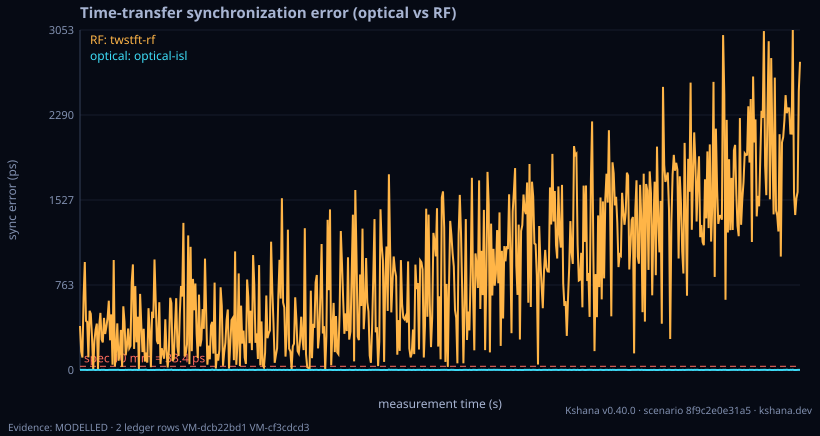

<!-- SPDX-License-Identifier: AGPL-3.0-only -->
<!-- Generated by tools/gen_kinds_index.py from the engine, the schema, the verification matrix and one run of the example. Do not edit by hand. -->
# `timetransfer`

Scenario kind of the engine v0.39.0, family [Clocks, timing and holdover](../clocks-timing-and-holdover.md). Advisory: analysis output from a research and engineering tool, not type-approved navigation equipment and not a safety-of-life service. Every label here is the engine's or the verification matrix's; a kind is MODELLED unless the matrix says otherwise (how a label is earned: the README's Evidence section).

## What it does

Optical vs RF two-way time/frequency transfer.

One run of `scenarios/timetransfer.toml` summarises as: scenario 8f9c2e0e31a5 | optical sync_rms 0.98ps range_rms 0.293mm adev(1s) 1.73e-12 | RF sync_rms 1137.3ps range_rms 341.0mm adev(1s) 8.65e-10

## Inputs

From the schema (`kshana kinds --json`):

- Required fields: `seed`, `samples`, `step_s`, `range_spec_mm`, `link_quantum`, `link_classical`
- Optional fields: none

The example `scenarios/timetransfer.toml` sets, among others:

| Field | Value | Unit |
|---|---|---|
| `kind` | timetransfer | text |
| `link_classical.id` | twstft-rf | text |
| `link_classical.provenance` | Two-way satellite time and frequency transfer (TWSTFT, Ku-ba | text |
| `link_classical.q_rw_s` | 1.0000e-26 | s |
| `link_classical.sigma_j_s` | 5.0000e-10 | s |
| `link_quantum.id` | optical-isl | text |
| `link_quantum.provenance` | Optical inter-satellite link, picosecond-level synchronizati | text |
| `link_quantum.q_rw_s` | 1.0000e-32 | s |
| `link_quantum.sigma_j_s` | 1.0000e-12 | s |
| `range_spec_mm` | 10 | mm |
| `samples` | 600 | not stated |
| `seed` | 42 | 1 |

## Run it

```sh
kshana scenarios/timetransfer.toml
```

## What it gives

The scalar results of that run, with the units the engine states:

| Result | Value | Unit |
|---|---|---|
| `classical.fom.adev_tau0` | 8.6527e-10 | 1 |
| `classical.fom.range_p95_mm` | 636.83765 | mm |
| `classical.fom.range_rms_mm` | 340.957818 | mm |
| `classical.fom.sync_p95_ps` | 2124.261745 | ps |
| `classical.fom.sync_rms_ps` | 1137.312862 | ps |
| `classical.fom.within_spec_fraction` | 0.026667 | 1 |
| `classical.spec.id` | twstft-rf | text |
| `classical.spec.kind` | two-way-time-transfer | text |
| `classical.spec.params.q_rw` | 1.0000e-26 | 1/s |
| `classical.spec.params.q_wf` | 0 | s^2/s |



## Evidence

MODELLED: the [verification matrix](../../VERIFICATION-MATRIX.md) rows that name this kind.

- **MODELLED** Two-way/TWSTFT (Sagnac), GNSS common-view, PPP; link-jitter→range Tests: [time_transfer_error_budgeting_reference.rs](../../../tests/time_transfer_error_budgeting_reference.rs).

The rows the run itself exercised, with the oracle the matrix gives each (the public sources are named there):

- **MODELLED** Two-way/TWSTFT (Sagnac), GNSS common-view, PPP; link-jitter→range. Oracle (ExternalDataset): Sagnac magnitude checked against an authoritative PUBLISHED VALUE — N. Ashby, 'Relativity in the GPS', Living Reviews in Relativity 6:1 (2003), Eq. 1.29: an eastward equatorial circumnavigation accrues 207.4 ns (2ωA_E/c²); kshana reproduces 207.386 ns. Independently corroborated by RTKLIB 2.4.3 geodist() (Takasu, BSD-2-Clause), which carries the same 2Aω/c² geometry. The composite BIPM TWSTFT transponder/common-view/
- **MODELLED** Deterministic, scenario-hashed, SBOM + cross-platform golden gates. Oracle (ExternalDataset): SBOM conformance to the official CycloneDX 1.5 JSON Schema (+ valid SPDX identifiers) — an external published standard, zero validation errors over the full dependency graph; the FoM-determinism / byte-reproducibility part remains a pinned self-consistency check, so the row stays MODELLED

## Limitations

What the run's own report says is not modelled or not validated:

- Time-transfer error budgeting is MODELLED, not validated: a sub-claim is externally checked, but the whole capability composes modelled pieces, so the capability stays Modelled. (verification matrix (docs/MODELLED-RATIONALE.md))
- Reproducibility & software assurance is MODELLED, not validated: a sub-claim is externally checked, but the whole capability composes modelled pieces, so the capability stays Modelled. (verification matrix (docs/MODELLED-RATIONALE.md))

## See also

- Family page: [Clocks, timing and holdover](../clocks-timing-and-holdover.md#timetransfer)
- All kinds: [KINDS.md](../../KINDS.md)
