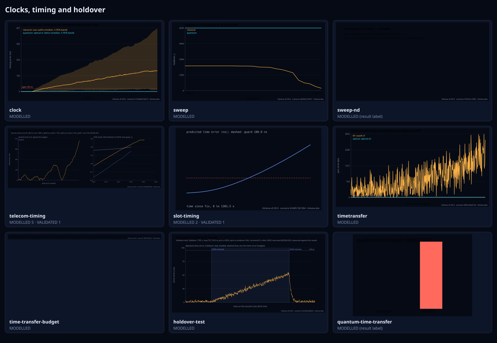
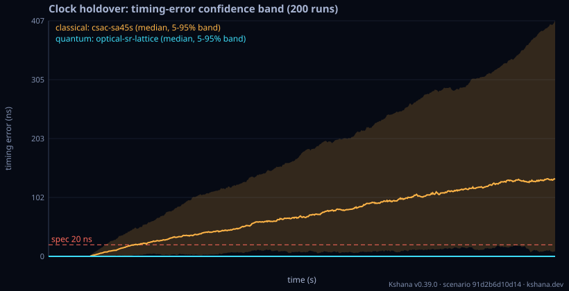
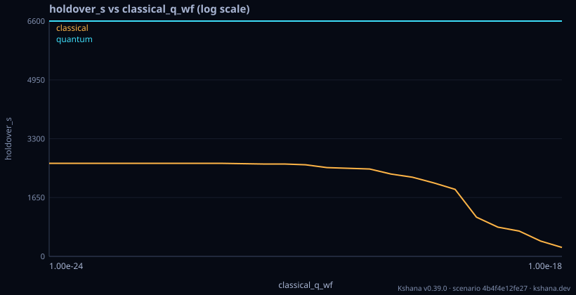
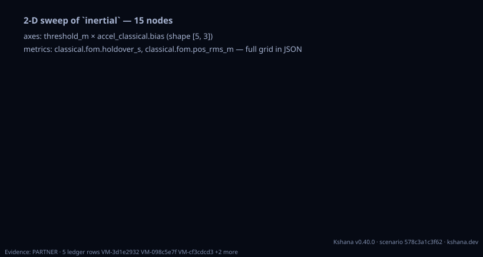
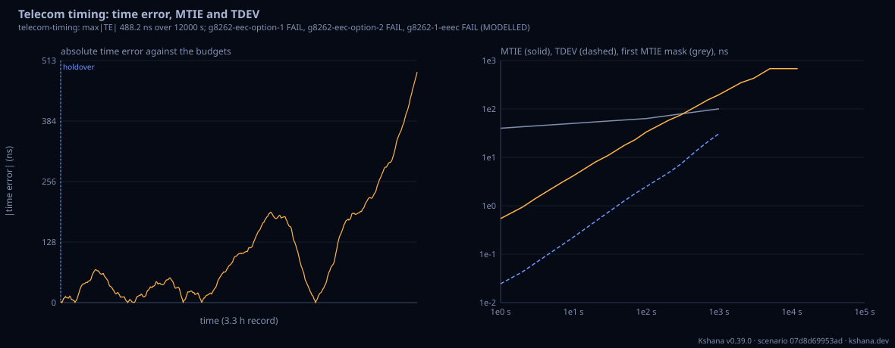
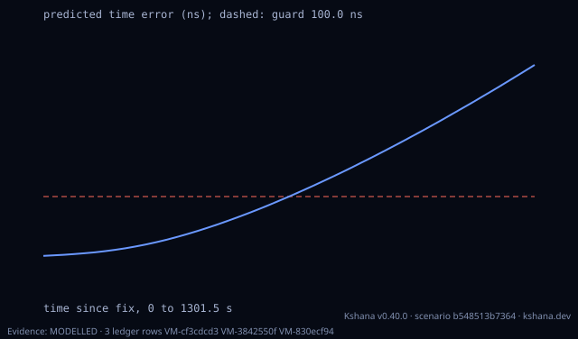
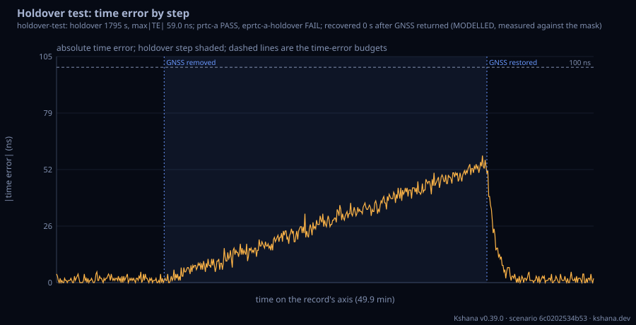
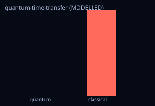

<!-- SPDX-License-Identifier: AGPL-3.0-only -->
<!-- Generated by tools/gen_kinds_index.py. Do not edit by hand. -->
# Clocks, timing and holdover

9 scenario kinds of the engine v0.38.0. Advisory: analysis output from a research and engineering tool, not type-approved navigation equipment and not a safety-of-life service. Every label here is the engine's or the verification matrix's; a kind is MODELLED unless the matrix says otherwise (how a label is earned: the README's Evidence section).

Topic pages: [TELECOM-TIMING](../TELECOM-TIMING.md), [SLOT-TIMING](../SLOT-TIMING.md), [TIMING-HIL](../TIMING-HIL.md), [CLOCK-LOG-FORMATS](../CLOCK-LOG-FORMATS.md). Run one: `kshana scenarios/clock-holdover.toml`. All families: [KINDS.md](../KINDS.md).



| Kind | What it does | Ledger |
|---|---|---|
| [`clock`](by-kind/clock.md) | Clock holdover vs spec; optional Monte-Carlo ensemble (runs > 1). | MODELLED |
| [`sweep`](by-kind/sweep.md) | 1-D trade-study sweep over a clock-pack parameter. | MODELLED |
| [`sweep-nd`](by-kind/sweep-nd.md) | Generic N-D sweep over any pack via dotted TOML keys / JSON metric paths. | MODELLED (result label) |
| [`telecom-timing`](by-kind/telecom-timing.md) | Telecom timing: time error, maximum time interval error (MTIE) and time deviation (TDEV) of a GNSS holdover, checked against ITU-T masks with a PASS or FAIL and a margin per mask. | MODELLED 5 · VALIDATED 1 |
| [`slot-timing`](by-kind/slot-timing.md) | Slot timing: seconds until a free-running clock leaves the guard of a time-indexed routing or tasking slot (the largest absolute time error the slot tolerates), the contribution of every term at that  | MODELLED 2 · VALIDATED 1 |
| [`timetransfer`](by-kind/timetransfer.md) | Optical vs RF two-way time/frequency transfer. | MODELLED |
| [`time-transfer-budget`](by-kind/time-transfer-budget.md) | Two-way satellite time and frequency transfer between two stations through a geostationary relay: the two-way equation solved for T_A - T_B with every non-reciprocal term (station equipment delays, Ku | MODELLED |
| [`holdover-test`](by-kind/holdover-test.md) | MODELLED holdover test of a timing system, scored from a time-error record the OPERATOR supplies (a linuxptp ptp4l, phc2sys or ts2phc log, a chrony tracking or statistics log, a TICC, TimeLab or RINEX | MODELLED |
| [`quantum-time-transfer`](by-kind/quantum-time-transfer.md) | MODELLED trusted-quantum-timing chain: an end-to-end quantum (optical-lattice clock + entanglement/single-photon link) vs classical (CSAC + RF two-way) time-transfer budget, a reused timing protection | MODELLED (result label) |

### `clock`

Clock holdover vs spec; optional Monte-Carlo ensemble (runs > 1).

Required fields: `seed`, `threshold_ns`, `time`, `gnss`, `clock_quantum`, `clock_classical`. Optional: `runs`, `integrity`.

**Ledger:** MODELLED. Full page, with the inputs, results, evidence and limitations: [clock](by-kind/clock.md).

```sh
kshana scenarios/clock-ensemble.toml
```



### `sweep`

1-D trade-study sweep over a clock-pack parameter.

Required fields: `parameter`, `metric`, `start`, `stop`, `steps`, `base`. Optional: `scale`.

**Ledger:** MODELLED. Full page, with the inputs, results, evidence and limitations: [sweep](by-kind/sweep.md).

```sh
kshana scenarios/sweep-clock-stability.toml
```



### `sweep-nd`

Generic N-D sweep over any pack via dotted TOML keys / JSON metric paths.

Required fields: `base`, `axes`, `metrics`.

**Ledger:** no matrix row names this kind; the engine labels its own result. Full page, with the inputs, results, evidence and limitations: [sweep-nd](by-kind/sweep-nd.md).

```sh
kshana scenarios/sweep-nd-inertial.toml
```



### `telecom-timing`

Telecom timing: time error, maximum time interval error (MTIE) and time deviation (TDEV) of a GNSS holdover, checked against ITU-T masks with a PASS or FAIL and a margin per mask. Input is either a SYNTHETIC HOLDOVER (an oscillator preset -- ocxo, rubidium, caesium or csac, each carrying the stability, aging and temperature figures of a named public Microchip datasheet -- plus the GNSS-loss time, record length and sample interval; the free-running clock carries white, flicker and, where the datasheet fit needs it, random-walk frequency noise, linear aging and a sinusoidal temperature term) or an INGESTED SERIES of [time_s, time_error_ns] pairs given inline (and, on native builds only, a CSV file). Masks: ITU-T G.8272 (07/2025) PRTC-A and PRTC-B (max|TE| 100 / 40 ns, MTIE Tables 1-2, TDEV Tables 3-4); G.8272.1 (2024) Amd. 1 (07/2025) ePRTC locked (30 ns, Tables 1-2) and ePRTC-A holdover (the Table 3 time-error envelope rising from 30 ns to 100 ns over the holdover period H set by the locked duration, MTIE Table 4, TDEV Table 5); G.8273.2 (2023) Amd. 2 (11/2025) T-BC/T-TSC classes A-C (max|TE|, constant time error, low-pass-filtered MTIE and TDEV) and class D (max|TE_L| 5 ns, the only class D figure not left for further study); G.8271.1 (2022) Amd. 3 (05/2025) reference point C (max|TE_L| 1100 / 600 / 100 ns with MTIE Tables 7-1 to 7-3). Every entry a Recommendation marks for further study is absent rather than filled in, and each report lists what is not implemented. Also reports the time to exceed each maximum-time-error budget (defaults: 100 ns ePRTC max|TE_HO|, 400 ns network holdover allocation, 1100 ns point C, 1.5 us class 4), the MTIE/TDEV curves as a CSV table with each mask limit, and a units-and-provenance entry per numeric field. VALIDATED: the MTIE and TDEV estimators against the allantools package on a committed holdover series. MODELLED: the mask tables are transcriptions, and a synthetic holdover is a model built from datasheet maxima, not a measurement of any unit. Not a conformance test.

Required fields: none. Optional: `seed`, `masks`, `budgets`, `holdover`, `series`.

**Ledger:** MODELLED 5 · VALIDATED 1. Full page, with the inputs, results, evidence and limitations: [telecom-timing](by-kind/telecom-timing.md).

```sh
kshana scenarios/telecom-synce-eec.toml
```



### `slot-timing`

Slot timing: seconds until a free-running clock leaves the guard of a time-indexed routing or tasking slot (the largest absolute time error the slot tolerates), the contribution of every term at that moment with the dominant one named (fix uncertainty, white phase noise, white, flicker, random-walk and random-run frequency noise, residual frequency offset, temperature, ageing), the time left since the last fix, and the largest fix interval that keeps the clock inside, net of the fix latency. The oscillator is a CLASS default (csac, uso, dsac, tcxo, ocxo or rafs: one cited one-second Allan deviation and an assumed red-noise floor), a telecom-timing DATASHEET PRESET or an inline DATASHEET (Allan-deviation maxima fitted as an envelope, plus ageing and a temperature coefficient), or an inline MEASURED PHASE RECORD (its overlapping Allan deviation fitted by weighted least squares in the white-phase and IEEE Std 1139 frequency-modulation basis, so the red-noise floor is measured rather than assumed). A breach beyond the longest averaging time the datasheet or record supports is flagged as extrapolated. An optional spoofing section adds the timing protection level for a receiver in orbit: orbital speed and period, how long a single ground spoofer can reach the satellite per pass, the clock-aided monitor floor and CUSUM detection latency, the conditional bound, the pull a spoofer at a stated maximum ramp rate accumulates before the satellite leaves its reach or an independent check runs, and whether each ground-contact or crosslink check is independent of that spoofer. VALIDATED: the holdover inversion from a fitted record, held out on a real caesium clock measured against a hydrogen maser (tests/slot_timing_cs5071a_holdout.rs, data-gated); on a measured crystal oscillator the held-out prediction is conservative but not within the bar, so the crystal case is MODELLED. MODELLED: class and datasheet sources, the deterministic terms and the spoofing assessment.

Required fields: `oscillator`, `slot`. Optional: `spoofing`.

**Ledger:** MODELLED 2 · VALIDATED 1. Full page, with the inputs, results, evidence and limitations: [slot-timing](by-kind/slot-timing.md).

```sh
kshana scenarios/slot-timing-ocxo-leo.toml
```



### `timetransfer`

Optical vs RF two-way time/frequency transfer.

Required fields: `seed`, `samples`, `step_s`, `range_spec_mm`, `link_quantum`, `link_classical`.

**Ledger:** MODELLED. Full page, with the inputs, results, evidence and limitations: [timetransfer](by-kind/timetransfer.md).

```sh
kshana scenarios/timetransfer.toml
```


### `time-transfer-budget`

Two-way satellite time and frequency transfer between two stations through a geostationary relay: the two-way equation solved for T_A - T_B with every non-reciprocal term (station equipment delays, Ku-band ionosphere, transponder, Sagnac), a quadrature uncertainty budget whose type A term is the simulated link's TDEV at the averaging time, a simulated link with white and flicker phase noise and a diurnal non-reciprocity, and the stability (rate, residual RMS, TDEV, ADEV) of any supplied BIPM Circular T Section 1 series, MJD,ns CSV or IGS RINEX station-clock records. MODELLED.

Required fields: `station_a`, `station_b`, `satellite_lon_deg`, `transponder_ab_ns`, `transponder_ba_ns`, `white_noise_ns`, `uncertainty`. Optional: `uplink_ghz`, `downlink_ghz`, `true_offset_ns`, `flicker_noise_ns`, `diurnal_amplitude_ns`, `reciprocity_bias_ns`, `step_s`, `span_days`, `averaging_s`, `seed`, `series`.

**Ledger:** MODELLED. Full page, with the inputs, results, evidence and limitations: [time-transfer-budget](by-kind/time-transfer-budget.md).

```sh
kshana scenarios/time-transfer-budget.toml
```


### `holdover-test`

MODELLED holdover test of a timing system, scored from a time-error record the OPERATOR supplies (a linuxptp ptp4l, phc2sys or ts2phc log, a chrony tracking or statistics log, a TICC, TimeLab or RINEX clock log, or time_s,time_error_ns pairs). The test has four steps and Kshana performs none of them: a locked BASELINE, GNSS REMOVED by the operator (the antenna cable or the simulator output; Kshana transmits and drives nothing) at a stated time, HOLDOVER on the system's own oscillator, and RECOVERY after the operator restores GNSS at a second stated time. The record is split at those two times. Baseline: time-error statistics and the ITU-T masks written for a locked clock. Holdover: statistics, the fractional frequency offset the system held (a least-squares line), the masks written for holdover or an autonomous clock, the ePRTC-A holdover envelope from the stated locked duration, and the time to exceed each time-error budget. Recovery: whether and when |TE| came inside a stated band and stayed there, the peak and the largest step. Every limit is transcribed from a public ITU-T table (the telecom-timing masks); the words are 'measured against the mask', and the two times are the operator's statement, not verified. A record too short for a mask is INCOMPLETE, never extrapolated. See docs/TIMING-HIL.md.

Required fields: `test`, `series`. Optional: `masks`, `budgets`.

**Ledger:** MODELLED. Full page, with the inputs, results, evidence and limitations: [holdover-test](by-kind/holdover-test.md).

```sh
kshana scenarios/holdover-test-ptp4l.toml
```



### `quantum-time-transfer`

MODELLED trusted-quantum-timing chain: an end-to-end quantum (optical-lattice clock + entanglement/single-photon link) vs classical (CSAC + RF two-way) time-transfer budget, a reused timing protection level + a delay/replay-attack security FoM (1-P_md), a clock-anomaly detection probability + CUSUM latency, and the quantum-vs-classical trade as honest TradeEvidence with a representativeness + gaps-to-flight record. Illustrative public-source device/link params; models the class, no TRL/flight/certification claimed.

Required fields: none. Optional: `integration_s`, `dissemination_interval_s`, `link_loss_db`, `classical_link_sigma_s`, `monitor_pfa`, `attack_delay_s`, `clock_fault_sigma`.

**Ledger:** no matrix row names this kind; the engine labels its own result. Full page, with the inputs, results, evidence and limitations: [quantum-time-transfer](by-kind/quantum-time-transfer.md).

```sh
kshana scenarios/quantum-time-transfer.toml
```


