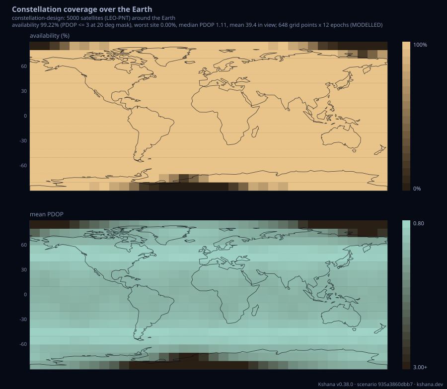
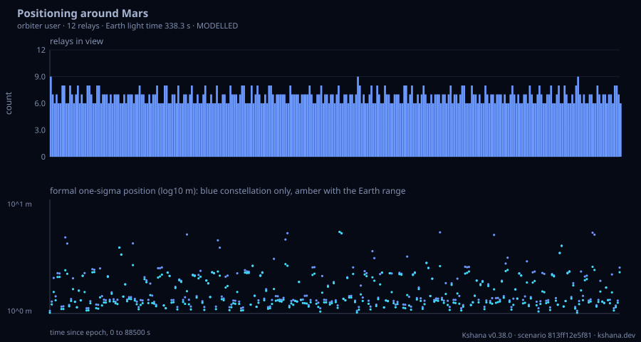
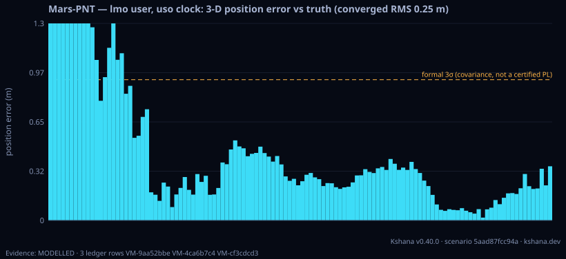

<!-- SPDX-License-Identifier: AGPL-3.0-only -->
<!-- Generated by tools/gen_kinds_index.py. Do not edit by hand. -->
# Constellations, coverage and geometry

7 scenario kinds of the engine v0.39.0. Advisory: analysis output from a research and engineering tool, not type-approved navigation equipment and not a safety-of-life service. Every label here is the engine's or the verification matrix's; a kind is MODELLED unless the matrix says otherwise (how a label is earned: the README's Evidence section).

Topic pages: [CONSTELLATION-DESIGN](../CONSTELLATION-DESIGN.md), [COVERAGE](../COVERAGE.md), [SOLAR-SYSTEM](../SOLAR-SYSTEM.md), [SKYLINE](../SKYLINE.md). Run one: `kshana scenarios/orbit-gnss-challenged.toml`. All families: [KINDS.md](../KINDS.md).


| Kind | What it does | Ledger |
|---|---|---|
| [`orbit`](by-kind/orbit.md) | GNSS availability + DOP from an orbital constellation (Walker / TLE / RINEX). | MODELLED 4 · VALIDATED 4 |
| [`ephemeris`](by-kind/ephemeris.md) | Ephemeris & ground track: propagate one satellite (TLE→SGP4 or analytic orbit) and emit its TEME/GCRS state (position + velocity), ITRF/ECEF position, WGS-84 sub-satellite lat/lon/alt, and per-step st | VALIDATED |
| [`constellation-design`](by-kind/constellation-design.md) | Constellation design at scale: Walker DELTA and Walker STAR patterns in the i: T/P/F convention (nodes spread over 360 or 180 deg, in-plane spacing 360*P/T, inter-plane phase offset 360*F/T), explicit | MODELLED 1 · VALIDATED 2 |
| [`solar-system`](by-kind/solar-system.md) | The whole solar system at one epoch, for PNT (positioning, navigation and timing) around any body. | MODELLED 2 · VALIDATED 3 |
| [`body-pnt`](by-kind/body-pnt.md) | Positioning around any solar-system body: an orbiter or a surface lander around a central body chosen by name (Mars, the Moon, Europa, Ganymede, Titan and the rest of the solar-system catalogue), navi | MODELLED 1 · VALIDATED 1 |
| [`mars-pnt`](by-kind/mars-pnt.md) | Deep-space Mars PNT: a simulated MARCONI relay constellation (areostationary + inclined relays broadcasting one-way + relaying two-way to a deep-space station) navigates a reference user (transfer / l | MODELLED |
| [`passes`](by-kind/passes.md) | Ground-station pass prediction: the time-domain visibility passes (AOS/TCA/LOS, maximum apparent elevation, duration) of a circular orbit, as SGP4 mean elements at the window start, over a station abo | MODELLED 2 · VALIDATED 2 |

### `orbit`

GNSS availability + DOP from an orbital constellation (Walker / TLE / RINEX).

Required fields: `seed`, `threshold_ns`, `mask_deg`, `time`, `user|user_site`, `constellation`, `clock_quantum`, `clock_classical`. Optional: `sigma_uere_m`, `constellations`, `epoch`, `export_sp3`, `export_omm`, `export_oem`, `skyline`.

**Ledger:** MODELLED 4 · VALIDATED 4. Full page, with the inputs, results, evidence and limitations: [orbit](by-kind/orbit.md).

```sh
kshana scenarios/orbit-rinex.toml
```


### `ephemeris`

Ephemeris & ground track: propagate one satellite (TLE→SGP4 or analytic orbit) and emit its TEME/GCRS state (position + velocity), ITRF/ECEF position, WGS-84 sub-satellite lat/lon/alt, and per-step station az/el/range + range-rate (Doppler). The satellite comes from a `tle` or from an analytic `orbit` with its `epoch` (a `tle` wins when both are given); with a `tle`, an `epoch` overrides the TLE's own epoch as t = 0.

Required fields: `tle|orbit+epoch`. Optional: `step_s`, `duration_s`, `station`, `dut1_s`, `xp_arcsec`, `yp_arcsec`, `carrier_hz`, `eop_finals2000a`.

**Ledger:** VALIDATED. Full page, with the inputs, results, evidence and limitations: [ephemeris](by-kind/ephemeris.md).

```sh
kshana scenarios/ephemeris.toml
```


### `constellation-design`

Constellation design at scale: Walker DELTA and Walker STAR patterns in the i: T/P/F convention (nodes spread over 360 or 180 deg, in-plane spacing 360*P/T, inter-plane phase offset 360*F/T), explicit element lists and multi-shell designs, several constellations in one run, around the Earth, the Moon, Mars or any other planet, Pluto or major moon using the constants in the body module (the same ones the solar-system and body-pnt kinds use). PRESETS from published nominal elements: gps-baseline and gps-expandable (the 24 slots and the six fore/aft expandable pairs of the GPS Standard Positioning Service Performance Standard, 5th edition 2020, Tables 3.2-1 to 3.2-3), galileo (Walker 24/3/1 at 29 599.801 km and 56 deg, Galileo Open Service Service Definition Document issue 1.1 Tables 1 and 23), beidou and beidou-meo (Walker 24/3/1 at 21 528 km and 55 deg plus three geostationary satellites at 80, 110.5 and 140 deg E and three inclined geosynchronous satellites at 55 deg, BeiDou Open Service Performance Standard 3.0 section 4.1; the MEO phase and the 118 deg E inclined-geosynchronous crossing are modelled because the standard does not state them) and glonass (24/3/1 at 19 100 km and 64.8 deg from the slot formula of the GLONASS Interface Control Document edition 5.1 section 5.2). COVERAGE AND DILUTION OF PRECISION: over a latitude/longitude grid and a sampled window with an elevation mask, the number of satellites in view, GDOP, PDOP, HDOP and VDOP per cell, the availability (a fix with PDOP at or below a threshold, 6 by default) per cell, globally (area-weighted) and at the worst site, with one receiver clock per constellation unless clock = "common". It scales to thousands of satellites: visibility is a dot product against each satellite's coverage half-angle, and satellites are banded by sub-satellite latitude each epoch so a grid row tests only those that can be in view; the report counts the pair tests saved. The JSON carries the grid maps and downsampled per-satellite ground tracks. VALIDATED: the Walker generator against Galileo OS SDD Table 23 and the GLONASS ICD slot formula, the GPS preset against the published equatorial-crossing column of SPS PS Table 3.2-1, and the GPS baseline global HDOP distribution against SPS PS Appendix B (median 0.94, 95% 1.25, mean 0.96, tolerance 0.03). MODELLED: two-body orbits with optional secular J2, a spherical body, geometric visibility only (no signal power, health or terrain), and the relative phase between different systems, which is not a snapshot of any real date.

Required fields: none. Optional: `body`, `duration_s`, `step_s`, `mask_deg`, `pdop_threshold`, `grid_step_deg`, `lat_min_deg`, `lat_max_deg`, `lon_min_deg`, `lon_max_deg`, `clock`, `j2`, `track_points`, `max_tracks`, `constellation`.

**Ledger:** MODELLED 1 · VALIDATED 2. Full page, with the inputs, results, evidence and limitations: [constellation-design](by-kind/constellation-design.md).

```sh
kshana scenarios/leo-pnt-mega-shell.toml
```



### `solar-system`

The whole solar system at one epoch, for PNT (positioning, navigation and timing) around any body. For the Sun, the eight planets, Pluto, the Moon, Phobos, Deimos, Io, Europa, Ganymede, Callisto and Titan it reports the heliocentric position and velocity in the ICRF (International Celestial Reference Frame, equatorial J2000), the heliocentric distance and J2000 ecliptic longitude and latitude, the gravitational parameter, equatorial and mean radius, J2 where published and its reference radius, the sidereal rotation period, the IAU pole and the prime meridian at the epoch, an orbit track sampled over one revolution (heliocentric for planets, parent-centred for moons), and the light time, one-way and two-way range, solar Shapiro delay and Sun separation from an observer body (default Earth); extra from/to links get the same treatment. Positions: the JPL Keplerian elements of Standish and Williams (Table 1 for 1800 AD to 2050 AD, Tables 2a/2b for 3000 BC to 3000 AD) with each planet's nominal error, the Montenbruck & Gill lunar series for the Earth-Moon split, JPL mean elements with the IAU synchronous rotation rate for the Martian and Galilean moons, and the IAU rotation model for Titan. Light time: the radiometric fixed-point solve, transmitter at its retarded position; Newtonian, with the Shapiro delay reported separately. VALIDATED against JPL Horizons (DE441) within twice the nominal error: Mercury to Saturn and the Earth from Table 1 (worst 1.87 times nominal) and all eight planets from Tables 2a/2b (worst 1.71 times), and the Earth to Mars and Jupiter light time. MODELLED, each row labelled: Uranus and Neptune from Table 1 (2.0 and 5.2 times the nominal error against DE441), Pluto (the 1992 row; no stated error), the Moon and the seven moons (measured against Horizons, no published bound).

Required fields: none. Optional: `epoch`, `epoch_jd_tdb`, `bodies`, `observer`, `track_points`, `table`, `links`.

**Ledger:** MODELLED 2 · VALIDATED 3. Full page, with the inputs, results, evidence and limitations: [solar-system](by-kind/solar-system.md).

```sh
kshana scenarios/solar-system-tour.toml
```


### `body-pnt`

Positioning around any solar-system body: an orbiter or a surface lander around a central body chosen by name (Mars, the Moon, Europa, Ganymede, Titan and the rest of the solar-system catalogue), navigating with one-way pseudoranges from a small Walker navigation constellation around the body (two-body orbits with the body's own J2 secular drift, an unknown user clock) and optionally a clock-free deep-space two-way range from the Earth, whose direction and distance come from the analytic solar-system ephemeris at every epoch. Lines of sight are blocked by the body's mean sphere, and a surface user also needs the elevation mask. Per epoch: relays in view, whether the Earth is above the limb, the constellation-only GDOP and PDOP (geometric and position dilution of precision), the formal one-sigma position uncertainty with and without the Earth row, and the error of a seeded Gauss-Newton least-squares fix each way; over the run: availability, Earth visibility, median PDOP, RMS error and median formal sigma, plus the Earth-to-body light time, round trip, Shapiro delay and Sun separation at the epoch. MODELLED: the relay orbits, the noise levels and the instantaneous measurement model are modelling choices, not validated against a mission's navigation data; the body constants are the published values cited in body.rs, and the Earth geometry inherits the solar-system ephemeris labels.

Required fields: none. Optional: `body`, `epoch`, `epoch_jd_tdb`, `duration_s`, `step_s`, `seed`, `table`, `user`, `constellation`, `earth_link`.

**Ledger:** MODELLED 1 · VALIDATED 1. Full page, with the inputs, results, evidence and limitations: [body-pnt](by-kind/body-pnt.md).

```sh
kshana scenarios/mars-orbit-pnt.toml
```



### `mars-pnt`

Deep-space Mars PNT: a simulated MARCONI relay constellation (areostationary + inclined relays broadcasting one-way + relaying two-way to a deep-space station) navigates a reference user (transfer | lmo | surface) through the joint one-way/two-way radiometric fusion estimator. Reports per-epoch geometry/visibility, achieved RMS vs truth, and the formal covariance (1σ / 3σ position) — an honest simulated FoM, NOT a certified protection level.

Required fields: none. Optional: `user`, `clock_class`, `step_s`, `duration_s`, `nmax`, `range_sigma_m`, `doppler_sigma_mps`, `dynamic_tightness`, `two_way_period_s`, `seed`.

**Ledger:** MODELLED. Full page, with the inputs, results, evidence and limitations: [mars-pnt](by-kind/mars-pnt.md).

```sh
kshana scenarios/mars-pnt-lmo.toml
```



### `passes`

Ground-station pass prediction: the time-domain visibility passes (AOS/TCA/LOS, maximum apparent elevation, duration) of a circular orbit, as SGP4 mean elements at the window start, over a station above an elevation mask across a window, with total access time. SGP4/SDP4 propagation on the IAU 2006/2000A Earth-fixed frame (optional UT1 - UTC and polar motion), ITU-R P.834-9 tropospheric refraction and the downlink light time (both on by default), crossings solved to 1e-7 s and the culmination by golden-section search. The pass geometry is VALIDATED against Orekit 13.1.8 at sea-level stations; the scenario's orbit and station are illustrative inputs.

Required fields: none. Optional: `altitude_km`, `inclination_deg`, `raan_deg`, `arg_lat_deg`, `station_lat_deg`, `station_lon_deg`, `station_alt_m`, `epoch`, `mask_deg`, `duration_hours`, `step_s`, `refraction`, `light_time`, `ut1_minus_utc_s`, `xp_arcsec`, `yp_arcsec`.

**Ledger:** MODELLED 2 · VALIDATED 2. Full page, with the inputs, results, evidence and limitations: [passes](by-kind/passes.md).

```sh
kshana scenarios/passes.toml
```


