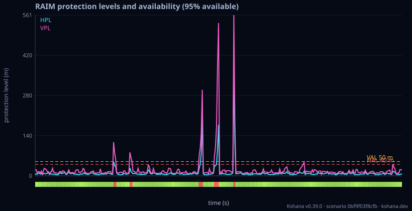
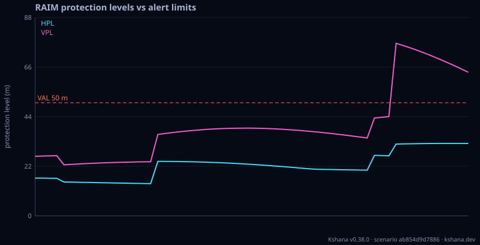
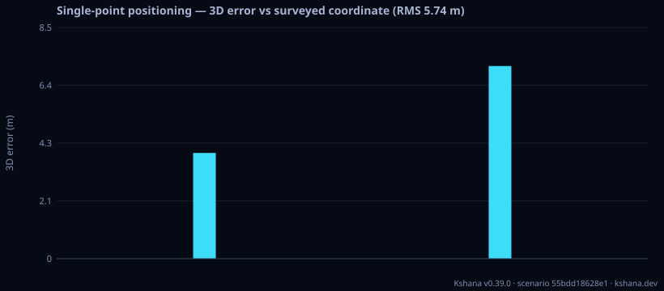
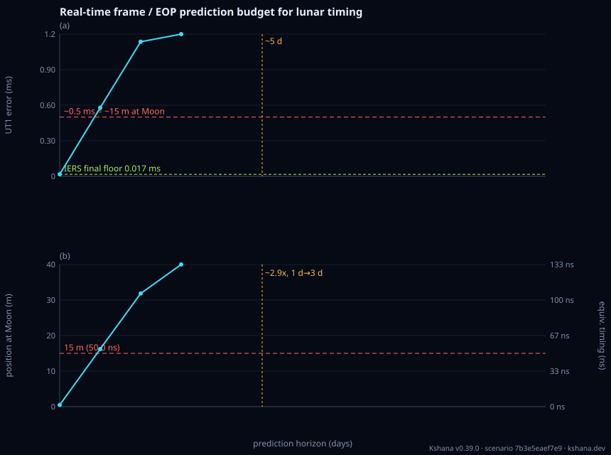

<!-- SPDX-License-Identifier: AGPL-3.0-only -->
<!-- Generated by tools/gen_kinds_index.py. Do not edit by hand. -->
# GNSS measurements, positioning and integrity

6 scenario kinds of the engine v0.38.0. Advisory: analysis output from a research and engineering tool, not type-approved navigation equipment and not a safety-of-life service. Every label here is the engine's or the verification matrix's; a kind is MODELLED unless the matrix says otherwise (how a label is earned: the README's Evidence section).

Topic pages: [INTEGRITY](../INTEGRITY.md), [POSITIONING](../POSITIONING.md), [ARAIM_REFERENCE](../ARAIM_REFERENCE.md), [OSNMA](../OSNMA.md). Run one: `kshana scenarios/integrity-raim.toml`. All families: [KINDS.md](../KINDS.md).


| Kind | What it does | Ledger |
|---|---|---|
| [`integrity`](#integrity) | Snapshot / solution-separation / ARAIM RAIM with HPL/VPL and a Stanford diagram. | MODELLED 6 · VALIDATED 4 |
| [`gnss-sim`](#gnss-sim) | Measurement-domain pseudorange simulation (Klobuchar iono, Saastamoinen/Niell tropo) + RAIM. | VALIDATED |
| [`pvt`](#pvt) | Real-observation single-point positioning: solve a receiver's position from a RINEX 3 observation file and a broadcast-navigation file (code pseudoranges, broadcast ephemeris, Klobuchar iono, Saastamo | MODELLED |
| [`araim-reference-check`](#araim-reference-check) | Published ARAIM certification reference vectors: the engine's ARAIM horizontal and vertical protection levels run against the WG-C ARAIM Technical Subgroup's OWN worked numerical examples, at the tole | VALIDATED |
| [`space-weather`](#space-weather) | Space-weather environment model: solar (F10.7/F10.7a) and geomagnetic (Kp, with the definitional Kp↔ap table) activity indices, the Jacchia-1971 exospheric temperature they drive (validated vs publish | MODELLED |
| [`realtime-frame-eop`](#realtime-frame-eop) | Real-time lunar frame / Earth-orientation prediction budget: P4 Table 1 (the frame-error consistency check — post-processed ~0.27 m ↔ ~0.010 ms and real-time ~15 m ↔ ~0.5 ms, each frame position expre | MODELLED 1 · VALIDATED 2 |

### `integrity`

Snapshot / solution-separation / ARAIM RAIM with HPL/VPL and a Stanford diagram.

Required fields: `mask_deg`, `sigma_uere_m`, `p_fa`, `p_md`, `al_h_m`, `al_v_m`, `time`, `user|user_site`, `constellation`. Optional: `sigma_ura_m`, `b_nom_m`, `constellations`, `seed`, `araim_dual`, `p_hmi`, `skyline`.

**Ledger:** MODELLED 6 · VALIDATED 4. The [verification matrix](../VERIFICATION-MATRIX.md) rows that name this kind:

- MODELLED: The optional [integrity] section of the clock kind (clock_integrity::run): from a stated site and constellation presets (geometry::sky_geometry), at every integrity epoch while the GNSS timeline is not denied, snapshot R ([clock_integrity.rs](../../tests/clock_integrity.rs))
- VALIDATED: Scalar-time solution-separation TPL over heterogeneous sources; PL driven by worst-exclusion subset noise + UTC(k) bias
- MODELLED: PL(τ)=max(TPL_handover,HPL(τ)); lower-semicontinuous PL(0+)≥PL(0−); K(IR/2) running-max; τ/τ³/τ⁵ phase exponents
- VALIDATED: Running-max envelope overbound-covers (zero-piercing) a real metrological series at every tested lag tau>=90d on a disjoint segment; short-tau (<=30d) is a disclosed Modelled boundary ([cti_holdover_coverage_reference.rs](../../tests/cti_holdover_coverage_reference.rs))
- and 6 more in the matrix.

```sh
kshana scenarios/integrity-raim.toml
```

Headline numbers from this run (read from `result.json` through its own `units` block):

| Field | Value | Unit | What it is |
|---|---|---|---|
| `samples_available` | 344 | count | sampled epochs at which a protected fix existed and both protection levels were at or below their alert limits |
| `samples_total` | 361 | count | epochs sampled on the time grid, one per step over the configured duration |



3 bundled scenarios use this kind; the others are in [`scenarios/`](../../scenarios/).

Topic pages: [CAMPAIGNS.md](../CAMPAIGNS.md), [INTEGRITY.md](../INTEGRITY.md).

### `gnss-sim`

Measurement-domain pseudorange simulation (Klobuchar iono, Saastamoinen/Niell tropo) + RAIM.

Required fields: `seed`, `time`, `receiver`, `constellation`. Optional: `iono`, `tropo`, `mask_deg`, `noise_sigma_m`, `multipath_m`, `sat_clock_rms_m`, `uere_m`, `p_fa`, `p_md`, `alert_limit_h_m`, `alert_limit_v_m`, `skyline`.

**Ledger:** VALIDATED. The [verification matrix](../VERIFICATION-MATRIX.md) rows that name this kind:

- VALIDATED: Klobuchar single-frequency L1 slant ionospheric group delay from the eight broadcast α/β coefficients ([klobuchar_reference.rs](../../tests/klobuchar_reference.rs))

```sh
kshana scenarios/gnss-sim-raim.toml
```

Headline numbers from this run (read from `result.json` through its own `units` block):

| Field | Value | Unit | What it is |
|---|---|---|---|
| `fom.fault_rate` | 0 | 1 | fraction of epochs at which the RAIM chi-squared test declared a fault |
| `fom.mean_hpl_m` | 22.2019 | m | mean horizontal protection level over the epochs that had one |
| `fom.mean_iono_m` | 19.8612 | m | mean modelled slant ionospheric delay over every satellite sample of the run |
| `fom.mean_tropo_m` | 6.76279 | m | mean modelled slant tropospheric delay over every satellite sample of the run |
| `fom.mean_vpl_m` | 39.9235 | m | mean vertical protection level over the epochs that had one |
| `fom.raim_availability` | 0.819672 | 1 | fraction of epochs at which RAIM produced protection levels and both were at or below their alert limits |



2 bundled scenarios use this kind; the others are in [`scenarios/`](../../scenarios/).

Topic pages: [REAL_TLE_GUIDE.md](../REAL_TLE_GUIDE.md), [SKYLINE.md](../SKYLINE.md).

### `pvt`

Real-observation single-point positioning: solve a receiver's position from a RINEX 3 observation file and a broadcast-navigation file (code pseudoranges, broadcast ephemeris, Klobuchar iono, Saastamoinen/Niell tropo), optionally validated against a surveyed coordinate.

Required fields: `obs_rinex`, `nav_rinex`. Optional: `truth_ecef`, `apriori_ecef`, `mask_deg`, `dual_frequency`.

**Ledger:** MODELLED. The [verification matrix](../VERIFICATION-MATRIX.md) rows that name this kind:

- MODELLED: Divergence-free Hatch filter (ionosphere-free code carried by the ionosphere-free carrier, window N epochs, restart on loss of lock, geometry-free jump or gap) in the precise single-point positioning assembly
- MODELLED: dop_error_mc::run_geometry and check: a seeded Monte Carlo (N = 20,000 epochs per geometry, sigma = 1.5 m, ChaCha8 seed 36 + i) of the engine's own iterated least-squares fix (pvt::solve_spp, unit weights, solved from th ([uere_dop_monte_carlo.rs](../../tests/uere_dop_monte_carlo.rs))

```sh
kshana scenarios/pvt-abmf.toml
```

Headline numbers from this run (read from `result.json` through its own `units` block):

| Field | Value | Unit | What it is |
|---|---|---|---|
| `fom.epochs_solved` | 2 | count | epochs at which the least-squares solve returned a fix (at least four usable measurements and a non-singular g |
| `fom.epochs_total` | 3 | count | observation epochs present in the supplied RINEX observation file |
| `fom.max_3d_m` | 7.11681 | m | largest three-dimensional position error against the surveyed truth at any solved epoch |
| `fom.mean_n_used` | 9 | count | mean number of satellites entering the solve, averaged over the solved epochs |
| `fom.mean_pdop` | 1.79361 | 1 | mean position dilution of precision over the solved epochs; a dimensionless geometry factor multiplying the ra |
| `fom.mean_postfit_rms_m` | 1.97161 | m | mean of the per-epoch post-fit pseudorange residual RMS over the solved epochs |



Topic pages: [POSITIONING.md](../POSITIONING.md), [INTEGRITY.md](../INTEGRITY.md).

### `araim-reference-check`

Published ARAIM certification reference vectors: the engine's ARAIM horizontal and vertical protection levels run against the WG-C ARAIM Technical Subgroup's OWN worked numerical examples, at the tolerance (TOL_PL = 5e-2 m) those documents themselves state. Two vectors are committed as fixtures, each carrying its retrieval URL, retrieval date, source-file SHA-256 and page: the Reference Airborne Algorithm Description Document v3.1 (2019) Appendix D — self-consistent, and the acceptance vector — and the Milestone 3 Report (2016) Annex A section A.IX, the statement the research bibliographies cite. Every published input (the 10-satellite 2-constellation geometry matrix, the C_int and C_acc variance diagonals, b_nom, P_sat, P_const and the LPV-200 constant set) and every published output (VPL, HPL, EMT, sigma_v_acc, K_fa_3 and the two constellation-fault modes' sigma_3, sigma_ss_3 and b_3) is reported beside the engine's own number and their absolute difference. The protection-level equation is NOT re-solved here: the reference's mode list is handed to the engine's existing raim::araim_protection_level / araim_integrity_risk, so the bisection and the Gaussian-tail algebra under test are the engine's own; only the geometry, the sub-solutions, the detection thresholds and the published budget split are built for it. EXTERNALLY CHECKED against the 2019 vector: VPL 18.2926 m vs 18.3 m published, HPL 13.4063 m vs 13.45 m, EMT 7.2997 m vs 7.2998 m, sigma_v_acc 1.3694 m vs 1.3694 m, and all six published intermediates to within half a unit in their last printed decimal. The 2016 vector carries two internal defects the report states rather than hides — a sign typo in row 3 of G, and a K_fa_3 evaluated at 57 fault modes while the document states N_fault_max = 1 (12 modes) — so its geometry intermediates reproduce exactly while its protection levels are reported as measured discrepancies and excluded from the acceptance figure; the tolerance is never widened to absorb them. Every emitted numeric field carries a unit and a provenance class, and a transcribed figure is labelled `published` so it can never be mistaken for a computed one. SCOPE: only N_fault_max = 1 (single-satellite and single-constellation fault modes) is implemented, and a case whose priors require simultaneous multi-event fault subsets is REFUSED rather than silently truncated; fault detection, exclusion, the chi-square consistency check and the double-counting re-allocation step of the reference algorithm are out of scope. This reproduces a published reference algorithm's worked example — it is not a certification, an airworthiness artefact or an approval.

Required fields: none. Optional: `vector`.

**Ledger:** VALIDATED. The [verification matrix](../VERIFICATION-MATRIX.md) rows that name this kind:

- VALIDATED: The multiple-hypothesis solution-separation protection-level equation itself: all-in-view and per-fault-mode weighted least squares on an East/North/Up geometry with one clock state per constellation, the sub-solution si ([araim_reference_vectors.rs](../../tests/araim_reference_vectors.rs))

```sh
kshana scenarios/araim-reference-check.toml
```

Result label (the engine's): EXTERNALLY CHECKED — the engine's ARAIM protection levels run against the published worked numerical examples of the EU-U.S. Working Group C ARAIM Technical Subgroup reference airborne algorithm, at the tolerance (TOL_PL) those documents themselves state. Every published figure carries its source UR

Headline numbers from this run (read from `result.json` through its own `units` block):

| Field | Value | Unit | What it is |
|---|---|---|---|
| `acceptance_tolerance_m` | 0.05 | m | TOL_PL |
| `acceptance_vectors` | 1 | count |  |
| `vectors_checked` | 2 | count |  |
| `worst_acceptance_error_m` | 0.043709 | m | the largest /computed - published/ over the VPL and HPL of every vector whose protection levels the source sta |


Topic pages: [INTEGRITY.md](../INTEGRITY.md), [ARAIM_REFERENCE.md](../ARAIM_REFERENCE.md).

### `space-weather`

Space-weather environment model: solar (F10.7/F10.7a) and geomagnetic (Kp, with the definitional Kp↔ap table) activity indices, the Jacchia-1971 exospheric temperature they drive (validated vs published solar-min/mean/max), and the Jacchia-1971 thermospheric neutral density at the diurnal-mean exospheric temperature against the activity-free static profile at a set of altitudes — the solar-cycle density dependence the static atmosphere omits. MODELLED: the density agrees with accelerometer-derived densities (TOLEOS CHAMP and GRACE) within a factor 2 at solar maximum but is about 1.7x too dense in the 2008 solar minimum.

Required fields: none. Optional: `f107`, `f107a`, `kp`, `altitudes_km`.

**Ledger:** MODELLED. The [verification matrix](../VERIFICATION-MATRIX.md) rows that name this kind:

- MODELLED: Solar/geomagnetic indices (definitional Kp↔ap table), the Jacchia-1971 exospheric temperature, and the Jacchia 1971 thermospheric density (SAO Special Report 332: static diffusion profiles reproducing its Table 7, with t

```sh
kshana scenarios/space-weather.toml
```

Result label (the engine's): MODELLED — solar/geomagnetic indices, Jacchia-71 exospheric temperature and Jacchia-71 static density at the diurnal-mean temperature

Headline numbers from this run (read from `result.json` through its own `units` block):

| Field | Value | Unit | What it is |
|---|---|---|---|
| `ap` | 27 | 2 nT | the ap equivalent of `kp` read from the definitional IAGA/GFZ 28-step Kp->ap table; ap is conventionally expre |
| `exospheric_temperature_k` | 1046.74 | K | Jacchia-1971 global nighttime-minimum exospheric temperature T_inf = 379 + 3.24*f107a + 1.3*(f107 - f107a) + 2 |
| `mean_exospheric_temperature_k` | 1186.74 | K | Jacchia-1971 diurnal-mean exospheric temperature (379 + 3.24*f107a + 1.3*(f107 - f107a))*(1 + 0.3/2) + 28*kp + |


### `realtime-frame-eop`

Real-time lunar frame / Earth-orientation prediction budget: P4 Table 1 (the frame-error consistency check — post-processed ~0.27 m ↔ ~0.010 ms and real-time ~15 m ↔ ~0.5 ms, each frame position expressed as its equivalent UT1 error via the L19 lever arm Δr = D_EM·ω⊕·ΔUT1) and Table 2 (measured UT1 prediction error vs horizon — the L18 curve read directly off the real IERS finals2000A series: the Bulletin A − Bulletin B final floor and the multi-day persistence-predictor error, each mapped to a Moon-frame position by L19), plus the L21 root-sum-square real-time frame-error budget (EOP + ephemeris + realisation floor). VALIDATED closed form (the L19 lever arm, ω⊕ cross-checked against the CIO Earth-rotation angle) and VALIDATED real data (the L18 curve off the real finals2000A rows); MODELLED are the lunar-relay OD covariance magnitudes and frame-realisation floor (representative allocations) and the persistence predictor (not IERS's operational Bulletin A algorithm). Not a certified real-time frame product.

Required fields: none. Optional: `epoch`, `horizons_days`, `ephemeris_pos_sigma_m`, `ephemeris_vel_sigma_mps`, `latency_s`, `frame_realization_floor_m`, `delta_ut1_ms`, `delta_xp_mas`, `delta_yp_mas`, `eop_finals2000a`, `eop_finals2000a_later`, `frame_realization_tie_noise_m`, `operational_window_days`, `operational_min_cycle_fraction`, `operational_anchor_residual`.

**Ledger:** MODELLED 1 · VALIDATED 2. The [verification matrix](../VERIFICATION-MATRIX.md) rows that name this kind:

- VALIDATED: One table reports the UT1 prediction error, the polar-motion pole error and their quadrature combination at the Moon over an IDENTICAL epoch set per horizon, emitting the epochs each component was measured at. ([embedded_eop_vintage_astropy_preregistered.rs](../../tests/embedded_eop_vintage_astropy_preregistered.rs))
- VALIDATED: The `realtime-frame-eop` runtime default is the library own embedded copy of a verbatim IERS finals2000A extract (tools/finals2000A_20260930.txt: 174 consecutive daily rows, MJD 61224-61397, cut from the finals2000A.all  ([operational_eop_predictor_reference.rs](../../tests/operational_eop_predictor_reference.rs))
- MODELLED: A least-squares bias-plus-rate fit over a trailing window plus the principal periodic terms — annual, semi-annual and the two principal zonal tides for UT1; Chandler, annual and semi-annual for the pole — extrapolated wi ([operational_eop_predictor_reference.rs](../../tests/operational_eop_predictor_reference.rs))

```sh
kshana scenarios/realtime-frame-eop.toml
```

Result label (the engine's): Real-time lunar frame / Earth-orientation prediction budget. VALIDATED closed form: the L19 lever arm (1 ms ↔ 28.03 m ↔ 93.5 ns), ω⊕ cross-checked against the CIO Earth-rotation angle. VALIDATED real data: the L18 UT1 and polar-motion prediction-error curves read directly off the real IERS finals200

Headline numbers from this run (read from `result.json` through its own `units` block):

| Field | Value | Unit | What it is |
|---|---|---|---|
| `earth_moon_distance_m` | 3.844e+08 | m | DE440 mean Earth-Moon distance |
| `eop_input.final_rows` | 30 | count |  |
| `eop_input.prediction_rows` | 90 | count |  |
| `eop_input.rapid_rows` | 54 | count | rows of the EOP input with the IERS measured flag I and no Bulletin B final block yet |
| `eop_input.rows` | 174 | count |  |
| `lever_arm_m_per_s` | 28030.9 | m/s | D_EM * omega_earth (L19) |



Topic pages: [integrations.md](../integrations.md).
