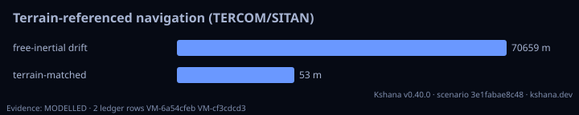
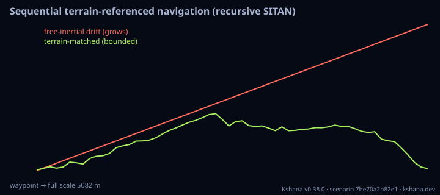
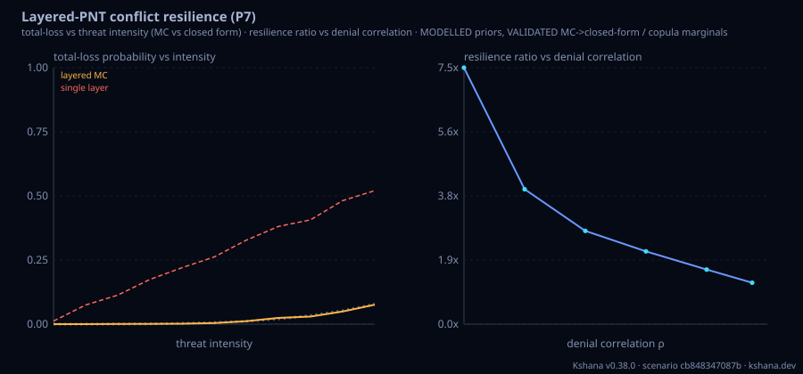

<!-- SPDX-License-Identifier: AGPL-3.0-only -->
<!-- Generated by tools/gen_kinds_index.py. Do not edit by hand. -->
# GPS-denied alternative PNT

5 scenario kinds of the engine v0.39.0. Advisory: analysis output from a research and engineering tool, not type-approved navigation equipment and not a safety-of-life service. Every label here is the engine's or the verification matrix's; a kind is MODELLED unless the matrix says otherwise (how a label is earned: the README's Evidence section).

Topic pages: [CAPABILITY](../CAPABILITY.md), [RESILIENCE-CROSSWALK](../RESILIENCE-CROSSWALK.md). Run one: `kshana scenarios/combined-altpnt.toml`. All families: [KINDS.md](../KINDS.md).


| Kind | What it does | Ledger |
|---|---|---|
| [`gravity-map`](by-kind/gravity-map.md) | GPS-denied gravity-map-matching navigation: a cold-atom gravimeter recovers a constant INS drift from the gravity-anomaly sequence it flies through. | MODELLED (result label) |
| [`terrain-nav`](by-kind/terrain-nav.md) | GPS-denied terrain-referenced navigation (TERCOM/SITAN): a radar/baro altimeter matches the ground-elevation profile against an SRTM-style DEM to recover the INS drift. | MODELLED |
| [`terrain-slam`](by-kind/terrain-slam.md) | GPS-denied sequential (recursive) terrain-referenced navigation: a particle filter runs the terrain-match measurement model epoch by epoch (SITAN as a running filter) so a time-varying INS drift is tr | MODELLED (result label) |
| [`combined-altpnt`](by-kind/combined-altpnt.md) | GPS-denied combined gravity + magnetic + terrain navigator: three scalar field channels fused per waypoint for a sharper (lower-CRLB) drift fix than any single field. | MODELLED (result label) |
| [`conflict-resilience`](by-kind/conflict-resilience.md) | MODELLED layered-PNT conflict resilience (P7): a contested-environment user fields several PNT layers (open-service GNSS, wideband GNSS, an authenticated constellation, an augmentation relay), each wi | MODELLED (result label) |

### `gravity-map`

GPS-denied gravity-map-matching navigation: a cold-atom gravimeter recovers a constant INS drift from the gravity-anomaly sequence it flies through.

Required fields: `nmax`, `start_lat_deg`, `start_lon_deg`, `step_lat_deg`, `step_lon_deg`, `waypoints`, `drift_lat_deg`, `drift_lon_deg`, `gravimeter_asd`, `averaging_time_s`, `map_sigma_mgal`, `search_half_deg`, `search_step_deg`. Optional: `coeffs`, `mascons`, `refine_stages`, `refine_factor`, `noise_seed`, `reference`, `map_error_mc`.

**Ledger:** no matrix row names this kind; the engine labels its own result. Full page, with the inputs, results, evidence and limitations: [gravity-map](by-kind/gravity-map.md).

```sh
kshana scenarios/gravity-map-nav.toml
```


### `terrain-nav`

GPS-denied terrain-referenced navigation (TERCOM/SITAN): a radar/baro altimeter matches the ground-elevation profile against an SRTM-style DEM to recover the INS drift.

Required fields: `dem_seed`, `start_lat_deg`, `start_lon_deg`, `step_lat_deg`, `step_lon_deg`, `waypoints`, `drift_lat_deg`, `drift_lon_deg`, `altimeter_sigma_m`, `map_sigma_m`, `search_half_deg`, `search_step_deg`. Optional: `refine_stages`, `refine_factor`, `noise_seed`.

**Ledger:** MODELLED. Full page, with the inputs, results, evidence and limitations: [terrain-nav](by-kind/terrain-nav.md).

```sh
kshana scenarios/terrain-nav.toml
```



### `terrain-slam`

GPS-denied sequential (recursive) terrain-referenced navigation: a particle filter runs the terrain-match measurement model epoch by epoch (SITAN as a running filter) so a time-varying INS drift is tracked along the track, where the batch terrain-nav only recovers a single constant offset.

Required fields: `dem_seed`, `start_lat_deg`, `start_lon_deg`, `step_lat_deg`, `step_lon_deg`, `waypoints`, `drift_rate_lat_deg`, `drift_rate_lon_deg`, `altimeter_sigma_m`, `map_sigma_m`. Optional: `n_particles`, `init_pos_sigma_deg`, `process_sigma_deg`, `resample_ess_frac`, `seed`.

**Ledger:** no matrix row names this kind; the engine labels its own result. Full page, with the inputs, results, evidence and limitations: [terrain-slam](by-kind/terrain-slam.md).

```sh
kshana scenarios/terrain-slam.toml
```



### `combined-altpnt`

GPS-denied combined gravity + magnetic + terrain navigator: three scalar field channels fused per waypoint for a sharper (lower-CRLB) drift fix than any single field.

Required fields: `start_lat_deg`, `start_lon_deg`, `step_lat_deg`, `step_lon_deg`, `waypoints`, `drift_lat_deg`, `drift_lon_deg`, `search_half_deg`, `search_step_deg`, `nmax`, `gravity_sigma_mgal`, `igrf_year`, `magnetic_sigma_nt`, `dem_seed`, `terrain_sigma_m`. Optional: `coeffs`, `mascons`, `magnetic_mascons`, `igrf_alt_km`, `refine_stages`, `refine_factor`, `noise_seed`, `magnetic_grid`.

**Ledger:** no matrix row names this kind; the engine labels its own result. Full page, with the inputs, results, evidence and limitations: [combined-altpnt](by-kind/combined-altpnt.md).

```sh
kshana scenarios/combined-altpnt.toml
```


### `conflict-resilience`

MODELLED layered-PNT conflict resilience (P7): a contested-environment user fields several PNT layers (open-service GNSS, wideband GNSS, an authenticated constellation, an augmentation relay), each with a base availability, a 1σ accuracy and a per-vector denial vulnerability to the shared jamming/spoofing threat. An intensity-swept SEEDED Monte-Carlo denies each layer with probability clamp(vulnerability·intensity·vector_weight,0,1), fuses the survivors by the closed-form inverse-variance rule σ_fused=(Σ 1/σ_i²)^(−1/2), and reports the total-loss probability (all layers denied), the median fused error and per-layer usable/denial statistics vs intensity. The headline resilience ratio (single-layer vs layered total-loss probability) lands at ~7x under the INDEPENDENCE assumption; a one-factor Gaussian-copula correlated-denial sweep then shows that ~7x collapse toward 1 as denial correlation rises (correlation defeats layering). A prior-sensitivity block ranges the headline over the SOURCED vulnerability priors via the mcda tornado + a Dirichlet threat-effort re-allocation + percentile CIs. VALIDATED core: the Monte-Carlo total-loss converges to the closed-form independent product Π_i p_deny_i (within MC standard error at a fixed seed and large N); the inverse-variance fuse is a closed-form identity; at ρ=0 the copula reduces to the independent model and every ρ preserves each layer's marginal denial rate. MODELLED: the per-layer vulnerability/availability/accuracy magnitudes are sourced-but-Modelled inputs (JammerTest 2024, TEXBAT, EASA SIB, RTCA DO-229, LunaNet/IOAG — see conflict_threat_params), and the specific ~7x magnitude and the ratio-vs-correlation curve shape follow from that parameterisation. A §4.2 per-vector survival breakdown then resolves the shared RF threat into the four named vectors (jamming/spoofing/kinetic/cyber) and reports each vector's usable-PNT graceful-degradation curve S_v(x)=1-Prod_i(1-a_i(1-clamp(susceptibility_i,v·x,0,1))) — VALIDATED: the seeded per-layer Monte-Carlo converges to that closed form; jamming is the sharpest vector for the correlated-RF baseline and the RF-immune inertial layer is the decisive survivor. Not a certified navigation-availability product.

Required fields: none. Optional: `layers`, `intensity`, `correlation`, `trials`, `seed`, `primary_layer`.

**Ledger:** no matrix row names this kind; the engine labels its own result. Full page, with the inputs, results, evidence and limitations: [conflict-resilience](by-kind/conflict-resilience.md).

```sh
kshana scenarios/conflict-resilience.toml
```


