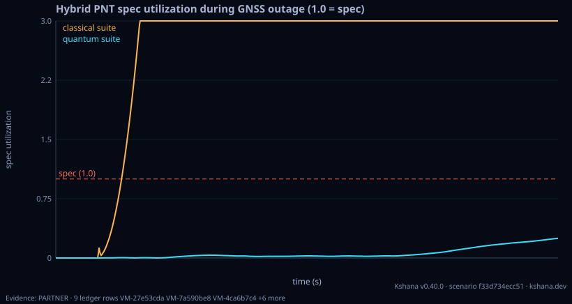
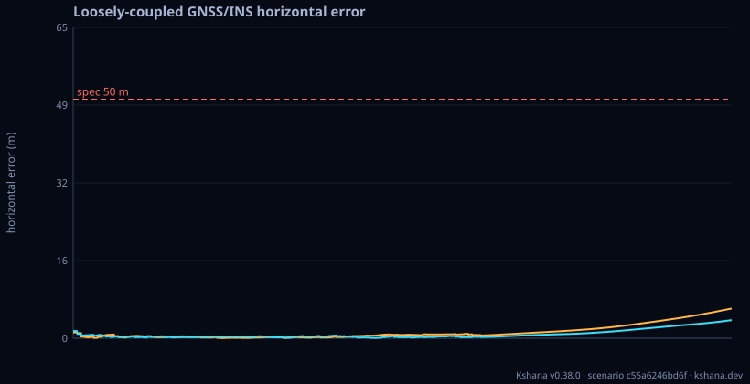

<!-- SPDX-License-Identifier: AGPL-3.0-only -->
<!-- Generated by tools/gen_kinds_index.py. Do not edit by hand. -->
# Inertial, fusion and quantum sensors

9 scenario kinds of the engine v0.39.0. Advisory: analysis output from a research and engineering tool, not type-approved navigation equipment and not a safety-of-life service. Every label here is the engine's or the verification matrix's; a kind is MODELLED unless the matrix says otherwise (how a label is earned: the README's Evidence section).

Topic pages: [QUANTUM-MODELS](../QUANTUM-MODELS.md), [QUANTUM](../QUANTUM.md), [LEO-PNT-FUSION](../LEO-PNT-FUSION.md). Run one: `kshana scenarios/gnss-ins.toml`. All families: [KINDS.md](../KINDS.md).


| Kind | What it does | Ledger |
|---|---|---|
| [`inertial`](by-kind/inertial.md) | 1-DOF inertial dead-reckoning during a GNSS outage. | MODELLED 6 · VALIDATED 2 |
| [`hybrid`](by-kind/hybrid.md) | Hybrid PNT capstone: clock + IMU + time-transfer aiding. | MODELLED |
| [`fusion`](by-kind/fusion.md) | Joint Kalman sensor-fusion PNT over the same hybrid inputs. | MODELLED 4 · VALIDATED 4 |
| [`hybrid-ukf`](by-kind/hybrid-ukf.md) | 17-state hybrid quantum+classical tightly-coupled GNSS/INS UKF (MODELLED): 15 INS error states + CAI-derived accel-bias correction + a 2-state (phase+frequency) clock from the q-parameter clock engine | MODELLED (result label) |
| [`gnss-ins`](by-kind/gnss-ins.md) | Loosely- and tightly-coupled GNSS/INS error-state EKF. | MODELLED (result label) |
| [`ins-trn-coast`](by-kind/ins-trn-coast.md) | INS/TRN coasting error model: position error against coast duration, built from IMU coefficients rather than swept as an assumed drift rate. | VALIDATED |
| [`quantum-gnss-free-nav`](by-kind/quantum-gnss-free-nav.md) | MODELLED GNSS-free quantum navigation: during a GNSS outage, a quantum (cold-atom interferometer) inertial budget vs a classical navigation-grade INS — position-error growth over the coast, holdover t | MODELLED (result label) |
| [`quantum-anomaly-detect`](by-kind/quantum-anomaly-detect.md) | MODELLED fault/anomaly detection for quantum PNT systems: a labelled fault catalog (clock frequency-jump/drift/lock-loss; sensor bias-step/dropout), a detection-statistic ROC AUC (with a bootstrap CI  | MODELLED (result label) |
| [`quantum-trade`](by-kind/quantum-trade.md) | Quantum-vs-classical PNT trade (13503): timing-holdover + inertial-holdover benefit of a candidate clock (a measured-ADEV curve — the defensibility hinge — or a quantum clock class) vs a classical bas | MODELLED 1 · VALIDATED 2 |

### `inertial`

1-DOF inertial dead-reckoning during a GNSS outage.

Required fields: `seed`, `threshold_m`, `time`, `gnss`, `accel_quantum`, `accel_classical`. Optional: `runs`.

**Ledger:** MODELLED 6 · VALIDATED 2. Full page, with the inputs, results, evidence and limitations: [inertial](by-kind/inertial.md).

```sh
kshana scenarios/imu-deadreckoning.toml
```


### `hybrid`

Hybrid PNT capstone: clock + IMU + time-transfer aiding.

Required fields: `seed`, `timing_spec_ns`, `position_spec_m`, `time`, `gnss`, `resync`, `clock_quantum`, `clock_classical`, `accel_quantum`, `accel_classical`.

**Ledger:** MODELLED. Full page, with the inputs, results, evidence and limitations: [hybrid](by-kind/hybrid.md).

```sh
kshana scenarios/hybrid-pnt.toml
```



### `fusion`

Joint Kalman sensor-fusion PNT over the same hybrid inputs.

Required fields: `seed`, `timing_spec_ns`, `position_spec_m`, `time`, `gnss`, `resync`, `clock_quantum`, `clock_classical`, `accel_quantum`, `accel_classical`. Optional: `coupled`.

**Ledger:** MODELLED 4 · VALIDATED 4. Full page, with the inputs, results, evidence and limitations: [fusion](by-kind/fusion.md).

```sh
kshana scenarios/fusion-pnt.toml
```


### `hybrid-ukf`

17-state hybrid quantum+classical tightly-coupled GNSS/INS UKF (MODELLED): 15 INS error states + CAI-derived accel-bias correction + a 2-state (phase+frequency) clock from the q-parameter clock engine, driven by the bracketed CAI error model. The figure of merit is filter self-consistency (NEES + innovation-whiteness vs χ² bounds) — a self-consistency statement, NOT a real-world accuracy guarantee. Simulation only; no TRL>3, no flight heritage, no external validation.

Required fields: `seed`, `time`, `gnss`, `accel`, `clock`. Optional: `residual_accel_bias_m_s2`, `speed_m_s`, `sigma_pr_m`, `sigma_rr_mps`, `consistency_seeds`, `q_factor`, `r_factor`.

**Ledger:** no matrix row names this kind; the engine labels its own result. Full page, with the inputs, results, evidence and limitations: [hybrid-ukf](by-kind/hybrid-ukf.md).

```sh
kshana scenarios/hybrid-ukf.toml
```


### `gnss-ins`

Loosely- and tightly-coupled GNSS/INS error-state EKF.

Required fields: `seed`, `threshold_m`, `time`, `gnss`, `imu_quantum`, `imu_classical`. Optional: `sis_correlation_s`, `sigma_pos_m`, `sigma_vel_mps`, `lat_deg`, `lon_deg`, `alt_m`, `trajectory`, `tight`.

**Ledger:** no matrix row names this kind; the engine labels its own result. Full page, with the inputs, results, evidence and limitations: [gnss-ins](by-kind/gnss-ins.md).

```sh
kshana scenarios/gnss-ins.toml
```



### `ins-trn-coast`

INS/TRN coasting error model: position error against coast duration, built from IMU coefficients rather than swept as an assumed drift rate. Five growth contributions — accelerometer bias, gyro-bias tilt through gravity, velocity random walk, angle random walk and scale factor against travelled distance — each propagated through a nine-state local-level inertial error model with Schuler feedback at a stated latitude and height (the short-coast leading-order laws t², t³, t^1.5, t^2.5 and t¹/t² are reported beside it) and combined under a STATED rule (root-sum-square by default, or linear-sum, or deterministic-sum with stochastic-rss; all three are computed on every run so the choice is visible rather than buried). The coast durations reaching caller-supplied position thresholds (10 m and 50 m by default) are located by the engine's existing bisection, each with a per-contribution breakdown naming the dominant source, and each single contribution's crossing is additionally inverted algebraically so the two agree. A terrain-relative-navigation mode bounds the coast with periodic position fixes and reports the largest fix interval that holds each threshold; a position-only fix leaves velocity error and tilt alive across the fix, so it does not always bound the coast at any fix rate, and the report says so rather than returning a zero. MODELLED: the IMU class coefficients are representative band figures, not a datasheet, and the terrain-fix residual is an input. An unreached threshold is reported as null with a status, never as a zero. Not a certified inertial-navigation performance product.

Required fields: none. Optional: `imu_grade`, `accel_bias_ug`, `accel_vrw_m_s_per_sqrt_hr`, `accel_scale_factor_ppm`, `gyro_bias_deg_per_hr`, `gyro_arw_deg_per_sqrt_hr`, `speed_m_s`, `ref_accel_m_s2`, `latitude_deg`, `height_m`, `combination`, `crossing_thresholds_m`, `grades`, `drift_band_lo_m_per_s`, `drift_band_hi_m_per_s`, `trn_fix_mode`, `trn_fix_interval_s`, `trn_fix_residual_m`, `mission_duration_s`.

**Ledger:** VALIDATED. Full page, with the inputs, results, evidence and limitations: [ins-trn-coast](by-kind/ins-trn-coast.md).

```sh
kshana scenarios/ins-trn-coast.toml
```


### `quantum-gnss-free-nav`

MODELLED GNSS-free quantum navigation: during a GNSS outage, a quantum (cold-atom interferometer) inertial budget vs a classical navigation-grade INS — position-error growth over the coast, holdover to a position threshold, and the quantum-vs-classical trade as honest TradeEvidence with representativeness. Honest observability note: with no external fix the accelerometer bias is unobservable so the error grows; the quantum sensor slows but does not close that gap. Illustrative public-source device params; models the class, no TRL/flight/certification.

Required fields: none. Optional: `outage_s`, `threshold_m`, `quantum_bias_m_s2`, `classical_bias_m_s2`.

**Ledger:** no matrix row names this kind; the engine labels its own result. Full page, with the inputs, results, evidence and limitations: [quantum-gnss-free-nav](by-kind/quantum-gnss-free-nav.md).

```sh
kshana scenarios/quantum-gnss-free-nav.toml
```


### `quantum-anomaly-detect`

MODELLED fault/anomaly detection for quantum PNT systems: a labelled fault catalog (clock frequency-jump/drift/lock-loss; sensor bias-step/dropout), a detection-statistic ROC AUC (with a bootstrap CI from the externally-validated eval_stats) and a minimum-detectable-fault at a fixed false-alarm rate, with the quantum-clock-aided monitor (lower noise) detecting smaller faults — as honest TradeEvidence + representativeness. Gaussian detection-statistic model (AUC = Phi(mu/(sigma*sqrt2))); models the class, illustrative public-source params, no TRL/flight/certification.

Required fields: none. Optional: `fault_mu`, `quantum_sigma`, `classical_sigma`, `pfa`, `pd`, `samples`, `seed`.

**Ledger:** no matrix row names this kind; the engine labels its own result. Full page, with the inputs, results, evidence and limitations: [quantum-anomaly-detect](by-kind/quantum-anomaly-detect.md).

```sh
kshana scenarios/quantum-anomaly-detect.toml
```


### `quantum-trade`

Quantum-vs-classical PNT trade (13503): timing-holdover + inertial-holdover benefit of a candidate clock (a measured-ADEV curve — the defensibility hinge — or a quantum clock class) vs a classical baseline class, with the long-tau floor-assumption caveat carried on the artifact, plus a GNSS-denied resilience-vs-time envelope. MODELLED; quantifies (never validates) a partner device. The candidate clock is a measured curve (`candidate_adev_taus` + `candidate_adev_values`, equal length, at least 2 points; it wins when both forms are given) or a `candidate_clock_class`.

Required fields: `timing_threshold_s`, `position_threshold_m`, `baseline_clock_class`, `candidate_adev_taus+candidate_adev_values|candidate_clock_class`. Optional: `baseline_ins`, `candidate_ins`, `resilience_times_s`, `alt_pnt_bound_m`.

**Ledger:** MODELLED 1 · VALIDATED 2. Full page, with the inputs, results, evidence and limitations: [quantum-trade](by-kind/quantum-trade.md).

```sh
kshana scenarios/quantum-trade.toml
```


