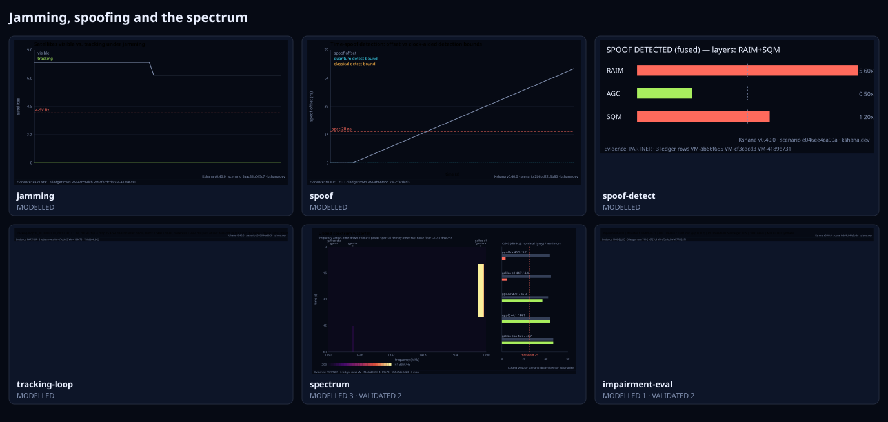
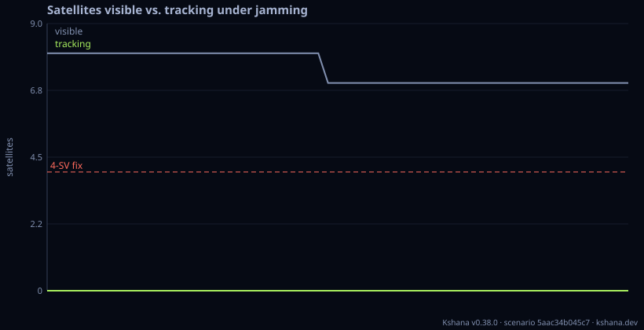
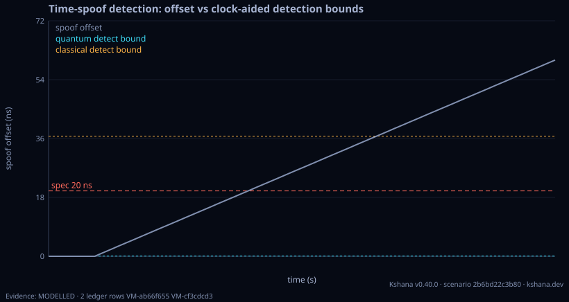
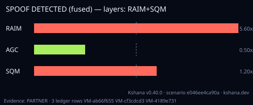
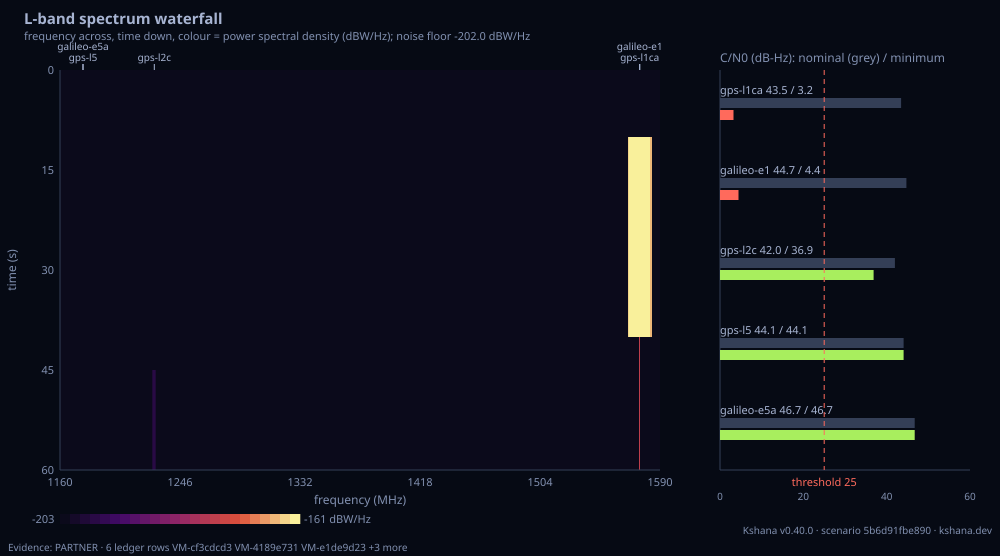

<!-- SPDX-License-Identifier: AGPL-3.0-only -->
<!-- Generated by tools/gen_kinds_index.py. Do not edit by hand. -->
# Jamming, spoofing and the spectrum

6 scenario kinds of the engine v0.38.0. Advisory: analysis output from a research and engineering tool, not type-approved navigation equipment and not a safety-of-life service. Every label here is the engine's or the verification matrix's; a kind is MODELLED unless the matrix says otherwise (how a label is earned: the README's Evidence section).

Topic pages: [SPECTRUM](../SPECTRUM.md), [DECEIVED-TIME](../DECEIVED-TIME.md), [IQ-FOLLOW](../IQ-FOLLOW.md). Run one: `kshana scenarios/jamming-demo.toml`. All families: [KINDS.md](../KINDS.md).



| Kind | What it does | Ledger |
|---|---|---|
| [`jamming`](by-kind/jamming.md) | Link-budget jamming: J/S → effective C/N₀ → loss of lock. | MODELLED |
| [`spoof`](by-kind/spoof.md) | Stochastic time-spoof detector (Neyman–Pearson / χ²₁) with Monte-Carlo P_fa/P_md. | MODELLED |
| [`spoof-detect`](by-kind/spoof-detect.md) | Combined RF/measurement spoof detector (multi-SV RAIM-consistency + AGC + SQM, fused) vs a parameterised attack (power advantage, carrier-phase alignment, time/position push; TEXBAT-style). | MODELLED |
| [`tracking-loop`](by-kind/tracking-loop.md) | Tracking-loop loss of lock: C/N0 -> lock/unlock WITH HYSTERESIS, the time it takes to lose lock, and spoof pull-in as a function of code and carrier offset RATE. | MODELLED |
| [`spectrum`](by-kind/spectrum.md) | L-band spectrum model and waterfall: the whole GNSS L band as one power spectral density (PSD), frequency across, time down, over a scripted jammer timeline. | MODELLED 3 · VALIDATED 2 |
| [`impairment-eval`](by-kind/impairment-eval.md) | AI/ML RF-impairment detection evaluation testbed (13494): generate a labelled, parameter-grounded SYNTHETIC corpus (nominal/jamming/spoof-time/spoof-position/multipath), score a detector (energy/agc/s | MODELLED 1 · VALIDATED 2 |

### `jamming`

Link-budget jamming: J/S → effective C/N₀ → loss of lock.

Required fields: `seed`, `time`, `receiver`, `constellation`. Optional: `jammer`, `mask_deg`, `tracking_threshold_dbhz`, `degraded_margin_db`, `signal_power_dbw`, `temp_k`, `freq_hz`, `chip_rate_hz`, `skyline`.

**Ledger:** MODELLED. Full page, with the inputs, results, evidence and limitations: [jamming](by-kind/jamming.md).

```sh
kshana scenarios/jamming-demo.toml
```



### `spoof`

Stochastic time-spoof detector (Neyman–Pearson / χ²₁) with Monte-Carlo P_fa/P_md.

Required fields: `threshold_ns`, `time`, `attack`, `clock_quantum`, `clock_classical`.

**Ledger:** MODELLED. Full page, with the inputs, results, evidence and limitations: [spoof](by-kind/spoof.md).

```sh
kshana scenarios/spoof-attack.toml
```



### `spoof-detect`

Combined RF/measurement spoof detector (multi-SV RAIM-consistency + AGC + SQM, fused) vs a parameterised attack (power advantage, carrier-phase alignment, time/position push; TEXBAT-style).

Required fields: `attack`. Optional: `satellites`, `detector`.

**Ledger:** MODELLED. Full page, with the inputs, results, evidence and limitations: [spoof-detect](by-kind/spoof-detect.md).

```sh
kshana scenarios/spoof-detect.toml
```



### `tracking-loop`

Tracking-loop loss of lock: C/N0 -> lock/unlock WITH HYSTERESIS, the time it takes to lose lock, and spoof pull-in as a function of code and carrier offset RATE. The engine's existing denial and capture criteria are ratios on received power (a jammer denies at J/S = 30 dB, a spoofer captures at 3 dB); real loss of lock is not a power ratio, it is where a loop's jitter plus dynamic stress leaves its tracking-threshold budget. Reports (1) carrier (Costas) and code (non-coherent early/late) 1-sigma thermal jitter versus C/N0, squaring loss included, against the stated rules 3*sigma_PLL + theta_e <= 45 deg (the 15-degree rule in three-sigma form) and 3*sigma_DLL + ramp lag <= d/2 chips; (2) the drop and re-lock C/N0 thresholds with the binding loop named, the re-lock threshold DERIVED from the wider bandwidth a receiver re-pulls-in at rather than asserted, so the hysteresis width must fall between 5*log10(ratio) and 10*log10(ratio) dB; (3) the declared time to lose lock from a two-threshold lock detector with confirmation dwells driven over a C/N0 ramp, reported separately from the physical phase-escape time (the Viterbi mean time between cycle slips, in log10 s because it spans hundreds of decades); (4) spoof pull-in limits — the largest code slew and carrier Doppler rate a victim's loops can follow, with a map over both axes, because a spoofer that slews faster than these does not capture the loop, it outruns it; and (5) the DENIAL RADIUS the loop dynamics imply reported ALONGSIDE the existing power-ratio radius, never in place of it, with their signed difference as its own named field (denial_radius_delta_km) and a definition beside it. Every emitted numeric field carries a unit and a provenance class. VALIDATED closed forms: the carrier and code jitter expressions, the loop-filter reduction sqrt(2*B_n*T) and the first-order ramp lag are cross-checked against the engine's own sdr correlator stepped forward on seeded synthetic IF — a different route to the same numbers — to 0.6 %, 3.7 % and 0.17 % respectively, and the modified Bessel I0 behind the cycle-slip time against standard tabulated values to 1e-7. The lower validity limit is asserted, not merely stated: below ~32 dB-Hz at 1 ms the real atan discriminator saturates against its +-pi/2 range and measures less jitter than any linear theory. MODELLED: the loop bandwidths, integration time, correlator spacing, pull-in bandwidth ratio, confirmation dwells, jammer power and antenna gains are representative band figures, not a datasheet. NOT modelled: oscillator (Allan-deviation) and vibration jitter, front-end bandwidth limiting, multipath, AGC dynamics, data-bit-transition loss, external aiding, and any half-cycle correction to the Costas cycle-slip formula. Under loop dynamics spoof capture has no radius at all — the binding constraint is offset rate, not power — so that field is null with a reason rather than a fabricated number. Not a certified receiver-performance product.

Required fields: none. Optional: `pll_bandwidth_hz`, `dll_bandwidth_hz`, `predetection_integration_s`, `correlator_spacing_chips`, `carrier_allowance_deg`, `code_allowance_chips`, `pullin_bandwidth_ratio`, `drop_confirm_epochs`, `relock_confirm_epochs`, `doppler_rate_hz_per_s`, `code_slew_chips_per_s`, `cn0_high_dbhz`, `cn0_low_dbhz`, `ramp_duration_s`, `jitter_table_cn0_dbhz`, `jammer_power_dbw`, `jammer_gain_dbi`, `rx_gain_toward_jammer_db`, `rx_gain_toward_sat_db`, `signal_power_dbw`, `temp_k`, `freq_hz`, `chip_rate_hz`, `jammer_type`, `q_override`, `denial_js_threshold_db`, `capture_js_threshold_db`, `spoof_code_slew_chips_per_s`, `spoof_doppler_rate_hz_per_s`.

**Ledger:** MODELLED. Full page, with the inputs, results, evidence and limitations: [tracking-loop](by-kind/tracking-loop.md).

```sh
kshana scenarios/tracking-loop.toml
```


### `spectrum`

L-band spectrum model and waterfall: the whole GNSS L band as one power spectral density (PSD), frequency across, time down, over a scripted jammer timeline. SIGNALS: GPS L1 C/A and L2C (BPSK(1)), Galileo E1 open service (MBOC(6,1,1/11), or BOC(1,1)), GPS L5 and Galileo E5a (BPSK(10)), each at its carrier with the interface-specification minimum received power (IS-GPS-200, IS-GPS-705, Galileo OS SIS ICD) unless overridden; GLONASS, BeiDou and Galileo E6 are not modelled. JAMMERS: continuous-wave tone, flat narrowband noise, linear sawtooth chirp and broadband noise matched to a band's own modulation, each with a centre, a bandwidth, a received power (direct, or EIRP and range through the jamming kind's free-space path loss) and on/off times. Each jammer is scored against each band by its spectral separation coefficient kappa over the receiver bandwidth, and (C/N0)_eff = [1/(C/N0) + sum (J/S) kappa]^-1; for one jammer this equals the jamming kind's anti-jam equation with Q = 1/(R_c kappa), and the report carries that cross-check (and the jamming kind's representative-Q figure beside it). The noise floor is k T_sys with T_sys = T_ant + 290 K (F - 1). The waterfall averages each cell over its bin and its row (chirps exactly, whole sweeps plus the partial one; jammers switching mid-row by their duty), so the C/N0 timeline and the picture come from the same numbers; result.json carries the grid block-averaged in power, per-band C/N0 and J/S per row, and per jammer per band the SSC, Q, J/S, in-band J/S and steady C/N0. Optional [iq]: the model drawn as complex IQ at one instant, written to and read back from a SigMF recording (cf32_le or ci16_le), and compared with a Welch estimate. Optional [recording] (native builds): a real SigMF recording's Welch PSD beside the model. VALIDATED: the signal PSDs against the textbook main-lobe widths (BPSK(n) 2n x 1.023 MHz null to null; BOC(1,1) lobes centred at +/-1.023 MHz) and the spectral separation coefficients against their Parseval closed forms and Kaplan & Hegarty's Q = 1 (CW) and 1.5 (matched). MODELLED: jammer powers, timeline, front-end bandwidths, the continuous-spectrum (no code lines) treatment and the absence of AGC, blanking and antenna pattern.

Required fields: none. Optional: `seed`, `duration_s`, `step_s`, `receiver`, `grid`, `bands`, `jammers`, `iq`, `recording`.

**Ledger:** MODELLED 3 · VALIDATED 2. Full page, with the inputs, results, evidence and limitations: [spectrum](by-kind/spectrum.md).

```sh
kshana scenarios/l-band-waterfall-jamming.toml
```



### `impairment-eval`

AI/ML RF-impairment detection evaluation testbed (13494): generate a labelled, parameter-grounded SYNTHETIC corpus (nominal/jamming/spoof-time/spoof-position/multipath), score a detector (energy|agc|sqm|parity|fused) with the detector-agnostic harness, and report AUC/ROC/confusion + per-class Pd at a target Pfa, plus the in- vs out-of-distribution optimism gap. MODELLED operating characteristics only — never field/IQ, no good/bad verdict.

Required fields: none. Optional: `seed`, `n_per_class`, `nominal_cn0_dbhz`, `meas_noise`, `detector`, `target_pfa`, `shift_severity_scale`, `optimism_tol`.

**Ledger:** MODELLED 1 · VALIDATED 2. Full page, with the inputs, results, evidence and limitations: [impairment-eval](by-kind/impairment-eval.md).

```sh
kshana scenarios/impairment-eval.toml
```


