<!-- SPDX-License-Identifier: AGPL-3.0-only -->
<!-- Generated by tools/gen_kinds_index.py. Do not edit by hand. -->
# Lunar and cislunar

20 scenario kinds of the engine v0.39.0. Advisory: analysis output from a research and engineering tool, not type-approved navigation equipment and not a safety-of-life service. Every label here is the engine's or the verification matrix's; a kind is MODELLED unless the matrix says otherwise (how a label is earned: the README's Evidence section).

Topic pages: [LUNAR-REFERENCE-STATION](../LUNAR-REFERENCE-STATION.md), [LUNAR-INFRASTRUCTURE](../LUNAR-INFRASTRUCTURE.md), [LUNANET-AFS](../LUNANET-AFS.md). Run one: `kshana scenarios/lunar-infrastructure-od-consistency.toml`. All families: [KINDS.md](../KINDS.md).


| Kind | What it does | Ledger |
|---|---|---|
| [`lunar-integrity`](by-kind/lunar-integrity.md) | Lunar south-pole ARAIM protection-level pass vs a representative LunaNet relay set. | MODELLED (result label) |
| [`lunar-time-offset`](by-kind/lunar-time-offset.md) | Modelled relativistic Earth–Moon clock rate (Lunar Coordinate Time, LTC/TCL): the secular LTC−TT rate from the self-potential difference and the Moon's kinetic term, reported with the published 56–59  | MODELLED (result label) |
| [`lunar-time-budget`](by-kind/lunar-time-budget.md) | MODELLED end-to-end Coordinated Lunar Time (LTC) time-error budget: the seven LTC error terms assembled as time-error curves x_i(τ) over a whole averaging-time grid, root-summed into x_Σ(τ), and the c | MODELLED |
| [`lunar-vlbi`](by-kind/lunar-vlbi.md) | Modelled lunar geodetic VLBI delay observable: an Earth baseline (two ground stations, GCRS) observes a one-way signal from a NovaMoon-class lunar-surface beacon. | MODELLED 3 · VALIDATED 3 |
| [`lunar-vlbi-fim`](by-kind/lunar-vlbi-fim.md) | Lunar-VLBI station-coordinate covariance: the delay partials of the lunar-vlbi observable accumulated over an explicit SCHEDULE (baselines x epochs) into a Fisher information matrix, inverted, and rep | MODELLED 3 · VALIDATED 2 |
| [`lunar-joint-od-clock`](by-kind/lunar-joint-od-clock.md) | Modelled joint multi-technique lunar OD + clock batch estimator on a SIMULATED network: a Gauss-Newton snapshot fit that fuses Earth-baseline geodetic VLBI delays, lunar-local station↔satellite ranges | MODELLED (result label) |
| [`lunar-frame-realisation`](by-kind/lunar-frame-realisation.md) | Modelled lunar reference-frame realisation: a 7-parameter Helmert (similarity) datum fit — 3 translation, 3 small-angle rotation, 1 scale — tying an estimated set of selenographic-derived MCMF point c | MODELLED (result label) |
| [`lunar-frame-campaign`](by-kind/lunar-frame-campaign.md) | Seven-parameter Helmert (similarity) frame datum driven by a SIMULATED OBSERVING CAMPAIGN rather than by an injected transform. | MODELLED 2 · VALIDATED 3 |
| [`lunar-llr-datum`](by-kind/lunar-llr-datum.md) | Seven-parameter Helmert lunar frame datum driven by a REAL, ARCHIVED observing campaign rather than a simulated one. | VALIDATED |
| [`moonlight-service-volume`](by-kind/moonlight-service-volume.md) | Modelled lunar navigation service-volume analysis from an ILLUSTRATIVE, public-source Moonlight/LCNS-class lunar-orbit constellation (not affiliated with ESA): sweeps a selenographic lat/lon grid over | MODELLED (result label) |
| [`lunar-differential-pnt`](by-kind/lunar-differential-pnt.md) | Modelled lunar DIFFERENTIAL PNT (a lunar DGNSS/SBAS analogue): a NovaMoon-class reference station at a KNOWN selenographic location computes per-satellite differential corrections from an ILLUSTRATIVE | MODELLED (result label) |
| [`lunar-station-coverage`](by-kind/lunar-station-coverage.md) | Modelled lunar reference-station coverage: a Monte Carlo sweep of the lunar differential-PNT model over a south-polar user grid and a day of epochs. | MODELLED |
| [`lunar-beacon`](by-kind/lunar-beacon.md) | Surface-beacon augmentation of a lunar orbital navigation service, as a runnable before/after table. | MODELLED |
| [`lunar-interop-export`](by-kind/lunar-interop-export.md) | Modelled lunar interoperability export: emits the lunar reference frame, lunar time scale and lunar ephemeris in LunaNet/IOAG-aligned, CCSDS-based interchange forms with round-trip / field conformance | MODELLED (result label) |
| [`cislunar-observability`](by-kind/cislunar-observability.md) | MODELLED planar cislunar constellation observability (P6): tracks a four-spacecraft differential-corrected planar-DRO constellation with inter-satellite ranging and reports how much of a spacecraft's  | MODELLED |
| [`cislunar-arc-recovery`](by-kind/cislunar-arc-recovery.md) | MODELLED independent-estimator test of the cislunar arc-length observability threshold. | MODELLED |
| [`lunar-attack-surface`](by-kind/lunar-attack-surface.md) | Lunar surface-navigation signal-security attack surface (P1): composes the open signal-security analyses into one binary-reachable run. | MODELLED (result label) |
| [`lunar-jamming`](by-kind/lunar-jamming.md) | Lunar-native RF jamming: per-satellite jammer-to-signal ratio, effective C/N₀ and loss of lock for a selenographic surface user under a lunar surface (or raised) jammer, over the illustrative public-s | MODELLED |
| [`earth-gnss-lunar`](by-kind/earth-gnss-lunar.md) | Earth-GNSS reception at lunar distance, the weak-signal layer the conflict-resilience paper names and the engine had no model for. | MODELLED |
| [`lunar-infrastructure`](by-kind/lunar-infrastructure.md) | MODELLED studies of the Moon's orbit and surface as navigation and geodetic infrastructure, five studies behind one kind selected by `study`: od-consistency (onboard Earth-GNSS orbit determination in  | MODELLED (result label) |

### `lunar-integrity`

Lunar south-pole ARAIM protection-level pass vs a representative LunaNet relay set. sigma_ure_m exposes the signal-in-space ranging accuracy (protection levels scale linearly with it, so sweeping it answers what ranging accuracy an alert limit requires). Defaults to the historical LNIS-class south-pole case.

Required fields: none. Optional: `step_s`, `duration_s`, `alert_limit_m`, `p_hmi`, `sigma_ure_m`.

**Ledger:** no matrix row names this kind; the engine labels its own result. Full page, with the inputs, results, evidence and limitations: [lunar-integrity](by-kind/lunar-integrity.md).

```sh
kshana scenarios/lunanet-araim.toml
```

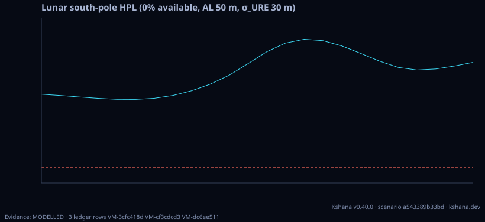

### `lunar-time-offset`

Modelled relativistic Earth–Moon clock rate (Lunar Coordinate Time, LTC/TCL): the secular LTC−TT rate from the self-potential difference and the Moon's kinetic term, reported with the published 56–59 µs/day band, plus the accumulated offset over a horizon.

Required fields: none. Optional: `epoch_year`, `epoch_month`, `epoch_day`, `horizon_days`.

**Ledger:** no matrix row names this kind; the engine labels its own result. Full page, with the inputs, results, evidence and limitations: [lunar-time-offset](by-kind/lunar-time-offset.md).

```sh
kshana scenarios/lunar-time-offset.toml
```

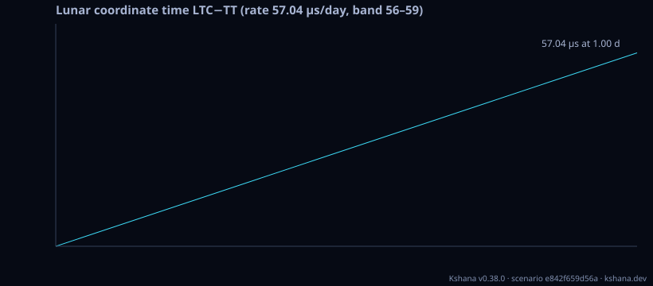

### `lunar-time-budget`

MODELLED end-to-end Coordinated Lunar Time (LTC) time-error budget: the seven LTC error terms assembled as time-error curves x_i(τ) over a whole averaging-time grid, root-summed into x_Σ(τ), and the clock-vs-frame CROSSOVER τ at which the growing clock term overtakes the constant real-time frame-realisation term (below it the budget is frame-limited, above it clock-limited) — the honest answer to the single-τ artifact. The τ-slopes are closed-form and analytically checkable (clock τ^{+1/2}/τ^{+1}, floors τ^0, measurement τ^{-1/2}) and the clock rows reproduce the published one-day clock specs (crate::clock_specs); the RF/optical-link, frame-realisation, relativistic-residual and ephemeris floor MAGNITUDES are Modelled budget allocations (documented defaults, caller-overridable), not measurements. The contribution is the reproducible crossover τ, not a certified per-term number; not certified for operational timekeeping.

Required fields: none. Optional: `clock`, `tau_min_s`, `tau_max_s`, `points_per_decade`, `clocks`, `time_lab`.

**Ledger:** MODELLED. Full page, with the inputs, results, evidence and limitations: [lunar-time-budget](by-kind/lunar-time-budget.md).

```sh
kshana scenarios/lunar-time-budget.toml
```


### `lunar-vlbi`

Modelled lunar geodetic VLBI delay observable: an Earth baseline (two ground stations, GCRS) observes a one-way signal from a NovaMoon-class lunar-surface beacon. Emits the near-field two-range-difference delay, its rate, and the wavefront-curvature near-field correction over a pass — cross-checked against the same-codebase plane-wave Δ-DOR observable in the far-field limit, with finite-difference-verified partials. The default analytic path is MODELLED and carries the frame-consistency, xp=yp=0 polar-motion and plane-wave-vs-near-field caveats. Setting planetary_kernel_path, earth_orientation_kernel_path and moon_orientation_kernel_path runs the kernel path instead (DE440, MOON_PA_DE440, ITRF93; converged barycentric light times; adds the epoch's beacon and station partials), whose Newtonian delay and partials agree with NAIF SPICE converged light times to 0.06 ps and 7.4e-9. Not validated against real VLBI data.

Required fields: none. Optional: `station1_lat_deg`, `station1_lon_deg`, `station1_alt_m`, `station2_lat_deg`, `station2_lon_deg`, `station2_alt_m`, `beacon_lat_deg`, `beacon_lon_deg`, `beacon_alt_m`, `epoch_year`, `epoch_month`, `epoch_day`, `horizon_hours`, `step_min`, `planetary_kernel_path`, `earth_orientation_kernel_path`, `moon_orientation_kernel_path`.

**Ledger:** MODELLED 3 · VALIDATED 3. Full page, with the inputs, results, evidence and limitations: [lunar-vlbi](by-kind/lunar-vlbi.md).

```sh
kshana scenarios/lunar-vlbi.toml
```


### `lunar-vlbi-fim`

Lunar-VLBI station-coordinate covariance: the delay partials of the lunar-vlbi observable accumulated over an explicit SCHEDULE (baselines x epochs) into a Fisher information matrix, inverted, and reported as the station coordinate covariance and the per-coordinate station sigma — a computed engine output rather than a scalar delay precision pushed through an assumed isotropic g = 3 equipartition factor. The state carries Earth-FIXED (ITRS) station coordinates, so the Jacobian is the inertial partial rotated by each epoch's GCRS->ITRS matrix: Earth rotation is what makes those coordinates observable, and the report MEASURES the Earth-fixed line-of-sight sweep and the beacon declination rather than assuming them. One observation is one (baseline, epoch) pair with BOTH stations above the elevation mask, weighted 1/delay_sigma_s^2. Reports rank, datum defect, condition number, the full information spectrum, the covariance matrix, per-station per-axis and 3-D sigmas, and the free-network null space on every run; under a rank deficiency the headline sigma is published as NULL with a status, never read out of a near-singular inverse. The equipartition value c*delay_sigma_s*sqrt(g/N) for the SAME schedule is emitted beside the computed value with the ratio, together with the isotropic trace bound sqrt(p/trace(M)) that AM-HM makes a hard floor — so the ratio is the anisotropy the assumption discarded. The delay closure tau_ik = tau_ij + tau_jk makes only n-1 of the n(n-1)/2 baselines geometrically independent; the report states both counts. MODELLED: the Moon-centre ephemeris, station clocks, troposphere and Earth-orientation parameters are held FIXED and observations are treated as independent, so the covariance is a Cramer-Rao bound for a reduced parameter set, not a predicted session result; the delay sigma, station coordinates and schedule are inputs. The partial the geometric-delay Jacobian leaves out (the differenced Shapiro term) is measured by finite difference and emitted. Not a geodetic product.

Required fields: none. Optional: `stations`, `beacon_lat_deg`, `beacon_lon_deg`, `beacon_alt_m`, `epoch_year`, `epoch_month`, `epoch_day`, `arc_hours`, `step_min`, `delay_sigma_s`, `elevation_mask_deg`, `datum`, `estimate_beacon`, `rel_tol`, `equipartition_g`, `planetary_kernel_path`.

**Ledger:** MODELLED 3 · VALIDATED 2. Full page, with the inputs, results, evidence and limitations: [lunar-vlbi-fim](by-kind/lunar-vlbi-fim.md).

```sh
kshana scenarios/lunar-vlbi-fim.toml
```


### `lunar-joint-od-clock`

Modelled joint multi-technique lunar OD + clock batch estimator on a SIMULATED network: a Gauss-Newton snapshot fit that fuses Earth-baseline geodetic VLBI delays, lunar-local station↔satellite ranges and inter-satellite ranges to recover, together, a lunar surface station's 3-D position, a small constellation's positions and every asset's clock offset from an injected truth. The headline honest result — VLBI makes the station's full 3-D position observable where lunar-local ranging alone leaves a weakly-observed direction — is reported as the with-vs-without-VLBI station-error contrast. MODELLED simulated closed-loop recovery (truth shares the observation model), deterministic (seeded), NOT real-data validated; no force-model propagation inside the solver; no TRL/heritage/agency endorsement.

Required fields: none. Optional: `n_sat`, `n_earth`, `seed`, `sigma_vlbi_s`, `sigma_range_m`, `sigma_isl_m`, `station_lat_deg`, `station_lon_deg`, `station_alt_m`, `orbit_radius_km`, `sigma_clock_s`, `orbit_ecc`, `orbit_inc_deg`, `orbit_argp_deg`, `orbit_planes`, `epoch_year`, `epoch_month`, `epoch_day`.

**Ledger:** no matrix row names this kind; the engine labels its own result. Full page, with the inputs, results, evidence and limitations: [lunar-joint-od-clock](by-kind/lunar-joint-od-clock.md).

```sh
kshana scenarios/lunar-joint-od-clock.toml
```

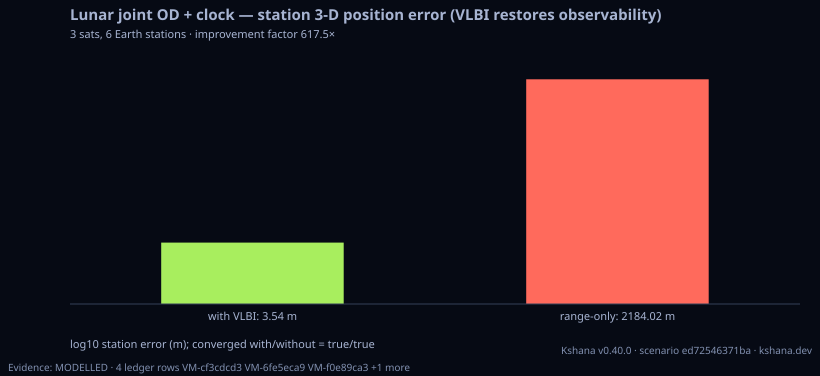

### `lunar-frame-realisation`

Modelled lunar reference-frame realisation: a 7-parameter Helmert (similarity) datum fit — 3 translation, 3 small-angle rotation, 1 scale — tying an estimated set of selenographic-derived MCMF point coordinates to a datum by weighted least squares (crate::batch_ls::gauss_newton), plus a simple orientation tie expressing the realised small rotation about the ICRF axes relative to the IAU 2015 WGCCRE body orientation. The scenario injects a known small transform (translation ~tens of m, rotation ~µrad, scale ~1e-7) into a well-spread synthetic point network, adds seeded Gaussian noise, recovers the datum, and reports the recovered transform, the per-parameter recovery error vs the injected truth, and the post-fit RMS residual. MODELLED self-consistency — recovers an injected similarity transform (noiseless to ~machine precision), NOT a realisation against real tracking/VLBI data; deterministic (seeded); no TRL/heritage/agency endorsement.

Required fields: none. Optional: `n_points`, `tx_m`, `ty_m`, `tz_m`, `rot_x_urad`, `rot_y_urad`, `rot_z_urad`, `scale_ppb`, `noise_sigma_m`, `seed`, `epoch_year`, `epoch_month`, `epoch_day`.

**Ledger:** no matrix row names this kind; the engine labels its own result. Full page, with the inputs, results, evidence and limitations: [lunar-frame-realisation](by-kind/lunar-frame-realisation.md).

```sh
kshana scenarios/lunar-frame-realisation.toml
```

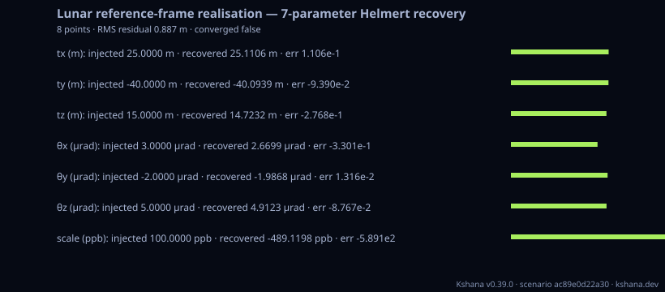

### `lunar-frame-campaign`

Seven-parameter Helmert (similarity) frame datum driven by a SIMULATED OBSERVING CAMPAIGN rather than by an injected transform. A network of Earth stations observes a catalogue of lunar-surface beacons over an explicit schedule; the lunar-VLBI delay partials are accumulated over that schedule into a beacon-coordinate Fisher information matrix exactly as lunar-vlbi-fim does; and that information is propagated through the Helmert design A = [I3 | [p]_x | p] at the catalogue points into the datum covariance H = A^T M_b A, diagnosed by crate::fim::crlb. NO transform is injected and nothing is recovered from a planted answer, so the reported datum accuracy derives from the observing programme: halving the delay sigma halves it exactly, and lengthening the arc improves it because the libration the report MEASURES (sub_earth_direction_sweep_deg) is what separates the line-of-sight beacon coordinate from the plane-of-sky ones. Rank, datum defect, condition number, the full spectrum, the unobservable directions IN THE SEVEN-PARAMETER BASIS, the weakest direction even at full rank and each parameter's share of it are emitted on every run; a parameter the campaign does not constrain is published as NULL with a status, never read out of a near-singular inverse. Beacon-error correlation is measured, not assumed: with the stations held fixed no observation touches two beacons so the information matrix is exactly block-diagonal (offblock_fraction 0), and with the stations estimated the Schur-marginalised block is coupled, with the induced correlation printed and the whole propagation re-run with it discarded so the price of an independence assumption is a number. The same propagation under an isotropic per-coordinate sigma, and the recovery error the lunar-frame-realisation scenario reports, are both run here and printed beside the campaign value with their ratios. MODELLED: the beacon catalogue is sourced but the CAMPAIGN is simulated — the station network and the delay sigma are illustrative inputs, individual delay observations are treated as independent, and the Moon-centre ephemeris, station clocks, troposphere and Earth-orientation parameters are held FIXED, so the datum covariance is a Cramer-Rao bound for a reduced parameter set. Not a geodetic product.

Required fields: none. Optional: `stations`, `beacons`, `epoch_year`, `epoch_month`, `epoch_day`, `arc_hours`, `step_min`, `delay_sigma_s`, `elevation_mask_deg`, `earth_elevation_mask_deg`, `station_datum`, `rel_tol`, `assumed_coordinate_sigma_m`, `solver`.

**Ledger:** MODELLED 2 · VALIDATED 3. Full page, with the inputs, results, evidence and limitations: [lunar-frame-campaign](by-kind/lunar-frame-campaign.md).

```sh
kshana scenarios/lunar-frame-campaign.toml
```


### `lunar-llr-datum`

Seven-parameter Helmert lunar frame datum driven by a REAL, ARCHIVED observing campaign rather than a simulated one. Where lunar-frame-campaign removed the injected transform but still stated its station network, its schedule and its per-observation sigma as ILLUSTRATIVE inputs, this kind takes all three from measurement: the epochs are the ground-transmit times of archived ILRS Consolidated Laser Ranging Data normal points, the observations are the laser ranges really fired at the five retroreflector arrays on the Moon, and every observation weight is that normal point's own archived precision bin_rms/sqrt(n_raw) read out of the file. Station coordinates come from the IERS ITRF2020 SLR solution (propagated to epoch by their published velocities) and the reflector coordinates from JPL DE430 Table 7 in the mean-Earth/mean-rotation frame the IAU 2015 WGCCRE model realises. Range partials accumulate into the joint reflector-coordinate Fisher information matrix and propagate through the same Helmert design into the datum covariance, diagnosed by crate::fim::crlb. Rank, defect, condition, spectrum, unobservable directions in the seven-parameter basis, the weakest direction at full rank and each parameter's share of it are emitted on every run, and an unconstrained parameter is published as NULL with a status. Inter-array correlation is MEASURED at exactly zero rather than assumed, because a laser range touches one array. A record the catalogues cannot place — a station with no published ITRF position — is SKIPPED AND COUNTED, never given a substituted coordinate. WHICH LINKS ARE MEASURED AND WHICH ARE MODELLED IS THE REPORT, NOT A FOOTNOTE: the Moon-centre ephemeris and the IAU body orientation remain modelled and their combined size is emitted as the observed-minus-computed one-way range residual over every point used; troposphere, solid-body tides, station eccentricity, polar motion, UT1-UTC, relativistic delay and station clocks are absent and inside that residual. Because an ephemeris error reaches a covariance only through the direction of each line of sight, every run also re-solves the whole datum with all partials tilted by sensitivity_tilt_deg (sign alternating) and emits the ratio, so the covariance's insensitivity to the modelled ephemeris is a number rather than an argument. The simulated campaign's own figures are RUN and printed beside the measured ones, not transcribed. MODELLED: the seven-parameter figures are a Cramer-Rao bound for a reduced parameter set on a real schedule — not a solved datum, not an LLR analysis and not a geodetic product. The committed real-data slice ships with the repository but not with the published crate; point data_dir at a copy of it.

Required fields: none. Optional: `data_dir`, `normal_points_dir`, `reflectors_path`, `stations_path`, `dut1_s`, `rel_tol`, `compare_simulated_campaign`, `sensitivity_tilt_deg`, `planetary_kernel_path`, `extra_reflectors`, `extra_beacons`, `extra_earth_elevation_mask_deg`, `beacon_campaign`.

**Ledger:** VALIDATED. Full page, with the inputs, results, evidence and limitations: [lunar-llr-datum](by-kind/lunar-llr-datum.md).

```sh
kshana scenarios/lunar-llr-datum.toml
```


### `moonlight-service-volume`

Modelled lunar navigation service-volume analysis from an ILLUSTRATIVE, public-source Moonlight/LCNS-class lunar-orbit constellation (not affiliated with ESA): sweeps a selenographic lat/lon grid over a time horizon and reports DOP / coverage / availability (≥4 sats AND PDOP < threshold) plus a generalised lunar ARAIM protection-level (HPL/VPL) envelope over the volume. The DOP geometry REUSES the gnss_lib_py-VALIDATED kernel (crate::orbit::dop); the protection level REUSES the LunaNet LNIS lunar ARAIM machinery (crate::lunar, σ_URE≈30 m) and reduces to the existing south-pole PL as a special case. MODELLED composition: a circular-/elliptical-Keplerian relay set (not the real differential-corrected LCNS/NRHO ephemeris), a mean-rotation Moon (no libration/precessing pole). Deterministic (pure geometry). No TRL/heritage/agency endorsement.

Required fields: none. Optional: `n_sats`, `sma_km`, `eccentricity`, `inc_deg`, `argp_deg`, `lat_min_deg`, `lat_max_deg`, `lat_step_deg`, `lon_min_deg`, `lon_max_deg`, `lon_step_deg`, `horizon_hours`, `step_min`, `elev_mask_deg`, `pdop_threshold`, `alert_limit_m`, `p_hmi`, `perturbed`, `sigma_ure_m`, `export_site_lat_deg`, `export_site_lon_deg`, `export_antenna`, `ephemeris_path`, `planetary_kernel_path`, `epoch_utc`, `terrain`.

**Ledger:** no matrix row names this kind; the engine labels its own result. Full page, with the inputs, results, evidence and limitations: [moonlight-service-volume](by-kind/moonlight-service-volume.md).

```sh
kshana scenarios/moonlight-service-volume.toml
```

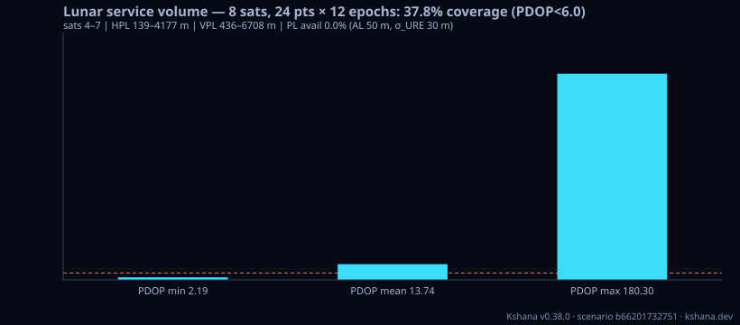

### `lunar-differential-pnt`

Modelled lunar DIFFERENTIAL PNT (a lunar DGNSS/SBAS analogue): a NovaMoon-class reference station at a KNOWN selenographic location computes per-satellite differential corrections from an ILLUSTRATIVE, public-source Moonlight/LCNS-class constellation (NovaMoon referenced only as a system CLASS, not affiliated with ESA), and a user offset by baseline_km applies them so the COMMON-MODE orbit + clock errors cancel. The clock term cancels EXACTLY (an algebraic identity); the orbit term leaves only the line-of-sight-difference projection, which → 0 as baseline → 0 (the spatial-decorrelation floor) and grows ≈ linearly with baseline. Reports the user 3-D position error WITH vs WITHOUT corrections, the reduction factor, the error-vs-baseline curve, and a user protection level that REUSES the DO-229E SBAS machinery (crate::sbas) with the differential residual σ. MODELLED — exact cancellation identity + first-order decorrelation model; not real-data validated; no TRL/heritage/agency endorsement. Deterministic if seeded.

Required fields: none. Optional: `n_sats`, `sma_km`, `eccentricity`, `inc_deg`, `argp_deg`, `ref_lat_deg`, `ref_lon_deg`, `baseline_km`, `orbit_err_m`, `clock_err_m`, `noise_m`, `seed`, `t_s`, `residual_sigma_m`, `p_hmi`, `survey_sigma_m`, `latency_s`, `quantization_bits`.

**Ledger:** no matrix row names this kind; the engine labels its own result. Full page, with the inputs, results, evidence and limitations: [lunar-differential-pnt](by-kind/lunar-differential-pnt.md).

```sh
kshana scenarios/lunar-differential-pnt.toml
```


### `lunar-station-coverage`

Modelled lunar reference-station coverage: a Monte Carlo sweep of the lunar differential-PNT model over a south-polar user grid and a day of epochs. A differential reference station at a known south-polar site corrects a stated constellation (illustrative Keplerian or a tabulated ephemeris) with a stated signal-in-space error, survey error, correction latency and link quantization; per point and over the region it reports the percentile corrected and uncorrected position error (3-D, horizontal, vertical), availability, coverage against a stated threshold, DO-229E protection levels, the coverage radius per azimuth and the correction-link budget at the station and at the worst point. Not a statement about the performance of any real system; not affiliated with or endorsed by any agency. MODELLED.

Required fields: none. Optional: `n_sats`, `sma_km`, `eccentricity`, `inc_deg`, `argp_deg`, `ephemeris_path`, `mask_deg`, `station_lat_deg`, `station_lon_deg`, `station_height_m`, `survey_sigma_m`, `orbit_err_m`, `clock_err_m`, `sise_sigma_m`, `sise_orbit_variance_fraction`, `noise_m`, `latency_s`, `quantization_bits`, `grid_lat_max_deg`, `grid_lat_step_deg`, `points`, `t_start_s`, `t_span_s`, `t_step_s`, `n_trials`, `accuracy_threshold_m`, `percentile`, `alert_limit_m`, `residual_sigma_m`, `p_hmi`, `seed`, `terrain`, `orbit_err_growth_m_per_s`, `receiver`, `solution`.

**Ledger:** MODELLED. Full page, with the inputs, results, evidence and limitations: [lunar-station-coverage](by-kind/lunar-station-coverage.md).

```sh
kshana scenarios/lunar-station-coverage.toml
```

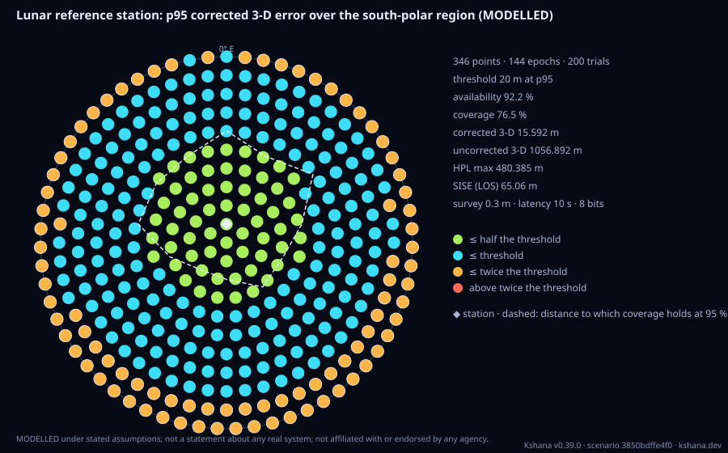

### `lunar-beacon`

Surface-beacon augmentation of a lunar orbital navigation service, as a runnable before/after table. A south-polar user sees a sparse orbital set in a narrow patch of sky, so the ranging geometry is ill-conditioned; a few SURVEYED SURFACE BEACONS supply the low-elevation, wide-azimuth line-of-sight rows an all-overhead set lacks, and the horizontal dilution of precision collapses. The scenario reports three configurations at one epoch — satellites alone, satellites plus the visible beacons, and a larger constellation as the alternative route to the same geometry — each with its visible-source counts, its full DOP, and the realised 1-sigma accuracy in METRES obtained by multiplying through a per-beacon user-equivalent ranging error assembled as the root-sum-square of clock-synchronisation, multipath and survey terms. Beacon visibility is the airless-Moon two-height geometric horizon (no atmosphere, so the bound is exact), and the DOP assembly is the same kernel cross-checked against gnss_lib_py in tests/dop_reference.rs. WHY THIS KIND EXISTS: the module behind it has been in the engine and checked against an independent DOP path since L08/L09, but it was not reachable from a run — no kind, no dispatch arm, no bundled file. The README advertised the capability and the verification matrix carried NO row for it at all, so it was simultaneously claimed in prose and unclaimed in the ledger, while being unreachable in the engine. The defaults are the geometry that already carries a committed golden (a user at -80 deg with a 2 m antenna, three beacons at -80/0, -79/+60 and -79/-60 at 2 km, a six-satellite illustrative LCNS snapshot at t=0, a 5 deg mask), so a bare run reproduces a table an oracle already covers rather than inventing fresh numbers. MODELLED: the constellation design, the beacon placement and every error-budget magnitude are illustrative inputs, not a fielded survey or a measured link; only the DOP arithmetic, the horizon closed form and the sigma = DOP x sigma_URE relation are externally anchored. Not a service-performance commitment.

Required fields: none. Optional: `user`, `beacons`, `n_satellites`, `comparison_n_satellites`, `epoch_s`, `elevation_mask_deg`, `clock_sync_m`, `multipath_m`, `survey_m`.

**Ledger:** MODELLED. Full page, with the inputs, results, evidence and limitations: [lunar-beacon](by-kind/lunar-beacon.md).

```sh
kshana scenarios/lunar-beacon.toml
```


### `lunar-interop-export`

Modelled lunar interoperability export: emits the lunar reference frame, lunar time scale and lunar ephemeris in LunaNet/IOAG-aligned, CCSDS-based interchange forms with round-trip / field conformance. REUSES the crate's CCSDS OEM 2.0 emitter+parser (crate::oem) re-tagged for the lunar context — the OEM REF_FRAME carries the IAU 2015 WGCCRE lunar body frame (MOON_ME / MOON_PA), TIME_SYSTEM the lunar time scale (LTC / TCL / UTC), CENTER_NAME = MOON — over a sample illustrative LCNS-class ephemeris (positions from crate::lunar_service, velocity by finite difference). Also emits a LunaNet/IOAG-aligned lunar-time descriptor (scale id, secular rate µs/day from crate::lunar_time, published band, reference surface) that round-trips via serde_json, and wraps the artifacts in the existing KIF envelope (crate::interchange) with the MODELLED honesty label. Reports artifacts emitted, OEM line count, field-conformance pass + present/missing field list, OEM round-trip ok, time-metadata round-trip ok, and KIF byte size. MODELLED — deterministic round-trip + field-name conformance vs published CCSDS OEM + LunaNet/IOAG field semantics is the oracle; NOT a certified interoperability conformance test; illustrative public-source ephemeris, not affiliated with ESA; no TRL/heritage/agency endorsement.

Required fields: none. Optional: `frame`, `time_system`, `n_states`, `epoch`, `step_min`, `object`.

**Ledger:** no matrix row names this kind; the engine labels its own result. Full page, with the inputs, results, evidence and limitations: [lunar-interop-export](by-kind/lunar-interop-export.md).

```sh
kshana scenarios/lunar-interop-export.toml
```

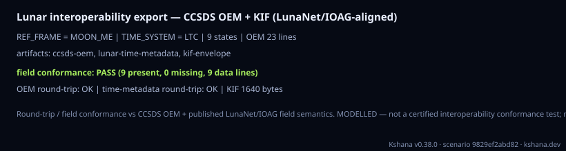

### `cislunar-observability`

MODELLED planar cislunar constellation observability (P6): tracks a four-spacecraft differential-corrected planar-DRO constellation with inter-satellite ranging and reports how much of a spacecraft's four-state [x,y,ẋ,ẏ] the arc makes observable. Emits (1) the rank-vs-arc-length table for a single range-only link — instantaneously rank-1, growing toward the full four-state as the arc extends (P6 Table 1); (2) the observability-Gramian eigen-spectrum + condition number over the arc; (3) the range-only-vs-range+range-rate instantaneous-rank comparison (the Doppler design lever) plus the range-only-singular / range+rate-defined GDOP reporting; and (4) an independent SRIF cross-validation whose posterior covariance turns finite / well-conditioned exactly at the arc where the observable rank reaches four. VALIDATED core: the observable rank is a rank-revealing singular-value threshold cross-checked against the Gramian eigen-rank; the eigen-spectrum obeys the spectral invariants (trace=Σλ, det=Πλ, Frobenius²=Σλ²); the variational STM is the finite-difference-validated CR3BP STM; the range/range-rate Jacobian rows are finite-difference-validated analytic partials (cross-checked against the crate's 3-D range-rate observable); the four initial conditions are differential-corrected planar DROs that close to a tight periodicity residual and are retrograde; the rank transition is cross-validated against the crate's square-root information filter (posterior covariance finite exactly at full rank, cond(P)=cond(OᵀO)); a rank-deficient snapshot is flagged GDOP-undefined (fim condition=inf), never a bogus finite value — the same singular-geometry guard pvt::solve_spp applies. MODELLED: the constellation design (DRO perilune amplitudes and phases) and the specific rank progression it produces. Not a certified navigation-performance product.

Required fields: none. Optional: `mu`, `arc_hours`, `epochs`, `steps`, `rel_tol`, `spatial`, `sigma_range_m`, `family`, `n_spacecraft`, `sigma_pos_threshold_km`.

**Ledger:** MODELLED. Full page, with the inputs, results, evidence and limitations: [cislunar-observability](by-kind/cislunar-observability.md).

```sh
kshana scenarios/cislunar-observability.toml
```

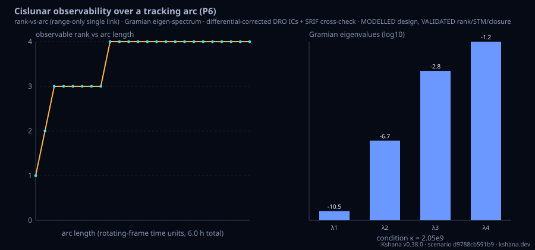

### `cislunar-arc-recovery`

MODELLED independent-estimator test of the cislunar arc-length observability threshold. That threshold is a RANK read on the observability matrix assembled from the ANALYTIC range Jacobian rows and the ANALYTIC variational state-transition matrix, and its square-root-information-filter cross-check folds those same rows — a consistency check between two numerical machines, not corroboration. This kind supplies the missing arbiter: a batch least-squares estimator that actually RECOVERS the chief's initial state from simulated measurements, with the measurement partials taken as CENTRAL FINITE DIFFERENCES of the composed forward model. It calls no analytic Jacobian row, no variational STM, no singular-value or eigen decomposition, no rank tolerance and no square-root information filter — a source-text guard in tests/cislunar_arc_recovery_reference.rs makes that enforceable — while the dynamics (the same RK4 CR3BP flow), the initial conditions (the same differential-corrected constellation), the scalar observable and the epoch grid are shared deliberately and named in the emitted `independence` block, because two analyses of one physical problem must agree about the physics to be comparable. Two criteria, each swept over five decades of its own bound: NOISE-FREE RECOVERY (every seeded trial's final state error at most recovery_factor times its a-priori displacement — the rank analogue, with no singular-value tolerance in it) and MONTE-CARLO ESTIMABILITY (the measured RMS position error over a seeded noise ensemble below a stated bound — the estimability analogue, measured rather than predicted). Supports the planar four-state and the spatial six-state, the DRO / L2 halo / L2 NRHO families, range and range-rate observables, and a Moon-centred polar parameterisation in which the transformation is applied to the STATE and the forward model re-differenced there. MEASURED on the published planar DRO grid: the estimator recovers the four-state from 0.782609 h against the rank criterion's 2.086957 h at rel_tol 1e-6 (ratio 0.375) — the rank threshold is NOT corroborated as a recoverability boundary — while the measured estimability boundary lands in the same grid cell as the formal one, 5.739130 h, and the measured error curve reproduces the formal 1-sigma over 21 arc lengths to a geometric-mean ratio of 0.98. MODELLED: the constellation design, the epoch grid, the single tracked link, the displacement magnitude, the measurement sigma and the two stated bounds. Not a certified navigation-performance product.

Required fields: none. Optional: `mu`, `arc_hours`, `epochs`, `steps`, `spatial`, `family`, `n_spacecraft`, `observable`, `coordinates`, `trials`, `seed`, `displacement_nd`, `recovery_factor`, `sigma_range_m`, `sigma_range_rate_mm_s`, `error_bound_km`, `max_iterations`, `rel_tol`.

**Ledger:** MODELLED. Full page, with the inputs, results, evidence and limitations: [cislunar-arc-recovery](by-kind/cislunar-arc-recovery.md).

```sh
kshana scenarios/cislunar-arc-recovery.toml
```


### `lunar-attack-surface`

Lunar surface-navigation signal-security attack surface (P1): composes the open signal-security analyses into one binary-reachable run. Reports (1) the AFS received power and its power SURPLUS versus a terrestrial GPS reference, plus the 12-18 dB sensitivity band as a genuine multi-axis sweep over the link inputs (reference level x EIRP x slant range) with the 25x-rounded / 28x-unrounded linear-factor reconciliation. REVISED (rule R4): this reported a 15.6 dB power DEFICIT and a 32x/36x factor until the GPS reference was corrected from -125 / -128.5 (which are the dBm figures) to -155 / -158.5 dBW, the ICD-GPS-200 values the jamming module has always carried. The sign inverts: the modelled lunar AFS signal is 14.4 dB STRONGER than terrestrial GPS L1 C/A, not weaker. The received power itself did not move by a bit, and the linear factor is the old one over exactly 1000, which is exactly the 30 dB dBm-to-dBW offset; (2) the required attacker transmit power to spoof (J/S = 3 dB) and to deny (J/S = 30 dB) at each standoff, the inverse of the J/S link; (3) the orbital capture footprint under a real uniform-aperture antenna pattern (Airy [2 J1(x)/x]^2), an altitude-limited sub-hemispheric cap whose limb is NOT captured; (4) a computed tracking-loop spoof-capture pull-in outcome (does a matched-code spoofer at a given power advantage and code offset actually drag the DLL/PLL) rather than the asserted 3 dB threshold; (5) the airless-body geometric horizon reach of a raised surface transmitter; and (6) the OSNMA/TESLA authentication budget (20 bit/s overhead = ~40 % of a 50 bit/s AFS nav message, key-disclosure latency, 2^-40 forgery). An empty body reproduces the P1 baseline; every input is defaulted and overridable. VALIDATED sub-results carry their source module's oracle (closed-form dB radiometry; inverse-J/S round trip; Airy pattern vs A&S Bessel and spherical-cap geometry; DLL/PLL pull-in vs Kaplan & Hegarty; spherical-tangent horizon identity vs eo_payload; OSNMA SIS-ICD field sizing). MODELLED: the representative geometry/power magnitudes and the specific capture-map cell values. Not a certified security product.

Required fields: none. Optional: `afs_eirp_dbw`, `user_gain_dbi`, `slant_range_m`, `slant_range_max_m`, `carrier_hz`, `gps_reference_dbw`, `gps_reference_min_dbw`, `afs_isotropic_signal_dbw`, `transmitter_altitude_m`, `transmitter_power_dbw`, `antenna_diameter_m`, `footprint_grid`, `spoof_power_advantage_db`, `spoof_code_offset_chips`, `attacker_gain_dbi`, `spoof_capture_js_db`, `jam_denial_js_db`, `standoffs_m`, `mast_height_m`, `user_antenna_height_m`, `footprint_altitude_min_m`, `footprint_altitude_max_m`, `footprint_altitude_steps`, `footprint_altitude_scale`, `footprint_diameter_min_m`, `footprint_diameter_max_m`, `footprint_diameter_steps`, `footprint_diameter_scale`.

**Ledger:** no matrix row names this kind; the engine labels its own result. Full page, with the inputs, results, evidence and limitations: [lunar-attack-surface](by-kind/lunar-attack-surface.md).

```sh
kshana scenarios/lunar-attack-surface.toml
```

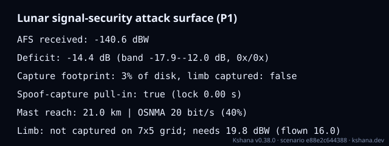

### `lunar-jamming`

Lunar-native RF jamming: per-satellite jammer-to-signal ratio, effective C/N₀ and loss of lock for a selenographic surface user under a lunar surface (or raised) jammer, over the illustrative public-source Moonlight/LCNS-class lunar-orbit constellation. Composes the existing open jamming physics (jamming::j_over_s_db, effective_cn0_dbhz, rx_antenna_gain_db, lock_status, q_factor) with the existing lunar sky geometry (lunar_service::LunarConstellation + topocentric, lunar::selenographic_to_mcmf); no geometry or radiometry is re-derived. Unlike the Earth `jamming` kind, the signal leg is NOT a fixed received power: each satellite's isotropic received power is its own link budget EIRP − FSPL(slant range), so the J/S varies satellite by satellite with lunar range and elevation. Reports ONE ROW PER VISIBLE (epoch, satellite) LINK — azimuth, elevation, slant range, both received powers the J/S is the difference of, the J/S, the nominal and effective C/N₀ and the lock status — plus aggregate figures of merit beside (never in place of) that table, and the same table as a CSV artifact. Every emitted numeric field carries a unit and a provenance class. VALIDATED sub-results carry their source module oracle (the anti-jam equation and J/S link of Kaplan & Hegarty §9.4, externally referenced in tests/gnss_denied_jamming_resilience_reference.rs; the lunar geometry of lunar_service). The composition itself is cross-checked against an independent two-link-budget path (linkbudget::received_signal_power_dbw, a different free-space-loss expression) to 1e-9 dB. MODELLED: the illustrative constellation, the representative EIRP / jammer power / antenna gains / noise temperature, and the absence of terrain shadowing, multipath, AGC dynamics and adaptive nulling. Not a certified denial-of-service product. With a jammer configured the report also carries a DENIAL CONTOUR WITH AN UNCERTAINTY BAND rather than a contour read off one scalar: the full measured wanted-signal C/N₀ distribution over the per-satellite table (n, min, p05, p25, median, p75, p95, max, mean, sample stdev, and the sample's own asymmetry), and the contour evaluated at each of those order statistics under BOTH denial criteria the engine recognises — the incumbent power-ratio one (J/S = 30 dB, as in attack-surface and tracking-loop) and the loss-of-lock one (effective C/N₀ falling to tracking_threshold_dbhz, the criterion this report's own status column uses) — on both axes of the denial plane (required jammer EIRP at the scenario standoff, denial standoff at the scenario EIRP). The band edges ARE contour(p05) and contour(p95), the same closed-form map applied to the sample's own quantiles: not a sigma fitted to the sample and not median ± k·stdev, with stdev emitted for continuity and used by nothing. A quantile already at or below the tracking threshold has no finite denying J/S and its loss-of-lock columns are null with a counted reason, never a clamped radius.

Required fields: none. Optional: `n_sats`, `sma_km`, `eccentricity`, `inc_deg`, `argp_deg`, `site_lat_deg`, `site_lon_deg`, `site_alt_m`, `horizon_hours`, `step_min`, `elev_mask_deg`, `sat_eirp_dbw`, `carrier_hz`, `chip_rate_hz`, `user_boresight_gain_dbi`, `temp_k`, `tracking_threshold_dbhz`, `degraded_margin_db`, `jammer`.

**Ledger:** MODELLED. Full page, with the inputs, results, evidence and limitations: [lunar-jamming](by-kind/lunar-jamming.md).

```sh
kshana scenarios/lunar-jamming.toml
```

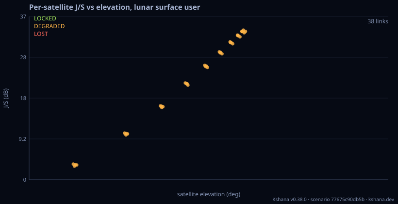

### `earth-gnss-lunar`

Earth-GNSS reception at lunar distance, the weak-signal layer the conflict-resilience paper names and the engine had no model for. A GNSS satellite points its antenna at the Earth; a receiver near the Moon sits about fifteen times the orbital radius away, so three things bite at once. The Earth OCCULTS THE BORESIGHT: from 26,560 km it subtends a 13.9 deg half-angle, so any lunar-bound ray must leave the transmitter at least that far off nadir, which removes the peak of the beam before any power is computed. What remains is the MAIN-LOBE EDGE AND THE SIDELOBES, the regime the LuGRE payload actually operated in during 2025. And the free-space loss is about 208 dB at L1, roughly 25 dB more than a terrestrial user pays. The report emits one row per satellite (off-boresight angle, Earth occultation, range, path loss, transmit gain at that angle, received power, carrier-to-noise density) and aggregates only the links clearing the tracking threshold. IT ALSO REPORTS THE CONDITIONING, because that is what defines this layer: every visible satellite lies inside a cone a couple of degrees wide as seen from the Moon, so the lines of sight are nearly parallel, the dilution of precision is enormous, and an Earth-GNSS fix at lunar distance is a TIMING-grade observation far more than a position-grade one. MODELLED, and the transmit pattern is the reason: the gain at angle is a uniform circular aperture (Airy), while a real GPS L1 antenna is a twelve-element helical array with a shaped main lobe and non-Airy sidelobes. Measured patterns exist and are not vendored here, so orderings and orders of magnitude are meaningful while the dB of any single satellite is not. Deliberately ABSENT, each making the budget optimistic: no ionospheric or tropospheric loss on the limb-grazing rays, no polarisation, pointing or implementation loss, and a spherical Earth with no refractive extension. The Moon position is an INPUT (range plus inertial direction) rather than an ephemeris lookup, because the quantity under test is the link and the beam geometry. Upgrading this row to Validated needs a measured transmit pattern and LuGRE normal points; neither is in the repository and neither is invented here.

Required fields: none. Optional: `altitude_km`, `inclination_deg`, `planes`, `sats_per_plane`, `phasing_f`, `epoch_s`, `receiver_range_m`, `receiver_ra_deg`, `receiver_dec_deg`, `tx_power_dbw`, `tx_diameter_m`, `tx_efficiency`, `freq_hz`, `rx_gain_dbi`, `system_temp_k`, `tracking_threshold_dbhz`, `back_lobe_suppression_db`, `epochs`, `span_s`.

**Ledger:** MODELLED. Full page, with the inputs, results, evidence and limitations: [earth-gnss-lunar](by-kind/earth-gnss-lunar.md).

```sh
kshana scenarios/earth-gnss-lunar.toml
```

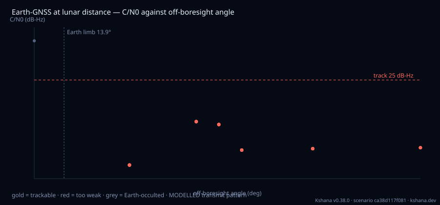

### `lunar-infrastructure`

MODELLED studies of the Moon's orbit and surface as navigation and geodetic infrastructure, five studies behind one kind selected by `study`: od-consistency (onboard Earth-GNSS orbit determination in an NRHO or ELFO against independent ground radiometric orbit determination, judged by their own covariances over a seeded Monte Carlo), carrier-phase (joint surface-orbiter double-differenced carrier phase and integer ambiguity resolution with LAMBDA), frame-coestimation (a surface station and orbiters added to Earth-station ranging for the seven-parameter lunar frame datum), space-tie (GNSS, VLBI and laser ranging on one spacecraft, frame-tie precision against the local-tie error) and geodesy-sensitivity (Fisher information of the lunar Love numbers h2, k2, l2 and the physical libration from laser ranging, orbiter tracking, a surface gravimeter and a surface clock). A restricted three-body model with stated simplifications; the numerics are checked against independent programs and nothing is compared with a measurement of a lunar quantity.

Required fields: `study`. Optional: `seed`, `orbit`, `gnss`, `ground`, `monte_carlo`, `surface`, `llr`, `orbiter`, `gravimeter`, `clock`, `techniques`, `nominal`.

**Ledger:** no matrix row names this kind; the engine labels its own result. Full page, with the inputs, results, evidence and limitations: [lunar-infrastructure](by-kind/lunar-infrastructure.md).

```sh
kshana scenarios/lunar-infrastructure-space-tie.toml
```

no plot: the example writes no chart
