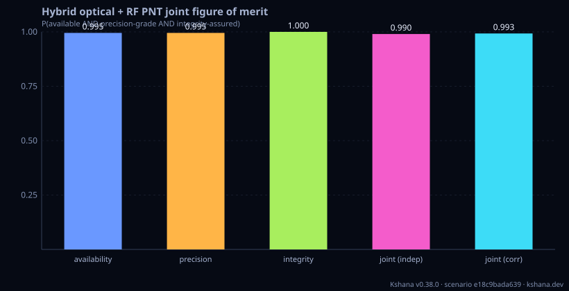

<!-- SPDX-License-Identifier: AGPL-3.0-only -->
<!-- Generated by tools/gen_kinds_index.py. Do not edit by hand. -->
# Optical PNT

2 scenario kinds of the engine v0.38.0. Advisory: analysis output from a research and engineering tool, not type-approved navigation equipment and not a safety-of-life service. Every label here is the engine's or the verification matrix's; a kind is MODELLED unless the matrix says otherwise (how a label is earned: the README's Evidence section).

Topic pages: [OPTICAL-ATMOSPHERE](../OPTICAL-ATMOSPHERE.md). Run one: `kshana scenarios/optical-atmosphere-network.toml`. All families: [KINDS.md](../KINDS.md).


| Kind | What it does | Ledger |
|---|---|---|
| [`optical-atmosphere`](by-kind/optical-atmosphere.md) | MODELLED optical PNT through the atmosphere: for an optical link and a set of ground sites with stated cloud climates it reports the wavelength- and elevation-dependent clear-air loss (Kim visibility  | MODELLED |
| [`hybrid-optical-rf`](by-kind/hybrid-optical-rf.md) | MODELLED heterogeneous optical + RF PNT joint figure of merit (P5): composes the 1550 nm two-way optical link budget (photon-limited two-way ranging CRLB σ_τ/√N and diffraction footprint λ/D·range), a | HETEROGENEOUS (result label) |

### `optical-atmosphere`

MODELLED optical PNT through the atmosphere: for an optical link and a set of ground sites with stated cloud climates it reports the wavelength- and elevation-dependent clear-air loss (Kim visibility law plus Rayleigh), the Hufnagel-Valley turbulence state (Rytov variance, scintillation index, gamma-gamma parameters, aperture averaging), the weather-driven availability against the link margin (cloud optical depth from a log-normal liquid-water climate, geometric-optics extinction, independent turbulence fade), the link margin needed for target availabilities, the outage-duration distribution, the timing and ranging error growth per outage through the clock holdover model, distance-correlated site-diversity availability, and what-if gains for enhancement techniques (wavelength, receive aperture, adaptive-optics scintillation reduction, extra margin). VALIDATED as implementation of the stated formulas against an independent mpmath oracle: Rytov variance, scintillation index, gamma-gamma fade probability, aperture-averaging factor, cloud and clear-air optical depth. MODELLED: every weather, technique and clock input and the independence and copula assumptions; no measured availability record has been compared. Advisory analysis, not a certified availability or navigation product.

Required fields: none. Optional: `wavelength_nm`, `elevation_deg`, `availability_targets_pct`, `link`, `atmosphere`, `site`, `network`, `technique`, `clock`, `timeseries`.

**Ledger:** MODELLED. Full page, with the inputs, results, evidence and limitations: [optical-atmosphere](by-kind/optical-atmosphere.md).

```sh
kshana scenarios/optical-atmosphere-network.toml
```


### `hybrid-optical-rf`

MODELLED heterogeneous optical + RF PNT joint figure of merit (P5): composes the 1550 nm two-way optical link budget (photon-limited two-way ranging CRLB σ_τ/√N and diffraction footprint λ/D·range), a cross-modality solution-separation RAIM protection level (position AND timing) that fuses the loose RF and tight optical solutions with disparate covariances, the N-station optical clear-sky availability (independent-union 1−Π(1−a_i) and a spatially-correlated variant), an optical↔RF state/covariance handoff with a PROVEN bit-continuous (no-jump) mean and a NEES χ² consistency gate, and a joint P(available AND precision-grade AND integrity-assured) score with correlation handling. VALIDATED closed form: the ranging CRLB, diffraction footprint, χ² protection-level quantile, union combinatorics, handoff mean-continuity + NEES gate, and the joint independent product. MODELLED: the optical loss allocations, RF/optical σ magnitudes, cloud-climatology inputs, correlations, and P_HMI budget. Not a certified availability/integrity product.

Required fields: none. Optional: `wavelength_nm`, `tx_power_w`, `tx_aperture_m`, `rx_aperture_m`, `range_km`, `pulse_rms_ps`, `integration_s`, `atmospheric_loss_db`, `pointing_loss_db`, `optics_efficiency`, `detector_efficiency`, `two_way`, `rf_pos_sigma_m`, `rf_vertical_sigma_m`, `rf_clock_sigma_s`, `p_fa`, `p_md`, `alert_limit_h_m`, `alert_limit_v_m`, `alert_limit_t_s`, `grade_pos_m`, `grade_time_s`, `n_optical_sites`, `site_correlation`, `fom_correlation`, `handoff_inflation`, `p_hmi`, `fault_ramp_rate_pos_m_s`, `fault_ramp_rate_clock_s_s`, `process_noise_pos_psd_m2_s`, `process_noise_clock_psd_s2_s`, `coast_coverage_k`, `rf_band`, `rf_eirp_dbw`, `rf_g_over_t_db`, `rf_other_losses_db`, `rf_data_rate_bps`, `rf_required_eb_n0_db`, `rf_chip_rate_hz`, `rf_correlator_spacing_chips`, `rf_dll_bandwidth_hz`, `rf_tracking_threshold_dbhz`, `rf_degraded_margin_db`.

**Ledger:** no matrix row names this kind; the engine labels its own result. Full page, with the inputs, results, evidence and limitations: [hybrid-optical-rf](by-kind/hybrid-optical-rf.md).

```sh
kshana scenarios/hybrid-optical-rf.toml
```


