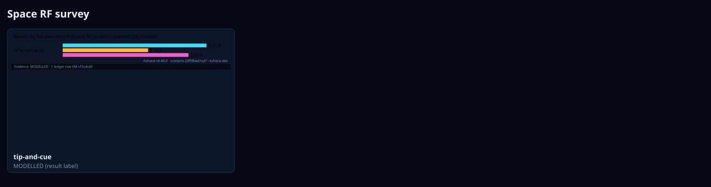
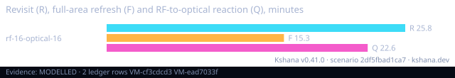

<!-- SPDX-License-Identifier: AGPL-3.0-only -->
<!-- Generated by tools/gen_kinds_index.py. Do not edit by hand. -->
# Space RF survey

1 scenario kind of the engine v0.40.0. Advisory: analysis output from a research and engineering tool, not type-approved navigation equipment and not a safety-of-life service. Every label here is the engine's or the verification matrix's; a kind is MODELLED unless the matrix says otherwise (how a label is earned: the README's Evidence section).

Topic pages: [TIP-AND-CUE](../TIP-AND-CUE.md). Run one: `kshana scenarios/tip-and-cue-baltic-m2.toml`. All families: [KINDS.md](../KINDS.md).



| Kind | What it does | Ledger |
|---|---|---|
| [`tip-and-cue`](by-kind/tip-and-cue.md) | MODELLED revisit and tip-and-cue latency of a two-layer maritime survey over the Baltic Sea: an RF survey layer and an optical layer, each a Walker star pattern of 550 km sun-synchronous orbits propag | MODELLED (result label) |

### `tip-and-cue`

MODELLED revisit and tip-and-cue latency of a two-layer maritime survey over the Baltic Sea: an RF survey layer and an optical layer, each a Walker star pattern of 550 km sun-synchronous orbits propagated with the secular J2 drift on a spherical Earth, with an elevation mask for the RF layer and an off-nadir field of regard (and optionally daylight) for the optical layer. Reports R, the area-weighted mean gap between RF accesses per point; F, the mean wait until every sea point has been in view; and Q, the mean wait from an RF access to an optical look, each with its median, 95th percentile and largest value. Geometry and timing only: no detection, weather or tasking latency. A cross-check of published simulation figures, never a validation.

Required fields: none. Optional: `kind`, `title`, `seed`, `area`, `step_s`, `span_days`, `m2`, `cases`.

**Ledger:** no matrix row names this kind; the engine labels its own result. Full page, with the inputs, results, evidence and limitations: [tip-and-cue](by-kind/tip-and-cue.md).

```sh
kshana scenarios/tip-and-cue-short.toml
```


